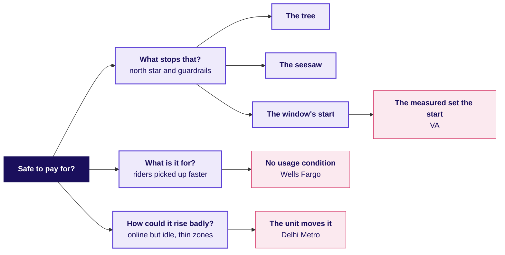

# What makes a number safe to pay for?

*Illustrative case: the company is real, the situation and the data are synthetic, built for this class.* Uber, Hyderabad, the driver app. From 31 August 2026 an enrolled driver online through a whole peak window is guaranteed Rs 300 per peak online hour, with a top-up for the gap. Six weeks each side: peak online hours 118,000 to 146,300 (up 24 percent), trips 224,200 to 230,900 (up 3 percent), trips per peak online hour 1.90 to 1.58, offers accepted 0.86 to 0.73, median wait 4.8 to 4.6 minutes, top-up Rs 0 to Rs 1.9 crore. Data: `drivers`, `driver_weeks`, `zone_weeks`. Ask, due Friday: is it working, what should it pay for, is anyone gaming it? Caveats: monsoon's end, 140 new drivers, online means the app is open, three thin outer zones, drivers on two apps.

## Panel 1: What makes a number safe to pay for?

**Crux:** Pay for completed peak trips per enrolled driver online at peak, guarded by acceptance, the rider's wait and the top-up per trip; hours rose 24 percent while trips per hour fell from 1.90 to 1.58.

## Panel 2: What did six drivers do, counted by hand?

| Driver, zone | Hours, week of 10 Aug then 21 Sep | Trips, the same two weeks |
|---|---|---|
| A, Jubilee Hills | 10 then 11 | 21 then 22 |
| B, Banjara Hills | 9 then 10 | 17 then 18 |
| C, Gachibowli | 11 then 12 | 22 then 23 |
| D, Madhapur | 10 then 11 | 19 then 20 |
| E, Shamshabad | 10 then 16 | 18 then 3 |
| F, Rajendranagar | 10 then 14 | 17 then 2 |
| All six | 60 then 74, up 23 percent | 114 then 88, down 23 percent |

**Crux:** 114 / 60 = 1.90 and 88 / 74 = 1.19: add the trips, add the hours, divide once. Two of six sit in the idle tail against 15 percent of the city, so the city falls less, to 1.58.

## Panel 3: What are the seven lines of a complete definition?

| Line | In plain words | The redesign |
|---|---|---|
| Numerator | What is counted | Peak trips completed, one per paying rider |
| Denominator | Divided by, count printed | Enrolled drivers online one peak hour or more |
| Window | The stretch of time | The calendar week |
| Exclusions | Left out, with why | Cancelled trips, test accounts, off-window trips |
| Does not reward | Behaviour paid nothing | Hours online, declines, a shrinking base |
| Guardrails | Must not get worse | Accepted share over a floor; median wait; top-up per trip |
| Gaming note | What each guardrail catches | Declining; lost supply; a runaway top-up |

**Crux:** The first four lines make a number computable; the last three make it hard to game. North star 35.76 to 35.89 trips per online driver-week.

## Panel 4: What is the proxy test?

Could a team hit this number while the thing it stands for got worse?

| Proposed number | How it rises badly | The guardrail |
|---|---|---|
| Peak online hours | Online in empty zones | Hours with no trip: 0.22 to 0.38 |
| Completed trips per driver | Short trips only | Offers accepted, over a floor |
| Enrolled drivers | Sign up, never drive | Share online at peak |

**Crux:** A guardrail is chosen by the gaming it catches; another growth count catches nothing.

## Panel 5: What did hours cost, and what would the redesign save?

**Rs 1.159 crore**, 61 percent of the top-up, went to driver-weeks that accepted under half their offers: 180 idle drivers, hours 2.1 times, trips down 12 percent. A floor between 0.46 and 0.78 stops it.

**Crux:** Saving Rs 58 lakh to Rs 92.7 lakh if a fifth to a half is still paid: an assumption with a range, settled by a test.
