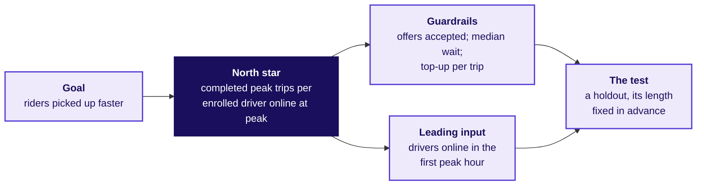

# How does a strong candidate answer "how would you measure the success of a new feature?"

*Written for this programme in the style of product-company and GCC screens; the facts inside are from the case file. Illustrative case: the company is real, the situation and the data are synthetic, built for this class.*

**Who needs the answer.** You, in a product or analytics screen, where this question is a staple and
the interviewer is listening for structure before any number. The same structure answers the city
head's ticket: is the peak-hour guarantee working, what should it pay for, and is anyone gaming it?

**The questions on the way.** What does the interviewer ask, word for word? What does a strong
candidate ask first? What structure comes before any number? Which trap is the interviewer setting?
How do a weak and a hire-grade answer compare? Which follow-ups come next? How does the same question
move to an AI coding assistant? How does a candidate settle three teams who each want their own
target?

---

## What does the interviewer ask, word for word?

> **Interviewer:** "Uber launched a peak-hour earnings guarantee for drivers in one city six weeks
> ago. How would you measure whether it is a success?"

The question is tagged **[S]**: a staple asked everywhere, in this programme's calibration for 0 to 3
year candidates in the Indian market.

---

## What does a strong candidate ask before any number?

> **Candidate:** "Before I pick a metric, three things. What was the guarantee meant to change: more
> drivers online, or riders picked up faster? Who is in it: every driver, or drivers who enrolled?
> And what would count as harm: riders waiting longer, or the top-up running past its budget?"
>
> **Interviewer:** "The launch note says more drivers on the road at peak, so riders are picked up
> faster. Enrolled drivers only. It guarantees Rs 300 per peak online hour and tops up the gap.
> Finance cares about the top-up; the city head cares about riders."
>
> **Candidate:** "Then the goal is riders served faster at peak, and online hours are a means to it.
> I will treat hours as a proxy until I see whether they bought any service."

---

## What structure comes before any number?

> **Candidate:** "Here is how I would lay it out, and then I would like to see the numbers. The goal
> is faster pickups at peak. The users are enrolled drivers and riders at peak. The primary metric is
> completed peak trips per enrolled driver online at peak, per week: the numerator is trips completed
> inside the peak windows, the denominator is enrolled drivers online at least one peak hour that
> week, with that count shown, and the window is the calendar week. Two guardrails: the share of
> offers drivers accept, so nobody is paid for declining, and the median rider wait at peak, so
> riders are not worse off. One leading input: drivers online in the first peak hour. Finance's
> top-up per completed trip sits beside them. And I would test any change with a holdout, with the
> length of the test fixed before it starts."

---

## Which trap is the interviewer setting?

> **Interviewer:** "Six weeks in, peak online hours are up 24 percent. Is it working?"

The trap is a candidate who hears "up 24 percent", names online hours as the success metric, and
stops. Online hours count an open app, and the guarantee paid for exactly that.

---

## How do a weak and a hire-grade answer compare?

| Beat | Weak answer | Hire-grade answer |
|---|---|---|
| Clarify | Starts on metrics at once | Asks what the scheme is for, who is in it and what counts as harm |
| Structure | Lists hours, satisfaction and a survey | Goal, one north star with numerator, denominator and window, guardrails, a leading input, the test |
| The number | "Hours are up 24 percent, so it works" | "Hours rose 24 percent; what did trips per online hour and the wait do?" |
| The paradox | Not seen | Trips per peak online hour fell from 1.90 to 1.58 while the wait barely moved, 4.8 to 4.6 minutes |
| The segment | None | 180 drivers, 15 percent, made under one trip an hour; 72 percent of their new hours sat in the three outer zones |
| The cost | None | Rs 1.159 crore, 61 percent of the Rs 1.9 crore top-up, went to driver-weeks that accepted fewer than half their offers |
| The decision | "Roll it out to more cities" | Hold the extension; pay the floor for completed peak trips with an acceptance floor; test it first |
| What would change it | Nothing | If the outer zones' riders waited less because idle drivers sat there, part of the hourly floor bought something |

---

## How does the hire-grade candidate think aloud?

> **Candidate:** "Hours are the input, so before I call it, two numbers: trips per peak online hour,
> and the rider's wait."
>
> **Interviewer:** "Trips per peak online hour went from 1.90 to 1.58. The median wait went from 4.8
> to 4.6 minutes."
>
> **Candidate:** "So hours rose a quarter and the output per hour fell by about a sixth, while riders
> waited about as long. Requests could explain it if riders asked for fewer trips, so I would check
> demand. If demand held, I would split the drivers: who added the hours?"
>
> **Interviewer:** "Requests rose 1.8 percent. 180 drivers, about 15 percent, made fewer than one
> trip per online hour after the launch, and most of their new hours were in three outer zones with
> few riders. The other drivers who were there before the launch held 1.90."
>
> **Candidate:** "Then the scheme paid for an open app, and a slice of drivers sold it one. I would
> size it: what share of the top-up went to weeks where drivers declined most offers?"
>
> **Interviewer:** "61 percent of Rs 1.9 crore."
>
> **Candidate:** "About Rs 1.16 crore in six weeks. So my answer: it is not a success on the goal it
> was launched for. I would not extend it. I would pay the floor for completed peak trips, with a
> floor on the share of offers accepted, and test that rule against the current one before any new
> city. What would change my mind: if riders in the outer zones waited less because those drivers
> sat there, some of those hours bought service, and I would keep part of the hourly floor there."

---

## Which follow-ups come next, and what does a strong answer say?

| Follow-up | A hire-grade answer in one breath |
|---|---|
| "Online hours rose 24 percent; what do you check before you celebrate?" | "Trips per online hour and the rider's wait, then demand, then who added the hours: 1.90 to 1.58, 4.8 to 4.6 minutes, requests up 1.8 percent, 180 drivers under one trip an hour." |
| "Which guardrail would driver operations argue against, and why are they partly right?" | "The acceptance floor: some declines are fair, a long trip at the end of a shift for one. So the floor sits in the gap the data shows, above the idle tail's highest week, 0.46, and below everyone else's lowest, 0.78." |
| "The measured drivers control when they log in; what happens to your number?" | "Logging in alone cannot raise it, because the numerator is completed trips and each one starts with a rider's request; the denominator counts a driver once, whatever the hours, and its count sits beside the rate." |

---

## How does the same question move to an AI coding assistant?

This variant is written for the programme and names no company figure.

> **Interviewer:** "Your team ships an AI coding assistant. Sales quotes the share of suggestions
> developers accept. How would you measure whether the assistant is a success?"
>
> **Candidate:** "First, what is it for: developers shipping working code faster. Accepted
> suggestions are a proxy, like online hours: a developer can accept a short suggestion and delete
> it a minute later. So the outcome I would count is suggested text still in the code at the next
> commit, per active developer per week. The guardrails are build failures and the revert rate, so
> kept code is also working code, and time to merge, so review is not slowed. Acceptance stays as a
> leading input, never the target. The gaming I would watch is short suggestions accepted and
> deleted. And I would test it with a holdout of users, its length fixed before it starts."

| Line | The earnings guarantee | The AI coding assistant |
|---|---|---|
| The gamed proxy | Peak online hours | Suggestions accepted |
| North star | Completed peak trips per enrolled driver online at peak, per week | Suggested text still in the code at the next commit, per active developer, per week |
| Guardrails | Offers accepted; median rider wait; top-up per trip | Build failures; revert rate; time to merge |
| Leading input | Drivers online in the first peak hour | Acceptance, kept as an input and never the target |
| The gaming | Online with the app open, declining | Short suggestions accepted, then deleted |
| How it is settled | A test of the redesign | A holdout of users |

---

## How does a candidate settle three teams who each want their own target?

The question is tagged **[D]**: a differentiator, the one that separates candidates who can hold a
room from candidates who can compute.

> **Interviewer:** "Driver operations wants online hours as the scheme's target. Marketing wants
> enrolled drivers. Finance wants top-up per trip. Each wants its own number. How do you get to one,
> and what do you say to the two who lose?"

**What a strong candidate asks first.** What is the scheme for, and which decision will the number
drive: the payout rule, the budget, or the city's review? And what does each team need to see to do
its own job?

**The structure.** Tie the one number to the scheme's goal, then give every other team's number a
named place: a guardrail, an input or a diagnostic, with the decision it drives.

**The trap.** Giving each team its own target, or averaging the three into a score nobody can act
on.

| Beat | Weak answer | Hire-grade answer |
|---|---|---|
| Clarify | "Which team is right?" | "What is the scheme for, and what does each team need to see to do its job?" |
| The call | Gives each team its own target | One north star tied to the goal: completed peak trips per enrolled driver online at peak |
| The two who lose | Promises to revisit next quarter | Shows where each number now lives: hours beside trips per online hour as supply's diagnostic, enrolled drivers as the denominator's printed count, top-up per trip as guardrail 3 |
| The evidence | None | Hours rose 24 percent while trips per online hour fell from 1.90 to 1.58, so hours cannot be the target |
| What would change it | Nothing | "If the wait rose while the north star held, I would revisit the acceptance floor" |

> **Candidate, to the two who lose:** "Your number stays on the page, and it has a job. Finance, top-up
> per completed trip is a guardrail read every week; if it climbs while trips do not, the rule is
> paying for the wrong thing again, and you will see it first. Marketing, enrolled drivers is printed
> beside the rate every week, and sign-ups are a leading input; if the base shrinks, the rate cannot
> hide it."

| Follow-up | A hire-grade answer in one breath |
|---|---|
| "Driver operations says hours are what they control. Why not pay for those?" | "They control hours, and the guarantee proved hours can rise with no service: 180 drivers added hours and lost trips. Their input is drivers online in the first peak hour, which moves before trips do." |
| "Finance says the budget is all that matters." | "The budget is guardrail 3, top-up per completed trip, and it was Rs 82.3 after the launch; a target of spend alone would be met by paying nobody, and riders would wait." |
| "What if the teams still disagree after your answer?" | "The city head decides, from one page: the north star, the guardrails each team owns, and the test that would show who was right." |
