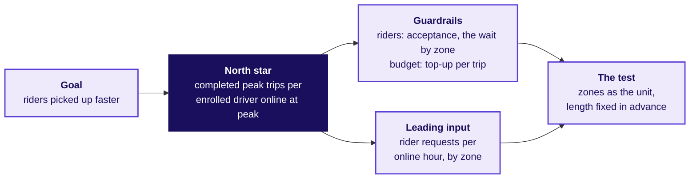

# How does a strong candidate answer "how would you measure the success of a new feature?"

*Written for this programme in the style of product-company and GCC screens; the facts inside are from the case file. Illustrative case: the company is real, the situation and the data are synthetic, built for this class.*

**Who needs the answer.** You, in a product or analytics screen, where this question is a staple and
the interviewer is listening for structure before any number. The same structure answers the city
head's ticket: is the peak-hour guarantee working, what should it pay for, and is anyone gaming it?

**The questions on the way.** What does the interviewer ask, word for word? What does a strong
candidate ask first? What structure comes before any number? Which trap is the interviewer setting?
How do a weak and a hire-grade answer compare? Which seven checks does a pair tick? How does the
hire-grade candidate think aloud? Which follow-ups come next, and which harder ones? How does the
same question move to an AI coding assistant? How does a candidate settle three teams who each want
their own target?

---

## What does the interviewer ask, word for word?

> **Interviewer:** "Uber launched a peak-hour earnings guarantee for drivers in one city six weeks
> ago. How would you measure whether it is a success?"

The question is tagged **[S]**, a staple in this programme's calibration for 0 to 3 year candidates in
the Indian market. A GCC, a company's own technology and analytics centre in India, asks it as often
as a product company does.

---

## What does a strong candidate ask before any number?

> **Candidate:** "Before I pick a metric, a few things. What was the guarantee meant to change: more
> drivers online, or riders picked up faster? Who is in it? What would count as harm: riders waiting
> longer, or the top-up running past its budget? What decision rides on my answer: continue, change
> or extend it? And against what: the six weeks before, or a city without the scheme?"
>
> **Interviewer:** "The launch note says more drivers on the road at peak, so riders are picked up
> faster. Every driver in the city's tables enrolled. It guarantees Rs 300 per peak online hour and
> tops up the gap. Finance cares about the top-up; the city head cares about riders and is deciding
> whether to extend it to two more cities. Compare with the six weeks before; there is no comparison
> city."
>
> **Candidate:** "Then the goal is riders served faster at peak, and online hours are a means to it.
> I will treat hours as a proxy until I see whether they bought any service, and with no comparison
> city I will need an argument for cause."

---

## What structure comes before any number?

> **Candidate:** "Here is how I would lay it out, and then I would like the numbers. The goal is
> faster pickups at peak. The users are enrolled drivers and riders at peak. The north star, the one
> number I would judge the scheme by, is completed peak trips per enrolled driver online at peak,
> per week: trips completed inside the peak windows, over enrolled drivers online at least one peak
> hour that week with that count printed beside it, over the calendar week. It says whether each
> paid driver works. It does not say whether riders gained, and it would rise if drivers quit, so I
> read it with three guardrails: for riders, the share of offers drivers accept, with the share they
> accept and then cancel beside it, and the rider's wait at peak, zone by zone; for the budget, the
> top-up per completed trip. One leading input: rider requests per online hour, by zone, which tells
> the city where to send drivers. And I would test any change with zones as the unit, since drivers
> in one zone compete for the same riders, with its length and its metrics fixed before it starts."

---

## Which trap is the interviewer setting?

> **Interviewer:** "Six weeks in, peak online hours are up 24 percent. Is it working?"

The trap is a candidate who hears "up 24 percent", names online hours as the success metric, and
stops. Online hours count an open app, and the guarantee paid for exactly that.

---

## How do a weak and a hire-grade answer compare?

| Beat | Weak answer | Hire-grade answer |
|---|---|---|
| Clarify | Starts on metrics at once | Asks what the scheme is for, who is in it, what counts as harm, which decision rides on it, and against what |
| Structure | Lists hours, satisfaction and a survey | Goal, one north star with its lines, three guardrails, a leading input, and the test with its unit |
| The number | "Hours are up 24 percent, so it works" | "Hours rose 24 percent; what did trips per online hour, the wait and my north star do?" |
| The paradox | Not seen | Trips per peak online hour fell from 1.90 to 1.58, the city's wait barely moved (4.8 to 4.6 minutes) and the north star barely moved (35.76 to 35.89) |
| The cause | None | The rate stepped down in the launch week itself, from 1.88 to 1.64, while weekly requests stayed between about 41,000 and 44,000: a season drifts, and this stepped on the launch date |
| The segment | None | 180 drivers, 15 percent, made under one trip an hour; 72 percent of their new hours sat in the three outer zones |
| The zones | None | Outer-zone waits fell from 6.6 to 5.95 minutes, about 185 extra trips there, at about Rs 46,000 a trip |
| The cost | None | Rs 1.9 crore bought 6,700 more peak trips, about Rs 2,836 each, 17 times the Rs 165 fare; Rs 1.159 crore went to driver-weeks that accepted under half their offers |
| The decision | "Roll it out to more cities" | Hold the extension; keep the floor only for driver-weeks that accept at least half their offers, an accepted trip later cancelled counting as declined; test it by zone first |
| What would change it | Nothing | If, without the hourly floor, outer-zone waits went back up to 6.6 minutes, keep a smaller floor in those three zones only |

## Which seven checks does a pair tick for each answer?

Read both answers in the table above and tick each check yes, partly or no for each. Then hear the
trainer's reading and compare it with yours.

| Check | What a full yes sounds like |
|---|---|
| Clarified scope | The answer asks what the scheme is for, who it serves and what counts as harm, then uses what it heard. |
| Named the denominator and window | The answer says aloud what the number is counted per and over which period. |
| Saw the paradox | The answer names, with numbers, the paid number rising while the thing it stands for did not. |
| Sized it with a unit | The answer gives a size with its unit and its base, such as rupees per extra trip over six weeks. |
| Said what would change its mind | The answer names a condition a test or the data could show. |
| Tied it to a decision and its cost | The answer ends on a decision and says what it costs. |
| Gave the structure before the number | The answer lays out the goal, the north star, the guardrails, the leading input and the test before any number. |

---

## How does the hire-grade candidate think aloud?

> **Candidate:** "Hours are the input, so before I call it, three numbers: trips per peak online
> hour, the rider's wait, and my north star."
>
> **Interviewer:** "Trips per peak online hour went from 1.90 to 1.58. The city's median wait went
> from 4.8 to 4.6 minutes. Your north star went from 35.76 to 35.89."
>
> **Candidate:** "So hours rose a quarter, output per hour fell by about a sixth, and the number I
> would judge it by barely moved. One caution on the wait: if 4.8 is the middle of each zone's own
> median, a quiet zone counts as much as a busy one, so I want it by zone, and with ride-level data I
> would weight it by requests and read the slowest tenth of riders beside the median. Requests could
> explain the fall if riders asked for fewer trips, so I would check demand, and then ask who added
> the hours."
>
> **Interviewer:** "Requests rose 1.8 percent. 180 drivers, about 15 percent, made fewer than one
> trip per online hour after the launch, and most of their new hours were in three outer zones with
> few riders. The other 880 drivers who were there before the launch held 1.90."
>
> **Candidate:** "Did the rate drift down, or step down?"
>
> **Interviewer:** "It was 1.88 the week before the launch and 1.64 in the launch week. Weekly
> requests stayed between about 41,000 and 44,000 throughout."
>
> **Candidate:** "A season drifts; this stepped on the launch date, which is my argument for cause
> until a test settles it. Now the money: Rs 1.9 crore bought 6,700 more peak trips, about Rs 2,836
> each, 17 times the average fare. What share of the top-up went to weeks where drivers declined most
> offers?"
>
> **Interviewer:** "61 percent."
>
> **Candidate:** "About Rs 1.16 crore. The rule explains why they declined: below the floor, the
> top-up shrinks by whatever the next trip earns, so a trip earned the driver nothing extra. Before I
> decide, did riders in the outer zones gain?"
>
> **Interviewer:** "Their median wait went from 6.6 to 5.95 minutes, and they completed about 185
> more trips than their old fulfilment rate would give."
>
> **Candidate:** "Then it moved the goal a little, where the idle hours sat, and the idle tail drew
> about Rs 85.7 lakh of top-up in those zones: about Rs 46,000 per extra trip, a price nobody would
> pay. My answer: not a success at that price, and I would not extend it. I would keep the Rs 300
> floor only for driver-weeks that accept at least half their offers, an accepted trip the driver
> then cancels counting as declined, which gives every trip its value back, and test that by zone
> before any new city. What would change my mind: if, without the hourly floor, outer-zone waits went
> back up to 6.6 minutes, I would keep a smaller floor in those three zones only."

---

## Which follow-ups come next, and what does a strong answer say?

| Follow-up | A hire-grade answer in one breath |
|---|---|
| "Online hours rose 24 percent; what do you check before you celebrate?" | "Trips per online hour, the wait by zone and the north star, then demand, then who added the hours: 1.90 to 1.58; 4.8 to 4.6 minutes in the city and 6.6 to 5.95 in the outer zones; 35.76 to 35.89; requests up 1.8 percent; 180 drivers under one trip an hour." |
| "Which guardrail would driver operations argue against, and why are they partly right?" | "The acceptance floor: some declines are fair, a long trip at the end of a shift for one. On this data no idle-tail week accepted more than 0.46 and no other week fewer than 0.78, so a floor of half spares every other driver; on a real city the two groups overlap, so the test tries two floor levels." |
| "The measured drivers control when they log in; what happens to your number?" | "Logging in alone cannot raise it, because the numerator is completed trips and each one starts with a rider's request. Logging off can: a driver who stays off a whole week leaves the denominator and lifts the rate, which is why the count sits beside it. Under any rule that pays for trips, the fraud to check is a trip booked from a second rider account." |

---

## Which harder follow-ups should a strong candidate be ready for?

| Follow-up | A hire-grade answer in one breath |
|---|---|
| "Your north star went from 35.76 to 35.89. Did the scheme work?" | "It barely moved, and it would rise if drivers quit, so I never read it alone: the north star says whether each paid driver works, and the wait by zone says whether riders gained." |
| "Driver cancellations after accepting more than doubled. What does your acceptance floor do now?" | "The floor counts an accepted trip the driver then cancels as declined. Even the 880 drivers outside the idle tail went from cancelling 0.037 of what they accepted to 0.077, so the cancel share sits beside acceptance every week." |
| "If the 180 quit, who carries their trips?" | "They completed 33,440 peak trips after the launch; at 1.90 an hour the other drivers would need about 17,600 more peak hours. Three cases: they go back to their old rate, they game the new floor, or they quit; for the first month I would watch drivers online in the first peak hour and drivers' earnings per online hour every week." |
| "Randomise what, when drivers share riders?" | "Zones, or zones switched on and off by week. Two rules inside one zone would compete for the same riders. The test runs at least four weeks, since bookings per hour took three weeks to settle, with the length fixed before it starts." |
| "Why the median wait, and not the slowest riders?" | "The middle of the zones' medians hides the outer zones and the tail; with ride-level data I would weight the wait by requests and read the slowest tenth of riders beside the median, zone by zone." |

---

## How does the same question move to an AI coding assistant?

This variant is written for the programme; it names no company figure, and its numbers are invented.

> **Interviewer:** "Your team ships an AI coding assistant. Sales quotes the share of suggestions
> developers accept. How would you measure whether the assistant is a success?"
>
> **Candidate:** "A few questions first. Who is it for: the developer, or the company buying the
> seats? What would count as harm: slower reviews, broken builds, insecure code? And what decision
> rides on it: renewing the seats, or changing when the assistant suggests?"
>
> **Interviewer:** "The company buying the seats decides on renewal next quarter. Harm is anything
> that slows shipping or breaks it."
>
> **Candidate:** "Then the goal is working code shipped faster per developer with a seat. The share
> of suggestions accepted is a proxy, like online hours, and the team that quotes it can move it:
> show fewer, shorter, safer suggestions and the share rises while the tool writes less. Short
> suggestions accepted and then deleted inflate it too, though accepting and deleting is mostly how a
> developer inspects a suggestion. With invented numbers: if acceptance rose from 30 to 40 percent
> while merged code per developer stayed flat, the proxy rose and the goal did not. So the outcome I
> would count is suggested text still in the code at the next commit, per developer with a seat, per
> week, with the share of seats used that week printed beside it, and I would read beside it the
> number closest to the goal: time from first commit to merge. The guardrails are build failures and
> reverts on commits that carry suggested code, compared with commits that do not; security findings
> in accepted code; and suggested lines rewritten within a few weeks. Acceptance stays a leading
> input that nobody is paid on. The test uses teams as the unit, since developers share code and
> reviewers, and compares the current suggestion rule with a new one, so both sides have suggested
> text to keep; time to merge is compared across both, and the length is fixed before it starts, long
> enough to get past the weeks in which developers learn the tool. What would change my mind: if time
> to merge did not fall while kept text rose, the tool is writing more code without shipping it
> faster."

If the interviewer cites research: a 2022 study of a code-completion tool found that the rate at
which shown suggestions are accepted, more than measures of how long completions stay in the code,
drives how productive developers feel (Ziegler and others, "Productivity Assessment of Neural Code
Completion", arXiv 2205.06537, https://arxiv.org/abs/2205.06537, checked 12 October 2026). That makes
acceptance a fair leading input for how the tool feels to use; renewing the seats still rests on
measured time to merge in a team-level test.

| Line | The earnings guarantee | The AI coding assistant |
|---|---|---|
| The gamed proxy | Peak online hours | Suggestions accepted |
| North star | Completed peak trips per enrolled driver online at peak, per week | Suggested text still in the code at the next commit, per developer with a seat, per week |
| Read beside it | The rider's wait, zone by zone | Time from first commit to merge |
| Guardrails | Offers accepted, with cancels beside it; the rider's wait; top-up per completed trip | Build failures and reverts on commits with suggested code; security findings in accepted code; suggested lines rewritten within weeks |
| Leading input | Rider requests per online hour, by zone | Acceptance, an input nobody is paid on |
| The gaming | The app left open in a quiet zone; offers declined, or accepted and then cancelled | Fewer, shorter, safer suggestions shown; short suggestions accepted and deleted |
| How it is settled | A test with zones as the unit | A test with teams as the unit, the current rule against a new one |

In the table, a **commit** is a saved change to the code, a **revert** undoes one, **time to merge** is
how long a change waits before it joins the main code, and a **build failure** is code that does not
compile or pass its tests.

---

## How does a candidate settle three teams who each want their own target?

The question is tagged **[D]**: a differentiator, the one that separates candidates who can hold a
room from candidates who can compute.

> **Interviewer:** "Driver operations wants online hours as the scheme's target. Marketing wants
> enrolled drivers. Finance wants top-up per trip. Each wants its own number. How do you get to one,
> and what do you say to the teams who lose?"

**What a strong candidate asks first.** What is the scheme for, and which decision will the number
drive: the payout rule, the budget, or the city's review? And what does each team need to see to do
its own job?

**The structure.** Tie the one number to the scheme's goal, say aloud that none of the three teams'
numbers is it, then give each a named place: a guardrail, an input or a diagnostic, with the
decision it drives.

**The trap.** Giving each team its own target, or averaging the three into a score nobody can act
on.

| Beat | Weak answer | Hire-grade answer |
|---|---|---|
| Clarify | "Which team is right?" | "What is the scheme for, and what does each team need to see to do its job?" |
| The call | Gives each team its own target | One north star tied to the goal: completed peak trips per enrolled driver online at peak, per calendar week |
| The teams who lose | Promises to revisit next quarter | Says none of the three numbers is the target, then places each: hours beside trips per online hour as supply's diagnostic; the enrolled count printed beside the rate; for finance, a total cap on the top-up and its cost per extra trip |
| The evidence | None | Hours rose 24 percent while trips per online hour fell from 1.90 to 1.58, and the old rule paid about Rs 2,836 per extra trip |
| What would change it | Nothing | "If the wait by zone rose under the new rule, I would revisit the acceptance floor, starting in the outer zones" |

> **Candidate, to all three:** "None of your three numbers is the one we judge the scheme by: hours
> rose 24 percent while trips per online hour fell from 1.90 to 1.58, so the city judges it by
> completed peak trips per enrolled driver online at peak, each calendar week. Each of your numbers
> still has a job. Driver operations, peak hours stay on the page beside trips per online hour, and
> you own the input that moves first, rider requests per online hour by zone, which says where to
> send drivers. Marketing, the enrolled count is printed beside the rate every week, so a shrinking
> base shows at once. Finance, you get a total cap on the top-up and its cost per extra trip: the old
> rule paid about Rs 2,836 for each one. If the wait by zone rose under the new rule, I would revisit
> the acceptance floor, starting in the outer zones."

| Follow-up | A hire-grade answer in one breath |
|---|---|
| "Driver operations says hours are what they control. Why not pay for those?" | "They control hours, and the guarantee showed hours can rise while riders gain little: 180 drivers added hours and lost trips. Their lever is where drivers go, which rider requests per online hour by zone shows first." |
| "Finance says the budget is all that matters." | "The budget is a total cap plus the top-up per completed trip, which was Rs 82.3 after the launch, half the average fare; a target of spend alone is met by paying nobody, and riders would wait." |
| "What if the teams still disagree after your answer?" | "The city head decides, from one page: the north star, the guardrails each team owns, and the test that would show who was right." |
