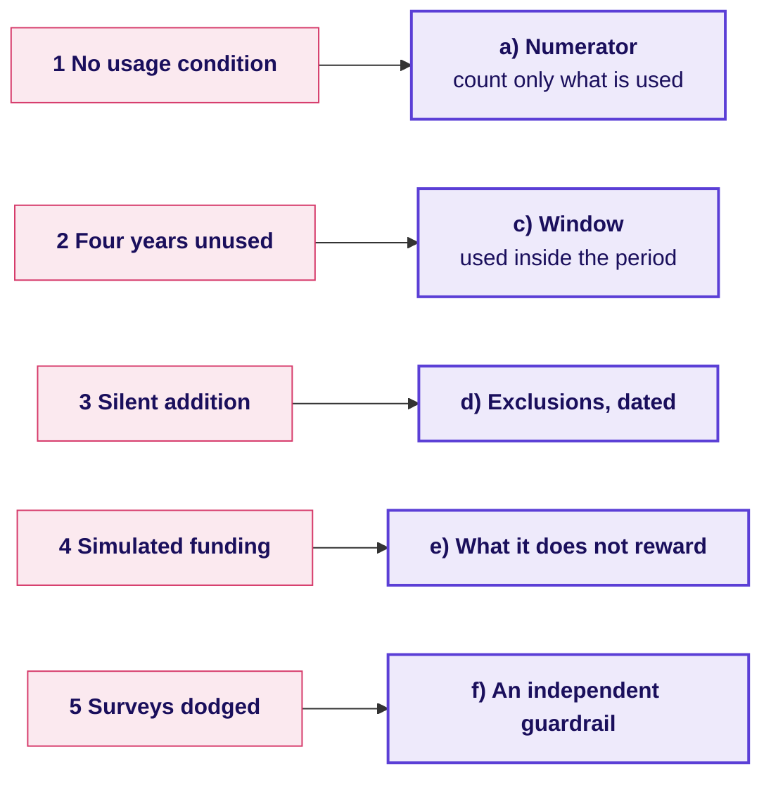
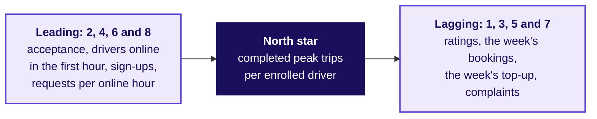
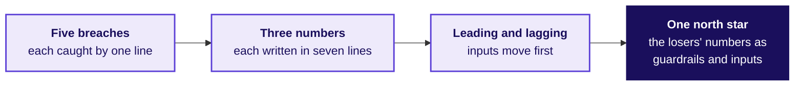

# The metric clinic: which line would have caught it?

Week 4, Day 1. Fallback for the tentative faculty block.

Header: WEEK 4  ·  MONDAY  ·  THE METRIC CLINIC, IF THE TENTATIVE FACULTY BLOCK SLIPS

## SECTION 13: Which line would have caught it?
*Which line of a complete definition does each of five facts in the SEC's Wells Fargo order breach, before the room writes its own definitions again?*

```notes
LIVE, 35 minutes: the five facts (8), the match in groups (15), the answers argued (12). This deck runs
only if the tentative IITGN block W4-1 does not; it teaches nothing about testing, which stays with
the block whenever it runs. Fallback note: trainer/C2_W04_D01_fallback_note_TRAINER.md.
Transition: the five facts.
```

## S1. Five facts from the SEC's Wells Fargo order
*What did the order find about how the cross-sell number was built and hit?*

```cards
icon: file-x | eyebrow: Fact 1 | title: No usage condition | body: Accounts and products per household counted whether or not anyone used them | tone: light
icon: clock | eyebrow: Fact 2 | title: Four years unused | body: A debit card, the largest product category, could stay in the count for up to four years with no use | tone: light
icon: eye-off | eyebrow: Fact 3 | title: A silent addition | body: In 2013 remittance accounts joined the count without investors being told, giving 0.04 of that year's 0.11 rise in the ratio | tone: light
icon: banknote | eyebrow: Fact 4 | title: Simulated funding | body: Staff moved customers' money into new accounts so the accounts counted as funded and earned sales credit | tone: light
icon: phone-off | eyebrow: Fact 5 | title: Surveys dodged | body: Staff changed contact details so satisfaction surveys would not reach customers | tone: light
```

Source: the SEC order, Release 34-88257, February 2020, checked 12 October 2026.

```notes
LIVE, 8 minutes. Read each fact; each group takes one fact first and reads it aloud. Do not add facts
that are not on the card: firing counts and the "3.5 million accounts" figure are not verified in
the week's sources. Source:
https://www.sec.gov/files/litigation/admin/2020/34-88257.pdf (checked 12 October 2026)
Transition: the match.
```

## S2. Which line would have caught each fact?
*Match each of the five facts to the line of a complete definition that would have stopped it; one line is left over.*

| Fact | |
|---|---|
| 1 | No usage condition |
| 2 | Four years unused |
| 3 | A silent addition in 2013 |
| 4 | Simulated funding |
| 5 | Surveys dodged |

a) Numerator: count an account only if the customer used it

b) Denominator: households, with the count printed beside the ratio

c) Window: drop an account once it goes unused for the period

d) Exclusions, dated: every change to what is counted is dated on the definition

e) What it does not reward: money moved in and out to meet a rule

f) A guardrail read from data the measured staff cannot touch

```notes
LIVE, 15 minutes. Groups answer as a string of five letters in fact order. One line is spare, so
elimination alone does not finish it.
Transition: the answers.
```

## S3. Answer: a c d e f; the denominator is spare
*Why does each fact belong to its line, and why is the denominator left over?*

| Fact | The line that catches it | Why |
|---|---|---|
| 1 No usage condition | a) Numerator with a usage condition | The count itself must require the thing it stands for |
| 2 Four years unused | c) Window | Use inside the period, or it leaves the count |
| 3 Silent addition | d) Exclusions, dated | A change to what is counted carries a date and a note |
| 4 Simulated funding | e) What it does not reward | Names the behaviour the number refuses to pay for |
| 5 Surveys dodged | f) Independent guardrail | A guardrail the measured can redirect guards nothing |



The denominator (b) was households throughout; the gaming sat in what was counted, when, and who could reach the check.

```notes
LIVE, 12 minutes. Take the most-argued fact first. Then the Uber parallel, one line each: an hour
counted with no trip (fact 1), an online hour that starts when the driver chooses (fact 2's window,
and VA's desired date from chapter 5), a definition change in Uber's own count (none in the case;
say so), a top-up for idling (fact 4), a check the drivers cannot touch (the rider's wait, fact 5).
Transition: the city's three numbers, written out in full.
```

## SECTION 14: Does each number survive its owner?
*What happens when each of three proposed numbers is written as a complete definition and its owner attacks it?*

```notes
LIVE, 40 minutes: set up (5), groups write (20), owners attack (15). Nine groups in three sets of
three, each set on one number.
Transition: the three numbers and their owners.
```

## S4. Three numbers, each with an owner who wants it
*Which number does each owner propose, and what would it reward?*

```cards
icon: car | eyebrow: Driver-operations lead | title: Peak online hours | body: Rewards being online, whatever happens in the hour | tone: light
icon: wallet | eyebrow: Finance partner | title: Completed peak trips | body: Rewards trips, including the short ones a driver cherry-picks; finance wants each rupee to buy a trip | tone: light
icon: megaphone | eyebrow: Marketing lead | title: Share of offers accepted | body: Rewards saying yes, including to trips later cancelled; the number marketing can show riders | tone: light
```

Each set writes its number as a complete definition of seven lines: numerator, denominator, window, exclusions, what it does not reward, guardrails, and the gaming note.

```notes
LIVE, 5 minutes to set. The template is in exercises/guided/C2_W04_D01_definition_STUDENT.md. Twenty
minutes to write. The finance and marketing readers argue different numbers here than on their round 1
cards, on purpose: each defends a number it did not choose, so the room hears each attack from the
other side.
Transition: the attack each owner will mount.
```

## S5. Each owner's attack, and the line that holds
*What does each owner say against the definition written for their number, and which line answers it?*

| Owner | The attack | The part that is true | The line that answers it |
|---|---|---|---|
| Driver operations | "Hours are what we control; trips depend on riders" | Supply is driver operations' job | Guardrail: trips per online hour beside the hours |
| Finance partner | "Trips are what the money buys; why guard them?" | Trips are what the city wants | Guardrail: accepted share, which catches cherry-picking |
| Marketing lead | "Acceptance is what riders feel first" | It moves first, in the launch week | Gaming note: an accepted trip then cancelled; the cancel share beside it |

On the case data the three numbers moved 24 percent up (hours), 3 percent up (trips) and 13 points down (acceptance): three owners, three stories about the same six weeks.

```notes
LIVE, 15 minutes. Each owner attacks the set that wrote their number; the set answers with a line.
Score as in round 3: answered, conceded, or lost.
Transition: which numbers move first.
```

## SECTION 15: Which numbers lead, and which lag?
*Which of eight city numbers move before the north star and which confirm it later, and which guardrail does each north star need?*

```notes
LIVE, 30 minutes: the eight numbers (12), defended (6), the three north stars and their guardrails
(12). Cut this section first if time runs short.
Transition: the eight numbers.
```

## S6. Which of eight numbers lead, and which lag?
*For each number, does it move before completed peak trips per driver, or confirm it later?*

| # | City number |
|---|---|
| 1 | Rider rating of this week's trips |
| 2 | Share of offers accepted this week |
| 3 | Gross bookings this week |
| 4 | Enrolled drivers online in this week's first peak hours |
| 5 | Top-up paid for this week |
| 6 | New driver sign-ups this week |
| 7 | Rider complaints filed about this week's trips |
| 8 | Rider requests per online hour this week, by zone |

a) 2, 4, 6 and 8 lead; the other four lag

b) 1, 2, 4 and 8 lead; the other four lag

c) 2, 4 and 8 lead; the other five lag

d) 2, 3, 5 and 6 lead; the other four lag

```notes
LIVE, 12 minutes. The eight numbers and the options are the handout's Q1, in its order
(exercises/unguided/C2_W04_D01_lead_lag_STUDENT.md); its Q2 is the defence. Letters first, then
each group defends two of its calls aloud.
Transition: the answer.
```

## S7. Answer: a; inputs lead, bills and ratings lag
*Why does each number sit where it does?*



**Answer: a.** The four inputs move before trips per driver do, and the city team can act on them this week; the four confirmations arrive after the trips have happened. On the case data acceptance settled in the launch week while bookings per online hour took three weeks.

```notes
LIVE, 6 minutes. A dashboard of only lagging numbers lets a drift run for weeks before anyone sees
it; a dashboard of only leading numbers never says whether the outcome came.
Transition: three north stars and the guardrail each needs.
```

## S8. Three north stars, and the guardrail each needs
*How could each north star be hit while riders were served worse, and which guardrail catches it?*

| North star | How it could be hit badly | The guardrail |
|---|---|---|
| Completed peak trips per enrolled driver per week | Drivers accept short trips and decline the rest | Share of offers accepted, at or above an acceptance floor |
| Peak online hours per enrolled driver | Drivers sit online in zones with few riders | Share of online hours with no completed trip (0.22 to 0.38 on the case) |
| Enrolled drivers | Drivers sign up and never drive | Count only drivers online at least one peak hour that week |

```notes
LIVE, 12 minutes. Each group writes one more guardrail for a north star of its choice and names the
gaming it catches. A growth target offered as a guardrail gets the question: what would it catch?
Transition: the dispute, as an interviewer asks it.
```

## SECTION 16: What do you say to the teams who lose?
*How does a candidate get three teams who each want their own target to one number, and what do they say to the teams who lose?*

```notes
LIVE, 15 minutes: the second transcript read in pairs (8), scored (5), the close (2). The transcript is the [D]
section of extras/C2_W04_D01_transcript_STUDENT.md.
Transition: the two answers.
```

## S9. Three teams, one number: two answers compared
*Where does a weak answer to the dispute go wrong, and what does a hire-grade answer do?*

| Beat | Weak answer | Hire-grade answer |
|---|---|---|
| Clarify | "Which team is right?" | "What is the scheme for, and what does each team need to see to do its job?" |
| The call | Gives each team its own target | One north star tied to the scheme's goal: completed peak trips per enrolled driver online at peak |
| The teams who lose | Promises to revisit | Says none of the three numbers is the target, then places each: hours beside trips per online hour; the enrolled count beside the rate; a total cap and cost per extra trip for finance |
| What would change it | Nothing | "If the wait by zone rose under the new rule, I would revisit the acceptance floor" |

```notes
LIVE, 13 minutes: read in pairs (8), then score both on the scorecard (5)
(trainer/C2_W04_D01_interview_scorecards_TRAINER.md).
Transition: the clinic's close.
```

## S10. Close: a definition is a set of lines that hold
*What has the clinic added to the morning's definition?*



**The crux.** Every way of gaming a number gets caught by a line written down before anyone is paid: the count, its window, what it does not reward, and a check the measured cannot touch.

```notes
LIVE, 2 minutes. The test of the redesign stays with the tentative faculty block whenever it runs.
Transition: the TA lab.
```
