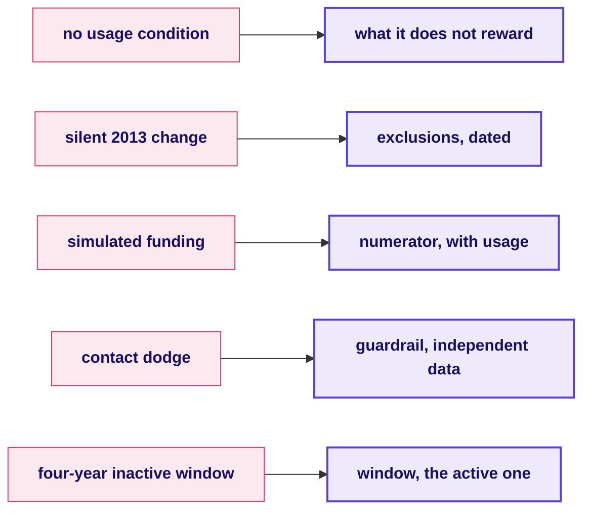
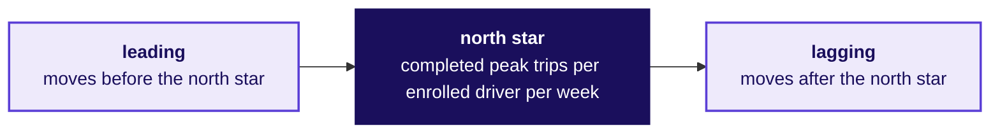

# Fallback: the metric clinic

Week 4, Day 1. Fallback deck (runs if the tentative faculty block slips).

Kicker: WEEK 4  ·  MONDAY  ·  FALLBACK
Quote: If IIT Gandhinagar does not run the A/B session, 120 minutes of metric clinic replace it; nothing of what the block owns is taught here.
Who: The trainer, if the block slips

```notes
LIVE, 1 minute. The fallback runs only if the tentative faculty block is cancelled or shifted.
Four parts of 35, 40, 30 and 15 minutes. Nothing in the fallback teaches A/B testing, since that
belongs to the block whenever it runs.
Transition: part 1, the Wells Fargo dissection.
```

---

## SECTION 6: Which SEC breach parallels which line of a definition?
*What are the five breaches the SEC named at Wells Fargo, and which line of a definition would catch each?*

```notes
LIVE, 35 minutes: part 1 of the fallback. Groups read the SEC order's five facts and name which
line of a complete definition each one breaches. Each group gets five minutes per fact and the
trainer rotates. Styles: Veritasium's predict-then-reveal on each fact; the case method's
groups argue; takeUforward's ladder of items.
Transition: the five breaches, in one card set.
```

---

## S1. The five breaches in the SEC order
*Which breach does each fact describe, and which line of a definition catches it?*

```cards
icon: circle-alert | eyebrow: Breach 1 | title: No usage condition         | body: Accounts counted toward the ratio without any customer activity; debit cards up to four years unused | tone: light
icon: circle-alert | eyebrow: Breach 2 | title: Silent 2013 change         | body: Remittance accounts added to the cross-sell count without the market being told | tone: light
icon: circle-alert | eyebrow: Breach 3 | title: Simulated funding          | body: Deposits moved briefly to meet account-opening thresholds and then withdrawn | tone: light
icon: circle-alert | eyebrow: Breach 4 | title: Contact dodge              | body: Customer contact details changed so complaint surveys would not reach them | tone: light
icon: circle-alert | eyebrow: Breach 5 | title: Four-year inactive window  | body: The target measured over a window that did not require the customer to still be using the product | tone: light
```

```notes
LIVE, 5 minutes to set. Read the five breaches aloud. Each group picks one line of our seven-line
definition template and names which breach it catches. Each group reports in two minutes, so the
whole room covers five breaches in 25 minutes.
Transition: the first match, which the room does from instinct.
```

---

## S2. Match: definition line to breach
*Which line of a seven-line definition catches each breach?*



| Breach | The line that catches it |
|---|---|
| No usage condition | **What it does not reward:** stays named on the definition; a line that pays for being signed up pays for being signed up |
| Silent 2013 change | **Exclusions:** every change to the exclusions is dated on the definition page; a quiet change is caught by the audit |
| Simulated funding | **Numerator:** the numerator carries the usage condition the deposit does not satisfy; a brief deposit does not count |
| Contact dodge | **Guardrail:** a complaint-rate guardrail reads independent data (not a company survey) |
| Four-year inactive window | **Window:** the window is the active window; an "inactive four years" account does not sit in it |

**The parallel to Monday's scheme.** "Peak online hours" has no usage condition. "Online" was redefined when the app's background mode changed, silently. A driver who logs in at 23:59 and out at 00:01 counts as online for two peak hours. A rider's complaint about wait never reaches the scheme's number. All five breaches have an Uber version.

```notes
LIVE, 8 minutes. Walk the room through each pairing. The point: the seven-line template is a
checklist against gaming. Nothing stops a scheme using it from being gamed if the lines are not
there.
Transition: the dissection in pairs, 20 minutes.
```

---

## SECTION 7: Which complete definition would driver operations fight?
*Which of the city's three numbers does each role argue for, and what does each definition reward?*

```notes
LIVE, 40 minutes: part 2 of the fallback. The three city roles return with their numbers; each
group writes the complete definition for one and the role attacks. The point is that a definition
is not an answer; it is a defence that must survive the attack.
Transition: the three numbers, each with its proposer.
```

---

## S3. The three numbers, each role's proposal
*What does each role propose, and what does each number reward?*

```cards
icon: user  | eyebrow: Driver operations | title: Peak online hours   | body: Rewards sign-up and staying online, whatever happens in that hour | tone: light
icon: user  | eyebrow: Marketing         | title: Enrolled drivers    | body: Rewards acquisition; the hoarding sells the floor, so the sign-up is the story | tone: light
icon: user  | eyebrow: Finance partner   | title: Top-up per trip     | body: Rewards low top-up per trip; the finance team wants a budget they can predict | tone: light
```

**Three groups write three definitions.** Each definition carries the seven lines of the template. The role whose number it is attacks in round 2 of this part. The scorer uses the card from half two.

```notes
LIVE, 5 minutes to set. Nine groups split into three sets of three, each set working on one of
the three numbers. Twenty minutes to write; fifteen minutes to defend; the trainer rotates and
voices the role in each set's defence.
Transition: the attack moves, one slide to hold up.
```

---

## S4. The attacks each role will mount
*What does each role attack first, and what does the room concede or answer?*

| Role | First attack | Partly true because | The answer |
|---|---|---|---|
| Driver operations | "You cannot measure us on a number we do not control" | True: hour-by-hour, the driver chooses to log on | The denominator counts hours that completed trips, not just hours logged on |
| Marketing | "The hoarding promised a floor; changing it is a bait and switch" | True: the brand paid for the promise | The floor is kept, with an acceptance condition; the promise is amended, not broken |
| Finance partner | "The top-up cost Rs 1.9 crore in six weeks; your redesign has to prove what it saves" | True: the top-up budget is finance's number | Paid only to driver-weeks at or above 0.5 acceptance, the same six weeks would have cost Rs 74 lakh if every driver behaved the same; the A/B test says how many would change |

**The three definitions each have one line that each role fights, and one line that each role has to concede.** The room writes both.

```notes
LIVE, 5 minutes. Read the three attacks and their partly-true answers. The groups then spend
twenty minutes writing the definition for their assigned number and fifteen defending it.
Transition: part 3, the leading-and-lagging drill.
```

---

## SECTION 8: Which city metrics lead, and which lag?
*What do leading and lagging mean, and where do eight metrics sit?*

```notes
LIVE, 30 minutes: part 3. The eight metrics come on the board; each group classifies three
metrics as leading or lagging; the second half of the slot writes guardrails for three north
stars. Styles: Striver's ladder of items, Krish Naik's narration of each line, ByteByteGo's
single map of the dashboard.
Transition: the eight metrics.
```

---

## S5. The eight city metrics, read
*Which of these eight numbers moves before the city's north star, and which moves after?*



| # | Metric | Leading or lagging |
|---|---|---|
| 1 | Enrolled drivers online in the first peak hour | Leading, by about three hours |
| 2 | Requests per online hour, by zone | Leading, by one week |
| 3 | Acceptance share at the first peak | Leading, by one hour |
| 4 | Median rider wait at peak | Co-moving, same hour |
| 5 | Trips per peak online hour, this week | Co-moving, same week |
| 6 | Driver top-up paid this week | Lagging, by one week |
| 7 | Rider satisfaction score at month end | Lagging, by three weeks |
| 8 | Driver churn in the next quarter | Lagging, by one quarter |

**Leading moves before the north star, so it predicts; lagging moves after, so it confirms.** A dashboard needs both. A dashboard with only lagging numbers lets a drift run for weeks before anyone notices.

```notes
LIVE, 7 minutes. The room classifies three metrics each. Expect disputes on 5: trips per peak
online hour this week is both the north star and co-moving with it. Resolve: the "trips per
peak online hour" measured by the week it is in is the north star; the leading version is the
first-hour one of metric 3.
Transition: the three north stars, each needing a guardrail.
```

---

## S6. Three north stars, three guardrails
*Which guardrail would you add to each north star to catch the ways of hitting it that hurt the city?*

| North star | The gaming | The guardrail |
|---|---|---|
| Completed peak trips per enrolled driver per week | Drivers accept short trips, cherry-pick | Acceptance share at a floor, by zone |
| Trips per peak online hour | Drivers decline peak requests and still log in | Median rider wait at peak, by zone |
| Enrolled drivers active in the week | Mass sign-up with no activity | The denominator counts "online at least one peak hour" |

**Each group writes one guardrail more.** The whole room then reads them aloud and the trainer scores the three strongest, three weakest.

```notes
LIVE, 8 minutes to write; 7 minutes to read aloud. Watch for a group that writes a guardrail that
is another growth number ("revenue per driver-week"); send them back with the test: name the
gaming it catches.
Transition: part 4, the second transcript, the dispute version.
```

---

## SECTION 9: Three teams, three numbers, one scheme
*What do you say to the city head when driver operations, marketing and finance each want their own number?*

```notes
LIVE, 15 minutes: part 4. The transcript is the [D] variant of Monday's L6: a dispute between
three roles. One pair reads aloud, one pair scores. Styles: the case method's role cards from the
morning return, now in the interview room.
Transition: the transcript's weak and hire-grade openings.
```

---

## S7. The dispute: three teams want their own target
*How does a hire-grade answer concede where each team is right and still name one number?*

| Beat | Weak answer | Hire-grade answer |
|---|---|---|
| Clarify | "Which team is right?" | "Each team is right about something; the question is which number carries the scheme's decision and which lines of its definition carry each team's attack" |
| Structure | Picks one team | Opens on the scheme's goal, picks the north star, names the guardrails that answer each team's attack |
| The trap | Promises everyone their number | Names the one number and the guardrails that address each team's partly-true objection |
| Decision tied to cost | "We would try both" | "Paid only where acceptance stayed at 0.5 or above, the six weeks would have cost Rs 74 lakh against the Rs 1.9 crore spent, if every driver behaved the same; the test tells us how many would not" |

**Scorecard (TRAINER).** Clarified scope; named the denominator; conceded where each team is partly right; named the number tied to a decision and its cost; refused to split into three (Aced, verified 12 October 2026).

```notes
LIVE, 8 minutes. One pair reads the weak and hire-grade answers side by side; one pair scores
each on the scorecard. The scorecard goes to the trainer.
Transition: the fallback's close.
```

---

## S8. Fallback close: a definition that stands up
*What has the fallback bought the room, if the block runs tomorrow?*

1. **Breach to line.** The seven-line template catches every breach the SEC named at Wells Fargo.
2. **Three attacks.** Each of the city's roles has an attack that is partly right; the definition answers each with a line.
3. **Dashboard.** Leading metrics predict, lagging confirm; a dashboard needs both.
4. **Dispute.** One number, with guardrails that answer each team's partly-right objection.

**Kavya's review.** "You made a definition stand up to three attacks and five breaches."

```notes
LIVE, 1 minute. The handoff to tomorrow's work: Tuesday's slide, the city head's five minutes
with each loser in the room. If the block runs tomorrow, the room is ready. If not, it still has
a definition that answered three attacks.
Transition: end of the fallback.
```
