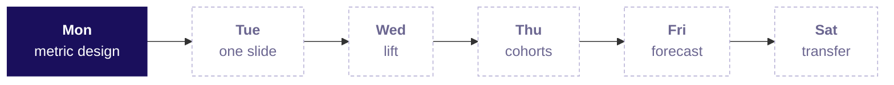
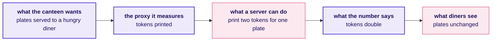
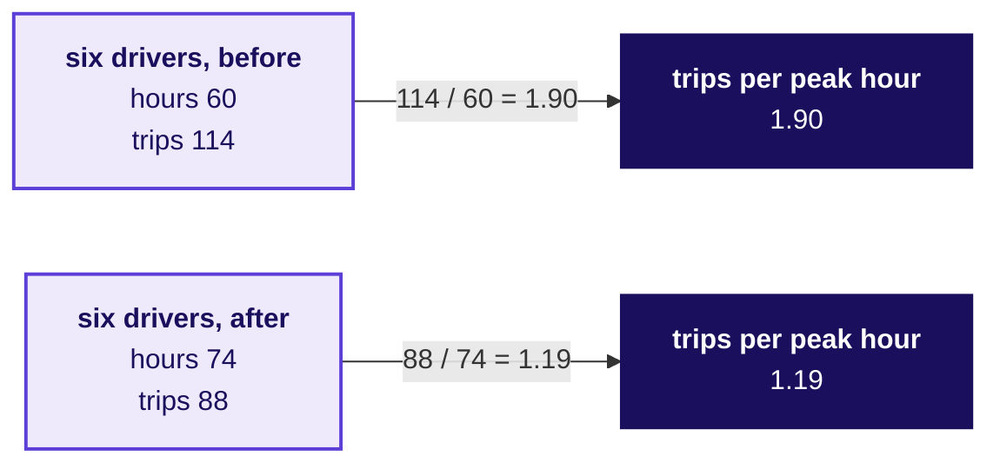
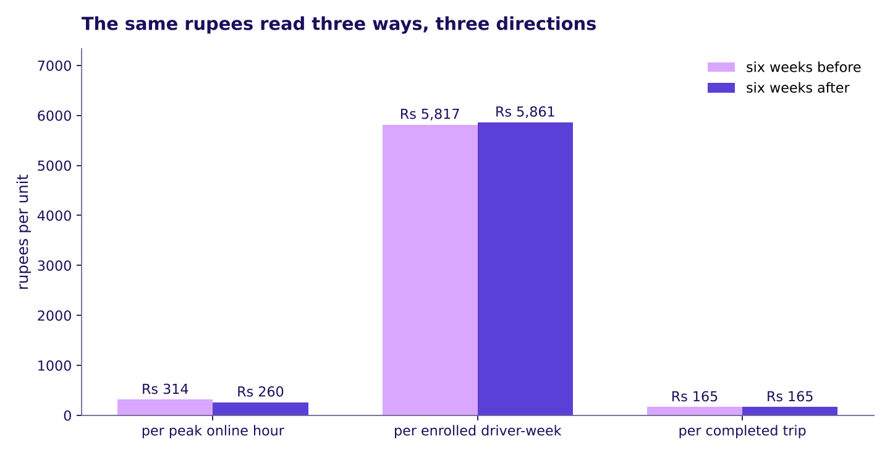
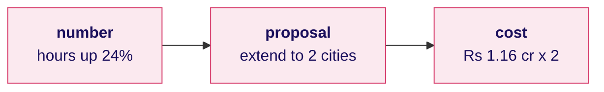
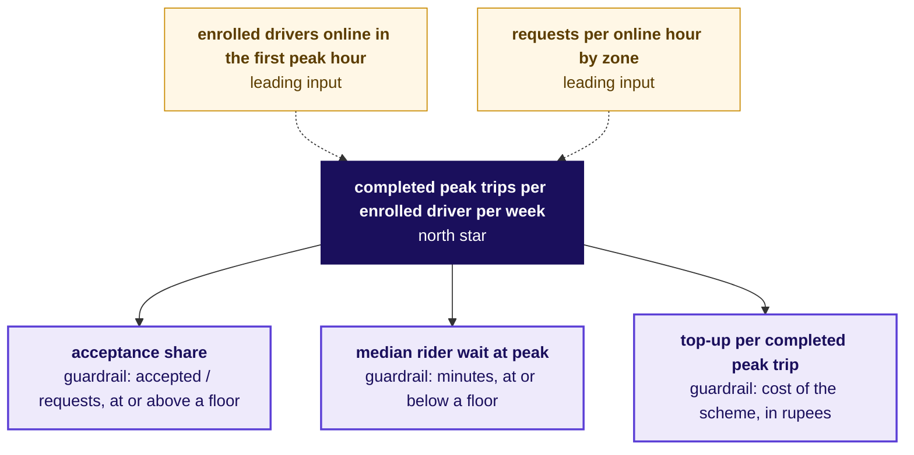
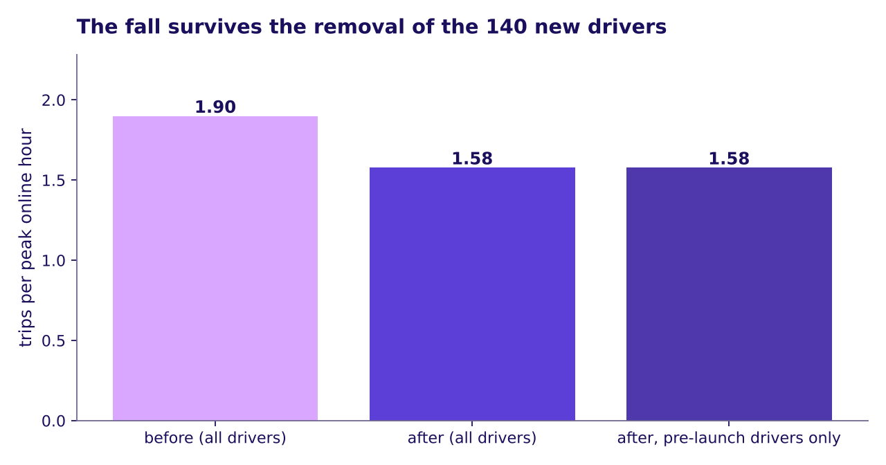

# Is the number we pay for measuring what we want?

Week 4, Day 1. Half one.

Kicker: WEEK 4  ·  MONDAY  ·  MORNING AND FIRST 60
Quote: Peak online hours up 24 percent, completed trips up 3 percent, trips per peak online hour 1.9 to 1.6. Is the scheme working? Which metric should it pay for? Is anyone gaming it?
Who: The Hyderabad city head, Uber, to the driver-operations team

```notes
LIVE, 15 seconds, before the first chapter runs. Read the ticket aloud and say once: this is an
illustrative case, the company is real and the data is synthetic, built for this class. The
morning climbs from a hand count on twelve rows to the metric a scheme should pay for; the
afternoon's first 60 minutes play the city team as three roles arguing with the room's
definition.
Transition: the ticket, in full.
```

---

## S1. The ticket: Uber Hyderabad, peak-hour guarantee
*What did the Hyderabad city team ask, and what has moved after six weeks?*

**The scheme.** On Monday 31 August 2026 the Hyderabad city team launched a peak-hour earnings guarantee. A driver who stays online through a weekday peak window is guaranteed Rs 300 per peak online hour, and Uber pays the gap between the driver's trip earnings and the floor as a top-up.

| Measure | Six weeks before (20 Jul to 24 Aug) | Six weeks after (31 Aug to 5 Oct) |
|---|---|---|
| Peak online hours | 118,000 | 146,300 |
| Completed peak trips | 224,200 | 230,900 |
| Trips per peak online hour | 1.90 | 1.58 |
| Acceptance share | 0.86 | 0.73 |
| Share of online hours with no trip | 0.22 | 0.38 |
| Median rider wait, peak | 4.8 minutes | 4.6 minutes |
| Top-up paid | Rs 0 | Rs 1.9 crore |

**Data the analyst has.** `drivers` (1,200 rows, 140 joined after the launch), `driver_weeks` (one row per driver per week on the app, with peak hours, offers, accepted, driver cancels, trips, hours with no trip, bookings, top-up), `zone_weeks` (12 zones, 12 weeks, with rider requests, fulfilled and median wait). A request one driver declines is offered to the next, so `driver_weeks` counts offers and `zone_weeks` counts rider requests. **The ask, by Friday.** Is the scheme working, which metric should it pay for, and is anyone gaming it. **Known caveats.** The monsoon ended inside the after window; 140 drivers joined after the launch; the app logs a driver as online whenever the driver app is open; the three outer zones get few requests at any hour.

> *Illustrative case: the company is real, the situation and the data are synthetic, built for this class.*

```notes
LIVE, 2 minutes. Read the ticket in order; name no number twice. Pause after "top-up Rs 1.9 crore".
Ask: of these eight numbers, which one would the driver-operations lead celebrate on Monday
morning? The hands tend to go to peak online hours; leave the answer open.
Transition: the week's map, with Monday lit.
```

---

## S2. The week map, with Monday lit
*Where does today sit in the week?*



```notes
LIVE, 2 minutes. Point to Monday, lit, and read the one line. Each later day will light its own
node on its own slide two; by Saturday every node reads with a number earned on its day.
Transition: where today ends, so the room can see the path they are climbing.
```

---

## S3. Where today ends: pay for trips, with a floor
*What sentence closes the day?*

**By the end of the day**, the room writes the sentence the Hyderabad city team should take to the review:

> *"The scheme should pay for completed peak trips, per enrolled driver per week, with an acceptance guardrail at or above a floor the city sets. Pay dropped to Rs 0 for any hour a driver stays online outside an acceptance pattern that completes trips. Expected saving under the redesign: about Rs 1.16 crore over six weeks, from the 61 percent of top-up that went to idle online hours in outer zones."*

The room has not earned that sentence yet. It climbs there one level at a time: hand count on twelve rows, the full data, the trap, the caveats, the decision, the interview.

```notes
LIVE, 1 minute. Read the sentence once, then say: everything else today is how the room gets to
earn it. Nothing to write down.
Transition: chapter 1, the twelve rows, counted by hand.
```

---

## SECTION 1: Can online hours rise while riders wait as long?
*What happened on the six driver-weeks a hand count can carry, and how is that different from supply going up?*

```notes
LIVE, 55 minutes in two parts: the war game's round 1 (15), chapter 1 proper (40). No laptops yet.
The war game's three roles name their favourite number from a card and the room says, from
instinct only, how each could rise while riders waited longer. The twelve rows then come up on the
sheet. Chapter 1 is L1 of the ladder: understand and count by hand.
Styles on this chapter: Veritasium (predict before the reveal), StatQuest (tiny numbers, say the
step aloud), Brilliant (open with a question).
Transition: the war game's three role cards, read.
```

---

## S4. War game, round 1: three roles, three numbers
*Which number does each role want the city head to celebrate, and how could each be gamed?*

```cards
icon: user  | eyebrow: Driver operations | title: Peak online hours | body: Up 24 percent; supply at peak is the city's biggest headache | tone: light
icon: user  | eyebrow: Marketing         | title: Enrolled drivers  | body: The guarantee is on every hoarding, and the sign-up count is the acquisition story | tone: light
icon: user  | eyebrow: Finance partner   | title: Top-up per trip   | body: We hold the budget, and the top-up has to feel like money that bought trips | tone: light
```

**The proxy-test card the scorers hold.** For every number the roles name, three questions: could a team hit this while riders waited longer, who controls the count, and what does the number deliberately not reward.

```notes
LIVE, 15 minutes. The trainer voices the three cards, or three learners read them aloud. The nine
groups each spend five minutes on one way to game each number, from instinct, before any method is
taught. Expect: online hours can rise if drivers stay logged in doing nothing; enrolled drivers
can rise if everyone signs up and barely drives; top-up per trip can rise if drivers accept short
trips and decline anything else. Write them on the board, named by role, and park "what the data
would show" until chapter 2.
Transition: the canteen token toy, then the twelve rows.
```

---

## S5. The canteen that pays its servers per token
*How does a proxy, a number that stands in for the thing wanted, start to drift from what matters?*



**A proxy is a number that stands in for the thing somebody wants.** A canteen pays its servers per token printed and wants plates served to hungry diners. Tokens go from 200 to 400 a day while plates stay at 200, because each plate now gets two tokens.

```notes
LIVE, 4 minutes, the Veritasium move. Ask the room before the diagram goes up: if the canteen
rewards tokens, which can rise without any extra plate being served? Take hands for "nothing",
"maybe one or two", "many". Reveal the two-token answer. The toy is invented (R1) and the
numbers are chosen to be easy.
Transition: on which Uber number could the same thing be happening.
```

---

## S6. The twelve driver-weeks, read before any code opens
*What happened to six Uber drivers in Hyderabad in two particular weeks?*

| Driver | Zone | Hours before | Trips before | Hours after | Trips after |
|---|---|---|---|---|---|
| A | Jubilee Hills | 10 | 21 | 11 | 22 |
| B | Banjara Hills | 9 | 17 | 10 | 18 |
| C | Gachibowli | 11 | 22 | 12 | 23 |
| D | Madhapur | 10 | 19 | 11 | 20 |
| E | Shamshabad | 10 | 18 | 16 | 3 |
| F | Rajendranagar | 10 | 17 | 14 | 2 |
| **Total** | | **60** | **114** | **74** | **88** |

The before week is the one beginning 10 August 2026; the after week is the one beginning 21 September 2026. Trips per peak online hour across the six: 1.90 before, 1.19 after.

```notes
LIVE, 6 minutes. Count the four totals aloud: 60, 74, 114, 88. Then divide: 114 over 60 and 88
over 74. The twelve rows show the same paradox as the city, sharper: hours up 23 percent, trips
down 23 percent, so trips per hour nearly halves. Point at drivers E and F before saying their
story: hours up, requests down (an outer zone), most declined.
Ask: on the twelve rows, name the drivers whose hours rose without trips following. Take two
answers, write E and F on the board.
Transition: a worked micro-example, step by step.
```

---

## S7. One ratio, counted aloud: 1.90 before, 1.19 after
*How is the hand count read, and what did it just say about the city?*



A rate as a ratio of two sums, never the mean of ratios. The denominator says what the number is per.

```notes
LIVE, 3 minutes. Read: trips per peak hour before is 1.90, after is 1.19. Say what the drop
stands for: for every ten hours a driver spent online, the city gained 19 trips before the
scheme and 12 trips after. The hours rose; the trips did not follow.
Watch for anyone computing a mean of each driver's ratio: it reaches a different number, which
chapter 2 catches as the trap it is.
Transition: Wells Fargo, the public case that is Monday's cold anchor.
```

---

## S8. Wells Fargo: when the ratio has no usage condition
*What happens when a company pays its people for a number that does not require the thing it stands for?*

**Public case, dated 12 October 2026.** Wells Fargo's cross-sell ratio measured accounts per customer: a target of "eight accounts per customer" with no condition that the customer used them. Over about four years, employees opened unauthorised deposit and credit card accounts to meet quotas: debit cards up to four years unused counted toward the ratio; a 2013 change added remittance accounts to the count silently; some accounts were funded by simulated deposits; contact details were changed to dodge customer surveys. The Consumer Financial Protection Bureau fined the bank USD 185 million in 2016, the SEC settled at USD 3 billion in 2020 ([CFPB press release, 2016](https://www.consumerfinance.gov/about-us/newsroom/consumer-financial-protection-bureau-fines-wells-fargo-100-million-widespread-illegal-practice-secretly-opening-unauthorized-accounts/) and [SEC order, 2020](https://www.sec.gov/files/litigation/admin/2020/34-88257.pdf), both verified 12 October 2026).

**The parallel to Monday.** Peak online hours up 24 percent with no condition that the driver completed a peak trip.

```notes
LIVE, 5 minutes. Set the scene: for about four years an accounts-per-customer target with no
usage check sent sales staff to open unauthorised accounts because the pay was tied to the proxy.
The pay-outs eventually cost more than the scheme ever bought. Then ask: on Uber Hyderabad, which
of the eight ticket numbers has no usage condition on it? "Peak online hours up 24 percent" is
the parallel.
Draw the parallel on the board, two columns, Wells Fargo and Uber.
Transition: chapter 1's close, said in the question ladder.
```

---

## S9. Chapter 1 close: hours up, trips per hour fell
*What has the room learned, in one line, before any code opens?*

1. **What does "peak online hours up 24 percent" stand for?** The time the driver app was open in the window, not the service delivered.
2. **What did the six drivers' twelve rows do?** Hours went from 60 to 74 (up 23 percent), trips from 114 to 88 (down 23 percent), trips per hour from 1.90 to 1.19.
3. **Which drivers moved the number?** E and F, in outer zones, hours up while trips fell to almost nothing.
4. **Where has this happened before?** Wells Fargo paid for accounts per customer with no usage condition and spent more on penalties than the proxy ever earned.

**Kavya's review.** "Before I read any rate, I read what it is divided by, over which window, and whether the thing it stands for has a usage condition."

**In the interview.** [M] How would you measure the success of a new feature? A hire-grade answer opens on the goal, names the user, one primary metric with its numerator, denominator and window, two guardrails and one leading input, and the test. Monday earns that answer.

```notes
LIVE, 3 minutes. Read the four lines in order. The interview question stays open; the day's L6
answers it.
Transition: chapter 2, the full data in code.
```

---

## SECTION 2: What are the city totals, and where did the fall sit?
*How do the twelve rows read on 12,860 driver-weeks, and which number should the city team not have celebrated?*

```notes
LIVE, 50 minutes in two parts: chapter 2 proper (40) and the break (10). Laptops open now.
Notebook 02 opens on the twelve rows and runs the groupby on 12,860 driver-weeks. Styles on this
chapter: Krish Naik (line by line, pandas), Veritasium (predict, then run), StatQuest (the ratio
on tiny numbers restated), takeUforward (the second route in SQL).
Transition: the drift chart, read before any code.
```

---

## S10. Hours rising, trips per hour falling, twelve weeks
*How does the city read on twelve weeks rather than two?*


The dashed line shows the launch week. Peak online hours rose; trips per peak online hour fell. The same picture extends the twelve-row story: it was not two unusual weeks.

```notes
LIVE, 3 minutes. Point at the launch week line; read the before trajectory (hours between about
19,400 and 20,200 a week, trips per hour wandering between 1.88 and 1.93) and the after trajectory
(hours between about 23,800 and 24,900 a week, trips per hour 1.64 in the launch week and then
between 1.56 and 1.59). Then say: twelve weeks of data say the
same thing as six drivers' twelve rows said in two.
Transition: the predict step before the groupby.
```

---

## S11. Predict: of these four numbers, which moved most?
*Which of these moved most, in direction and amount, from the before window to the after window?*

a) Peak online hours
b) Completed peak trips
c) Trips per peak online hour
d) Driver cancellation share

```notes
LIVE, 2 minutes. Letters by hand; two columns on the board, direction and amount. Most say a and
c; some say d. Leave open; the groupby cell runs next and reveals.
Transition: the groupby, line by line.
```

---

## S12. Answer: hours up, trips flat, ratio down, cancels up
*What did the city-wide groupby print?*

| Measure | Before | After |
|---|---|---|
| peak online hours | 118,000 | 146,300 |
| completed peak trips | 224,200 | 230,900 |
| trips per online hour | 1.90 | 1.58 |
| acceptance share | 0.86 | 0.73 |
| driver cancels / accepted | 0.04 | 0.09 |

The groupby runs on `driver_weeks` with the before/after mask on `week_start`; the ratio is taken as `sum(trips) / sum(hours)`, never a mean of per-driver ratios. The six drivers of the hand count fell further, to 1.19, because they were chosen to show the mechanism: two of the six, E and F, logged hours with almost no trips, a third of the sample. Chapter 3 counts how many such drivers the city has.

```notes
LIVE, 4 minutes. Read the five rows aloud and name what moved: acceptance down 13 points, cancels
more than doubled. Point out the twelve-row paradox (hours up 23 percent and ratio down to 1.19)
is less sharp on the city (ratio down to 1.58), because the six were chosen to show the
mechanism and two of them are drivers like E and F. Chapter 3 finds how many the city has.
Say about denominators: each ratio names the two sums it is a quotient of; the mean of
per-driver ratios reaches a different number and is wrong.
Transition: the first check, that the fall is not demand.
```

---

## S13. The check: zone requests up, waits held steady
*If demand fell, which column would show it, and did it?*

```python
zone = pd.read_csv("C2_W04_D01_zone_weeks_STUDENT.csv")
zb = zone[zone["week_start"] < "2026-08-31"]
za = zone[zone["week_start"] >= "2026-08-31"]
print(zb["peak_requests"].sum(), za["peak_requests"].sum())
print(round(zb["median_wait_min"].median(), 1), round(za["median_wait_min"].median(), 1))
```

Zone requests rose about 2 percent across the window. Median rider wait held near 4.8 minutes before and 4.6 after, so riders did not wait longer. **The fall in trips per peak online hour is not demand.**

```notes
LIVE, 3 minutes. Say the check: if demand fell, zone-level requests would show it. They rose
slightly. If drivers were struggling to serve the demand, waits would have grown. They did not.
So the fall is on the supply side, in how hours were spent, not in how many riders asked for a
ride.
Transition: the three ways to read the same rupees.
```

---

## S14. The same rupees read three ways: three directions
*Which denominator does a slide use, and what do the other two say?*



Rupees per peak online hour fell from Rs 314 to Rs 260. Rupees per completed trip held at Rs 165. Rupees per enrolled driver-week moved by a little. **The denominator is a choice. A slide names the one it uses.**

```notes
LIVE, 4 minutes. Point at each pair of bars. Per hour the gap is clear: Rs 54 less from the same
hour. Per trip the fare did not move. Per driver-week the two bars are nearly equal; the direction
there depends on the base, which is why the slide must say which number sits in the denominator.
This picture answers finance's objection in advance: the top-up money is real; the question is
what it bought.
Watch for anyone taking the per-trip bar as "the scheme is working": that bar says the fare per
completed trip did not move, not that the scheme produced more completed trips.
Transition: Delhi Metro's three-numbers lesson.
```

---

## S15. Delhi Metro: a crowd counted three ways
*What happens when one measurement is read without naming its denominator?*

In 2018 the Delhi Metro Rail Corporation reported 27 lakh daily ridership while a separate note gave 45 lakh daily line utilisation ([DMRC press piece, verified 12 October 2026](https://www.latestly.com/agency-news/dmrc-uses-new-count-metric-on-traffic-flow-doesnt-share-ridership-190870.html/amp)). The 2026 record for 17 September is 64.06 lakh average daily passenger journeys and 82,44,903 boardings ([Tribune, verified 12 October 2026](https://www.tribuneindia.com/news/delhi/delhi-metro-records-99-95-train-punctuality-in-2026-dmrc/) and [Republic World, verified 12 October 2026](https://www.republicworld.com/india/delhi-metro-breaks-all-time-record-with-8244-lakh-footfall-as-dtc-strike-sends-rush-soaring-2026-09-18-137241)). A ridership counts riders; a journey counts the trips one rider makes; a boarding counts every entry. Three different numbers from the same crowd.

```notes
LIVE, 3 minutes. The parallel: Uber's trips per hour, trips per driver-week and trips per enrolled
driver each tell a different story, and a slide that names one without naming the denominator sends
a reader to the wrong number. Metro counts riders, journeys and boardings; the three disagree by a
factor of two or three. Name the sources on the slide and the date they were checked.
Transition: chapter 3, where in the data the fall sits.
```

---

## SECTION 3: Which drivers drove the fall, and what did it cost?
*What makes a number safe to pay for, and where did Rs 1.9 crore of top-up go?*

```notes
LIVE, 70 minutes in three parts: the trap in the data (25), the metric tree built line by line
(35), the caveats and L4 (10). Styles on this chapter: Veritasium's predict-then-reveal before
the your-turn cell, 3Blue1Brown's concept board region by region, ByteByteGo's metric tree, the
case method's roles anchored in real objections.
Transition: the your-turn cell that the notebook holds open.
```

---

## S16. Predict: who sits inside the fall?
*Which group of drivers would you check first for an answer?*

a) Drivers in core zones (Jubilee Hills, Gachibowli, Hitech City)
b) Drivers whose hours rose but trips did not
c) The 140 drivers who joined after the launch
d) Drivers with high acceptance before and after

```notes
LIVE, 2 minutes. Letters by hand. The honest majority of the room says b or c. The notebook's
your-turn cell is empty: the room has to run a groupby on driver and ask what is different about
the drivers whose trips per hour is below 1.0 after the launch.
Transition: the answer, after the cell runs.
```

---

## S17. Answer: 180 drivers, hours doubled, trips fell 12%
*What did the empty your-turn cell print when the room ran it?*


**The lower-right cluster is the idle tail.** 180 drivers of the 1,200 enrolled, 15 percent of the base. Their peak online hours after the launch are about 2.1 times their hours before. Their peak trips are about 88 percent of their trips before, down 12 percent. 72 percent of their new hours are logged in the three outer zones (Shamshabad, Rajendranagar, Patancheru). This is the idle tail the scheme pays for, found in the data. The hand count's six held two such drivers, a third of the sample against 15 percent of drivers city-wide, which is why the six fell to 1.19 while the city fell to 1.58.

```notes
LIVE, 4 minutes. Point at the dots along the x-axis: hours far to the right, trips far below the
dotted 1.9 line. These are driver-weeks where the driver stayed online for 30 or 40 hours and
completed 20 or 25 trips. Then say: nothing in the data says why; the hypothesis is the floor
pays for being online, and the outer zones have few requests, so the driver who logs there earns
the floor without a trip.
Watch for anyone saying "the drivers are lazy": they are responding to the number the city pays
them, which is Wells Fargo once removed.
Transition: how much the gaming cost.
```

---

## S18. 61 percent of the top-up went to acceptance below 0.5
*How much of Rs 1.9 crore was paid to driver-weeks with low acceptance?*


```python
after = driver_weeks[driver_weeks["week_start"] >= "2026-08-31"].copy()
after["acceptance"] = after["peak_accepted"] / after["peak_offers"]
low = after.loc[after["acceptance"] < 0.5, "topup_rs"].sum()
share = round(low / after["topup_rs"].sum() * 100)
```

`share` prints 61. Of the Rs 1.9 crore paid, Rs 1.16 crore went to driver-weeks where fewer than half of the offers the driver saw were accepted.

```notes
LIVE, 3 minutes. Read the number: 61 percent. The scheme paid 1.16 crore to driver-weeks that
declined most of what was asked of them. The remaining Rs 74 lakh went to driver-weeks where the
driver kept pace: a scheme that paid only there would have cost Rs 74 lakh for the same six
weeks if every driver had behaved the same, which the redesign cannot promise.
Transition: the trap, named exactly.
```

---

## S19. The wrong number: supply target met, extend scheme
*What decision does "peak online hours up 24 percent" send to the city head on Monday morning?*



**The check that catches it.** Trips per peak online hour, and median rider wait by zone. **The fix.** Pay for completed peak trips with an acceptance guardrail. Rs 1.9 crore spent would have been Rs 74 lakh under the fix if every driver had behaved the same, which a new rule changes.

```notes
LIVE, 4 minutes. Present the colleague's draft as what Monday morning's briefing would carry if
nobody checked trips per hour. Then say what each line costs: the extension signs a Rs 2 crore
cheque for the same gaming in each of two new cities. Draw the fix on the board, with the two
guardrails.
Transition: the metric tree, built on the board region by region.
```

---

## S20. The metric tree, built from the north star down
*How is the scheme's north star related to the leading inputs the city team can act on?*



**The north star names what the scheme pays for.** The guardrails name the ways of hitting the north star that would hurt the city or the business. The leading inputs are what the city team can act on this week without waiting for the north star to catch up.

```notes
LIVE, 6 minutes, building the tree region by region, 3Blue1Brown style. First the north star
alone: completed peak trips per enrolled driver per week. Then one guardrail at a time, each
with the gaming it catches: acceptance below a floor catches "stay online and decline
everything"; wait above a floor catches "trips too short to serve riders"; top-up per completed
trip catches a budget run-away. Leading inputs: enrolled drivers online in the first peak hour
predicts same-day supply; requests per online hour by zone predicts whether the hours are in the
right place.
Transition: the definition, as one page, written line by line.
```

---

## S21. The definition in seven lines, each a guardrail
*What are the seven lines a complete definition writes down?*

| Line | What it says |
|---|---|
| Numerator | Trips completed inside the peak windows, counted per paying rider as Uber counts them |
| Denominator | Drivers enrolled in the scheme who were online at least one peak hour that week, with the count printed beside the rate |
| Window | The calendar week |
| Exclusions | Trips cancelled by either side, test accounts, trips outside the window |
| What it does not reward | Hours online, requests declined, a shrinking enrolled base |
| Guardrails (three) | Acceptance share at a floor; median rider wait at peak; top-up per completed trip |
| Leading inputs (two) | Enrolled drivers online in the first peak hour; requests per online hour by zone |

**Gaming note (on every line of the definition).** Each guardrail names the way of hitting the north star that it catches. A definition without the "what it does not reward" line is a definition that will be gamed.

```notes
LIVE, 7 minutes, writing each line on the board. Pause after every line and ask: what gaming does
this line catch? If the room is quiet, give one example: the denominator says "online at least one
peak hour that week", which stops a driver who signs up and never logs in from diluting the rate
to zero. Pause on "what it does not reward": the room will say "hours online", which is Monday's
whole lesson.
Transition: Swiggy's glossary, as a company that writes its denominators down.
```

---

## S22. Swiggy's glossary: denominators written down
*How does a public company name the numerator, the denominator and the window?*

**Public case, dated 12 October 2026.** Swiggy's own glossary in the quarter to 30 September 2024 defines Monthly Transacting Users (MTU) as the count of distinct users who placed one or more orders in a given month on the platform, averaged over the three months. Platform frequency is orders divided by MTUs. GOV is gross order value, with its denominators spelt out ([Swiggy quarter letter, verified 12 October 2026](https://www.bseindia.com/xml-data/corpfiling/AttachHis/2495f39b-e1d1-4018-8f69-6ff250345e98.pdf)).

**The parallel to Monday.** Our definition writes every line Swiggy writes: the numerator, the denominator, the window, the exclusions, and what it does not reward.

```notes
LIVE, 4 minutes. Read Swiggy's three definitions in order; name the window on each. The point is
not the company; the point is that a reader of a Swiggy letter cannot miscount MTUs, because the
denominator is on the page. A scheme that pays for a number should write the same seven lines.
Transition: the caveats an engineer must say aloud, L4.
```

---

## S23. What the data cannot show, in six caveats
*Which doubts must the engineer name before anyone acts on the number?*

| Caveat | The data check, in one line |
|---|---|
| Data quality: "online" is the app being open | The share of online hours with zero trips in zones with requests (rose from 0.22 to 0.38) |
| Mix: 140 drivers joined after the launch | Trips per hour recomputed for drivers present in both windows |
| Seasonality: the monsoon ended inside the after window | The same comparison for last year's weeks (the data holds twelve, so the caveat stays open) |
| Interference: drivers on two platforms | Acceptance by hour of day; Uber cannot see the other platform directly |
| Selection: who enrolled | Enrolled against not enrolled in the before window |
| Causality: the scheme or the season | Only the A/B test of the redesign (the faculty block, tentative) can settle it |

**The fall survives the pre-launch cohort.** Trips per peak online hour on drivers present in both windows: 1.90 before, 1.58 after. The 140 new drivers do not explain the fall.



```notes
LIVE, 5 minutes. Read each caveat and name what settles it. The data-quality check is the share
of hours with no trip, from 0.22 to 0.38; the mix check is the bar on the right of the picture;
the seasonality check is open and the room says so; the interference check needs cross-platform
data Uber does not have; the selection check compares enrolled against not enrolled; the
causality check is the next 120 minutes.
Transition: the chapter's close.
```

---

## S24. Chapter 3 close: north star, guardrails, Rs 1.16 crore
*What does the room take into the afternoon?*

1. **Which number did the city team not celebrate?** Peak online hours up 24 percent, because the scheme paid for being online, not for serving a rider.
2. **Where did the fall sit?** 180 drivers of 1,200 whose hours doubled while their trips fell 12 percent, 72 percent of their new hours in outer zones.
3. **What did the gaming cost?** Rs 1.16 crore of the Rs 1.9 crore top-up (61 percent) went to driver-weeks where acceptance stayed below 0.5.
4. **What is the north star?** Completed peak trips per enrolled driver per week.
5. **Which two guardrails stop the gaming?** Acceptance share at a floor, and median rider wait at peak.

**Kavya's review.** "You found the plant in the data by refusing to celebrate the first number. The city head's job now is to say what the floor on acceptance is, and that is the only decision left."

**In the interview.** [M] A number rose and the business celebrated. What do you check before you believe it, and in what order?

```notes
LIVE, 3 minutes. Read the five lines in order. Say what the afternoon does: round 3 of the war
game, where the three roles attack the room's definition. If round 3 goes clean, the room has
earned Monday's sentence.
Transition: lunch; half two carries round 3, the interview and the Kahoot.
```

---

## S25. Half two: roles, transcript, Kahoot, the lab
*What comes next this afternoon, in four parts and the lab?*

```timeline
label: Afternoon, 30 min | title: War game, round 3 | body: The three roles attack the room's definition; each group writes it, defends it and prices the Rs 1.16 crore
label: Afternoon, 15 min | title: Transcript | body: [M] How would you measure the success of a new feature? And the AI-company variant on acceptance rate.
label: Afternoon, 15 min | title: Kahoot and close | body: Eight items, with the return question from Week 2 Friday
label: Afternoon, 120 min | title: Faculty block (tentative) | body: W4-1, designing the A/B test of the redesigned scheme
label: Lab (TA-led) | title: Kalpa Retail transfer | body: Re-run L1 to L3 on reorders per Retail-Plus member
```

```notes
LIVE, 1 minute. The afternoon has three parts and the lab. Say that the tentative faculty
block waits on IIT Gandhinagar's confirmation. Lunch.
Transition: break; half two picks up with the war game's third round.
```
