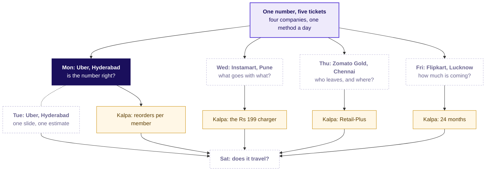
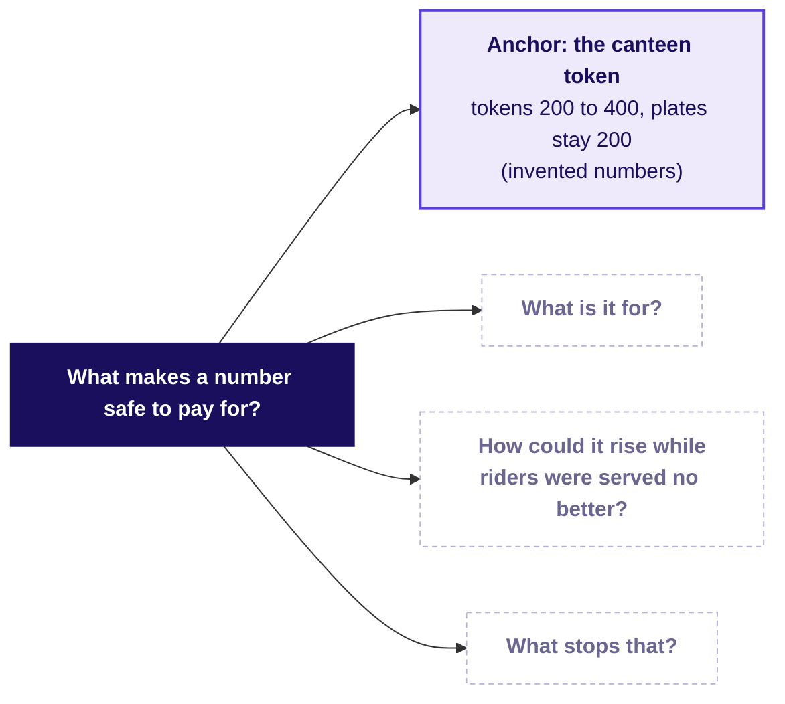
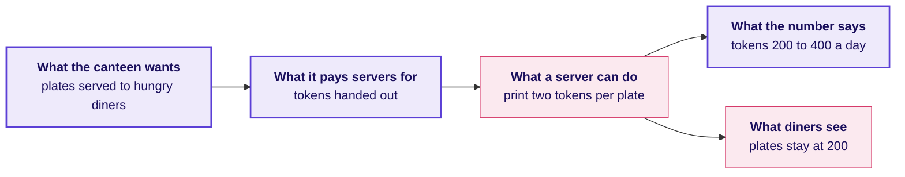
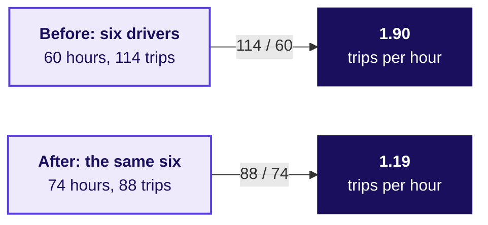
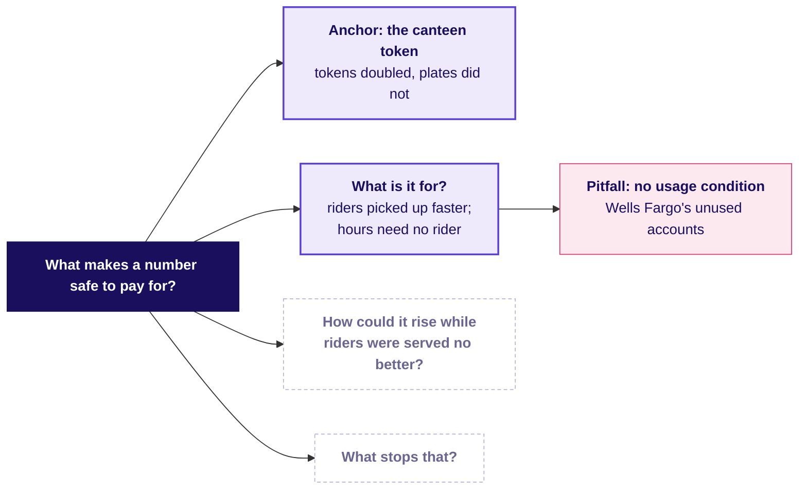
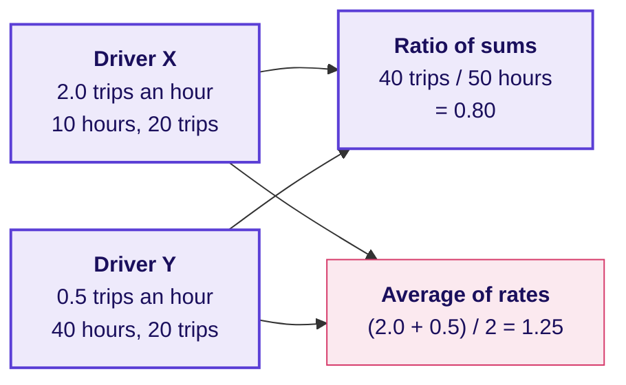
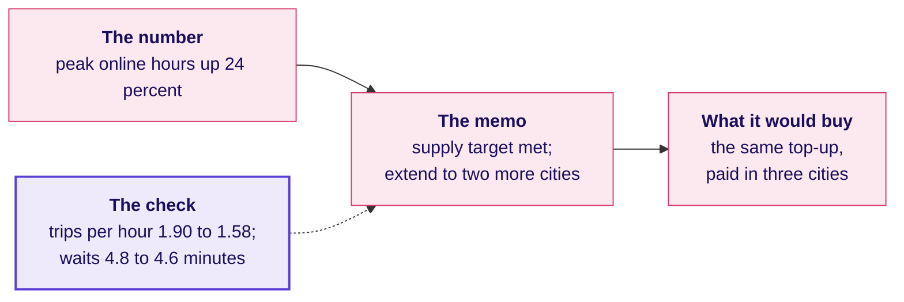
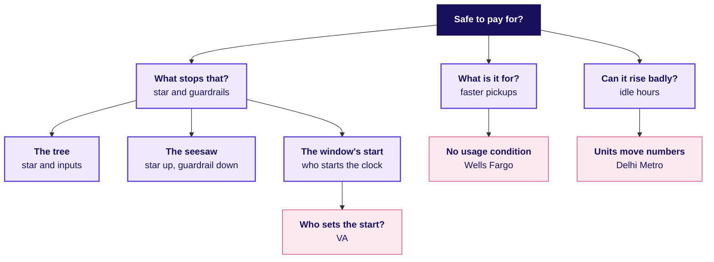

# Is the number we pay for measuring what we want?

Week 4, Day 1. Half one.

Header: WEEK 4  ·  DAY 1  ·  UBER, HYDERABAD, AN ILLUSTRATIVE CASE

## S1. Ticket: Uber Hyderabad's peak-hour guarantee
*What did the city team launch, what moved in six weeks, and what does the city head ask?*

**Uber, Hyderabad, the driver app.** From Monday 31 August 2026 an enrolled driver (one signed up for the scheme) online through a whole peak window (two a day, three hours each) is guaranteed Rs 300 per peak online hour: Uber tops up the gap between the driver's trip earnings and that floor. The goal: riders picked up faster.

| Six weeks each side | 20 Jul to 30 Aug | 31 Aug to 11 Oct |
|---|---|---|
| Peak online hours; completed peak trips | 118,000; 224,200 | 146,300 (up 24%); 230,900 (up 3%) |
| Trips per peak online hour | 1.90 | 1.58 |
| Share of offers accepted; share of accepted trips the driver cancelled | 0.86; 0.04 | 0.73; 0.09 |
| Share of online hours with no trip; median rider wait | 0.22; 4.8 min | 0.38; 4.6 min |
| Share of rider requests unfulfilled; top-up paid | 0.11; Rs 0 | 0.10; Rs 1.9 crore |

**Data:** `drivers` (1,200; 140 joined after the launch), `driver_weeks` (one row per driver per week: hours, offers, accepted, cancels, trips, hours with no trip, bookings as fares riders paid, top-up; a declined request is offered again, so it counts offers), `zone_weeks` (rider requests, fulfilled, median wait). **Ask, due Friday:** is it working, what should it pay for, is anyone gaming it, raising the number without doing what it stands for? **Caveats:** the monsoon ended mid-window; 140 drivers are new; online means the app is open; three outer zones (Shamshabad, Rajendranagar, Patancheru) get few requests; drivers can be on two apps; trip earnings are not in the data.

> *Illustrative case: the company is real, the situation and the data are synthetic, built for this class.*

```notes
LIVE, 3 minutes. Read the ticket top to bottom in the order it is written: company and surface,
the table, the data, the ask, the caveats, the label line. Say the label line in full: the company
is real, the situation and the data are synthetic, built for this class. Then ask one question
and leave it open: of the eight numbers in the table, which one would the city team put in the
headline of Monday's update? Most hands go to "peak online hours up 24 percent". Write it on the
board; the day is about whether that number deserves the headline.
Transition: where the day sits in the week.
```

## S2. The week: five tickets, one method a day
*Where does today's ticket sit among the week's five?*



```notes
LIVE, 2 minutes. Point to Monday, lit, and to the four dashed days. Each day is a ticket at a company
the room uses, climbed from a hand count to an interview question, and each day's TA lab moves the
same method to Kalpa Retail. By Saturday every node carries the number the room produced on it.
The week explorer (content/W04/D1/demos/C2_W04_D01_week_explorer_STUDENT.html, which ships with the
week) opens on this map; light Monday there if it is on the projector.
Transition: where today ends.
```

## S3. Where today ends: one sentence and seven lines
*What will the room hand the city head when the morning is done?*

By the close of the afternoon's first hour the room writes one sentence with its blanks filled from the data, and a definition of seven lines that the three city-team roles, who each lose something under it, cannot break.

> "Judge the scheme by ________, guarded by ________ and ________, because paying for hours cost Rs ____ in six weeks for ________."

```timeline
label: Line 1 | title: Numerator | body: What is counted, and when it counts
label: Line 2 | title: Denominator | body: Per whom, with the count printed beside the rate
label: Line 3 | title: Window | body: Over which period
label: Line 4 | title: Exclusions | body: What is left out on purpose, each change dated
label: Line 5 | title: What it does not reward | body: The behaviour it refuses to pay for
label: Line 6 | title: Guardrails | body: Must not get worse: two for riders, one for the budget
label: Line 7 | title: Gaming note | body: How each guardrail catches a way of hitting the number
```

```notes
LIVE, 1 minute. Read the sentence with its blanks and the seven line names; nothing to write yet.
Say: every blank gets a number from the data before lunch, and every line gets tested by three
people this afternoon.
Transition: the board the day fills, region by region.
```

## S4. The day's board: four questions before paying
*Which questions must a number answer before anyone is paid for it?*



Each chapter fills one region of this board: chapter 1 answers what the number is for, chapter 2 how it rose while riders were served no better, chapter 3 what stops it.

```notes
LIVE, 1 minute. Draw the same board on the whiteboard and keep it up all day; each chapter's close
adds its region. The finished board is panel one of the cheat sheet.
Transition: the war game's first round.
```

## S5. War game, round 1: three roles, three numbers
*Which number does each of the city team's three roles want the scheme judged on, and how could each look good while riders were served no better?*

```cards
icon: car | eyebrow: Driver-operations lead | title: Peak online hours | body: Wants supply at peak, the city's oldest problem; hours rose 24 percent | tone: light
icon: megaphone | eyebrow: Marketing lead | title: Enrolled drivers | body: The guarantee is the story that wins new drivers; every sign-up counts | tone: light
icon: wallet | eyebrow: Finance partner | title: Top-up per trip | body: Holds the budget; wants each rupee of top-up to buy a trip, so wants this number low | tone: light
```

**The proxy test, three questions per number.** A proxy is a number that stands in for the thing wanted. Could a team hit this number while riders were served no better? Who controls the count? What does the number deliberately not reward?

```notes
LIVE, 8 minutes, the war game's round 1 (run sheet: trainer/C2_W04_D01_war_game_TRAINER.md).
The trainer voices the three role cards, or three learners read them. Each of the nine groups has
three minutes to give one way to game each number, from instinct only, and its scorer holds the
proxy-test card. Write the answers on the board under each role. Expect: hours rise if drivers stay
logged in and idle; enrolled drivers rise if people sign up and never drive; top-up per trip falls
if drivers take only short trips. Park "what would the data show" until chapter 2.
When it stalls: give the canteen token (who controls the count?), then point at the twelve rows,
drivers E and F.
Transition: chapter 1 opens on the question the war game left behind.
```

## SECTION 1: What does an hour count?
*What does "peak online hours up 24 percent" stand for, and what happened to six drivers counted by hand, before the city head celebrates it?*

```notes
LIVE, 40 minutes for the chapter: the opener question (4), the canteen (5), the twelve rows and the
hand count (18), Wells Fargo (8), the close (5). Level 1: understand and count by hand. No laptops.
Styles: Brilliant (the question first), Veritasium (predict, then reveal), StatQuest (tiny numbers
said aloud), the case method (a real company's decision and what it cost).
Notebook: notebooks/C2_W04_D01_01_twelve_rows_STUDENT.ipynb.
Transition: the question that opens the chapter.
```

## S6. Which number can rise with no rider at all?
*Before any data, which of four city numbers can a driver raise without a single rider asking for a trip?*

a) Completed peak trips

b) Peak online hours

c) Offers accepted over offers shown

d) Median rider wait at peak

```notes
LIVE, 2 minutes. Letters on paper, then a show of letters. The room usually splits between b and c.
Leave it open for ten seconds, then reveal.
Transition: the answer.
```

## S7. Answer: hours, since the app counts it open
*Why can peak online hours rise with no rider served?*

**Answer: b.** The app logs a driver as online whenever the driver app is open and the driver is marked available, wherever the phone is: in traffic, at home, or parked in a zone with no riders. Trips need a rider who asked, accepted offers need an offer, and the wait is measured on riders. Hours need only an open app.

**A proxy is a number that stands in for the thing somebody wants.** The city wants riders picked up faster; it counted hours because hours are easy to count.

```notes
LIVE, 2 minutes. Say: the driver controls the count, and that is the first thing to look for in any
number someone is paid for. Point back to the board's first question, what is it for.
Transition: a canteen that pays for the easy count.
```

## S8. A canteen pays per token: tokens double
*How does a proxy drift once people are paid for it?*



**The proxy test.** Could a team hit this number while the thing it stands for got worse, or stayed the same? The canteen's tokens fail it: tokens per plate went from 1.0 to 2.0 and no extra diner ate. The numbers are invented.

```notes
LIVE, 5 minutes, the Veritasium move. Before the picture goes up, ask: if the canteen pays per token,
what can rise with no extra plate served? Take three answers, then show the picture. The canteen is
invented and the numbers are chosen to be easy. Explorer scene M1 shows the same drift on the city:
drivers as dots go from driving to idling as the guarantee rises; open it here if it is on the
projector.
Transition: six drivers from the case's own data.
```

## S9. Six drivers, two weeks, counted by hand
*What did six drivers' hours, offers and trips do between one week before and one week after?*

| Driver | Zone | Hours, before → after | Trips, before → after | Offers accepted, after |
|---|---|---|---|---|
| A | Jubilee Hills | 10 → 11 | 21 → 22 | 22 of 25 |
| B | Banjara Hills | 9 → 10 | 17 → 18 | 18 of 21 |
| C | Gachibowli | 11 → 12 | 22 → 23 | 23 of 26 |
| D | Madhapur | 10 → 11 | 19 → 20 | 20 of 23 |
| E | Shamshabad | 10 → 16 | 18 → 3 | 4 of 14 |
| F | Rajendranagar | 10 → 14 | 17 → 2 | 3 of 12 |

The before week begins 10 August 2026 and the after week 21 September 2026. These are twelve rows of the case's own `driver_weeks`; E and F drive in two of the three outer zones, where riders are few.

```notes
LIVE, 6 minutes, StatQuest: say each number aloud. Add the hours column for the before week (60)
and the after week (74), then the trips (114 and 88), writing the four sums on the board. Point at
E and F before saying anything about them: hours up, offers down because Shamshabad and
Rajendranagar get few requests, and most of those offers declined.
Transition: the prediction before the ratio.
```

## S10. What does trips per hour do on the six?
*Before dividing, what will trips per peak online hour do on the six drivers?*

a) Holds near 1.9

b) Falls to about 1.6, as the city's did

c) Falls to about 1.2

d) Rises above 2.0

```notes
LIVE, 2 minutes. Everyone writes a letter. Most write b, because the ticket says 1.58.
Transition: the hand count.
```

## S11. Answer: 1.90 before, 1.19 after, by hand
*How is the ratio counted, and why do the six fall further than the city's 1.58?*



**Answer: c.** Hours rose 23 percent and trips fell 23 percent, so trips per peak online hour fell from 1.90 to 1.19: add the trips, add the hours, divide once. The city fell to 1.58; the six fall further because they were chosen to show the mechanism, and two of them, E and F, logged hours with almost no trips, a third of this sample. How common such drivers are in the city is chapter 2's question.

```notes
LIVE, 4 minutes. Say the step aloud: for every ten hours online the six made 19 trips before and 12
after. Then say why the six are not the city: the rows were picked so the mechanism shows in
miniature. Watch for anyone averaging each driver's own ratio; chapter 2 shows what that average
prints on the full data and why it misleads.
Transition: a company that paid for a number with no usage condition.
```

## S12. Wells Fargo paid for accounts nobody used
*What happens when a company pays its people for a number that does not require the thing it stands for?*

**Wells Fargo's cross-sell metric** was the number of accounts and products per retail bank household. It had no usage condition: an unused debit card, the largest product in it, could stay in the count for up to four years. Staff opened accounts customers had not asked for, moved customers' money into new accounts so the accounts would count as funded ("simulated funding"), and changed contact details so customers would not receive satisfaction surveys.

```stats
value: 185 | label: USD million, 2016 | note: penalties, after about 1.5 million deposit and 565,000 card accounts may not have been authorised
value: 3 | label: USD billion, 2020 | note: settlement with the SEC and the Department of Justice
value: 2016 | label: sales goals ended | note: the bank dropped product sales goals for its employees
```

Sources: the release of the US Consumer Financial Protection Bureau (CFPB) of 8 September 2016, the release of the US Securities and Exchange Commission (SEC) of 21 February 2020 and the SEC order, Release 34-88257, each checked 12 October 2026.

```notes
LIVE, 8 minutes. Tell it in order: the number (accounts per household), the missing condition
(nobody had to use the account), what staff did to hit it, and what it cost (USD 185 million in
2016, USD 3 billion in 2020, sales goals scrapped). Then draw two columns on the board, Wells Fargo
and Uber Hyderabad: an account counted with no use, an hour counted with no trip. Do not quote a
firing count or Goodhart; neither is verified in the week's sources.
Sources:
https://www.consumerfinance.gov/about-us/newsroom/consumer-financial-protection-bureau-fines-wells-fargo-100-million-widespread-illegal-practice-secretly-opening-unauthorized-accounts/ (checked 12 October 2026)
https://www.sec.gov/newsroom/press-releases/2020-38 (checked 12 October 2026)
https://www.sec.gov/files/litigation/admin/2020/34-88257.pdf (checked 12 October 2026)
Transition: the chapter's close and the board's first region.
```

## S13. Close: a paid proxy drifts from its goal
*What has chapter 1 answered, and what does the board now hold?*



**The crux.** A number is safe to pay for only if hitting it requires the thing it stands for; hours online do not require a rider.

**The senior analyst's check.** Before trusting a rate, read its baseline (1.90 before), its denominator (hours the app was open, which the driver controls) and the evidence that the goal moved (city trips rose only 3 percent).

```notes
LIVE, 5 minutes. Add the region to the board: what is it for, and the first pitfall. Read the crux
line twice; it is the line the cheat sheet repeats. The interview question the day earns, [S] how
would you measure the success of a new feature, stays open until the afternoon.
Transition: chapter 2, the full data.
```

## SECTION 2: Where did the fall sit?
*What do the city totals say over twelve weeks, and which drivers and zones drive the fall, before a proposal goes out to extend the scheme?*

```notes
LIVE, 50 minutes for the chapter: the demand question (5), the twelve weeks and the groupby (12),
the average that misleads (8), the denominator cases (6), the idle tail (14), the close (5).
Levels 2 and 3. Laptops open on notebooks/C2_W04_D01_02_full_data_trap_STUDENT.ipynb.
Styles: Krish Naik (one line of narration per cell), Veritasium (predict before each reveal),
Brilliant (the question first), ByteByteGo (the board grows at the close).
Transition: the first question of the chapter.
```

## S14. Which column would show riders asked for less?
*If riders simply asked for fewer trips, where would the data show it?*

a) `peak_online_hours` in `driver_weeks`

b) `peak_requests` in `zone_weeks`

c) `topup_rs` in `driver_weeks`

d) `peak_bookings_rs` divided by trips

```notes
LIVE, 2 minutes. Letters on paper. The trap the question guards against: "trips per hour fell
because demand fell", said before anyone looked at demand.
Transition: the answer, with the numbers.
```

## S15. Answer: rider requests rose 1.8 percent
*Did demand fall, and why do the two tables count different things?*

**Answer: b.** Demand lives in `zone_weeks`. Rider requests rose from 251,910 to 256,556 (up 1.8 percent), the unfulfilled share went from 0.11 to 0.10 and the median wait from 4.8 to 4.6 minutes. The fall in trips per hour is not demand.

```stats
value: 1.07 | label: offers per request, before | note: 269,773 offers shown to drivers for 251,910 rider requests
value: 1.35 | label: offers per request, after | note: 347,583 offers for 256,556 requests: more declines, more re-offers
```

A request one driver declines is offered to the next driver, so `driver_weeks` counts offers and `zone_weeks` counts requests: two tables, two units, and the gap between them grew with the declining.

```notes
LIVE, 4 minutes. Read the three demand numbers, then the two stats. Ask what could make offers per
request rise while requests barely moved: drivers declining, so each request is shown again.
Transition: twelve weeks, one week at a time.
```

## S16. Twelve weeks: hours jumped, trips per hour fell
*Was the fall two odd weeks, or a level that held for six?*


Before the launch, trips per hour wandered between 1.88 and 1.93. In the launch week it read 1.64, then held between 1.55 and 1.59 for five weeks, while hours rose from about 20,000 a week to about 24,000. The two lines use two different scales, so the point where they cross means nothing.

```notes
LIVE, 3 minutes. The animated version, whiteboards/C2_W04_D01_drift_STUDENT.gif, draws the twelve
weeks one at a time; play it on the projector and stop at the dashed line to ask what the next week
will show. Then show this full picture and read the two ranges. Explorer scene M1 draws the same
drift with drivers as dots; use it here if it is on the projector.
Transition: the groupby that produced these totals.
```

## S17. One groupby gives the city's totals
*What is the smallest code that turns 12,860 driver-weeks, one row for every driver on the app each week, into the ticket's numbers?*

```python
dw["window"] = dw["week_start"].lt("2026-08-31").map({True: "before", False: "after"})
city = dw.groupby("window")[["peak_online_hours", "peak_trips"]].sum()
city["trips_per_hour"] = city["peak_trips"] / city["peak_online_hours"]
```

| Window | Hours | Trips | Trips per hour | Accepted share | No-trip share |
|---|---|---|---|---|---|
| Before | 118,000 | 224,200 | 1.90 | 0.863 | 0.22 |
| After | 146,300 | 230,900 | 1.58 | 0.730 | 0.38 |

The rate is a ratio of two sums: every trip over every hour. `.lt(...)` asks whether a week starts before the launch, and `.map` turns True and False into before and after; the notebook adds the two shares the same way, sum first, then divide.

```notes
LIVE, 6 minutes, Krish Naik: run the notebook's totals cell line by line and say what each line is
for. The table is the cell's output, rounded as the ticket rounds it.
Transition: a shortcut a colleague might take.
```

## S18. What does an average of weekly rates print?
*A colleague averages every driver-week's own trips per hour; what does that print for the after window?*

a) 1.58

b) 1.71

c) 1.19

d) 1.90

```notes
LIVE, 2 minutes. Letters on paper. This is the chapter's first trap, the plausible wrong number.
Transition: the answer, and why it is wrong.
```

## S19. Answer: 1.71, which hides two-fifths of the fall
*Why does averaging each week's rate understate the fall, and what is the fix?*

**Answer: b.** The average of rates prints 1.71 after the launch, against 1.58 from the sums. The true fall is 0.32, from 1.90 to 1.58; the average shows 0.19 of it and hides 0.13, about two-fifths. It gives a 42-hour week the same weight as a 10-hour one, so the long, slow weeks of the drivers online longest count no more than anyone's short, busy ones.



The drivers are invented: Y's 40 slow hours count as one week, like X's 10, so the average reads 1.25 against a true 0.80, too high, as the city's 1.71 is. **The decision it would mislead:** a fall two-fifths smaller reads as noise, and the scheme is extended. **The check:** recompute from the sums. **The fix:** a ratio of sums, its denominator named.

```notes
LIVE, 6 minutes. Work the invented pair aloud first, then return to 1.71 against 1.58. Week 1 met
the same rule on Kalpa's orders: a rate is two sums divided once.
Transition: companies that write their denominators down.
```

## S20. Swiggy writes each denominator down
*What does a complete definition look like in a public filing?*

| Swiggy term, as filed | What is counted | Per what | Window |
|---|---|---|---|
| Average Monthly Transacting Users (MTU) | Unique users with at least one completed order on the app or website | per month | the month, averaged over the period |
| Platform frequency | Completed orders | per transacting user | the month, averaged over the period |

In the quarter to 30 September 2024 Swiggy reported platform frequency of 4.53 orders per user a month and an MTU of 17.1 million (its shareholder letter filed with the exchange, checked 12 October 2026). Because "completed order" and "per month, averaged" are written down, a reader cannot mistake MTU for registered users.

```notes
LIVE, 3 minutes. Read the two rows, naming numerator, denominator and window each time. The point is
the habit: a filing that names its denominator cannot be misread, and the city's ticket names
"per peak online hour" for the same reason. Source:
https://www.bseindia.com/xml-data/corpfiling/AttachHis/2495f39b-e1d1-4018-8f69-6ff250345e98.pdf (checked 12 October 2026)
Transition: one crowd, counted three ways.
```

## S21. Delhi Metro counts its crowd in three units
*How can one network's crowd give three numbers, none of them wrong?*

```stats
value: 27 lakh | label: riders a day, February 2018 | note: gate count: one entry and one exit, one rider
value: 45,35,932 | label: line utilisation, 29 May 2018 | note: every line ridden counts: three lines, three
value: 82,44,903 | label: boardings, 17 September 2026 | note: a record day, in a third unit
```

In 2018 the Delhi Metro Rail Corporation (DMRC) began counting "line utilisation": a rider from Noida City Centre to HUDA City Centre who changes across three lines counts three times, where the gate count counts one rider (PTI, the Press Trust of India). In 2026 the figures arrive as 64.06 lakh average daily "journeys" (The Tribune) and a record day of "boardings" (Republic World), each a different unit again; all checked 12 October 2026. A definition can move a number without moving the crowd.

```notes
LIVE, 3 minutes. The parallel is on the board already: offers and requests are two units for the
same riders, and offers rose 29 percent on requests that rose 1.8 percent.
Sources:
https://www.latestly.com/agency-news/dmrc-uses-new-count-metric-on-traffic-flow-doesnt-share-ridership-190870.html/amp (checked 12 October 2026)
https://www.tribuneindia.com/news/delhi/delhi-metro-records-99-95-train-punctuality-in-2026-dmrc/ (checked 12 October 2026)
https://www.republicworld.com/india/delhi-metro-breaks-all-time-record-with-8244-lakh-footfall-as-dtc-strike-sends-rush-soaring-2026-09-18-137241 (checked 12 October 2026)
Transition: who is behind the fall.
```

## S22. How many drivers sit under one trip an hour?
*Of the 1,200 drivers, how many made fewer than one trip per peak online hour after the launch?*

a) About 30

b) About 100

c) About 180

d) About 400

```notes
LIVE, 4 minutes, the your-turn cell of notebook 02. Everyone writes a letter, then types the four
lines from the notebook's markdown into the empty cell and runs it. Wait until most of the room has
a number before the reveal.
Transition: the answer and the picture.
```

## S23. Answer: 180 drivers, more hours, fewer trips
*Who are they, what did their hours and trips do, and where were they online?*


**Answer: c.** 180 drivers, 15 percent of the city: the **idle tail**, named for the long online hours in which they completed few trips. Their hours went to 2.1 times their level before the launch while their trips fell 12 percent, and 72 percent of their new hours were in the outer zones. Each dot is one driver-week; E's and F's weeks are the small group at the bottom left, the most extreme of the 180, which is why the six fall further than the city.

```notes
LIVE, 6 minutes. Point at the cluster to the right of 30 hours with 25 to 35 trips: weeks online in
almost every peak window with far fewer trips than the dotted line. Say what the data cannot say:
why they did it. The likely reading is that the floor pays for being online and the outer zones are
quiet, so a driver parked there earns the floor without a trip. A second route in the notebook
finds the same 180 by acceptance alone. Watch for "these drivers are lazy": they are doing what
the number pays for, as Wells Fargo's staff did.
Transition: the chapter's close.
```

## S24. Close: hours rose where riders were few
*What has chapter 2 answered, and what does the board now hold?*


**The crux.** A rate is two sums divided once, with its denominator named; the city's 1.90 to 1.58 is real, demand rose, and 180 drivers sitting online in thin zones carry the fall.

**The senior analyst's check.** Baseline (1.90), denominator (online hours), evidence from a second table (requests rose 1.8 percent), and the segment reached a second way (acceptance finds the same 180).

```notes
LIVE, 5 minutes. Add the region to the board. Then the break: 10 minutes.
Transition: after the break, chapter 3 asks what the scheme should pay for instead.
```

## SECTION 3: What should it pay for?
*Which number should the scheme pay for, which guardrails stop the gaming, and what can the data not show, before the city head decides on Friday?*

```notes
LIVE, 65 minutes for the chapter: the opener question (5), the wrong memo and its cost (12), the
tree and the inputs (14), the definition line by line, guided (16), the window and its start (6),
the caveats (10), the close (2). Levels 3 and 4. Notebook:
notebooks/C2_W04_D01_03_definition_and_cost_STUDENT.ipynb.
Styles: Brilliant (question first), 3Blue1Brown (the tree built region by region), the case method
(VA's decision and its cost), ByteByteGo (the finished board).
Transition: the question that opens the chapter.
```

## S25. Which number would you pay drivers for?
*Which rule would make drivers drive and serve riders, without paying for idling or for picking only easy trips?*

a) Peak online hours, as now

b) Completed peak trips, nothing beside it

c) Completed peak trips, with a minimum share of offers accepted

d) Enrolled drivers

```notes
LIVE, 2 minutes. Letters on paper. Explorer scene M2 lets the room move the choice and watch the dots
re-behave; use it after the vote if it is on the projector.
Transition: the answer.
```

## S26. Answer: trips, with a floor on acceptance
*Why does each of the other three fail?*

**Answer: c.** Hours pay for an open app, which the idle tail showed. Trips alone let a driver accept only short or nearby trips and decline the rest, which the share of offers accepted catches. Enrolled drivers rise with every sign-up whether or not anyone drives. Trips with an acceptance floor, a minimum share of offers accepted, pay for the service and catch the cherry-picking.

```notes
LIVE, 3 minutes. Take each wrong letter in turn and say the gaming it invites; the room should hear
that every wrong answer is a number someone would really propose.
Transition: the memo that the celebrated number would have produced.
```

## S27. The wrong memo: "supply met, extend it"
*What decision does "peak online hours up 24 percent" send to the city head, and what catches it?*



**The plausible wrong answer:** "Peak online hours up 24 percent over six weeks. Supply target met. Recommendation: extend the scheme to two more cities." **The check that catches it:** trips per peak online hour fell from 1.90 to 1.58 and the median wait barely moved, so riders were served no better. **The fix:** pay for completed peak trips, with an acceptance guardrail.

```notes
LIVE, 4 minutes. Present the memo as the one a hurried analyst writes on Monday morning. Then the
check, then the fix. The next slide prices what the memo would have kept buying.
Transition: where the Rs 1.9 crore went.
```

## S28. How much top-up went to declining weeks?
*What share of the Rs 1.9 crore went to driver-weeks that accepted fewer than half their offers?*

a) 15 percent

b) 39 percent

c) 61 percent

d) 88 percent

```notes
LIVE, 2 minutes. Letters on paper; notebook 03's first cell answers it.
Transition: the answer.
```

## S29. Answer: 61 percent, Rs 1.16 crore of 1.9
*Where did the money go, and what is the honest way to state a saving?*


**Answer: c.** Rs 1.159 crore, 61 percent, went to driver-weeks that accepted fewer than half the offers they were shown; Rs 74 lakh went to the rest. Rs 74 lakh is what the six weeks would have cost had only the second group been paid and every driver behaved the same, which a new rule would not guarantee: some idle drivers would start accepting enough to qualify.

```notes
LIVE, 4 minutes. Say the behaviour line clearly, because the finance partner and every interviewer
will ask it: a saving that assumes nobody changes is the most the redesign could save, and an honest
saving says how drivers respond. Round 3
this afternoon prices the saving under a stated range.
Transition: the tree that replaces the single number.
```

## S30. The tree: a north star, guardrails, inputs
*How does the number the scheme pays for connect to the numbers that must not get worse and the ones the city team can act on this week?*


**The north star** names the outcome the scheme exists for. **Guardrails** name the ways of hitting it that hurt riders (guardrails 1 and 2) or the budget (guardrail 3). **Inputs** are what the city team can move this week, such as drivers online in the first hour of each peak window, before the north star catches up. Read the north star and its guardrails as a **seesaw**: if the north star rises while a guardrail moves the wrong way (fewer offers accepted, a longer wait, more top-up per trip), riders or the budget paid for the rise.

```notes
LIVE, 7 minutes, 3Blue1Brown: build it on the board one region at a time. First the north star alone,
then each guardrail with the gaming it catches (a driver online and declining; trips so short or so
cherry-picked that waits rise; a top-up that runs away), then the two inputs. Explorer scene M2, the
seesaw, shows the north star against its guardrails. Tuesday's slide, Thursday's funnel and Friday's
forecast all hang off this north star.
Transition: which of these moves first.
```

## S31. Acceptance moved first, bookings followed
*Which number would have warned the city team in the first week?*


**Leading** and **lagging** say when a number moves: a leading number moves before the north star, a lagging one confirms it later. That is a separate question from the job a number does, so acceptance is guardrail 1 and also a leading number. It fell to its new level in the launch week (0.729), while bookings per online hour, the fares riders paid per hour, fell to Rs 271 that week and kept falling to Rs 259.1 by the third. A city team watching acceptance would have seen the gaming in week one.

```notes
LIVE, 4 minutes. Explorer scene M4 asks which line turns first; use it if it is on the projector.
Then classify three of the ticket's numbers aloud: acceptance (leading), trips per hour (moves with
the north star), top-up paid (lagging, the bill arrives after).
Transition: the definition, line by line.
```

## S32. Seven lines make the number hard to game
*What does each line of the redesign's definition say, and which gaming does it stop?*

| Line | The redesign's definition |
|---|---|
| Numerator | Trips completed inside the peak windows, one per paying rider: Uber's annual report counts an UberX Share ride with three paying riders as three trips |
| Denominator | Enrolled drivers online at least one peak hour that week, the count printed beside the rate |
| Window | The calendar week |
| Exclusions | Trips cancelled by either side, test accounts, trips outside the windows |
| What it does not reward | Hours online; offers declined; a shrinking enrolled base, since fewer drivers in the count would raise the rate with no extra trip |
| Guardrails | For riders: accepted share at or above a floor the city sets, and the median rider wait. For the budget: top-up per completed trip |
| Gaming note | Guardrail 1 catches declining and cherry-picking; guardrail 2, supply that stops serving riders; guardrail 3, a top-up that runs away from the trips it pays for |

On the data, the north star read 35.76 trips per online driver-week before and 35.89 after: hours rose 24 percent and the number the scheme exists for barely moved.

```notes
LIVE, 16 minutes, guided: the room writes each line with the trainer (exercises/guided/
C2_W04_D01_definition_STUDENT.md). Pause after every line and ask which gaming it stops: the
denominator's "online at least one peak hour" stops a sign-up who never drives from diluting the
rate; "what it does not reward" names hours. Uber's 10-K counts an UberX Share ride with three
paying riders as three trips and an UberX ride with three passengers as one, which is why the
numerator says "per paying rider". Explorer scene M3 recomputes the metric as each line changes.
Transition: who controls when the clock starts.
```

## S33. VA let the measured set the clock's start
*What happens when the people being measured control where a window begins?*

The US Department of Veterans Affairs measured patient wait from a "desired date" that schedulers entered. At its Phoenix facility, of 79 staff interviewed, 30 said they had used the wrong desired date, producing false zero-day waits, and 11 said they "fixed" waits longer than the 14-day goal by rebooking with a later desired date. After the interim report of the VA's Office of Inspector General (OIG), the 14-day goal was removed from employee performance contracts (VA OIG report 14-02603-267, August 2014, checked 12 October 2026).

**The parallel.** A driver decides when the app is open, so the driver sets the start of every online hour. A definition that pays per online hour hands the clock to the person it pays.

```notes
LIVE, 6 minutes. The board's third sketch goes up: the window and its start. Ask who starts the
clock in each of the day's numbers: hours (the driver), trips (the rider's request), wait (the
rider's request). Source:
https://www.vaoig.gov/sites/default/files/reports/2014-08/VAOIG-14-02603-267.pdf (checked 12 October 2026)
Transition: what the data cannot show.
```

## S34. Without the 140 new drivers, what remains?
*Take out every driver who joined after the launch: what does trips per hour read for the six weeks after?*

a) 1.90

b) 1.79

c) 1.58

d) 1.19

```notes
LIVE, 2 minutes. The trap here is a caveat used as an excuse: "the new drivers explain it".
Transition: the answer and the other cuts.
```

## S35. Answer: 1.58; the fall survives each cut
*Which doubts does the fall survive, and which stay open until someone gathers more?*


**Answer: c.** Without the new drivers the rate is still 1.58. In the three weeks with the most rider requests, the first three after the launch and still in the rains, it already read 1.60, so the monsoon's end cannot explain the fall. In the nine core zones it fell from 1.90 to 1.79, so the fall sits mostly in the three outer zones. Three doubts stay open: drivers on two apps (the data holds weekly totals, so it cannot show a decline made because another app's trip was under way), who chose to enrol (every driver here enrolled, so no group stayed out to compare with), and cause (only a test of the redesign settles it).

```notes
LIVE, 8 minutes. Walk the six caveats in order, each with the fact that would settle it: data quality
(online means the app is open; hours with no trip rose from 0.22 to 0.38), mix (new drivers: 1.58
without them), seasonality (the three weeks with most requests: 1.60; last year's weeks are not in the data, so the
caveat narrows and stays partly open), drivers on two apps (needs hourly data and the other app), who chose to
enrol (needs the city's full driver list), cause (the tentative faculty block designs the test).
Transition: the finished board.
```

## S36. Close: pay for trips, guarded three ways
*What does the finished board say?*



**The crux.** Pay for completed peak trips per enrolled driver online at peak, guarded for riders by acceptance and the wait, and for the budget by the top-up per trip.

```notes
LIVE, 2 minutes. The board is finished; it is panel one of the cheat sheet. Read the crux line: paying
for hours sent 61 percent of Rs 1.9 crore to driver-weeks that declined most of what they were
offered. The interview line the chapter earns: [F] north star against guardrail, with one example
pair, completed peak trips per enrolled driver, guarded by the share of offers accepted. Then lunch.
Transition: half two opens on round 3 of the war game.
```

## S37. This afternoon: three rounds become one answer
*What runs after lunch, and in what order?*

```timeline
label: 30 minutes | title: War game, round 3 | body: Round 2 was the morning's chapters; now each group writes and prices the redesign, and the roles attack it
label: 15 minutes | title: The interview room | body: The transcript read in pairs and scored, then the AI-company variant
label: 15 minutes | title: Kahoot and close | body: Eight items, one returning from Week 2 Friday
label: 120 minutes | title: IITGN faculty block (tentative) | body: Designing the test of the redesigned scheme
label: The lab | title: Kalpa Retail, TA-led | body: The same method on the head of Retail-Plus's growth number
```

```notes
LIVE, 1 minute. Say the faculty block is tentative until IIT Gandhinagar confirms it.
Transition: lunch.
```
