# Business metric design: which number should the plan chase, and what stops it being gamed?

Week 4, Day 1. Half one.

Header: WEEK 4  ·  MONDAY  ·  BUSINESS METRIC DESIGN  ·  UBER, HYDERABAD

---

## S1. Business metric design: the number a plan chases
*Which number should a plan chase, and what stops the people paid on it from gaming it?*

Monday answers one question with six topics: which single number should a plan chase, and what stops the people paid to raise it from raising it the wrong way? The topics come first, each taught on an everyday example whose numbers are invented and small enough to count by hand. Then Uber's Hyderabad driver app uses all six to judge a peak-hour earnings guarantee, an illustrative case: the company is real, the situation and the data are synthetic, built for this class.

```timeline
label: First | title: Six topics | body: A canteen, a driving school, a cricket chase, a register and a kirana shop, all invented.
label: Then | title: The case | body: Uber's Hyderabad guarantee, paid on peak online hours.
label: In the lab | title: Kalpa Retail | body: The number the head of Retail-Plus, Kalpa's paid membership tier, wants. | tone: dark
```

```notes
LIVE, 1 minute, on screen as the room sits down. Read the subtitle: it is the row's Day focus, the
number the growth plan chases and what stops it being gamed. Say the order of the day once: six
topics on everyday examples, then the Uber case, then Kalpa in the TA lab. The row's own scenario,
Meera's growth plan after Kalpa Health and the fight over which number the company chases, comes back
in the lab, where the head of Retail-Plus wants "reorders per member". Transition: where Monday sits
in the week.
```

---

## S2. The week: five tickets, one method a day
*Where does today's ticket sit among the week's five?*

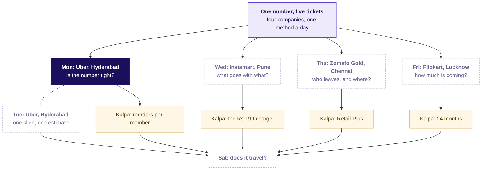

```notes
LIVE, 1 minute. Point to Monday, lit, and to the four dashed days. Each day is a ticket at a company
the room uses, and each day's TA lab moves the same method to Kalpa Retail. Monday is first, so no
earlier day has a number on its node yet; by Saturday every node carries the number the room
produced on it. The week explorer (demos/C2_W04_D01_week_explorer_STUDENT.html, which ships with the
week) opens on this map; light Monday there if it is on the projector. Transition: the six topics.
```

---

## S3. Six topics, then the case that uses them
*Which topics does Monday teach, in which order, and where is each practised?*

| Chapter | Topic, as the curriculum words it | Minutes | Notebook |
|---|---|---|---|
| 1 | What to measure and why; the proxy test | 13 minutes | 01 |
| 2 | North-star and guardrail metrics | 10 minutes | 02 |
| 3 | Leading against lagging indicators | 10 minutes | 03 |
| 4 | Definitions: numerator, denominator, window, exclusions | 10 minutes | 04 |
| 5 | Gaming, and definitions that resist it | 10 minutes | 05 |
| 6 | The metric definition artifact | 10 minutes | 06 |
| 7 to 9 | The case: Uber's Hyderabad peak-hour guarantee, after a 10-minute break | 100 minutes | 07 to 09 |
| 10 and 11 | The case's last round and the interview room, after lunch | 40 minutes | 10 and 11 |
| Lab | Kalpa Retail's growth plan, the same method, in the practice lab | the lab's length | 12 |

A 7-minute opening comes first; after chapter 11, 20 minutes hold the Kahoot, the handoff and the close, then the IITGN faculty session (tentative). Each notebook in `notebooks/` carries its chapter's number and topic.

```notes
LIVE, 2 minutes. Read the topic column aloud: these are the six subtopics of the curriculum row, in
its order, word for word. Chapters 1 to 3 decide what to count; chapters 4 to 6 decide how it is
written down so it cannot be gamed. Then read the running order the table and the line under it
give: the opening, the six chapters, the break, chapters 7 to 9 to lunch, chapters 10 and 11 and the
20-minute close, then the IITGN faculty session (tentative), or the metric clinic in its place. The
row's own Kalpa scenario, Meera's growth plan and the three numbers its teams propose, runs in the
practice lab on the same method. Transition: how the six topics join.
```

---

## S4. Six topics: what each rests on and what it feeds
*How do Monday's six topics connect to each other, to earlier weeks and to the case?*

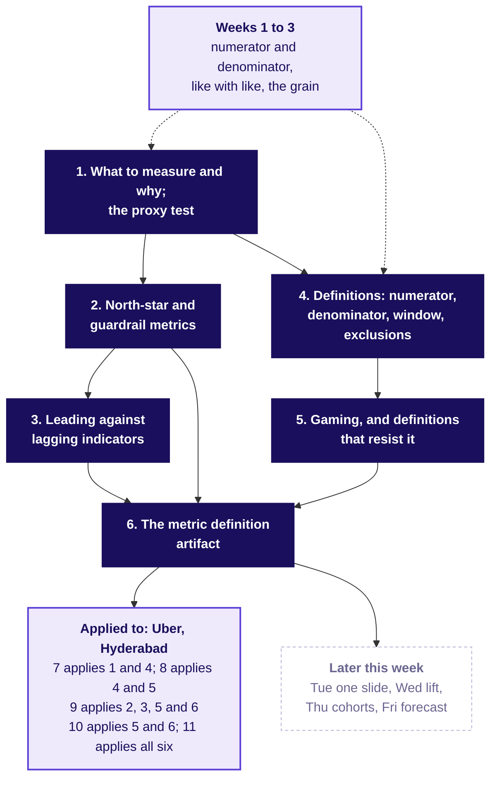

```notes
LIVE, 2 minutes. ByteByteGo's move: one connected map before any detail. The lit boxes are the six
topics of the row, in its order. Two chains: chapters 1 to 3 choose the number (is it safe to pay
for, which one to chase, which one warns first), and chapters 4 and 5 write it down so it cannot be
gamed; chapter 6 puts both on one page, its guardrails from chapter 2. The Uber box says which case
chapter applies which topic. On the slide all six are lit as today's topics; on the board, draw them
unlit and light each as its chapter closes. The dashed box is what the chapters reuse, each named again at
the point of reuse: Week 1 Monday's numerator and denominator for every rate, Week 1 Tuesday's like
with like, Week 2 Friday's grain and one number with its denominator. Tuesday defends today's number
on one slide; Wednesday's lift, Thursday's cohorts and Friday's forecast each consume a number written
today's way. Every concept chapter closes on this map with its own box lit. Explorer: the home screen.
Transition: the destination.
```

---

## S5. The case: a guarantee paid on hours, six weeks on
*Where will the six topics be used, and what must the analyst hand in?*

| On the ticket | What it says |
|---|---|
| Company, city, surface | Uber, Hyderabad, the driver app: from Monday 31 August 2026 an enrolled driver (one signed up for the scheme) online through a whole peak window (two a day, three hours each) is guaranteed Rs 300 per peak online hour, and Uber tops up the gap between the driver's trip earnings and that floor |
| Before and after, six weeks each side | Peak online hours 118,000 to 146,300, up 24 percent; completed peak trips 224,200 to 230,900, up 3 percent; trips per peak online hour 1.90 to 1.58; top-up Rs 0 to Rs 1.9 crore |
| The data | `drivers`, `driver_weeks` (one row per driver per week) and `zone_weeks` (rider requests and waits by zone) |
| The ask, due Friday | Is the scheme working, which number should it pay for, and is anyone gaming it? |
| Caveats | The monsoon ended mid-window; 140 drivers are new; online means the app is open; three outer zones get few requests |

> *Illustrative case: the company is real, the situation and the data are synthetic, built for this class.*

```notes
LIVE, 1 minute. Show it as the destination: read the before and after line and the ask, nothing
more. Ask which of these numbers the city team would put in Monday's headline; most hands go to peak
online hours, up 24 percent. Write it on the whiteboard with the board's question above it, "What
makes a number safe to pay for?", and leave both up: chapter 7 opens on the full ticket after the
break and fills the board region by region. Transition: chapter 1.
```

---

## SECTION 1: What to measure and why; the proxy test: what is a number for?
*Say what a number is for, and test whether a team could raise it while the thing it stands for got worse.*

```notes
LIVE, 30 seconds. Concept 1 of 6, 13 minutes, the longest, because it opens on the instinct round
the curriculum row asks for. The topic is the row's subtopic, word for word. Every number in this
chapter except the bank's on its last slide is invented. Notebook 01 runs beside the chapter. Transition: what a metric is, and who needs the answer.
```

---

## S6. A metric is a number someone decides with
*Who needs the answer, and which questions lead to it?*

A **metric** is a number a person watches in order to decide something: how much rice to cook, whom to pay, whether to keep a scheme. A **target** is a metric with a value somebody is asked to hit, and a person paid on a target works to hit it.

**Who needs the answer.** A school canteen's owner (invented), whose kitchen cooks rice to the count of tokens the counter hands out and who pays the servers by the same count: a count that drifts from the plates wastes rice and money every day.

```timeline
label: The job | title: What is it for? | body: The decision it feeds, and who makes it.
label: The pull | title: What did pay change? | body: The count the servers were paid on.
label: The cost | title: What did it cost? | body: Rice cooked from the wrong count.
label: The test | title: Is it safe to pay for? | body: Could a team raise it while the goal got worse? | tone: dark
```

```notes
LIVE, 1 minute. Read the two definitions, then the four questions; each gets a number before the
next is asked. Most of the room has never been paid on a number, so the canteen makes the pull of a
target concrete. Transition: the instinct round.
```

---

## S7. Which teacher number can rise as children learn less?
*A principal (invented) proposes three numbers to judge teachers by. Which could a teacher raise while the children learned less?*

```cards
icon: clipboard-check | eyebrow: a | title: Attendance marked | body: Only the share of children marked present. | tone: light
icon: book-open | eyebrow: b | title: Homework collected | body: Only the notebooks handed in each week. | tone: light
icon: file-text | eyebrow: c | title: Term exam average | body: Only the class's average mark in the exam. | tone: light
icon: layers | eyebrow: d | title: All three of them | body: Attendance, homework and the exam average. | tone: light
```

```notes
LIVE, 3 minutes, the row's instinct round at small scale: three proposed targets, and the room says
how each could be hit while the thing it stands for got worse. Letters on paper, a show of letters,
two minutes with a neighbour, a second vote. Most pick c, since an exam feels hard to fake. Write the
room's ways of raising each number on the board before the answer goes up. Transition: the answer.
```

---

## S8. Answer: d, all three can rise with no extra learning
*How could each number rise, and what does that make each of them?*

| The number | How a teacher could raise it while the children learned less |
|---|---|
| Attendance marked | Mark a child present who is not in the room: the register is the teacher's own |
| Homework collected | Collect every notebook and never read one |
| Term exam average | Teach only the questions the paper repeats, or keep the weakest children away from the exam |

Each number stands in for the children's learning, which nobody can count directly. A **proxy** is a number that stands in for the thing somebody wants. The belief the vote tested is the common one: if the number goes up, the thing it stands for has improved.

```notes
LIVE, 1 minute 30 seconds. Take each row in turn. The room usually finds the first two and argues
about the third: the exam average is a proxy too, and its last move, keeping the weakest children
away, returns in chapter 2 at a driving school as a shrinking denominator. Transition: the same pull,
counted by hand.
```

---

## S9. Tokens doubled once servers were paid per token
*What did ten days of a school canteen's counts do when pay followed tokens (invented)?*

| Days | Servers paid per token? | Tokens a day | Plates a day | Tokens per plate |
|---|---|---|---|---|
| 1 to 5 | no | 200 | 200 | 200 / 200 = 1.0 |
| 6 to 10 | yes | 400 | 200 | 400 / 200 = 2.0 |

**Counted by hand.** The kitchen cooks 150 g of rice for every token the counter hands out, batch by batch through lunch. From the plates: 200 x 0.15 = 30 kg. From the tokens on day 6: 400 x 0.15 = 60 kg, so 30 kg is thrown away that day, Rs 1,500 a day at Rs 50 a kg and Rs 7,500 over the five paid days. Every number here is invented.

```notes
LIVE, 2 minutes, StatQuest: say each number aloud and write the four sums on the board.
Ask what changed on day 6: only the pay rule. A server who hands two tokens to each diner is paid
twice for one plate, and nobody else loses anything they can see that day. Transition: the picture,
and the rule named last.
```

---

## S10. The paid count drifted from the plates it stood for
*What does the picture show, and what is the rule called?*

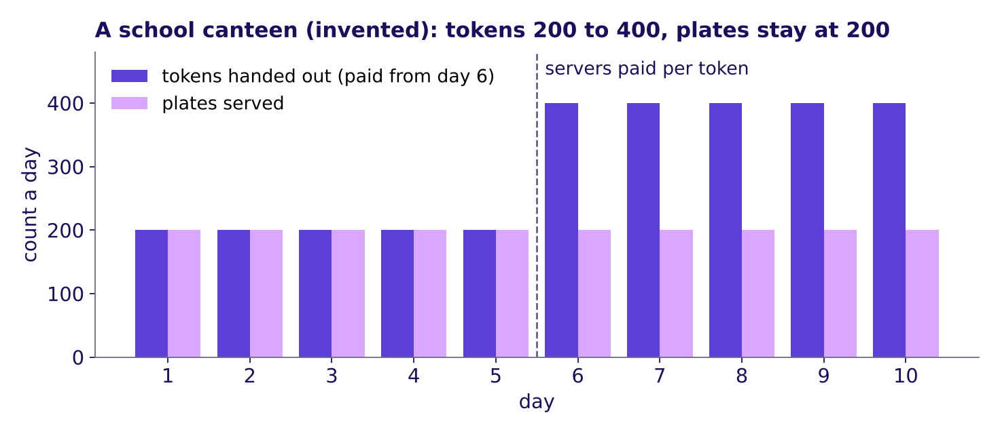

The tokens stood in for plates until the servers were paid on them; from day 6 the paid number doubled and the plates stayed flat. Named last: the **proxy test** asks whether a team could hit this number while the thing it stands for got worse or stayed the same. Tokens fail it, and the curriculum's rule says why: any target bends behaviour toward itself.

```notes
LIVE, 1 minute 30 seconds, 3Blue1Brown: the picture first, the name after it. The rule in the
curriculum row's own words: "if a department could hit the number while the business got worse, the
number is a proxy that has drifted." The word proxy as research uses it: Chou, "Blending Proxy
Metrics with a North Star", arXiv 2606.21745 (June 2026), whose abstract describes proxies as numbers
used in place of outcomes the experimenter does not observe:
https://arxiv.org/abs/2606.21745 (checked 13 October 2026). Explorer: scene M1 draws the same drift
on the city's drivers; it belongs to chapter 7. Transition: the same test in code.
```

---

## S11. Five lines of pandas run the proxy test
*How does code reproduce the count and the test?*

```python
days = pd.read_csv("../data/C2_W04_D01_canteen_days_STUDENT.csv")  # ten invented days
days["per_plate"] = days["tokens"] / days["plates"]   # 1.0, then 2.0
days["rice_kg"] = days["tokens"] * 0.15               # what the kitchen cooks from tokens
first, last = days.iloc[0], days.iloc[-1]
drifted = last.tokens > first.tokens and last.plates <= first.plates   # True
```

`drifted` prints True: the paid number rose and the thing it stands for did not. Notebook 01 runs the same lines on the ten days, draws the picture and tries the test on a second number, a school bus driver's kilometres (invented).

```notes
LIVE, 1 minute, Krish Naik's move: one plain sentence for each line. Line one loads the ten days;
line two divides tokens by plates; line three cooks rice from tokens the way the kitchen did; the
last two lines ask the proxy test of the two columns, first day against last. Transition: the rules.
```

---

## S12. Four rules for choosing what to measure
*Which rules does the chapter leave, and what does an interviewer ask?*

1. Name the decision a number feeds before you count it.
2. A proxy stands in for the thing wanted, and nearly every number on a dashboard is one.
3. Before anyone is paid on a number, ask whether a team could raise it while the goal got worse.
4. Any target bends behaviour toward itself, so read a paid number beside the thing it stands for.

**In the interview.** [S] How would you measure the success of a new feature?

*Each interview line carries a tag: [S] is asked everywhere, [F] often in product screens and in global capability centres (GCCs, the offices global companies run in India), and [D] sets a strong candidate apart.*

```notes
LIVE, 1 minute 30 seconds. The rules are the slide a learner photographs. Ask the proxy-test set's
first item aloud (exercises/unguided/C2_W04_D01_proxy_test_set_STUDENT.md, Q1), take letters, then
say the key and one reason from its solution file; Q2 and Q3 wait for the practice lab. Transition:
where the idea goes, and what it cost a bank.
```

---

## S13. The proxy test feeds chapter 2 and the case's hours
*Where did the idea come from, and where does it go next?*

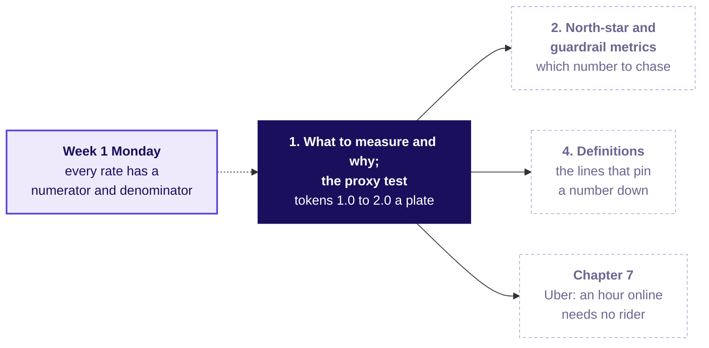

**The same test failed at a bank.** Cross-selling is selling an existing customer one more product, such as a credit card to someone with a savings account. Wells Fargo judged branch staff on products sold, through sales targets and bonuses, and showed investors a cross-sell number, products per household; staff opened accounts customers never asked for or used, and both counts rose. It paid USD 185 million in penalties in 2016 (100 to the US consumer-finance regulator, 35 to a US bank regulator, 50 to Los Angeles) and USD 3 billion in 2020.

```notes
LIVE, 1 minute. The idea joins the map. Then the bank, in order: the numbers (products sold, on
which the CFPB says staff chased "sales targets" and "bonuses", and the cross-sell number, products
per household, which investors read), the missing condition (nobody had to use the account), what it cost (USD 185 million in
2016: the CFPB's USD 100 million, the OCC's USD 35 million and Los Angeles's USD 50 million, all named
in the CFPB's release; USD 3 billion in 2020, and the bank dropped product sales goals). Do not quote a firing count or
Goodhart; neither is verified in the week's sources. Sources:
https://www.consumerfinance.gov/about-us/newsroom/consumer-financial-protection-bureau-fines-wells-fargo-100-million-widespread-illegal-practice-secretly-opening-unauthorized-accounts/ (checked 13 October 2026)
https://www.sec.gov/newsroom/press-releases/2020-38 (checked 13 October 2026)
Transition: chapter 2, the number a plan chases.
```

---

## SECTION 2: North-star and guardrail metrics: which number to chase?
*Pick the one number a plan chases, and the numbers that must not fall while it rises.*

```notes
LIVE, 30 seconds. Concept 2 of 6, 10 minutes. The example is a driving school whose numbers are all
invented; its four instructors teach 25 learners each. Notebook 02 runs beside the chapter.
Transition: who needs the answer.
```

---

## S14. A plan chases one number and watches others
*Who needs the answer, and which questions lead to it?*

When a plan has many numbers, a team needs one it chases and a few it watches so the chase does no harm. The one it chases is the **north star**; the ones that must not get worse while it rises are the **guardrails**.

**Who needs the answer.** A family choosing a driving school (invented) from its hoarding, and the owner who pays instructors on the hoarding's number: a rate read alone can sell a year in which fewer learners got a licence.

```timeline
label: The claim | title: What does the hoarding count? | body: Passes over learners who took the test.
label: The move | title: What else changed? | body: How many took the test.
label: The outcome | title: What did learners pay for? | body: A licence, per learner who enrolled.
label: The guard | title: What must not fall? | body: The share who got to take the test. | tone: dark
```

```notes
LIVE, 1 minute. Read the two names and the four questions. A learner who has never worked in a
business has seen this pull in coaching ads and school results, so the driving school is chosen to
feel familiar. Transition: the prediction.
```

---

## S15. A pass rate rose from 60 to 90 percent: why?
*A driving school (invented) prints "90 percent pass the licence test" on its hoarding; last year it printed 60. What most likely happened?*

```cards
icon: graduation-cap | eyebrow: a | title: Better teaching | body: Instructors taught more this year. | tone: light
icon: file-text | eyebrow: b | title: An easier test | body: The transport office made it simpler. | tone: light
icon: users | eyebrow: c | title: Fewer took the test | body: Instructors booked it only for their surest learners. | tone: light
icon: trending-up | eyebrow: d | title: More enrolled | body: A bigger intake lifted the rate. | tone: light
```

```notes
LIVE, 1 minute 30 seconds. Vote, a neighbour, vote again. The plausible first instinct is a, the
reading the hoarding is written for. Transition: the answer, counted by hand.
```

---

## S16. Answer: c, 40 took the test where 100 had
*How do the school's counts show it, counted by hand?*

| Year | Enrolled | Took the test | Passed | Passed / took | Took / enrolled | Passed / enrolled |
|---|---|---|---|---|---|---|
| 2025 | 100 | 100 | 60 | 0.60 | 1.00 | 0.60 |
| 2026 | 100 | 40 | 36 | 0.90 | 0.40 | 0.36 |

**Counted by hand, invented numbers.** In 2025 all 100 learners took the test and 60 passed: 60 / 100 = 0.60. In 2026 each instructor booked the test only for the learners they were surest of, 40 in all, and 36 passed: 36 / 40 = 0.90. Licences per learner who enrolled fell from 60 / 100 = 0.60 to 36 / 100 = 0.36.

```notes
LIVE, 1 minute 30 seconds. Write the six numbers on the board and divide aloud. The hoarding's
rate rose by half while 24 fewer learners got a licence. Transition: the picture, and the two names.
```

---

## S17. The pass rate rose because its denominator shrank
*What does the picture show, and what are the two numbers called?*

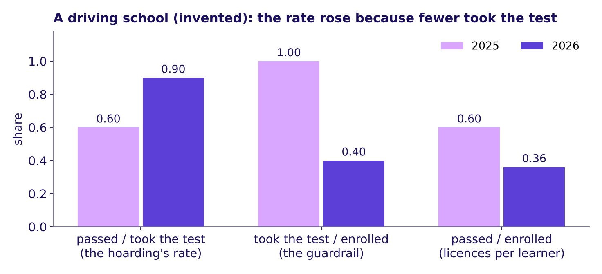

The hoarding's rate rose because the share who took the test fell: a **seesaw**, one side up because the other went down. Named last: a **north star** is the one number that best captures the value the people served get; here it is licences per enrolled learner, 0.60 then 0.36, which no instructor can raise by holding learners back. The hoarding chased the pass rate instead. A **guardrail** is a number watched beside the number being chased, so that hitting it does no hidden harm: beside the pass rate, the share who took the test, 1.00 then 0.40, catches this school's move.

```notes
LIVE, 1 minute 30 seconds, 3Blue1Brown: point at the seesaw before naming it. The two numbers
multiply into the honest one: 0.90 x 0.40 = 0.36. Sources for the names: Amplitude's "What Makes a
Good vs Bad North Star Metric" (Julia Sholtz, 15 August 2024): "A North Star Metric is a single metric
that best captures the value customers derive from your product":
https://www.amplitude.com/blog/good-bad-north-star-metric.md (checked 13 October 2026); Spotify
Confidence's glossary: "A guardrail metric is a metric monitored during an experiment to ensure the
change doesn't cause unintended harm, even when the success metric improves":
https://confidence.spotify.com/glossary/guardrail-metric (checked 13 October 2026). Explorer: scene
M2, the seesaw, on the city's drivers; it belongs to chapter 9. Transition: the same split in code.
```

---

## S18. Five lines of pandas split the rate in two
*How does code reproduce the count?*

```python
school = pd.read_csv("../data/C2_W04_D01_driving_school_STUDENT.csv")  # invented
year = school.groupby("year")[["enrolled", "took_test", "passed"]].sum()
year["pass_rate"] = year["passed"] / year["took_test"]       # 0.60, 0.90
year["took_share"] = year["took_test"] / year["enrolled"]    # 1.00, 0.40
year["per_learner"] = year["pass_rate"] * year["took_share"] # 0.60, 0.36
```

The last line multiplies the hoarding's rate by its guardrail and gives licences per learner who enrolled, the number the families wanted.

```notes
LIVE, 1 minute. One sentence a line: load, add up each year, divide twice, multiply. The product
equals passed over enrolled, which notebook 02 checks a second way. Transition: the rules.
```

---

## S19. Four rules for a north star and its guardrails
*Which rules does the chapter leave, and what does an interviewer ask?*

1. Chase one number: the one that best captures the value the people served get.
2. Read the number a plan chases beside a guardrail that catches a harmful way of hitting it.
3. Choose a guardrail by the harm or gaming it catches: a second growth target, such as "orders up 20 percent", is one more number to chase and catches none.
4. A rate can rise because its denominator shrank, so print the count beside the rate.

**In the interview.** [F] North-star against guardrail, with one example pair.

```notes
LIVE, 1 minute 30 seconds. Ask the north-star set's first item aloud (exercises/unguided/
C2_W04_D01_north_star_guardrails_set_STUDENT.md, Q1), take letters, then say the key and one reason.
Transition: two companies whose headline number had to match what they were trying to do.
```

---

## S20. Orders per user would have read a success as a fall
*What happens when a north star counts the wrong thing for what the business is trying to do?*

```stats
value: over 28% | label: of MTUs, in Swiggy's words | note: monthly transacting users who used Maxxsaver, Instamart's larger-basket offer, in the quarter to 30 June 2025
value: Rs 612 | label: average order value | note: up 16 percent on the quarter, from wider non-grocery selection and Maxxsaver
value: NOV | label: Eternal's headline | note: net order value: the value of orders before discounts (GOV), minus the discounts
```

**Swiggy Instamart's Maxxsaver** unlocks extra discounts once a cart passes a threshold, so some users put more into fewer orders. Swiggy puts the slower order growth down to that and to letting go of some low-value orders and unprofitable users: orders per user alone would read the quarter as a fall, and the letter adds that the ramp-up kept contribution flat. **Eternal**, whose businesses include Zomato and Blinkit, stopped disclosing gross order value in its letter for the quarter to 30 June 2026 "as NOV more accurately reflects underlying performance": a discount is value handed back to the customer, which gross order value still counts.

```notes
LIVE, 1 minute. Each company chose a headline number that matched what it was trying to do;
neither letter says a number was used badly, so do not say it either. Swiggy's and Eternal's
financial years start in April, so Q1 FY26 is the quarter to 30 June 2025 and Q1 FY27 the quarter to
30 June 2026. Sources: Swiggy's Q1 FY26
shareholder letter: https://www.swiggy.com/corporate/wp-content/uploads/2025/07/Q1-FY2026-Shareholder-letter.pdf
(checked 13 October 2026); Eternal's Q1 FY26 letter for NOV = GOV minus discounts:
https://drive.google.com/file/d/1VtoiLsA2OpKauFnkKIlhXRmnbvxL-6ha/view (checked 13 October 2026);
its Q1 FY27 letter for the sunset:
https://drive.google.com/file/d/1jb9KWd4Ap4RTKHFHxzEOO7jgQqVZEGcd/view (checked 13 October 2026),
linked from https://www.eternal.com/blog/q1fy27/ (checked 13 October 2026). Transition: where the
idea goes.
```

---

## S21. The north star feeds chapter 3 and Uber's redesign
*Where did the idea come from, and where does it go next?*

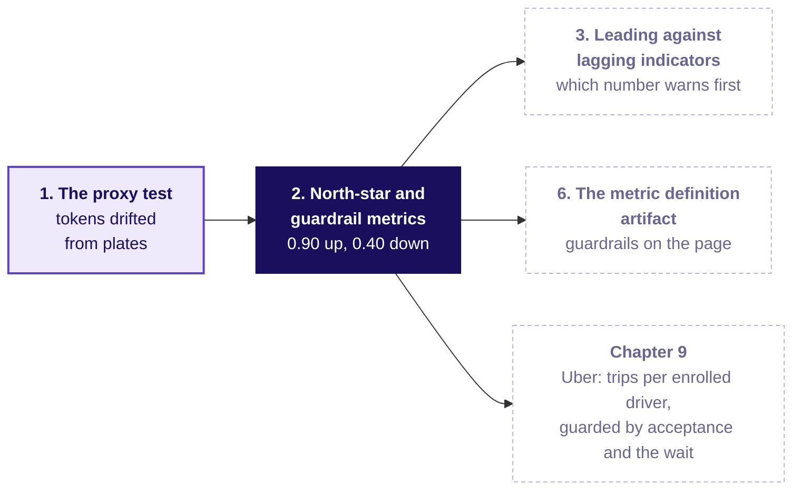

At Uber's Hyderabad scheme the same pair returns in chapter 9: completed peak trips per enrolled driver as the north star, with the share of offers accepted (an offer is one rider's request shown to one driver, who may accept or decline it) and the rider's wait as the guardrails that catch a driver who stays online and declines.

```notes
LIVE, 30 seconds. The idea joins the map. Transition: chapter 3, which number warns first.
```

---

## SECTION 3: Leading against lagging indicators: which number warns?
*Tell a number that warns while a team can still act from one that confirms the result later.*

```notes
LIVE, 30 seconds. Concept 3 of 6, 10 minutes. The example is a T20 chase whose every run is
invented. Notebook 03 runs beside the chapter. Transition: who needs the answer.
```

---

## S22. Some numbers arrive while a team can still act
*Who needs the answer, and which questions lead to it?*

A number that moves before the north star, while a team can still act on it, is **leading**; one that confirms the north star after the result is fixed is **lagging**. Leading and lagging say when a number moves, which is a separate question from the job it does, so one number can be a guardrail and a leading number at once.

**Who needs the answer.** The captain of a side chasing a T20 total (invented), who can still change the batting order at over 11 and cannot change the scoreboard at over 20.

```timeline
label: The goal | title: When is a chase lost? | body: The final score against the target.
label: The warning | title: Which number moves first? | body: The runs an over still needed.
label: The guard | title: What is it read with? | body: The wickets still in hand.
label: The record | title: Which number confirms? | body: The margin, after the last ball. | tone: dark
```

```notes
LIVE, 1 minute. Read the two names. Cricket is chosen because the room already reads a required
rate without being taught it, so the idea arrives on something they know. Transition: the prediction.
```

---

## S23. When does the chase first need 10 an over?
*The other side made 159, so 160 wins in 20 overs (invented); after 10 overs at six an over the chase is 60 for 3. When does the runs-an-over needed first reach 10?*

```cards
icon: list | eyebrow: a | title: After over 5 | body: A third of the way in. | tone: light
icon: list | eyebrow: b | title: After over 10 | body: Halfway, at 60 for 3. | tone: light
icon: list | eyebrow: c | title: After over 15 | body: Five overs from the end. | tone: light
icon: list | eyebrow: d | title: Only at the end | body: When the last ball is bowled. | tone: light
```

```notes
LIVE, 1 minute 30 seconds. Letters on paper. The plausible wrong answer is d: "you know a chase is
lost when the last over ends". Transition: the answer, counted by hand.
```

---

## S24. Answer: b, 10.0 an over after over 10
*How is the runs-an-over needed counted, and when does the result arrive?*

| After over | Runs so far | Runs still needed | Overs left | Needed an over |
|---|---|---|---|---|
| 0 | 0 | 160 | 20 | 160 / 20 = 8.0 |
| 5 | 30 | 130 | 15 | 130 / 15 = 8.7 |
| 10 | 60 | 100 | 10 | 100 / 10 = 10.0 |
| 15 | 102 | 58 | 5 | 58 / 5 = 11.6 |
| 20 | 147 | lost by 12 | 0 | the result |

**Counted by hand, invented numbers.** Six an over for ten overs is 60, so 100 are still needed from 10 overs, 10.0 an over. The side ends on 147, and the other side's 159 wins by 12 runs: the scoreboard confirms the loss at over 20, ten overs after the rate needed warned.

```notes
LIVE, 1 minute 30 seconds, StatQuest: fill the table row by row aloud. The runs in overs 11 to 20
are 7, 8, 9, 10, 8, 9, 10, 11, 9 and 6. Transition: the picture, and the names.
```

---

## S25. The rate needed warned ten overs before the result
*What does the picture show, and what are the two kinds of number called?*

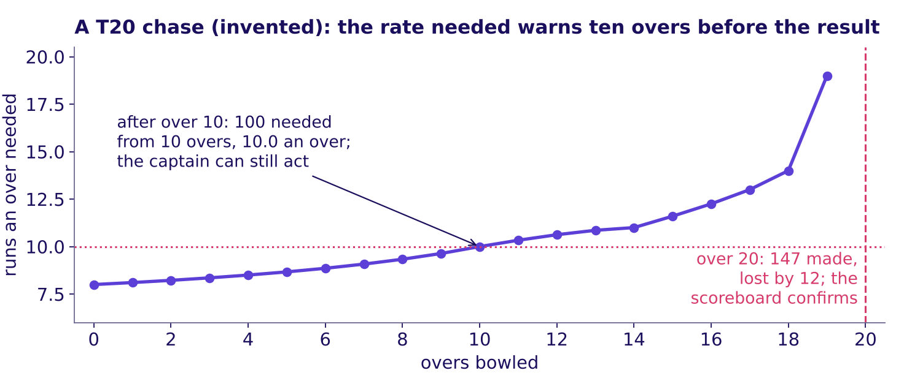

The runs an over needed climbed past 10 at over 10, while the captain could still promote a hitter; the margin arrived at over 20. Named last: a **leading indicator** moves before the north star while the team can act, and a **lagging indicator** confirms it later. Wickets in hand, 7 at over 10, are the guardrail read beside it: a side that chases the rate by swinging at every ball loses wickets, and the wickets show that harm before the score does.

```notes
LIVE, 1 minute 30 seconds. The words in Amplitude's article on north star metrics (Julia Sholtz,
15 August 2024): "Some metrics tell you what has already happened to your business; these are
lagging indicators", and "Revenue is a lagging indicator", with a good north star described as "a
leading indicator of revenue": https://www.amplitude.com/blog/good-bad-north-star-metric.md (checked
13 October 2026). Transition: the same count in code.
```

---

## S26. Four lines of pandas give the rate needed
*How does code reproduce the count?*

```python
overs = pd.read_csv("../data/C2_W04_D01_chase_overs_STUDENT.csv")  # invented
overs["so_far"] = overs["runs"].cumsum()                   # 60 after over 10
overs["needed_an_over"] = (160 - overs["so_far"]) / (20 - overs["over"])
overs.loc[overs["over"] == 10, "needed_an_over"]          # 10.0
```

`cumsum` keeps a running total, so each row holds the runs made so far; the division is the board's sum, one row per over.

```notes
LIVE, 1 minute. One sentence a line. Over 20 divides by zero overs left; notebook 03 stops the
column at over 19, where the result takes over. Transition: the rules.
```

---

## S27. Four rules for leading and lagging numbers
*Which rules does the chapter leave, and what does an interviewer ask?*

1. A leading number moves before the north star, while the team can still act on it, and history shows it predicts the north star.
2. A lagging number confirms the north star after the result is fixed.
3. Read a leading number beside its guardrail: 10 an over with 7 wickets in hand is a different chase from 10 an over with 2.
4. A dashboard of lagging numbers alone lets a drift run for weeks before anyone sees it.

**In the interview.** [F] North-star against guardrail, with one example pair.

```notes
LIVE, 1 minute 30 seconds. Ask the leading-lagging set's first item aloud: the eight Kalpa numbers,
called leading or lagging by letter, then say the key and one reason; two learners defend one call
each in a sentence, as the curriculum row asks
(exercises/unguided/C2_W04_D01_leading_lagging_set_STUDENT.md, Q1). Transition: the same split on
the case's own weeks.
```

---

## S28. Acceptance settled in week one; bookings kept falling
*Which of the city's numbers would have warned in the first week of Uber's scheme?*

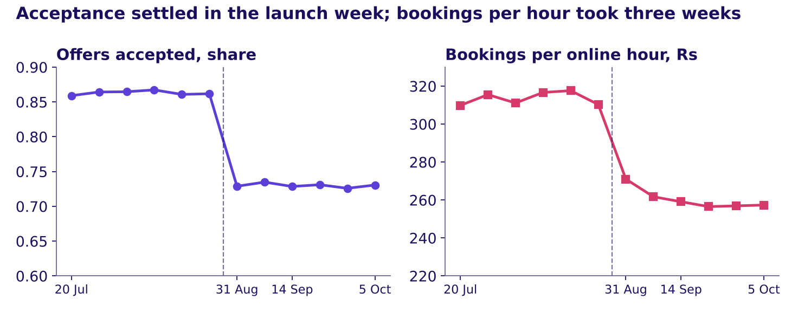

On the case's twelve weeks the share of offers accepted went from 0.862 in the week before the launch to 0.729 in the launch week and stayed there, while bookings per online hour, the fares riders paid per hour online, went from Rs 310.3 to Rs 271.0 that week and kept falling to Rs 259.1 by the third. Both fell at the launch; acceptance reached its new level at once, so a city team watching it had the whole change in week one.

```notes
LIVE, 1 minute. The connected example, on the case's synthetic data: acceptance is guardrail 1 in
chapter 9 and a leading number here, the job and the timing being two questions. Explorer: scene M4
asks which line turns first; use it if it is on the projector. Transition: where the idea goes.
```

---

## S29. Leading inputs feed chapter 6 and the case's tree
*Where did the idea come from, and where does it go next?*

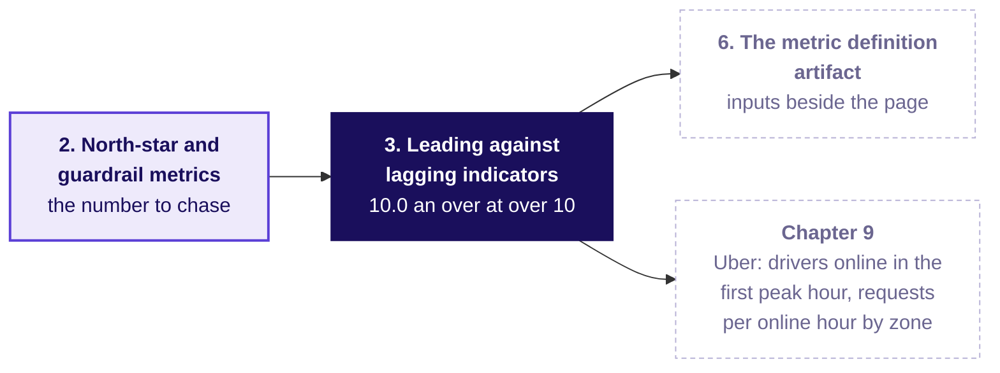

In chapter 9 the city's two leading inputs sit under its north star: enrolled drivers online in the first peak hour, and rider requests per online hour by zone.

```notes
LIVE, 30 seconds. The idea joins the map. Transition: chapter 4, the lines that pin a number down.
```

---

## SECTION 4: Definitions: numerator, denominator, window, exclusions: which four lines?
*Write the four lines that make a number computable, and watch each line move the same number.*

```notes
LIVE, 30 seconds. Concept 4 of 6, 10 minutes. The example is one student's term register, every
day of it invented; the programme's own attendance rule is not used. Notebook 04 runs beside the
chapter. Transition: who needs the answer.
```

---

## S30. Four written lines let two people count alike
*Who needs the answer, and which questions lead to it?*

Week 1 Monday wrote every rate as a **numerator** over a **denominator**. Two more lines finish the job: the **window**, the stretch of time the count covers, and the **exclusions**, what is left out of both counts, with the date of any change.

**Who needs the answer.** A school principal (invented) who prints one attendance figure on a student's transfer certificate, and the two clerks who must compute it alike: a figure computed two ways can cost a student a scholarship.

```timeline
label: Line 1 | title: The numerator | body: What is counted on top.
label: Line 2 | title: The denominator | body: What it is divided by.
label: Line 3 | title: The window | body: Which stretch of days.
label: Line 4 | title: The exclusions | body: What leaves both counts. | tone: dark
```

```notes
LIVE, 1 minute. Backward hook, said once: Week 1 Monday's numerator and denominator. Today adds the
two lines Week 1 left implicit. Transition: the prediction.
```

---

## S31. How many numbers can one honest register give?
*One student's 60-day term (invented): five honest clerks compute the attendance percentage from the same register. How many different numbers come out?*

```cards
icon: hash | eyebrow: a | title: One | body: A register is a register. | tone: light
icon: hash | eyebrow: b | title: Two | body: With holidays, or without them. | tone: light
icon: hash | eyebrow: c | title: Four or more | body: One for each choice a clerk makes. | tone: light
icon: circle-help | eyebrow: d | title: It cannot be told | body: Not without the register in hand. | tone: light
```

```notes
LIVE, 1 minute 30 seconds. The misconception under a: "attendance is one number; everyone computes
it the same way". Transition: the answer, counted by hand.
```

---

## S32. Answer: c, five numbers from one register
*Which line moved, and what did each reading count?*

| The line that changed | Numerator | Denominator | Reading |
|---|---|---|---|
| None: the school's rule | 40 present | 50 working days | 80.0 percent |
| Denominator: calendar days | 40 | 60 days | 66.7 percent |
| Exclusions: medical leave out of both counts | 40 | 48 | 83.3 percent |
| Numerator: medical leave counted present | 42 | 50 | 84.0 percent |
| Window: the last 20 working days | 14 | 20 | 70.0 percent |

**The register, invented.** A 60-day term holds 10 holidays, so 50 working days; the student was present on 40, absent on 8 and on medical leave for 2. In the term's last 20 working days the student was present on 14.

```notes
LIVE, 1 minute 30 seconds, StatQuest: divide each row aloud, one clerk a row. Every reading is
honest; each answers a different question, and only a written definition says which one the
certificate means. Transition: the
picture, and the rule.
```

---

## S33. Each line moved the same student's number
*What does the picture show, and what is the rule called?*

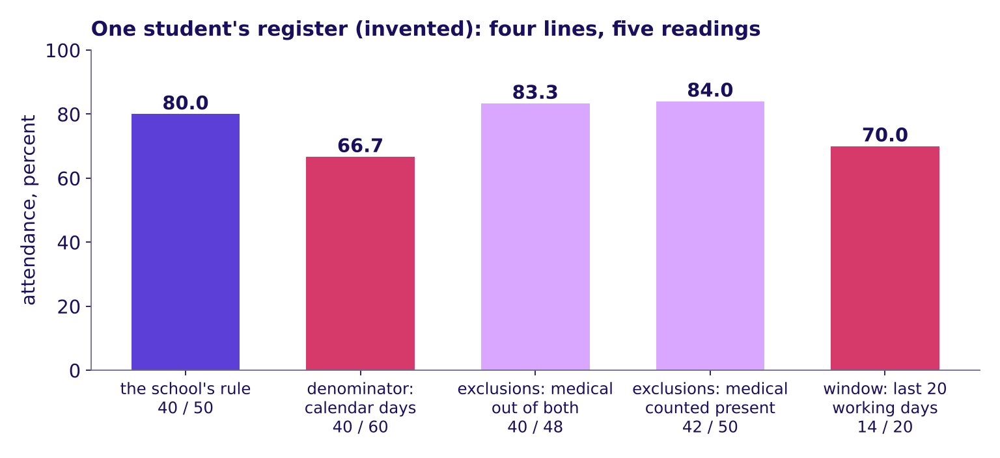

The same register printed every figure from 66.7 to 84.0 percent as one line at a time changed. Named last: four lines make a number **computable**, its numerator, its denominator, its window and its exclusions, and with them written down two people compute the same number. The course outline adds that a definition is complete only when it also says what it deliberately does not reward, a line chapter 6's page carries.

```notes
LIVE, 1 minute 30 seconds. The same four lines in a public specification: the US Centers for
Medicare and Medicaid Services' Measures Management System lists a measure's denominator, its
denominator exclusions, its numerator and its time interval, and says "Denominator exclusions refer
to criteria that result in removal of patients or cases from the denominator before calculating the
numerator": https://mmshub.cms.gov/measure-lifecycle/measure-specification/develop-specification and
https://mmshub.cms.gov/measure-lifecycle/measure-specification/develop-specification/denominator-exclusions
(both checked 13 October 2026). Explorer: scene M3 rebuilds a definition line by line on the city's
drivers; it belongs to chapter 9. Transition: the four lines in code.
```

---

## S34. One small function holds the four lines
*How does code reproduce all five readings?*

```python
reg = pd.read_csv("../data/C2_W04_D01_attendance_register_STUDENT.csv")   # invented
def attendance(days, top=("present",), bottom=("present", "absent", "medical")):
    return round(100 * days.status.isin(top).sum() / days.status.isin(bottom).sum(), 1)
attendance(reg)                                       # 80.0, the school's rule
attendance(reg, bottom=("present", "absent"))         # 83.3, medical leave left out
```

The two arguments are the numerator and the denominator; the window is the rows passed in, and an exclusion is a status left out of both.

```notes
LIVE, 1 minute. One sentence a line. Notebook 04 calls the same function five times and checks each
result against a count made by filtering the table directly. Transition: the rules.
```

---

## S35. Four rules for writing a definition
*Which rules does the chapter leave, and what does an interviewer ask?*

1. Write the numerator and the denominator as counts of named things.
2. Write the window as dates or periods: the same register reads 80.0 over the term and 70.0 over its last 20 working days.
3. List every exclusion, and date any change to the list.
4. Print the definition beside the number wherever the number travels.

**In the interview.** [F] What makes a metric gameable, and how do you write one that is not?

```notes
LIVE, 1 minute 30 seconds. Ask the definition-lines set's first item aloud
(exercises/unguided/C2_W04_D01_four_definition_lines_set_STUDENT.md, Q1), take letters, then say the
key and one reason. Transition: a company that writes its lines down.
```

---

## S36. Swiggy's filings write each line down
*What do the four lines look like in a public filing?*

| Swiggy term, as filed | Numerator | Denominator | Window | Exclusions, read from the words |
|---|---|---|---|---|
| Average Monthly Transacting Users (MTU) | Unique users with at least one completed order on the app or website | none: a count | the month, averaged over the period | users with no completed order |
| Platform frequency | Completed orders | transacting users | the month, averaged over the period | orders not completed |

In the quarter to 30 September 2024 Swiggy reported platform frequency of 4.53 orders per user a month and an MTU of 17.1 million. MTU is a count, so it has no denominator. Because "completed order" and "per month, averaged" are written down, a reader cannot mistake MTU for registered users.

```notes
LIVE, 1 minute. Read the two rows, naming numerator, denominator and window each time; the
exclusions column is read from the filed words, since "completed" leaves out every order that was
not. Source:
Swiggy's Q2 FY25 shareholder letter, filed with BSE:
https://www.bseindia.com/xml-data/corpfiling/AttachHis/2495f39b-e1d1-4018-8f69-6ff250345e98.pdf
(checked 13 October 2026). Transition: where the idea goes.
```

---

## S37. The four lines feed chapter 5 and chapter 8
*Where did the idea come from, and where does it go next?*

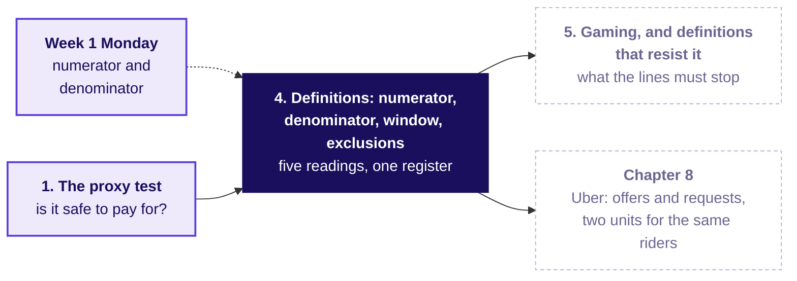

**The unit moves the number too.** In February 2018 Delhi Metro carried nearly 27 lakh riders a day; its new "line utilisation" count read 45,35,932 on 29 May 2018, since a rider who changes across three lines counts three times: one crowd, two units, and two windows too. After the change it did not share the daily ridership figure.

```notes
LIVE, 30 seconds. The idea joins the map, then Delhi Metro in one breath; chapter 8 meets the same
lesson in offers against rider requests. PTI's copy gives February's "nearly 27 lakh commuters ...
daily", the 29 May line utilisation, and that DMRC "did not share the daily average ridership
figures" after the new section opened, ridership having "taken a hit after two fare hikes in 2017":
a new count printed without the old one beside it, which is why chapter 5 dates every change. Sources:
https://www.latestly.com/agency-news/dmrc-uses-new-count-metric-on-traffic-flow-doesnt-share-ridership-190870.html/amp
(PTI's copy, checked 13 October 2026);
https://www.deccanherald.com/india/delhi/delhi-metro-records-highest-ever-footfall-on-aug-29-2666561
("Journey or line utilisation is calculated by the number of corridors passengers use to reach their
destinations", checked 13 October 2026). Transition: chapter 5, what the lines must resist.
```

---

## SECTION 5: Gaming, and definitions that resist it: how is a number gamed?
*Name the four ways a paid number is gamed, and the line of a definition that stops each.*

```notes
LIVE, 30 seconds. Concept 5 of 6, 10 minutes. The example is Balaji Kirana, an invented corner shop
in Hyderabad, and its four weeks of home deliveries. Notebook 05 runs beside the chapter.
Transition: who needs the answer.
```

---

## S38. Gaming raises a number without the work
*Who needs the answer, and which questions lead to it?*

**Gaming** is raising a number without doing what it stands for. Some of it is false reporting, a done press with nothing delivered, which a receipt and an audit stop; some is honest work steered to the count, such as booking only the surest learners, which pay design and a guardrail catch. Either way a paid number pulls behaviour toward it.

**Who needs the answer.** The owner of Balaji Kirana (invented), who pays the delivery boy Rs 20 for each delivery marked done in the shop's app and promises customers delivery within 30 minutes: a count the boy controls pays him for parcels nobody received.

```timeline
label: The count | title: Who controls it? | body: The person paid, or the person served.
label: The proof | title: Does it need a receipt? | body: A press, or a customer's OTP.
label: The clock | title: Who starts it? | body: The person timed, or the system.
label: The rules | title: Did they change unannounced? | body: A new kind of count, undated. | tone: dark
```

```notes
LIVE, 1 minute. Read the definition and its two kinds, false reporting and steered work; the people
in the stories are ordinary.
An OTP is the one-time code the customer reads out at the door. Transition: the prediction.
```

---

## S39. What can rise with no parcel changing hands?
*Balaji Kirana (invented) pays Rs 20 for each delivery the boy marks done; in four weeks he marks 50. Against the deliveries customers confirmed with their OTP, what does the shop find?*

```cards
icon: equal | eyebrow: a | title: The same 50 | body: A delivery marked is a delivery made. | tone: light
icon: trending-down | eyebrow: b | title: Fewer than 50 | body: Some were marked at the gate and never handed over. | tone: light
icon: trending-up | eyebrow: c | title: More than 50 | body: Customers confirm orders he forgot to mark. | tone: light
icon: circle-help | eyebrow: d | title: It cannot be told | body: The app keeps no second record. | tone: light
```

```notes
LIVE, 1 minute 30 seconds. The misconception under a: "if we pay per delivery, we get more deliveries".
Transition: the answer, counted by hand.
```

---

## S40. Answer: b, 50 marked done and 40 confirmed
*Who controls each count, and what does each one pay?*

| The count | Who controls it | Four weeks | At Rs 20 |
|---|---|---|---|
| Deliveries marked done | the delivery boy | 50 | Rs 1,000 |
| Deliveries confirmed with the customer's OTP | the customer | 40 | Rs 800 |
| Within 30 minutes of the dispatch time the boy types | the delivery boy | 50 of 50, 1.00 | |
| Within 30 minutes of the shop's bill | the shop's system | 35 of 50, 0.70 | |

**Counted by hand, invented numbers.** The Rs 200 gap is the gaming: 10 orders were marked done at the gate and never handed over, and all 6 of the month's complaints came from those 10. Both clocks stop at the boy's done press, so they time all 50 marked orders; chapter 6's page times only the 40 the customer confirmed.

```notes
LIVE, 1 minute 30 seconds. Read each row with its owner. Ask what the boy gains by typing the
dispatch time late: every delivery reads on time. Transition: the picture, and the rule.
```

---

## S41. The boy's own counts read higher than the shop's
*What does the picture show, and when does a definition resist gaming?*

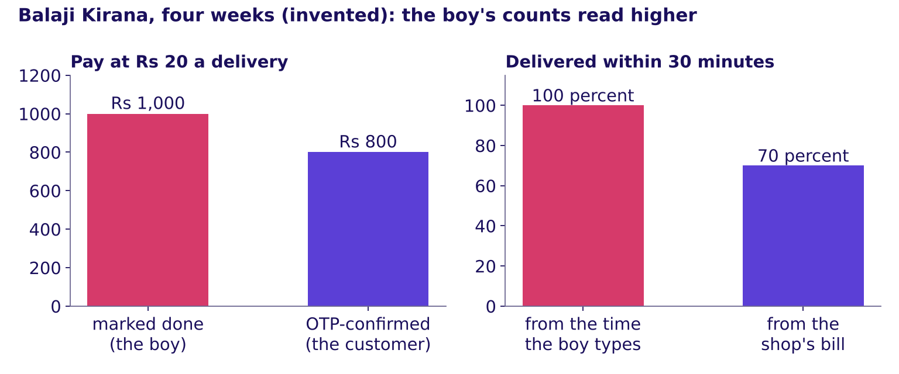

Both of the boy's counts read better than the counts the customer and the shop keep. Named last: a definition **resists gaming** when its numerator needs a receipt, its denominator is set by someone other than the people paid, its clock starts at a time the system records, its exclusions are dated, and it says what it does not reward.

```notes
LIVE, 1 minute 30 seconds. The five properties are the programme's own summary of the four failures
on the next slide, each taken from a written record: the SEC's 2020 order against Wells Fargo
(Release 34-88257) and the VA inspector general's 2014 report, both re-read on 13 October 2026.
Transition: the four ways, side by side.
```

---

## S42. Four ways to game a count, the line that stops each
*How is each way done at the shop and in public, and which line catches it?*

| How it is gamed | At Balaji Kirana (invented) | In public, or in the case | The line that stops it |
|---|---|---|---|
| The paid person controls the count | The boy presses done | The illustrative Uber case: an open app counts as online (chapter 7) | A count the person served confirms |
| No receipt or use is needed | Done with no OTP | Wells Fargo: accounts nobody used | A receipt condition in the numerator |
| The person timed sets the clock's start | The boy types the dispatch time | US Veterans Affairs: the wait ran from a "desired date" the scheduler typed | A clock that starts at the system's time |
| A quiet change of definition | The shop starts counting attempts | Wells Fargo, 2013: accounts for sending money abroad added to the count, unannounced | Exclusions and changes dated on the page |

At its Phoenix facility, 30 of the 40 primary-care schedulers and supervisors the inspectors asked said they set the desired date from the next open appointment or the provider's availability, so a long wait read as zero days.

```notes
LIVE, 1 minute. Read across each row. Wells Fargo: in the SEC's order, global remittance
accounts joined the cross-sell count during 2013 without investors being told, giving 0.04 of that
year's 0.11 rise. VA: after the inspector general's interim report the 14-day goal left employee
performance contracts. Sources: https://www.sec.gov/files/litigation/admin/2020/34-88257.pdf
(checked 13 October 2026); https://www.vaoig.gov/sites/default/files/reports/2014-08/VAOIG-14-02603-267.pdf
(checked 13 October 2026). Transition: one condition in code.
```

---

## S43. One condition turns a press into a delivery
*How does code reproduce the counts?*

```python
orders = pd.read_csv("../data/C2_W04_D01_kirana_deliveries_STUDENT.csv")  # invented
orders["marked_done"].sum()                     # 50, the boy's count
orders["otp_confirmed"].sum()                   # 40, the customer's
(orders["minutes_from_bill"] <= 30).mean()      # 0.70, the shop's clock
```

Each line counts the same 50 orders under a different owner: summing True values counts them, and the mean of True and False is a share.

```notes
LIVE, 1 minute. One sentence a line. Notebook 05 adds the second route: the 6 complaints matched to
the 10 orders with no OTP. Transition: the rules.
```

---

## S44. Four rules for a definition that resists gaming
*Which rules does the chapter leave, and what does an interviewer ask?*

1. Let the person served confirm the count, as an OTP does.
2. Start the clock at a time the system records, never at one the person timed types in.
3. Date every change to what is counted, and print the change beside the number.
4. Say in one line what the number deliberately does not reward.

**In the interview.** [F] What makes a metric gameable, and how do you write one that is not?

```notes
LIVE, 1 minute 30 seconds. Ask the gaming set's first item aloud
(exercises/unguided/C2_W04_D01_gaming_set_STUDENT.md, Q1), take letters, then say the key and one
reason. Transition: where the idea goes.
```

---

## S45. Resistant lines feed the page and the case's pay rule
*Where did the idea come from, and where does it go next?*

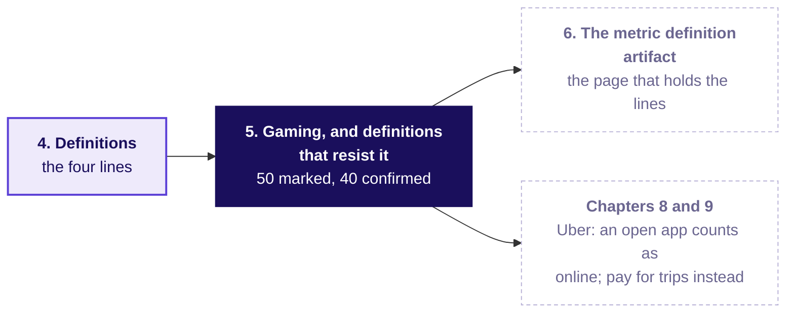

At Uber the driver controls the count of online hours; chapter 9's redesign judges the scheme by completed trips, which need a rider's request, and chapter 10 pays the Rs 300 floor only to driver-weeks that clear an acceptance floor, a least share of offers accepted.

```notes
LIVE, 30 seconds. The idea joins the map. Transition: chapter 6, the page.
```

---

## SECTION 6: The metric definition artifact: what does the page hold?
*Fill the seven-line page a company can adopt, so that three teams argue about one written thing.*

```notes
LIVE, 30 seconds. Concept 6 of 6, 10 minutes, on the same invented shop as chapter 5. Notebook 06
runs beside the chapter. Transition: who needs the answer.
```

---

## S46. One written page ends three remembered numbers
*Who needs the answer, and which questions lead to it?*

The **metric definition artifact** is one page a company adopts, so teams argue about one written thing instead of three remembered ones. Its first four lines, from chapter 4, make the number computable; its last three, from chapters 2 and 5, make it safe to pay for.

**Who needs the answer.** The owner of Balaji Kirana (invented), whose son wants "deliveries up 20 percent" as the shop's growth target; after the break, the Hyderabad city head, who signs Uber's page.

```timeline
label: The shape | title: What are the seven lines? | body: The skeleton, with blanks.
label: The gap | title: What does a weak page lack? | body: Five of the seven.
label: The fill | title: What does a full page say? | body: The shop's lines, filled.
label: The proof | title: Is anything missing? | body: A check that names the gap. | tone: dark
```

```notes
LIVE, 1 minute. Read the definition and the four questions. Transition: the prediction.
```

---

## S47. How many of seven lines does this page hold?
*The shop's growth plan (invented) reads: "Deliveries, monthly, plus 20 percent". How many of a complete definition's seven lines are on it?*

```cards
icon: list-ordered | eyebrow: a | title: One | body: Only what is counted. | tone: light
icon: list-ordered | eyebrow: b | title: Two | body: What is counted, and over when. | tone: light
icon: list-ordered | eyebrow: c | title: Four | body: The lines that make it computable. | tone: light
icon: list-ordered | eyebrow: d | title: All seven | body: A name, a window and a target. | tone: light
```

```notes
LIVE, 1 minute 30 seconds. The misconception under d: "a metric is defined when it has a name and a
target". Transition: the answer, and the skeleton.
```

---

## S48. Answer: b, what is counted and the window
*What are the seven lines, and which two does the weak page hold?*

```timeline
label: Line 1 | title: Numerator | body: What is counted, with its receipt.
label: Line 2 | title: Denominator | body: Divided by what, count printed.
label: Line 3 | title: Window | body: Over which period.
label: Line 4 | title: Exclusions | body: Left out of both, each change dated.
label: Line 5 | title: Not rewarded | body: Behaviour the number refuses to pay for.
label: Line 6 | title: Guardrails | body: Two or three numbers that must not fall past a margin.
label: Line 7 | title: Gaming note | body: The way of gaming each guardrail catches. | tone: dark
```

"Deliveries" is line 1 with no receipt and "monthly" is line 3; "plus 20 percent" is a target, which says how much and never what. The weak page leaves five lines blank.

```notes
LIVE, 1 minute 30 seconds. The skeleton before the instance: say the seven names, then point at the
two the weak page fills. Transition: the same seven lines, filled for the shop.
```

---

## S49. Balaji Kirana's page, filled line by line
*What does a full page say for the shop's deliveries?*

| Line | Balaji Kirana's page (invented) |
|---|---|
| Numerator | Deliveries confirmed with the customer's OTP |
| Denominator | Orders billed that week, the count printed beside the rate |
| Window | The calendar week |
| Exclusions | Orders the customer cancelled before dispatch, each change dated; none in these four weeks |
| What it does not reward | A done press with no OTP, a dispatch time typed by hand, a shrinking order count |
| Guardrails | Complaints per 100 orders billed; the share of confirmed deliveries within 30 minutes of the bill |
| Gaming note | Complaints catch an OTP asked for by phone before the goods arrive; the bill clock catches a late-typed dispatch time |

Read on the four weeks: 40 of 50 orders confirmed, 0.80; complaints 12 per 100 orders billed; 30 of the 40 within 30 minutes of the bill, 0.75.

```notes
LIVE, 1 minute 30 seconds. Fill each line with the room before showing it; ask which chapter each
line comes from. Once the numerator needs an OTP, a press at the gate pays nothing, so complaints
watch for the move that is left: the OTP taken over the phone. Transition: the weak page and the full one, week by week.
```

---

## S50. The weak page counted presses; the full one, receipts
*What does the picture show, and what is the page called?*

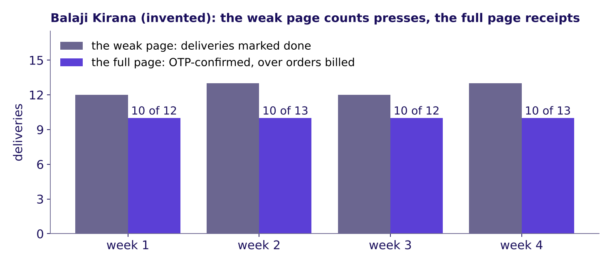

Week by week the weak page reads 12 or 13 deliveries; the full page reads 10 confirmed of the orders billed. Named last: the **metric definition artifact** is the seven-line page a company adopts, four lines that make the number computable and three that make it safe to pay for.

```notes
LIVE, 1 minute. The same lines in public: a US quality measure's specification lists its
numerator, denominator, exclusions and time interval among its building blocks (CMS Measures Management
System, https://mmshub.cms.gov/measure-lifecycle/measure-specification/develop-specification,
checked 13 October 2026). The seven lines are assembled from the curriculum row's own words:
numerator, denominator, window and exclusions, what it deliberately does not reward, the guardrails
and the gaming note. Transition: the page in code.
```

---

## S51. A seven-key dictionary and a one-line check
*How does code hold the page, and find what is missing?*

```python
LINES = ["numerator", "denominator", "window", "exclusions",
         "does_not_reward", "guardrails", "gaming_note"]
weak = {"numerator": "deliveries", "window": "monthly"}
[line for line in LINES if not weak.get(line)]   # the five blank lines
```

A page is a dictionary with one key per line, and the check lists every line left blank: five for the weak page, none for the full one.

```notes
LIVE, 1 minute. Notebook 06 holds both pages as dictionaries and flags a guardrail whose gaming
note names nothing it catches. Transition: the rules.
```

---

## S52. Four rules for the page a company signs
*Which rules does the chapter leave, and what does an interviewer ask?*

1. Write all seven lines before anyone is paid on the number.
2. The first four lines make it computable; the last three make it safe to pay for.
3. A target is no line of a definition: "plus 20 percent" says how much and never what.
4. When teams disagree, change a line on the page and date it.

**In the interview.** [D] Three departments each want their own target; how do you get to one, and what do you say to the two who lose?

```notes
LIVE, 1 minute 30 seconds. Ask the artifact set's first item aloud
(exercises/unguided/C2_W04_D01_artifact_set_STUDENT.md, Q1), take letters, then say the key and one
reason. Transition: the page goes to the case.
```

---

## S53. The page is filled for Uber in chapter 9
*Where do the six ideas go next?*

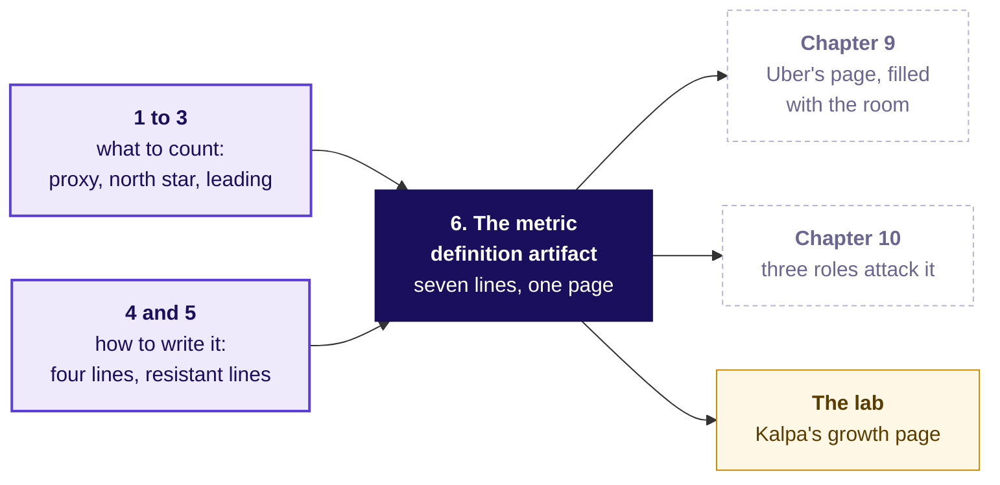

**A published page.** Uber's annual report defines a monthly active platform consumer as a unique consumer who completed a ride or received a delivery at least once in a month, averaged over the quarter: a count with a receipt and a window, written down; as a count, it has no denominator.

```notes
LIVE, 30 seconds. The concept block is done: six boxes lit on the map from S4. Source: Uber's 10-K
for 2025: https://www.sec.gov/Archives/edgar/data/1543151/000154315126000015/uber-20251231.htm
(checked 13 October 2026). Then the break: 10 minutes. Transition: after the break, chapter 7 opens
the case on its full ticket.
```

---

## SECTION 7: Twelve driver-weeks by hand, with the proxy test and the four definition lines: what does an hour count?
*Applies the proxy test (chapter 1) and the four lines of a definition (chapter 4) to six drivers counted by hand, before the city head reads "hours up 24 percent" as success.*

```notes
LIVE, 30 seconds. The first case chapter, level L1, 32 minutes: the full ticket and round 1 of the
war game (12), then the twelve rows by hand (20). No laptops until the hand count is on the board.
Notebook 07 repeats the count in code. Styles: Brilliant (the question first), Veritasium (predict,
then reveal), StatQuest (tiny numbers said aloud), the case method (three roles with partly-right
numbers). Transition: what the chapter answers, and for whom.
```

---

## S54. Twelve rows apply the proxy test and the four lines
*Who needs the answer, and which questions lead to it?*

**Applies:** What to measure and why; the proxy test (chapter 1); Definitions: numerator, denominator, window, exclusions (chapter 4).

**Who needs the answer.** The Hyderabad city head, who decides on Friday whether the scheme is working and whether to extend it to two more cities: if "hours up 24 percent" is read as "riders picked up much faster" while the wait moved only from 4.8 to 4.6 minutes, the same top-up goes to two more cities.

```timeline
label: The ticket | title: What launched, and what moved? | body: The full ticket, read in order.
label: The roles | title: How could each number rise badly? | body: Round 1 of the war game.
label: The rows | title: What did six drivers do? | body: Twelve driver-weeks, counted by hand.
label: The gap | title: Why do six fall further? | body: Two of the six logged hours with almost no trips. | tone: dark
```

```notes
LIVE, 1 minute 30 seconds. The room knows the proxy test from the canteen and the four lines from the register;
here they meet the case's own rows. Transition: the ticket, read in full.
```

---

## S55. Ticket: Uber Hyderabad's peak-hour guarantee
*What did the city team launch, what moved in six weeks, and what does the city head ask?*

**Uber, Hyderabad, the driver app.** From Monday 31 August 2026 an enrolled driver (one signed up for the scheme) online through a whole peak window (two a day, three hours each) is guaranteed Rs 300 per peak online hour: Uber tops up the gap between the driver's trip earnings and that floor. The goal: riders picked up faster.

| Six weeks each side | 20 Jul to 30 Aug | 31 Aug to 11 Oct |
|---|---|---|
| Peak online hours; completed peak trips | 118,000; 224,200 | 146,300 (up 24%); 230,900 (up 3%) |
| Trips per peak online hour | 1.90 | 1.58 |
| Share of offers accepted; share of accepted trips the driver cancelled | 0.86; 0.04 | 0.73; 0.09 |
| Share of online hours with no trip; median rider wait | 0.22; 4.8 min | 0.38; 4.6 min |
| Share of rider requests unfulfilled; top-up paid | 0.11; Rs 0 | 0.10; Rs 1.9 crore |

**Data:** `drivers` (1,200; 140 joined after the launch), `driver_weeks` (one row per driver per week: hours, offers, accepted, cancels, trips, hours with no trip, bookings as fares riders paid, top-up; a request one driver declines is shown to the next, so one request can appear as several offers), `zone_weeks` (rider requests, fulfilled, median wait). **Ask, due Friday:** is it working, what should it pay for, is anyone gaming it, raising the number without doing what it stands for? **Caveats:** the monsoon ended mid-window; 140 drivers are new; online means the app is open; three outer zones (Shamshabad, Rajendranagar, Patancheru) get few requests; drivers can be on two apps; trip earnings, the driver's share of the fares, are not in the data.

> *Illustrative case: the company is real, the situation and the data are synthetic, built for this class.*

```notes
LIVE, 3 minutes. Read the ticket top to bottom in the order it is written: company and surface,
the table, the data, the ask, the caveats, the label line. Say the label line in full: the company
is real, the situation and the data are synthetic, built for this class. Then return to the
headline the room chose before chapter 1, "peak online hours up 24 percent", still on the board; the
case's chapters decide whether that number deserves the headline.
Transition: where today ends.
```

---

## S56. Where today ends: one sentence and seven lines
*What will the room hand the city head when the morning is done?*

By the close of the afternoon's first hour the room writes one sentence with its blanks filled from the data, and chapter 6's seven-line page for the city, which the three city-team roles, who each lose something under it, cannot break.

> "Judge the scheme by ________, guarded by ________ and ________, because paying for hours cost Rs ____ in six weeks for ________."

The sentence names the two guardrails for riders; the budget's guardrail, top-up per trip, sits on the page.

```timeline
label: Line 1 | title: Numerator | body: What is counted, and when it counts
label: Line 2 | title: Denominator | body: Per whom, with the count printed beside the rate
label: Line 3 | title: Window | body: Over which period
label: Line 4 | title: Exclusions | body: What is left out on purpose, each change dated
label: Line 5 | title: What it does not reward | body: The behaviour it refuses to pay for
label: Line 6 | title: Guardrails | body: Must not get worse: two for riders, one for the budget
label: Line 7 | title: Gaming note | body: How each guardrail catches a way of hitting the number
```

```notes
LIVE, 1 minute. Read the sentence with its blanks and the seven line names, which the room met on
Balaji Kirana's page in chapter 6; nothing to write yet. Say: every blank gets a number from the
data before lunch, and every line gets tested by three people this afternoon.
Transition: the board the day fills, region by region.
```

---

## S57. The day's board: four questions before paying
*Which questions must a number answer before anyone is paid for it?*

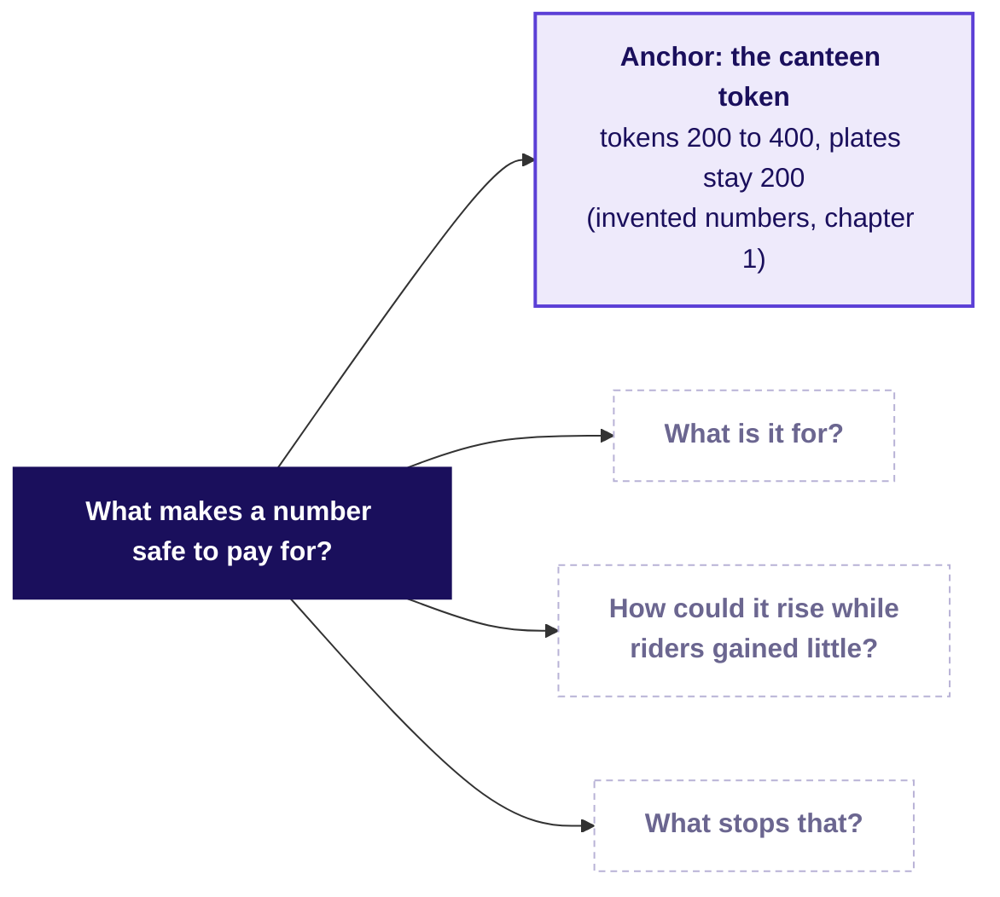

Each case chapter fills one region of this board: chapter 7 answers what the number is for, chapter 8 how it rose while riders gained little, chapter 9 what stops it.

```notes
LIVE, 1 minute. The board's question went up before chapter 1; add its three questions and the
anchor now, and keep the board up all day; each case chapter's close adds its region. The finished
board is the cheat sheet's second panel. Transition: the war game's first round.
```

---

## S58. War game, round 1: three roles, three numbers
*Which number does each of the city team's three roles want the scheme judged on, and how could each look good while riders gained little?*

```cards
icon: car | eyebrow: Driver-operations lead | title: Peak online hours | body: Wants supply at peak, the city's oldest problem; hours rose 24 percent | tone: light
icon: megaphone | eyebrow: Marketing lead | title: Enrolled drivers | body: The guarantee is the story that wins new drivers; every sign-up counts | tone: light
icon: wallet | eyebrow: Finance partner | title: Top-up per trip | body: Holds the budget; wants each rupee of top-up to buy a trip, so wants this number low | tone: light
```

**Three questions per number.** Could a team hit it while riders gained little (the proxy test, chapter 1)? Who controls the count (chapter 5)? What does it deliberately not reward (chapter 6)? Round 2 is the data in chapters 7 to 9; round 3, after lunch, attacks the redesign.

```notes
LIVE, 5 minutes, the war game's round 1 (run sheet: trainer/C2_W04_D01_war_game_TRAINER.md).
The trainer voices the three role cards, or three learners read them. Each of the nine groups has
two minutes to give one way to game each number, now with chapter 1's proxy test and chapter 5's
four ways in hand, and its scorer holds the proxy-test card. Write the answers on the board under each
role. Expect: hours rise if drivers stay logged in and idle; enrolled drivers rise if people sign up
and never drive; top-up per trip falls if drivers take only short trips. Park "what would the data
show" until chapter 8.
When it stalls: recall the canteen's tokens from chapter 1 (who controls the count?), then ask who
decides when the app is open; drivers E and F wait for S60.
Transition: chapter 1's test, asked of an hour.
```

---

## S59. An hour needs only an open app, as a token did
*Which of the city's numbers can a driver raise with no rider at all, by chapter 1's proxy test?*

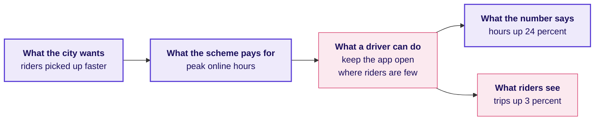

Peak online hours fail chapter 1's test the way the canteen's tokens did: the app logs a driver as online whenever the driver app is open and the driver is marked available, wherever the phone is. Trips need a rider who asked, accepted offers need an offer, and the wait is measured on riders; hours need only an open app.

```notes
LIVE, 1 minute, a recall by name and straight to the data. Say: the driver controls the count, the
first of chapter 5's four ways. Point back to the board's first question, what is it for. Name round
2 once: chapters 7 to 9 answer each of round 1's attacks with the data, one board region at a time.
Transition: six drivers from the case's own data.
```

---

## S60. Six drivers, two weeks, counted by hand
*What did six drivers' hours, offers and trips do between one week before and one week after?*

| Driver | Zone | Hours, before → after | Trips, before → after | Offers accepted, after |
|---|---|---|---|---|
| A | Jubilee Hills | 10 → 11 | 21 → 22 | 22 of 25 |
| B | Banjara Hills | 9 → 10 | 17 → 18 | 18 of 21 |
| C | Gachibowli | 11 → 12 | 22 → 23 | 23 of 26 |
| D | Madhapur | 10 → 11 | 19 → 20 | 20 of 23 |
| E | Shamshabad | 10 → 16 | 18 → 3 | 4 of 14 |
| F | Rajendranagar | 10 → 14 | 17 → 2 | 3 of 12 |

The before week begins 10 August 2026 and the after week 21 September 2026. These are twelve rows of the case's own `driver_weeks`; E and F drive in two of the three outer zones, where riders are few. Their 16 and 14 hours are short beside the drivers who idle like them, who average about 39 peak online hours a week after the launch, as chapter 8's full data shows.

```notes
LIVE, 7 minutes, StatQuest: say each number aloud. Add the hours column for the before week (60)
and the after week (74), then the trips (114 and 88), writing the four sums on the board. Point at
E and F before saying anything about them: hours up, few offers because Shamshabad and
Rajendranagar get few requests, and most of those offers declined.
Transition: the prediction before the ratio.
```

---

## S61. What does trips per hour do on the six?
*Before dividing, what will trips per peak online hour do on the six drivers?*

a) Holds near 1.9

b) Falls to about 1.6, as the city's did

c) Falls to about 1.2

d) Rises above 2.0

```notes
LIVE, 2 minutes. Everyone writes a letter. Most write b, because the ticket says 1.58.
Transition: the hand count.
```

---

## S62. Answer: 1.90 before, 1.19 after, by hand
*How is the ratio counted, and why do the six fall further than the city's 1.58?*

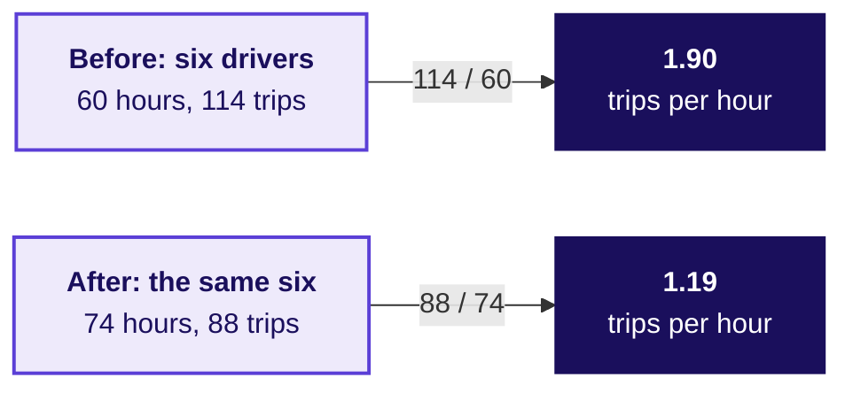

**Answer: c.** Hours rose 23 percent and trips fell 23 percent, so trips per peak online hour fell from 1.90 to 1.19: add the trips, add the hours, divide once, chapter 4's numerator over its denominator. The city fell to 1.58; the six fall further because they were chosen to show the mechanism, and two of them, E and F, logged hours with almost no trips, a third of this sample. How common such drivers are in the city is chapter 8's question.

```notes
LIVE, 6 minutes. Say the step aloud: for every ten hours online the six made 19 trips before and 12
after. Then say why the six are not the city: the rows were picked so the mechanism shows in
miniature. Watch for anyone averaging each driver's own ratio; chapter 8 shows what that average
prints on the full data and why it misleads.
Transition: the chapter's close.
```

---

## S63. Close: a paid proxy drifts from its goal
*What has chapter 7 answered, and what does the board now hold?*

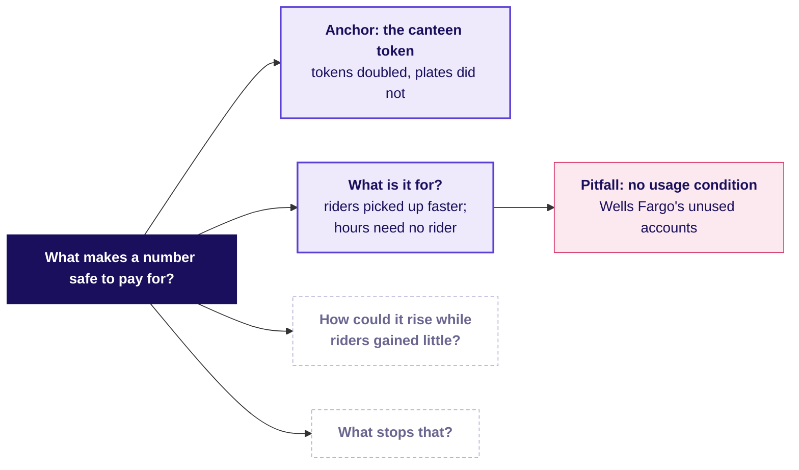

**The crux.** A number is safe to pay for only if hitting it requires the thing it stands for; hours online do not require a rider.

**The senior analyst's check.** Before trusting a rate, read its baseline (1.90 before), its denominator (hours the app was open, which the driver controls) and the evidence that the goal moved (city trips rose only 3 percent).

```notes
LIVE, 4 minutes. Add the region to the board: what is it for, and the first pitfall, the bank from
chapter 1. Read the crux line twice; it is the line the cheat sheet repeats. The interview question
the day earns, [S] how would you measure the success of a new feature, stays open until the
afternoon. Transition: chapter 8, the full data.
```

---

## SECTION 8: All 12,860 driver-weeks, with the definition lines and gaming: where did the fall sit?
*Applies the denominator and the window (chapter 4) and who controls the count (chapter 5) to every driver-week, before a proposal goes out to extend the scheme.*

```notes
LIVE, 30 seconds. Levels 2 and 3, 30 minutes: the opener and map (2), the demand question (4), the
twelve weeks and the groupby (7), the average that misleads (6), the idle tail (8), the close (3). Laptops open on
notebooks/C2_W04_D01_08_denominators_on_full_data_STUDENT.ipynb. Styles: Krish Naik (one line of
narration per cell), Veritasium (predict before each reveal), Brilliant (the question first),
ByteByteGo (the board grows at the close). Transition: what the chapter answers.
```

---

## S64. The full data apply chapters 4 and 5
*Who needs the answer, and which questions lead to it?*

**Applies:** Definitions: numerator, denominator, window, exclusions (chapter 4); Gaming, and definitions that resist it (chapter 5).

**Who needs the answer.** The city head, before a proposal to extend the scheme to two more cities goes out: a fall read as weak demand, or measured with the wrong denominator, sends the same top-up further.

```timeline
label: Demand | title: Did riders ask for less? | body: Rider requests, from a second table.
label: The weeks | title: What do twelve weeks show? | body: One groupby, a ratio of two sums.
label: The trap | title: What does an average print? | body: The mean of each week's rate.
label: The tail | title: Who sits under one trip an hour? | body: The drivers behind the fall. | tone: dark
```

```notes
LIVE, 1 minute 30 seconds. Read the Applies line: chapter 4's lines and chapter 5's first way are
the two ideas the full data test. Transition: the first question of the chapter.
```

---

## S65. Which column would show riders asked for less?
*If riders simply asked for fewer trips, where would the data show it?*

a) `peak_online_hours` in `driver_weeks`

b) `peak_requests` in `zone_weeks`

c) `topup_rs` in `driver_weeks`

d) `peak_bookings_rs` divided by trips

```notes
LIVE, 1 minute. Letters on paper. The trap the question guards against: "trips per hour fell
because demand fell", said before anyone looked at demand.
Transition: the answer, with the numbers.
```

---

## S66. Answer: rider requests rose 1.8 percent
*Did demand fall, and why do the two tables count different things?*

**Answer: b.** Demand lives in `zone_weeks`. Rider requests rose from 251,910 to 256,556 (up 1.8 percent), the unfulfilled share went from 0.11 to 0.10 and the median wait from 4.8 to 4.6 minutes. The fall in trips per hour is not demand.

```stats
value: 1.07 | label: offers per request, before | note: 269,773 offers shown to drivers for 251,910 rider requests
value: 1.35 | label: offers per request, after | note: 347,583 offers for 256,556 requests: more declines, more re-offers
```

A request one driver declines is offered to the next driver, so `driver_weeks` counts offers and `zone_weeks` counts requests: two units for the same riders, as Delhi Metro's riders and line uses were in chapter 4, and the gap between them grew with the declining.

```notes
LIVE, 3 minutes. Read the three demand numbers, then the two stats. Ask what could make offers per
request rise while requests barely moved: drivers declining, so each request is shown again.
Transition: twelve weeks, one week at a time.
```

---

## S67. Twelve weeks: hours jumped, trips per hour fell
*Was the fall two odd weeks, or a level that held for six?*

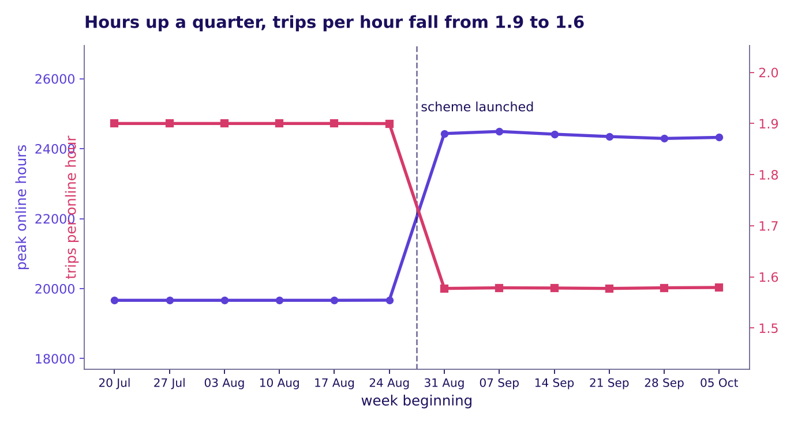

Before the launch, trips per hour wandered between 1.88 and 1.93. In the launch week it read 1.64, then held between 1.55 and 1.59 for five weeks, while hours rose from about 20,000 a week to about 24,000. The two lines use two different scales, so the point where they cross means nothing.

```notes
LIVE, 3 minutes. The animated version, whiteboards/C2_W04_D01_drift_STUDENT.gif, draws the twelve
weeks one at a time; play it on the projector and stop at the dashed line to ask what the next week
will show. Then show this full picture and read the two ranges. Explorer scene M1 draws the same
drift with drivers as dots; use it here if it is on the projector.
Transition: the groupby that produced these totals.
```

---

## S68. One groupby gives the city's totals
*What is the smallest code that turns 12,860 driver-weeks, one row for every driver on the app each week, into the ticket's numbers?*

```python
dw["window"] = dw["week_start"].lt("2026-08-31").map({True: "before", False: "after"})
city = dw.groupby("window")[["peak_online_hours", "peak_trips"]].sum()
city["trips_per_hour"] = city["peak_trips"] / city["peak_online_hours"]
```

| Window | Hours | Trips | Trips per hour | Accepted share | No-trip share |
|---|---|---|---|---|---|
| Before | 118,000 | 224,200 | 1.90 | 0.863 | 0.22 |
| After | 146,300 | 230,900 | 1.58 | 0.730 | 0.38 |

The rate is a ratio of two sums, chapter 4's numerator and denominator over chapter 4's window: every trip over every hour, six weeks each side. `.lt(...)` asks whether a week starts before the launch, and `.map` turns True and False into before and after; the notebook adds the two shares the same way, sum first, then divide.

```notes
LIVE, 4 minutes, Krish Naik: scroll back to the notebook's totals cell, the first after its setup,
and run it line by line, saying what each line is for; its numbers are the ticket's, so running it
before S65 spoils nothing. The table is the cell's output, rounded as the ticket rounds it.
Transition: a shortcut a colleague might take.
```

---

## S69. What does an average of weekly rates print?
*A colleague averages every driver-week's own trips per hour; what does that print for the after window?*

a) 1.58

b) 1.71

c) 1.19

d) 1.90

```notes
LIVE, 2 minutes. Letters on paper. This is the chapter's first trap, the plausible wrong number.
Transition: the answer, and why it is wrong.
```

---

## S70. Answer: 1.71, which hides two-fifths of the fall
*Why does averaging each week's rate understate the fall, and what is the fix?*

**Answer: b.** The average of rates prints 1.71 after the launch, against 1.58 from the sums. Before the launch the same average read 1.90, so set beside itself it shows a fall of 0.19; the true fall is 0.32, from 1.90 to 1.58, so the average hides 0.13, about two-fifths. It gives a 42-hour week the same weight as a 10-hour one, so the long, slow weeks of the drivers online longest count no more than anyone's short, busy ones.

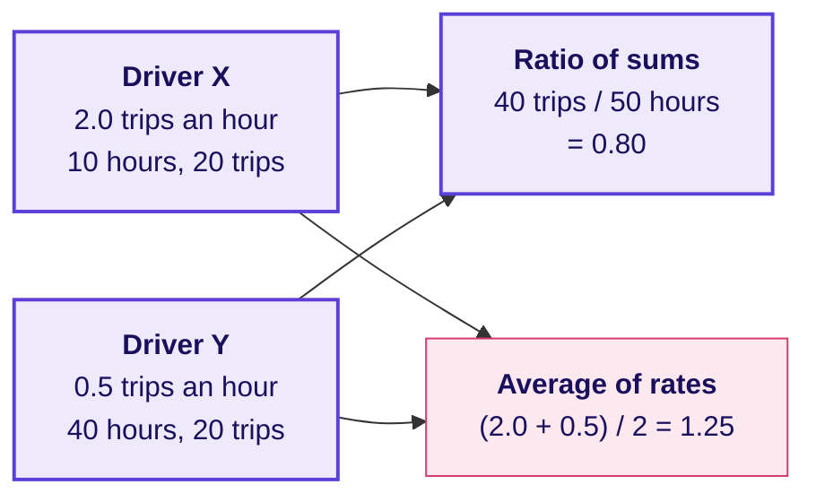

The drivers are invented: Y's 40 slow hours count as one week, like X's 10, so the average reads 1.25 against a true 0.80, too high, as the city's 1.71 is. **The decision it would mislead:** a fall two-fifths smaller reads as noise, and the scheme is extended. **The check:** recompute from the sums. **The fix:** a ratio of sums, its denominator named, as Swiggy's filings name theirs (chapter 4).

```notes
LIVE, 4 minutes. Work the invented pair aloud first, then return to 1.71 against 1.58. Week 1 met
the same rule on Kalpa's orders: a rate is two sums divided once.
Transition: who is behind the fall.
```

---

## S71. How many drivers sit under one trip an hour?
*Of the 1,200 drivers, how many made fewer than one trip per peak online hour after the launch?*

a) About 30

b) About 100

c) About 180

d) About 400

```notes
LIVE, 3 minutes, the your-turn cell of notebook 08. Everyone writes a letter, then types the four
lines from the notebook's markdown into the empty cell and runs it. Wait until most of the room has
a number before the reveal.
Transition: the answer and the picture.
```

---

## S72. Answer: 180 drivers, more hours, fewer trips
*Who are they, what did their hours and trips do, and where were they online?*

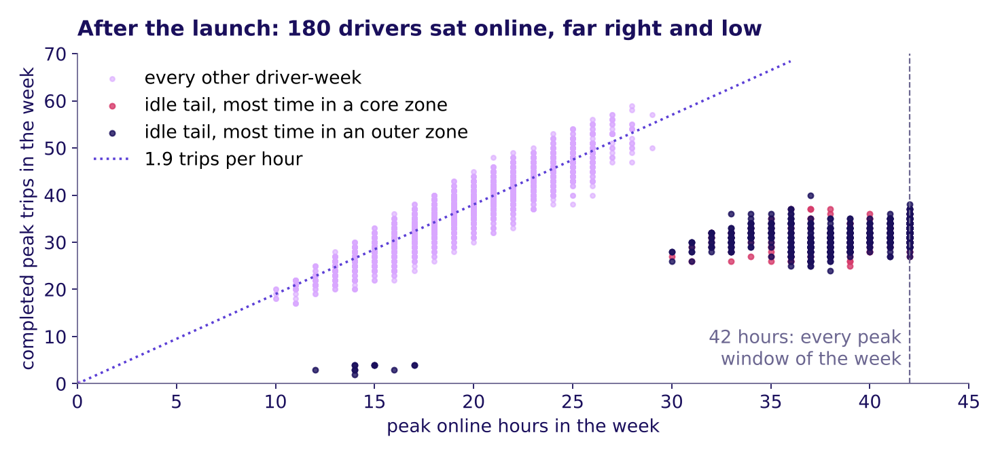

**Answer: c.** 180 drivers, 15 percent of the city: the **idle tail**, named for the long online hours in which they completed few trips. Their hours went to 2.1 times their level before the launch while their trips fell 12 percent, and 72 percent of their new hours were in the outer zones. Each dot is one driver-week. Most of the tail sits far right and low, at about 39 hours a week; E's and F's weeks sit apart at the bottom left, short weeks with almost no trips, the extreme of the 180, which is why the six fall further than the city.

```notes
LIVE, 5 minutes. Point at the cluster to the right of 30 hours with 25 to 35 trips: weeks online in
almost every peak window with far fewer trips than the dotted line. Say what the data cannot say:
why they did it. The likely reading is that the floor pays for being online and the outer zones are
quiet, so a driver parked there earns the floor without a trip: chapter 5's first way, the paid
person controls the count. A second route in the notebook finds the same 180 by acceptance alone.
Watch for "these drivers are lazy": they are doing what the number pays for, as Wells Fargo's staff
did in chapter 1.
Transition: the chapter's close.
```

---

## S73. Close: hours rose where riders were few
*What has chapter 8 answered, and what does the board now hold?*

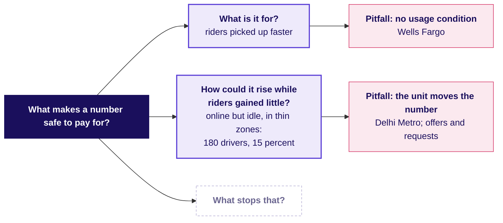

**The crux.** The city's rate is two sums divided once, with its denominator named; the city's 1.90 to 1.58 is real, demand rose, and 180 drivers sitting online in thin zones carry the fall.

**The senior analyst's check.** Baseline (1.90), denominator (online hours), evidence from a second table (requests rose 1.8 percent), and the segment reached a second way (acceptance finds the same 180).

```notes
LIVE, 3 minutes. Add the region to the board. Transition: chapter 9 asks what the scheme should pay
for instead.
```

---

## SECTION 9: The redesign's north star, guardrails, leading inputs, resistant lines and seven-line page: what should it pay for?
*Applies the north star and guardrails (chapter 2), the leading inputs (chapter 3), the lines that resist gaming (chapter 5) and the seven-line page (chapter 6) to the redesign, before the city head decides on Friday.*

```notes
LIVE, 30 seconds. Levels 3 and 4, 38 minutes: the opener and map (2), the opener question (4), the
wrong memo and its cost (8), the tree and the inputs (4), the Uber page line by line, guided (11), the caveats (7), the
close (2). Notebook: notebooks/C2_W04_D01_09_north_star_guardrails_cost_STUDENT.ipynb. Styles:
Brilliant (question first), 3Blue1Brown (the tree built region by region), the case method,
ByteByteGo (the finished board). Transition: what the chapter answers.
```

---

## S74. The redesign applies chapters 2, 3, 5 and 6
*Who needs the answer, and which questions lead to it?*

**Applies:** North-star and guardrail metrics (chapter 2); Leading against lagging indicators (chapter 3); Gaming, and definitions that resist it (chapter 5); The metric definition artifact (chapter 6).

**Who needs the answer.** The city head, who must say by Friday what the scheme pays for, and the finance partner, who holds the top-up budget: a scheme that keeps paying for hours keeps paying drivers to sit online in zones with few riders.

```timeline
label: The rule | title: Which number to pay for? | body: Four rules, voted.
label: The cost | title: What did hours cost? | body: The top-up, split at half accepted.
label: The page | title: What do the seven lines say? | body: Chapter 6's page, filled for the city.
label: The doubts | title: What can the data not show? | body: Each caveat and the fact that settles it. | tone: dark
```

```notes
LIVE, 1 minute 30 seconds. Every idea in this chapter was taught on an invented example this morning; here
each is recalled by name and goes straight to the data. Transition: the question that opens it.
```

---

## S75. Which number should the scheme reward?
*Which number, if the scheme rewarded it, would make drivers drive and serve riders, without rewarding idling or picking only easy trips?*

a) Peak online hours, as now

b) Completed peak trips, nothing beside it

c) Completed peak trips, with a minimum share of offers accepted

d) Enrolled drivers

```notes
LIVE, 2 minutes. Letters on paper. Explorer scene M2 lets the room move the choice and watch the dots
re-behave; use it after the vote if it is on the projector.
Transition: the answer.
```

---

## S76. Answer: trips, with an acceptance floor
*Why does each of the other three fail?*

**Answer: c.** Hours pay for an open app, which the idle tail showed. Trips alone let a driver accept only short or nearby trips and decline the rest, which the share of offers accepted catches. Enrolled drivers rise with every sign-up whether or not anyone drives. Trips with an acceptance floor, a least share of offers accepted, reward the service and catch the cherry-picking: chapter 2's north star with its guardrail. Two floors now run through the case: the Rs 300 floor is what a driver-week is guaranteed, and the acceptance floor is what a driver-week must clear to earn it, the pay rule chapter 10 prices.

```notes
LIVE, 2 minutes. Take each wrong letter in turn and say the gaming it invites; the room should hear
that every wrong answer is a number someone would really propose.
Transition: the memo that the celebrated number would have produced.
```

---

## S77. The wrong memo: "supply met, extend it"
*What decision does "peak online hours up 24 percent" send to the city head, and what catches it?*

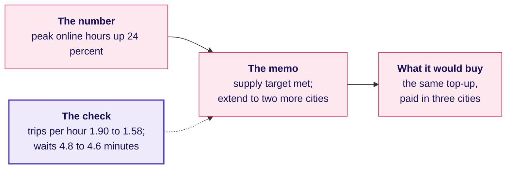

**The plausible wrong answer:** "Peak online hours up 24 percent over six weeks. Supply target met. Recommendation: extend the scheme to two more cities." **The check that catches it:** trips per peak online hour fell from 1.90 to 1.58 and the median wait moved only from 4.8 to 4.6 minutes, so riders were served barely better, at about Rs 2,836 of top-up for each extra trip. **The fix:** judge the scheme by completed peak trips, with an acceptance guardrail.

```notes
LIVE, 3 minutes. Present the memo as the one a hurried analyst writes on Monday morning. Then the
check, then the fix. The next slide prices what the memo would have kept buying.
Transition: where the Rs 1.9 crore went.
```

---

## S78. How much top-up went to declining weeks?
*What share of the Rs 1.9 crore went to driver-weeks that accepted fewer than half their offers?*

a) 15 percent

b) 39 percent

c) 61 percent

d) 88 percent

```notes
LIVE, 2 minutes. Letters on paper; notebook 09's first cell answers it.
Transition: the answer.
```

---

## S79. Answer: 61 percent, Rs 1.16 crore of 1.9
*Where did the money go, and what is the honest way to state a saving?*

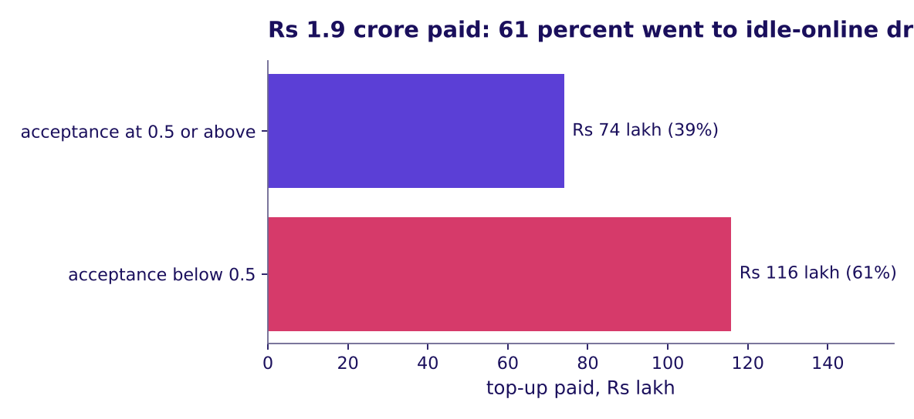

**Answer: c.** Rs 1.159 crore, 61 percent, went to driver-weeks that accepted fewer than half the offers they were shown; Rs 74 lakh went to the rest. Rs 74 lakh is what the six weeks would have cost had only the second group been paid and every driver behaved the same, which a new rule would not guarantee: some idle drivers would start accepting enough to qualify.

```notes
LIVE, 3 minutes. Say the behaviour line clearly, because the finance partner and every interviewer
will ask it: a saving that assumes nobody changes is the most the redesign could save, and an honest
saving says how drivers respond. Chapter 10, round 3 of the war game after lunch, prices the saving
under a stated range, in notebook 10.
Transition: the tree that replaces the single number.
```

---

## S80. The tree: a north star, guardrails, inputs
*How does the number the scheme pays for connect to the numbers that must not get worse and the ones the city team can act on this week?*

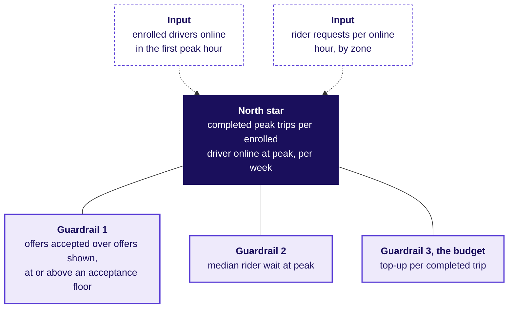

Chapter 2's north star and guardrails and chapter 3's leading inputs, on the city. A completed trip is a rider served, counted with a receipt; the wait covers only riders who were picked up, so it can improve while more requests go unserved, which is why it guards from beside the north star. Read it as chapter 2's seesaw: if the north star rises while a guardrail moves the wrong way, riders or the budget paid for the rise. Acceptance, guardrail 1, also settled first in the launch week (chapter 3's S28). The first input needs a record the tables do not hold, drivers online by peak hour, so the city starts logging it.

```notes
LIVE, 4 minutes, 3Blue1Brown: build it on the board one region at a time, first the north star
alone, then each guardrail with the gaming it catches (a driver online and declining; trips so short
or so cherry-picked that waits rise; a top-up that runs away), then the two inputs. Explorer scene
M2, the seesaw, shows the north star against its guardrails. Tuesday's slide, Thursday's funnel and
Friday's forecast all hang off this north star.
Transition: the definition, line by line.
```

---

## S81. Seven lines make the number hard to game
*What does each line of the redesign's definition say, and which gaming does it stop?*

| Line | The redesign's definition |
|---|---|
| Numerator | Trips completed inside the peak windows, one per paying rider: Uber's annual report counts an UberX Share ride with three paying riders as three trips |
| Denominator | Enrolled drivers online at least one peak hour that week, the count printed beside the rate |
| Window | The calendar week |
| Exclusions | Trips cancelled by either side, test accounts, trips outside the windows |
| What it does not reward | Hours online; offers declined; a shrinking enrolled base, since fewer drivers in the count would raise the rate with no extra trip |
| Guardrails | For riders: accepted share at or above an acceptance floor the city sets, read with the share of accepted trips the driver cancels, and the median rider wait. For the budget: top-up per completed trip |
| Gaming note | Guardrail 1 catches declining and cherry-picking, and the cancel share beside it accepting then cancelling; guardrail 2, supply that stops serving riders; guardrail 3, a top-up that runs away from the trips it pays for |

Chapter 6's page, filled for the city. On the data, the north star read 35.76 trips per online driver-week before and 35.89 after: hours rose 24 percent and the number the scheme exists for barely moved. Every driver in the table enrolled, so the weeks before the launch count the same drivers.

```notes
LIVE, 11 minutes, guided: the room writes each line with the trainer (exercises/guided/
C2_W04_D01_definition_STUDENT.md), the skeleton they filled for Balaji Kirana in chapter 6 now on the
city. Pause after every line and ask which gaming it stops: the denominator's "online at least one
peak hour" stops a sign-up who never drives from diluting the rate; "what it does not reward" names
hours. Uber's 10-K counts an UberX Share ride with three paying riders as three trips and an UberX
ride with three passengers as one, which is why the numerator says "per paying rider" (checked 13
October 2026). The wait's clock starts at the rider's request, never at a time a driver sets,
chapter 5's third way. Explorer scene M3 recomputes the metric as each line changes.
Transition: what the data cannot show.
```

---

## S82. Without the 140 new drivers, what remains?
*Take out every driver who joined after the launch: what does trips per hour read for the six weeks after?*

a) 1.90

b) 1.79

c) 1.58

d) 1.19

```notes
LIVE, 2 minutes. The trap here is a caveat used as an excuse: "the new drivers explain it".
Transition: the answer and the other cuts.
```

---

## S83. Answer: 1.58; the fall survives each cut
*Which doubts does the fall survive, and which stay open until someone gathers more?*

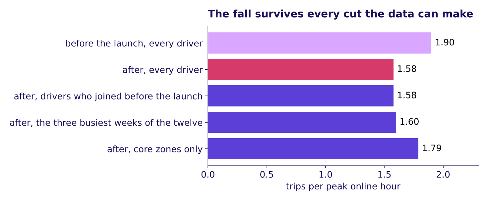

**Answer: c.** Without the new drivers the rate is still 1.58. In the three weeks with the most rider requests, the first three after the launch and still in the rains, it already read 1.60, so the monsoon's end does not explain the step at the launch; whether the season moved the later weeks stays partly open, since last year's weeks are not in the data. In the nine core zones it fell from 1.90 to 1.79, so the fall sits mostly in the three outer zones. Three doubts stay open: drivers on two apps (the data holds weekly totals, so it cannot show a decline made because another app's trip was under way), who chose to enrol (every driver here enrolled, so no group stayed out to compare with), and cause (only a test of the redesign settles it).

```notes
LIVE, 5 minutes. Walk the six caveats in order, each with the fact that would settle it: data quality
(online means the app is open; hours with no trip rose from 0.22 to 0.38), mix (new drivers: 1.58
without them), seasonality (the three weeks with most requests: 1.60; last year's weeks are not in the data, so the
caveat narrows and stays partly open), drivers on two apps (needs hourly data and the other app), who chose to
enrol (needs the city's full driver list), cause (the tentative faculty block designs the test).
Transition: the finished board.
```

---

## S84. Close: pay for trips, guarded three ways
*What does the finished board say?*

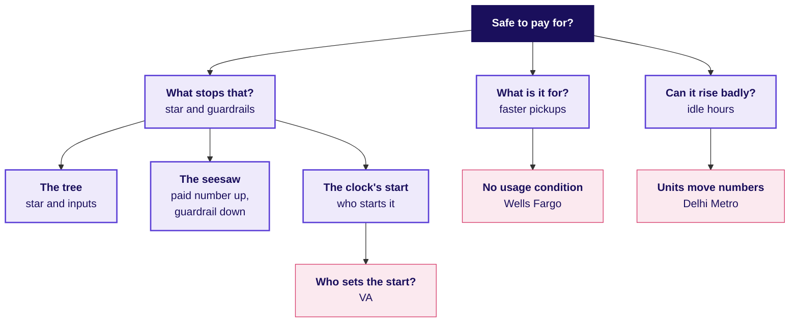

**The crux.** Judge the scheme by completed peak trips per enrolled driver online at peak, guarded for riders by acceptance and the wait, and for the budget by the top-up per trip; chapter 10 prices the pay rule that follows.

```notes
LIVE, 2 minutes. The board is finished; it is the cheat sheet's second panel. Read the crux line:
paying for hours sent 61 percent of Rs 1.9 crore to driver-weeks that declined most of what they were
offered. The pitfalls on its last row were each taught this morning: the bank in chapter 1, the
units in chapter 4, the clock in chapter 5. The interview line the chapter earns: [F] north-star
against guardrail, with one example pair, completed peak trips per enrolled driver, guarded by the
share of offers accepted. Then lunch; the afternoon's running order is on the topics slide, S3.
Transition: half two opens on chapter 10, round 3 of the war game.
```
