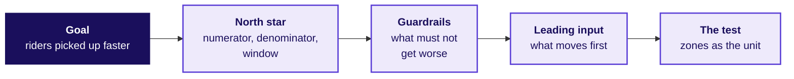
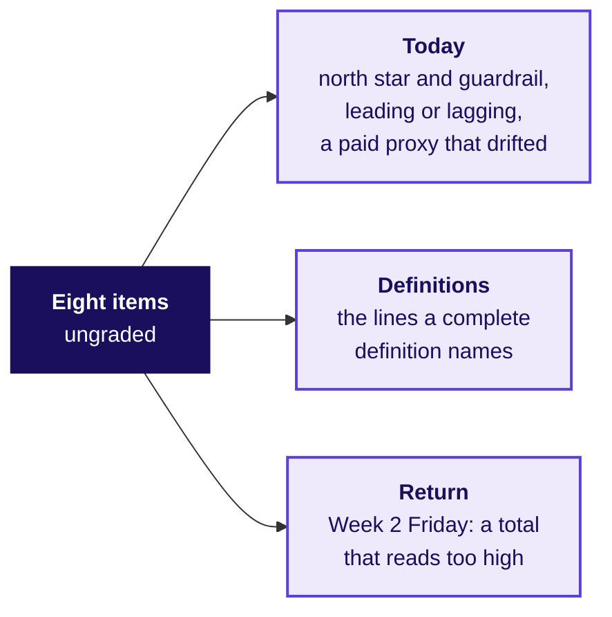

# Does the definition survive the people it costs?

Week 4, Day 1. Half two.

Header: WEEK 4  ·  DAY 1  ·  UBER, HYDERABAD, AN ILLUSTRATIVE CASE

## SECTION 4: Does it survive the roles?
*Does the room's definition survive three roles who each lose something under it, and what would the redesign save, before the city head signs it on Friday?*

```notes
LIVE, 30 minutes for round 3 of the war game: the brief (3), groups write and price (14), the
attacks and the defences (10), the scoring (3). Level 5: decide and cost it. Run sheet:
trainer/C2_W04_D01_war_game_TRAINER.md; role cards: trainer/C2_W04_D01_role_cards_TRAINER.md;
the unguided exercise: exercises/unguided/C2_W04_D01_redesign_STUDENT.md.
Styles: the case method (roles with partly-right objections), Veritasium (predict which line
answers which attack), Striver's ladder (the unguided items climb from a line to a cost).
Transition: what each group hands in.
```

## S38. Round 3: write it, price it, defend it
*What does each group hand in, and how is it scored?*


**The survival rule.** A definition survives when every role's attack is answered by one of its lines or a guardrail. A definition that survives only by dropping the guarantee has lost the driver-operations lead, and Tuesday's slide has to win that lead back.

```notes
LIVE, 3 minutes. Hand out the definition template (exercises/guided/C2_W04_D01_definition_STUDENT.md
carries it). Nine groups work at once; the trainer voices one role per visit and rotates.
When it stalls: a group with a guardrail that is another growth count ("bookings per driver") is
asked what that guardrail would catch.
Transition: the three attacks.
```

## S39. Three attacks, and the part of each that is true
*What will each role say against the redesign, and which part of it holds?*

```cards
icon: car | eyebrow: Driver-operations lead | title: "Drivers will log off" | body: True for the 180 in the idle tail; the other 880 who joined before the launch held 1.90 trips an hour, and the wait by zone shows any loss | tone: light
icon: megaphone | eyebrow: Marketing lead | title: "Changing terms looks like bait" | body: True that the floor was the promise; the redesign keeps it for drivers who accept at least half their offers | tone: light
icon: wallet | eyebrow: Finance partner | title: "The fall is the monsoon's end" | body: Partly: the season moves requests, but the rate stepped from 1.88 to 1.64 in the launch week itself | tone: light
```

Each attack is partly right by design, and a defence names the true part before answering the rest.

```notes
LIVE, 3 minutes. Read the three cards in the roles' voices. The numbers on the cards come from the
data: 880 is the 1,060 drivers there before the launch less the 180 in the idle tail, and they made
1.90 trips an hour in both windows; the rate stepped down in the launch week while weekly requests
stayed between about 41,000 and 44,000, and the three weeks with the most requests already read
1.60. If the 180 quit, their 33,440 trips would need about 17,600 more hours from the others. The
top-up budget is finance's number, so finance decides what the floor may cost.
Transition: which line answers the hardest attack.
```

## S40. Which line answers "drivers will log off"?
*If drivers log off and riders wait longer, which line tells the city head that riders are worse off?*

a) The numerator: trips completed in the peak windows

b) The denominator: drivers online at least one peak hour

c) Guardrail 2: median rider wait at peak

d) What it does not reward: hours online

```notes
LIVE, 2 minutes. Letters on paper. Groups that answered b are half right: the denominator would
shrink, and the next slide says why the wait is the line that protects riders.
Transition: the answer.
```

## S41. Answer: the wait guardrail catches lost supply
*Why does the rider's wait answer driver operations, and where should the acceptance floor sit?*


**Answer: c.** If drivers who serve riders log off, riders wait longer, and the wait, read zone by zone, is the line that moves for riders; the shrinking count of drivers shows who left, while the north star would rise. The floor sits in the gap: no idle-tail week accepted more than 0.46 of its offers and no other week fewer than 0.78; counting an accepted trip later cancelled as declined moves the edges to 0.43 and 0.67, and half still sits between.

```notes
LIVE, 3 minutes. The floor is the city's call; the data says a floor anywhere between the two numbers
stops the gaming without touching a driver who declines the odd bad trip. Say that the gap is this
clean because the data is synthetic; on a real city the two groups overlap and the floor is a
trade-off the test measures.
Transition: what the redesign would save, said honestly.
```

## S42. The saving is a range, with its assumption
*What did paying for hours cost, and what would the redesign save if some idle drivers changed?*

```stats
value: Rs 1.159 crore | label: paid to declining weeks | note: 61 percent of the Rs 1.9 crore top-up, six weeks
value: Rs 58 to 92.7 lakh | label: the redesign's saving | note: if a half to a fifth of that would still be paid
value: Rs 82.3 | label: top-up per completed trip | note: after the launch; guardrail 3 watches it
```

**The rule priced.** The Rs 300 floor stays, and a driver-week earns its top-up only if the driver accepted at least half the offers shown, an accepted trip later cancelled counting as declined. **The assumption, stated.** Some idle drivers would start accepting enough to qualify, so between a fifth and a half of the idle tail's top-up would still be paid. **What would settle it:** the test of the redesign that this afternoon's tentative faculty block designs. Rs 74 lakh, what the other driver-weeks received, is what the rule would have paid had every driver behaved the same, so it is the least the redesign would cost.

```notes
LIVE, 3 minutes. Groups compare their own saving with the range. A group that wrote "saves Rs 1.16
crore" has assumed nobody changes; ask what the idle tail would do on Monday morning under the new
rule.
Transition: two companies whose north stars had to match what they were trying to do.
```

## S43. Maxxsaver: fewer orders per user, bigger baskets
*What happens when a north star counts the wrong thing for what the business is trying to do?*

**Swiggy Instamart's Maxxsaver** unlocks extra discounts once a cart passes a threshold. In the quarter to 30 June 2025 over 28 percent of its monthly transacting users used it, Instamart's average order value rose 16 percent quarter on quarter to Rs 612, and Swiggy wrote that some cart consolidation led by Maxxsaver (customers putting more into fewer, larger orders), with some low-value orders let go, lowered order growth (Q1 FY26 shareholder letter, checked 12 October 2026). Orders per user would have read that success as a fall.

**Eternal**, whose businesses include Zomato and Blinkit, defines net order value (NOV) as gross order value (GOV), what orders were worth, minus discounts (its Q1 FY26 letter), and in its Q1 FY27 letter stopped disclosing GOV "as NOV more accurately reflects underlying performance"; both checked 12 October 2026.

```notes
LIVE, 4 minutes. The parallel: the redesign pays for what the city wants (trips) and names what it
does not reward (hours), the way Eternal moved its headline from gross to net. Do not say either
company used a metric badly; both letters describe their own choice. Sources:
https://www.swiggy.com/corporate/wp-content/uploads/2025/07/Q1-FY2026-Shareholder-letter.pdf (checked 12 October 2026)
https://drive.google.com/file/d/1VtoiLsA2OpKauFnkKIlhXRmnbvxL-6ha/view (Eternal Q1 FY26 letter, checked 12 October 2026)
https://drive.google.com/file/d/1jb9KWd4Ap4RTKHFHxzEOO7jgQqVZEGcd/view (Eternal Q1 FY27 letter, checked 12 October 2026)
https://www.eternal.com/blog/q1fy27/ (the page that links the Q1 FY27 letter, checked 12 October 2026)
Transition: the interview room.
```

## SECTION 5: What does the interviewer hear?
*How would you measure the success of a new feature, and an AI coding assistant without rewarding deleted suggestions, when an interviewer asks it cold?*

```notes
LIVE, 15 minutes: the transcript read in pairs and scored (9), the AI-company variant (4), the
handoff (2). Level 6. The transcript: extras/C2_W04_D01_transcript_STUDENT.md; the scorecard:
trainer/C2_W04_D01_interview_scorecards_TRAINER.md.
Styles: the case method in the interview room, Feynman (the first sentence a newcomer could
repeat), Striver's ladder (the follow-ups climb).
Transition: the question as a screen asks it.
```

## S44. The question, and what to clarify first
*What does the interviewer ask, what should a candidate ask back, and which trap is set?*

> "Uber launched a peak-hour earnings guarantee for drivers in one city six weeks ago. How would you measure whether it is a success?"

**Clarify before any number.** What was the scheme meant to change: more drivers online, or riders picked up faster? Who is in it, and who pays? What would count as harm? Which decision rides on the answer, and against which baseline?



**The trap the interviewer sets.** Peak online hours rose 24 percent; a candidate who names that number and stops has measured the scheme by what it paid for.

```notes
LIVE, 2 minutes. Pairs: one reads the interviewer, one answers cold for sixty seconds before
opening the transcript. Every transcript opens with the line that it was written for this
programme in the style of product-company and GCC screens, with the facts from the case.
Transition: two answers side by side.
```

## S45. Weak and hire-grade answers, side by side
*Where does a weak answer lose the interviewer, and what does a hire-grade one do instead?*

| Beat | Weak answer | Hire-grade answer |
|---|---|---|
| Clarify | Starts on metrics at once | Asks what the scheme is for, what counts as harm, which decision rides on it and against what |
| Structure | Lists hours, satisfaction, a survey | Goal, one north star with its lines, three guardrails, a leading input, the test by zone |
| The trap | "Hours are up 24 percent, so it works" | Trips per online hour fell from 1.90 to 1.58, stepping down in the launch week, and the north star barely moved |
| Segment and zones | None | 180 drivers added hours on fewer trips, mostly in the outer zones, where waits fell 6.6 to 5.95 minutes at about Rs 46,000 per extra trip |
| Decision and cost | "Roll it out to more cities" | Hold it: Rs 2,836 per extra trip; floor only for weeks accepting half their offers; test by zone |

```notes
LIVE, 4 minutes. Pairs score both answers on the scorecard's seven criteria, 0 to 2 each, then
compare with the trainer's scores. A hire-grade answer scores 2 on the first three: clarified
scope, named the denominator and window, saw the paradox.
Transition: the follow-ups an interviewer pushes on.
```

## S46. Three follow-ups and the line that answers each
*Where does the interviewer push next, and what does a hire-grade answer say in one breath?*

| Follow-up | The hire-grade line |
|---|---|
| "Online hours rose 24 percent; what do you check before you celebrate?" | Trips per online hour and the rider's wait: hours rose 24 percent and trips 3, so the rate fell from 1.90 to 1.58 and waits barely moved |
| "Which guardrail would driver operations fight, and why are they partly right?" | The acceptance floor: some declines are fair, so set it in the gap the data shows, above 0.46 and below 0.78, and test two levels, since on a real city the groups overlap |
| "The drivers control when they log in; what happens to your number?" | Logging in cannot raise it, since each trip needs a rider's request; logging off can, so print the driver count beside the rate |

```notes
LIVE, 3 minutes. Read each follow-up in the interviewer's voice; the pair that answered cold tries
the line before reading it.
Transition: the same question at an AI company.
```

## S47. The AI-company variant: a coding assistant
*How would you measure an AI coding assistant without rewarding suggestions that were accepted and then deleted?*

| Line | Uber's guarantee | An AI coding assistant |
|---|---|---|
| The gamed proxy | Peak online hours | Suggestions accepted |
| North star | Completed peak trips per enrolled driver online at peak, per week | Suggested code still present at the next commit, per developer with a seat, per week |
| Read beside it | The rider's wait, zone by zone | Time from first commit to merge |
| Guardrails | Accepted share of offers; rider wait; top-up per trip | Build failures and reverts on suggested code; security findings; rewritten lines |
| Leading input | Rider requests per online hour, by zone | Acceptance, an input nobody is paid on |
| The gaming | Stay online, decline the offers | Fewer, safer suggestions shown; short ones accepted, then deleted |
| How it is settled | A test with zones as the unit | A test with teams as the unit, old rule against new |

Programme-written: the variant names no company and no figure. A commit is a saved change to the code; time to merge is how long a change waits before it joins the main code.

```notes
LIVE, 4 minutes. Ask which line catches a developer who accepts every suggestion and deletes it in
the next edit: the north star itself, since deleted text is not present at the next commit.
Transition: the Kahoot.
```

## S48. Kahoot: eight calls, one from Week 2
*Can the room make today's calls in seconds, and one from Week 2 Friday?*



Eight items, scored on correctness and speed together; the pack is kahoot/C2_W04_D01_quiz_STUDENT.md.

```notes
LIVE, 8 minutes to run. The trap item uses numbers other than today's; read the most-missed item
again before the room leaves.
Transition: the handoff to the afternoon block.
```

## S49. Handoff: designing the test of the redesign
*What does the next 120 minutes add to what the room has built?*

> "You have a number the scheme should pay for and two guardrails that catch the ways of hitting it that hurt riders. You have not tested whether the redesign moves it. The next 120 minutes design that test on this city: the unit you randomise, the metric, the guardrail and how long you run it before you look."

**The IITGN faculty block W4-1 is tentative** until IIT Gandhinagar confirms it. If it does not run, the metric clinic runs in its place, and the test stays with the block.

```notes
LIVE, 1 minute. Say the handoff aloud. Park every "is the fall real, or the season?" question for
the block; it is the question a test answers.
Transition: the day's close.
```

## S50. Close: the sentence, filled from the data
*What does the room hand the city head, and what does Tuesday ask of it?*

> "Judge the scheme by completed peak trips per enrolled driver online at peak, guarded by the share of offers accepted and the rider's wait, because paying for hours cost Rs 1.159 crore in six weeks for driver-weeks that declined most of what they were offered."

The rule that follows from it: the Rs 300 floor stays only for driver-weeks that accept at least half their offers, an accepted trip later cancelled counting as declined.

**The crux lines.** A number is safe to pay for only if hitting it requires the thing it stands for. A rate is two sums divided once, with its denominator named. A saving is said as a range, with the assumption about how people respond beside it.

**Tuesday's question.** Can this answer survive one slide, five minutes, in front of the three people who each lose something under it?

```notes
LIVE, 2 minutes. Read the sentence; it is the blanked sentence from the morning, filled. The
pre-read for Tuesday ships tonight. The TA lab now runs the same method on Kalpa Retail.
Transition: the lab.
```
