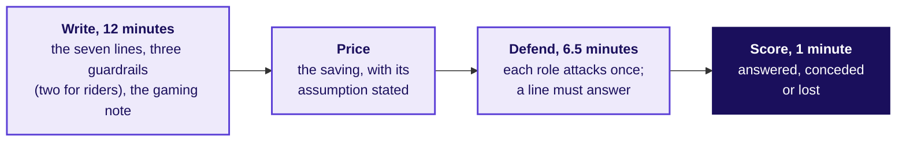
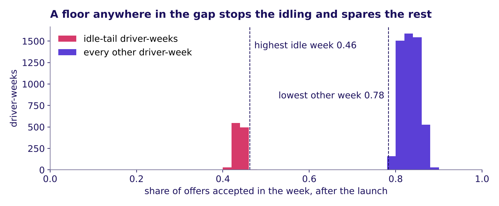
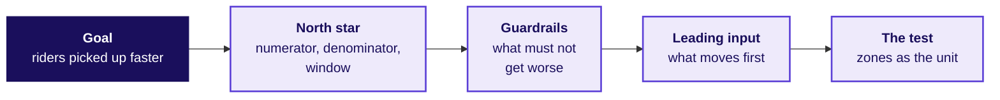
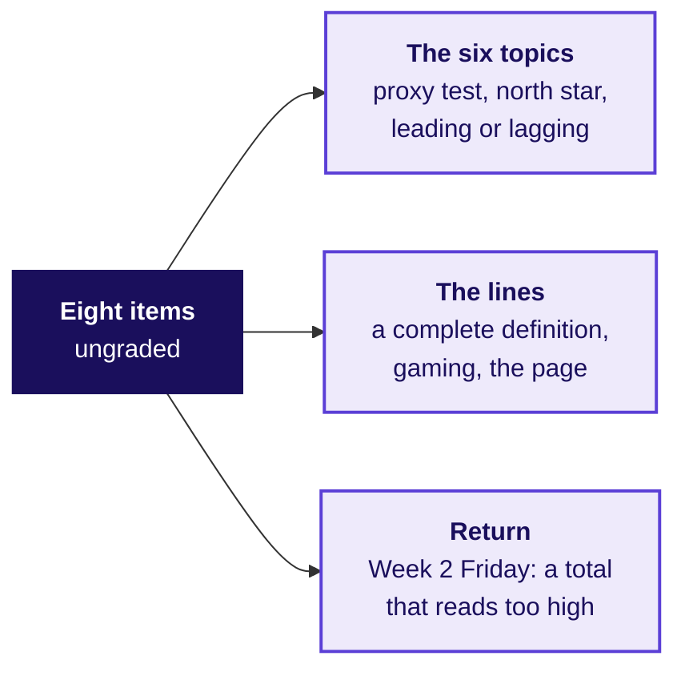

# Does the definition survive the people it costs?

Week 4, Day 1. Half two.

Header: WEEK 4  ·  MONDAY  ·  BUSINESS METRIC DESIGN  ·  UBER, HYDERABAD

---

## SECTION 10: The page under attack from three roles, with gaming and the seven lines: does it survive the roles?
*Applies the lines that resist gaming (chapter 5) and the seven-line page (chapter 6) under attack from three roles who each lose something, and prices what the redesign would save, before the city head signs it on Friday.*

```notes
LIVE, 30 seconds. Round 3 of the war game, 25 minutes: the map (1), the brief (2), groups write and
price (12), the attacks and the line that answers each (6 minutes 30 seconds), the saving (2), the
scoring (1). Level 5: decide and
cost it. Run sheet: trainer/C2_W04_D01_war_game_TRAINER.md; role cards:
trainer/C2_W04_D01_role_cards_TRAINER.md; the unguided exercise:
exercises/unguided/C2_W04_D01_redesign_STUDENT.md; the notebook:
notebooks/C2_W04_D01_10_gaming_page_three_roles_STUDENT.ipynb, the page tested against each way of
gaming it and each role's objection tested on the tables, open on screen only if a group disputes a
card, and the room's self-study text after the day. Styles: the case method (roles with partly-right
objections), Veritasium (predict which line answers which attack), Striver's ladder (the unguided
items climb from a line to a cost). Transition: what the round applies.
```

---

## S85. Round 3 applies chapters 5 and 6 under attack
*Who needs the answer, and which questions lead to it?*

**Applies:** Gaming, and definitions that resist it (chapter 5); The metric definition artifact (chapter 6).

**Who needs the answer.** The city head, who signs the page on Friday, and the three roles in the room who each lose something under it: driver operations loses the hours it reported as supply, marketing the promise it sold, and finance a saving it cannot book until a test reports. A page that cannot answer them is dropped, and the city keeps paying for hours.

```timeline
label: The sheet | title: What does a group hand in? | body: The seven lines, priced.
label: The attacks | title: What will each role say? | body: Three objections, each partly right.
label: The line | title: Which line answers each? | body: A guardrail or a line of the page.
label: The saving | title: What would it save? | body: A range, with its assumption. | tone: dark
```

```notes
LIVE, 1 minute. Read the Applies line: the page from chapter 6 and the lines from chapter 5 are what
the roles now attack. Transition: what each group hands in.
```

---

## S86. Round 3: write it, price it, defend it
*What does each group hand in, and how is it scored?*



**The survival rule.** A definition survives when every role's attack is answered by one of its lines or a guardrail. A definition that survives only by dropping the guarantee has lost the driver-operations lead, and Tuesday's slide has to win that lead back.

```notes
LIVE, 14 minutes: the brief (2), then groups write and price (12). Hand out the definition template (exercises/guided/C2_W04_D01_definition_STUDENT.md
carries it, the same seven lines as Balaji Kirana's page in chapter 6). Nine groups work at once;
the trainer voices one role per visit and rotates.
When it stalls: a group with a guardrail that is another growth count ("bookings per driver") is
asked what that guardrail would catch.
Transition: the three attacks.
```

---

## S87. Three attacks, and the part of each that is true
*What will each role say against the redesign, and which part of it holds?*

```cards
icon: car | eyebrow: Driver-operations lead | title: "Drivers will log off" | body: True for the 180 in the idle tail; the other 880 who joined before the launch held 1.90 trips an hour, and the wait by zone shows any loss | tone: light
icon: megaphone | eyebrow: Marketing lead | title: "Changing terms looks like bait" | body: True that the floor was the promise; the redesign keeps it for drivers who accept at least half their offers | tone: light
icon: wallet | eyebrow: Finance partner | title: "The fall is the monsoon's end" | body: Partly: the season moves requests, but the rate stepped from 1.88 to 1.64 in the launch week itself | tone: light
```

Each attack is partly right by design, and a defence names the true part before answering the rest.

```notes
LIVE, 2 minutes 30 seconds. Read the three cards in the roles' voices. The numbers on the cards come from the
data: 880 is the 1,060 drivers there before the launch less the 180 in the idle tail, and they made
1.90 trips an hour in both windows; the rate stepped down in the launch week while weekly requests
stayed between about 41,000 and 44,000, and the three weeks with the most requests already read
1.60. If the 180 quit, their 33,440 trips would need about 17,600 more hours from the others. The
top-up budget is finance's number, so finance decides what the floor may cost.
Transition: which line answers the hardest attack.
```

---

## S88. Which line answers "drivers will log off"?
*If drivers log off and riders wait longer, which line tells the city head that riders are worse off?*

a) The numerator: trips completed in the peak windows

b) The denominator: drivers online at least one peak hour

c) Guardrail 2: median rider wait at peak

d) What it does not reward: hours online

```notes
LIVE, 1 minute 30 seconds. Letters on paper. Groups that answered b are half right: the denominator would
shrink, and the next slide says why the wait is the line that protects riders.
Transition: the answer.
```

---

## S89. Answer: the wait guardrail catches lost supply
*Why does the rider's wait answer driver operations, and where should the acceptance floor sit?*



**Answer: c.** If drivers who serve riders log off, riders wait longer, and the wait, read zone by zone, is the line that moves for riders; the shrinking count of drivers shows who left, while the north star would rise. The acceptance floor sits in the gap: no idle-tail week accepted more than 0.46 of its offers and no other week fewer than 0.78; counting an accepted trip later cancelled as declined moves the edges to 0.43 and 0.67, and half still sits between.

```notes
LIVE, 2 minutes 30 seconds. The acceptance floor is the city's call; the data says one anywhere between
the two numbers stops the gaming without touching a driver who declines the odd bad trip. Say that
the gap is this clean because the data is synthetic; on a real city the two groups overlap and where
the acceptance floor sits is a trade-off the test measures.
Transition: what the redesign would save, said honestly.
```

---

## S90. The saving is a range, with its assumption
*What did paying for hours cost, and what would the redesign save if some idle drivers changed?*

```stats
value: Rs 1.159 crore | label: paid to declining weeks | note: 61 percent of the Rs 1.9 crore top-up, six weeks
value: Rs 58 to 92.7 lakh | label: the redesign's saving | note: if a half to a fifth of that would still be paid
value: Rs 82.3 | label: top-up per completed trip | note: after the launch; guardrail 3 watches it
```

**The rule priced.** The Rs 300 floor stays, and a driver-week earns its top-up only if the driver accepted at least half the offers shown, an accepted trip later cancelled counting as declined. Every driver-week under half belongs to the idle tail (S89), so the Rs 1.159 crore is the idle tail's top-up. **The assumption, stated.** Some idle drivers would start accepting enough to qualify, so between a fifth and a half of the idle tail's top-up would still be paid. **What would settle it:** the test of the redesign that this afternoon's tentative faculty block designs. Rs 74 lakh, what the other driver-weeks received, is what the rule would have paid had every driver behaved the same, so it is the least the redesign would cost.

```notes
LIVE, 3 minutes: the comparison (2), then the scoring (1). Groups compare their own saving with the
range, which notebook 10 prices. A group that wrote "saves Rs 1.16 crore" has assumed nobody
changes; ask what the idle tail would do on Monday morning under the new rule. Chapter 2's Maxxsaver
made the same point from the other side: a north star has to match what the business is trying to
do, and this one counts trips. Then the scoring, and name chapter 6's [D] question once: three
departments each want their own target, and round 3 was its answer, one page with each department's
worry written as a line.
Transition: the interview room.
```

---

## SECTION 11: The interview question on a new feature, with all six topics: what wins the interview?
*How would you measure the success of a new feature, and an AI coding assistant without rewarding deleted suggestions, when an interviewer asks it cold?*

```notes
LIVE, 30 seconds. 15 minutes: the opener and the map (2), the question and the clarifiers (2), the
transcript read in pairs and scored (4), the follow-ups (3), the AI-company variant (4). Level 6.
The transcript: extras/C2_W04_D01_transcript_STUDENT.md; the scorecard:
trainer/C2_W04_D01_interview_scorecards_TRAINER.md; the notebook:
notebooks/C2_W04_D01_11_new_feature_definition_page_STUDENT.ipynb, which checks every number of the
hire-grade answer on the data and drafts the coding assistant's page in its your-turn cell, the
room's self-study text after the day. Styles: the case method in the interview room,
Feynman (the first sentence a newcomer could repeat), Striver's ladder (the follow-ups climb).
Transition: what the room applies.
```

---

## S91. The interview room applies all six topics
*Who needs the answer, and which questions lead to it?*

**Applies:** What to measure and why; the proxy test (chapter 1); North-star and guardrail metrics (chapter 2); Leading against lagging indicators (chapter 3); Definitions: numerator, denominator, window, exclusions (chapter 4); Gaming, and definitions that resist it (chapter 5); The metric definition artifact (chapter 6).

**Who needs the answer.** You, in a product or analytics screen, where the question below is asked cold and a candidate who names one number and stops is screened out.

```timeline
label: Clarify | title: What should a candidate ask? | body: The goal, the harm, the decision, the baseline.
label: Compare | title: Weak or hire-grade? | body: Two answers, side by side.
label: Push | title: Where does the interviewer push? | body: Three follow-ups.
label: Transfer | title: Does it move to AI? | body: A coding assistant, measured the same way. | tone: dark
```

```notes
LIVE, 1 minute 30 seconds. Every chapter of the day returns here: the proxy test in the trap the interviewer
sets, the north star and guardrails in the structure, the leading input, the four lines, the gaming
and the page. Transition: the question as a screen asks it.
```

---

## S92. The question, and what to clarify first
*What does the interviewer ask, what should a candidate ask back, and which trap is set?*

> "Uber launched a peak-hour earnings guarantee for drivers in one city six weeks ago. How would you measure whether it is a success?"

**Clarify before any number.** What was the scheme meant to change: more drivers online, or riders picked up faster? Who is in it, and who pays? What would count as harm? Which decision rides on the answer, and against which baseline?



**The trap the interviewer sets.** Peak online hours rose 24 percent; a candidate who names that number and stops has measured the scheme by what it paid for.

**A test's unit** is what gets the old rule or the new one. Here it is whole zones, so every driver and rider in a zone meets one rule and drivers in one zone cannot compare pay and switch.

```notes
LIVE, 2 minutes. Pairs: one reads the interviewer, one answers cold for sixty seconds before
opening the transcript. Every transcript opens with the line that it was written for this
programme in the style of product-company and GCC screens, with the facts from the case.
Transition: two answers side by side.
```

---

## S93. Weak and hire-grade answers, side by side
*Where does a weak answer lose the interviewer, and what does a hire-grade one do instead?*

| Beat | Weak answer | Hire-grade answer |
|---|---|---|
| Clarify | Starts on metrics at once | Asks what the scheme is for, what counts as harm, which decision rides on it and against what |
| Structure | Lists hours, satisfaction, a survey | Goal, one north star with its lines, three guardrails, a leading input, the test by zone |
| The trap | "Hours are up 24 percent, so it works" | Trips per online hour fell from 1.90 to 1.58, stepping down in the launch week, and the north star barely moved |
| Segment and zones | None | 180 drivers added hours on fewer trips, mostly in the outer zones, where waits fell 6.6 to 5.95 minutes at about Rs 46,000 per extra trip |
| Decision and cost | "Roll it out to more cities" | Hold it: Rs 2,836 per extra trip; floor only for weeks accepting half their offers; test by zone |

```notes
LIVE, 4 minutes. Pairs tick both answers against the seven checks printed in the transcript file
(yes, partly or no), then hear the trainer's reading from the scorecard. A hire-grade answer meets
the first three in full: clarified scope, named the denominator and window, saw the paradox. The
Rs 46,000 is the idle tail's top-up in the three outer zones over the extra trips those zones
fulfilled; notebook 11 derives it and the 6.6 to 5.95 minutes, and checks every number in the table.
Transition: the follow-ups an interviewer pushes on.
```

---

## S94. Three follow-ups and the line that answers each
*Where does the interviewer push next, and what does a hire-grade answer say in one breath?*

| Follow-up | The hire-grade line |
|---|---|
| "Online hours rose 24 percent; what do you check before you celebrate?" | Trips per online hour and the rider's wait: hours rose 24 percent and trips 3, so the rate fell from 1.90 to 1.58 and waits barely moved |
| "Which guardrail would driver operations fight, and why are they partly right?" | The acceptance floor: some declines are fair, so set it in the gap the data shows, above 0.46 and below 0.78, or 0.43 and 0.67 once an accepted trip later cancelled counts as declined, and test two levels, since on a real city the groups overlap |
| "The drivers control when they log in; what happens to your number?" | Logging in cannot raise it, since each trip needs a rider's request; logging off can, so print the driver count beside the rate |

```notes
LIVE, 3 minutes. Read each follow-up in the interviewer's voice; the pair that answered cold tries
the line before reading it.
Transition: the same question at an AI company.
```

---

## S95. The AI-company variant: a coding assistant
*How would you measure an AI coding assistant without rewarding suggestions that were accepted and then deleted?*

| Line | Uber's guarantee | An AI coding assistant |
|---|---|---|
| The gamed proxy | Peak online hours | Suggestions accepted |
| North star | Completed peak trips per enrolled driver online at peak, per week | Suggested code still present at the next commit, per developer with a seat, per week |
| Read beside it | The rider's wait, zone by zone | Time from first commit to merge |
| Guardrails | Accepted share of offers; rider wait; top-up per trip | Build failures and reverts on suggested code; security findings; rewritten lines |
| Leading input | Rider requests per online hour, by zone | Acceptance, an input nobody is paid on |
| The gaming | Stay online, decline the offers | Fewer, safer suggestions shown; short ones accepted, then deleted |
| How it is settled | A test with zones as the unit | A test with teams as the unit, old rule against new |

Programme-written: the variant names no company and no figure. A commit is a saved change to the code; time to merge is how long a change waits before it joins the main code. A seat is one developer's paid licence, a revert undoes a change already made, and a security finding is a weakness a security scan or review reports.

```notes
LIVE, 4 minutes. Ask which line catches a developer who accepts every suggestion and deletes it in
the next edit: the north star itself, since deleted text is not present at the next commit, the
receipt condition of chapter 5.
Transition: the Kahoot.
```

---

## S96. Kahoot: eight calls, one from Week 2
*Can the room make today's calls in seconds, and one from Week 2 Friday?*



Eight items, scored on correctness and speed together; each names the topic it tests, and the pack is kahoot/C2_W04_D01_quiz_STUDENT.md.

```notes
LIVE, 12 minutes: eight items at about a minute each, then the two most-missed items said again with
the topic each tests. The trap item reuses chapter 8's idle-tail numbers, 2.1 times the hours and 12
percent fewer trips, which differ from anything the practice lab finds.
Transition: the handoff to the afternoon block.
```

---

## S97. Handoff: designing the test of the redesign
*What does the next 120 minutes add to what the room has built?*

> "You have a number the scheme should pay for and two guardrails that catch the ways of hitting it that hurt riders. You have not tested whether the redesign moves it. The next 120 minutes design that test: the unit you randomise, the metric, the guardrail and how long you run it before you look."

**The IITGN faculty block W4-1 is tentative** until IIT Gandhinagar confirms it. If it does not run, the metric clinic runs in its place, and the test stays with the block.

```notes
LIVE, 2 minutes. Say the handoff aloud. Park every "is the fall real, or the season?" question for
the block; it is the question a test answers.
Transition: the day's close.
```

---

## S98. Close: the sentence, filled from the data
*What does the room hand the city head, and what does Tuesday ask of it?*

> "Judge the scheme by completed peak trips per enrolled driver online at peak, guarded by the share of offers accepted and the rider's wait, because paying for hours cost Rs 1.159 crore in six weeks for driver-weeks that declined most of what they were offered."

The rule: the Rs 300 floor stays only for driver-weeks that accept at least half their offers, an accepted trip the driver later cancels counting as declined.

| Topic | On Uber's scheme |
|---|---|
| 1. The proxy test | Hours need no rider |
| 2. North star, guardrails | Trips, with acceptance and the wait |
| 3. Leading, lagging | Acceptance settled first |
| 4. The four lines | Trips over drivers online, by week |
| 5. Gaming | Pay for trips riders asked for |
| 6. The page | Seven lines the city signs |

**Tuesday's question.** Can this answer survive one slide, five minutes, in front of the three people who each lose something under it?

```notes
LIVE, 6 minutes. Read the sentence; it is the blanked sentence from the morning, filled. Then the
strip: ask the room for the city's number on each of the six topics before reading its line. The
pre-read for Tuesday ships tonight. Next comes the IITGN faculty block (tentative), or the metric
clinic in its place; the TA lab then runs the same method on Kalpa Retail.
Transition: the faculty block.
```
