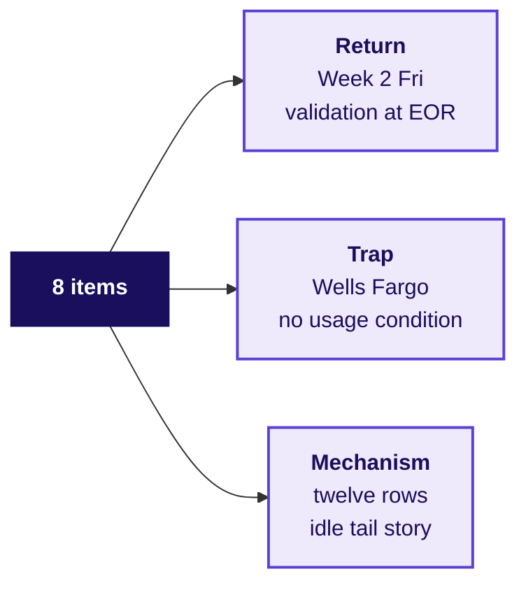

# War game round 3, the transcript and the handoff

Week 4, Day 1. Half two.

Kicker: WEEK 4  ·  MONDAY  ·  AFTERNOON, FIRST 60
Quote: Your definition has to survive our three objections, each partly right. Then one of you reads the interview question in a transcript.
Who: The afternoon's close, before the Hyderabad faculty block (tentative)

```notes
LIVE, 30 seconds. Half two is the afternoon's first 60 minutes: war game round 3, the interview
transcript and the AI-company variant, the Kahoot and the handoff to the (tentative) faculty
block. The lab's Kalpa transfer runs after the trainer's time.
Transition: round 3, where the room's definition meets the three roles' attacks.
```

---

## SECTION 4: Does the definition survive three partly-right attacks?
*What does the room's seven-line definition answer when driver operations, marketing and finance each raise a real objection?*

```notes
LIVE, 35 minutes: round 3 (30), close (5). Styles: the case method (roles with partly-right
objections), takeUforward's problem-first items, Veritasium's predict-then-reveal on round 3's
reveal of which roles conceded what.
Transition: the three roles' objections, in one slide.
```

---

## S26. Round 3: the three objections, each partly right
*Which part of each objection does the definition concede, and which part does it answer?*

```cards
icon: user  | eyebrow: Driver operations | title: Drivers will log off | body: True for the idle tail, false for the 880 honest drivers; the definition keeps the floor for drivers who accept | tone: light
icon: user  | eyebrow: Marketing         | title: Bait and switch     | body: True that the hoarding promised a floor; the floor is kept for drivers who accept, and the acceptance guardrail is named | tone: light
icon: user  | eyebrow: Finance partner   | title: The monsoon ended   | body: Partly: the L4 cuts bound it, the fall survives drivers present in both windows, and the top-up budget is still finance's number | tone: light
```

**The template each group fills.** North star; numerator; denominator; window; exclusions; what it does not reward; two guardrails with the gaming each catches; two leading inputs. Round 3 scores the definition on whether every role's attack is answered by one of these lines.

```notes
LIVE, 5 minutes to set the round. Read the three cards aloud. Each group has 20 minutes to write
and defend. Scoring: a definition survives when every role's attack is answered by a line of the
definition or a guardrail; a definition that drops the guarantee has lost driver operations,
which Tuesday takes up. Nine groups work in parallel; the trainer rotates through three groups,
voicing one role per visit.
Transition: the scorer's card the groups hold.
```

---

## S27. The scorer's card, four moves of a defence
*How does each group answer an objection without conceding too much or too little?*

```timeline
label: Move 1 | title: Restate | body: Restate the objection until the role agrees you understood it
label: Move 2 | title: Answer  | body: Name the line of the definition or guardrail that catches the gaming
label: Move 3 | title: Concede | body: Say which part of the objection is true, with a number if the data has one
label: Move 4 | title: Change  | body: Say what would change your mind, with the fact that would do it
```

**A defence that concedes nothing fails round 3.** A defence that concedes everything also fails: it ends with no definition left.

```notes
LIVE, 2 minutes. Model one defence yourself before the groups start. Pick driver operations and
restate: "You are saying that if we pay only for completed trips, drivers in slow outer zones
will log off." Answer: "The acceptance floor keeps the floor for drivers who accept at the floor
rate; the acceptance pattern is what defines idle." Concede: "You are right that outer-zone
supply is thinner; the fall was concentrated there and we would ask the city for a separate
guarantee for outer zones with its own acceptance floor." Change: "If outer-zone wait rose past
seven minutes, we would raise the floor there."
Transition: the groups go. Thirty minutes, the trainer rotates.
```

---

## SECTION 5: What the interviewer listens for
*Which structure does a hire-grade answer carry, and what does the trap look like?*

```notes
LIVE, 15 minutes: the transcript (10), the AI-company variant (5). Styles: the case method's
reading in pairs with a scorecard; Striver's ladder's hire-grade next to weak answer side by
side; Feynman's "say it to a hostel warden" as the pass criterion.
Transition: the question as a screener would ask it.
```

---

## S28. Transcript: the four beats a hire-grade answer carries
*What does a hire-grade candidate open with, and what trap does the interviewer fish for?*


| Beat | Weak answer | Hire-grade answer |
|---|---|---|
| Clarify | "A new feature on the app?" | "Which user, which business decision, and what would count as harm?" |
| Structure | Lists five metrics | Goal, user, one metric with numerator, denominator, window, two guardrails, one leading input, test |
| The trap | Online hours up 24 percent | Names it as a proxy and tells the paradox: 2.1x hours with 12 percent fewer trips in the idle tail |
| Decision tied to cost | "We would roll it out" | Pay per completed peak trip; gamed cost Rs 1.16 crore; redesign Rs 74 lakh |

**Three follow-ups.** "Online hours rose 24 percent; what do you check first?" "Which guardrail would driver operations argue against, and why are they partly right?" "The measured drivers control when they log in; what happens to your number?"

```notes
LIVE, 7 minutes. Read the weak and hire-grade answers side by side, one beat at a time. Pause on
"the trap": the weak answer celebrates the proxy; the hire-grade answer names it as a proxy and
tells the paradox. Then read the three follow-ups and have two learners answer the first one
aloud. The scorecard goes to the trainer; a group ranks a hire-grade answer at 2 on the first
three criteria.
Transition: the AI-company variant, which asks the same question about an AI coding assistant.
```

---

## S29. AI-company variant: the coding assistant metric
*How would you measure a coding assistant without rewarding accepted-but-deleted suggestions?*

| Line of the definition | For Uber's scheme | For the AI coding assistant |
|---|---|---|
| North star | Completed peak trips per enrolled driver per week | Suggested text still present at the next commit, per active developer per week |
| The gamed proxy | Peak online hours | Suggestions accepted |
| Guardrail 1 | Acceptance share | Build failures per developer per week |
| Guardrail 2 | Median rider wait | Revert rate on suggested text |
| Guardrail 3 | Top-up per completed trip | Time to merge, per developer |
| Window | The calendar week | The calendar week |
| The gaming | Stay online, decline requests | Short suggestions accepted and deleted |

**Programme-written variant; no company figure.** The structure travels: the proxy is replaced; the north star carries the thing the business wants; the guardrails catch each gaming.

```notes
LIVE, 5 minutes. Read the two columns side by side. Say the point: the structure of a good
measurement is the same whether the product is a ride-hail or a coding assistant. Ask: for a
developer who accepts a suggestion and deletes it in the next edit, which guardrail catches it?
Revert rate.
Transition: the Kahoot, eight items, with Week 2 Friday's return question.
```

---

## S30. Kahoot: eight items in five minutes
*Can the room answer today's traps, in writing, in under a minute each?*



Items test: the proxy (1), the denominator (2), the idle-tail multiplier (3), the top-up share (4), the acceptance guardrail (5), Week 2 Friday's end-of-reporting-day validation (6), Wells Fargo's no-usage-condition breach (7), the twelve-row story (8). Keys sit in the TRAINER file.

```notes
LIVE, 8 minutes to run. The return question tests Week 2 Friday's lesson on validation at the
end of reporting day. The Wells Fargo item (7) asks the room to name "no usage condition" as the
breach that parallels Uber's "online means app open".
Transition: the handoff line to the tentative faculty block.
```

---

## S31. The handoff: the A/B test of the redesigned scheme
*What does the next 120 minutes test, and why does the scheme need it?*

> *"You have a number the scheme should pay for and two guardrails that catch the ways of hitting it that hurt riders. You have not tested whether the redesign moves it. The next 120 minutes design that test on this city: the unit you randomise, the metric, the guardrail and how long you run it before you look."*

**The faculty block is tentative.** W4-1, A/B testing: unit, metric, guardrail, duration, peeking. If the block slips, the fallback deck's metric clinic runs instead.

```notes
LIVE, 1 minute. The trainer says the handoff aloud. Say the block is tentative until IIT
Gandhinagar confirms the session. If the tentative block does not run, the metric clinic
fallback runs. Park "is the fall real" for the block.
Transition: the day's close.
```

---

## S32. Monday close: a number redesigned, Tuesday to come
*What does the room take into Tuesday, and what will the one-slide answer have to say?*

**Monday earned.** A number that rose because the scheme paid for being online, a 180-driver idle tail that logged outer-zone hours without trips, a Rs 1.16 crore cost to idle online hours, and a definition that pays for completed trips with an acceptance guardrail.

**Tuesday brings.** The same case, one day on. The city head's one slide at the Thursday review: Rs 314 to Rs 260 per online hour; three objections, each partly right; four moves of a defence. Plus a guesstimate: how many drivers must be online at the evening peak to keep wait under five minutes.

**Pre-read ships tonight.** The city head's one-slide terms, and the vocabulary: claim, evidence, caveat, action.

```notes
LIVE, 1 minute. The room reads tonight's pre-read; the TA lab runs the Kalpa transfer now. The
lab's twelve rows and the plant stay in the TA note.
Transition: lab.
```
