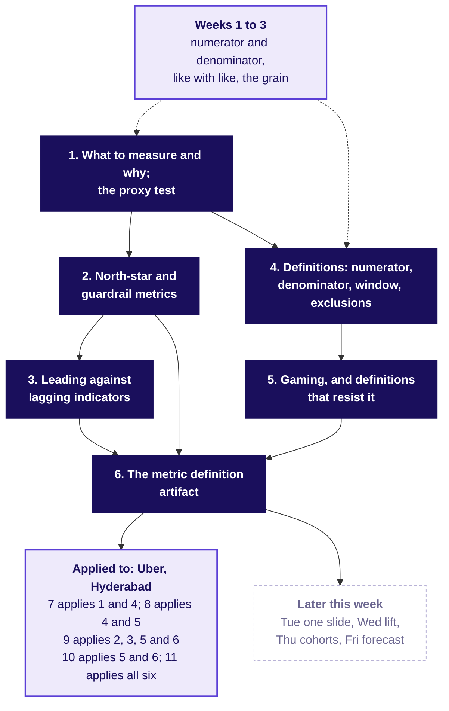
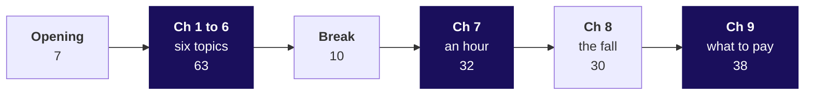

# Day sheet, Week 4 Monday: business metric design, which number should the plan chase, and what stops it being gamed?

**TRAINER ONLY.** Nothing on this page reaches a learner.

Posts to <!-- sync:module:W04/D1 -->Module 2: Applied Machine Learning<!-- /sync:module:W04/D1 -->, on <!-- sync:day-date:W04/D1 -->Mon 26 Oct 2026<!-- /sync:day-date:W04/D1 -->.

<!-- sync:faculty-day:W04/D1 -->
**IITGN faculty block W4-1 (tentative), 120 minutes, after this row's applied core.** Faculty: to be confirmed by IIT Gandhinagar.

TOPIC: Designing an experiment that moves a metric: randomisation, control groups, the A/B test, and the sample size behind it.
PICKS UP WHERE THE ROW STOPS: the row designs the metric and its guardrails and never tests whether a change moved it.
CONNECTS TO KALPA: one initiative on the growth plan's tree, tested properly; it builds on the Week 2 block on power, and it answers the interview anchor 'how would you measure the success of a new feature'.
BY THE END: a learner can design an A/B test for one initiative: the unit that is randomised, the metric, the guardrail and the duration.
DOES NOT REPEAT: the north-star and guardrail definitions.
<!-- /sync:faculty-day:W04/D1 -->

Your row stops where the faculty block starts: the Kahoot, the handoff and the close (afternoon
deck, S96 to S98) are the last things you run. Read the handoff line below word for word, name the
block as tentative, and park any "is the fall real?" question for it. If the block does not run, the
metric clinic (`slides/C2_W04_D01_fallback_STUDENT.md`, sections 13 to 16, 120 minutes, run sheet in
`trainer/C2_W04_D01_fallback_note_TRAINER.md`) takes its place, and it teaches nothing about testing.

**The handoff line, said by the trainer.** "You have a number the scheme should pay for and two
guardrails that catch the ways of hitting it that hurt riders. You have not tested whether the
redesign moves it. The next 120 minutes design that test: the unit you randomise, the metric, the
guardrail and how long you run it before you look." The block's brief above ties its test to one
initiative on Kalpa's growth plan, while the approved spine has it test this city's redesign, so the
handoff names neither and the faculty's choice stands.

Built from the approved Week 4 spine (`docs/detailing/W04_analyst_craft_spine.md`, section 5 with its
concept block of 13 October 2026, and the rules of sections 2 to 4), the Monday plan
(`docs/detailing/W04_concept_first/D1_plan.md`), the Monday case of `docs/detailing/W04_case_file.md`
and the Monday row of `docs/curriculum/W4_Analyst_craft.md`. Data: the day's own generator,
`internal/C2_W04_D01_generate_INTERNAL.py`, seed 20261026, which writes the five case tables and the
six invented tables of the concept chapters to `data/`, and every number below to
`internal/C2_W04_D01_facts_INTERNAL.yaml` (the concept chapters' under `toy_` ids).

**The week's explorer** is `demos/C2_W04_D01_week_explorer_STUDENT.html`, built on its own branch and
shipped with the week. Monday uses scene M1 (S10's notes and S67), M2 (S17's notes, S75 and S80), M3
(S33's notes and S81) and M4 (S28); each slide's notes name its scene. If the file is not on the
projector, every slide stands without it.

**No guesstimate on Monday.** The spine and the case file start the daily guesstimate on Tuesday,
whose drivers-at-peak question uses Monday's `zone_weeks` as its synthetic check.

---

## Which six topics does Monday teach, and where is each taught?

The curriculum row's six subtopics, verbatim and in its order, are the morning's six concept
chapters. This is the coverage matrix's first table (`internal/C2_W04_D01_coverage_INTERNAL.md`).

| # | Topic, as the row words it | Chapter | Slides (`half1`) | Notebook | Exercise items | Kahoot | Minutes |
|---|---|---|---|---|---|---|---|
| 1 | What to measure and why; the proxy test | SECTION 1, what is a number for? | S6 to S13 | 01 `proxy_test` | Proxy test set Q1 to Q3; lab set Q5 | Q5 | 13 |
| 2 | North-star and guardrail metrics | SECTION 2, which number to chase? | S14 to S21 | 02 `north_star_guardrails` | North star set Q1 to Q3; guided Q4; redesign Q3; lead and lag Q3; lab set Q2, Q3; Kalpa Q3 | Q1 | 10 |
| 3 | Leading against lagging indicators | SECTION 3, which number warns? | S22 to S29 | 03 `leading_lagging` | Leading and lagging set Q1 to Q3; lead and lag Q1, Q2; lab set Q4; Kalpa Q4 | Q2 | 10 |
| 4 | Definitions: numerator, denominator, window, exclusions | SECTION 4, which four lines? | S30 to S37 | 04 `numerator_denominator_window_exclusions` | Four lines set Q1 to Q3; guided Q1 to Q3; Kalpa Q2, Q5; lab set Q1 | Q4, Q6 | 10 |
| 5 | Gaming, and definitions that resist it | SECTION 5, how is a number gamed? | S38 to S45 | 05 `gaming_resistant_definitions` | Gaming set Q1 to Q3; redesign Q1, Q2, Q4 | Q3 | 10 |
| 6 | The metric definition artifact | SECTION 6, what does the page hold? | S46 to S53 | 06 `metric_definition_artifact` | Artifact set Q1 to Q3; Kalpa Q1 | Q7 | 10 |

Each concept chapter runs the same eight beats: the opener, the map slide with who needs the answer
and the questions on the way, the misconception as a prediction and its answer, the hand count on the
invented example, the picture with the rule named last, a code glimpse, four rules with the interview
line, and the map node that names the case chapter applying it. Each closes on its set's Q1, called
on the rules slide: letters on paper, then the key and one reason, inside that slide's minute and a
half.

| Case chapter | Applies | Slides | Notebook | Minutes |
|---|---|---|---|---|
| SECTION 7, what does an hour count? | Topics 1 and 4 | `half1` S54 to S63 | 07 `proxy_test_on_twelve_rows` | 32 (the full ticket and round 1, 12; the twelve rows by hand, 20) |
| SECTION 8, where did the fall sit? | Topics 4 and 5 | `half1` S64 to S73 | 08 `denominators_on_full_data` | 30 |
| SECTION 9, what should it pay for? | Topics 2, 3, 5 and 6 | `half1` S74 to S84 | 09 `north_star_guardrails_cost` | 38 |
| SECTION 10, does it survive the roles? | Topics 5 and 6 | `half2` S85 to S90 | 10 `gaming_page_three_roles`; the redesign set | 25 |
| SECTION 11, what wins the interview? | All six | `half2` S91 to S95, then S96 to S98 | 11 `new_feature_definition_page`; the transcript | 15, then 20 for the Kahoot, the handoff and the close |
| The TA-led lab | Topics 2 to 6 on Kalpa | none | 12 `kalpa_lab` | the lab's length |

---

## How do the six topics join, and where does the case apply them?

The concept map is `half1` S4; every concept chapter closes on its own node of it, and the board
work opens on it.

Chapters 1 to 3 choose the number; chapters 4 and 5 write it down so it cannot be gamed; chapter 6
puts both on one page, its guardrails from chapter 2, which chapter 9 fills for Uber and the lab fills
for Kalpa. On the slide all six boxes are lit as the day's topics; on the board, draw them unlit and
light each as its chapter closes. The Uber box says which case chapter applies which topic, and the
case chapters recall each topic by name where they use it (S59, S68 to S70, S80).

---

## Which case beats moved, and do the minutes still add up?

The concept block was added inside the same 240 trainer minutes: its 63 minutes came from the case
beats it absorbed, each leaving a one-line recall by name where it stood.

| Block | Before the rebuild | Minutes | After the rebuild | Minutes | What moved |
|---|---|---|---|---|---|
| Opening | The ticket, the week map, where today ends, the board and round 1 (old S1 to S5) | 15 | The day's topic, the week map, the topics slide, the concept map and the ticket as the destination (S1 to S5) | 7 | The full ticket, where today ends, the board and round 1 open chapter 7 |
| Concept block | none | 0 | Chapters 1 to 6 (S6 to S53) | 63 | Built from the beats in this column |
| Break | After old S24 | 10 | After S53 | 10 | |
| The twelve rows | Chapter 1 (old S6 to S13) | 40 | Chapter 7 (S54 to S63): the full ticket and round 1, 12; the twelve rows, 20 | 32 | The canteen (old S8) to chapter 1; Wells Fargo (old S12) to chapter 1; old S6 and S7 become the recall on S59; round 1 three minutes shorter, since chapter 1 opens on the instinct round |
| The full data | Chapter 2 (old S14 to S24) | 50 | Chapter 8 (S64 to S73) | 30 | Swiggy (old S20) and Delhi Metro (old S21) to chapter 4 |
| The page and the cost | Chapter 3 (old S25 to S37) | 65 | Chapter 9 (S74 to S84) | 38 | The lead picture (old S31) to chapter 3; the VA clock (old S33) to chapter 5; the seven-line skeleton to chapter 6, so S81 is the Uber instance; old S37 cut, since the topics slide carries the afternoon's order |
| Round 3 | Old S38 to S43 | 30 | Chapter 10 (S85 to S90) | 25 | Maxxsaver and Eternal (old S43) to chapter 2 |
| The interview room | Old S44 to S47 | 15 | Chapter 11 (S91 to S95) | 15 | |
| Kahoot, handoff and close | Old S48 to S50 | 15 | S96 to S98 | 20 | The close names the six topics on one strip |
| The trainer's day | | 240 | | 240 | The morning 180 and the afternoon's first 60, as the spine's envelope sets |

---

## Which questions does the day ask, in the order the trainer asks them?

The day's question, the row's Day focus: **which number should the plan chase, and what stops it
being gamed?** The ticket's: **is the scheme working, which metric should it pay for, and is anyone
gaming it?** Ask each question below before its answer is shown.

| Part | Level | Its question | The smaller questions, in order |
|---|---|---|---|
| The opening | | Which number should a plan chase, and what stops it being gamed? | Where does today sit in the week? Which six topics come first, and how do they join? Where will they be used? |
| Chapter 1 | concept | What is a number for? | Which teacher number can rise as children learn less? What did tokens per plate do once pay followed tokens? What did it cost? What is the proxy test? |
| Chapter 2 | concept | Which number to chase? | Why did a pass rate rise from 60 to 90 percent? What happened to licences per learner? Which number is the north star, and which the guardrail? |
| Chapter 3 | concept | Which number warns? | When does the chase first need 10 an over? When does the result arrive? What is read beside the warning? Which of Uber's numbers settled first? |
| Chapter 4 | concept | Which four lines? | How many numbers can one register give? Which line moved each? How do Swiggy's filings write the lines down? |
| Chapter 5 | concept | How is a number gamed? | What can rise with no parcel delivered? Whose clock is it? Which line stops each of the four ways? |
| Chapter 6 | concept | What does the page hold? | How many of seven lines does the weak page hold? What does the full page say? How does code find a blank line? |
| Chapter 7 | L1 | What does an hour count? | What does the full ticket say, line by line? Where does today end? How could each role's number be hit badly? What did six drivers do, counted by hand? Why do the six fall further than the city? |
| Chapter 8 | L2, L3 | Where did the fall sit? | Did demand fall? What do the twelve weeks show? What does one `groupby` give? What does an average of each week's rate print? How many drivers sit under one trip an hour? |
| Chapter 9 | L3 to L5 | What should it pay for? | Which number should the scheme reward? What memo would the celebrated number have sent? How much top-up went to declining weeks? How do a north star, guardrails and inputs fit? What are the seven lines for Uber? What remains without the new drivers? |
| Chapter 10 | L5 | Does it survive the roles? | What does each group hand in? What will each role say, and which part is true? Which line answers "drivers will log off"? What would the redesign save, said honestly? |
| Chapter 11 | L6 | What wins the interview? | What does a strong candidate clarify first? How do a weak and a hire-grade answer compare? Which follow-ups come next? How does the question move to an AI coding assistant? |
| The close | | Is the number the scheme pays for measuring what the city wants? | What does the Kahoot show the room got? What is the sentence, filled? What does Tuesday ask? |

**The day's answer, said at the close (afternoon S98).** "Judge the scheme by completed peak trips
per enrolled driver online at peak, guarded by the share of offers accepted and the rider's wait,
because paying for hours cost Rs 1.159 crore in six weeks for driver-weeks that declined most of what
they were offered." Then the rule that follows from it: the Rs 300 floor stays only for driver-weeks
that accept at least half their offers, an accepted trip later cancelled counting as declined.

## Where does each item of the row's agenda run?

The row's agenda and drills, mapped to the built day. Its Kalpa scenario moves to the practice lab by
decision `teaching-approach`: the concept chapters teach on invented examples and the case on Uber,
and the lab carries Kalpa.

| The row's item | Its minutes | What delivers it in the built day | Minutes |
|---|---|---|---|
| 1. Three proposed targets; the room says how each could be hit while the business got worse | 15 | The instinct round on the principal's three numbers (S7 and S8, 4.5); the ticket and round 1 on the city team's three numbers (S54 to S58, 12); the row's own three, Marketing's orders per month, Operations' app sessions and Retail-Plus's reorders per member, appear in the Kalpa set's preamble and options, and the lab's notebook tests reorders per member; no item asks how orders per month or app sessions could be hit while the business got worse | 16.5 |
| 2. Metric as decision instrument; the proxy test; gaming and definitions that resist it | 40 | The rest of chapter 1 (8.5); chapter 5 (10); chapter 7's twelve rows (20) | 38.5 |
| 3. North-star against guardrails; leading against lagging, on Kalpa's tree | 50 | Chapter 2 (10); chapter 3 with the eight Kalpa numbers at S27 (10); chapter 9's vote, memo, cost and tree (S74 to S80, 18); Kalpa's own tree in the lab's Kalpa set | 38 |
| 4. Definitions, computed on the customer table | 45 | Chapter 4 (10); chapter 8 on `driver_weeks` (30); Kalpa's table in the lab notebook | 40 |
| 5. Guided then unguided: the artifact for the growth plan, with guardrails and a gaming note | 60 | Chapter 6 (10); the Uber page with the room (S81, 11); round 3 (25); Kalpa's page in the lab's Kalpa set | 46 |
| 6. Kahoot and close | 20 | S96 to S98 | 20 |
| Not on the row's agenda | | The opening (7), the break (10), chapter 9's caveats (S82 to S84, 9), the interview room (15) | 41 |
| Mid-session drill 1: eight Kalpa metrics classified, two defended | 15 | The leading-lagging set's Q1 at S27, inside chapter 3; its Q2, the defence, in the practice lab; the full drill on Uber's numbers in the clinic's section 15 | inside chapter 3 |
| Mid-session drill 2: the guardrail for three proposed north stars | 15 | Lead and lag Q3 in the practice lab, on Uber's three; the clinic's S8 | the lab |

The trainer's 240 minutes are all in the last column's first seven rows. The row's unguided task,
one guardrail written alone and then attacked by a partner, runs as round 3's groups attacked by the
three roles; the row's "cut first", the second unguided definition, has no counterpart, since the day
writes one unguided definition.

## Where do the row's references point?

| Reference in the row | Where it points | Checked |
|---|---|---|
| GeeksforGeeks, data analyst interview questions | https://www.geeksforgeeks.org/data-analysis/data-analyst-interview-questions-and-answers/ | Loads (checked 13 October 2026) |
| Interview Query, product and metric questions | https://www.interviewquery.com/p/python-data-science-interview-questions | Not verified on 13 October 2026: the site refused the request |
| Exponent, data analyst interview questions (also the student reference) | https://www.tryexponent.com/blog/top-data-analyst-interview-questions | Redirects to Aced, which loads (checked 13 October 2026) |

---

## What does the day start from, and where does it stop?

| | |
|---|---|
| **Start from** | Weeks 1 and 2: any rate the definition needs can be computed, a rate is a ratio of two sums, a total's grain is checked first. Today is judgement: what to count, and what the count rewards. |
| **Go as far as** | Every learner can name the six topics and test a number with each, then writes the redesign's definition on seven lines with two guardrails and a gaming note, prices what paying for hours cost, and answers the three roles. |
| **Stop before** | Testing whether the redesign works: randomisation, control groups, sample size and duration belong to the tentative faculty block. Basket analysis (Wednesday), cohorts (Thursday), forecasting (Friday). Name each as later, once. |
| **Comes later** | Tuesday puts today's answer on one slide in front of the three roles and opens the daily guesstimate; Wednesday's lift, Thursday's cohorts and Friday's forecast each hang off a north star written today's way. |
| **Cut first** | The GIF (show the drift PNG on S67), then S36's Swiggy table to its MTU row, then S20 (Maxxsaver and Eternal) to its stats; in the fallback, section 15's drill. Never cut a concept chapter's hand count, the gaming demonstration (S39 to S41), round 3, the twelve-row count (S60 to S62) or the Kalpa lab. S37's Delhi Metro line stays, since S66, S73 and S84 recall it. |

---

## How does the morning's 180 minutes run?

| Part | Minutes | Slides (`half1`) | Beside it | What must land | If short of time |
|---|---|---|---|---|---|
| The opening | 7 | S1 to S5 | The concept map on the board | The six topics named in the row's order; the ticket seen as the destination | S2 to its lit node |
| Chapter 1 | 13 | S6 to S13 | Notebook 01; proxy test set Q1 | Tokens 1.0 to 2.0 a plate, Rs 1,500 of rice a day, and the proxy test named last | S13's Wells Fargo line to one sentence |
| Chapter 2 | 10 | S14 to S21 | Notebook 02; north star set Q1 | The pass rate 0.60 to 0.90 against licences per learner 0.60 to 0.36 (invented); the seesaw named | S20 to its stats |
| Chapter 3 | 10 | S22 to S29 | Notebook 03; leading and lagging set Q1 with two calls defended | 10.0 an over at over 10, the loss confirmed at over 20 | S28 to one sentence |
| Chapter 4 | 10 | S30 to S37 | Notebook 04; four lines set Q1 | Five readings, 66.7 to 84.0, each moved by one line | S36 to its MTU row |
| Chapter 5 | 10 | S38 to S45 | Notebook 05; gaming set Q1 | 50 marked against 40 confirmed; the four ways and the line that stops each | S42's public column read aloud without discussion |
| Chapter 6 | 10 | S46 to S53 | Notebook 06; artifact set Q1 | The seven lines; the weak page holds two | S53's Uber 10-K line |
| Break | 10 | After S53 | | | |
| Chapter 7 | 32 | S54 to S63 | Role cards; the twelve-row table on paper; notebook 07; `trainer/C2_W04_D01_war_game_TRAINER.md` | The full ticket read in order; each role's number attacked with the proxy test; 1.90 then 1.19, counted by hand | Round 1 to one attack per role |
| Chapter 8 | 30 | S64 to S73 | Notebook 08 and its empty your-turn cell | Requests rose; 1.71 against 1.58; the 180 drivers found by the room | S68 shown on screen without running it |
| Chapter 9 | 38 | S74 to S84 | Notebook 09; `exercises/guided/C2_W04_D01_definition_STUDENT.md` | The seven lines written with the room; Rs 1.159 crore with its behaviour caveat; the fall survives every cut | S81 to its template; S83 to three caveats |

## How do the afternoon's first 60 minutes run?

| Part | Minutes | Slides (`half2`) | Beside it | What must land | If short of time |
|---|---|---|---|---|---|
| Chapter 10, round 3 | 25 | S85 to S90 | `exercises/unguided/C2_W04_D01_redesign_STUDENT.md`; role cards; notebook 10 for a disputed card | Each group's definition answers every role or concedes in the open; the saving said as a range | S90 to the range alone |
| Chapter 11, the interview room | 15 | S91 to S95 | `extras/C2_W04_D01_transcript_STUDENT.md`; the scorecard; notebook 11 | The hire-grade answer clarifies, structures, sees the paradox and prices it | S95 to its table |
| Kahoot, handoff and close | 20 | S96 to S98 | `kahoot/C2_W04_D01_quiz_STUDENT.md` | The most-missed item said again; the handoff line read; the six topics on one strip | Kahoot to six items |

Then the tentative IITGN block, 120 minutes, or the metric clinic in its place. Then the TA-led
lab: notebook 12, the Kalpa set, the lead-and-lag drill, the lab set and the concept sets' Q2 and Q3
(`trainer/C2_W04_D01_lab_note_TRAINER.md`). The lab note is kept as merged and predates the concept
sets, so this sheet schedules them: after the lab note's four parts the TA runs the six sets' Q2 and
Q3, 12 items, about 20 minutes, and opens their six solution files; if the lab reaches its end first,
the 12 items go home as self-study before Saturday. The clinic's section 15 hands out the
lead-and-lag file and prints its Q1 on S6 in the file's order, with its letters, so a room that ran the
clinic skips that file in the lab, as the lab note and the lab set's problem 2 say.

## When does each notebook run?

A notebook carries more than the live minutes allow, since it is also the self-study text. In class
the trainer runs on screen only the cells a slide names, inside that slide's minutes:

| Notebook | What runs in class | What waits for the lab or for home |
|---|---|---|
| 01 to 06 | The code glimpse slide (S11, S18, S26, S34, S43, S51) is the notebook's code count, read line by line | The prediction, the pictures and the your-turn cell |
| 07 | The totals cell behind S61 and S62, after the hand count | The offers picture |
| 08 | S68's totals cell and S71's your-turn cell, typed by the room | The second route by acceptance |
| 09 | The split behind S78 and S79, the board behind S81, the cuts behind S82 and S83 | The SQL cell |
| 10 | Its pictures, only when a group disputes a card at S87 | The tests of each line, the saving and the your-turn cell |
| 11 | Nothing; S93's numbers come from it | The checks and the coding assistant's page |
| 12 | The whole lab, with the TA | |

---

## Which traps does the day set, with their exact numbers?

The concept chapters each stage the misconception their example refutes; the case chapters each
stage a plausible wrong number. Every invented number below is labelled invented where it appears.

| Where | The plausible wrong answer | The decision it would mislead | The check that catches it | The fix |
|---|---|---|---|---|
| S7 and S8, chapter 1 | "The exam average cannot be faked" | Paying teachers on it | How each number could rise while children learned less | All three are proxies; read each beside what it stands for |
| S15 and S16, chapter 2 | "Better teaching lifted the pass rate to 0.90" (invented) | A family enrols on the hoarding | Licences per learner who enrolled: 0.60 to 0.36 | Read the pass rate beside its guardrail, 1.00 to 0.40 who took the test, and chase licences per enrolled learner |
| S23 and S24, chapter 3 | "You know a chase is lost when the last over ends" | A captain who waits | The runs an over needed: 10.0 after over 10 (invented) | Watch the leading number with its guardrail, wickets in hand |
| S31 and S32, chapter 4 | "Attendance is one number" | A scholarship refused on 66.7 | Which line changed: five readings, 66.7 to 84.0 (invented) | Print the four lines beside the number |
| S39 and S40, chapter 5 | "Paying per delivery gets more deliveries" | Rs 1,000 paid for 40 parcels | The OTP column: 40 of 50 confirmed (invented) | A receipt in the numerator, a clock the system starts |
| S47 and S48, chapter 6 | "A name, a window and a target define a metric" | Paying on "deliveries, monthly, plus 20 percent" | The seven lines: two written, five blank | Write all seven before anyone is paid |
| S61 and S62, notebook 07 | "Trips per hour fell to the ticket's 1.58 on the six" | Reading a hand sample as the city | Count it: 114 / 60 = 1.90, 88 / 74 = 1.19 | Say why the six fall further: two of six idle against 15 percent city-wide |
| S65 and S66, notebook 08 | "Trips per hour fell because demand fell" | Blaming the season and keeping the scheme | `zone_weeks`: requests 251,910 to 256,556, up 1.8 percent | Offers per request 1.07 to 1.35: declined requests were offered again |
| S69 and S70, notebook 08 | 1.71, the average of each driver-week's rate after the launch | A fall that looks two-fifths smaller than it is | Recompute from the sums: 1.58 | Ratio of sums, every time |
| S77, notebook 09 | "Peak online hours up 24 percent: supply target met, extend to two more cities" | Spending the scheme in two more cities | Trips per online hour 1.90 to 1.58; median wait 4.8 to 4.6 minutes | Judge the scheme by completed peak trips, with an acceptance floor in the pay rule |
| S82 and S83, notebook 09 | "The 140 new drivers explain the fall" | Dismissing the finding as mix | The rate without them: still 1.58 | Say which doubts the fall survives (new drivers, the three weeks with most requests at 1.60, core zones at 1.79) and which stay open |
| S75, S76 and round 3 | "Pay per completed trip, nothing beside it" | A rule drivers game by cherry-picking short trips | The share of offers accepted falls when drivers decline | An acceptance floor between 0.46 and 0.78 |
| Round 3, S90 | "The redesign saves Rs 1.16 crore" | A saving that assumes no driver changes behaviour | Ask what an idle driver does on Monday under the new rule | Rs 58 lakh to Rs 92.7 lakh if a fifth to a half is still paid, with the assumption stated |

---

## Where does the room check itself?

| After | Every learner should have | If most do not |
|---|---|---|
| Each concept chapter | The letter for its set's Q1, and the chapter's hand count on paper | Redo the hand count aloud on the chapter's table at the start of the practice lab, before the set's Q2 and Q3 |
| Chapter 7 | 60 and 74 hours, 114 and 88 trips, 1.90 and 1.19 on paper | Redo the count aloud, column by column, before any code |
| Chapter 8 | 180 drivers from the your-turn cell, and 1.71 against 1.58 | Read the four lines of the your-turn cell aloud; check the window flag line first |
| Chapter 9 | The seven lines filled from notebook 09: 35.76 and 35.89; 0.863 and 0.73; 4.8 and 4.6; Rs 0 and Rs 82.3 | Walk S81 line by line again with the template on screen |
| Chapter 10 | A group sheet with a definition, a saving as a range with its assumption, and one answer per role | Give the stalled group the hint: what would that guardrail catch? |
| The lab | Kalpa's two ratios from the hand count and from the table | The lab note's hints, in order |

---

## Which Kalpa values are planted, and what if nobody finds one?

All three sit in the lab notebook's empty your-turn cells, so no saved output names them. No STUDENT
file states them before the lab; afterwards, only as decision `w4-finding-once-found` allows.

| Plant | Value | Found in | If nobody finds it |
|---|---|---|---|
| Reorders placed per Retail-Plus member, the 107 who joined by 19 August, 10 to 30 September over 20 August to 9 September | 1.22 | Notebook 12, first your-turn cell | Ask: "count the window's placements and the comparison's for the 107 in `base`, each over 107; which is bigger?" |
| Booked value of reorders per member, any status, the same 107 and the same two windows | 0.96 | Notebook 12, first your-turn cell | Ask: "now the rupees: did the value per member rise with the count?" |
| No placement in the window became an order: every one was an auto-reorder, cancelled, merged into a basket the member already had open or still pending | none delivered | Notebook 12, second your-turn cell | Ask: "group the window's placements by `auto` and `status`, then count the ones with an `order_id`: how many became an order?" |

The per-member figures divide both windows by the same 107 members, the ones already in the tier
when the comparison window opened on 20 August, because a member who joined later had fewer of its
days to reorder in: one who joined on 25 August had 16 of its 21. The lab's hand count on seven members gives 1.33 and 0.84, more than 0.10 from each
plant, so the full table still has a reason to be run. The seven rows are in the lab note.

The curriculum row's Kalpa column says reorders per member rose 22 percent while revenue per member
fell 4 percent. The lab's data says something sharper: booked value per member, any status, read 0.96
of the comparison window, and none of the window's placements became an order. Say what the data
shows, never the row's 4 percent, and keep the row's Kahoot items on Kalpa out of Monday's Kahoot,
which runs before the lab finds the plant (decision `w4-finding-once-found`).

---

## Which numbers does the day use, and where does each live?

Every number below is in `internal/C2_W04_D01_facts_INTERNAL.yaml` under the id beside it.

| Number | Value | Facts id |
|---|---|---|
| Peak online hours, before and after | 118,000 and 146,300 (up 24 percent) | `hours_before`, `hours_after`, `hours_change_pct` |
| Completed peak trips | 224,200 and 230,900 (up 3 percent) | `trips_before`, `trips_after`, `trips_change_pct` |
| Trips per peak online hour | 1.90 and 1.58 | `tph_before`, `tph_after` |
| Offers accepted over offers shown | 0.863 and 0.73 | `acceptance_before`, `acceptance_after` |
| Accepted, then cancelled by the driver | 0.037 and 0.09 | `driver_cancel_share_before`, `driver_cancel_share_after` |
| Online hours with no trip, share | 0.22 and 0.38 | `no_trip_share_before`, `no_trip_share_after` |
| Median rider wait at peak, minutes | 4.8 and 4.6 | `median_wait_before`, `median_wait_after` |
| Rider requests | 251,910 and 256,556 (up 1.8 percent) | `requests_before`, `requests_after`, `requests_change_pct` |
| Offers per request | 1.07 and 1.35 | `offers_per_request_before`, `offers_per_request_after` |
| The average of each week's rate, after | 1.71 | `mean_of_ratios_after` |
| The idle tail | 180 drivers, 15 percent; hours 2.1 times; trips 0.88 times; 72 percent of new hours outer | `idle_tail_drivers`, `idle_tail_share_of_drivers`, `idle_hours_ratio`, `idle_trips_ratio`, `idle_new_hours_outer_share` |
| Every other pre-launch driver | 880 drivers at 1.90 in both windows | `drivers_others`, `others_tph_before`, `others_tph_after` |
| Top-up | Rs 1.9 crore; Rs 1.159 crore (61 percent) to weeks under half accepted; Rs 74.1 lakh to the rest | `topup_after_rs`, `topup_low_acceptance_rs`, `topup_low_acceptance_share`, `topup_high_acceptance_rs` |
| The saving under the uptake assumption | Rs 58 lakh to Rs 92.7 lakh, a fifth to a half still paid | `saving_low_rs`, `saving_high_rs`, `uptake_low`, `uptake_high` |
| The acceptance gap | 0.46 and 0.78 | `acceptance_max_idle_week_after`, `acceptance_min_other_week_after` |
| The north star | 35.76 and 35.89 trips per online driver-week | `north_star_before`, `north_star_after` |
| Top-up per completed trip, after | Rs 82.3 | `topup_per_trip_after_rs` |
| The fall under each cut | 1.58 without new drivers; 1.60 in the three weeks with most requests; core zones 1.90 to 1.79 | `tph_pre_launch_after`, `tph_crest_weeks_after`, `tph_core_zones_before`, `tph_core_zones_after` |
| Acceptance and bookings per hour, weeks 7 to 9 | 0.729, 0.735, 0.729; Rs 271.0, 261.7, 259.1 | `acceptance_2026_08_31` and the next two; `rs_per_hour_2026_08_31` and the next two |
| The twelve rows | 60 and 74 hours; 114 and 88 trips; 1.90 and 1.19 | `twelve_hours_before` and the rest of `twelve_*` |
| The idle tail's week, against E and F | About 39 peak online hours a driver-week after the launch, against E's 16 and F's 14 | `idle_hours_per_driver_week_after` |
| What the top-up bought | 6,700 more trips, about Rs 2,836 each, 17.2 fares; net of the rise in requests, at the old fulfilment rate of 0.89, about 2,565 trips, near Rs 7,400 each | `extra_trips`, `topup_per_extra_trip_rs`, `topup_per_extra_trip_fares`, `fulfil_rate_before`, `extra_trips_net_of_demand`, `topup_per_net_extra_trip_rs` |
| The outer zones | Wait 6.6 to 5.95 minutes; about 185 extra trips; Rs 85.7 lakh to idle weeks there; about Rs 46,000 per extra trip | `outer_wait_before`, `outer_wait_after`, `outer_extra_trips`, `idle_outer_topup_rs`, `cost_per_extra_outer_trip_rs` |
| Cancels after accepting | Others 0.037 to 0.077; idle tail 0.152 after | `cancel_share_other_before`, `cancel_share_other_after`, `cancel_share_idle_after` |
| The acceptance floor with cancels counted as declines | Highest idle week 0.43; lowest other week 0.67 | `completed_share_max_idle_week_after`, `completed_share_min_other_week_after` |
| If the 180 quit | 33,440 trips; about 17,600 more peak hours at 1.90 | `idle_trips_after`, `hours_to_carry_idle_trips` |

---

## What are the interview answers, each in one breath?

| Question, as the row tags it | The answer in one breath |
|---|---|
| [S] How would you measure the success of a new feature? | Clarify the goal, the harm, the decision and the baseline; name one north star with its lines, three guardrails, a leading input and a test with its unit named; then read the data: hours rose 24 percent while trips per online hour stepped from 1.88 to 1.64 in the launch week and settled at 1.58, the north star barely moved, and outer-zone waits fell from 6.6 to 5.95 minutes at about Rs 46,000 per extra trip, so do not extend it, keep the Rs 300 floor only for weeks that accept half their offers, and test that, with Rs 2,836 per extra trip, near Rs 7,400 once the rise in requests is netted out, as the cost to beat. |
| [F] North star against guardrail, with one example pair. | The north star names the outcome the plan exists for and a guardrail catches a harmful way of hitting it: completed peak trips per enrolled driver online at peak, guarded by the share of offers accepted, which falls when drivers cherry-pick. |
| [F] What makes a metric gameable, and how do you write one that is not? | It is gameable when the people paid can raise the count without the outcome, as an open app raises online hours; write the numerator with a usage condition, set the denominator by something other than the outcome and print its count, name the window and dated exclusions, say what it does not reward, and add guardrails read from data the measured cannot easily move, such as the rider's wait by zone. |
| [D] Three departments each want their own target; how do you get to one, and what do you say to the two who lose? | Tie one north star to the scheme's goal and say aloud that none of the three teams' numbers is it; then give each a named job: hours beside trips per online hour, the enrolled count printed beside the rate, and for finance a total cap on the top-up and its cost per extra trip, Rs 2,836 under the old rule and near Rs 7,400 net of the rise in requests; and say what evidence would reopen the call. |

---

## Which file serves which moment?

| Moment | File |
|---|---|
| The morning | `slides/C2_W04_D01_half1_STUDENT.pptx` (source `.md`); concept notebooks 01 to 06, then case notebooks 07 to 09; the six concept sets in `exercises/unguided/` |
| The war game | `trainer/C2_W04_D01_war_game_TRAINER.md`; `trainer/C2_W04_D01_role_cards_TRAINER.md` |
| The guided definition | `exercises/guided/C2_W04_D01_definition_STUDENT.md` |
| Round 3 | `exercises/unguided/C2_W04_D01_redesign_STUDENT.md`; `notebooks/C2_W04_D01_10_gaming_page_three_roles_STUDENT.ipynb` |
| The interview room | `extras/C2_W04_D01_transcript_STUDENT.md`; `trainer/C2_W04_D01_interview_scorecards_TRAINER.md`; `notebooks/C2_W04_D01_11_new_feature_definition_page_STUDENT.ipynb` |
| The close | `kahoot/C2_W04_D01_quiz_STUDENT.md`; `slides/C2_W04_D01_half2_STUDENT.pptx` |
| If the faculty block slips | `slides/C2_W04_D01_fallback_STUDENT.pptx`; `trainer/C2_W04_D01_fallback_note_TRAINER.md` |
| The TA-led lab | `notebooks/C2_W04_D01_12_kalpa_lab_STUDENT.ipynb`; `exercises/unguided/C2_W04_D01_kalpa_north_star_STUDENT.md`; `exercises/unguided/C2_W04_D01_lead_lag_STUDENT.md`; `exercises/practice/C2_W04_D01_lab_set_STUDENT.md`; `trainer/C2_W04_D01_lab_note_TRAINER.md` |
| Tonight | `takehome/C2_W04_D01_brief_STUDENT.md` and its self-check; `study-notes/C2_W04_D01_notes_STUDENT.md`; `cheatsheets/C2_W04_D01_safe_to_pay_STUDENT.pdf`; `preread/C2_W04_D01_preread_STUDENT.md` |
| The board | `whiteboards/C2_W04_D01_board_work_STUDENT.md` |
