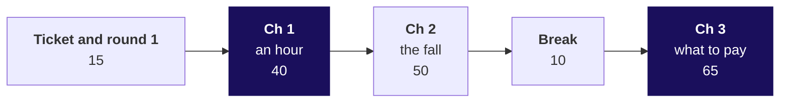

# Day sheet, Week 4 Monday: is the number the scheme pays for measuring what the city wants?

**TRAINER ONLY.** Nothing on this page reaches a learner.

Posts to <!-- sync:module:W04/D1 -->Module 2: Applied Machine Learning<!-- /sync:module:W04/D1 -->, on <!-- sync:day-date:W04/D1 -->Mon 26 Oct 2026<!-- /sync:day-date:W04/D1 -->.

<!-- sync:faculty-day:W04/D1 -->
**IITGN faculty block W4-1 (tentative), 120 minutes, after this row's applied core.** Faculty: to be confirmed by IIT Gandhinagar.

TOPIC: Designing an experiment that moves a metric: randomisation, control groups, the A/B test, and the sample size behind it.
PICKS UP WHERE THE ROW STOPS: the row designs the metric and its guardrails and never tests whether a change moved it.
CONNECTS TO KALPA: one initiative on the growth plan's tree, tested properly; it builds on the Week 2 block on power, and it answers the interview anchor 'how would you measure the success of a new feature'.
BY THE END: a learner can design an A/B test for one initiative: the unit that is randomised, the metric, the guardrail and the duration.
DOES NOT REPEAT: the north-star and guardrail definitions.
<!-- /sync:faculty-day:W04/D1 -->

Your row stops where the faculty block starts: the Kahoot and the close (afternoon deck, S48 to S50)
are the last things you run. Read the handoff line below word for word, name the block as tentative,
and park any "is the fall real?" question for it. If the block does not run, the metric clinic
(`slides/C2_W04_D01_fallback_STUDENT.md`, 120 minutes, run sheet in
`trainer/C2_W04_D01_fallback_note_TRAINER.md`) takes its place, and it teaches nothing about testing.

**The handoff line, said by the trainer.** "You have a number the scheme should pay for and two
guardrails that catch the ways of hitting it that hurt riders. You have not tested whether the
redesign moves it. The next 120 minutes design that test on this city: the unit you randomise, the
metric, the guardrail and how long you run it before you look."

Built from the approved Week 4 spine (`docs/detailing/W04_analyst_craft_spine.md`, section 5 and the
rules of sections 2 to 4), the Monday case of `docs/detailing/W04_case_file.md` and the Monday row of
`docs/curriculum/W4_Analyst_craft.md`. Data: the day's own generator,
`internal/C2_W04_D01_generate_INTERNAL.py`, seed 20261026, which writes the five CSVs in `data/`
and every number below to `internal/C2_W04_D01_facts_INTERNAL.yaml`.

**The week's explorer** is `demos/C2_W04_D01_week_explorer_STUDENT.html`, built on its own branch and
shipped with the week. Monday uses scenes M1 (S8 and S16), M2 (S25 and S30), M3 (S32) and M4 (S31);
each slide's notes name its scene. If the file is not on the projector, every slide stands
without it.

**No guesstimate on Monday.** The spine and the case file start the daily guesstimate on Tuesday,
whose drivers-at-peak question uses Monday's `zone_weeks` as its synthetic check.

---

## Which questions does the day ask, in the order the trainer asks them?

The day's question, the ticket's: **is the scheme working, which metric should it pay for, and is
anyone gaming it?** Ask each question below before its answer is shown.

| Part | Level | Its question | The smaller questions, in order |
|---|---|---|---|
| The ticket and round 1 | L1 | What did the city team launch, what moved, and how could each role's number rise while riders were served no better? | What does the ticket say, line by line? Where does today sit in the week? Where does today end? Which four questions must a number answer before anyone is paid for it? How could each of the three roles' numbers be hit badly? |
| Chapter 1 | L1 | What does an hour count? | Which number can a driver raise without driving? What happens to a token once servers are paid per token? What did six drivers do, counted by hand? Why do the six fall further than the city? What did a paid proxy cost Wells Fargo? |
| Chapter 2 | L2, L3 | Where did the fall sit? | Did demand fall? What do the twelve weeks show? What does one `groupby` give? What does an average of each week's rate print? How does Swiggy write a denominator down? Why do Delhi Metro's numbers differ by unit and by day? How many drivers sit under one trip an hour? |
| Chapter 3 | L3 to L5 | What should it pay for? | Which number would you pay drivers for? What memo would the celebrated number have sent? How much top-up went to declining weeks? How do a north star, guardrails and inputs fit? Which number moved first? What are the seven lines? Who set the clock's start at VA? What remains without the new drivers? |
| Round 3 | L5 | Does it survive the roles? | What does each group hand in? What will each role say, and which part is true? Which line answers "drivers will log off"? What would the redesign save, said honestly? What did Maxxsaver and Eternal choose? |
| The interview room | L6 | What does the interviewer hear? | What does a strong candidate clarify first? How do a weak and a hire-grade answer compare? Which follow-ups come next? How does the question move to an AI coding assistant? |
| The close | | Is the number the scheme pays for measuring what the city wants? | What does the Kahoot show the room got? What is the sentence, filled? What does Tuesday ask? |

**The day's answer, said at the close (afternoon S50).** "Judge the scheme by completed peak trips
per enrolled driver online at peak, guarded by the share of offers accepted and the rider's wait,
because paying for hours cost Rs 1.159 crore in six weeks for driver-weeks that declined most of what
they were offered." Then the rule that follows from it: the Rs 300 floor stays only for driver-weeks
that accept at least half their offers, an accepted trip later cancelled counting as declined.

---

## What does the day start from, and where does it stop?

| | |
|---|---|
| **Start from** | Weeks 1 and 2: any rate the definition needs can be computed, a rate is a ratio of two sums, a total's grain is checked first. Today is judgement: what to count, and what the count rewards. |
| **Go as far as** | Every learner writes the redesign's definition on seven lines with two guardrails and a gaming note, prices what paying for hours cost, and answers the three roles. |
| **Stop before** | Testing whether the redesign works: randomisation, control groups, sample size and duration belong to the tentative faculty block. Basket analysis (Wednesday), cohorts (Thursday), forecasting (Friday). Name each as later, once. |
| **Comes later** | Tuesday puts today's answer on one slide in front of the three roles and opens the daily guesstimate; Wednesday's lift, Thursday's cohorts and Friday's forecast each hang off a north star written today's way. |
| **Cut first** | The GIF (show the drift PNG), then S21 (Delhi Metro) to one sentence, then S43 (Maxxsaver and Eternal) to its first paragraph; in the fallback, section 8's drill. Never cut round 3, the twelve-row count (S9 to S11) or the Kalpa lab. |

---

## How does the morning's 180 minutes run?

| Part | Minutes | Slides (`half1`) | Beside it | What must land | If short of time |
|---|---|---|---|---|---|
| Ticket and round 1 | 15 | S1 to S5 | Role cards; proxy-test card; `trainer/C2_W04_D01_war_game_TRAINER.md` | The ticket read in order; each role's number attacked from instinct | Round 1 to one attack per role |
| Chapter 1 | 40 | S6 to S13 | Notebook 01; the twelve-row table on paper | 1.90 then 1.19, counted by hand; two of six idle against 15 percent of the city | S12 to its three numbers |
| Chapter 2 | 50 | S14 to S24 | Notebook 02 and its empty your-turn cell | Requests rose; 1.71 against 1.58; the 180 drivers found by the room | S20 and S21 to one sentence each |
| Break | 10 | After S24 | | | |
| Chapter 3 | 65 | S25 to S37 | Notebook 03; `exercises/guided/C2_W04_D01_definition_STUDENT.md` | The seven lines written with the room; Rs 1.159 crore with its behaviour caveat; the fall survives every cut | S33 to its parallel line; S35 to three caveats |

## How do the afternoon's first 60 minutes run?

| Part | Minutes | Slides (`half2`) | Beside it | What must land | If short of time |
|---|---|---|---|---|---|
| Round 3 | 30 | S38 to S43 | `exercises/unguided/C2_W04_D01_redesign_STUDENT.md`; role cards | Each group's definition answers every role or concedes in the open; the saving said as a range | S43 to Maxxsaver only |
| The interview room | 15 | S44 to S47 | `extras/C2_W04_D01_transcript_STUDENT.md`; the scorecard | The hire-grade answer clarifies, structures, sees the paradox and prices it | S47 to its table |
| Kahoot and close | 15 | S48 to S50 | `kahoot/C2_W04_D01_quiz_STUDENT.md` | The most-missed item said again; the handoff line read | Kahoot to six items |

Then the tentative IITGN block, 120 minutes, or the metric clinic in its place. Then the TA-led
lab: notebook 04, the Kalpa set, the lead-and-lag drill and the lab set (`trainer/C2_W04_D01_lab_note_TRAINER.md`).

---

## Which traps does the day set, with their exact numbers?

| Where | The plausible wrong number | The decision it would mislead | The check that catches it | The fix |
|---|---|---|---|---|
| S10 and S11, notebook 01 | "Trips per hour fell to the ticket's 1.58 on the six" | Reading a hand sample as the city | Count it: 114 / 60 = 1.90, 88 / 74 = 1.19 | Say why the six fall further: two of six idle against 15 percent city-wide |
| S14 and S15, notebook 02 | "Trips per hour fell because demand fell" | Blaming the season and keeping the scheme | `zone_weeks`: requests 251,910 to 256,556, up 1.8 percent | Offers per request 1.07 to 1.35: declined requests were offered again |
| S18 and S19, notebook 02 | 1.71, the average of each driver-week's rate after the launch | A fall that looks two-fifths smaller than it is | Recompute from the sums: 1.58 | Ratio of sums, every time |
| S27, notebook 03 | "Peak online hours up 24 percent: supply target met, extend to two more cities" | Spending the scheme in two more cities | Trips per online hour 1.90 to 1.58; median wait 4.8 to 4.6 minutes | Pay for completed peak trips, with an acceptance floor |
| S34 and S35, notebook 03 | "The 140 new drivers explain the fall" | Dismissing the finding as mix | The rate without them: still 1.58 | Say which doubts the fall survives (new drivers, the three weeks with most requests at 1.60, core zones at 1.79) and which stay open |
| S25, S26 and round 3 | "Pay per completed trip, nothing beside it" | A rule drivers game by cherry-picking short trips | The share of offers accepted falls when drivers decline | An acceptance floor between 0.46 and 0.78 |
| Round 3, S42 | "The redesign saves Rs 1.16 crore" | A saving that assumes no driver changes behaviour | Ask what an idle driver does on Monday under the new rule | Rs 58 lakh to Rs 92.7 lakh if a fifth to a half is still paid, with the assumption stated |

---

## Where does the room check itself?

| After | Every learner should have | If most do not |
|---|---|---|
| Chapter 1 | 60 and 74 hours, 114 and 88 trips, 1.90 and 1.19 on paper | Redo the count aloud, column by column, before any code |
| Chapter 2 | 180 drivers from the your-turn cell, and 1.71 against 1.58 | Read the four lines of the your-turn cell aloud; check the window flag line first |
| Chapter 3 | The seven lines filled from notebook 03: 35.76 and 35.89; 0.863 and 0.73; 4.8 and 4.6; Rs 0 and Rs 82.3 | Walk S32 line by line again with the template on screen |
| Round 3 | A group sheet with a definition, a saving as a range with its assumption, and one answer per role | Give the stalled group the hint: what would that guardrail catch? |
| The lab | Kalpa's two ratios from the hand count and from the table | The lab note's hints, in order |

---

## Which Kalpa values are planted, and what if nobody finds one?

All three sit in the lab notebook's empty your-turn cells, so no saved output names them. No STUDENT
file states them before the lab; afterwards, only as decision `w4-finding-once-found` allows.

| Plant | Value | Found in | If nobody finds it |
|---|---|---|---|
| Reorders placed per Retail-Plus member, 10 to 30 September over 20 August to 9 September | 1.22 | Notebook 04, first your-turn cell | Ask: "count the window's placements and the comparison's, each over 120 members; which is bigger?" |
| Booked value of reorders per member, any status, the same two windows | 0.96 | Notebook 04, first your-turn cell | Ask: "now the rupees: did the value per member rise with the count?" |
| No reorder in the window became a separate delivered order: every one was an auto-reorder, cancelled, merged into a later order or still pending | none delivered | Notebook 04, second your-turn cell | Ask: "group the window's placements by `auto` and `status`: how many were delivered?" |

The lab's hand count on seven members gives 1.35 and 0.88, at least 0.05 from each plant, so the
full table still has a reason to be run. The seven rows are in the lab note.

---

## Which numbers does the day use, and where does each live?

Every number below is in `internal/C2_W04_D01_facts_INTERNAL.yaml` under the id beside it.

| Number | Value | Facts id |
|---|---|---|
| Peak online hours, before and after | 118,000 and 146,300 (up 24 percent) | `hours_before`, `hours_after`, `hours_change_pct` |
| Completed peak trips | 224,200 and 230,900 (up 3 percent) | `trips_before`, `trips_after`, `trips_change_pct` |
| Trips per peak online hour | 1.90 and 1.58 | `tph_before`, `tph_after` |
| Offers accepted over offers shown | 0.863 and 0.73 | `acceptance_before`, `acceptance_after` |
| Accepted, then cancelled by the driver | 0.037 and 0.09 | `driver_cancel_share_before`, `driver_cancel_share_after` |
| Online hours with no trip, share | 0.22 and 0.38 | `no_trip_share_before`, `no_trip_share_after` |
| Median rider wait at peak, minutes | 4.8 and 4.6 | `median_wait_before`, `median_wait_after` |
| Rider requests | 251,910 and 256,556 (up 1.8 percent) | `requests_before`, `requests_after`, `requests_change_pct` |
| Offers per request | 1.07 and 1.35 | `offers_per_request_before`, `offers_per_request_after` |
| The average of each week's rate, after | 1.71 | `mean_of_ratios_after` |
| The idle tail | 180 drivers, 15 percent; hours 2.1 times; trips 0.88 times; 72 percent of new hours outer | `idle_tail_drivers`, `idle_tail_share_of_drivers`, `idle_hours_ratio`, `idle_trips_ratio`, `idle_new_hours_outer_share` |
| Every other pre-launch driver | 880 drivers at 1.90 in both windows | `drivers_others`, `others_tph_before`, `others_tph_after` |
| Top-up | Rs 1.9 crore; Rs 1.159 crore (61 percent) to weeks under half accepted; Rs 74.1 lakh to the rest | `topup_after_rs`, `topup_low_acceptance_rs`, `topup_low_acceptance_share`, `topup_high_acceptance_rs` |
| The saving under the uptake assumption | Rs 58 lakh to Rs 92.7 lakh, a fifth to a half still paid | `saving_low_rs`, `saving_high_rs`, `uptake_low`, `uptake_high` |
| The acceptance gap | 0.46 and 0.78 | `acceptance_max_idle_week_after`, `acceptance_min_other_week_after` |
| The north star | 35.76 and 35.89 trips per online driver-week | `north_star_before`, `north_star_after` |
| Top-up per completed trip, after | Rs 82.3 | `topup_per_trip_after_rs` |
| The fall under each cut | 1.58 without new drivers; 1.60 in the three weeks with most requests; core zones 1.90 to 1.79 | `tph_pre_launch_after`, `tph_crest_weeks_after`, `tph_core_zones_before`, `tph_core_zones_after` |
| Acceptance and bookings per hour, weeks 7 to 9 | 0.729, 0.735, 0.729; Rs 271.0, 261.7, 259.1 | `acceptance_2026_08_31` and the next two; `rs_per_hour_2026_08_31` and the next two |
| The twelve rows | 60 and 74 hours; 114 and 88 trips; 1.90 and 1.19 | `twelve_hours_before` and the rest of `twelve_*` |
| What the top-up bought | 6,700 more trips, about Rs 2,836 each, 17.2 fares | `extra_trips`, `topup_per_extra_trip_rs`, `topup_per_extra_trip_fares` |
| The outer zones | Wait 6.6 to 5.95 minutes; about 185 extra trips; Rs 85.7 lakh to idle weeks there; about Rs 46,000 per extra trip | `outer_wait_before`, `outer_wait_after`, `outer_extra_trips`, `idle_outer_topup_rs`, `cost_per_extra_outer_trip_rs` |
| Cancels after accepting | Others 0.037 to 0.077; idle tail 0.152 after | `cancel_share_other_before`, `cancel_share_other_after`, `cancel_share_idle_after` |
| The floor with cancels counted as declines | Highest idle week 0.43; lowest other week 0.67 | `completed_share_max_idle_week_after`, `completed_share_min_other_week_after` |
| If the 180 quit | 33,440 trips; about 17,600 more peak hours at 1.90 | `idle_trips_after`, `hours_to_carry_idle_trips` |

---

## What are the interview answers, each in one breath?

| Question, as the row tags it | The answer in one breath |
|---|---|
| [S] How would you measure the success of a new feature? | Clarify the goal, the harm, the decision and the baseline; name one north star with its lines, three guardrails, a leading input and a test with zones as its unit; then read the data: hours rose 24 percent while trips per online hour stepped from 1.88 to 1.64 in the launch week and settled at 1.58, the north star barely moved, and outer-zone waits fell from 6.6 to 5.95 minutes at about Rs 46,000 per extra trip, so do not extend it, keep the floor only for weeks that accept half their offers, and test that by zone. |
| [F] North star against guardrail, with one example pair. | The north star names the outcome the plan exists for and a guardrail catches a harmful way of hitting it: completed peak trips per enrolled driver online at peak, guarded by the share of offers accepted, which falls when drivers cherry-pick. |
| [F] What makes a metric gameable, and how do you write one that is not? | It is gameable when the people paid can raise the count without the outcome, as an open app raises online hours; write the numerator with a usage condition, set the denominator by something other than the outcome and print its count, name the window and dated exclusions, say what it does not reward, and add guardrails read from data the measured cannot easily move, such as the rider's wait by zone. |
| [D] Three departments each want their own target; how do you get to one, and what do you say to the two who lose? | Tie one north star to the scheme's goal and say aloud that none of the three teams' numbers is it; then give each a named job: hours beside trips per online hour, the enrolled count printed beside the rate, and for finance a total cap on the top-up and its cost per extra trip, Rs 2,836 under the old rule; and say what evidence would reopen the call. |

---

## Which file serves which moment?

| Moment | File |
|---|---|
| The morning | `slides/C2_W04_D01_half1_STUDENT.pptx` (source `.md`); notebooks 01 to 03 |
| The war game | `trainer/C2_W04_D01_war_game_TRAINER.md`; `trainer/C2_W04_D01_role_cards_TRAINER.md` |
| The guided definition | `exercises/guided/C2_W04_D01_definition_STUDENT.md` |
| Round 3 | `exercises/unguided/C2_W04_D01_redesign_STUDENT.md` |
| The interview room | `extras/C2_W04_D01_transcript_STUDENT.md`; `trainer/C2_W04_D01_interview_scorecards_TRAINER.md` |
| The close | `kahoot/C2_W04_D01_quiz_STUDENT.md`; `slides/C2_W04_D01_half2_STUDENT.pptx` |
| If the faculty block slips | `slides/C2_W04_D01_fallback_STUDENT.pptx`; `trainer/C2_W04_D01_fallback_note_TRAINER.md` |
| The TA-led lab | `notebooks/C2_W04_D01_04_kalpa_lab_STUDENT.ipynb`; `exercises/unguided/C2_W04_D01_kalpa_north_star_STUDENT.md`; `exercises/unguided/C2_W04_D01_lead_lag_STUDENT.md`; `exercises/practice/C2_W04_D01_lab_set_STUDENT.md`; `trainer/C2_W04_D01_lab_note_TRAINER.md` |
| Tonight | `takehome/C2_W04_D01_brief_STUDENT.md` and its self-check; `study-notes/C2_W04_D01_notes_STUDENT.md`; `cheatsheets/C2_W04_D01_safe_to_pay_STUDENT.pdf`; `preread/C2_W04_D01_preread_STUDENT.md` |
| The board | `whiteboards/C2_W04_D01_board_work_STUDENT.md` |
