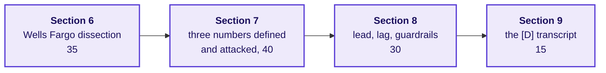

# How do you run the metric clinic if the tentative faculty block slips?

**TRAINER ONLY.** The IITGN block W4-1, designing the test of the redesigned scheme, is tentative
until IIT Gandhinagar confirms it. If it does not run, the metric clinic fills its 120 minutes with
practice on today's method and teaches nothing about testing: randomisation, control groups, sample
size and duration stay with the block whenever it runs. Deck: `slides/C2_W04_D01_fallback_STUDENT.pptx`.

**Who needs the answer.** The trainer who learns, late, that the block will not run, and has to fill
120 minutes without starting a new technique.

**The questions on the way.** What runs, for how long? What does each section need? What are the
answers? What do you do when a section stalls? What do you never do in the clinic?

---

## What runs, for how long?

| Section | Minutes | Slides | Materials |
|---|---|---|---|
| 6. Which line would have caught it? | 35 | S1 to S3 | The five SEC facts on S1; the match on S2 |
| 7. Does each number survive its owner? | 40 | S4 and S5 | The definition template, `exercises/guided/C2_W04_D01_definition_STUDENT.md` |
| 8. Which numbers lead, and which lag? | 30 | S6 to S8 | S6's eight numbers; or `exercises/unguided/C2_W04_D01_lead_lag_STUDENT.md` as the handout |
| 9. What do you say to the teams who lose? | 15 | S9 and S10 | The [D] section of `extras/C2_W04_D01_transcript_STUDENT.md`; `trainer/C2_W04_D01_interview_scorecards_TRAINER.md` |

Cut section 8 first if time runs short.

---

## What are the answers?

| Slide | The answer | What to say |
|---|---|---|
| S2 and S3 | a c d e f, with the denominator (b) spare | Each fact breaches one line: no usage condition (numerator), four years unused (window), the silent 2013 addition (dated exclusions), simulated funding (what it does not reward), surveys dodged (an independent guardrail). The denominator, households, was never the problem. |
| S5 | Each owner's attack has a true part and a line that answers it | Driver operations: trips per online hour beside the hours. City head: the accepted share, which catches cherry-picking. Finance partner: an accepted trip then cancelled, so the cancel share sits beside acceptance. |
| S6 and S7 | a: numbers 1 to 4 lead, 5 to 8 lag | Inputs the team can act on this week lead; bills, ratings, departures and the quarter's bookings confirm. On the case data acceptance settled in the launch week while bookings per online hour took three weeks. |
| S8 | One guardrail per north star | Trips per driver: accepted share over a floor. Hours per driver: share of online hours with no trip, 0.22 to 0.38. Enrolled drivers: count only drivers online at least one peak hour that week. |
| S9 | Score the [D] pair on the scorecard | The weak answer scores 1 of 14 and the hire-grade answer 13; read the line that earns each 2. |

---

## What do you do when a section stalls?

| Stall | The one move |
|---|---|
| Section 6: groups argue fact 1 is the denominator | Ask: "was the number of households ever wrong? Or was it what got counted on top?" |
| Section 7: a set writes a definition with no exclusions | Point at fact 3 from section 6: a change to what is counted needs a date |
| Section 8: a group calls the month's top-up leading | Ask: "can the city team change this month's top-up bill this week, or only read it?" |
| Section 8: a guardrail that is another growth count | Ask: "what would that guardrail catch?" |
| Section 9: pairs score the weak answer high because it sounded sure | Ask them to read the line that earned each point |

---

## What do you never do in the clinic?

Never preview the faculty block's content: no randomisation, no control group, no sample size, no
test duration. If a learner asks how the redesign would be tested, say the tentative block owns that
question and park it on the board. Never name the Kalpa plant, which the lab finds after the clinic.
