# What goes on the board on Monday, and in what order?

*Illustrative case: the company is real, the situation and the data are synthetic, built for this class.*

Uber, Hyderabad, the driver app. From 31 August 2026 an enrolled driver online through a whole peak window
is guaranteed Rs 300 per peak online hour. Six weeks later peak online hours are up 24 percent, completed
peak trips up 3 percent, and trips per peak online hour down from 1.90 to 1.58, with Rs 1.9 crore paid in
top-up. The city head asks, by Friday, whether the scheme works, what it should pay for, and whether
anyone is gaming it.

**Who needs the answer.** The trainer, who draws these in order, and you, if you missed a drawing or want
to redraw the board from memory before Tuesday.

**The questions on the way.** Each heading below asks the question one drawing answers, in the order the drawings go up, and the last asks what stays on the board at the end.

---

## Where does today's ticket sit in the week?

Goes up first, before the ticket is discussed. Monday is lit; the other days stay dashed until they come.

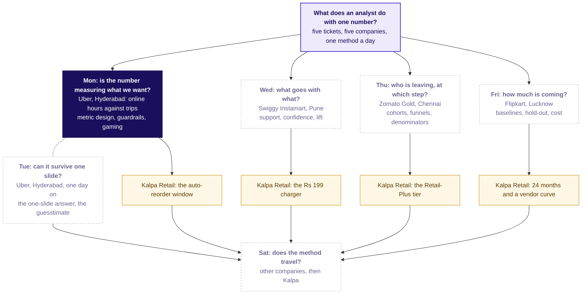

---

## Which four questions must a number answer before anyone is paid for it?

The day's concept board, empty but for its anchor. Each chapter fills one region.

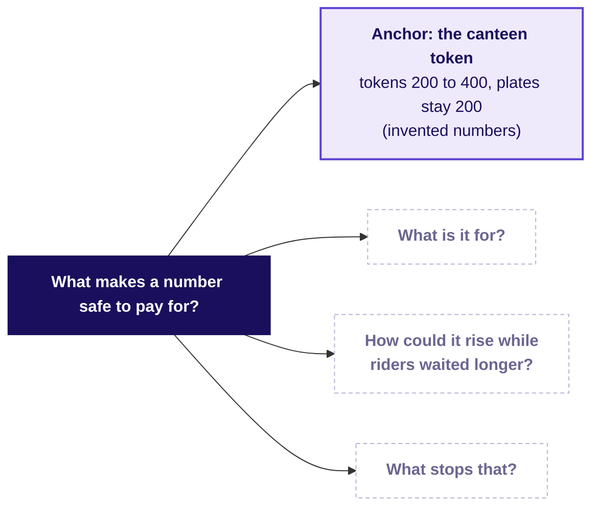

---

## What happens to a token once servers are paid per token?

The canteen, invented numbers: tokens double from 200 to 400 a day while plates stay at 200.

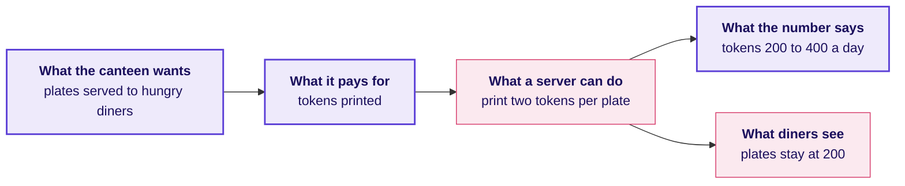

---

## What did six drivers' hours and trips do, counted by hand?

Hours 60 then 74, trips 114 then 88: 1.90 then 1.19 trips per hour. Two of the six, E and F, sit in the idle tail, a third of the sample against 15 percent of the city.

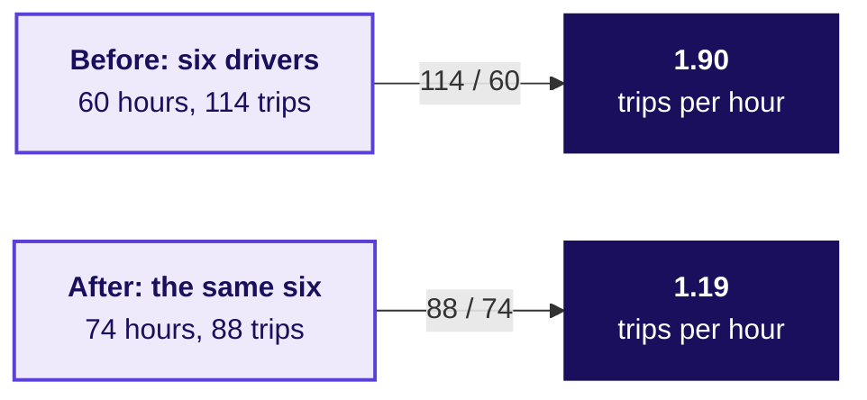

---

## What does the board hold after chapter 1?

The first region filled: what the number is for, and the first pitfall.

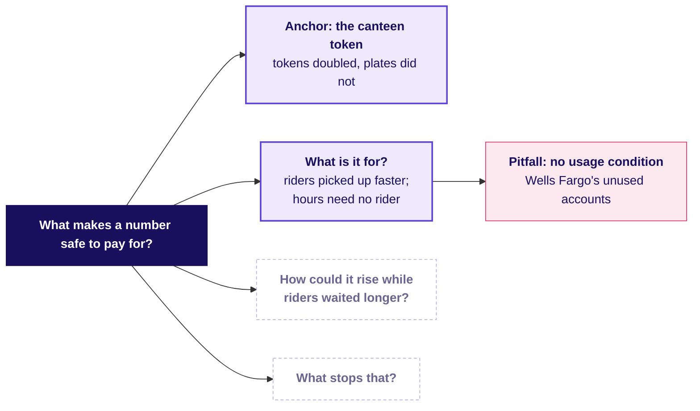

---

## Why does an average of each driver-week's rate mislead?

Two invented drivers: 21 trips over 11 hours is 1.91, while the average of their rates is 1.5. On the city, the average prints 1.71 against the true 1.58.

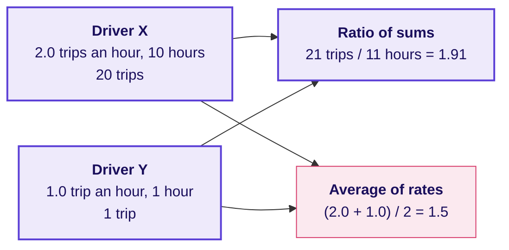

---

## What does the board hold after chapter 2?

The second region filled: how the number rose while riders were served no faster.

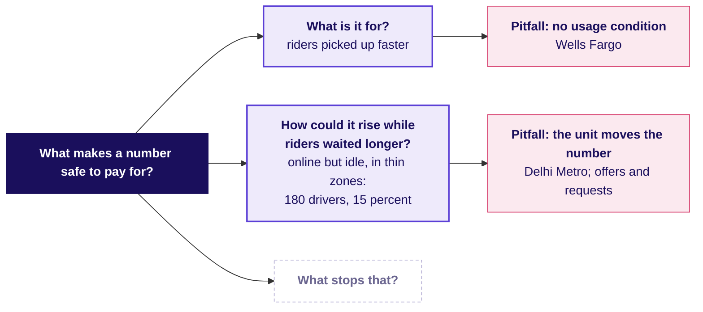

---

## What decision would the celebrated number have sent?

The wrong memo, the check that catches it and the fix, side by side.

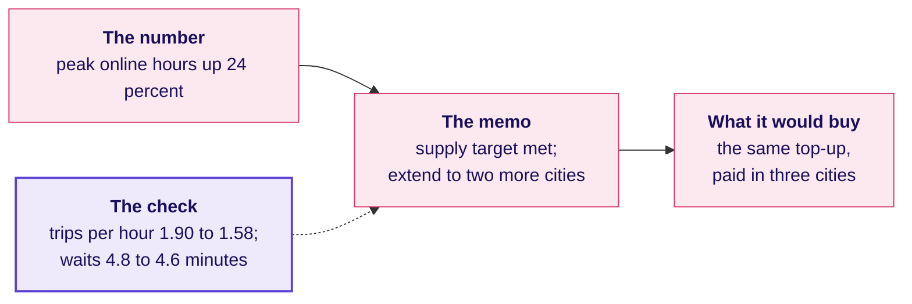

---

## How do a north star, its guardrails and its inputs fit together?

Built one region at a time: the north star, then each guardrail with the gaming it catches, then the two inputs. Read it as a seesaw: if the north star rises and a guardrail drops, the rise was bought.

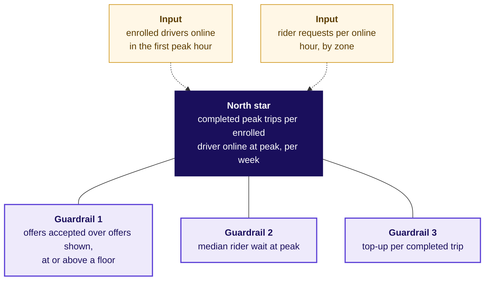

---

## What makes a number safe to pay for, now that the board is finished?

The finished board, which is panel one of the cheat sheet.

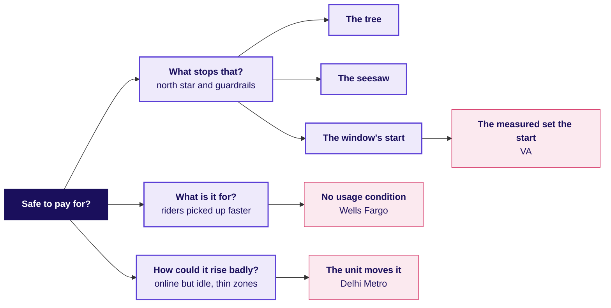

---

## How does round 3 of the war game run?

The afternoon's first drawing: write, price, defend, score.

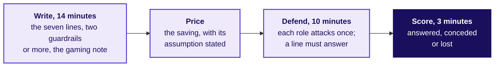

---

## What structure does a hire-grade answer give the interviewer?

Goal, north star, guardrails, leading input, the test: the order a strong candidate says it aloud.

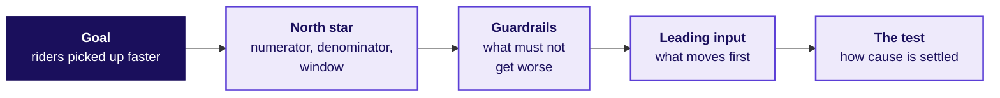

---

## What is on the board when the day ends?

The finished concept board from the morning stays up all afternoon, with three lines written under it:

- Pay for completed peak trips per enrolled driver online at peak, per week.
- Guard it with the share of offers accepted (a floor between 0.46 and 0.78), the median rider wait and the top-up per completed trip.
- Paying for hours sent Rs 1.159 crore, 61 percent of the Rs 1.9 crore top-up, to driver-weeks that accepted fewer than half their offers.
