# Stakeholder communication: which five moves carry a decision to the people who lose under it?

Week 4, Tuesday. The shop, the school and the canteen are invented; Uber, Hyderabad is an illustrative case: the company is real, the situation and the data are synthetic, built for this class.

## Panel 1: What are Tuesday's five topics, and where is each applied?

```mermaid
flowchart LR
    K["<b>Already in the room</b><br/>Weeks 1 and 2: the four-part note; a rate names its denominator. Monday: the metric, and who loses under it"]
    subgraph today["Tuesday's five topics, in the curriculum's order"]
        direction LR
        T1["<b>1 · The one-slide answer: claim, evidence, caveat, action</b><br/>chapter 1"]
        T2["<b>2 · What to leave out, and the appendix</b><br/>chapter 2"]
        T3["<b>3 · Defending under challenge: restate, answer, concede, what would change your mind</b><br/>chapter 3"]
        T4["<b>4 · The guesstimate: clarify, map, calculate, validate</b><br/>chapter 6"]
        T5["<b>5 · The AI-free written business case</b><br/>chapter 7"]
        T1 --> T2 --> T3 --> T4 --> T5
    end
    C["<b>Applied to</b><br/>Uber, Hyderabad: chapters 4, 5 and 8 to 10; Kalpa in the lab; then every build week"]
    K --> today
    today --> C
    classDef lit fill:#1A0F5C,stroke:#1A0F5C,color:#FFFFFF
    classDef known fill:#EEEAFB,stroke:#5B3FD6,color:#1A0F5C,stroke-width:2px
    class K,C known
    class T1,T2,T3,T4,T5 lit
```

**Crux:** Say the claim, cut to it, hold it under challenge, size what it needs, and write it down.

## Panel 2: The one-slide answer: what does a slide carry?

| Part | Ramesh's shop (invented) |
|---|---|
| Claim, the title | The longer hours add Rs 700 a day but earn less per hour, so count the evening on its own |
| Evidence, with its denominator | Sales per hour: Rs 1,190 in September, Rs 1,050 in October; per customer Rs 100 in both |
| Caveat, beside it | A festival fortnight fell inside October |
| Action, cost, who signs | Keep the hours through November, decide after thirty days; Rs 170 a day; Ramesh signs |

**Crux:** The decision picks the denominator: an hours decision is read per hour.

## Panel 3: What to leave out, and the appendix: where does the rest go?

| Ask of each element | If yes |
|---|---|
| Does the claim need it? | It stays on the slide |
| Will a named person ask about it? | It goes to that person's page, headed by their question |
| Is it the caveat? | It stays, whatever else leaves |

**Crux:** Ramesh's eight elements: three stay, four go to two pages, one leaves.

## Panel 4: Defending under challenge: how do you hold a claim?

| Move | At Gulmohar Secondary School (invented) |
|---|---|
| Restate | "You are saying attendance rose because the exams began." |
| Answer | Weeks 3 to 5 sit 4.7 points above last year's, before any exam |
| Concede | Exam weeks run about 8 points higher, in both years |
| Change my mind | The same rise at a school with the old timetable |

**Crux:** Concede the true part out loud; overclaiming and retreating both lose the room.

## Panel 5: The guesstimate: how big is an unknown?

| Step | The canteen's tea (invented) |
|---|---|
| Clarify | One canteen, one weekday, cups of tea |
| Map | Students x share who buy x cups each |
| Calculate | 3,000 x 0.45 x 2 = 2,700; the share sets 1,500 to 3,900 |
| Validate | The till's 2,340: same unit, period and definition |

**Crux:** Check in the same unit, period and definition, and move the answer if the check says so.

## Panel 6: The AI-free written business case: what must a page carry?

| Sentence | Carries |
|---|---|
| First | The claim, with what to do and why |
| Second | One number, what it is divided by, its window |
| Third | The caveat, before the action |
| Last | The action, its cost in rupees and weeks, who signs |

**Crux:** Plain words: "divided by", never "denominator".

## Panel 7: What does Uber's city head take to Thursday?

| Read | All driver-weeks |
|---|---|
| Per peak online hour | Rs 314 to Rs 260, down 17 percent |
| Per active driver-week | Rs 5,817 to Rs 5,861, up 0.8 percent |
| Per trip | Rs 165 both windows |
| Drivers at the evening peak | About 5,700 by the chain; about 5,000 to 5,700 checked like for like |

**Crux:** The scheme pays per online hour, so the slide reads per online hour.
