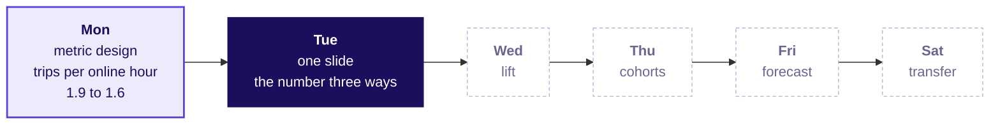
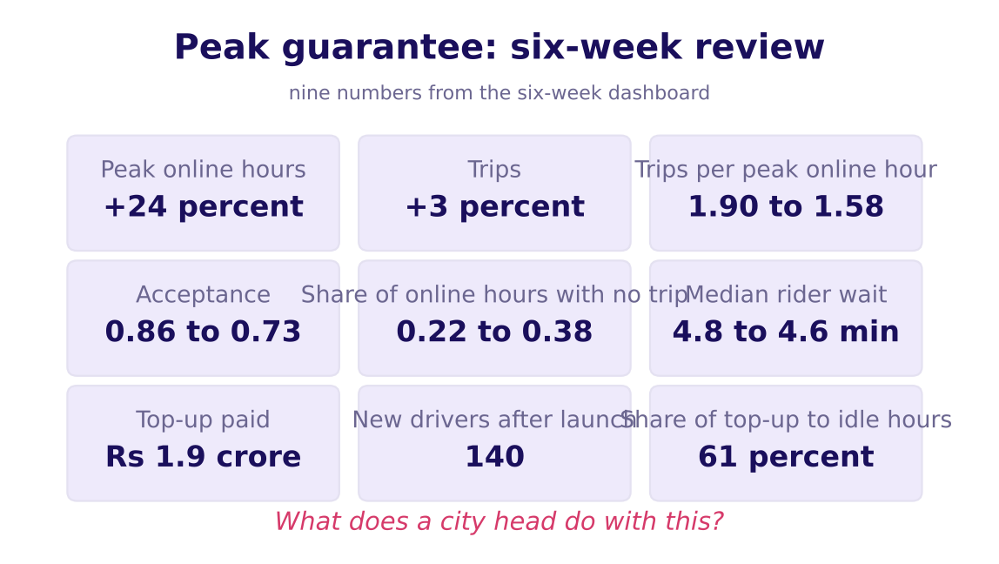
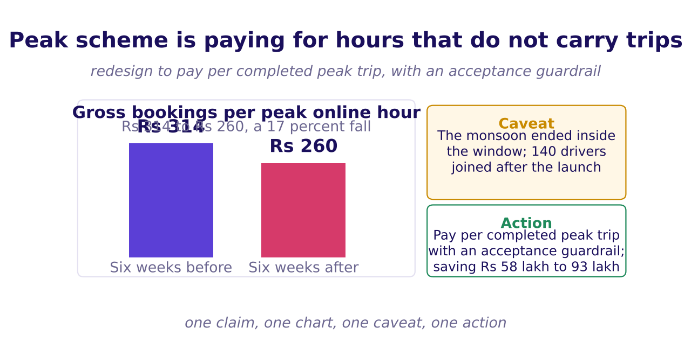
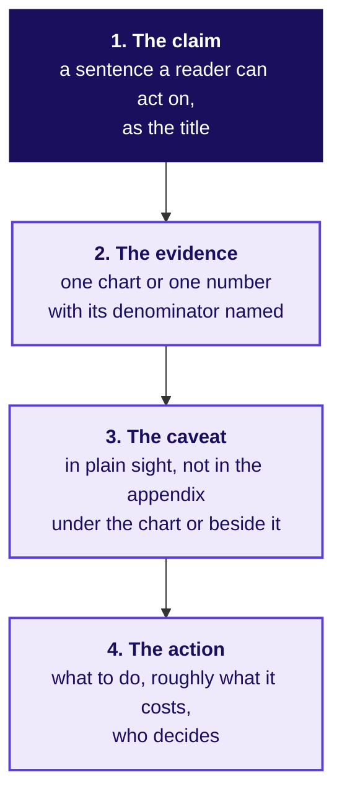
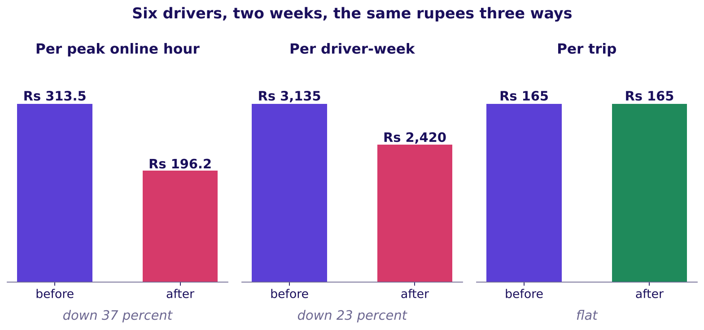
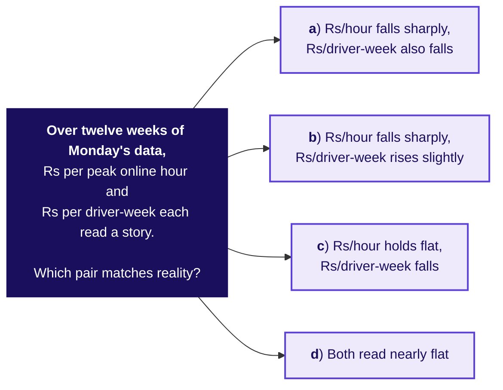
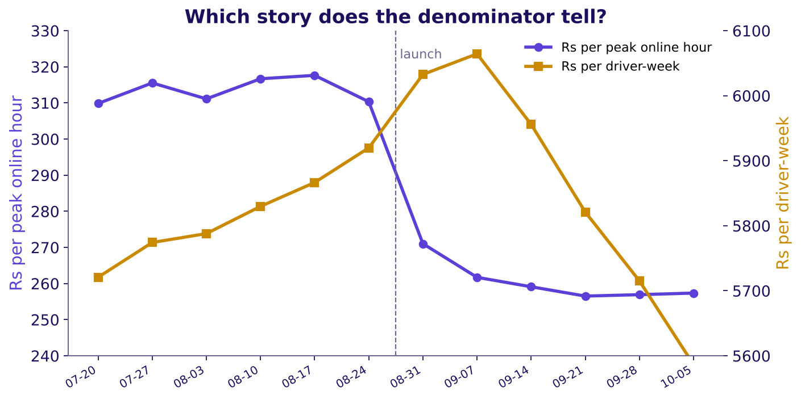
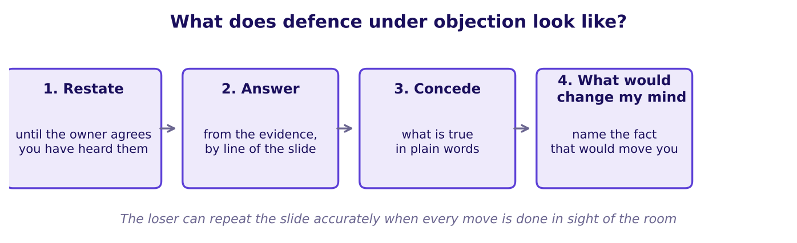
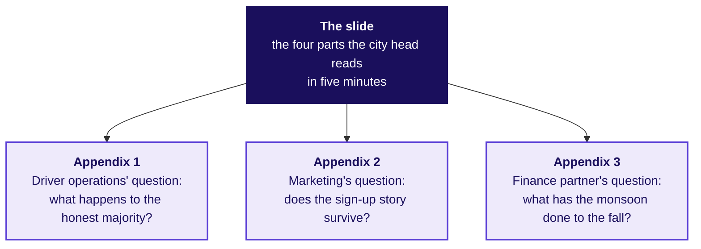

# Can the redesign survive one slide in front of three losers?

Week 4, Day 2. Half one.

Kicker: WEEK 4  ·  TUESDAY  ·  MORNING, 180 MINUTES
Quote: Thursday 15:00. One slide. Five minutes. The driver-operations lead, the marketing lead and the finance partner in the room, each losing something under the redesign.
Who: The Hyderabad city head, Uber, to the senior analyst who built Monday's definition

```notes
LIVE, 15 seconds, before the first chapter runs. Say once that this is the same illustrative
Uber case as Monday, built for this class, and today the slide the city head takes to the
review is the deliverable. The morning is a studio: build, present, take the objection, get
scored, rebuild. The three roles are Monday's three, now holding Monday's objections. The
afternoon dojo sizes a number from nothing, worked in Half 2.
Transition: the ticket, in full.
```

---

## S1. The ticket: one slide, five minutes, three losers
*What has the city head asked for, and which number lands first?*

**The ask.** The city head takes the redesign to the Thursday city review: one slide, five minutes, with Monday's three roles in the room. Each one loses something under the redesign and each will say so. **The number the slide must explain first, because finance will raise it before anyone sits down:** gross bookings per peak online hour fell from Rs 314 in the six weeks before the launch to Rs 260 in the six weeks after, while the average peak fare stayed at Rs 165 and online hours rose 24 percent.

**The same rupees read three ways.** Per peak online hour, down 17 percent. Per enrolled driver-week, up less than one percent (because hours and driver-weeks both rose). Per completed trip, flat at Rs 165. The slide must say which denominator it is reading before it says what the number did.

**The afternoon ask.** Before the review, roughly how many drivers must be online at the evening peak on a weekday to keep the median rider wait under five minutes. Fifteen minutes, no dataset, assumptions stated.

**Data.** Monday's three tables. **Caveats.** The three objections are each partly right; the peak window is three hours long; the published figure a validate step would want is not in the research ledger.

> *Illustrative case: the company is real, the situation and the data are synthetic, built for this class.*

```notes
LIVE, 2 minutes. Read the ticket in order; name the three denominators once each. Pause on
"each loses something under the redesign". Ask: which of the three roles will side with the
city head when the five minutes end? Leave the answer open; the role cards hold the surprise.
Transition: the week's map, with Tuesday lit.
```

---

## S2. The week map, Tuesday lit
*Where does today sit, and what has Monday's node earned?*



```notes
LIVE, 1 minute. Point to Monday's node: it now reads with the number the room produced
yesterday. Tuesday is lit; the three days to the right stay dashed. Every chapter close
today adds one more thing to Tuesday's node, so by the handoff the node reads with the
slide's claim in one sentence.
Transition: where today ends.
```

---

## S3. Where today ends: a slide the loser can repeat
*What sentence closes the day?*

**By the end of the morning**, the room has built a one-slide answer the losing roles can repeat accurately back to the city head:

> *"The peak scheme is paying for online hours that do not carry trips. Pay per completed peak trip, with an acceptance guardrail, saves Rs 58 lakh to Rs 93 lakh over six weeks on last window's data. The number we read is bookings per peak online hour, Rs 314 to Rs 260; the driver-week and per-trip reads are in the appendix."*

**By the end of the afternoon dojo**, every learner has sized drivers online at the evening peak from nothing, said each assumption aloud, and validated the number against the case's own request data.

The room has not earned either yet. The morning climbs from the one claim through the three denominators to the defence that survives three objections; the afternoon brings a Fermi walk, a seven-minute paired estimate against the clock and a one-page business case written AI-free.

```notes
LIVE, 1 minute. Read the one-slide sentence once. Say: everything in the morning is how the
room earns the right to say it in that order. Nothing to write down.
Transition: chapter 1, the title is the claim.
```

---

## SECTION 1: What is the one claim, and which number carries it?
*How does a title that is a topic turn into a title that is a sentence a city head could act on?*

```notes
LIVE, 45 minutes in two parts: the hostel notice board (12 minutes), then the cluttered Monday
slide rebuilt live by the room (33 minutes). Laptops closed for the first part. Chapter 1 is
L1 and L2 of the ladder: the title as the claim, and the denominator the slide names.
Styles on this chapter: Brilliant (the chapter opens on a question with options), StatQuest
(the twelve rows summed aloud three ways), Minto and SWD (the makeover and the Big Idea test).
Transition: a predict item on what makes a title act.
```

---

## S4. Predict: which of these four titles acts?
*The chapter opens on a prediction before any method is taught.*

The chapter begins with a lettered vote. Four candidate titles for the slide:

- a) **Peak guarantee: six-week review**
- b) **Online hours up 24 percent, trips up 3 percent**
- c) **Pay for completed peak trips, not for online hours**
- d) **Hyderabad operations update, October**

**The question.** Which title tells the city head what to do when she reaches it on the printed page? The room votes before the method arrives.

```notes
LIVE, 3 minutes. Take hands for each letter in turn and write the counts on the board. Expect
a cluster at (a) and (b), with (c) picking up as the morning goes on. Say nothing about which
is right; the warden test will choose it.
Transition: the hostel notice board, with its topic title.
```

---

## S5. Answer: the title that acts is a sentence
*Why does the hostel warden act when the title is a sentence?*

**A warden walks past a notice board.** The notice reads "Breakfast survey results". The warden walks on; the results sit there for a week. The next notice reads "Rotis replace rice at Monday breakfast; the kitchen moves two staff from the rice counter to the roti line". The warden stops, reads once, and sends two staff.

**The claim is a sentence a reader can act on.** The topic names the subject. The sentence names the answer, who it is for, and what moves. Pyramid Principle, Minto's phrase: the answer comes first.

```notes
LIVE, 4 minutes. Walk through the two notices in order. The second notice is a toy, invented
for this class, but the shape is Minto's. Ask: which of the four titles from the vote is like
the first notice, which like the second. Expect (a) and (d) called topic, (c) called sentence.
Transition: how does the eye read a slide full of numbers.
```

---

## S6. Nine numbers from Monday's dashboard
*What happens when a dashboard arrives on the city head's desk at 09:00?*



**The slide the Hyderabad operations analyst sent on Monday morning.** Nine numbers from Monday's dashboard, laid out as a grid. **The warden test fails.** A city head reading this at 09:00 cannot act. Every number is up or down. The title names the subject and nothing more.

```notes
LIVE, 3 minutes. Project the image, then ask the room what the slide is asking the city head
to do. Nothing to write; the next slide rebuilds this. The nine numbers are the ones Monday's
pack already published, no new figure is on this page.
Transition: the rebuild, one piece at a time.
```

---

## S7. The same evidence, rebuilt to one claim
*What does the slide become when it names the number, the claim and the action?*



**One claim, one chart, one caveat, one action.** The claim is a sentence. The chart is one number: bookings per peak online hour, Rs 314 to Rs 260. The caveat sits where the eye lands, not in the appendix. The action names what to do and roughly what it saves.

**The warden test.** A reader who sees the slide for five seconds can repeat the claim and the action.

```notes
LIVE, 6 minutes. Walk from the title to the chart, to the caveat, to the action, in that
order. Point at each in sight of the room. Ask: which of the two slides lets the city head
do something next. Expect every hand on the second. The reveal is the shape, not the number;
the number is still Monday's.
Transition: the four parts of a slide a loser can repeat.
```

---

## S8. The four parts of a slide the loser can repeat
*What are the parts, in what order, and where do they land on the page?*



**Panel order on the page.** The claim at the top. The chart filling the left two-thirds. The caveat beside the chart, in a tinted box. The action at the bottom right, with its cost and the role who signs it. **An appendix is one page per role**, each page headed by the question that role will ask on Thursday.

```notes
LIVE, 3 minutes. Point at each box as it is named. Say: the four parts are an order, so a
slide that opens on evidence has already lost the title. Ask: what goes on the appendix page
headed by the driver-operations lead? Expect: idle hours, the outer zones, acceptance's
guardrail floor.
Transition: into the second part of chapter 1, the twelve rows read three ways.
```

---

## S9. The twelve driver-weeks, read in rupees three ways
*What do the same twelve rows say when the denominator changes?*

| Driver | Zone | Hours before | Trips before | Rs before | Hours after | Trips after | Rs after |
|---|---|---|---|---|---|---|---|
| A | Jubilee Hills | 10 | 21 | 3,465 | 11 | 22 | 3,630 |
| B | Banjara Hills | 9 | 17 | 2,805 | 10 | 18 | 2,970 |
| C | Gachibowli | 11 | 22 | 3,630 | 12 | 23 | 3,795 |
| D | Madhapur | 10 | 19 | 3,135 | 11 | 20 | 3,300 |
| E | Shamshabad | 10 | 18 | 2,970 | 16 | 3 | 495 |
| F | Rajendranagar | 10 | 17 | 2,805 | 14 | 2 | 330 |
| **Total** | | **60** | **114** | **18,810** | **74** | **88** | **14,520** |

**Three denominators, three sentences.** Per peak online hour: Rs 18,810 over 60 is Rs 313.5, Rs 14,520 over 74 is Rs 196.2, down 37 percent. Per driver-week: Rs 18,810 over 6 is Rs 3,135, Rs 14,520 over 6 is Rs 2,420, down 23 percent. Per trip: Rs 18,810 over 114 is Rs 165, Rs 14,520 over 88 is Rs 165, flat.

```notes
LIVE, 6 minutes. Count aloud: 60, 74 (hours); 114, 88 (trips); 18,810, 14,520 (rupees).
Divide three times for before, three times for after. Say the three verdicts in order: down
37, down 23, flat. Ask: which denominator does the slide read first? Expect the room to say
per peak online hour, since that is what moves most; the next slide shows why that is also
the honest read when the scheme pays for hours.
Transition: the picture, three bars.
```

---

## S10. The same rupees, three stories
*Why does the picture say what the arithmetic has just said?*



**Three bar pairs on one picture.** Per peak online hour falls by about a third. Per driver-week falls by about a quarter (the twelve rows have the same six drivers both weeks, so the denominator does not move; the full data moves it the other way). Per trip holds at Rs 165, because a trip pays its fare.

**The slide says which denominator it reads before it reads the number.** This is the one rule that stops the three roles from each quoting their favourite number.

```notes
LIVE, 3 minutes. Walk left to right. Each bar pair carries its unit as a label. Say: a trip
pays its fare; that is why the per-trip read is flat. Ask: which role would quote per
driver-week? Expect: the marketing lead. Which would quote per trip? Expect: the finance
partner. The city head's slide is the one that names the number the scheme pays for.
Transition: a trap, before the method.
```

---

## S11. Predict: which denominator do you expect?
*The chapter stages its trap before the data arrives.*



**Write your letter down.** The reveal is on the next slide; the one who wrote stays with the one who did not.

```notes
LIVE, 3 minutes. Hands up for each letter; write counts on the board. Expect the room to
split (a) and (c). The reveal shows (b): the hours rose by more than the bookings fell, so
the per-driver-week number barely moved; this is why the city head's roles will each quote
whichever denominator favours their case.
Transition: the reveal.
```

---

## S12. Answer: Rs 314 falls, Rs 5,817 holds
*What does the twelve-week picture show about each denominator?*



**Twelve weeks, two lines, one axis each.** Rs per peak online hour drops from about Rs 314 to about Rs 260 after the launch date. Rs per driver-week rises from Rs 5,817 to Rs 5,861, less than one percent, because hours and driver-weeks both rose. The flat per-trip read is drawn in the notebook; here the two reads that disagree are the ones the slide must choose between.

**The honest choice.** Pay the scheme per peak online hour and the number is falling. Pay the scheme per enrolled driver-week and the number is holding. The city head's job is to say which one the scheme pays for.

```notes
LIVE, 4 minutes. Trace the fall line first, then the near-flat line. Point at the vertical
dashed line (launch) and say: six weeks either side, the two lines move in different ways
because they are measuring different things. Ask: which line will the marketing lead quote,
and which will the city head? Expect: marketing takes the flat line; the city head takes the
falling one, because that is what the scheme actually pays for.
Transition: into chapter 2, the three objections.
```

---

## SECTION 2: Which objection is partly right, and which part?
*How does a defence under three objections stay honest, and where does the slide bend?*

```notes
LIVE, 50 minutes in two parts: the four moves of a defence (12 minutes), and the studio's
first round (38 minutes). Each role is partly right by design. Chapter 2 is L3 and L4 of the
ladder: defence as a shape, with the appendix as the drawer for what leaves the slide.
Styles on this chapter: the case method (the three role cards from Monday return), Veritasium
(predict which role sides with the city head before the cards reveal), ByteByteGo (the slide
grows an appendix drawer, not a longer slide).
Transition: the four moves.
```

---

## S13. Defence under objection, in four moves
*How does the owner of a slide survive three objections and keep every honest line?*



**Four moves in order.** Restate the objection, in your own words, until the owner agrees. Answer from the evidence on the slide, by line. Concede what is true, in plain words, without surrendering the claim. Say what would change your mind, naming the fact that would move you.

**The loser can repeat the slide accurately when every move happens in sight of the room.** Nobody wins by repeating the claim louder. Nobody wins by moving a caveat into the appendix.

```notes
LIVE, 5 minutes. Walk the four moves on the picture. Say: a slide that cannot survive the
third move (concede) is a slide that does not know what is true. The trainer models one full
defence first, conceding on purpose, before the groups try one.
Transition: three cards, three objections.
```

---

## S14. The three roles return, with Monday's objections
*What does each role say about the redesign, and which part is partly right?*

```cards
icon: user  | eyebrow: Driver operations | title: "Drivers will log off" | body: Pay per completed trip and the honest majority stops staying online in dead windows; the idle tail is already gone | tone: light
icon: user  | eyebrow: Marketing         | title: "The guarantee is the acquisition story" | body: Every hoarding reads 'Rs 300 an hour'; cut it and the sign-up curve breaks | tone: light
icon: user  | eyebrow: Finance partner   | title: "The fall is just the monsoon" | body: The monsoon ended inside the window; demand fell with it; the scheme has not had a fair chance | tone: light
```

**The city head reads these in order.** Each one is partly right. Each one's partly-right part is a line the slide must concede in sight of the room.

```notes
LIVE, 4 minutes. Read each card aloud. Ask the room, before the next slide, which of the
three the city head will side with on Thursday afternoon. Collect three answers; write the
tallies on the board; the surprise is that the city head sides with none of them because
each is partly right.
Transition: the partly-right part of each, named.
```

---

## S15. The partly-right part of each objection
*What does the slide concede, and where does the evidence land?*

| Role | What they say | Where they are partly right | What the slide answers |
|---|---|---|---|
| Driver operations | "Drivers will log off" | True for the idle tail: Rs 1.159 crore of top-up went to driver-weeks under 0.5 acceptance, almost all in outer zones | The honest majority still has the floor; the guardrail is acceptance, so the floor stays for drivers who accept |
| Marketing | "The guarantee is the acquisition story" | True that the hoarding sells the floor; 140 drivers joined in September | The slide keeps the floor as a sign-up story; the redesign changes the pay unit, not the acquisition line |
| Finance partner | "The fall is just the monsoon" | True inside the first after week; demand did ease | The L4 cuts: the fall survives among drivers present in both windows, and in weekday peaks only, and after the monsoon-ended cut |

**Each row is one appendix page.** The question in the "What they say" column is the heading of that role's appendix slide, so when the role asks on Thursday, the city head's analyst turns to a page that answers that question.

```notes
LIVE, 6 minutes. Walk one row at a time. Say which number on the slide answers each line
(bookings per hour for driver operations, Rs 1.9 crore top-up for marketing, the monsoon-ended
cut for finance). Ask: if driver operations says "but my honest drivers lose money", what is
on their appendix page? Expect: the pay to driver-weeks above 0.5 acceptance, which stays.
Transition: the studio's first round.
```

---

## S16. The studio's first round: three minutes, three roles
*How does a group present the slide, and what does the scorer hold?*

**Three per group**: a presenter (five minutes with one slide), an objector (reads one role card), a scorer (holds the four-moves card). Three rounds of seven minutes, so each learner takes each seat once in the morning. The scorer marks the four moves and never the final number.

**What a studio defender is listening for**, in the scorer's card:

- Did the presenter restate the objection in their own words before answering?
- Did the answer name the line of the slide it rested on?
- Did they concede the part that is true, in plain words?
- Did they say what would change their mind?

**The trainer models one defence first**, conceding on purpose, so the room sees what the shape looks like before trying it.

```notes
LIVE, 10 minutes for the trainer's model. Pick finance's objection ("just the monsoon"), run
the four moves, and concede the first after week honestly. Point at the L4 cut as the fact
that answers it. Then split the room into threes and start the clock. Nine groups, three
rounds, seven minutes each.
Transition: the mid-studio check.
```

---

## S17. The studio's mid-point: two patterns that fail
*What do the groups do that costs them the slide?*

**Two failures the scorer watches for.** The retreat: a presenter concedes everything after the first objection and loses the claim; the room cannot tell what the slide was about. The over-claim: a presenter repeats the claim louder when challenged, never conceding; the loser gives up on hearing anything new.

**One hint fits each**:

- To the presenter who retreats, ask: "Which line of your evidence did the objection touch?"
- To the presenter who over-claims, ask: "What would change your mind?"

Both are moves three and four of the shape; both appear on the four-moves card.

```notes
LIVE, 3 minutes. Pause the studio after round one. Call out two or three examples from the
groups; name the pattern, give the hint, send the next round. No new teaching; the rule is
the same.
Transition: a prediction before chapter 3.
```

---

## SECTION 3: What leaves the slide, and where does it go?
*How does the appendix hold what the four moves leave behind, without hiding it?*

```notes
LIVE, 20 minutes: Amazon's six-page memo as the opposite stance (5 minutes), then the
appendix drawer with its one page per role (15 minutes). Chapter 3 is L4 of the ladder: what
to cut and where to put it. Styles: the case method again (Amazon's letter as a decision
forced by its own CEO), Minto (one appendix page answers one question).
Transition: Amazon in 2017.
```

---

## S18. Amazon's six-page memo, the opposite stance
*Why does a company that bans slides read a memo in silence?*

**Amazon, 2017 letter to shareholders.** Jeff Bezos wrote: no PowerPoint-style presentations in meetings. In their place, a six-page memo written by the owner of the decision, read by the room in silence for the first fifteen minutes of the meeting.

**The memo's argument.** Writing in full sentences forces thinking that bullets hide. Reading in silence makes every participant start from the same baseline, which a presenter's voice cannot.

**For a city head who reads a slide in five minutes, not fifteen**, the lesson is the opposite: every bullet earns its place because the reader will not read a sentence that is not on the page.

> *Source: Amazon shareholder letter, 2017; the memo convention. R2 id T1.*

```notes
LIVE, 4 minutes. Say: Amazon's rule is not the city head's constraint, so the slide is not
replaced by a memo. The lesson Amazon's rule teaches is: pretend the city head reads the
slide in silence, in five minutes, and ask what each line earns there. Ask: which of the
nine Monday numbers would survive that test? Expect the room to say: the one that moves
most, named with its denominator.
Transition: the appendix drawer.
```

---

## S19. The appendix drawer, one page per role
*What goes behind the slide, and in what order?*



**Each appendix page is one question's answer.** The question is the heading. The evidence sits beneath it. The caveat is on the page where it belongs, not hidden; if a caveat is important enough that the role will ask about it, moving it to the appendix is dishonest.

```notes
LIVE, 4 minutes. Walk the three pages. Ask: can a caveat live only in the appendix? The
answer is no: a caveat belongs in plain sight on the slide where it changes the action, with
the appendix carrying the detail if the role goes looking. The city head's own slide names
the monsoon-end cut on the main page.
Transition: into the studio's second round.
```

---

## S20. The studio's second round: roles swapped
*What changes when the presenter sits in the objector's seat and defends their old slide?*

**Each group holds the same slide**, but the three learners swap roles. The presenter from round one becomes the objector in round two. The objector reads the role card that most argued against the slide they built. The scorer rotates to the third learner.

**The second round's test**: a presenter can only defend their slide well when they have sat in every objector's chair. By round two the room has heard every objection three times; the defence is now the moves, not the slide.

**Rotation**: three rounds of seven minutes in round one, three of seven minutes in round two, with two minutes of regroup between rounds. Six minutes of scoring at the end.

```notes
LIVE, 25 minutes. Reset the clock. The groups swap seats on the trainer's word, not between
rooms. At minute 12 (mid-round-two), pause and ask one group to name the move that most
helped them. Expect: concede. The move that most hurt them: restate (because an objection
restated weak sticks).
Transition: into the gallery and chapter 3's reveal.
```

---

## S21. The gallery: slides on the wall, voted
*Which titles would a city head actually act on?*

**At the end of the studio**, every group pins its final slide on the wall. The room walks the gallery for five minutes. Each learner holds three dots. One dot on the title that most clearly states a claim a city head could act on. One dot on the appendix page that most clearly answers its role's question. One dot on the slide whose caveat sits most clearly in sight.

**Two patterns the trainer watches**: a slide the room votes highly on whose claim is still a topic ("Peak scheme analysis"); a slide the room votes highly on whose caveat has been moved to the appendix. Both are examples for the solution discussion that closes the morning.

```notes
LIVE, 10 minutes. Dots on; walk; count. The vote is a cheap read of what the room has learnt,
not a grading. Save the trainer's own vote for the solution discussion. The gallery doubles
as the Big Idea test of SWD (R1 T1): a title that is a claim a city head could act on survives
the vote; a topic title does not.
Transition: the morning closes on where it opened.
```

---

## S22. Where the morning closes
*What has the room earned by the end of chapter 3?*

**Three things.** The one-slide answer the three roles can repeat (claim, chart with its denominator, caveat, action). The four moves of a defence under objection, with the trainer having modelled one and the room having run six. The appendix as a drawer, not as a hiding place.

**Four things the room has not yet done**, which the afternoon takes up: a number sized from nothing, under the clock; a one-page business case written AI-free; two transcripts of the slide presented to a non-technical leader read and scored; the gallery's lessons for the city head's own slide.

```notes
LIVE, 2 minutes. Read the three in order; read the four not yet done. Say that the Half 2
notebook, the dojo and the written case fill the afternoon. The handoff line now sits at
the bottom of the trainer sheet: "You have a slide a city head could act on. The afternoon
asks whether you can estimate the number you do not have, and write the slide down."
Transition: break, then Half 2.
```
