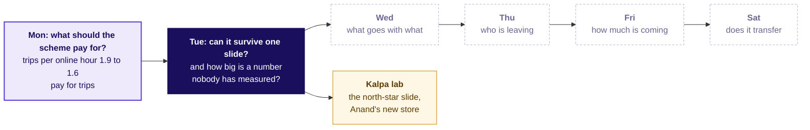
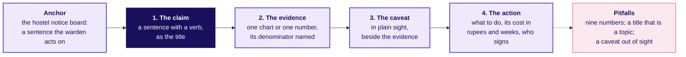
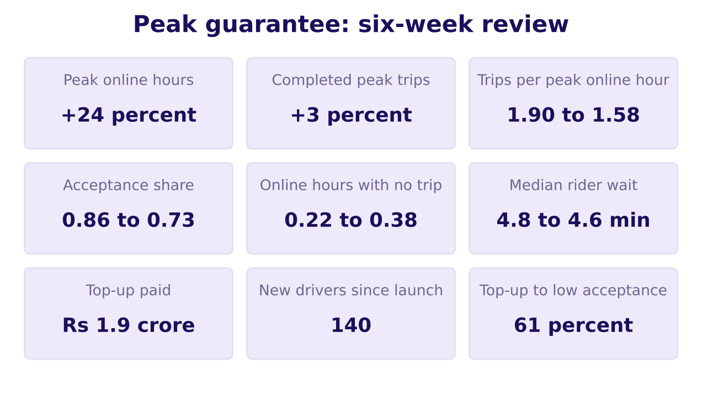
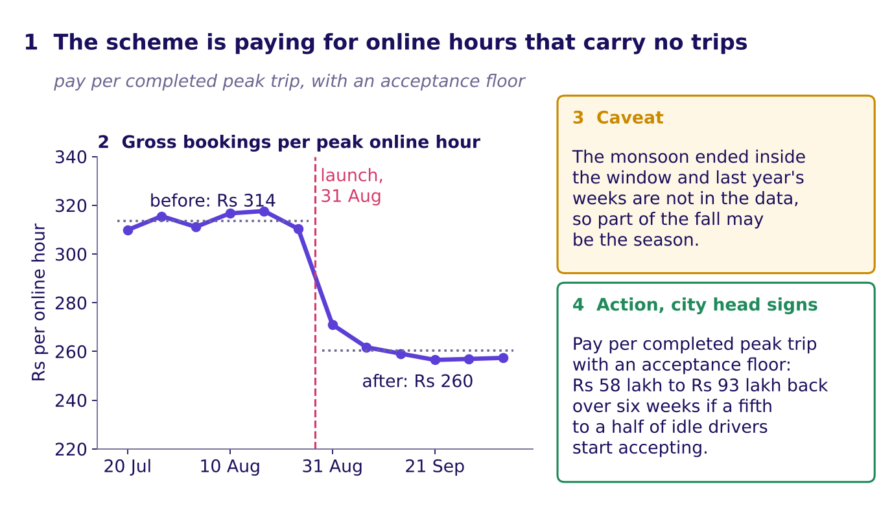
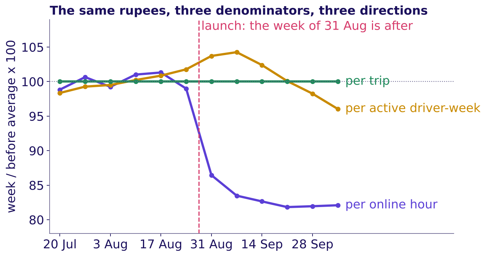
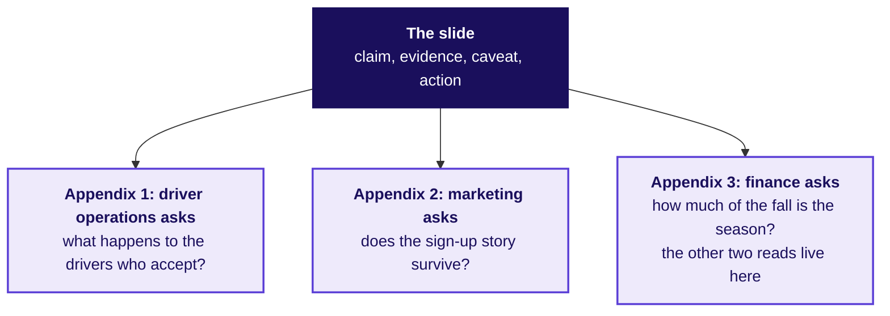
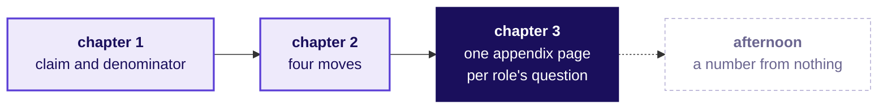

# Can the redesign survive one slide in front of three people who lose under it?

Week 4, Day 2. Half one.

Header: WEEK 4  ·  DAY 2  ·  UBER, HYDERABAD, AN ILLUSTRATIVE CASE

## S1. The ticket: one slide, five minutes, three objectors
*What has the city head asked for, and which number will land first?*

**Uber, Hyderabad, the driver app's peak-hour earnings guarantee, one day on.** The city head takes the redesign to Thursday's city review on one slide, in five minutes. The driver-operations lead, the marketing lead and the finance partner each lose something under it, and each will say so.

| Six weeks each side | 20 Jul to 30 Aug | 31 Aug to 11 Oct |
|---|---|---|
| Gross bookings per peak online hour | Rs 314 | Rs 260, down 17 percent |
| Average peak fare (bookings per trip) | Rs 165 | Rs 165, flat |
| Gross bookings per active driver-week | Rs 5,817 | Rs 5,861, up 0.8 percent |
| Peak online hours | 118,000 | 146,300, up 24 percent |

**Data.** Monday's `driver_weeks` and `zone_weeks`. **The afternoon ask.** How many drivers must be online at the weekday evening peak to keep the median rider wait under five minutes, sized in fifteen minutes without a dataset. **Caveats.** Each objection is partly right; the peak window is three hours long; no published figure exists to check the afternoon's answer against.

> Illustrative case: the company is real, the situation and the data are synthetic, built for this class.

```notes
LIVE, 3 minutes. Say once that this is Monday's illustrative Uber case, one day on, and that the
deliverable today is the slide the city head takes to the review. The morning is a studio: build,
present, take the objection, get scored, rebuild. The afternoon is a dojo: a number sized from
nothing, under a clock, then checked. No new technique arrives today. Then read the ticket top to
bottom. Gross bookings are what riders paid for the trips,
before Uber's share and before any top-up. An active driver-week is one driver with a row that
week. Pause on the three reads of the same rupees: down, up, flat. Ask which of the three roles will
quote which row; leave it open, chapter 2 answers it.
Transition: where Tuesday sits on the week's map.
```

---

## S2. The week map: Monday's number in, Tuesday lit
*Where does today sit, and what did Monday's node earn?*



```notes
LIVE, 1 minute. Monday's node now carries the number the room produced and the decision it led to.
Tuesday is lit; the days to the right stay dashed. Each chapter close today adds a line to Tuesday's
node. The amber node is the TA lab, where the same studio runs on Kalpa Retail.
Transition: where the day ends, so the room can see the climb.
```

---

## S3. Where today ends: a slide its losers can repeat
*What sentence will the city head be able to say on Thursday?*

> "The scheme is paying for online hours that carry no trips: gross bookings per peak online hour fell from Rs 314 to Rs 260 while the fare held at Rs 165. The monsoon ended inside the window, so part of the fall may be the season. Pay per completed peak trip with an acceptance floor; that returns Rs 58 lakh to Rs 92.7 lakh over six weeks depending on whether half or a fifth of the idle drivers start accepting."

**By the end of the afternoon** you will also have sized the drivers the evening peak needs, said every assumption aloud, given a range, and checked it against a ratio the case's own data can confirm.

```notes
LIVE, 1 minute. Read the sentence once. The morning earns its four parts in order: the claim, one
number with its denominator, the caveat, the action with its cost. The saving range is Monday's:
Rs 1.16 crore went to driver-weeks that accepted under half their offers, and the range assumes a
fifth to a half of that is still paid because those drivers start accepting.
Transition: what each role loses, before anyone builds anything.
```

---

## S4. Each role loses one thing it can point to
*What does each of the three roles lose under Monday's definition?*

```cards
icon: user | eyebrow: Driver-operations lead | title: The supply headline | body: Peak online hours up 24 percent stops being the target, and the idle drivers' hours will fall when idle hours stop paying | tone: light
icon: user | eyebrow: Marketing lead | title: A clean hoarding line | body: "Rs 300 an hour, guaranteed" now carries a condition: the floor holds for drivers who accept | tone: light
icon: user | eyebrow: Finance partner | title: Its own number as the headline | body: Top-up per trip becomes a guardrail, and the slide opens on bookings per online hour, Rs 314 to Rs 260 | tone: light
```

**Monday's definition, in one line.** The scheme pays for completed peak trips per enrolled driver per week, with three guardrails: the acceptance share, the median rider wait at peak, and top-up per completed trip.

```notes
LIVE, 10 minutes. Cards hidden first. Groups of three spend 6 minutes listing what each role loses;
take one loss per role from three groups and write them on the board (2 minutes), then show the
cards (2 minutes). A loss the room names that the cards miss goes on the board as well: it will
come back as an objection in chapter 2.
Transition: chapter 1, the title is the claim.
```

---

## SECTION 1: What is the one claim?
*What is the one claim, and which number carries it, so that nine numbers become one sentence a city head can act on?*

```notes
LIVE, 45 minutes. Chapter 1 is L1 and L2 of the ladder: the title as the claim, and the
denominator the slide names. Laptops closed until S13. Styles: Brilliant (the chapter opens on a
question), Veritasium (predict, then reveal), StatQuest (the twelve rows summed aloud), Storytelling
with Data and Minto (the makeover, the answer first). Explorer scene T1 runs beside S8 to S10 and
scene T2 beside S14 and S15.
Transition: a vote on four titles.
```

---

## S5. Predict: which of these four titles acts?
*Which title tells the city head what to do on the first read?*

a) Peak guarantee: six-week review

b) Online hours up 24 percent, trips up 3 percent

c) The scheme pays for idle hours: pay per completed trip

d) Hyderabad operations update, October

**Write your letter down before the next slide.**

```notes
LIVE, 3 minutes. Hands for each letter, counts on the board. Expect votes on b, since it carries
numbers. Say nothing about which is right.
Transition: the hostel notice board.
```

---

## S6. Answer: a title that acts is a sentence with a verb
*Why does a reader act on c and walk past a, b and d?*

**A hostel notice board (invented for this class).** One notice reads "Breakfast survey results"; the warden walks past it for a week. The next reads "Rotis replace rice at Monday breakfast, so the kitchen moves two staff from the rice counter to the roti line"; the warden reads it once and moves two staff.

**The answer is c.** a and d name a topic. b reports two numbers and leaves the reader to find the point, and it is Monday's trap resold: online hours up 24 percent is the number that rose while riders were served no better. Barbara Minto's Pyramid Principle puts the answer first and the support beneath it.

```notes
LIVE, 3 minutes. Read the two notices aloud. Then ask which of the four titles is like the first
notice. Minto's site describes ideas organised as a pyramid under a single point
(barbaraminto.com, checked 12 October 2026).
Transition: the four parts a slide needs.
```

---

## S7. One slide carries four parts, in this order
*What lets one slide carry a decision?*



**The order is the point.** A slide that opens on its evidence has already given away its title, and a slide whose caveat sits off the page invites its owner to call it dishonest.

```notes
LIVE, 3 minutes. Build the board region by region: point at the anchor, then each part in order,
then the pitfalls. This is the Week 1 four-part note (claim, evidence, caveat, action) made into one
page.
Transition: slide A, exactly as it arrived.
```

---

## S8. Slide A arrived with nine numbers and no claim
*What is a city head meant to do with this slide?*



**Nine numbers from Monday's dashboard, each given the same weight, under a title that names a topic.** The reader cannot tell which number matters, and the first number the eye meets is the one Monday showed to be the wrong one to celebrate.

```notes
LIVE, 3 minutes. Give the room 30 seconds of silence with the slide, then ask what it is asking the
city head to do. Every number here is Monday's. Explorer scene T1 starts from this slide.
Transition: which two of the nine carry a claim.
```

---

## S9. Which two of the nine numbers carry the claim?
*If the slide may keep only two numbers, which two make the case?*

a) Peak online hours +24 percent and completed peak trips +3 percent

b) Trips per peak online hour 1.90 to 1.58 and top-up to low acceptance 61 percent

c) Median rider wait 4.8 to 4.6 minutes and new drivers since launch 140

d) Acceptance share 0.86 to 0.73 and top-up paid Rs 1.9 crore

**Low acceptance** means a driver-week that accepted fewer than half the requests offered.

```notes
LIVE, 3 minutes. Each group writes one letter. Expect a split between a and b. The point of the
vote is that a carries two true numbers and no claim, which is why the room reaches for it.
Transition: the rebuild.
```

---

## S10. Answer: slide A rebuilt to one claim and its evidence
*What does the slide become when it keeps one claim, one number and its denominator?*



**The answer is b.** Trips per online hour falling at a flat fare is bookings per online hour falling, Rs 314 to Rs 260, and the 61 percent says where the top-up went.

```notes
LIVE, 5 minutes. This is the worked example of the guided exercise: rebuild it with the room
mirroring, part by part. Point at 1, 2, 3, 4 in order: the chart names its denominator in its title,
the caveat sits beside the evidence, and the action states the saving with the assumption behind it. The drop lands in the launch week: the
highest after week, Rs 271, sits below the lowest before week, Rs 310, which is why the chart, not
the bar pair, is the evidence.
Transition: two more slides, rebuilt by the groups.
```

---

## S11. Slide B: nine numbers from finance's tab
*Which one claim does finance's slide carry, and which number proves it?*

| Finance's tab, as sent | Before | After |
|---|---|---|
| Gross peak bookings | Rs 3.70 crore | Rs 3.81 crore |
| Bookings per online hour | Rs 314 | Rs 260 |
| Bookings per active driver-week | Rs 5,817 | Rs 5,861 |
| Bookings per trip | Rs 165 | Rs 165 |
| Top-up paid | Rs 0 | Rs 1.9 crore |
| Top-up per completed trip | | Rs 82.3 |
| Top-up to low acceptance | | Rs 1.16 crore |
| Top-up to everyone else | | Rs 74 lakh |
| Rider requests | 251,910 | 256,556 |

**Half worked.** The claim is drafted for you: "Rs 1.16 crore of the top-up went to driver-weeks that accepted fewer than half their offers." Choose the one number that proves it, and the caveat that sits beside it.

```notes
LIVE, 3 minutes. Odd-numbered groups take slide B, even-numbered groups take slide C (next slide).
Six minutes in total across S11 and S12 once both are on screen, then two groups read their
rebuilt titles. The guided exercise file carries both slides.
Transition: slide C.
```

---

## S12. Slide C: nine numbers from driver operations
*Which one claim does driver operations' slide carry, in a sentence of your own?*

| Driver operations' tab, as sent | Before | After |
|---|---|---|
| Drivers | 1,200 (140 new) | |
| Active driver-weeks | 6,360 | 6,500 |
| Offers shown to drivers | 269,773 | 347,583 |
| Acceptance share | 0.86 | 0.73 |
| Driver cancels after accepting | 0.04 | 0.09 |
| Drivers in the idle tail | | 180 |
| Idle-tail online hours | 20,000 | 42,000 |
| Idle-tail trips | 38,000 | 33,440 |
| Unfulfilled requests | 0.11 | 0.10 |

**Blank.** Write the claim yourself, keep two numbers, and name the caveat. The **idle tail** is Monday's name for the 180 drivers whose trips per online hour fell under 1.0 after the launch.

```notes
LIVE, 3 minutes. The faded step: no drafted claim. Collect two titles. A strong one reads close
to "180 drivers doubled their online hours while their trips fell": idle hours up 2.1 times
(20,000 to 42,000), trips down 12 percent.
Transition: the twelve rows, read in rupees.
```

---

## S13. The twelve rows, read in rupees three ways
*What do six drivers in two weeks say when the denominator changes?*

| Driver | Zone | Hours before | Trips before | Rs before | Hours after | Trips after | Rs after |
|---|---|---|---|---|---|---|---|
| A | Jubilee Hills | 10 | 21 | 3,465 | 11 | 22 | 3,630 |
| B | Banjara Hills | 9 | 17 | 2,805 | 10 | 18 | 2,970 |
| C | Gachibowli | 11 | 22 | 3,630 | 12 | 23 | 3,795 |
| D | Madhapur | 10 | 19 | 3,135 | 11 | 20 | 3,300 |
| E | Shamshabad | 10 | 18 | 2,970 | 16 | 3 | 495 |
| F | Rajendranagar | 10 | 17 | 2,805 | 14 | 2 | 330 |
| **Total** | | **60** | **114** | **18,810** | **74** | **88** | **14,520** |

**Per peak online hour:** 18,810 / 60 = Rs 313.5, then 14,520 / 74 = Rs 196.2, down 37 percent. **Per driver-week:** 18,810 / 6 = Rs 3,135, then 14,520 / 6 = Rs 2,420, down 23 percent. **Per trip:** Rs 165 both times.

```notes
LIVE, 5 minutes. The week of 10 August against the week of 21 September. Count aloud, column by
column: 60 and 74 hours, 114 and 88 trips, 18,810 and 14,520 rupees. Divide three times for each
week and say the three verdicts. E and F are Monday's two idle-tail drivers, which is why six
drivers fall further than the city.
Transition: the same arithmetic as a picture.
```

---

## S14. Predict: which way does each read go for the city?
*Over all the driver-weeks, which pair of moves holds?*

a) Per hour falls; per driver-week falls

b) Per hour falls; per driver-week rises a little

c) Per hour holds; per driver-week falls

d) Both hold nearly flat

**On the six drivers,** per driver-week fell 23 percent because the same six drivers sit in both weeks; the city's count of active driver-weeks moves.

```notes
LIVE, 2 minutes. Per driver-week here means per active driver-week. On six drivers the per-driver-week read fell, because the six are the same six in
both weeks. The city's driver-weeks move. Each learner writes a letter.
Transition: the reveal.
```

---

## S15. Answer: per hour falls, per driver-week rises
*What do the twelve weeks show for each denominator?*



**The answer is b.** Per peak online hour the rupees fell 17 percent, Rs 314 to Rs 260. Per active driver-week they rose 0.8 percent, Rs 5,817 to Rs 5,861. Per trip they held at Rs 165. Each line is divided by its own before-window value, so all three start near 100.

```notes
LIVE, 4 minutes. Trace the violet line first: a step at the launch, then flat. The amber line rises
and then slides below 100 by the last week, so even the window's 0.8 percent rise hides a weekly
slide. Ask which role will quote the amber line. Expect the marketing lead. Explorer scene T2 lets
learners pick the denominator.
Transition: the trap in that amber line.
```

---

## S16. The trap: "per driver-week is up, so it works"
*Why does the rise in bookings per active driver-week say nothing about the scheme?*

**The plausible wrong answer.** "Bookings per driver-week rose from Rs 5,817 to Rs 5,861, so the guarantee is working; keep it as it is." Every rupee in that sentence is right, and it would keep the city paying for idle hours.

**Why it is wrong.** The read is bookings over active driver-weeks, and online hours do not enter it. Bookings rose 3.0 percent because trips rose 3 percent at the same fare; active driver-weeks rose 2.2 percent, 6,360 to 6,500, because the 140 drivers who joined after the launch added 140 driver-weeks between them. The ratio rose 0.8 percent with no driver earning more for an hour online.

**The fix.** The slide names the denominator the scheme pays per, the peak online hour, and keeps the other two reads in the appendix with one line each on what moved them.

```notes
LIVE, 4 minutes. Write the three growth rates on the board: bookings 3.0, driver-weeks 2.2, ratio
0.8. An active driver-week is a driver with a row that week, never a sign-up to the guarantee.
Transition: the second route to the same number.
```

---

## S17. A second route: fare times trips per hour
*Is the fall in rupees per hour all trips, or some of it fare?*

```stats
value: Rs 313.5 | label: Rs 165 x 1.90 trips per hour | note: the six weeks from 20 July
value: Rs 260.4 | label: Rs 165 x 1.58 trips per hour | note: the six weeks from 31 August
value: Rs 165 | label: the fare, both windows | note: so the whole fall is trips per hour
```

**Bookings divided by hours and fare times trips per hour land on the same rupees in both windows.** The finance partner will ask whether riders paid less; they did not.

```notes
LIVE, 2 minutes. The notebook asserts the two routes agree to the paisa. Say it as one line the
slide's owner can repeat: the fare held, the trips per hour fell.
Transition: what chapter 1 adds to Tuesday's node.
```

---

## S18. Chapter 1 adds the claim and its denominator
*What can you now say in one sentence a driver would understand?*


**Chapter 1 adds** the claim (the scheme pays for idle hours) and its denominator (Rs 314 to Rs 260 per peak online hour). **Said plainly:** "An hour online used to bring in Rs 314 of fares and now brings in Rs 260, because more of those hours have no rider." **In the interview** [S]: present a recommendation to a non-technical stakeholder in two minutes, opening on that sentence.

```notes
LIVE, 2 minutes. Ask two learners to say the plain sentence aloud without the slide.
Transition: chapter 2, the objections.
```

---

## SECTION 2: Which objection holds?
*Which objection is partly right, and which part, so that the defence stays honest in front of all three roles?*

```notes
LIVE, 50 minutes. Chapter 2 is L3 of the ladder, with round one of the studio as L5 practice.
Styles: Veritasium (predict which role the city head sides with), the case method (Monday's three
roles return, each partly right), peer instruction (the vote and the revote).
Transition: the prediction.
```

---

## S19. Predict: which role will the city head side with?
*When the three objections land, whose side is the city head on?*

a) The driver-operations lead: "Drivers will log off and supply at peak will fall"

b) The marketing lead: "The guarantee is on every hoarding; changing it six weeks in looks like bait"

c) The finance partner: "The fall in bookings per hour is the monsoon ending"

d) None of them outright, because each objection is partly right

```notes
LIVE, 3 minutes. Vote, two minutes with a neighbour, revote. Count both votes on the board.
Transition: the true part of each.
```

---

## S20. Answer: each objection is partly right
*Which part of each objection is true, and what evidence answers the rest?*

| Role | The true part | The part the evidence answers |
|---|---|---|
| Driver operations | The 180 idle-tail drivers will log off: their idle hours are what stops being paid | The other 880 drivers, there before the launch, held at 1.90 trips per online hour and keep the floor if they accept |
| Marketing | The hoarding promised a floor, and 140 drivers joined after it went up | The floor stays for drivers who accept; none of the 140 joiners is in the idle tail |
| Finance | The monsoon ended inside the window, and last year's weeks are not in the data | Rider requests rose 1.8 percent; drivers who joined before the launch fell from 1.90 to 1.58 |

**The answer is d.** A defence that sides with no one concedes each true part out loud and answers the rest from a line of evidence.

```notes
LIVE, 5 minutes. One row at a time. Every number here is Monday's or is computed from Monday's
tables in the facts file: the 880 are the 1,200 drivers less the 180 in the idle tail and the 140
joiners, and none of the joiners is in the tail.
Transition: the shape a defence takes.
```

---

## S21. A defence runs in four moves
*What does the owner of a slide do when an objection lands?*

```timeline
label: Move 1 | title: Restate | body: Say the objection back until its owner agrees with your version
label: Move 2 | title: Answer | body: Answer from the evidence, naming the line of the slide it rests on
label: Move 3 | title: Concede | body: Say the true part out loud, in plain words, without dropping the claim
label: Move 4 | title: Change my mind | body: Name the fact that would move you, and how you would get it | tone: dark
```

**Move 4 is the one first defences skip.** It is also the move that tells the objector the claim can be tested.

```notes
LIVE, 3 minutes. The scorer in each three holds a card with these four moves and ticks each one
it hears; it never scores the final number.
Transition: two ways to get it wrong.
```

---

## S22. The trap: conceding nothing, or everything
*Which two defences lose the room, and what does each cost?*

**Concedes nothing.** "The data is clear. The scheme pays for idle hours. The monsoon is irrelevant." The finance partner hears a claim repeated louder and stops listening; the slide is rejected as one-sided and the city keeps paying.

**Concedes everything.** "You may be right that it is the monsoon; let us wait another six weeks." The claim is gone, and six more weeks of the same top-up follow.

**The check.** Did the reply name the true part and the line of evidence, in that order? The fix is the four moves.

```notes
LIVE, 3 minutes. Read both defences in character. The Kahoot's trap item asks whether the best
defence never concedes anything; it is false.
Transition: one full defence, modelled.
```

---

## S23. The monsoon objection, answered in four moves
*What does a complete defence of finance's objection sound like?*

**Restate.** "You are saying the fall in bookings per hour could be the season ending, and the scheme has not had a fair test."

**Answer.** "Three lines of evidence point at the scheme: rider requests rose 1.8 percent, so demand did not fall; the three busiest weeks after the launch still ran at 1.60 trips per online hour; and drivers who joined before the launch fell from 1.90 to 1.58, so the new drivers do not explain it."

**Concede.** "You are right that the monsoon ended inside the window, and that last year's weeks are not in the data."

**What would change my mind.** "The same six weeks of last year showing a fall of this size, or the test of the redesign showing no change in trips per online hour."

```notes
LIVE, 8 minutes. The trainer models this defence first, conceding on purpose, then points at each
move on the S21 card. Every number is Monday's L4 cut, from the facts file.
Transition: round one of the studio.
```

---

## S24. Studio round one: three seats, seven minutes each
*How does each group run the round, and what does the scorer hold?*

| Seat | What it does | What it holds |
|---|---|---|
| Presenter | Presents the rebuilt slide in five minutes, then answers one objection | The slide |
| Objector | Reads one role's objection from its card and pushes back once | One role card |
| Scorer | Ticks each move heard: restate, answer, concede, change my mind | The four-moves card |

**Three rounds of seven minutes.** Rotate seats after each round, so every member of a group presents once, objects once and scores once.

```notes
LIVE, 23 minutes. Two minutes to form threes and hand out cards, then 3 x 7. Thirty-five learners
make eleven threes and one pair; in the pair a TA takes the objector seat. Walk the room; note one
strong concession and one retreat to use on S25.
Transition: the pause after round one.
```

---

## S25. A defence fails by retreating or by overclaiming
*What do failing defences do, and which question fixes each?*

| The failure | What it sounds like | The question that fixes it |
|---|---|---|
| Retreat | The presenter concedes the whole claim at the first push | "Which line of your evidence did the objection touch?" |
| Overclaim | The presenter repeats the claim louder and concedes nothing | "What would change your mind?" |

**Chapter 2 adds the four moves to Tuesday's node:** restate, answer, concede, say what would change your mind. **In the interview** [F]: a stakeholder's objection is partly right; how do you answer it?

```notes
LIVE, 5 minutes. Name one example of each from the round, without names. Then the break.
Transition: break, 10 minutes, then chapter 3.
```

---

## SECTION 3: What leaves the slide?
*What leaves the slide and where does it go, so that nothing a role will ask about is hidden?*

```notes
LIVE, 20 minutes. Chapter 3 is L4 of the ladder. Styles: Veritasium (predict where a caveat goes),
the case method (Amazon's memo as the opposite rule), Minto (one appendix page answers one
question). The mid-session drill, cut five elements to two, runs on S30.
Transition: a prediction.
```

---

## S26. Predict: which of these belongs in the appendix?
*Of four things the slide could carry, which one moves behind it?*

a) The caveat that the monsoon ended inside the window

b) The per-driver-week and per-trip reads, with one line each on what moved them

c) The action and its saving range

d) The chart of bookings per peak online hour

```notes
LIVE, 3 minutes. Letters on paper. Expect some votes for a, since caveats feel like detail.
Transition: the answer, and the drawer it goes in.
```

---

## S27. Answer: the caveat stays; detail goes in a drawer
*What sits behind the slide, page by page?*



**The answer is b.** A caveat moved to the appendix is found there by its owner, who then calls the slide dishonest. Each appendix page is headed by the question one role will ask, so the analyst turns to it when the question comes.

```notes
LIVE, 5 minutes. The trap here is a caveat in the drawer. Walk the three pages and ask what each
role's page must hold. The common wrong answer in an interview is "I put everything in the
appendix".
Transition: a company that bans slides.
```

---

## S28. Amazon reads a six-page memo in silence
*Why would a company reject slides, and what does that teach a one-slide answer?*

**In its 2017 letter to shareholders, Amazon said it does no PowerPoint or slide presentations in meetings.** The owner writes a narratively structured six-page memo, the room reads it in silence at the start of the meeting, and the letter says a great memo probably takes a week or more to write.

**What it teaches the slide.** The memo forces full sentences where bullets hide the reasoning. The city head will read one slide in five minutes, so every element on it must earn its place the way a sentence earns its place in a memo.

> Source: Amazon's 2017 letter to shareholders, filed 18 April 2018 (checked 12 October 2026).

```notes
LIVE, 4 minutes. Ask: which is better for Thursday, a slide or a memo? There is no single answer:
the afternoon's written case is the memo form of this morning's slide.
Transition: the drill.
```

---

## S29. Cut five elements to the two that carry the claim
*Which two elements of a crowded draft does the claim need?*

| Element on the draft | Keep or move? |
|---|---|
| The line "peak online hours up 24 percent" | |
| The chart of bookings per peak online hour, Rs 314 to Rs 260 | |
| A table of acceptance by zone | |
| The top-up split: 61 percent to low acceptance | |
| A pie of top-up by week | |

**Your task.** Keep two, and for every element you move, write the role whose appendix page receives it.

```notes
LIVE, 6 minutes. This is mid-session drill 1, in exercises/unguided. Four minutes alone, two
minutes comparing with a neighbour. Expect the 24 percent line kept by some: ask what claim it
supports.
Transition: what chapter 3 adds.
```

---

## S30. Chapter 3 adds the appendix drawer
*What is left on the slide, and what is waiting behind it?*



**In the interview** [F]: what do you leave off the slide, and where does it go? Answer with the drawer: one page per question a named role will ask.

```notes
LIVE, 2 minutes. One learner says the slide's four parts and the three appendix headings from
memory.
Transition: round two of the studio.
```

---

## S31. Studio round two: the seats swap
*What changes when the presenter has sat in every objector's seat?*

**Each group keeps its slide and swaps seats.** The round-one presenter now objects, reading the role card that pushed hardest on their own slide; the round-one scorer presents, with the appendix pages built in chapter 3.

**Three rounds of seven minutes, rotating, then eight minutes to rebuild the slide** with what the objections showed.

```notes
LIVE, 38 minutes. Three minutes to set up, 3 x 7 = 21 minutes of rounds, 8 minutes to rebuild,
6 minutes for two groups to present their final slide to the room. Hold the slides for the
afternoon gallery.
Transition: where the morning ends.
```

---

## S32. Where the morning ends: three parts earned
*What can you do now that you could not do at the start of the morning?*

```cards
icon: file-text | eyebrow: Chapter 1 | title: The claim and its denominator | body: The scheme pays for idle hours: Rs 314 to Rs 260 per peak online hour, the fare flat | tone: light
icon: shield | eyebrow: Chapter 2 | title: The four moves | body: Restate, answer, concede, say what would change your mind | tone: light
icon: archive | eyebrow: Chapter 3 | title: The appendix drawer | body: One page per question a role will ask; the caveat stays on the slide | tone: light
```

**The afternoon asks the second question on the ticket:** how many drivers the evening peak needs, sized without a dataset.

```notes
LIVE, 2 minutes. Read the three cards. Lunch.
Transition: half two, the dojo.
```
