# Stakeholder communication: one slide, five minutes, three people paid to disagree

Week 4, Day 2. Half one.

Header: WEEK 4  ·  TUESDAY  ·  STAKEHOLDER COMMUNICATION  ·  UBER, HYDERABAD, AN ILLUSTRATIVE CASE

---

## S1. Stakeholder communication, then the first guesstimate
*One slide, five minutes, three people paid to disagree: can the answer survive, and can a number be sized from nothing?*

```cards
icon: store | eyebrow: The topics | title: Taught on invented examples | body: A kirana shop (a neighbourhood grocery), a secondary school and a campus canteen carry the five topics, each counted by hand before any code. | tone: light
icon: car | eyebrow: The case | title: Uber, Hyderabad, one day on | body: Monday's redesign of the peak-hour guarantee goes to Thursday's city review on one slide; then a number is sized from nothing. | tone: light
icon: building-2 | eyebrow: The lab | title: Kalpa Retail | body: The north-star slide presented to a TA, and the sign-ups a new store could win in its first year. | tone: dark
```

```notes
LIVE, 1 minute, on screen as the room sits down. Read the title and the subtitle: they are the
row's Day focus, in its words. Say the order of the day once: five topics, each taught on an
invented example and each with its own notebook, then Monday's Uber case one day on, then Kalpa in
the lab. Transition: where Tuesday sits in the week.
```

---

## S2. The week map: Monday's number in, Tuesday lit
*Where does today sit, and what did Monday's node earn?*

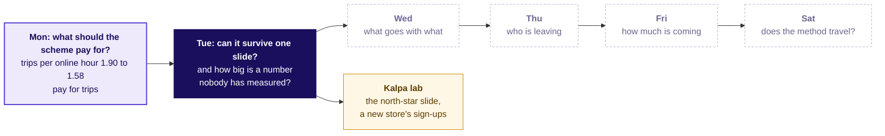

```notes
LIVE, 1 minute. Monday's node now carries the number the room produced and the decision it led to.
Tuesday is lit; the days to the right stay dashed. The amber node is the TA lab, where the same
studio runs on Kalpa Retail. The week's explorer, Monday's page at content/W04/D1/demos/C2_W04_D01_week_explorer_STUDENT.html: the home screen, Tuesday
lit; its scenes T1 to T3 are Tuesday's.
Transition: the five topics.
```

---

## S3. Five topics in five chapters, then Uber applies them
*Which topics does Tuesday teach, in what order, for how long, and in which notebook?*

| # | The topic, in the curriculum's words | Chapter | Minutes | Notebook |
|---|---|---|---|---|
| 1 | The one-slide answer: claim, evidence, caveat, action | 1 | 35 | 01 |
| 2 | What to leave out, and the appendix | 2 | 12 | 02 |
| 3 | Defending under challenge: restate, answer, concede, what would change your mind | 3 | 25 | 03 |
| 4 | The guesstimate: clarify, map, calculate, validate | 6, after lunch | 30 | 06 |
| 5 | The AI-free written business case | 7, after lunch | 10 | 07 |

Chapters 4 and 5 apply topics 1 to 3 to Uber's slide before lunch; chapters 8 to 10 apply topics 4 and 5 after it, with topics 1 and 3 back in the page and the interview room; and the lab runs the guesstimate on Kalpa Retail in notebook 11. A slide numbered D is for self-study; L1 to L6 in the notes mark the day's ladder, from a hand count anyone can do (L1) to the depth a hard interview asks (L6); and each interview line carries this programme's tag: [S] a staple asked everywhere, [F] frequent in product-company and global capability centre screens, [D] a differentiator.

```notes
LIVE, 1 minute. Read the five topics down the second column once: these are the curriculum's
words, so a learner can find each one again by name. Chapters 1 to 3 run now, each on an invented
example; chapters 6 and 7 open the afternoon after the second studio round, chapter 6 two chapters
before chapter 8, which applies it, and chapter 7 two before chapter 9, so the studio's two rounds
stay together and both afternoon topics are taught before the case uses them. A 10-minute break follows chapter 3. Transition: how the five topics join.
```

---

## S4. Five topics, joined to what came before and after
*What does each topic rest on, what does it feed, and where is it applied?*

```mermaid
flowchart LR
    K["<b>Already in the room</b><br/>Weeks 1 and 2: the four-part note; a rate names its denominator. Monday: the metric, and who loses under it"]
    subgraph today["Tuesday's five topics, in the curriculum's order"]
        direction LR
        T1["<b>1 · The one-slide answer: claim, evidence, caveat, action</b><br/>chapter 1"]
        T2["<b>2 · What to leave out, and the appendix</b><br/>chapter 2"]
        T3["<b>3 · Defending under challenge: restate, answer, concede, what would change your mind</b><br/>chapter 3"]
        T4["<b>4 · The guesstimate: clarify, map, calculate, validate</b><br/>chapter 6"]
        T5["<b>5 · The AI-free written business case</b><br/>chapter 7"]
        T1 --> T2 --> T3 --> T4 --> T5
    end
    C["<b>Applied to</b><br/>Uber, Hyderabad: chapters 4, 5 and 8 to 10; Kalpa in the lab; then every build week"]
    K --> today
    today --> C
    classDef lit fill:#1A0F5C,stroke:#1A0F5C,color:#FFFFFF
    classDef known fill:#EEEAFB,stroke:#5B3FD6,color:#1A0F5C,stroke-width:2px
    class K,C known
    class T1,T2,T3,T4,T5 lit
```

```notes
LIVE, 1 minute. Walk the map left to right. The left box is what the room already has: Week 1
Thursday's four-part note (claim, evidence, caveat, action), which today puts on one slide; the
denominator every rate has named since Week 1 Monday, which today's evidence carries; and Monday's
metric, which today's slide must get past the people who lose under it. The five dark boxes are
today's topics in the curriculum's order. Every topic is applied to Uber's case, and the
guesstimate runs once more on Kalpa in the lab; every build week ends on this slide and this
defence. The guesstimate's map step has the shape of Week 1's revenue tree, a chain of factors
multiplied, with guesses where the columns were. The map comes back at the close of each concept
chapter with that chapter's box filled. Transition: the case these topics will be used on.
```

---

## S5. The ticket: one slide, five minutes, three objectors
*What has the city head asked for, and which number will land first?*

**Uber, Hyderabad, the driver app's peak-hour earnings guarantee, one day on.** The scheme promises each enrolled driver Rs 300 per peak online hour and pays any shortfall as a top-up; Monday's redesign pays for completed peak trips instead, to drivers who accept at least half the requests offered, a rule called the acceptance floor; the idle tail is Monday's name for the 180 drivers who completed under one trip per online hour after the launch. Thursday's city review gets one slide, five minutes, and three people who each lose under the redesign. Gross bookings are what riders paid; an active driver-week is one driver with a row that week.

| Six weeks each side | 20 Jul to 30 Aug | 31 Aug to 11 Oct |
|---|---|---|
| Gross bookings per peak online hour | Rs 314 | Rs 260, down 17 percent |
| Average peak fare (bookings per trip) | Rs 165 | Rs 165, flat |
| Gross bookings per active driver-week | Rs 5,817 | Rs 5,861, up 0.8 percent |
| Peak online hours | 118,000 | 146,300, up 24 percent |

**Data.** Monday's `driver_weeks` (`peak_online_hours`, `peak_trips`, `peak_bookings_rs`, `topup_rs`) and `zone_weeks` (`peak_requests`, `median_wait_min`). **Afternoon ask.** Estimate, in fifteen minutes, how many drivers must be online at the three-hour weekday evening peak for a median wait under five minutes. **Caveats.** Each objection is partly right; no published figure checks the afternoon's answer.

> Illustrative case: the company is real, the situation and the data are synthetic, built for this class.

```notes
LIVE, 1 minute. Show it as the destination: Monday's illustrative Uber case, one day on, and the
deliverable is the slide the city head takes to Thursday's review. Read the metric's first row and
the ask, nothing more; chapter 4 opens by reading the ticket in full. Gross bookings are what riders
paid for the trips, before Uber's share and before any top-up; an active driver-week is one driver
with a row that week. Ask which of the three roles will quote which row of the table, and leave it
open: chapter 5 answers it.
Transition: chapter 1, the one-slide answer, on a kirana shop.
```

---

## SECTION 1: The one-slide answer: claim, evidence, caveat, action: what does a slide carry?
*The one-slide answer, taught on Ramesh's kirana shop, invented for this chapter: one claim as the title, one number with its denominator, the caveat in sight and the action with its cost, so the person who loses under it can repeat it.*

```notes
LIVE, 30 seconds. Concept chapter 1 of 5, 35 minutes. Ramesh's shop and every number about it are
invented, and every slide that shows one says so. Laptops stay shut until the code glimpse;
notebook 01 runs the same count on the shop's 56 days afterwards or in the lab. Transition: who
needs the answer.
```

---

## S6. A slide carries one decision in four parts
*Who needs the answer, and which questions lead to it?*

**The topic.** The one-slide answer: claim, evidence, caveat, action.

**Who needs the answer.** Ramesh, who owns a kirana shop, a neighbourhood grocery (invented), and opened it two more hours a day from October; he must decide whether the longer hours stay. His son argued for them and loses if they go.

```timeline
label: Question 1 | title: What is the claim? | body: One sentence with a verb, as the title, saying what is true and what to do.
label: Question 2 | title: Which number is the evidence? | body: One number with its denominator, or one chart, from a named window.
label: Question 3 | title: What is the caveat? | body: The one thing the evidence cannot show yet.
label: Question 4 | title: What is the action? | body: What to do, its cost in rupees and weeks, and who signs.
```

```notes
LIVE, 2 minutes 30 seconds. Define the words as they arrive. A slide, in a company, is one page shown
to the people who decide, for a few minutes, with others in the room who gain or lose by the
decision; those people are the stakeholders. Read the four questions: each gets an answer on the
shop's numbers before the next. Then name the test the chapter builds to: a slide has worked when
the person who loses under it can repeat it accurately, even while disagreeing. Transition: four
titles for Ramesh's slide.
```

---

## S7. Which title for Ramesh's slide acts?
*Ramesh opened two more hours a day in October (invented). Which title tells him what to do on the first read?*

**The broken default.** A slide with no claim makes every reader hunt for a point, so the son reads one number and the father another.

a) Shop sales, October

b) Sales Rs 12,600 a day, up Rs 700; 126 customers; 12 hours open

c) The longer hours add Rs 700 a day but earn less per hour, so count the evening on its own before deciding

d) Hours update

**Write your letter down before the next slide.**

```notes
LIVE, 4 minutes. Say the misconception aloud first, in the room's likely words: "more numbers make a
slide more convincing, and a neutral title keeps the reader fair." Letter cards up, a minute
arguing with a neighbour, letter cards up again; count both votes on the board. Expect b, since it
carries the most numbers. Say nothing about which is right. Transition: the reveal, and two notices
on a hostel board.
```

---

## S8. Answer: c, a title that acts is a sentence with a verb
*Why does Ramesh act on c and walk past a, b and d?*

| Title | What Ramesh learns from it |
|---|---|
| a) Shop sales, October | The topic, and nothing to do |
| b) Sales Rs 12,600 a day, up Rs 700; 126 customers; 12 hours open | Four true numbers and no point |
| c) The longer hours add Rs 700 a day but earn less per hour, so count the evening on its own before deciding | What is true, and what to do about it |
| d) Hours update | The topic again |

**A hostel notice board (invented).** One notice reads "Breakfast survey results"; the warden walks past it for a week. The next reads "Rotis replace rice at Monday breakfast, so the kitchen moves two staff from the rice counter to the roti line"; the warden reads it once and moves two staff. Title c is the second notice: answer first, the support beneath it.

```notes
LIVE, 4 minutes. Read the two notices aloud and ask which of the four titles is like the second one.
This is answer-first communication, Barbara Minto's Pyramid Principle: Management Consulted's page
on it (updated 2 September 2026, checked 13 October 2026) says it "starts with the conclusion first,
then organizes supporting points underneath it". Transition: which number carries the claim.
```

---

## S9. Per day up 5.9 percent, per hour down 11.8 percent
*The son says the shop earns more; the father says each hour earns less. Who is right, counted by hand?*

| Ramesh's shop, four weeks each side (invented) | September | October |
|---|---|---|
| Hours open a day | 10 | 12 |
| Customers a day | 119 | 126 |
| Sales a day | Rs 11,900 | Rs 12,600 |
| Sales per hour: sales a day / hours open | Rs 1,190 | Rs 1,050 |
| Sales per customer: sales a day / customers | Rs 100 | Rs 100 |
| Each of the two added hours: the Rs 700 rise / 2 hours | | at most Rs 350 |

**Both are right, and the denominator decides which sentence the slide carries.** Per day the shop is up Rs 700, 5.9 percent; per hour it is down 11.8 percent; per customer it is flat. The decision is whether the two extra hours pay, so the evidence divides by what the decision buys: the two added hours sold at most Rs 350 each, against Rs 1,190 in each of the old ten. The average fell because quieter hours joined it, and the Rs 350 says how much quieter.

```notes
LIVE, 7 minutes. The hand count, aloud, row by row, the way Week 1 Monday counted every rate:
11,900 / 10 = 1,190; 12,600 / 12 = 1,050; 11,900 / 119 = 100; 12,600 / 126 = 100. Have two
learners say the son's sentence and the father's sentence, each with its denominator named. Then
ask which denominator answers the question Ramesh faces, "do the two extra hours pay?": per hour,
and the sharpest per-hour number is the added hours' own, (12,600 - 11,900) / 2 = 350. It is the
most they can have sold: if the festival lifted the old ten hours too, the evening brought less.
Rs 350 is sales, before the cost of the goods; the shop's records hold no figure for what the goods
cost, so the slide cannot say yet whether the evening covers the helper's Rs 170 a day, and the
action has to count it. Callback: since Week 1, a rate without its denominator has been a rumour. A second example of the
same shape, an auto driver's day (invented), sits in notebook 01's your-turn cell and the notes.
Transition: the four parts, named.
```

---

## S10. One slide carries four parts, in this order
*What lets one slide carry a decision?*

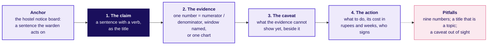

**This is the one-slide answer: claim, evidence, caveat, action.** It is Week 1 Thursday's four-part note made into one page, and the order is the order a reader needs: what to believe, why, what it cannot show yet, and what to do.

```notes
LIVE, 4 minutes. Build the board region by region: the anchor, then each part in order, then the
pitfalls. The name arrives last, as the shorthand for what the room just counted: the slide's four
parts are claim, evidence, caveat and action. Transition: Ramesh's slide, built.
```

---

## S11. Ramesh's slide, built in its four parts
*What do the four parts say for Ramesh, and can the son repeat it?*

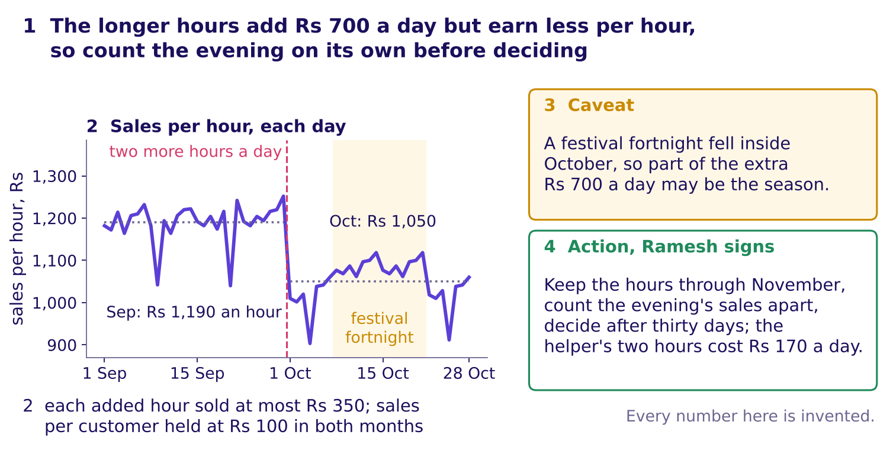

**The loser test.** The son argued for the longer hours, and he can repeat this title accurately while disagreeing with it, because it states his number, Rs 700 a day, beside his father's, the fall per hour.

```notes
LIVE, 6 minutes. Point at 1, 2, 3, 4 in order. The chart is the shop's 56 days as one line of sales
per hour, the change marked; the cluttered version of the same days is chapter 2's. The caveat sits
beside the evidence because Ramesh will raise it first, since it is the reason the son's Rs 700 may
not last: a festival fortnight fell inside October, so part of the Rs 700 may be the season. The action carries its cost, Rs 170 a day for the helper's
two extra hours, and who signs. Ask two learners to say the title in the son's voice, then in the
father's. Transition: the trap.
```

---

## S12. The trap: "Rs 700 more a day, so the hours work"
*Why is a true number the wrong evidence for this decision, on the shop's invented days?*

**The plausible wrong answer.** "Sales a day rose from Rs 11,900 to Rs 12,600, so the longer hours work; keep them." Every rupee is right, and it would keep paying the helper for two hours nobody has priced.

**Why it is wrong.** Rs 700 is sales before the cost of the goods, part of it may be the festival, and a day's total hides what each added hour brings: at most Rs 350, against Rs 1,190 in each old hour. **The check:** divide by what the decision buys, here the two extra hours, before reading the number. **The fix:** the evidence is per hour, the added hours' Rs 350 beside the old hours' Rs 1,190, and the action counts the evening's sales on their own for a month.

```python
m = days.groupby("month").agg(sales=("sales_rs", "sum"),
        days=("day", "count"), hours=("hours_open", "mean"),
        customers=("customers", "sum"))
m["per_day"] = m.sales / m.days            # 11,900 and 12,600
m["per_hour"] = m.per_day / m.hours        # 1,190 and 1,050
m["per_customer"] = m.sales / m.customers  # 100 and 100
added = m.per_day.diff().iloc[-1] / m.hours.diff().iloc[-1]  # 350
```

```notes
LIVE, 5 minutes. Read the wrong sentence in the son's voice and ask what decision it would make.
Then the code, one line at a time, said as a sentence: add up each month, divide by its days, divide again by
the hours open, divide the sales by the customers, and divide the rise by the hours added. Notebook
01 runs it on the 56 days and checks it against the hand count. Transition: the rules.
```

---

## S13. Four rules for a slide its loser can repeat
*What should a learner keep from chapter 1, and where is it used next?*

1. The title is the claim: a sentence with a verb that says what is true and what to do.
2. The evidence is one number divided by what the decision buys, with its window, or one chart.
3. The caveat sits beside the evidence, in plain sight.
4. The action names what to do, its cost in rupees and weeks, and who signs.

**In the interview.** [S] Present a recommendation to a non-technical stakeholder in two minutes: open on the claim, then one number with its denominator.

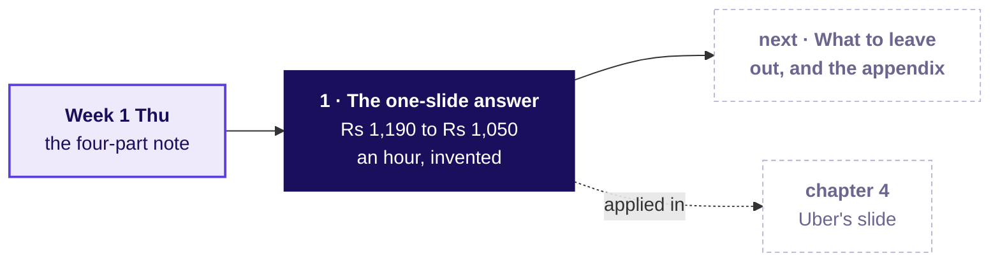

```notes
LIVE, 2 minutes. The rules are the slide a learner photographs. Check question before moving on:
"which of the four parts did the son's sentence leave out?" It left out the denominator the
decision is priced in, and with it the caveat and the cost. Fill the map's first box. Transition:
chapter 2, what leaves the slide.
```

---

## SECTION 2: What to leave out, and the appendix: where does the rest go?
*What to leave out, and the appendix, on Ramesh's first draft (invented): every element supports the claim, answers a named person's question on a page behind the slide, or leaves; the caveat never leaves.*

```notes
LIVE, 30 seconds. Concept chapter 2 of 5, 12 minutes. The same shop and the same invented numbers;
only the question changes. Transition: who needs the answer.
```

---

## S14. Every element stays, moves to a page, or leaves
*Who needs the answer, and which questions lead to it?*

**The topic.** What to leave out, and the appendix.

**Who needs the answer.** Ramesh, who reads the slide in five minutes, and two readers who each look for their own question behind it: his son and the shop's accountant. An **appendix** is the set of pages behind the slide, shown only when someone asks.

```timeline
label: Question 1 | title: How many elements stay? | body: Of the eight on Ramesh's first draft.
label: Question 2 | title: Where does each of the rest go? | body: A page behind the slide, or nowhere.
label: Question 3 | title: Can the caveat leave? | body: Even when the slide is crowded.
label: Question 4 | title: Does a chart obey the same rule? | body: Six series against one line.
```

```notes
LIVE, 1 minute 30 seconds. Choosing what to leave off is the skill: the row says so in as many
words. Read the four questions; each is answered on the draft before the next. Transition: the
draft itself.
```

---

## S15. How many of the draft's eight elements stay?
*Ramesh's first draft (invented) carries eight elements. How many belong on the slide itself?*

| Element on the draft | What it shows |
|---|---|
| Chart: sales per hour, by day | Rs 1,190 an hour in September, Rs 1,050 in October |
| Total sales, four weeks | Rs 3.33 lakh in September, Rs 3.53 lakh in October |
| Customers a day | 119 in September, 126 in October |
| Rain days | 2 in September, 2 in October |
| The son's hours at the counter | 4 a day in September, 6 in October |
| The helper's wage | Rs 85 an hour; the two extra hours cost Rs 170 a day |
| The festival fortnight | 14 of October's 28 days |
| Sales per customer | Rs 100 in both months |

a) 2, the two that carry the claim   b) 3   c) 5   d) 8

```notes
LIVE, 2 minutes. The misconception first, said aloud: "put everything in the appendix to be safe,
and move the caveat there, since it is only a detail." Letter cards up. Expect a split between a
and b. Transition: the sort that decides it.
```

---

## S16. Answer: b, three stay, and the caveat never leaves
*Where does each element go, and why does the caveat skip the sort?*

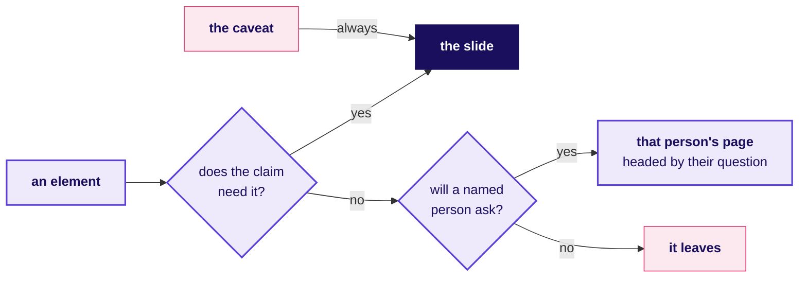

**The answer is b.** Two elements carry the claim, the per-hour chart and sales per customer, and the festival fortnight stays as the caveat. Read as sentences: if the claim needs an element, it stays; if a named person will ask about it, it goes to that person's page; if neither, it leaves; and the caveat stays whatever else happens, because an owner who finds it in the drawer calls the slide dishonest.

```notes
LIVE, 3 minutes. Walk the flow with one element at a time from the draft, then read the four
sentences aloud. Option a is the trap: the two that carry the claim are right, and the caveat is
forgotten. Transition: where the five that leave go.
```

---

## S17. Two pages behind the slide take four elements
*Which page takes each element that leaves, and what does the rule look like as code?*

| Where it goes | Elements |
|---|---|
| The slide | The per-hour chart; sales per customer; the festival fortnight, as the caveat |
| The son's page: did my extra hours bring customers? | Customers a day; the son's hours at the counter |
| The accounts page: what did the hours cost, and what did they bring? | Total sales over four weeks; the helper's wage |
| Nowhere: two in each month, so they explain none of the change, and nobody will ask | Rain days |

```python
def route(e):
    if e.is_caveat == "yes" or e.supports_claim == "yes":
        return "the slide"
    return e.whose_question + "'s page" if e.whose_question else "leaves"
```

```notes
LIVE, 2 minutes. Each page is headed by its owner's question, so Ramesh can turn to it the moment
the question comes. The four lines of code are the sort, one line per branch; notebook 02 runs them
on the eight elements. Transition: the same rule on a chart.
```

---

## S18. A chart obeys the same rule: one line stays
*How much of the cluttered chart's ink carries the claim?*

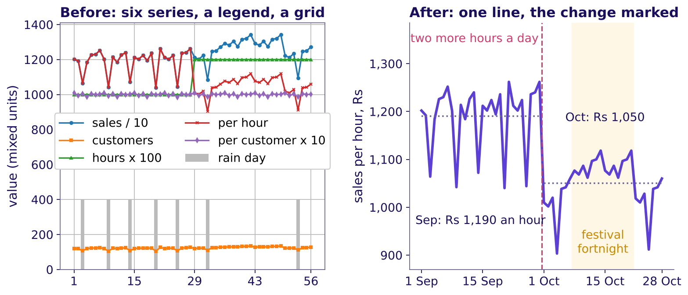

**Five of the six series leave, with the legend, the gridlines and the border; one line stays, with four short labels that read it: the two months' averages, the change and the festival.** Storytelling with Data's declutter test asks of each element, "Is it adding any informative value? If the answer is no, then take it out!"

```notes
LIVE, 1 minute 30 seconds. Point at the left chart first and ask what it claims; nobody can say in
five seconds. Then the right. The quote is from Storytelling with Data's post "a new year's
resolution: declutter your graphics" (4 January 2011, checked 13 October 2026). Transition: the
rules.
```

---

## S19. Four rules for what leaves the slide
*What should a learner keep from chapter 2, and where is it used next?*

1. An element stays only if the claim cannot stand without it.
2. An element a named person will ask about goes to that person's page, headed by their question.
3. An element nobody will ask about leaves.
4. The caveat stays on the slide, even when the slide is crowded.

**In the interview.** [F] What do you leave off the slide, and where does it go?

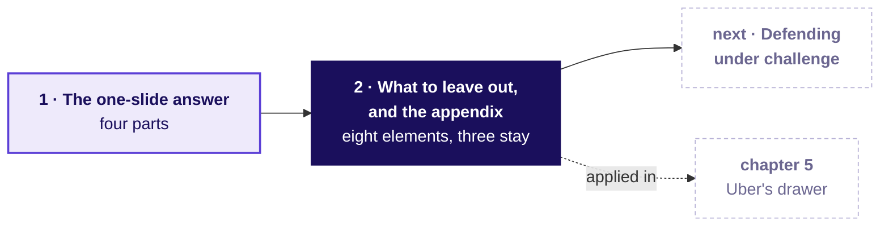

```notes
LIVE, 1 minute 30 seconds. Check question, true or false with its reason: "the slide is still
crowded after the cut, so the festival caveat moves to the appendix." False: the caveat stays
whatever else leaves, and something else goes instead. Fill the map's second box. Transition:
chapter 3, the defence.
```

---

## SECTION 3: Defending under challenge: restate, answer, concede, what would change your mind: how do you hold a claim?
*Defending under challenge, taught at Gulmohar Secondary School, invented for this chapter: an objection is usually partly right, and a defence that concedes its true part keeps the claim.*

```notes
LIVE, 30 seconds. Concept chapter 3 of 5, 25 minutes. Gulmohar Secondary School and its weeks are
invented. Transition: who needs the answer.
```

---

## S20. An objection is usually partly right
*Who needs the answer, and which questions lead to it?*

**The topic.** Defending under challenge: restate, answer, concede, what would change your mind.

**Who needs the answer.** A teacher at Gulmohar Secondary School (invented) who claims at a staff meeting that the new timetable raised attendance, and the headmaster, who decides whether the timetable stays. An **objection** is the reason a listener gives for not accepting a claim, usually built on a number the objector can see. To **concede** is to say its true part out loud.

```timeline
label: Question 1 | title: Which reply wins the room? | body: Four replies to one objection.
label: Question 2 | title: Which part of the objection is true? | body: Counted on two years of weeks.
label: Question 3 | title: Which evidence answers the rest? | body: The weeks before any exam.
label: Question 4 | title: What would change the teacher's mind? | body: A fact that can be checked.
```

```notes
LIVE, 2 minutes. Read the four questions. Most objections are partly right, which is why repeating
the claim louder fails; a concession is not a loss, because the claim rests on the evidence and
survives the objector being right about one part. Transition: the staff meeting.
```

---

## S21. Which reply wins the headmaster?
*The teacher says the new timetable, from week 3, raised attendance (invented). The sports teacher objects: "Attendance rose because the exams began." Which reply wins?*

a) The numbers again, louder: attendance rose 12.8 points this term, from 76.5 to 89.3 percent

b) Withdraw the claim until next term

c) Agree that exam weeks run higher, show that the rise began before the exams, and name what would change your mind

d) Ask for another term of data before anyone decides

**Vote, two minutes with a neighbour, then vote again.**

```notes
LIVE, 4 minutes. The misconception first, as the row's Kahoot trap says it: "a strong presenter
never concedes." Letter cards, two minutes arguing with a neighbour, letter cards again; count both
votes on the board. Expect a split between a and c. Transition: the school's weeks.
```

---

## S22. Answer: c, concede the exams and keep weeks 3 to 5
*Which part of the objection is true, and which line of evidence answers the rest?*

| Week (invented) | 1 | 2 | 3 | 4 | 5 | 6 | 7 | 8 |
|---|---|---|---|---|---|---|---|---|
| Last year, percent | 76 | 77 | 76 | 77 | 77 | 85 | 85 | 85 |
| This year, percent | 77 | 76 | 81 | 82 | 81 | 89 | 90 | 89 |

The new timetable began in week 3 this year; exams ran in weeks 6 to 8 in both years. **The true part:** the exam weeks run about 8 points above the three weeks before them in both years, 8.3 last year and 8.0 this year. **The rest:** weeks 3 to 5 this year sit 4 to 5 points above the same weeks last year, before any exam, 4.7 on average. **The answer is c.** a repeats the claim and concedes nothing; b and d retreat from evidence the teacher already holds.

```notes
LIVE, 4 minutes. The hand count, aloud. Last year: weeks 6 to 8 average 85.0, weeks 3 to 5 average
76.7, so exams add 8.3. This year: 89.3 against 81.3, so 8.0. Weeks 3 to 5, this year against last:
81.3 against 76.7, 4.7 points, with weeks 1 and 2 at 76.5 in both years. Transition: the same
numbers as a picture.
```

---

## S23. The rise began in week 3, before any exam
*What does the picture show that the objection missed?*

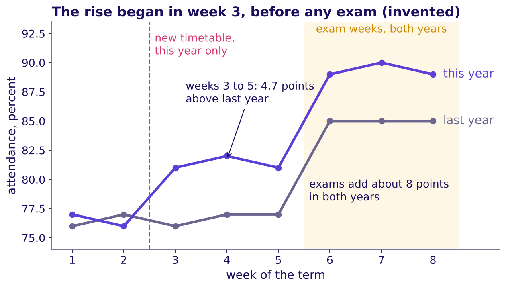

**The two lines agree where nothing changed and part where the timetable did.** Weeks 1 and 2 match; the exam weeks lift both years by about 8 points; only this year's line rises from week 3.

```notes
LIVE, 3 minutes. Trace the grey line, then the violet one. Ask what the sports teacher was looking
at: the jump at week 6, which both years share. The gap from week 3 is the evidence the defence
stands on. Transition: the shape a defence takes.
```

---

## S24. A defence runs in four moves, worked here
*What does a complete defence of the sports teacher's objection sound like, on the school's invented numbers?*

```timeline
label: Move 1 | title: Restate | body: "You are saying attendance rose because the exams began, so the timetable may have done nothing."
label: Move 2 | title: Answer | body: "Weeks 3 to 5 this year sit 4 to 5 points above last year's same weeks, before any exam."
label: Move 3 | title: Concede | body: "You are right that exam weeks run about 8 points higher; they did in both years."
label: Move 4 | title: Change my mind | body: "If a school with the same exams and the old timetable showed the same rise in weeks 3 to 5, I would drop the claim." | tone: dark
```

**These are the four moves: restate, answer, concede, what would change your mind.** Restating comes first because the objector has to agree with your version before any answer lands; Rapoport's rules, the philosopher Daniel Dennett's guide to criticising an argument fairly, open the same way.

```notes
LIVE, 5 minutes. Read the four moves in character, then name them, the rule arriving last. Move 4 is
the one first defences skip, and it is what tells the room the claim can be tested: Week 1
Thursday's fair comparison, said aloud. Rapoport's first rule, as The Marginalian quotes Dennett's
Intuition Pumps (checked 13 October 2026): re-express the target's position "so clearly, vividly,
and fairly" that the target says "Thanks, I wish I'd thought of putting it that way"; the second
lists the points of agreement. Transition: two ways to lose the room.
```

---

## S25. A defence fails by overclaiming or retreating
*Which two defences lose the room, and what does each cost the school?*

| The failure | What it sounds like | What it costs the school |
|---|---|---|
| Overclaim: concede nothing | "Exams are irrelevant; the timetable did it." | The headmaster hears a claim repeated louder, and the sports teacher, partly right, turns the staff room against the timetable |
| Retreat: concede everything | "You may be right; let us wait a term." | A term of the old timetable, with the evidence for the new one never heard |

**The check.** Did the reply name the true part and the line of evidence, in that order? **When the objector runs the meeting,** concede the true part first, keep their visible number on the page, and agree the test and the result that decides it before the meeting.

```notes
LIVE, 3 minutes. Read both failures in character. The last line is the [D] interview question's
answer in miniature: the person who loses under your claim controls the meeting, so the concession
and the deciding test are agreed before it. The Kahoot's trap item asks whether the best defence
never concedes anything; it is false. Transition: the two numbers, in code.
```

---

## S26. The concession and the answer, in four lines of code
*Which two numbers does the defence stand on, computed from the invented table?*

```python
w = att.pivot(index="week", columns="year", values="attendance_pct")
exam_lift = w.loc[6:8].mean() - w.loc[3:5].mean()     # 8.3 last year, 8.0 this year
early = w.loc[3:5].mean()                             # weeks 3 to 5, both years
rise = early["this year"] - early["last year"]        # 4.7 points, before any exam
```

**The concession carries one number and the answer carries another.** Exams lift both years by about 8 points; the timetable's weeks sit 4.7 points above last year's before any exam.

```notes
LIVE, 1 minute 30 seconds. Read each line aloud as a sentence: one row per week, one column per year;
the exam weeks against the three weeks before them; the early weeks this year against last year.
Notebook 03 runs it and composes the four moves from the two numbers. Transition: the rules.
```

---

## S27. Four rules for holding a claim under challenge
*What should a learner keep from chapter 3, and where is it used next?*

1. Restate the objection until its owner agrees with your version.
2. Answer from a named line of the evidence, never from the claim repeated.
3. Concede the true part out loud; the claim survives it.
4. Say the fact that would change your mind, so the claim can be tested.

**In the interview.** [F] A stakeholder's objection is partly right; how do you answer it? [D] The person who loses under your metric controls the meeting; how do you get it adopted anyway?

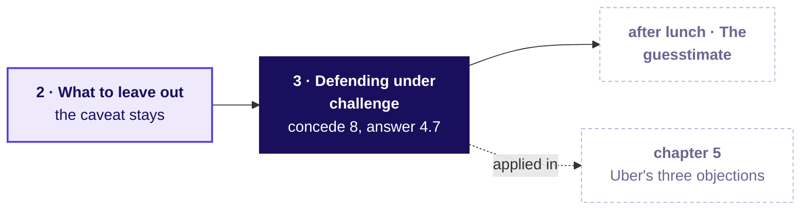

```notes
LIVE, 2 minutes. Check question: "which of the four moves does 'you may be right, let us wait'
leave out?" It concedes everything and answers nothing, so moves 2 and 4 are missing. Fill the
map's third box. Then the break, 10 minutes. Transition: after the break, the case: Uber's slide.
```

---

## SECTION 4: Uber's slide, rebuilt with the one-slide answer and what to leave out: which number carries it?
*The one-slide answer applied: Uber's slides A, B and C rebuilt to one claim, one number with its denominator, the caveat in sight and the action with its cost, so the city head can act on one slide.*

```notes
LIVE, 30 seconds. The first case chapter, levels L1 and L2 of the ladder, 40 minutes with the five on
what each role loses. Laptops closed until the twelve rows. Styles: Brilliant (the chapter opens on
a question), Veritasium (predict, then reveal), StatQuest (the twelve rows summed aloud),
Storytelling with Data and Minto (the makeover, the answer first). Explorer scene T1 runs beside
slide A's rebuild and scene T2 beside the per-driver-week prediction. Transition: what the chapter
applies, and for whom.
```

---

## S28. Uber's slide applies chapters 1 and 2
*Who needs the answer, and which questions lead to it?*

**Applies:** The one-slide answer: claim, evidence, caveat, action (chapter 1); What to leave out, and the appendix (chapter 2).

**Who needs the answer.** The Hyderabad city head, who has one slide and five minutes at Thursday's city review, with the driver-operations lead, the marketing lead and the finance partner in the room, each losing something under the redesign.

```timeline
label: Question 1 | title: What does each role lose? | body: The loser test, on three real roles.
label: Question 2 | title: Which title acts? | body: Chapter 1's claim, on finance's top-up.
label: Question 3 | title: Which two numbers stay? | body: Nine dashboard numbers cut to two.
label: Question 4 | title: Which denominator? | body: The same rupees read three ways.
```

```notes
LIVE, 1 minute 30 seconds. Go back to the ticket slide and read it in full now, top to bottom: the
metric with its values before and after, the two tables and their columns, the ask, the caveats and
the label line. Then the four questions. Every word the chapter needs was taught this morning:
claim, evidence, caveat, action, the appendix. Transition: where today ends.
```

---

## S29. Where today ends: a slide its losers can repeat
*What sentence will the city head be able to say on Thursday?*

> "The scheme is paying for online hours that carry no trips: gross bookings per peak online hour fell from Rs 314 to Rs 260 while the fare held at Rs 165. The monsoon ended inside the six weeks, so part of the fall may be the season. Test paying per completed peak trip with an acceptance floor: across the enrolled drivers, Monday's arithmetic saves Rs 58 lakh to Rs 92.7 lakh over six weeks if a half to a fifth of the idle drivers' top-up is still paid, and the per-trip rate, not yet set, can move it within that range or beyond it."

**By the end of the afternoon** you will also have estimated how many drivers the evening peak needs, said every assumption aloud, given a range, and checked it against the case's own data.

```notes
LIVE, 1 minute. Read the sentence once. The morning earns its four parts in order: the claim, one
number with its denominator, the caveat, the action with its cost. The saving range is Monday's:
Rs 1.16 crore went to driver-weeks that accepted under half their offers, and the range assumes a
half to a fifth of that is still paid because those drivers start accepting: half still paid saves
Rs 58 lakh, a fifth saves Rs 92.7 lakh. The range runs to a tenth of a lakh only because it is
arithmetic on Monday's total; the per-trip rate is still unknown, since a rate set high pays back
what the floor stops paying and a rate set low saves more than the range, so the sentence names it,
and the test fixes it first at a rate that pays the drivers who already accept what the floor paid
them. The saving is the scheme's, across the 1,200
enrolled drivers in Monday's data; a test on half of them saves about half of it while it runs. S30
shows the working.
Transition: what each role loses, chapter 1's loser test on real roles.
```

---

## S30. Each role loses one thing it can point to
*What does each of the three roles lose under Monday's definition?*

```cards
icon: user | eyebrow: Driver-operations lead | title: The supply headline | body: Peak online hours up 24 percent stops being the target, and the idle drivers' hours will fall when idle hours stop paying | tone: light
icon: user | eyebrow: Marketing lead | title: A clean hoarding line | body: "Rs 300 an hour, guaranteed" now carries a condition: the Rs 300 floor holds only for drivers who accept at least half their offers | tone: light
icon: user | eyebrow: Finance partner | title: Its own number as the headline | body: Top-up per trip becomes a guardrail, and the slide opens on bookings per online hour, Rs 314 to Rs 260 | tone: light
```

**The scheme now.** An enrolled driver online through a whole peak window (two three-hour windows a day) is guaranteed Rs 300 per peak online hour, the floor; when the driver's trip earnings in a window fall short, Uber pays the gap as a **top-up**. The trip earnings are the driver's share of the fares, and neither that share nor the window-by-window record is in Monday's tables, so a week's top-up cannot be rebuilt from its bookings. **Monday's redesign,** as a driver hears it: "The floor now pays for trips you complete, if you say yes to most offers." Saying yes to at least half the requests offered is the **acceptance floor**. Three **guardrails**, numbers that must not get worse while trips rise, watch it: the acceptance share, the median rider wait at peak and top-up per completed trip. **The saving:** Rs 1.16 crore of top-up (115.9 lakh) went to driver-weeks that accepted under half their offers; if half of it is still paid, 115.9 / 2 = Rs 58 lakh is saved over six weeks, and if a fifth is, 115.9 x 4/5 = Rs 92.7 lakh.

```notes
LIVE, 5 minutes. If a learner asks how a Rs 300 floor costs Rs 1.9 crore when an hour brought in Rs 260
of fares, or why the 880 drivers whose fares averaged Rs 313.5 an hour drew Rs 74 lakh: the floor is
checked window by window on the driver's share of the fares, so every slow window pays a top-up even
when the driver's average hour clears Rs 300, and the share is below the fare. Monday's caveats say
the share and the window record are not in the tables, so the top-up is read as Monday recorded it
and never rebuilt from the bookings. Cards hidden first.
Groups of three spend 3 minutes listing what each role loses, the loser test of chapter 1 on three
real roles; take one loss per role from three groups and write them on the board (1 minute), then
show the cards (1 minute). A loss the room names that the cards miss goes on the board as well: it
will come back as an objection in chapter 5.
Transition: four titles for finance's slide.
```

---

## S31. Predict: which of these four titles acts?
*Finance has a slide on the top-up. Which title tells the city head what to do on the first read?*

a) Top-up review, six weeks

b) Top-up Rs 1.9 crore, 61 percent of it to drivers accepting under half their offers

c) Most of the top-up pays drivers who decline offers: add an acceptance floor

d) Driver payments update, October

**Write your letter down before the next slide.**

```notes
LIVE, 2 minutes. Hands for each letter, counts on the board. Expect votes on b, since it carries
numbers. Say nothing about which is right.
Transition: the reveal.
```

---

## S32. Answer: a title that acts is a sentence with a verb
*Why does a reader act on c and walk past a, b and d?*

**The answer is c.** a and d name a topic. b reports two true numbers and leaves the reader to find the point. c says what is true and what to do about it, so a reader can act on the title alone: chapter 1's rule, the title is the claim, and Ramesh's title c on the kirana shop worked the same way.

```notes
LIVE, 2 minutes. One line of recall: chapter 1's notice board and the four parts are on the
board from the morning; point at the claim box. Minto's site describes ideas organised as a pyramid
under a single point (barbaraminto.com, checked 13 October 2026).
Transition: slide A, exactly as it arrived.
```

---

## S33. Slide A arrived with nine numbers and no claim
*What is a city head meant to do with this slide?*


**All nine of Monday's dashboard numbers get the same weight, under a title that names a topic.** The reader cannot tell which number matters, and the first number the eye meets is the one Monday showed to be the wrong one to celebrate.

```notes
LIVE, 2 minutes. Give the room 30 seconds of silence with the slide, then ask what it is asking the
city head to do. Every number here is Monday's. Explorer scene T1 starts from this slide.
Transition: which two of the nine carry a claim.
```

---

## S34. Which two of the nine numbers carry the claim?
*If the slide may keep only two numbers, which two make the case?*

a) Peak online hours +24 percent and completed peak trips +3 percent

b) Trips per peak online hour 1.90 to 1.58 and top-up to low acceptance 61 percent

c) Median rider wait 4.8 to 4.6 minutes and new drivers since launch 140

d) Acceptance share 86 to 73 percent and top-up paid Rs 1.9 crore

The **acceptance share** is requests a driver accepted over requests offered to them. **Low acceptance** means a driver-week that accepted fewer than half the requests offered: after the launch, these are the idle tail's weeks.

```notes
LIVE, 2 minutes. Each group writes one letter. Expect a split between a and b. The point of the
vote is that a carries two true numbers and no claim, which is why the room reaches for it.
Explorer scene T1 stays on slide A's nine numbers until every letter is in; nothing is unticked yet.
Transition: the rebuild.
```

---

## S35. Answer: slide A rebuilt to one claim and its evidence
*What does the slide become when it keeps one claim, one number and its denominator?*


**The answer is b.** At a flat fare, fewer trips per online hour means lower bookings per online hour, Rs 314 to Rs 260, and that fall is the chart. The 61 percent, the one number beside it, says where the top-up went. Option a is Monday's trap resold: online hours rose 24 percent while riders barely gained.

```notes
LIVE, 4 minutes. This is the worked example of the guided exercise: rebuild it with the room
mirroring, part by part, the four parts of chapter 1. Point at 1, 2, 3, 4 in order: the chart names its denominator in its title,
the caveat sits beside the evidence, and the action states the saving for all enrolled drivers; its
assumption, a half to a fifth of the idle top-up still paid, is said aloud, since the box has no room
for it. The drop lands in the launch week: the
highest after week, Rs 271, sits below the lowest before week, Rs 310, which is why the chart, not
the bar pair, is the evidence. In explorer scene T1, untick the seven numbers that leave, one at a time,
as each part is pointed at.
Transition: two more slides, rebuilt by the groups.
```

---

## S36. Slide B: nine numbers from finance's tab
*Which one claim does finance's slide carry, and which number proves it?*

| Finance's tab, as sent | Before | After |
|---|---|---|
| Gross peak bookings | Rs 3.70 crore | Rs 3.81 crore |
| Bookings per online hour | Rs 314 | Rs 260 |
| Bookings per active driver-week | Rs 5,817 | Rs 5,861 |
| Bookings per trip | Rs 165 | Rs 165 |
| Top-up paid | Rs 0 | Rs 1.9 crore |
| Top-up per completed trip | | Rs 82.3 |
| Top-up to low acceptance | | Rs 1.16 crore |
| Top-up to everyone else | | Rs 74 lakh |
| Rider requests | 251,910 | 256,556 |

**Half worked.** The claim is drafted for you: "Most of the top-up went to driver-weeks that accepted fewer than half their offers." Choose the one number that proves it, and keep the monsoon caveat beside it.

```notes
LIVE, 3 minutes. Odd-numbered groups take slide B, even-numbered groups take slide C (next slide).
Six minutes in total across S36 and S37 once both are on screen, then two groups read their
rebuilt titles. The guided exercise file carries both slides.
Transition: slide C.
```

---

## S37. Slide C: nine numbers from driver operations
*Which one claim does driver operations' slide carry, in a sentence of your own?*

| Driver operations' tab, as sent | Before | After |
|---|---|---|
| Drivers | 1,060 | 1,200 (140 new) |
| Active driver-weeks | 6,360 | 6,500 |
| Offers shown (a declined request is offered again) | 269,773 | 347,583 |
| Acceptance share | 86 percent | 73 percent |
| Driver cancels after accepting | 4 percent | 9 percent |
| Drivers in the idle tail | | 180 |
| Idle-tail online hours | 20,000 | 42,000 |
| Idle-tail trips | 38,000 | 33,440 |
| Unfulfilled requests | 11 percent | 10 percent |

**Blank.** Write the claim yourself, keep two numbers, and name the caveat. The **idle tail** is Monday's name for the 180 drivers whose trips per online hour fell under 1.0 after the launch.

```notes
LIVE, 3 minutes. The faded step: no drafted claim. Collect two titles. A strong one reads close
to "180 drivers doubled their online hours while their trips fell": idle hours up 2.1 times
(20,000 to 42,000), trips down 12 percent.
Transition: the twelve rows, read in rupees.
```

---

## S38. Three denominators, three verdicts on twelve rows
*What do six drivers, one week before the launch and one after, say when the denominator changes?*

| Driver | Zone | Hours, 10 Aug | Trips, 10 Aug | Rs, 10 Aug | Hours, 21 Sep | Trips, 21 Sep | Rs, 21 Sep |
|---|---|---|---|---|---|---|---|
| A | Jubilee Hills | 10 | 21 | 3,465 | 11 | 22 | 3,630 |
| B | Banjara Hills | 9 | 17 | 2,805 | 10 | 18 | 2,970 |
| C | Gachibowli | 11 | 22 | 3,630 | 12 | 23 | 3,795 |
| D | Madhapur | 10 | 19 | 3,135 | 11 | 20 | 3,300 |
| E | Shamshabad | 10 | 18 | 2,970 | 16 | 3 | 495 |
| F | Rajendranagar | 10 | 17 | 2,805 | 14 | 2 | 330 |
| **Total** | | **60** | **114** | **18,810** | **74** | **88** | **14,520** |

**Per peak online hour:** 18,810 / 60 = Rs 313.5, then 14,520 / 74 = Rs 196.2, down 37 percent. **Per driver-week:** 18,810 / 6 = Rs 3,135, then 14,520 / 6 = Rs 2,420, down 23 percent. **Per trip:** Rs 165 both times.

```notes
LIVE, 4 minutes. Chapter 1's kirana read the same rupees per day, per hour
and per customer; the same three divisions run here on twelve driver-weeks: six drivers, the week of 10 August against the week of 21
September. Count aloud, column by column: 60 and 74 hours, 114 and 88 trips, 18,810 and 14,520
rupees. Divide three times for each week and say the three verdicts. E and F are Monday's two
idle-tail drivers, which is why six drivers fall further than the city. These six drive about 10
peak hours a week against the city's 18.6, so their rupees per driver-week sit below the city's:
the hand count is for the method, and the city's numbers come next.
Transition: the city does something the six did not.
```

---

## S39. Predict: why does the city's per-driver-week rise?
*On the six drivers, rupees per driver-week fell 23 percent; on all driver-weeks, it rose 0.8 percent. Why?*

**Recall chapter 1:** the denominator picks the direction. Ramesh's shop rose per day and fell per hour on the same rupees.

a) The 140 new drivers earned more than the rest

b) Each driver-week carried more online hours

c) The fare rose after the launch

d) Fewer drivers sat idle after the launch

```notes
LIVE, 2 minutes. Per driver-week means per active driver-week: one driver with a row that week.
Each learner writes a letter. Expect votes on a, since new drivers are the obvious change.
Explorer scene T2, the denominator picker, stays closed until every letter is written; it opens on S40.
Transition: the reveal.
```

---

## S40. Answer: more hours a driver-week, less per hour
*How can rupees per driver-week rise while rupees per hour fall?*


**The answer is b.** Rupees per driver-week is rupees per hour times hours per driver-week, so the hours are Rs 5,817 / Rs 313.5 = 18.6 a driver-week before and Rs 5,861 / Rs 260.4 = 22.5 after. The average driver-week carried about four more online hours, most of them the idle tail's, while each hour brought in 17 percent less. Each line is the week over its before-window average, times 100; the amber line rose, then slid below 100.

```notes
LIVE, 3 minutes. Trace the violet line first: a step at the launch, then flat. Then the amber line:
up while hours climbed, down as trips per hour kept falling. Where the extra hours came from: the
idle tail's 180 drivers doubled their online hours, to about 39 a week, while completing 12 percent
fewer trips; the other 880 added under one hour a week. Ask which role will quote the amber
line. Expect the driver-operations lead, since it is closest to what a driver takes home in a week;
notebook 04's table gives each role its favourite. Explorer scene T2 lets learners pick the
denominator.
Transition: the trap in that amber line.
```

---

## S41. The trap: "per driver-week is up, so it works"
*Why does the rise in bookings per active driver-week say nothing good about the scheme?*

**The plausible wrong answer.** "Bookings per driver-week rose from Rs 5,817 to Rs 5,861, so the guarantee is working; keep it as it is." Every rupee in that sentence is right, and it would keep the city paying for idle hours.

**Why it is wrong.** Bookings rose 3.0 percent and active driver-weeks 2.2 percent (6,360 to 6,500), so the ratio rose 0.8 percent (1.030 / 1.022 = 1.008). The rise was bought with hours: 21 percent more online hours a driver-week for 17 percent less per hour. The rise itself sits with the other 880 drivers there before the launch, who drove about 4 percent more hours at an unchanged Rs 313.5 an hour; the idle tail doubled its hours for 12 percent fewer trips, so its weeks brought in less in fares. The 140 drivers who joined after the launch drove about one week each, at Rs 4,314 a driver-week, so they pulled the read down; for the drivers there before the launch, it rose 1.4 percent.

**The fix.** The slide names the denominator the scheme pays for, the peak online hour, and the presenter says it aloud.

```notes
LIVE, 3 minutes. Write the split on the board: Rs per driver-week = Rs per hour x hours per
driver-week. Then the three growth rates: bookings 3.0, driver-weeks 2.2, ratio 0.8. An active
driver-week is a driver with a row that week, never a sign-up to the guarantee.
Transition: the second route to the same number.
```

---

## S42. A second route: fare times trips per hour
*Is the fall in rupees per hour all trips, or some of it fare?*

```stats
value: Rs 313.5 | label: Rs 165 x 1.90 trips per hour | note: the six weeks from 20 July
value: Rs 260.4 | label: Rs 165 x 1.578 trips per hour | note: the six weeks from 31 August
value: Rs 165 | label: the fare, both windows | note: so the whole fall is trips per hour
```

**Rupees per hour is the fare times trips per hour, so the two routes always agree; the split shows which half moved.** The fare held, so the whole fall is trips per hour, 1.90 to 1.578 (230,900 / 146,300, printed as 1.58). The finance partner will ask whether riders paid less; they did not.

```notes
LIVE, 1 minute. Notebook 04 asserts the two routes agree to the paisa. Say it as one line the
slide's owner can repeat: the fare held, the trips per hour fell.
Transition: what chapter 4 adds to Tuesday's node.
```

---

## S43. Chapter 4 adds the claim and its denominator
*What can you now say in one sentence a driver would understand?*

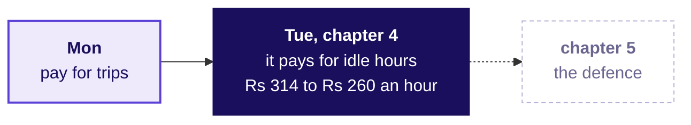

**Chapter 4 adds** the claim (the scheme pays for idle hours) and its denominator (Rs 314 to Rs 260 per peak online hour). **Said plainly:** "An hour online used to bring in Rs 314 of fares and now brings in Rs 260, because more of those hours have no rider." **In the interview** [S], this programme's tag for a staple asked everywhere: present a recommendation to a non-technical stakeholder in two minutes, opening on that sentence.

```notes
LIVE, 1 minute. Ask two learners to say the plain sentence aloud without the slide.
Transition: chapter 5, the objections.
```

---

## SECTION 5: Uber's three objections, answered by defending under challenge and the appendix: which objection holds?
*Defending under challenge applied: three roles, each partly right; the four moves in two studio rounds; and the appendix drawer with one page per role's question.*

```notes
LIVE, 30 seconds. The second case chapter, L3 of the ladder with round one of the studio as L5
practice and the drawer as L4, 52 minutes: 40 on the objections and round one, 12 on the drawer and
the drill. Styles: Veritasium (predict which role the city head sides with), the case method
(Monday's three roles return, each partly right), peer instruction (the vote and the revote).
Transition: what the chapter applies.
```

---

## S44. Uber's defence applies chapters 3 and 2
*Who needs the answer, and which questions lead to it?*

**Applies:** Defending under challenge: restate, answer, concede, what would change your mind (chapter 3); What to leave out, and the appendix (chapter 2).

**Who needs the answer.** The analyst whose slide must survive three roles who each lose something under it, and the city head, who sides with nobody until the evidence is on the table.

```timeline
label: Question 1 | title: Whose side is the city head on? | body: Three objections, one vote.
label: Question 2 | title: Which part of each is true? | body: The true part, conceded; the rest, answered.
label: Question 3 | title: What does a full defence sound like? | body: The four moves, modelled, then practised.
label: Question 4 | title: What goes behind the slide? | body: One appendix page per role's question.
```

```notes
LIVE, 1 minute 30 seconds. The four moves were taught on the school this morning; here they meet
three people with real stakes. Transition: the prediction.
```

---

## S45. Predict: which role will the city head side with?
*When the three objections land, whose side is the city head on?*

a) The driver-operations lead: "Drivers will log off and supply at peak will fall"

b) The marketing lead: "The guarantee is on every hoarding; changing it six weeks in looks like bait"

c) The finance partner: "The fall in bookings per hour is the monsoon ending"

d) None of them outright, because each objection is partly right

```notes
LIVE, 3 minutes. Vote, two minutes with a neighbour, revote. Count both votes on the board. Expect
votes on c, since the monsoon sounds like the safest explanation.
Transition: the true part of each objection.
```

---

## S46. Answer: each objection is partly right
*Which part of each objection is true, and what evidence answers the rest?*

| Role | The true part | The part the evidence answers |
|---|---|---|
| Driver operations | The 180 idle-tail drivers will log off: their idle hours are what stops being paid | The other 880 of the 1,060 drivers there before the launch held at 1.90 trips per online hour and keep the floor if they accept |
| Marketing | The hoarding promised a floor, and 140 drivers joined after it went up | The floor stays for drivers who accept; none of the 140 joiners is in the idle tail |
| Finance | The monsoon ended inside the six weeks, and last year's weeks are not in the data | In the last three weeks requests were back at the before level and trips per hour still ran at 1.56 |

**The answer is d.** A defence that sides with no one concedes each true part out loud and answers the rest from a line of evidence. Driver operations' true part has a place: 74 percent of the idle money went to driver-weeks in the three outer zones, which get few requests, and the outer zones' median wait fell furthest, from 6.6 to about 6 minutes, so that is the wait a change could cost first. Finance's row is the hardest: weekly requests fell four weeks running from 7 September, so the six-week rise of 1.8 percent hides that decline; the last three weeks answer it.

```notes
LIVE, 5 minutes. One row at a time. Every number here is Monday's or is computed from Monday's
tables in the facts file: the 880 are the 1,200 drivers less the 180 in the idle tail and the 140
joiners, and none of the joiners is in the tail. The 180 had also run at 1.90 trips an hour before
the launch, so the tail is drivers who changed, never drivers who were always slow. Weekly requests
in the last three weeks ran 41,161 to 42,602, against 41,155 to 42,719 before the launch.
Transition: the shape a defence takes.
```

---

## S47. The scorer's card: four moves, ticked as heard
*What does the owner of a slide do when an objection lands?*

```timeline
label: Move 1 | title: Restate | body: Say the objection back until its owner agrees with your version
label: Move 2 | title: Answer | body: Answer from the evidence, naming the line of the slide it rests on
label: Move 3 | title: Concede | body: Say the true part out loud, in plain words, without dropping the claim
label: Move 4 | title: Change my mind | body: Name the fact that would move you, and how you would get it | tone: dark
```

The scorer ticks each of chapter 3's four moves as it is heard and never scores the final number.

```notes
LIVE, 30 seconds. Hand out the scorer's cards: chapter 3's four moves, taught on the school this
morning. The two failures, overclaiming and retreating, were chapter 3's too.
Transition: one full defence, modelled.
```

---

## S48. The monsoon objection, answered in four moves
*What does a complete defence of finance's objection sound like?*

**Restate.** "You are saying the fall in bookings per hour could be the season ending, and the scheme has not had a fair test."

**Answer.** "Two lines of evidence point at the scheme: in the last three weeks after the launch, requests were back at the before window's level and trips per online hour still ran at 1.56; and the 1,060 drivers who were there before the launch fell from 1.90 to 1.58 as a group, all of it in the 180 of the idle tail while the other 880 held at 1.90, so the new drivers do not explain it."

**Concede.** "You are right that the monsoon ended inside the six weeks, and that last year's weeks are not in the data."

**What would change my mind.** "Last year's same six weeks showing a fall of this size, a city where the rains ended without the scheme showing the same fall, or the test of the redesign showing no change in trips per online hour."

```notes
LIVE, 5 minutes 30 seconds. The trainer models this defence first, conceding on purpose, then points at each
move on the S47 card. Every number is Monday's, recounted from Monday's tables when Tuesday's data
was built.
Transition: round one of the studio.
```

---

## S49. Studio round one: three seats, seven minutes each
*How does each group run the round, and what does the scorer hold?*

| Seat | What it does | What it holds |
|---|---|---|
| Presenter | Presents the rebuilt slide in five minutes, then answers one objection | The slide |
| Objector | Reads one role's objection from its card and pushes back once | One role card |
| Scorer | Ticks each move heard: restate, answer, concede, change my mind | The four-moves card |

**The round runs three turns of seven minutes.** The studio is the morning's practice: build a slide, present it, take an objection, get scored, rebuild. After each turn the seats rotate inside the three, so every member presents once, objects once and scores once.

```notes
LIVE, 23 minutes. Two minutes to form threes and hand out cards, then 3 x 7. Thirty-five learners
make eleven threes and one pair; in the pair a TA takes the objector seat. Walk the room; note one
strong concession and one retreat, and after the round name one of each without names: a retreat
is fixed by "which line of your evidence did the objection touch?", an overclaim by "what would
change your mind?", chapter 3's two failures.
Transition: what leaves the slide.
```

---

## S50. Predict: which of these belongs in the appendix?
*Of four things the slide could carry, which one moves behind it?*

a) The caveat that the monsoon ended inside the window

b) The per-driver-week and per-trip reads, with one line each on what moved them

c) The action and its saving range

d) The chart of bookings per peak online hour

```notes
LIVE, 3 minutes. Letters on paper. Expect some votes for a, since caveats feel like detail.
Transition: the answer, and the drawer it goes in.
```

---

## S51. Answer: the caveat stays; detail goes in a drawer
*What sits behind the slide, page by page?*


**The answer is b.** A caveat moved to the appendix is found there by its owner, who then calls the slide dishonest. Each appendix page is headed by the question one role will ask, so the analyst turns to it when the question comes.

```notes
LIVE, 3 minutes. Chapter 2's sort, applied: the trap here is a caveat in the drawer. Walk the three pages and ask what each
role's page must hold. The common wrong answer in an interview is "I put everything in the
appendix".
Transition: the drill.
```

---

## S52. Cut five elements to the two that carry the claim
*A second draft argues that riders got little for the Rs 1.9 crore. Which two of its five elements carry that claim?*

| Element on the draft | Keep or move? |
|---|---|
| The line "peak online hours up 24 percent" | |
| Median rider wait at peak, 4.8 to 4.6 minutes | |
| Top-up for each extra trip: Rs 2,836, for a trip worth Rs 165 | |
| The top-up split: 61 percent to low acceptance | |
| A table of acceptance share in each of the twelve zones, before and after | |

**Your task.** Keep two, and for every element you move, write the role whose appendix page receives it.

```notes
LIVE, 6 minutes. This is mid-session drill 1, in exercises/unguided. Four minutes alone, two
minutes comparing with a neighbour. Expect the 24 percent line kept by some: ask what claim it
supports. The two that carry it: the wait barely moved, and each extra trip cost Rs 2,836 of top-up
(Rs 1.9 crore over the 6,700 extra trips).
Transition: what chapter 5 adds.
```

---

## S53. Chapter 5 adds the appendix drawer
*What is left on the slide, and what is waiting behind it?*

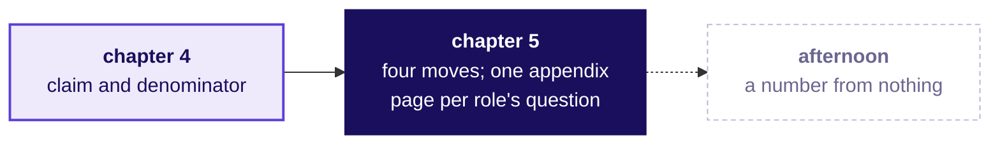

**In the interview** [F]: what do you leave off the slide, and where does it go? Answer with the drawer: one page per question a named role will ask.

```notes
LIVE, 1 minute. One learner says the slide's four parts and the three appendix headings from
memory.
Transition: where the morning ends.
```

---

## S54. Chapter 5 adds the defence and the drawer
*What can you now say when the finance partner says "it is the monsoon"?*

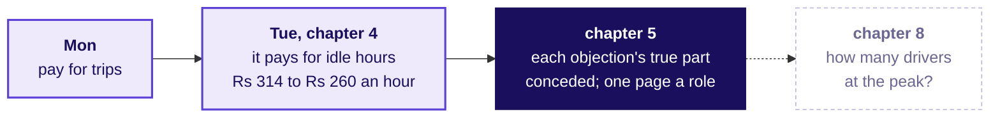

**Chapter 5 adds** the defence (restate, answer, concede, what would change your mind), one appendix page for each role's question, and the monsoon kept on the slide as the caveat. **Said plainly:** "Part of the fall may be the season; with rider requests back at their old level in the last three weeks, trips per hour stayed low, so a test has to settle it."

**The afternoon opens on round two of the studio, then asks the second question on the ticket:** how many drivers the evening peak needs, sized without a dataset.

```notes
LIVE, 1 minute. Ask two learners to say the plain sentence aloud without the slide. Lunch.
Transition: half two, round two of the studio, then the guesstimate.
```
