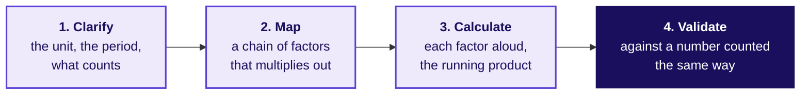
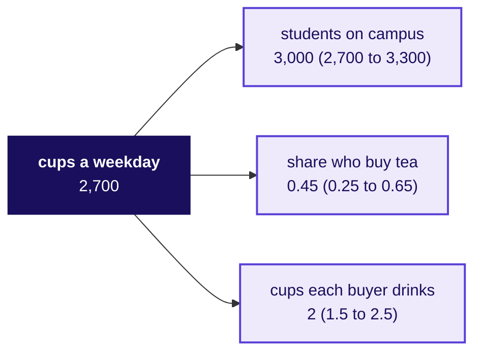
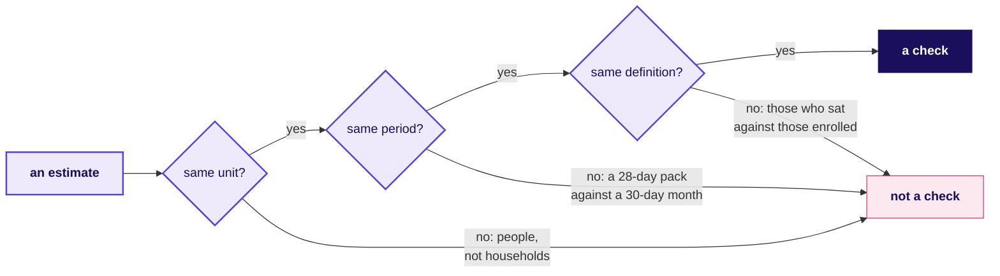
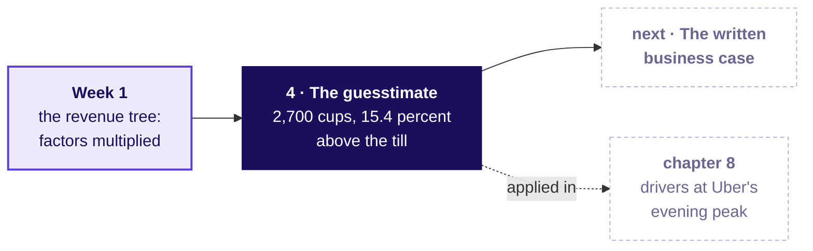
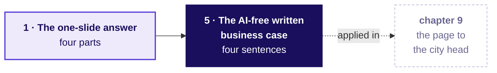
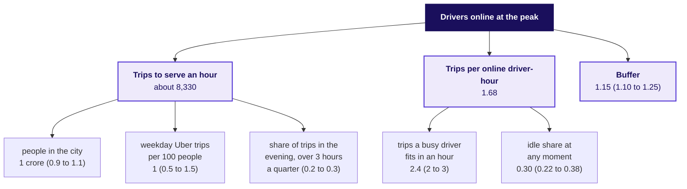
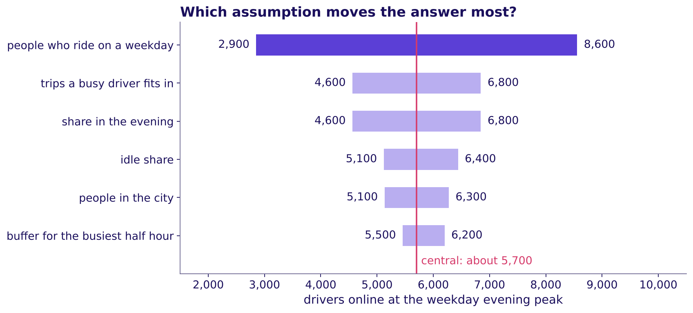
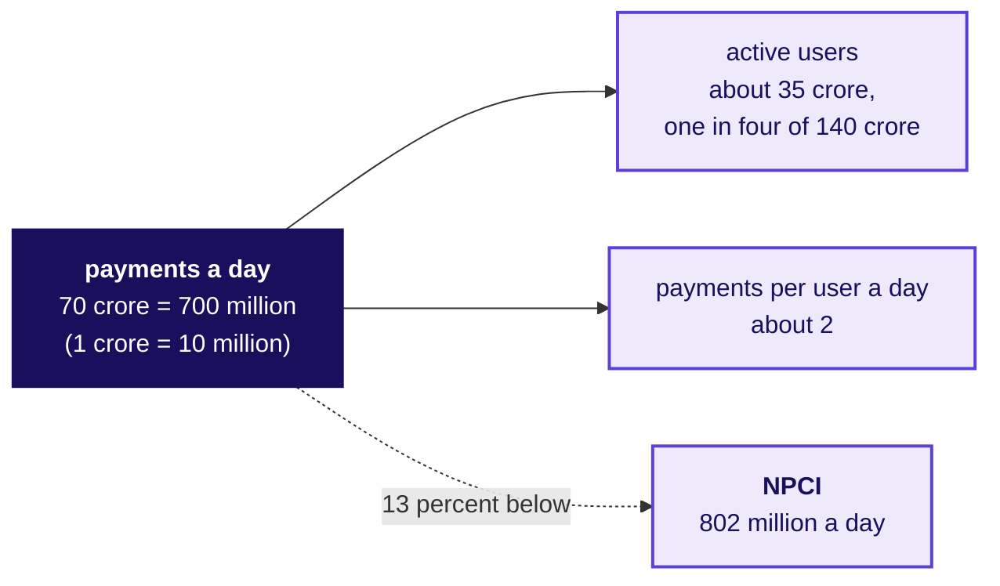
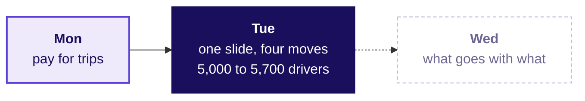

# How many drivers does the evening peak need, and can you say it on one page?

Week 4, Day 2. Half two.

Header: WEEK 4  ·  TUESDAY  ·  STAKEHOLDER COMMUNICATION  ·  UBER, HYDERABAD, AN ILLUSTRATIVE CASE

---

## S55. Studio round two: the seats swap
*What changes when the presenter has sat in every objector's seat?*

**Each group keeps its threes.** Each presenter now shows the slide rebuilt after round one, and answers each objection by naming the appendix page, from the drawer on S51, that holds the detail.

**The seats rotate through two turns of seven minutes, and then everyone has six minutes to rebuild their slide** with what the objections showed.

```notes
LIVE, 20 minutes, straight after lunch. Two turns of seven minutes, then six to rebuild: the
studio run sheet's two-turn fallback. The member who presented first in round one objects first
now. Collect the rebuilt slides; two groups present theirs to the room at the close if the slack
allows.
Transition: chapter 6, the guesstimate, on a campus canteen.
```

---

## SECTION 6: The guesstimate: clarify, map, calculate, validate: how big is an unknown?
*The guesstimate, taught on a campus canteen's tea, invented for this chapter: a number nobody has measured, built from guesses you can defend, given as a range, and checked against something counted the same way.*

```notes
LIVE, 30 seconds. Concept chapter 4 of 5, 30 minutes, after the second studio round. The canteen,
its till, the town, the phone pack and the school's pass rate are invented. Laptops stay shut until
the code glimpse. Transition: who needs the answer.
```

---

## S56. A guesstimate sizes what nobody has measured
*Who needs the answer, and which questions lead to it?*

**The topic.** The guesstimate: clarify, map, calculate, validate.

**Who needs the answer.** The canteen head (invented), who must order milk for a weekday before any till report exists, and any interviewer who asks for a number aloud. A **guesstimate** is a rough count of something nobody has measured; an **assumption** is a guess said aloud with its range; the **range** is the lowest and highest answer you would still defend.

```timeline
label: Question 1 | title: What exactly is counted? | body: The unit, the period, what counts.
label: Question 2 | title: Which factors multiply into it? | body: A chain, each factor a guess said aloud.
label: Question 3 | title: Which factor sets the range? | body: Each guess moved to its ends.
label: Question 4 | title: Is the answer sane? | body: Checked against a number someone counted.
```

```notes
LIVE, 2 minutes. A decision often cannot wait for data, which is why the method exists, and an
interviewer asks for one because it shows how a person thinks. Read the four questions. Transition:
before any method, everyone writes a number.
```

---

## S57. Who scores higher, the chain or the near guess?
*Write your own number for the cups of tea the campus canteen (invented) sells on a weekday. Then judge two candidates.*

**Candidate A:** "Students on campus times the share who buy tea times cups each: 3,000 x 0.45 x 2 = 2,700 cups. Checked against the till it runs high, so the share is the guess I would replace with a count first."

**Candidate B:** "About 2,350 cups."

The till's five weekdays average 2,340 cups.

a) B scores higher, because 2,350 sits ten cups from the till

b) A scores higher, because the chain and the check show how the number was built

c) They score the same, because both landed near the till

d) Neither scores, because a number with no data cannot be marked

```notes
LIVE, 4 minutes. The Rosling move first: everyone writes a number on paper before the candidates
appear, and three learners read theirs out. Then the vote, a minute with a neighbour, the vote
again. The misconception to say aloud: "the answer is what matters." Transition: the reveal.
```

---

## S58. Answer: b, the structure and the check are scored
*Why does the candidate further from the till score higher?*



**The answer is b.** Think Insights' guide to guesstimates says the interviewer "is interested in your thought process; not the final result", and that "the best candidates validate their results & try to spot their own mistake before telling their interviewer they are done". B's 2,350 cannot be checked, defended or improved; A's 2,700 shows which guess to replace. These are the four steps: clarify, map, calculate, validate.

```notes
LIVE, 3 minutes. Point at each step; the one first estimates skip is the fourth. Sources, both
checked 13 October 2026: Think Insights, "Guesstimates" (3 December 2018), the row's own reference;
and Aced's guide to analyst interviews, whose interviewer "isn't looking for a precise number". A
number that is wildly off still costs the answer, which is why step 4 exists. Transition: the four
steps, run on the canteen.
```

---

## S59. Clarify, map, calculate: 3,000 x 0.45 x 2 = 2,700
*How do the steps run on the canteen, each said aloud?*

| Step | On the campus canteen (invented) |
|---|---|
| Clarify | One canteen, one weekday, cups and never litres, tea and never coffee |
| Map | Cups a weekday = students on campus x the share who buy tea x cups each buyer drinks |
| Calculate | 3,000 students, then 1,350 who buy (x 0.45), then 2,700 cups (x 2) |



```notes
LIVE, 6 minutes. Ask the room for each value and its range, write the one it settles on, and say the
running product aloud: 3,000, then 1,350 who buy, then 2,700 cups. Units multiply too: students x
(buyers per student) x (cups per buyer) = cups. Callback: the map has the shape of Week 1's revenue
tree, a chain of factors multiplied. Transition: which guess moves the answer most.
```

---

## S60. The share who buy sets the range: 1,500 to 3,900
*Which guess, moved from its low end to its high end, moves the answer most?*


**The widest bar is the first guess to replace with a count.** With the other two held at their central values, students move the answer from 2,430 to 2,970, cups each from 2,025 to 3,375, and the share who buy from 1,500 to 3,900. **Say it as:** "about 2,700 cups, 1,500 to 3,900 by the share who buy."

```notes
LIVE, 4 minutes. Move one factor at a time, the others held: that is what each bar is. A range that
spans more than twice its low end tells the canteen head which number to count before ordering.
Transition: the check.
```

---

## S61. Validate: the till says 2,340, so revisit the share
*Is 2,700 sane, and which three tests must any check pass?*

**The chain runs 15.4 percent above the till's 2,340.** The share that lands on the till is 0.39: 3,000 x 0.39 x 2 = 2,340. A check counts only when it is in the same unit, the same period and the same definition.



**Two of the tests, on invented examples.** A 28-day phone pack of 1.5 GB a day is 42 GB and a 30-day month at the same rate is 45 GB, so compare per day: 1.5 GB in both. Gulmohar's 113 passes are 83.7 percent of the 135 who sat and 75.3 percent of the 150 enrolled, so use the denominator the question names.

```notes
LIVE, 5 minutes. The till is the right check: it counts cups, on a weekday, of tea sold. Then the
three tests, which stay on the board all afternoon: unit, period, definition. The unit test's
example is the trap on the next slide. Transition: the trap.
```

---

## S62. The trap: 24,000 people, so 96,000 households
*What does a sanity check catch that a careful calculation misses?*

**The plausible wrong answer.** "A town of 24,000 people (invented) has 96,000 households." Size a household business on it and the market is sixteen times too large.

**Why it is wrong.** The unit was multiplied where it should have been divided: households are people divided by about four, so about 6,000. **The check:** households never exceed people. **The fix:** write the unit beside every factor before multiplying.

```python
ledger = pd.read_csv("../data/C2_W04_D02_canteen_ledger_STUDENT.csv")
cups = ledger.central.prod()                       # 3,000 x 0.45 x 2 = 2,700
till = pd.read_csv("../data/C2_W04_D02_canteen_till_STUDENT.csv")
print(round(cups / till.cups_sold.mean() - 1, 3))  # 0.154: the chain runs high
```

```notes
LIVE, 3 minutes 30 seconds. Read the wrong sentence confidently, as an interviewee would. Ask which
of the four steps was skipped: clarify, since the unit was never written down. Then the code, in
plain words: the ledger's three central guesses multiplied, the till averaged, the gap printed.
Notebook 06 runs every step and all three tests. Transition: the rules.
```

---

## S63. Four rules for sizing a number from nothing
*What should a learner keep from chapter 6, and where is it used next?*

1. Clarify the unit, the period and what counts before writing any number.
2. Map the answer as a chain of factors that multiplies out in the unit you clarified.
3. Say each factor aloud with its range, and name the factor that sets the range.
4. Validate against a number counted in the same unit, period and definition, and move the answer if the check says so.

**In the interview.** [S] A guesstimate: how many customers could a new store sign up to a loyalty tier in its first year?



```notes
LIVE, 2 minutes. Check question: "which known number checks the canteen's weekday estimate: the till
for one weekday, the month's total takings, the coffee count, or the campus head count?" The till
for one weekday: same unit, period and definition. Fill the map's fourth box. Transition: chapter
7, the written case.
```

---

## SECTION 7: The AI-free written business case: what must a page carry?
*The AI-free written business case, taught on Ramesh's page (invented): the slide's four parts as four sentences on one page, read in two minutes by someone who was not in the room, written in your own words.*

```notes
LIVE, 30 seconds. Concept chapter 5 of 5, 10 minutes. Ramesh's shop returns from chapter 1, with the
same invented numbers. Transition: who needs the answer.
```

---

## S64. A business case is a written argument for a decision
*Who needs the answer, and which questions lead to it?*

**The topic.** The AI-free written business case.

**Who needs the answer.** Ramesh, reading his son's page alone in the evening, and later today the city head, reading the page each learner writes by hand. A **business case** says what to do, why, what it costs, what it returns and what could go wrong. It is one page because the reader has two minutes, and it is written without AI because it shows your own thinking.

```timeline
label: Question 1 | title: Which opening does the reader act on? | body: A list of numbers against one sentence.
label: Question 2 | title: Why sentences, not bullets? | body: A company that bans slides.
label: Question 3 | title: What goes on the page, in what order? | body: The four parts as four sentences.
label: Question 4 | title: Which words stay off it? | body: The method words a reader has to decode.
```

```notes
LIVE, 1 minute. The page is written because the people who decide read it when the presenter is
not there. It is handed in and read against a short checklist, with nothing graded. Transition: two
openings.
```

---

## S65. Which opening does Ramesh act on in two minutes?
*Two openings for the same page (invented). Does a business case need a spreadsheet and ten pages?*

| Opening | What it says (invented) |
|---|---|
| A, the draft's first three of nine lines | North star (sales a day): Rs 11,900 to Rs 12,600. Denominator: hours open, 10 to 12. Sales per hour index: 100 to 88. |
| B, the page's first sentence | Keep the longer hours for one more month and count the evening's own sales, because the two extra hours have brought Rs 700 a day while each hour of the day now earns less. |

a) A, since it carries more numbers   b) B, since it states the claim in a sentence   c) Neither, without a chart   d) Both equally

```notes
LIVE, 1 minute 30 seconds. The misconception aloud: "a business case needs a spreadsheet and ten
pages." Letter cards up. Transition: the reveal, and a company that bans slides.
```

---

## S66. Answer: b; Amazon reads six-page memos in silence
*Why do sentences beat bullets, and what does a company that bans slides do?*

**The answer is b.** A sentence has to carry its reasoning, where a bullet can hide it, and opening B says what to do and why before any number. Opening A needs a reader who knows what a north star, a denominator and an index are.

**In its 2017 letter to shareholders, Amazon said:** "We don't do PowerPoint (or any other slide-oriented) presentations at Amazon." The owner writes a narratively structured six-page memo, the room reads it in silence at the start of the meeting, and the letter says a great memo "probably should take a week or more".

> Source: Amazon's 2017 letter to shareholders, filed 18 April 2018 (checked 13 October 2026).

```notes
LIVE, 2 minutes. Ask which suits Thursday, a slide or a memo: there is no single answer, and the
afternoon's page is the memo form of the morning's slide. Transition: Ramesh's page, part by part.
```

---

## S67. Ramesh's page: four parts as four sentences
*What does the page say, part by part?*

| Part | Ramesh's page (invented) |
|---|---|
| Claim | Keep the longer hours for one more month and count the evening's own sales, because the two extra hours have brought Rs 700 a day while each hour of the day now earns less. |
| Evidence | Sales per hour fell from Rs 1,190 in September to Rs 1,050 in October, and sales per customer held at Rs 100. |
| Caveat | A festival fortnight fell inside October, so part of the extra Rs 700 a day may be the season. |
| Action | Keep the hours through November, write the evening's sales in a separate column each day, and decide after thirty days; the helper's two extra hours cost Rs 170 a day, and Ramesh signs. |

```notes
LIVE, 2 minutes 30 seconds. Read the page aloud in under a minute, then point at the order: the
caveat comes before the action, so the reader meets the doubt before the cost. Transition: what
the draft carried that the page does not.
```

---

## S68. The draft had nine lines and four method words
*What did the page cut, and which plain words replaced the method words?*


| Method word | The plain words that replace it |
|---|---|
| Denominator | divided by |
| Index | compared with the month before |
| Guardrail | a number that must not get worse |
| North star | the one number the team is judged on |

```notes
LIVE, 1 minute. The counts come from the page itself: nine lines and 13 numbers on the draft, four
sentences and 6 numbers on the page, four method words against none. Notebook 07 counts them in
three lines and checks your own page the same way. Transition: the rules.
```

---

## S69. Four rules for a page read in two minutes
*What should a learner keep from chapter 7, and where is it used next?*

1. The first sentence is the claim, with what to do and why.
2. The second carries one number, what it is divided by and its window.
3. The caveat comes before the action, so the reader meets the doubt first.
4. The action names what to do, its cost in rupees and weeks, and who signs.

**In the interview.** [S] Present a recommendation to a non-technical stakeholder in two minutes: the page, spoken.



```notes
LIVE, 1 minute 30 seconds. Check question: "a spreadsheet is attached to the page; which one thing
must still be on the page itself?" The claim, as its first sentence, since the reader may never
open the attachment. Fill the map's last box: all five topics are now taught. Transition: chapter
8, the guesstimate applied to Uber.
```

---

## SECTION 8: Drivers at Uber's evening peak, sized by the guesstimate: how many at the peak?
*The guesstimate applied: drivers online at the weekday evening peak, clarified, mapped, calculated, given as a range and checked like for like against the case's own data; then UPI, in pairs, against the clock.*

```notes
LIVE, 30 seconds. The third case chapter, L5 of the ladder on an estimate, 37 minutes: 25 on the
drivers worked together and 12 on UPI in pairs. Styles: Brilliant (the chapter opens on which
number would check it), StatQuest (round numbers spoken aloud, the running product on the board),
explorable explanations (explorer scene T3, the guesstimate tree with a slider per factor).
Mid-session drill 2, four estimates and their checks, is in exercises/unguided for the lab if the
room runs short here. Transition: what the chapter applies.
```

---

## S70. Uber's estimate applies chapter 6
*Who needs the answer, and which questions lead to it?*

**Applies:** The guesstimate: clarify, map, calculate, validate (chapter 6).

**Who needs the answer.** The city head, who asks before Thursday's review how many drivers must be online at the weekday evening peak to keep the median rider wait under five minutes, in fifteen minutes and without a dataset.

```timeline
label: Question 1 | title: Which number would check it? | body: Chapter 6's three tests, on four candidates.
label: Question 2 | title: What exactly is counted? | body: Drivers online at one moment.
label: Question 3 | title: What does the chain give? | body: The running product, and the factor that sets the range.
label: Question 4 | title: Is it sane, like for like? | body: The case's own driver-hours per trip.
```

```notes
LIVE, 1 minute. The canteen taught the four steps this afternoon; here they meet a number a city head
will spend money on. Transition: which number would check this estimate.
```

---

## S71. Predict: which number would check this estimate?
*You have sized drivers online at the weekday evening peak. Which of these numbers checks it in the same unit, period and definition?*

a) Monday's rider requests after the launch, 256,556 over six weeks

b) A published count of Uber drivers signed up in Hyderabad

c) A published count of Uber drivers online at one weekday evening peak in Hyderabad

d) The online driver-hours behind each rider request in the case's own data

```notes
LIVE, 2 minutes. Letters on paper, then a show of letters. Expect a, because it is the only number
on the list the room has seen. Chapter 6's three tests decide it.
Transition: the answer, and the rule behind it.
```

---

## S72. Answer: check in the same unit, period and definition
*Why does only one of the four check the estimate directly, and what do you do when it does not exist?*

**The answer is c, and nobody publishes it.** a counts rider requests over six weeks in twelve zones: another unit, a longer period and a slice of the city. b counts sign-ups, a different definition from drivers online at one moment. d is not wrong: it checks one link in the chain, a ratio the case's own data holds, and when the direct check does not exist, that is the honest fallback the afternoon uses. Chapter 6's three tests decide each: same unit, same period, same definition.

```notes
LIVE, 1 minute. Point at the three words on the board since chapter 6: unit, period, definition.
Transition: the city head's question, clarified.
```

---

## S73. Clarify: six questions pin the estimate down
*Which questions pin the estimate down before any number is written?*

| Ask | The answer to work with |
|---|---|
| Which city, which product? | The Hyderabad metro area, Uber, one product (assume cars) |
| Which window? | The weekday evening peak, one of the guarantee's two daily windows, three hours long |
| Drivers online when? | At one moment inside the window, since a count summed over three hours is another unit |
| What target? | A median rider wait under five minutes, for the city and then zone by zone |
| Requests or trips? | Trips: about nine in ten requests became trips in Monday's data |
| Drivers on two apps? | A driver online on Uber may be busy on another app, so lean the idle share low |

**The unit is drivers online at one moment.** Every factor in the chain must arrive in a unit that multiplies into it.

```notes
LIVE, 2 minutes 30 seconds. Chapter 6's first step, on the city. Ask the room for the clarifying questions before showing the table. A candidate
who skips this step is the one who lands on the trap at S78.
Transition: the map.
```

---

## S74. Map: drivers online as a chain of factors
*Which factors multiply into drivers online at the evening peak?*



**Drivers online = (trips to serve an hour / trips per online driver-hour) x buffer.** Each leaf is a guess said aloud with its range. Counting trips per 100 people, never riders, counts a commuter who rides both ways twice. A peak trip takes about 25 minutes from accepting to dropping, so a busy driver fits 2.4 an hour; the buffer covers the busiest half hour.

```notes
LIVE, 3 minutes 30 seconds. Build the tree on the board with the room, leaf by leaf, asking for each value and
its range. Explorer scene T3 has a slider per leaf. The idle share is a guess here; the validate
step checks it like for like.
Transition: the running product.
```

---

## S75. Calculate aloud: about 5,700 drivers
*What does the chain multiply out to, step by step?*

| Step | Said aloud | Running result |
|---|---|---|
| People x weekday trips per person | 1 crore x 1 per 100 | 1 lakh trips a day |
| x share in the evening | x a quarter | 25,000 in the window |
| / three hours | / 3 | about 8,330 trips an hour |
| Trips per online driver-hour | 2.4 x (1 - 0.30) | 1.68 |
| Trips an hour / trips per driver-hour | 8,330 / 1.68 | about 4,960 drivers |
| x buffer | x 1.15 | about 5,700 drivers |

**Question.** Using the ranges on S74, which assumption moves the answer most: a) the idle share, b) weekday trips per 100 people, c) the buffer, d) the trips a busy driver fits in an hour?

```notes
LIVE, 4 minutes. Say each step aloud and write the running result before the next. Then the
question: letters on paper, two minutes with a neighbour, revote. A range that spans three times
its low end beats one that spans a fifth.
Transition: the swing chart.
```

---

## S76. Answer: how often people ride moves it most
*How wide is the honest range, and which factor sets it?*



**The answer is b.** With every other factor at its central value, weekday trips of 0.5 to 1.5 per 100 people move the answer from about 2,900 to about 8,600; the idle share moves it from about 5,100 to 6,400. **Say it as:** "about 5,700 before the check, from 2,900 to 8,600 with everything else held, and mostly a question of how often people ride."

```notes
LIVE, 3 minutes. Trips per person is also the first number to replace: Uber's own dashboard holds
peak trips an hour. The idle share is the assumption Monday showed moving. Explorer scene T3 shows the
same swing: drag the trips-per-person slider from end to end.
Transition: the check.
```

---

## S77. Validate: like for like, the chain runs high
*Which part of the estimate can the case's own data confirm, and does it move the answer?*

```stats
value: 0.53 | label: driver-hours per completed trip, before | note: the case's twelve zones, median wait 4.8 minutes
value: 0.63 | label: driver-hours per completed trip, after | note: the same zones, median wait 4.6 minutes
value: 0.60 | label: the chain, before its buffer | note: 1 / 1.68, about an eighth above 0.53
```

**The chain needs about an eighth more driver time per trip than the before window, the one whose wait met the target, so it errs high.** Re-run at the case's 1.90 trips an hour: 8,330 / 1.90 x 1.15 = about 5,000, so say about 5,000 to 5,700. The case pools both daily windows on all seven days (42 hours a week), so it checks the ratio's size, never the city's count, and a published count of drivers online at Hyderabad's evening peak has not been found.

```notes
LIVE, 3 minutes. Like for like means per completed trip on both sides: the chain counts trips, so
the case's hours are divided by its trips, never its requests (0.47 per request mixes in the 11
percent of requests nobody served). The idle share checks the same way: 1.90 trips x 25 minutes
leaves an idle share of about 0.21 before the launch, the window that held the wait at 4.8 minutes.
Transition: the trap a hurried estimate falls into.
```

---

## S78. The trap: a day's trips divided by an hour's
*What goes wrong when a day meets an hour?*

**The plausible wrong answer.** "1 crore people, 1 trip per 100 people, so 1 lakh trips; a driver does 2.4 trips an hour; so about 41,700 drivers." A city head who takes that to the review asks for incentives for about seven times the drivers the chain says are needed.

**Why it is wrong.** A day's trips were divided by an hour's trips per driver, a period mismatch, and the idle share and the evening window were skipped. **The check:** write the unit beside every factor. **The fix:** bring the day's trips into the evening window's hour before dividing.

```notes
LIVE, 3 minutes. Write 41,700 and 5,700 side by side. Ask which step of the four was skipped:
clarify. This is the trap the interviewer fishes for in transcript 2.
Transition: UPI, in pairs.
```

---

## S79. UPI in pairs: seven minutes on the clock
*How many UPI payments happen in India on an average day?*

**The drill.** Work in pairs for seven minutes, with all four steps on one sheet. Clarify volume or value (volume: the count of payments). Map active users x payments per user a day, and say how many of those go to shops and how many to people, so the payments a day are believable.

**What the scorer checks:** scope clarified first, every assumption written with a range, the answer given as a range, and a sanity check in the right unit.

```notes
LIVE, 10 minutes. Three minutes to set up, seven on the clock. Collect three pairs' estimates on
the board before the next slide.
Transition: the published number.
```

---

## S80. The check: per day, and per payment
*Is a pair's estimate sane, and which comparison is the honest one?*

**NPCI's figure.** NPCI, the National Payments Corporation of India, which runs UPI, reported an average of 802 million UPI payments a day in September 2026: 24.07 billion in the month, worth Rs 29.37 lakh crore (Outlook Money, 2 October 2026; checked 12 October 2026).



**Two checks.** Per day: September has 30 days, so 24.07 billion / 30 = 802 million; dividing by 31 gives 776 million, a small slip beside the estimate's range. Per payment: Rs 29.37 lakh crore / 24.07 billion = about Rs 1,220 a payment, far above a cup of tea, so the count holds large transfers between people.

```notes
LIVE, 2 minutes. Read the board's estimates against 802 million. The worked chain lands 13 percent
below, a little low, and payments a day is the factor to revisit: the Rs 1,220 a payment says the
2 a day must split shops from people. Praise structure and the second check over closeness.
Transition: three traps a sanity check catches.
```

---

## S81. Three traps a sanity check catches
*Which skipped move lets each wrong number through?*

| Trap | What a confident candidate says | What catches it | The test it fails |
|---|---|---|---|
| People as households | "A city of two million people has eight million households" (invented) | Households are people divided by about four: 20 lakh / 4 = 5 lakh; this one multiplied | Unit |
| A record day | A weekday estimate of Delhi Metro journeys, checked against 82,44,903 | DMRC's average is 64.06 lakh journeys a day; 82,44,903 was one record day, 17 September 2026 | Period |
| A muddled source | "Flipkart had 63 million concurrent users in a minute" | Flipkart's text says 6.3 million (the 63 is in its web address), and "concurrent in a minute" mixes a moment with a minute | Definition: read the source's own words |

**Sources,** checked 12 October 2026: The Tribune (9 August 2026) and Republic World (18 September 2026), citing DMRC, the Delhi Metro Rail Corporation; Flipkart Stories (9 October 2026).

```notes
LIVE, 1 minute. The published versions of chapter 6's three tests, one line each: each trap fails
one of the three tests on the board, unit, period or definition.
In 2018 DMRC's line-utilisation count tallied a trip across three lines three times (PTI, 30 May
2018), another definition trap.
Transition: what chapter 8 adds to Tuesday's node.
```

---

## S82. Chapter 8 adds a number sized from nothing
*What does Tuesday's node carry now, and what does it hand to Wednesday?*



**Tuesday's node now carries** the slide (Rs 314 to Rs 260 per online hour, defended in four moves, one appendix page per role) and the estimate (about 5,000 to 5,700 drivers once checked; 2,900 to 8,600 by how often people ride). **In the interview** [S]: estimate a number from nothing, aloud, and check it. The structure, the stated assumptions and the check carry most of the score.

```notes
LIVE, 30 seconds. Then the break, 10 minutes.
Transition: after the break, the page to the city head.
```

---

## SECTION 9: The page to the city head, an AI-free written business case: what goes on one page?
*The written business case applied: the morning's slide as one page to the city head, by hand, in 35 minutes, handed in.*

```notes
LIVE, 30 seconds. The fourth case chapter, L5 in writing, 35 minutes, individual and AI-free. Style:
Feynman (plain words a driver would follow), Minto (the answer first). Transition: what the chapter
applies.
```

---

## S83. The page applies chapters 7 and 1
*Who needs the answer, and what must the page do?*

**Applies:** The AI-free written business case (chapter 7); The one-slide answer: claim, evidence, caveat, action (chapter 1).

**Who needs the answer.** The city head, reading alone before Thursday, with the three roles reading over a shoulder.

```timeline
label: Sentence 1 | title: The claim | body: What the city head should believe and do.
label: Sentence 2 | title: One number and its denominator | body: Rupees per peak online hour, before and after.
label: Sentence 3 | title: The caveat | body: Before the action, in plain sight.
label: Sentence 4 | title: The action and its cost | body: The saving over six weeks, and who signs.
```

```notes
LIVE, 30 seconds. Ramesh's page this afternoon was the worked example; the brief comes next.
Transition: the brief.
```

---

## S84. The brief: one page, four parts, in sentences
*What must the page do in the first two minutes of reading?*

```cards
icon: target | eyebrow: First sentence | title: The claim | body: What the city head should believe, in words a driver would follow | tone: light
icon: hash | eyebrow: Second | title: One number and its denominator | body: The rupees per peak online hour, before and after | tone: light
icon: triangle-alert | eyebrow: Third | title: The caveat | body: In the body of the page, where the reader meets it before the action | tone: light
icon: circle-check | eyebrow: Last | title: The action and its cost | body: What to do, the saving in rupees over weeks, who signs | tone: light
```

**The reader** is the city head, with the three roles reading over a shoulder: finance reads rupees, driver operations reads drivers, marketing reads sign-ups. Words a non-technical reader would not know (denominator, index, guardrail) stay off the page, or are said in plain words.

```notes
LIVE, 2 minutes. The checklist handed back after the slot asks five things: the claim first, one
number with its denominator, the caveat in sight, the action with its cost and signer, no method
words. Nothing is graded. Chapter 7's page for Ramesh is the worked example.
Transition: the thirty-five minutes.
```

---

## S85. Thirty-five minutes, on paper, alone
*What are the rules for the written case?*

**On one sheet, by hand.** Laptops and phones stay closed, so the page is your own thinking. Write the page; then read it once as the finance partner would and fix the sentence they would attack.

**At the end of the slot the page is handed in.** Three pages, chosen for one strong part each, are read aloud at the close if the clock allows.

```notes
LIVE, 32 minutes of silent writing. Walk once early to answer scope questions and once near the
end to signal the clock. No teaching inside the slot. Notebook 09 is for after the page is handed
in: it recounts the brief's numbers and runs chapter 7's page rules on a typed copy.
Transition: the transcripts.
```

---

## SECTION 10: The interview room, with the one-slide answer and the guesstimate spoken: what does it sound like?
*The interview room: the morning's slide and the afternoon's estimate as an interviewer hears them, a weak and a hire-grade answer side by side.*

```notes
LIVE, 30 seconds. The fifth case chapter, L6 of the ladder, 12 minutes: transcript 1 read in pairs
and scored; transcript 2 and transcript 3, the AI-company variant, are the evening's reading, from
extras/C2_W04_D02_interview_room_STUDENT.md with the scorecard. Style: interview rehearsal on
annotated answers. Transition: what the chapter applies.
```

---

## S86. The interview room applies chapters 1, 3 and 6
*Who needs the answer, and which questions lead to it?*

**Applies:** The one-slide answer: claim, evidence, caveat, action (chapter 1); Defending under challenge: restate, answer, concede, what would change your mind (chapter 3); The guesstimate: clarify, map, calculate, validate (chapter 6).

**Who needs the answer.** You, in a screen that asks for a two-minute recommendation or a number from nothing, with an interviewer listening for the structure before the number.

```timeline
label: Transcript 1 | title: The two-minute recommendation | body: Read in pairs, scored live.
label: Transcript 2 | title: Drivers at the evening peak | body: Self-study, with the scorecard.
label: Transcript 3 | title: The AI-company variant | body: Self-study: acceptance rate in a sales deck.
```

```notes
LIVE, 30 seconds. Transition: transcript 1.
```

---

## S87. Transcript 1: two openings, side by side
*"Present this recommendation to a non-technical leader in two minutes." How do the first lines differ?*

| A weak opening | A hire-grade opening |
|---|---|
| "So I looked at the dashboard. Online hours are up 24 percent, trips are up 3 percent, trips per hour went from 1.90 to 1.58, acceptance fell, and bookings per driver-week is actually up, so it is mixed." | "You are deciding whether to keep, end or change the guarantee. It is paying for online hours that carry no trips: an hour online brought in Rs 314 of fares and now brings in Rs 260 at the same fare, while the median wait barely moved, 4.8 to 4.6 minutes. Part of the fall may be the monsoon. Test paying per completed trip with an acceptance floor on half the drivers, picked at random, for six weeks; city-wide it saves Rs 58 lakh to Rs 92.7 lakh. You sign the test." |

**The follow-ups:** which denominator did you choose, and what would make you choose another; test or rollout, and how do you stop drivers moving into the zones you treat; the finance partner says it is the monsoon, so answer in under a minute.

```notes
LIVE, 8 minutes. In pairs, one reads the interviewer, one the candidate; then the candidate answers
the three follow-ups without notes. The weak opening reads numbers and lets the per-driver-week rise
blur the claim. The full hire-grade answer, with the per-driver-week line checked (each driver
online four more hours a week at 17 percent less per hour; the 140 joiners pulled the read down), is
in extras/C2_W04_D02_interview_room_STUDENT.md, and notebook 10 recomputes every number it speaks.
Transition: transcript 2.
```

---

## D88. Transcript 2: the drivers estimate, two answers
*"How many drivers must be online at the evening peak in a city?" What does each answer do first?*

| A weak answer | A hire-grade answer |
|---|---|
| "About 1 crore people, 1 percent ride, so 1 lakh trips. A driver does 2.4 trips an hour, so about 41,700 drivers." | "One moment of the three-hour weekday evening peak, one product, the city's median wait under five minutes. Drivers online is trips an hour divided by the trips one online driver completes in an hour, times a buffer: 8,330 / 1.68 x 1.15, about 5,700; trips per person moves it most, 2,900 to 8,600. Like for like, the case's 0.53 driver-hours per trip against my 0.60 says I run an eighth high, so 5,000 to 5,700, and each thousand idle drivers costs up to Rs 9 lakh an evening at the floor." |

**The follow-ups:** your idle share is a guess, so which number in the case data would catch it; the window is three hours, so what does a four-hour window do; give a range, and say which factor drives it.

```notes
SELF-STUDY, 8 minutes, the evening's reading with the scorecard. Hire-grade lines for the follow-ups: the case's hours with no trip (22 and 38
percent) are looser than idle at a moment, and like for like, its trips per hour before the launch,
when the wait held at 4.8 minutes, give an idle share of about 0.21 and about 5,000 drivers; a four-hour window
leaves the busiest half hour where it was, so the buffer rises to about 1.53 and the answer stays
about 5,700; about 2,900 to 8,600 with everything else held, driven by trips per person.
Transition: the AI-company variant.
```

---

## D89. The AI variant: acceptance rate in the sales deck
*How do you present a metric change to a head of product who quotes acceptance rate to customers?*

**The setup, invented for this class.** A coding assistant's sales deck quotes "acceptance rate 32 percent", the share of suggestions developers accept, even ones deleted soon after. The analyst proposes a new **north star**, the one number the team is judged on: characters of suggested code still in the file seven days after acceptance, per developer who saw a suggestion that week, with two **guardrails** that catch padding (retained characters per accepted character; edits per accepted suggestion).

**The objection, partly right.** "Acceptance rate is what customers see." True, and a 2022 study of GitHub Copilot's users found acceptance tracks how productive developers feel. **The answer** keeps acceptance in the deck as a **leading input**, a number that moves first, and switches the team's judgement to surviving code once a holdout of users shows it tracks seat renewals.

```notes
SELF-STUDY, 6 minutes, the evening's reading. Ask yourself which of the morning's three objections this resembles. Expect marketing's:
both keep the visible number while the north star does the judging. The study: Ziegler and
colleagues, arXiv 2205.06537, 13 May 2022 (checked 12 October 2026). A commit is a saved change to
the code; a revert undoes one.
Transition: scoring the transcripts.
```

---

## S90. How a pair scores a transcript
*What does an interviewer listen for, and how is each part scored?*

| Criterion | 0 | 1 | 2 |
|---|---|---|---|
| Clarified the scope first | skipped | partly | unit, window and target pinned |
| Named the denominator, or the unit, and the window | neither | one | both |
| Saw the trap | missed | named late | named and checked |
| Sized it with a unit | no unit | a unit, unchecked | a unit carried through |
| Said what would change their mind | no | vaguely | a named fact |
| Tied it to a decision and its cost | no | a decision | a decision and its rupees |
| Gave the structure before the number | number first | mixed | structure first |

```notes
LIVE, 3 minutes. Each pair scores both answers of one transcript on paper and compares with a
neighbouring pair. The trainer's scored copies are in the trainer pack.
Transition: the pain points.
```

---

## S91. Pain points, each with the case that shows it
*Where do first attempts at a slide and an estimate usually break?*

| Pain point | Where you saw it |
|---|---|
| The first slide carries every number | Slide A this morning: nine numbers, no claim |
| The first defence retreats or overclaims | Round one of the studio |
| A check against an unusual day | Delhi Metro's average day against one record day |
| A muddled published figure | Flipkart's 6.3 million against the 63 in its web address |
| A memo nobody can write in an hour | Amazon's letter: a great memo probably takes a week or more |

```notes
LIVE, 3 minutes, the close's first part. One line each; ask the room which one bit them today.
Transition: the Kahoot.
```

---

## S92. Kahoot: eight questions, ungraded
*Which of today's ideas can you retrieve under a timer?*

```cards
icon: list-ordered | eyebrow: Questions 1 to 3 | title: The slide | body: The four parts in order; keep or cut; the defence that never concedes | tone: light
icon: calculator | eyebrow: Questions 4 to 6 | title: The estimate | body: The four steps; the city of two million; a day against an hour | tone: light
icon: refresh-cw | eyebrow: Questions 7 and 8 | title: Back to Monday, and the page | body: The guardrail for a scheme that pays per trip; which opening of a one-page case is the claim | tone: light
```

```notes
LIVE, 12 minutes. Run the eight items from the Kahoot pack, read one line after each on what it
tested, and revisit any item under 50 percent correct. Nothing is graded.
Transition: where the day ends.
```

---

## S93. Where the day ends: a slide, a page and a range
*What will the city head hear on Thursday, and what comes tomorrow?*

> "The scheme is paying for online hours that carry no trips: Rs 314 to Rs 260 per peak online hour at a flat Rs 165 fare. Part of it may be the monsoon. Test paying per completed peak trip with an acceptance floor: city-wide, it saves Rs 58 lakh to Rs 92.7 lakh over six weeks if a half to a fifth of the idle drivers' top-up is still paid. At the evening peak the city needs about 5,000 to 5,700 drivers online, and how often people ride could move that from 2,900 to 8,600."

**The lines to keep.** A slide carries one claim, one number with its denominator, the caveat in sight and the action with its cost. Name the denominator before the number. Answer an objection in four moves. Size a number in four steps, give the factor that drives the range, and check it like for like. Check in the same unit, period and definition.

**Tomorrow:** five topics on counting what goes with what, then Swiggy Instamart's cart page in Pune and its strip of suggestions.

```notes
LIVE, 5 minutes. Read the sentence once. Wednesday's pre-read ships tonight: its five topics, their
words and the Instamart ticket's first lines, terms only. Then say the handoff line, as the day sheet has it: "You can
now put a number in front of the people who lose under it and size one from nothing. Tomorrow opens
on five topics about counting what goes with what, then a strip that suggests what goes with what,
and a click-through that fell when the strip began trusting counts. Read the topics and their words
tonight; we count them by hand first."
With the 6 minutes of slack, read three handed-in pages aloud, one strong part each.
Transition: close.
```
