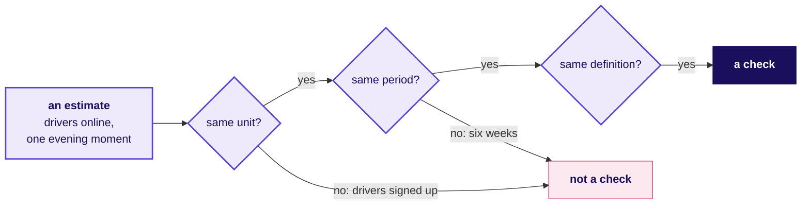
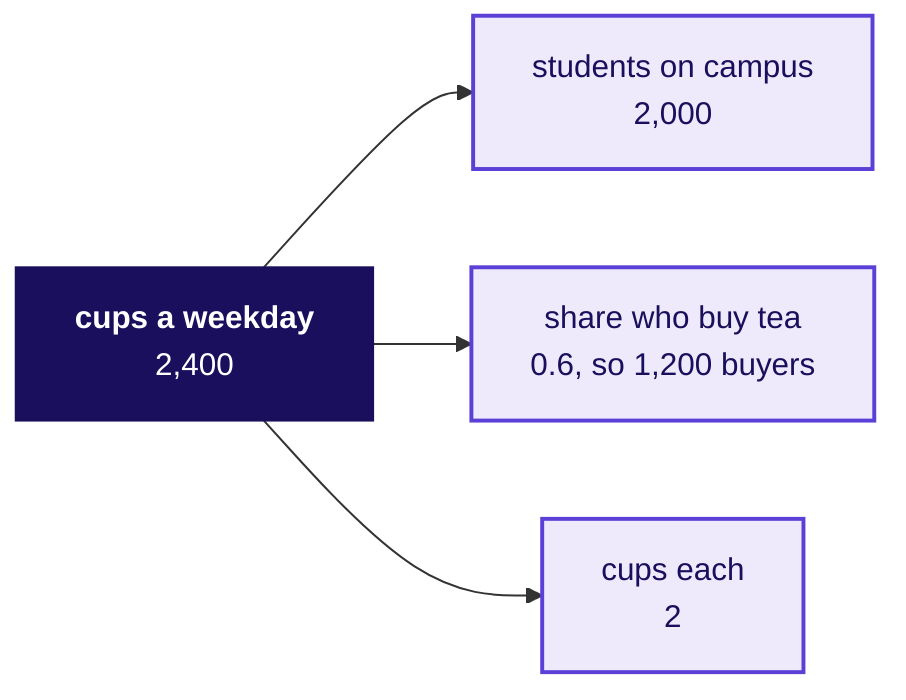
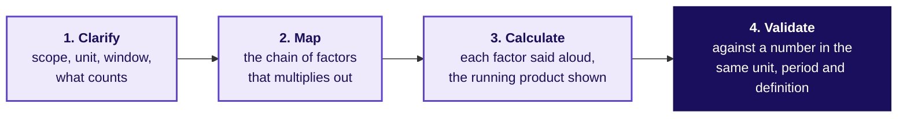
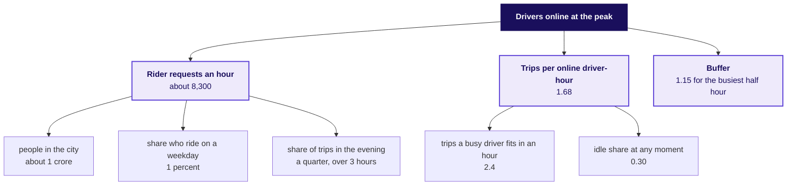
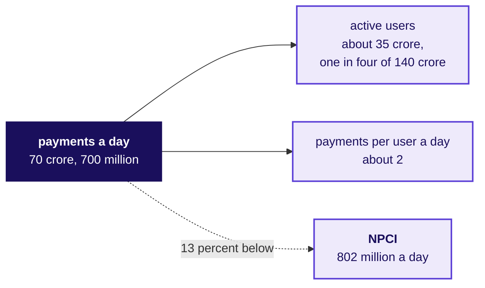
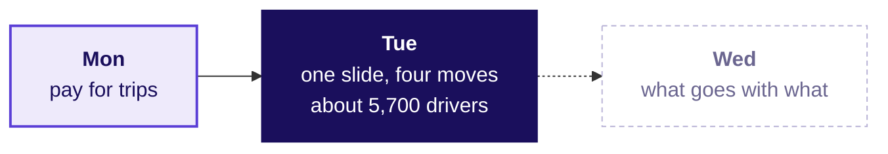

# How many drivers does the evening peak need, and can you say it on one page?

Week 4, Day 2. Half two.

Header: WEEK 4  ·  DAY 2  ·  UBER, HYDERABAD, AN ILLUSTRATIVE CASE

## SECTION 4: How big is the unknown?
*How many drivers must be online at the evening peak, sized from stated assumptions, and how do you know the answer is sane?*

```notes
LIVE, 65 minutes. Say once that the afternoon runs the dojo (a number sized from nothing,
then checked), the written case (the morning's slide as one page), the two transcripts and the
gallery, with no new technique. The dojo opens on the canteen's tea (10), drivers at the evening peak worked
together (30), UPI in pairs against the clock (25). Chapter 4 is L5 of the ladder on an estimate.
Styles: Brilliant (the chapter opens on which number to check against), StatQuest (round numbers
spoken aloud, the running product on the board), explorable explanations (explorer scene T3, the
guesstimate tree with a slider per factor). Mid-session drill 2, four estimates and their checks,
is in exercises/unguided for the lab if the room runs short here.
Transition: the opening question.
```

---

## S33. Predict: which number would check this estimate?
*You have sized drivers online at the weekday evening peak. Which of these numbers checks it?*

a) Monday's rider requests after the launch, 256,556 over six weeks

b) A published count of Uber drivers signed up in Hyderabad

c) A published count of Uber drivers online at one weekday evening peak in Hyderabad

d) The online driver-hours behind each rider request in the case's own data

```notes
LIVE, 3 minutes. Letters on paper, then a show of letters. Expect a, because it is the only number
on the list the room has seen.
Transition: the answer, and the rule behind it.
```

---

## S34. Answer: check in the same unit, period and definition
*Why does only one of the four check the estimate directly, and what do you do when it does not exist?*

**The answer is c, and nobody publishes it, so its slot reads "to be found".** a is a six-week total for the twelve zones the enrolled drivers work, a different period and a smaller area. b counts sign-ups, a different definition from drivers online at one moment. d checks one link in the chain, the ratio, and that is the check the afternoon uses.



```notes
LIVE, 2 minutes. Write the three words on the board: unit, period, definition. They stay up all
afternoon.
Transition: the warm-up, with nothing at stake.
```

---

## S35. The canteen's tea, in four steps aloud
*How many cups of tea does the campus canteen sell on a weekday?*

**A toy, invented for this class.** Clarify: one canteen, one weekday, cups and not litres. Map: students on campus x the share who buy tea x cups each. Calculate: 2,000 x 0.6 x 2 = 2,400 cups. Validate: the canteen's till for one weekday; failing that, cups counted at the counter for one busy half hour.



```notes
LIVE, 5 minutes. Ask the room for each value and write the one it settles on; say the running
product aloud: 2,000, then 1,200 who buy, then 2,400 cups.
Transition: the four steps as a strip.
```

---

## S36. A guesstimate runs in four steps
*What does every estimate in the dojo, and in an interview, do in order?*



**Interviewers score the structure and the sanity check, and hardly ever the final number.** Aced's analyst guide says the interviewer is evaluating the estimation framework and wants each assumption stated so it can be challenged (checked 12 October 2026).

```notes
LIVE, 2 minutes. Point at each step. The step first estimates skip is the fourth.
Transition: the city head's question, clarified.
```

---

## S37. Clarify: five questions pin the estimate down
*Which questions pin the estimate down before any number is written?*

| Ask | The answer to work with |
|---|---|
| Which city? | The Hyderabad metro area, Uber only |
| Which window? | The weekday evening peak, three hours long |
| Drivers online when? | At one moment inside the window, since a count summed over three hours is another unit |
| What target? | A median rider wait under five minutes |
| Requests or trips? | Rider requests, each one a trip to serve |

**The unit is drivers online at one moment.** Every factor in the chain must arrive in a unit that multiplies into it.

```notes
LIVE, 3 minutes. Ask the room for the clarifying questions before showing the table. A candidate
who skips this step is the one who lands on the trap at S42.
Transition: the map.
```

---

## S38. Map: drivers online as a chain of factors
*Which factors multiply into drivers online at the evening peak?*



**Drivers online = requests an hour / trips per online driver-hour x buffer.** Each leaf is an assumption with a range. A trip at the peak takes about 25 minutes from accepting to dropping, so a busy driver fits 2.4 an hour; the idle share is the share of online drivers with no rider at that moment.

```notes
LIVE, 6 minutes. Build the tree on the board with the room, leaf by leaf, asking for each value.
Explorer scene T3 has a slider per leaf. The idle share's range, 0.22 to 0.38, is Monday's own
share of online hours with no completed trip, before and after.
Transition: the running product.
```

---

## S39. Calculate aloud: about 5,700 drivers
*What does the chain multiply out to, step by step?*

| Step | Said aloud | Running result |
|---|---|---|
| People x share who ride | 1 crore x 1 percent | 1 lakh trips a day |
| x share in the evening | x a quarter | 25,000 in the window |
| / three hours | / 3 | about 8,300 requests an hour |
| Trips per online driver-hour | 2.4 x (1 - 0.30) | 1.68 |
| Requests / trips per driver-hour | 8,300 / 1.68 | about 4,960 drivers |
| x buffer | x 1.15 | about 5,700 drivers |

**Question.** Which assumption moves the answer most across its range: a) the idle share, b) the share who ride on a weekday, c) the buffer, d) the trips a busy driver fits in an hour?

```notes
LIVE, 6 minutes. Say each step aloud and write the running result before the next. Then the
question: letters on paper, two minutes with a neighbour, revote.
Transition: the swing chart.
```

---

## S40. Answer: the share who ride moves it most
*How wide is the honest range, and which factor sets it?*


**The answer is b.** With every other factor at its central value, a ride share of 0.5 to 1.5 percent moves the answer from about 2,900 to about 8,600. The idle share moves it from about 5,100 to 6,400. **Say it as:** "about 5,700, between about 2,900 and 8,600, and mostly a question of how many people ride."

```notes
LIVE, 5 minutes. The ride share is also the first number to replace: Uber's own dashboard holds
peak requests an hour. The idle share is the assumption Monday showed moving, 0.22 to 0.38 of
online hours with no trip in six weeks.
Transition: the check.
```

---

## S41. Validate: the case can check a ratio, never the count
*Which part of the estimate can the case's own data confirm?*

```stats
value: 0.47 | label: driver-hours per request, before | note: the case's twelve zones, median wait 4.8 minutes
value: 0.57 | label: driver-hours per request, after | note: the same zones, median wait 4.6 minutes
value: 0.60 | label: the chain, before its buffer | note: 1 / 1.68, about a quarter above 0.47
```

**Monday's data counts peak hours on all seven days, two three-hour windows a day, 42 hours a week,** so its 256,556 after-window requests are about 1,018 an hour: a slice of the city run by 1,200 drivers, which can check the ratio and never the city's count. The published figure for Uber drivers online at Hyderabad's evening peak is to be found.

```notes
LIVE, 3 minutes. Synthetic, labelled: these are the case's numbers, not Uber's. The chain errs on
the generous side, so the buffer is the first factor to trim.
Transition: the trap a hurried estimate falls into.
```

---

## S42. The trap: a day's trips divided by an hour's
*What goes wrong when the units are not clarified?*

**The plausible wrong answer.** "1 crore people, 1 percent ride, so 1 lakh trips; a driver does 2.4 trips an hour; so about 41,700 drivers." A city head who takes that to the review asks for incentives for about seven times the drivers the chain says.

**Why it is wrong.** A day's trips were divided by an hour's trips per driver, and the idle share and the evening window were skipped. **The check:** write the unit beside every factor. **The fix:** bring the day's trips into the evening window's hour before dividing.

```notes
LIVE, 5 minutes. Write 41,700 and 5,700 side by side. Ask which step of the four was skipped:
clarify. This is the trap the interviewer fishes for in transcript 2.
Transition: UPI, in pairs.
```

---

## S43. UPI in pairs: seven minutes on the clock
*How many UPI payments happen in India on an average day?*

**The drill.** In pairs, seven minutes, all four steps on one sheet. Clarify volume or value (volume: the count of payments). Map active users x payments per user a day, split between paying shops and paying people.

**What the scorer checks:** scope clarified first, every assumption written with a range, a range given, and a sanity check in the right unit. The final number scores nothing on its own.

```notes
LIVE, 12 minutes. Three minutes to set up, seven on the clock, two to swap sheets with the next
pair. Collect three pairs' estimates on the board before the next slide.
Transition: the published number.
```

---

## S44. The check: 802 million a day, compared per day
*Is a pair's estimate sane, and which comparison is the honest one?*

**NPCI's figure:** an average of 802 million UPI transactions a day in September 2026, and 24.07 billion in the month (Outlook Money, 2 October 2026, citing NPCI; checked 12 October 2026).



**The catch.** September has 30 days: 24.07 billion / 30 is 802 million, while dividing by 31 gives 776 million, about 3 percent low. Compare per-day figures in the unit the source published.

```notes
LIVE, 6 minutes. Read the board's estimates against 802 million. The worked chain lands 13 percent
below: same order, a little low, and payments a day is the factor to revisit. Praise structure, not
closeness.
Transition: three traps a sanity check catches.
```

---

## S45. Three traps a sanity check catches
*Which skipped move lets each wrong number through?*

| Trap | What a confident candidate says | What catches it | The move skipped |
|---|---|---|---|
| Crowd as households | "A city of two million people has nine million households" (invented) | About four people to a household gives about 5 lakh households | Clarify the unit |
| A different unit | A weekday estimate of Delhi Metro riders checked against a record day's boardings | DMRC reports 64.06 lakh journeys a day and, separately, a record 82,44,903 boardings on 17 September 2026 | Validate in the same unit |
| A decimal | "Flipkart had 63 million concurrent users in a minute" | Flipkart's own announcement of 9 October 2026 says 6.3 million; the 63 is in its URL | Read the source's text |

**Each trap is one skipped step,** so the scorer names the step and the room fixes the habit.

```notes
LIVE, 6 minutes. Sources, all checked 12 October 2026: The Tribune (9 August 2026) and Republic
World (18 September 2026), both citing DMRC; Flipkart Stories (9 October 2026). In 2018 DMRC's
line-utilisation count tallied a trip across three lines three times (PTI, 30 May 2018).
Transition: what chapter 4 adds to Tuesday's node.
```

---

## S46. Chapter 4 adds a number sized from nothing
*What does Tuesday's node carry now, and what does it hand to Wednesday?*



**Tuesday's node now carries** the slide (Rs 314 to Rs 260 per online hour, defended in four moves, one appendix page per role) and the estimate (about 5,700 drivers, between 2,900 and 8,600). **In the interview** [S]: estimate a number from nothing, aloud, and check it. The structure and the sanity check carry the score.

```notes
LIVE, 1 minute, taken from the traps slide's seven. Then the break.
Transition: break, 10 minutes, then the written case.
```

---

## SECTION 5: What goes on one page?
*What goes on the one page to the city head, so that the morning's slide reads in two minutes?*

```notes
LIVE, 40 minutes, individual, AI-free, handed in. The written case is the memo form of the
morning's slide: L5 in writing. Style: Feynman (plain words a driver would follow), Minto (the
answer first).
Transition: the brief.
```

---

## S47. The brief: one page, four parts, in sentences
*What must the page do in the first two minutes of reading?*

```cards
icon: target | eyebrow: First sentence | title: The claim | body: What the city head should believe, in words a driver would follow | tone: light
icon: hash | eyebrow: Second | title: One number and its denominator | body: The rupees per peak online hour, before and after | tone: light
icon: triangle-alert | eyebrow: Third | title: The caveat | body: In the body of the page, where the reader meets it before the action | tone: light
icon: circle-check | eyebrow: Last | title: The action and its cost | body: What to do, the saving in rupees over weeks, who signs | tone: light
```

**The reader** is the city head, with the three roles reading over a shoulder: finance reads rupees, driver operations reads drivers, marketing reads sign-ups. Words a non-technical reader would not know (denominator, ratio of sums, regression) stay off the page.

```notes
LIVE, 3 minutes. The checklist handed back after the slot asks five things: the claim first, one
number with its denominator, the caveat in sight, the action with its cost and signer, no method
words. Three or more is a pass.
Transition: the forty minutes.
```

---

## S48. Forty minutes, on paper, alone
*What are the rules for the written case?*

**On one sheet, by hand.** No laptop and no phone, so the page is your own thinking. Write the page; then read it once as the finance partner would and fix the sentence they would attack.

**At the end of the slot the page is handed in.** Three pages, chosen for one strong part each, come back at the gallery.

```notes
LIVE, 37 minutes of silent writing. Walk once early to answer scope questions and once near the
end to signal the clock. No teaching inside the slot.
Transition: the transcripts.
```

---

## SECTION 6: What does it sound like?
*What does the slide sound like spoken in an interview, and what does a hire-grade answer open on?*

```notes
LIVE, 25 minutes. Chapter 6 is L6 of the ladder: two transcripts and the AI-company variant, read
in pairs and scored. The full transcripts are in extras/C2_W04_D02_interview_room_STUDENT.md.
Style: interview rehearsal on annotated answers.
Transition: transcript 1.
```

---

## S49. Transcript 1: two openings, side by side
*"Present this recommendation to a non-technical leader in two minutes." How do the first lines differ?*

| A weak opening | A hire-grade opening |
|---|---|
| "So I looked at the dashboard. Online hours are up 24 percent, trips are up 3 percent, trips per hour went from 1.90 to 1.58, acceptance fell, and bookings per driver-week is actually up, so it is mixed." | "The scheme is paying for online hours that carry no trips. An hour online used to bring in Rs 314 of fares and now brings in Rs 260 at the same fare. Part of that may be the monsoon. Paying per completed trip with an acceptance floor returns Rs 58 lakh to Rs 92.7 lakh over six weeks depending on whether half or a fifth of idle drivers start accepting." |

**The follow-ups:** what is the one caveat you would say before anyone decides; which denominator did you choose, and what would make you choose another; the finance partner says it is the monsoon, so answer in under a minute.

```notes
LIVE, 8 minutes. In pairs, one reads the interviewer, one the candidate; then the candidate answers
the three follow-ups without notes. The weak opening reads nine numbers and lets the per-driver-week
rise blur the claim.
Transition: transcript 2.
```

---

## S50. Transcript 2: the drivers estimate, two answers
*"How many drivers must be online at the evening peak in a city?" What does each answer do first?*

| A weak answer | A hire-grade answer |
|---|---|
| "About 1 crore people, 1 percent ride, so 1 lakh trips. A driver does 2.4 trips an hour, so about 41,700 drivers." | "One moment of the three-hour weekday evening peak, Uber only, median wait under five minutes. Requests an hour times the trips one online driver completes, times a buffer: about 8,300 / 1.68 x 1.15, about 5,700, between 2,900 and 8,600, set mostly by the share who ride. The case's own 0.47 driver-hours per request says the chain is a little generous." |

**The follow-ups:** your idle share is a guess, so which number in the case data would catch it; the window is three hours, so what does a four-hour window do; give a range, and say which factor drives it.

```notes
LIVE, 8 minutes. Hire-grade lines for the follow-ups: the share of online hours with no completed
trip, 0.22 before and 0.38 after; a four-hour window spreads the evening's 25,000 trips to about
6,250 an hour and about 4,300 drivers, unless the extra hour adds trips; about 2,900 to 8,600, set
by the share who ride.
Transition: the AI-company variant.
```

---

## S51. The AI variant: acceptance rate in the sales deck
*How do you present a metric change to a head of product who quotes acceptance rate to customers?*

**The setup, invented for this class.** A coding assistant's sales deck quotes "acceptance rate 32 percent", the share of suggestions developers accept. The analyst proposes a new north star: suggested text still present at the next commit, per active developer-week, with build failures and revert rate as guardrails.

**The objection, partly right.** "Acceptance rate is what customers see in the deck." True: customers do see it. **The answer** keeps acceptance as a leading input on the dashboard and in the deck, and pays the team for text that survives, because a suggestion accepted and then deleted counts as accepted.

```notes
LIVE, 6 minutes. Ask which of the morning's three objections this resembles. Expect marketing's:
both keep the visible number while the north star does the paying.
Transition: scoring the transcripts.
```

---

## S52. How a pair scores a transcript
*What does an interviewer listen for, and how is each part scored?*

| Criterion | 0 | 1 | 2 |
|---|---|---|---|
| Clarified the scope first | skipped | partly | unit, window and target pinned |
| Named the denominator and the window | neither | one | both |
| Saw the trap | missed | named late | named and checked |
| Sized it with a unit | no unit | a unit, unchecked | a unit carried through |
| Said what would change their mind | no | vaguely | a named fact |
| Tied it to a decision and its cost | no | a decision | a decision and its rupees |
| Gave the structure before the number | number first | mixed | structure first |

```notes
LIVE, 3 minutes. Each pair scores both answers of one transcript on paper and compares with a
neighbouring pair. The trainer's scored copies are in the trainer pack.
Transition: the pain points.
```

---

## S53. Pain points, each with the case that shows it
*Where do first attempts at a slide and an estimate usually break?*

| Pain point | Where you saw it |
|---|---|
| The first slide carries every number | Slide A this morning: nine numbers, no claim |
| The first defence retreats or overclaims | Round one of the studio |
| A check in a different unit | Delhi Metro's journeys against its boardings |
| A decimal slip in a published figure | Flipkart's 6.3 million against the 63 in its URL |
| A memo nobody can write in an hour | Amazon's letter: a great memo probably takes a week or more |

```notes
LIVE, 5 minutes. One line each; ask the room which one bit them today.
Transition: the gallery.
```

---

## S54. The makeover gallery: three dots each
*Which rebuilt titles would a city head act on?*

**Every group's final slide goes on the wall, beside three written pages.** Each learner places three dots: one on the title that most clearly states a claim a city head could act on, one on the appendix page that best answers its role's question, one on the caveat that sits most clearly in sight.

**The test for a title** is the Big Idea from Storytelling with Data: one complete sentence that carries a point of view and says what is at stake (checked 12 October 2026).

```notes
LIVE, 10 minutes. Five minutes to walk and dot, five to read the top three titles aloud and name
the part each does well. A high-scoring title that is still a topic is the example to discuss.
Transition: the Kahoot.
```

---

## S55. Kahoot: eight questions, ungraded
*Which of today's ideas can you retrieve under a timer?*

```cards
icon: list-ordered | eyebrow: Questions 1 to 3 | title: The slide | body: The four parts in order; keep or cut; the defence that never concedes | tone: light
icon: calculator | eyebrow: Questions 4 to 6 | title: The estimate | body: The four steps; the city of two million; a day against an hour | tone: light
icon: refresh-cw | eyebrow: Questions 7 and 8 | title: Back to Monday and the check | body: The guardrail for a scheme that pays per trip; a monthly total over the wrong number of days | tone: light
```

```notes
LIVE, 20 minutes. Run the eight items from the Kahoot pack, read one line after each on what it
tested, and revisit any item under 50 percent correct. Nothing is graded.
Transition: where the day ends.
```

---

## S56. Where the day ends: a slide, a page and a range
*What will the city head hear on Thursday, and what comes tomorrow?*

> "The scheme is paying for online hours that carry no trips: Rs 314 to Rs 260 per peak online hour at a flat Rs 165 fare. Part of it may be the monsoon. Pay per completed peak trip with an acceptance floor, which returns Rs 58 lakh to Rs 92.7 lakh over six weeks depending on whether half or a fifth of idle drivers start accepting. At the evening peak the city needs about 5,700 drivers online, between 2,900 and 8,600."

**The lines to keep.** A slide carries one claim, one number with its denominator, the caveat in sight and the action with its cost. Name the denominator before the number. Answer an objection in four moves. Size a number in four steps and give the factor that drives the range. Check in the same unit, period and definition.

**Tomorrow:** Swiggy Instamart's cart page in Pune, and a strip that suggests what goes with what.

```notes
LIVE, 5 minutes. Read the sentence once. Wednesday's pre-read ships tonight: the Instamart ticket's
first lines and three terms, terms only.
Transition: close.
```
