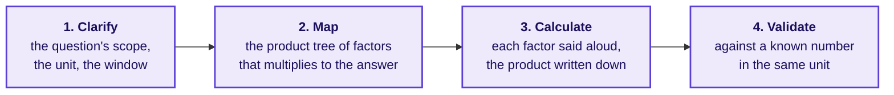
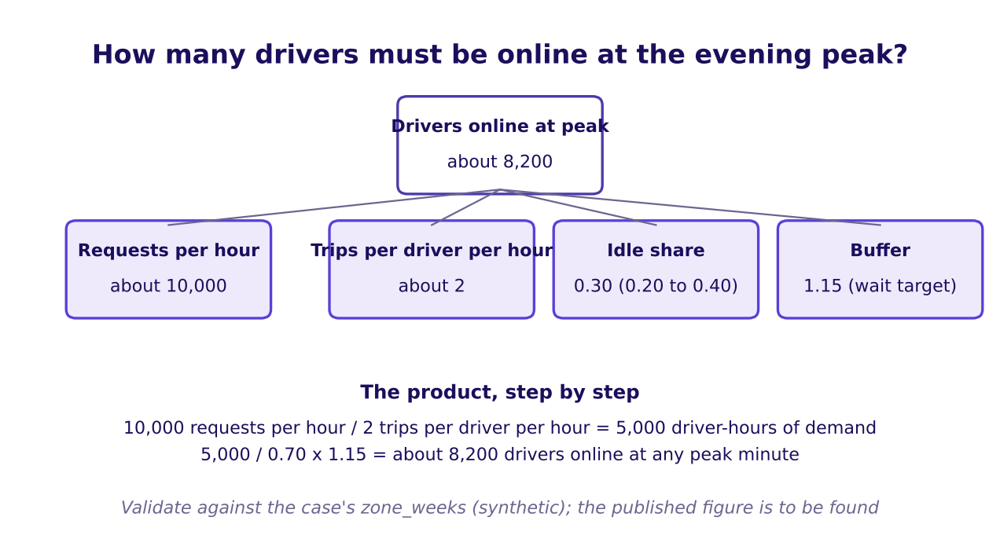
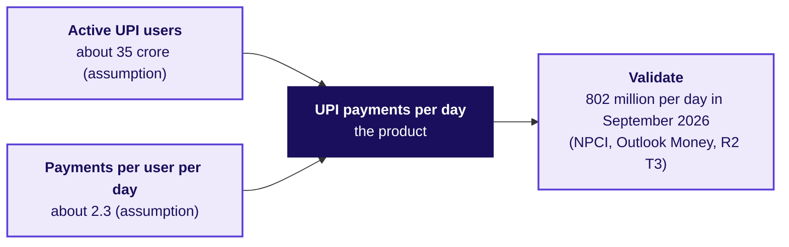
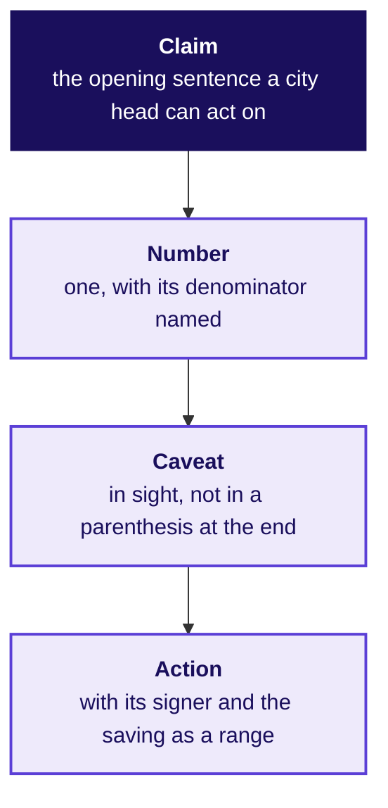

# The dojo, the written case, and two transcripts

Week 4, Day 2. Half two.

Kicker: WEEK 4  ·  TUESDAY  ·  AFTERNOON, 180 MINUTES
Quote: Before the review, roughly how many drivers must be online at the evening peak on a weekday to keep rider wait under five minutes. Fifteen minutes, no dataset, assumptions stated.
Who: The Hyderabad city head, Uber, to the senior analyst at 14:30

```notes
LIVE, 15 seconds. Half 2 runs the dojo (chapter 4), the paired guesstimate against the
clock, the AI-free written business case, and two transcripts. No new technique arrives;
every move was taught in Half 1 or is a step of the four-step guesstimate.
Transition: a prediction on an estimate the room has never heard.
```

---

## SECTION 4: How big is a number nobody has measured?
*What are the four steps, and what makes an estimate honest when there is no dataset?*

```notes
LIVE, 55 minutes: the warm-up (10, the canteen's cups of tea), the four steps (10), the
drivers-at-peak estimate worked together (25), the paired UPI estimate against the clock
(10). Chapter 4 is L5 of the ladder on an estimate rather than on a decision; the discipline
is the same as Monday's L5. Styles: Feynman (plain words first), StatQuest (round numbers
spoken aloud), explorable explanations (every assumption said and so moveable).
Transition: a chapter opener, four options.
```

---

## S23. Predict: which number is the sanity check?
*The chapter opens on the sanity check before the method is taught.*

**For a weekday evening peak in Hyderabad, which of the following is the sanity check you would want?**

- a) Monday's full after total of rider requests, 256,556 across six weeks
- b) A single after week's rider requests, about 42,000
- c) A one-hour evening count from the Monday rush, if we could find one
- d) The published total of registered drivers in Hyderabad (if any)

**Write your letter.** The reveal is after the four steps are taught.

```notes
LIVE, 3 minutes. Hands for each; write counts. Expect (b) and (c) to tie. The reveal shows
why (c) is the honest one if we had it: an evening peak is one hour of one day; everything
else is in a different unit. The point of the predict is that the sanity check sits in the
same unit as the estimate.
Transition: the warm-up, the canteen's cups of tea.
```

---

## S24. Answer: the canteen's tea, four steps, one toy
*What does the shape of a guesstimate look like when nothing is at stake?*

**On a weekday the campus canteen sells how many cups of tea?** The toy, invented for this class.

**Clarify.** Weekday, cups not litres, one canteen, not the whole campus. The room asks the question that pins the scope: a hostel or the canteen in the main building; which hours; whether to count cups re-ordered at the same seat.

**Map.** Students on campus on a weekday, about 2,000. Share who buy tea, about 60 percent. Cups per tea-drinker per weekday, about 2.

**Calculate.** 2,000 x 0.6 x 2 is 2,400 cups. Said aloud; written on the board as the three numbers get fixed.

**Validate.** Against the canteen's own till for the Monday the room is standing in, if it has one. If not, against a rough comparator the room agrees on (the next canteen; a hostel's recent order).

```notes
LIVE, 6 minutes. Walk the four steps aloud with the toy's numbers. Say: the four steps are
the shape of every estimate on this day and in every interview. Every assumption said so a
listener can push back. Invented numbers labelled as such on the slide.
Transition: the steps as a strip.
```

---

## S25. The four steps, as the dojo runs them
*What does the room hold on its sheet as every pair tries one?*



**The scorer's card for the dojo**: did the estimator clarify before mapping? did they say every assumption aloud? did they validate in the right unit? and did they give a range before the final number? The scorer marks the four moves and never the final number.

```notes
LIVE, 4 minutes. Point at each step. Say: an estimate is wrong when any one step is skipped;
calling it an estimate is not an excuse for not clarifying. Ask: in the canteen example,
which step pinned the scope? Expect: clarify. Which step is the one the room most forgets?
Expect: validate.
Transition: the city head's question, worked together.
```

---

## S26. Drivers online at the evening peak, worked
*What is the city head asking for, and what does the map look like?*



**Clarify.** Evening peak only (one of Monday's two peak windows). Hyderabad city, not Telangana. Drivers online, not drivers logged in; drivers at any single minute of peak, not across the three-hour window.

**Map.** Peak requests per hour. Trips per driver per peak hour. The idle share (the share of online drivers who are not on a trip at that moment). A small buffer so median wait sits under the target.

**Calculate, aloud.** About 10,000 requests per hour (said aloud as the assumption that pins the demand) / 2 trips per driver per hour (from Monday's 1.6 to 1.9) is about 5,000 driver-hours of demand each hour. With 30 percent idle (an assumption, range 20 to 40), divide by 0.70. Multiply by 1.15 for the wait buffer. **About 8,200 drivers at any peak minute, range 5,000 to 11,500.**

**Validate.** Against the case's own `zone_weeks` after window, the city received about 256,556 requests over 42 peak hours a week times six weeks, which is a density that lines up with the 10,000-per-hour assumption. Against a published figure of drivers online in Hyderabad: **to be found**. The research ledger does not hold one; the finishing session may fetch and date a primary source.

```notes
LIVE, 15 minutes. Build the map on the board with four nodes. For each factor, ask the room
for a value, write every answer, pick the one the room coalesces around, say it as an
assumption. Compute aloud, with rounding. Say the range. Point at the "to be found" slot and
name it: this is where a strong analyst goes looking before the review.
Transition: UPI, in pairs, against the clock.
```

---

## S27. UPI transactions a day, in pairs, seven minutes
*What is the paired drill, and what does the scorer watch for?*

**The paired estimate.** How many UPI transactions happen in India on an average day in September 2026? Seven minutes, in pairs, every assumption written on the sheet.



**The map.** About 35 crore active UPI users (an assumption said aloud). About 2 to 3 payments a day per active user, split between person-to-merchant and person-to-person. 35 crore times 2.3 is about 80.5 crore, which rounds to about 80 crore.

**The validate.** NPCI, through Outlook Money (verified 12 October 2026, R2 T3), reported 802 million per day on average in September 2026 and 24.07 billion in the month. **The catch**: a 30-day September against a 31-day October moves the monthly total by 3 percent, so a per-day figure is honest in a way a monthly total is not. Learners who divide the month by 31 get a lower per-day; the right unit is the per-day the source published.

```notes
LIVE, 10 minutes. Clock on at the slide; each pair hands in a sheet with its four steps. The
scorer card marks structure, not the final number (Aced, T2). The reveal is one minute at
the end: 80 crore sits within 2 percent of 802 million; the room reads this as a success of
the method, since no pair held the published figure.
Transition: two traps that the room would want to catch, before the written case.
```

---

## S28. The three traps a sanity check saves you from
*What goes wrong when the validate step is skipped or run in the wrong unit?*

| Trap | What a confident candidate says | What the sanity check does | Where this bites |
|---|---|---|---|
| The crowd mistaken for the household | "Hyderabad has about 9 million households" | A city of about 10 million people cannot hold 9 million households | A Kahoot item last week; a brochure number any analyst will fact-check soon |
| The validation in the wrong unit | Comparing journeys to boardings, one trip taken against one gate opened | A journey involves two gate openings on average | Delhi Metro's own figures, M6 |
| The published number read by a decimal | "Flipkart saw 63 million concurrent users in a minute" | The press release says 6.3 million; the URL slug reads 63 million | Flipkart stories, R2 T3 |

**Each trap is one skipped move**: clarify (crowds against households), validate (journeys against boardings), read (a decimal). The dojo's scorer marks the move; the room's estimates do not have to be close, only honest.

```notes
LIVE, 4 minutes. Walk one row at a time. Ask the room which move each trap skips. Expect
the right answer in each case; the point is that the scorer card maps each row to one move.
The decimal trap is the one the room is most likely to meet in a resume case; name it twice.
Transition: into chapter 5, the written case.
```

---

## SECTION 5: What goes on the one page to the city head?
*How does the slide's claim become a page a non-technical leader can read in two minutes?*

```notes
LIVE, 40 minutes individual, AI-free, handed in. Chapter 5 is L5 of the ladder in writing;
the dojo is L5 on an estimate. Each learner writes one page: the slide, longer, in sentences.
Style: Feynman (plain words first), Minto (the answer first).
Transition: the brief for the one page.
```

---

## S29. The brief for the one page
*What is asked of a page a city head reads in two minutes?*



**Audience.** The Hyderabad city head and the three roles in the review. Non-technical in parts: finance speaks rupees, driver operations speaks per-driver, marketing speaks sign-ups.

**Length.** One page, half the room is weak on English; a page is a sentence a reader can carry.

**Shape.** The claim first, as the opening sentence. The number with its denominator in the next sentence. The caveat in sight (a labelled hypothetical where it is not yet settled). The action in a sentence, the role who signs it, the saving in rupees over the six weeks the room has data for, as a range.

**AI-free.** Written on the sheet, 40 minutes. Handed in at the end of the slot; the trainer picks three for the solution discussion.

```notes
LIVE, 3 minutes. Read the four lines of the shape aloud. Say: a page that opens on method
has lost the city head by sentence two. The three the trainer will pick are the one that
opens on the claim, the one that handles the caveat best, and the one that names the action
with its signer. No learner names.
Transition: forty minutes on the clock.
```

---

## S30. The one page, written, forty minutes
*What is the writer doing, and what is the scorer looking for?*

**Each learner writes on the sheet.** No laptops; the sheet is the record. Every writer is a solo writer; a seatmate reads the finished page only after the slot closes.

**The scorer sheet** (handed with the one page, to the writer, after the slot):

- Claim as the opening sentence? Yes or no.
- Number named with its denominator? Yes or no.
- Caveat in sight (not in a parenthesis at the end)? Yes or no.
- Action named, with its signer and the saving as a range in rupees?
- Did the page avoid method words (regression, variance, ratio of sums, denominator) that a non-technical reader would not know?

**One mark per yes; three or more passes.** The three the trainer picks for the solution discussion are three different passes.

```notes
LIVE, 40 minutes silent writing. The trainer walks once in the first five minutes to answer
a scope question, once in the last five minutes to signal the clock. No teaching inside the
slot.
Transition: the transcripts.
```

---

## SECTION 6: What does the slide sound like, spoken?
*What does a weak answer open on, and what does a hire-grade answer open on?*

```notes
LIVE, 25 minutes. Chapter 6 is L6 of the ladder: the transfer. Two transcripts read in
pairs; the AI-company variant adds the move. Style: the case method as a transcript rather
than a card.
Transition: the first transcript, "present this to a non-technical leader".
```

---

## S31. Transcript 1: present it to a non-technical leader
*What are the first thirty seconds a hire-grade candidate opens on?*

**The interviewer.** "Present this recommendation to a non-technical leader in two minutes."

**A weak opening (what the interviewer hears).** "So we looked at the dashboard, there are nine numbers, and I ran a regression. Peak online hours are up 24 percent, trips are up 3 percent, trips per hour fell from 1.9 to 1.6, acceptance dropped. We think the scheme is paying for hours."

**A hire-grade opening.** "The peak scheme is paying for online hours that do not carry trips. For every ten rupees of gross bookings an online hour used to earn, it now earns eight. The redesign is to pay per completed peak trip, with an acceptance guardrail. On the data we have, this saves between Rs 58 lakh and Rs 93 lakh over six weeks."

**The three follow-ups the interviewer asks.**

1. "What is the one caveat you would say aloud before any decision is taken?"
2. "Which denominator did you choose, and what would make you choose a different one?"
3. "Which role in the review will side with you first?"

```notes
LIVE, 8 minutes. In pairs: one plays the interviewer, one plays the candidate. Each pair
reads the weak and hire-grade openings once, then the candidate attempts the three follow-ups.
Swap in five minutes. The scorecard the pair fills is in the trainer file; no learner marks
go on the slide.
Transition: the AI-company variant.
```

---

## S32. AI variant: acceptance rate in a sales deck
*What does the same shape sound like when the metric is an AI coding assistant's?*

**The setup.** A head of product at an AI coding-assistant company has quoted "acceptance rate of 32 percent" to the sales deck for a year. The product analyst wants to change the measure: retained-text at the next commit, with acceptance rate as a leading input and build failures and revert rate as guardrails.

**The objection.** "Acceptance rate is what customers see in the deck; cut it and the whole story changes."

**The partly-right part.** The objection is right that acceptance rate is what customers see, so it should stay in the deck. The redesign keeps it as a leading input, under a north star that cannot be gamed by accepting and deleting.

**A hire-grade reply.** "Acceptance rate stays in the deck as the leading input. The north star we optimise, and report by cohort, is suggested text still present at the next commit. The two guardrails that stop a game are build failures and revert rate. The transition is one quarter: both are reported, the deck still carries acceptance."

```notes
LIVE, 6 minutes. Read the setup, the objection, and the reply. Ask: which of Monday's three
objections is this most like? Expect: marketing's "the guarantee is the acquisition story",
because both keep the gamed proxy visible while the real north star does the paying. The
transfer is the same shape; the difference is the metric lives in a sales deck rather than
on a city hoarding.
Transition: the makeover gallery and the solution discussion.
```

---

## S33. The makeover gallery and the solution discussion
*What do the three slides the trainer picked show the room?*

**Three slides on the wall, kept from the morning's gallery.** One with the strongest claim as its title. One with the clearest in-sight caveat. One with the longest appendix, as a cautionary example.

**Three pages from the written case.** One opens on the claim, one handles the caveat best, one names the action with its signer.

**Fifteen minutes of discussion**: the room reads one slide and one page, then the trainer names the move in each (claim, caveat, action). No marks; the gallery is a mirror.

```notes
LIVE, 15 minutes. Hand the three slides and three pages around. Walk them in order. Say:
every one of these does one of the four things well; no one does all four, and that is the
point of the morning. Call out one trap on each (a stray method word, a caveat late, a
missing signer).
Transition: Kahoot, close, and tomorrow's pre-read.
```

---

## S34. Kahoot: eight items, no marks
*What does the room run before the day closes?*

**The Kahoot pack has eight items, used in the last fifteen minutes.** Five from the row (reworded with the city's numbers), one return question from Monday (the guardrail for a scheme that pays per trip), two more on the four moves of a defence and the sanity check. The trap item uses values other than 314 and 260 so the Kahoot cannot be answered by memorising the slide.

**No marks on a Kahoot in a build week.** The reader's leaderboard is a prompt, not a grade.

```notes
LIVE, 15 minutes. Run the eight items. After each, read one sentence of what it tested: the
title, the denominator, the four moves, the four steps, the Hyderabad crowd trap, the UPI
unit catch, the Delhi Metro unit trap, the Flipkart decimal trap. The Kahoot is in the
trainer pack; a learner never sees the key.
Transition: the handoff.
```

---

## S35. The handoff: tomorrow is the strip at Instamart
*What have you earned today, and what does the pre-read open on?*

**You earned today.** One slide the three roles in the review can repeat accurately. The four moves of a defence under three objections, each partly right. A number sized from nothing, with every assumption said aloud and validated against a published figure in the right unit. One page to the city head, AI-free, handed in.

**Tomorrow opens** on the Instamart cart page in Pune: three slots on the "frequently bought together" strip, a new ranking, and a click-through that fell. The pre-read on your sheet names the terms (support, confidence, lift) and lands them on no numbers yet.

```notes
LIVE, 2 minutes. Read the "You earned today" lines once. Point at the pre-read on the
sheet; nothing to do before the morning but open it on the bus home. Close with: the
afternoon dojo is the shape of every interview case the room will do in Weeks 15 and 20.
Transition: close.
```
