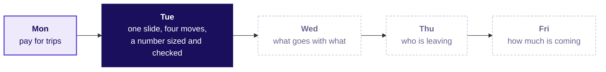

# Can the redesign survive one slide, and can a number be sized from nothing?

Week 4 · Tuesday · Analyst craft · Uber, Hyderabad, one day on
One claim, one number with its denominator, a caveat in sight and an action with its cost; then a number sized aloud and checked.
13 minute read · 4 figures

> Illustrative case: the company is real, the situation and the data are synthetic, built for this class.

## What can you do now that you could not do this morning?

**Who needs the answer.** You, deciding what to practise tonight. **The questions on the way.** Which
moves are new, and which come back every build week?

1. Turn a slide of nine numbers into one claim with one piece of evidence, its denominator named.
2. Read the same rupees three ways and say which read the decision needs, and why the others moved.
3. Answer an objection that is partly right in four moves without retreating or overclaiming.
4. Decide what leaves the slide and which person's appendix page it goes to.
5. Size a number from stated assumptions, give its range and the factor that sets it, and check it in the same unit.

## Where does today sit in the week and the programme?

**Who needs the answer.** Anyone explaining to a manager what Tuesday was for. **The questions on the
way.** What was worked, what was only mentioned, and what comes next?

**What this session covered.** Worked: the one-slide answer on the Uber case, rebuilt from three
cluttered slides; the three reads of gross bookings; two rounds of role-played defence; the
drivers-at-peak estimate and the paired UPI estimate; a one-page written case by hand. Mentioned
only: Amazon's six-page memo, the Delhi Metro's record day, Flipkart's muddled figure.

| | |
|---|---|
| In the subject | A number becomes a decision only when the person who loses under it can repeat it |
| In this programme | Monday wrote the metric; today puts it in front of the people it judges |
| In the work | The review where a metric replaces three departments' targets, and the round that opens "estimate this, aloud" |

The outcome tie: this is the moment in the capstone, the programme's final project, when you present a
finding to a panel in five minutes and take the first hostile question. Left out: slide design as a
craft and the theory of sizing whole markets; the guesstimate returns about once a month.

## What is the one picture to remember?

**Who needs the answer.** Anyone who has to rebuild a slide from memory. **The questions on the way.**
What are the four parts, and where do they sit?

Call it **the four-part slide**: the claim as the title, the evidence with its denominator, the caveat
beside it, the action with its cost and who signs.

The five lines to keep, as the afternoon deck closes on them: A slide carries one claim, one number
with its denominator, the caveat in sight and the action with its cost. Name the denominator before the
number. Answer an objection in four moves. Size a number in four steps, give the factor that drives
the range, and check it like for like. Check in the same unit, period and definition.

## What is the one claim, and which number carries it?

**Who needs the answer.** The Hyderabad city head, who has one slide and five minutes at Thursday's
city review. **The questions on the way.** What makes a title act? Which denominator does the slide
name? Why does one read rise while another falls?

Without a claim, a slide is a list the reader must decode. A claim is a sentence with a verb that a
reader can act on. A hostel notice reading "Breakfast survey results" is walked past; one reading
"Rotis replace rice at Monday breakfast, so the kitchen moves two staff to the roti line" gets two
staff moved (invented, and Minto's answer-first rule in miniature).

The denominator is a choice, and an auto driver shows why (invented): Rs 1,800 on Monday from 20
rides in 9 hours and Rs 1,800 on Tuesday from 18 rides in 12 hours is flat per day, up per ride (Rs 90
to Rs 100) and down per hour (Rs 200 to Rs 150).

The thread: gross bookings, what riders paid for peak trips. On Monday's twelve rows (six drivers, two
weeks) they fell 37 percent per online hour (Rs 313.5 to Rs 196.2), 23 percent per driver-week and not
at all per trip. On all driver-weeks they fell 17 percent per online hour (Rs 314 to Rs 260), rose 0.8
percent per active driver-week (Rs 5,817 to Rs 5,861) and held at Rs 165 per trip. A second route splits the fall: Rs 165 x 1.90 trips per hour
is Rs 313.5, and Rs 165 x 1.578 (230,900 / 146,300, printed 1.58) is Rs 260.4, so the fare held and the
whole fall is trips per hour.

> **WATCH OUT** · "Bookings per driver-week rose, so the guarantee works" is true to the rupee and
> wrong as a reason. Rupees per driver-week is rupees per hour times hours per driver-week: hours went
> from 18.6 to 22.5 a driver-week while each hour brought in 17 percent less, so the scheme bought
> hours. The 140 joiners drove about one week each at Rs 4,314, below the average, so they pulled the
> read down; the drivers there before the launch rose 1.4 percent. The tell: a read that rises while
> the read the scheme pays in falls.

> **IN THE FIELD** · Storytelling with Data's declutter makeover (4 January 2011) strips borders,
> gridlines and most markers and labels the lines directly, the moves of today's makeover.

> **CALLBACK** · Monday, chapter 2: trips per peak online hour fell from 1.90 to 1.58 while online
> hours rose 24 percent. Today's Rs 314 to Rs 260 is that fall in rupees.

Say it to a hostel warden: "An hour online used to bring in Rs 314 of fares and now brings in Rs 260,
because more of those hours have no rider." (The week's explorer, which ships with the week, draws
this in scenes T1 and T2.)

## Which objection is partly right, and which part?

**Who needs the answer.** The analyst whose slide must survive three roles who each lose something.
**The questions on the way.** What is each objection's true part? What are the four moves? What does a
failing defence sound like?

A defence that concedes nothing loses the room; one that concedes everything loses the claim. The four
moves: restate the objection until its owner agrees, answer from a named line of evidence, concede the
true part, say what would change your mind. Think of a referee explaining a decision to both captains:
the call stands, the replay is shown, the close part is admitted.

| Role | True part | Answered by |
|---|---|---|
| Driver operations: "drivers will log off" | The 180 idle-tail drivers will | The other 880, there before the launch, held at 1.90 trips per online hour |
| Marketing: "it looks like bait" | The hoarding promised a floor | The floor stays for drivers who accept; no joiner is in the idle tail |
| Finance: "it is the monsoon" | The season changed; last year's weeks are missing | With requests back at the before level, the last three weeks still ran at 1.56 trips an hour |

> **IN THE FIELD** · Amazon's 2017 letter to shareholders says its meetings use no slides: a
> six-page memo is read in silence at the start (letter filed 18 April 2018).

> **CALLBACK** · Week 1, Thursday: the four-part note (claim, evidence, caveat, action), now on one
> slide.

Say it to a hostel warden: "When someone pushes back, repeat their point, show your proof, admit what
they got right, and say what would change your mind."

## What leaves the slide, and where does it go?

**Who needs the answer.** The city head, who reads in five minutes, and the three roles, who each look
for their own question. **The questions on the way.** What stays? Where do the rest go? Can a caveat
leave?

Nine numbers become two: the chart of bookings per online hour and the 61 percent of the Rs 1.9 crore
top-up that went to driver-weeks accepting fewer than half their offers. Everything else goes to an
appendix page headed by the question one role will ask. The caveat never leaves: its owner finds it
in the drawer and calls the slide dishonest.

> **IN THE FIELD** · In 2018 the Delhi Metro reported "line utilisation", a trip across three lines
> counted three times, in place of ridership, and the press asked where ridership went (PTI, 30 May
> 2018). A number that leaves the slide goes to a named page, or readers assume it was hidden.

Say it to a hostel warden: "Keep the two numbers that make the point on the notice; put the rest in a
folder labelled with the question each one answers."

## How big is a number nobody has measured?

**Who needs the answer.** The city head, who wants drivers at the evening peak before data exists.
**The questions on the way.** What are the four steps? Which assumption sets the range? What can the
check confirm?

Clarify, map, calculate, validate. The chain: 1 crore people x 1 weekday Uber trip per 100 people x a
quarter of trips in the three evening hours = about 8,330 trips an hour; a busy driver fits 2.4 trips
an hour and 30 percent of online drivers have no rider, so each completes 1.68; 8,330 / 1.68 x 1.15 for
the busiest half hour is about 5,700 drivers. Counting trips, never riders, keeps a commuter who rides
both ways in the count. Trips per person moves the answer from about 2,900 to about 8,600 with
everything else held. Units: 1 lakh is 100,000; 1 crore is 10 million; 100 crore is 1 billion.

The case's data can check one ratio in the chain, like for like, and holds no city count: its twelve
zones used 0.53 online driver-hours per completed trip before the launch, when the median wait was 4.8
minutes, against the chain's 0.60. The chain runs about an eighth high, and at the case's 1.90 trips an
hour it gives about 5,000, so the checked answer is about 5,000 to 5,700. A published count of drivers
online at Hyderabad's evening peak has not been found.

> **WATCH OUT** · Dividing a day's trips by an hour's rate gives about 41,700 drivers, about seven
> times the chain. The tell: a unit that changes between factors without anyone saying so.

> **IN THE FIELD** · NPCI, which runs UPI, averaged 802 million transactions a day in September 2026
> (Outlook Money, 2 October 2026); 24.07 billion over 31 days would give 776 million. At about Rs 1,220
> a payment, large transfers between people sit inside the count.

Say it to a hostel warden: "Break the big number into small guesses you can defend, multiply, and check
against something counted the same way." (The week's explorer draws the chain in scene T3.)

## Where does this show up in the work?

**Who needs the answer.** Anyone wondering when they will use this. **The questions on the way.** Which
meetings, which costs?

- A metric review: a slide that cannot name its denominator hands each department a read to argue with.
- A funding decision before data exists, where an estimate with no range commits money to one point.
- An AI product whose acceptance rate rises while users delete what they accepted.

## Can you answer these without writing anything?

**Who needs the answer.** You, tonight. **The questions on the way.** Five checks, each pointing back
to a section.

1. Rs per active driver-week rose 0.8 percent. Is that evidence the guarantee works?
2. Which of the four moves do first defences skip?
3. Can the monsoon caveat move to the appendix?
4. Which factor sets the range of the drivers estimate?
5. From Monday: which guardrail catches drivers who accept only short trips?

Key: 1, no: each driver-week carried about four more online hours at 17 percent less per hour. 2, the
fourth, what would change your mind. 3, no: a caveat stays beside the evidence. 4, how often people
ride, in trips per 100 people. 5, the acceptance share.

## Where does this get tested?

**Who needs the answer.** Anyone with an analyst interview coming. **The questions on the way.** What
is asked, and what makes an answer weak? The tags are this programme's: [S] a staple asked everywhere,
[F] frequent in GCC and product screens, [D] a differentiator.

| Question | A strong answer | What makes it weak |
|---|---|---|
| [S] Present a recommendation to a non-technical leader in two minutes | The decision, the claim, one number with its denominator, what riders got, the caveat, the action with cost and signer | Opening on method and nine numbers |
| [S] How many drivers must be online at the evening peak? | Clarify, the formula, a range with its driving factor, a check like for like that moves the answer | A day's trips divided by an hour's rate: about 41,700 |
| [F] A stakeholder's objection is partly right; how do you answer it? | The four moves, the concession in the open | Retreating, or repeating the claim louder |
| [F] What do you leave off the slide, and where does it go? | Two elements stay; the rest go to pages headed by each role's question | "Everything goes in the appendix" |
| [D] The person who loses under your metric controls the meeting | Concede their true part, keep their number as a leading input, and agree the test and its deciding result before the meeting | Fighting for a clean sweep |

The AI-company variant: a coding assistant's deck quotes acceptance rate; keep it as a leading input,
and make suggested code still in the file seven days after acceptance the north star once a holdout
of users shows it tracks renewals.

## Which words did today use?

**Who needs the answer.** Anyone rereading a slide a month from now. **The questions on the way.** What
does each term mean?

| Term | Plain meaning | Example |
|---|---|---|
| Claim | The sentence the slide wants the reader to act on | The scheme pays for idle hours |
| Denominator | What a total is divided by | Per online hour, per driver-week, per trip |
| Gross bookings | What riders paid for trips, before Uber's share and any top-up | Rs 314 an online hour |
| Active driver-week | One driver with a row in the week's table | 6,360 before, 6,500 after |
| Caveat | What the evidence cannot show yet | The monsoon ended inside the window |
| Appendix page | A page behind the slide, headed by one role's question | Driver operations' page |
| Idle share | The share of online drivers with no rider at a moment | 0.30 in the chain |
| Floor | The Rs 300 guaranteed for each peak online hour | Rs 300 an hour |
| Top-up | What Uber pays to lift a driver's trip earnings up to the floor | Rs 1.9 crore in six weeks |
| Acceptance share | Requests a driver accepted over requests offered to them | 86 percent before, 73 percent after |
| Acceptance floor | The redesign's condition: accept at least half the requests offered | Half the offers |
| Idle tail | Monday's 180 drivers whose trips per online hour fell under 1.0; theirs are the weeks that accepted under half | 180 drivers |
| Guardrail | A number that must not get worse while the paid-for number rises | The median rider wait at peak |
| North star | The one number a scheme or a team is judged on | Completed peak trips per enrolled driver |
| Leading input | A number that moves first and can be acted on this week | Acceptance rate in the sales deck |
| Buffer | Extra drivers for the busiest half hour of the window | 1.15 in the chain |
| Index | A week's value over its before-window average, times 100 | 100 is "unchanged" |
| Sanity check | A comparison with a number counted the same way | 802 million a day |

## Where should you go next, and in what order?

**Who needs the answer.** Anyone with an evening to spend. **The questions on the way.** What to read,
how long each takes?

| Order | What | Time |
|---|---|---|
| 1 | Storytelling with Data, "what's the Big Idea?" (6 February 2014): https://www.storytellingwithdata.com/blog/2014/02/whats-big-idea (checked 12 October 2026) | 5 minutes |
| 2 | Storytelling with Data, "a new year's resolution: declutter your graphics": https://www.storytellingwithdata.com/blog/2011/01/new-years-resolution-declutter-your (checked 12 October 2026) | 5 minutes |
| 3 | Amazon's 2017 letter to shareholders, the memo section: https://www.sec.gov/Archives/edgar/data/1018724/000119312518121161/d456916dex991.htm (checked 12 October 2026) | 10 minutes |
