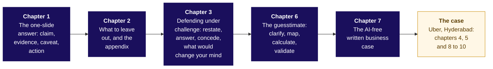
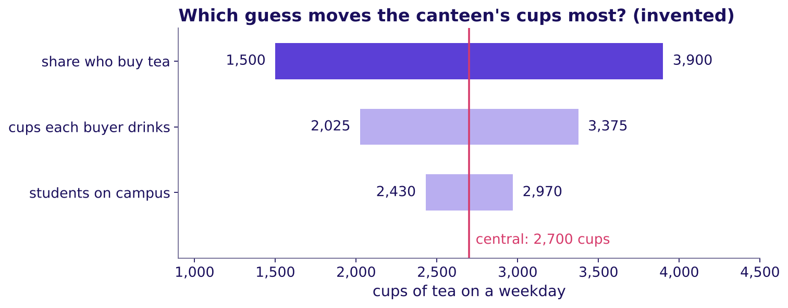
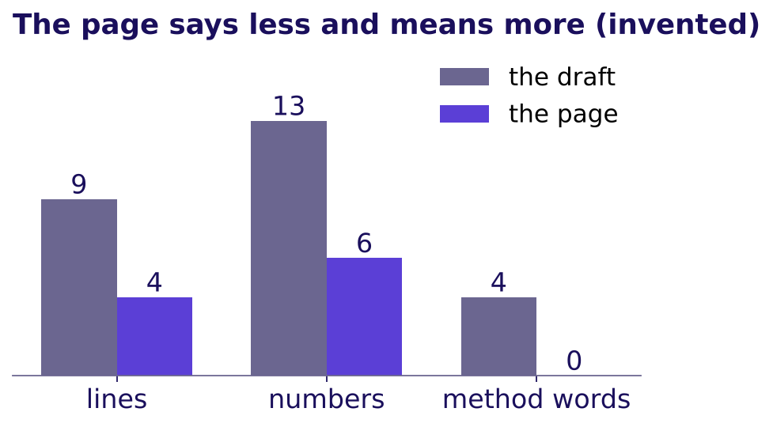

# Stakeholder communication: how does a decision survive one slide, one page and a number nobody has measured?

Week 4, Tuesday. About 13 minutes to read, and 10 more for the self-check.

Tuesday teaches five topics on invented examples small enough to count by hand: Ramesh's kirana shop,
Gulmohar Secondary School and a campus canteen. Then Uber's Hyderabad city head uses all five: one
slide, three objections, a number sized from nothing and one handwritten page. Illustrative case: the company is real, the situation and the
data are synthetic, built for this class.

---

## What can you do after Tuesday?

- Put a decision on one slide in four parts, and pick its evidence by the unit the decision buys.
- Decide what stays on the slide, which person's appendix page takes the rest, and why the caveat never leaves.
- Answer an objection that is partly right in four moves, conceding its true part out loud.
- Size a number nobody has measured in four steps, give its range, and check it like for like.
- Write the slide's four parts as four sentences on one page, by hand, in plain words.

## Which map holds the day?

Each topic leans on the one before it: say the claim, cut to it, hold it, size it, write it down.

---

## The one-slide answer: claim, evidence, caveat, action: what does a slide carry?

**Who needs the answer.** Ramesh (invented), who opened his kirana shop, a neighbourhood grocery, two
more hours a day from October and must decide whether they stay; later, the Uber city head, with one
slide and five minutes.

**The questions on the way.** What makes a title act? Which number is the evidence? Where do the
caveat and the action sit?

A slide with no claim makes every reader hunt for a point. A hostel notice reading "Breakfast survey
results" is walked past for a week; one reading "Rotis replace rice at Monday breakfast, so the
kitchen moves two staff from the rice counter to the roti line" gets two staff moved (invented). The
**claim** is that second kind of title: a sentence with a verb saying what is true and what to do.

The evidence is one number with its **denominator**, what the total is divided by, and the decision
picks it. Ramesh's shop (invented) sold Rs 11,900 a day in 10 hours in September and Rs 12,600 in 12
hours in October: per day up Rs 700, 5.9 percent, the son's sentence; per hour down from Rs 1,190 to
Rs 1,050, 11.8 percent, the father's; per customer flat at Rs 100. The decision buys two extra hours,
so divide by them: they sold at most Rs 350 each, against Rs 1,190 in an old hour. Sales are not
profit, and the shop's records hold no cost of goods, so whether the evening covers the helper's Rs 170
a day is still open.

The four parts, in the order a reader needs them: the **claim** as the title; the **evidence**, one
number divided by what the decision buys, with its window, or one chart; the **caveat** beside it,
what the evidence cannot show yet (a festival fortnight fell inside October); the **action**, with its
cost and who signs (keep the hours through November, count the evening's sales apart, decide after
thirty days; Rs 170 a day; Ramesh signs). The test: the person who loses under the slide can repeat it
while disagreeing.

> **WATCH OUT** · "Sales a day rose by Rs 700, so the longer hours work" reads Rs 700 of sales as if
> the hours earned all of it and the shop kept all of it.

**At Uber.** Chapter 4 reads the city's gross bookings the same three ways and puts Rs 314 to Rs 260
per peak online hour on the slide.

Say it to a hostel warden: "Put the decision in the title, one number that proves it, what you are
unsure of, and what to do with its cost."

## What to leave out, and the appendix: where does the rest go?

**Who needs the answer.** Ramesh (invented), who reads in five minutes, and two readers who each look
for their own question behind the slide: his son and the shop's accountant.

**The questions on the way.** How many elements stay? Where do the rest go? Can the caveat leave?

Ask three questions of every element on the draft: does the claim need it; if not, will a named person
ask about it; and is it the caveat, which stays whatever else happens. Of Ramesh's eight elements
(invented), three stay: the per-hour chart and sales per customer carry the claim, and the festival
fortnight is the caveat. The son's page ("did my extra hours at the counter bring customers?") takes
customers a day and his hours at the counter; the accountant's page ("what did the longer hours cost,
and what did they bring?") takes the four weeks' totals and the helper's wage; the rain days, two in
each month, leave. The **appendix** is those pages, shown only when someone asks.

A chart obeys the same rule. Storytelling with Data's declutter post (4 January 2011, checked 13
October 2026) asks of every element, "Is it adding any informative value? If the answer is no, then
take it out!" Six series, a legend and a grid become one line with a few short labels.

> **WATCH OUT** · "The slide is crowded, so the caveat goes to the appendix." An owner who finds the
> caveat in the drawer calls the slide dishonest; something else leaves instead.

**At Uber.** Nine dashboard numbers become two, and each of the three roles gets one appendix page
headed by its own question (chapters 4 and 5).

Say it to a hostel warden: "Keep the point and the doubt on the notice; file the rest under the
question each sheet answers."

## Defending under challenge: restate, answer, concede, what would change your mind: how do you hold a claim?

**Who needs the answer.** A teacher at Gulmohar Secondary School (invented) who claims the new
timetable, from week 3, raised attendance, and the headmaster, who decides whether it stays.

**The questions on the way.** Which part of the objection is true? Which evidence answers the rest?
What does a full defence sound like?

The sports teacher objects: "Attendance rose because the exams began." She is partly right. In both
years the exam weeks run about 8 points above the three weeks before them: 8.3 last year, 8.0 this
year. Weeks 3 to 5 this year sit 4.7 points above last year's same weeks, before any exam, and weeks 1
and 2 sit at 76.5 in both years. The concession carries the 8 points and the answer the 4.7.

The four moves: **restate** the objection until its owner agrees with your version; **answer** from a
named line of the evidence; **concede** the true part out loud; say **what would change your mind**,
so the claim can be tested. Restating comes first, as in Rapoport's rules, the philosopher Daniel
Dennett's guide to criticising an argument fairly (The Marginalian, 6 October 2026, checked 13
October 2026). A defence fails two ways: overclaiming concedes nothing ("exams are
irrelevant"), and retreating concedes everything ("let us wait a term").

**At Uber.** Chapter 5 finds each role's true part in the case's tables:

| Role | True part | Answered by |
|---|---|---|
| Driver operations: "drivers will log off" | The 180 idle-tail drivers will | The other 880, there before the launch, held at 1.90 trips per online hour |
| Marketing: "it looks like bait" | The hoarding promised a floor | The floor stays for drivers who accept; no joiner is in the idle tail |
| Finance: "it is the monsoon" | The season changed; last year's weeks are missing | With requests back at the before level, the last three weeks still ran at 1.56 trips an hour |

Say it to a hostel warden: "Repeat their point, show your proof, admit what they got right, and say
what would change your mind."

## The guesstimate: clarify, map, calculate, validate: how big is an unknown?

**Who needs the answer.** The campus canteen's head (invented), who must order milk for a weekday
before any till report exists, and any interviewer who asks for a number aloud.

**The questions on the way.** What exactly is counted? Which guess sets the range? Is the answer sane?

**Clarify** the unit, the period and what counts: one canteen, one weekday, cups of tea. **Map** a chain
that multiplies out in that unit: students x the share who buy x cups each. **Calculate** aloud: 3,000
students, then 1,350 who buy at 0.45, then 2,700 cups at 2 each. Moving one guess at a time to its
ends, the share who buy moves the answer from 1,500 to 3,900, wider than either other guess, so it is
the one to count first. **Validate** against a number counted the same way: the till averages 2,340
cups a weekday, so the chain runs 15.4 percent high and the share that lands on the till is 0.39.

A check counts only in the same **unit**, **period** and **definition**: a town of 24,000 people
(invented) has about 6,000 households, never 96,000; a 28-day pack of 1.5 GB a day (42 GB) and a 30-day
month (45 GB) match per day; Gulmohar's 113 passes are 83.7 percent of the 135 who sat and 75.3 percent
of the 150 enrolled. Think Insights' guide (3 December 2018, checked 13 October 2026) says the
interviewer is "interested in your thought process; not the final result".

> **WATCH OUT** · A careful chain can multiply a unit it should divide; the tell is a factor whose
> unit nobody wrote down.

**At Uber.** Chapter 8 sizes drivers online at the weekday evening peak at about 5,700, checks the
chain's driver-hours per trip against the case's own, and says about 5,000 to 5,700, inside the 2,900
to 8,600 that trips per person sets.

Say it to a hostel warden: "Break the big number into small guesses you can defend, multiply, and check
against something counted the same way."

## The AI-free written business case: what must a page carry?

**Who needs the answer.** Ramesh (invented), reading his son's page alone in the evening, and the city
head, reading the page each learner writes by hand in chapter 9.

**The questions on the way.** Which opening does the reader act on? What goes on the page, in what
order? Which words stay off it?

A **business case** says what to do, why, what it costs and what could go wrong, on one page because
the reader has two minutes, and AI-free because it shows your own thinking. The son's draft (invented)
ran nine lines, 13 numbers and four method words; the page runs four sentences, checked by five rules:
the claim first, with what to do and why; one number, what it is divided by and its window; the caveat
before the action; the action with its cost in rupees and weeks and who signs; and no method word.

The plain words: "divided by" for denominator, "compared with the month before" for index, "a number
that must not get worse" for guardrail, "the one number the team is judged on" for north star.
Amazon's 2017 letter to shareholders (filed 18 April 2018, checked 13 October 2026) says its meetings
use no slides: a six-page memo is read in silence at the start.

**At Uber.** In chapter 9 each learner writes the page to the city head by hand in 35 minutes and hands it in.

Say it to a hostel warden: "Write what to do and why first, one number second, the doubt third and
the cost last."

---

## The case: what does the city head take to Thursday's review?

**Who needs the answer.** The Hyderabad city head, who must keep, end or change the peak-hour earnings
guarantee. **The questions on the way.** Which number carries the slide? Which objections hold? How
many drivers does the evening peak need?

Since the launch on 31 August 2026, peak online hours rose 24 percent while completed peak trips rose 3
percent. Gross bookings (what riders paid) fell 17 percent per peak online hour, Rs 314 to Rs 260, rose
0.8 percent per active driver-week and held at Rs 165 per trip, so the whole fall is trips per hour: Rs
165 x 1.90 is Rs 313.5, and Rs 165 x 1.578 is Rs 260.4.

> **WATCH OUT** · "Bookings per driver-week rose, so the guarantee works." Hours per driver-week went
> from 18.6 to 22.5 while each hour brought in 17 percent less: the scheme bought hours. The rise sits
> with the other 880 drivers there before the launch, who drove about 4 percent more hours at an
> unchanged Rs 313.5 an hour; the idle tail's 180 drivers doubled theirs while completing 12 percent
> fewer trips.

74 percent of the idle money sat in the three outer zones, whose median wait fell furthest, from 6.6 to
about 6 minutes, so the redesign watches the wait zone by zone. Across the enrolled drivers it saves Rs
58 lakh to Rs 92.7 lakh over six weeks if a half to a fifth of that money is still paid; the per-trip
rate, not yet set, can move it within that range or beyond it.

The drivers estimate: 1 crore people x 1 weekday Uber trip per 100 people x a quarter in the three
evening hours is about 8,330 trips an hour; each online driver completes 2.4 x (1 - 0.30 idle) = 1.68
an hour; 8,330 / 1.68 x 1.15 for the busiest half hour is about 5,700, and trips per person alone moves
it from 2,900 to 8,600. The case's drivers are a slice, about 581 online in an average peak hour after
the launch, so they check a ratio, never the city's count:
0.53 online driver-hours per trip, pooled over both daily peaks, against the chain's 0.60, so the chain
runs an eighth high. Say about 5,000 to 5,700 inside that wider range. A day's trips over an hour's rate
gives about 41,700. No published count of drivers online at Hyderabad's evening peak has been found.
Units: 1 lakh is 100,000; 1 crore is 10 million.

## Can you answer these without notes?

1. Ramesh's sales a day rose Rs 700. Is that the evidence for keeping the longer hours?
2. The slide is crowded. Can the caveat move to the appendix?
3. Which of the four moves do first defences skip?
4. Which known number checks the canteen's weekday estimate?
5. Where on a one-page case does the caveat sit?
6. From Monday: which guardrail catches drivers who accept only short trips?

Key: 1, no: Rs 700 is sales, partly the festival, and the two added hours sold at most Rs 350 each
against Rs 1,190 in an old hour, so count the evening first. 2, no: the caveat stays and something else
leaves. 3, the fourth, what would change your mind. 4, the till's average weekday, 2,340 cups: same
unit, period and definition. 5, before the action. 6, the acceptance share.

## Which interview questions does Tuesday prepare you for?

The programme's tags: [S] a staple, [F] frequent in global capability centre (GCC) and product
screens, [D] a differentiator.

| Question | A strong answer | What makes it weak |
|---|---|---|
| [S] Present a recommendation to a non-technical leader in two minutes | The claim, one number with its denominator, the caveat, the action with cost and signer | Opening on method and nine numbers |
| [S] How many drivers must be online at the evening peak? | Clarify, the formula, a range with its driving factor, a like-for-like check that moves the answer | A day's trips divided by an hour's rate |
| [F] A stakeholder's objection is partly right; how do you answer it? | The four moves, the concession in the open | Retreating, or repeating the claim louder |
| [F] What do you leave off the slide, and where does it go? | What the claim needs stays; the rest goes to pages headed by each role's question | "Everything goes in the appendix" |
| [D] The person who loses under your claim controls the meeting | Concede their true part, keep their number on the page, and agree the deciding test beforehand | Fighting for a clean sweep |

The AI-company variant: a coding assistant's deck quotes acceptance rate; keep it as a leading input,
and judge the team on suggested code still in the file seven days after acceptance, per paid seat, once
last year's renewals show that number tracks them better.

## Which words did Tuesday use?

| Term | Plain meaning | Example |
|---|---|---|
| Claim | The sentence the slide wants the reader to act on | The scheme pays for idle hours |
| Denominator | What a total is divided by | Per hour, per day, per customer |
| Caveat | What the evidence cannot show yet | A festival fortnight fell inside October |
| Appendix page | A page behind the slide, headed by one reader's question | The accountant's page |
| Objection | The reason a listener gives for not accepting a claim | "Attendance rose because the exams began" |
| Concede | To say an objection's true part out loud | The exams add about 8 points |
| Guesstimate | A rough count of something nobody has measured | Cups of tea on a weekday |
| Range | The lowest and highest answer you would still defend | 1,500 to 3,900 cups |
| Check | A number counted in the same unit, period and definition | The till's 2,340 cups |
| Business case | A written argument for a decision | Ramesh's four sentences |

## Where should you read next, and how long does each take?

| Order | What | Time |
|---|---|---|
| 1 | Storytelling with Data, "a new year's resolution: declutter your graphics": https://www.storytellingwithdata.com/blog/2011/01/new-years-resolution-declutter-your (checked 13 October 2026) | 5 minutes |
| 2 | Storytelling with Data, "what's the Big Idea?" (6 February 2014): https://www.storytellingwithdata.com/blog/2014/02/whats-big-idea (checked 12 October 2026) | 5 minutes |
| 3 | Amazon's 2017 letter to shareholders, the memo section: https://www.sec.gov/Archives/edgar/data/1018724/000119312518121161/d456916dex991.htm (checked 13 October 2026) | 10 minutes |
