# Day sheet, Week 4 Tuesday: which five topics does the day teach, and can the redesign survive one slide and a number sized from nothing?

**TRAINER ONLY.** This page carries the keys, the traps with their exact wrong numbers and the
interview answers in one breath. Nothing on it reaches a learner before the close.

Posts to <!-- sync:module:W04/D2 -->Module 2: Applied Machine Learning<!-- /sync:module:W04/D2 -->, on <!-- sync:day-date:W04/D2 -->Tue 27 Oct 2026<!-- /sync:day-date:W04/D2 -->.

<!-- sync:faculty-day:W04/D2 -->
No IITGN faculty block on this day.
<!-- /sync:faculty-day:W04/D2 -->

With no block today, the trainer holds all 360 minutes: the morning's 180 and the afternoon's 180, then
the TA-led lab. The approved spine, `docs/detailing/W04_analyst_craft_spine.md`, section 6, sets the
day, and the case is `docs/detailing/W04_case_file.md`, Tuesday. Since the concept-first rebuild of 13
October 2026 the row's five subtopics are taught first, each as its own chapter on an invented example
(Ramesh's kirana shop, Gulmohar Secondary School, a campus canteen), and the Uber case applies them;
the case's numbers, traps and transcripts are unchanged.

**The case, in one paragraph.** Uber, Hyderabad, the driver app's peak-hour earnings guarantee, one day
on (illustrative: the company is real, the situation and the data are synthetic). Since the launch on
31 August 2026, gross bookings per peak online hour fell from Rs 314 to Rs 260 while the fare held at
Rs 165; per active driver-week they rose 0.8 percent (Rs 5,817 to Rs 5,861); per trip they held. The
city head takes Monday's redesign (pay per completed peak trip, with an acceptance floor) to Thursday's
city review on one slide, in five minutes, with the driver-operations lead, the marketing lead and the
finance partner in the room. In the afternoon the city head asks how many drivers must be online at
the weekday evening peak to keep median wait under five minutes, sized without data.

## Which topics does Tuesday teach, in what order, and where?

**Who needs the answer.** The trainer, who teaches each topic by its curriculum name before the case
uses it. **The questions on the way.** Which chapter teaches which subtopic? Which slides, notebook,
items and minutes go with it? Which case chapter applies it?

This is the coverage matrix's first table, from `internal/C2_W04_D02_coverage_INTERNAL.md`:

| # | Subtopic (verbatim from the row) | Name in the chapter title and the notebook | Chapter | Slides | Notebook | Exercise items | Kahoot items | Minutes |
|---|---|---|---|---|---|---|---|---|
| 1 | The one-slide answer: claim, evidence, caveat, action | The one-slide answer: claim, evidence, caveat, action | SECTION 1: The one-slide answer: claim, evidence, caveat, action: what does a slide carry? | half1 S6 to S13 | notebooks/C2_W04_D02_01_one_slide_answer_STUDENT.ipynb | ch1_one_slide_answer Q1 to Q5; slide_and_estimate Q1, Q2; interview_rungs Q1 | Q1 | 35 |
| 2 | What to leave out, and the appendix | What to leave out, and the appendix | SECTION 2: "What to leave out, and the appendix": where does the rest go? | half1 S14 to S19 | notebooks/C2_W04_D02_02_leave_out_and_appendix_STUDENT.ipynb | ch2_leave_out_appendix Q1 to Q3; mid_cut_to_two Q1, Q2 | Q2 | 12 |
| 3 | Defending under challenge: restate, answer, concede, what would change your mind | Defending under challenge: restate, answer, concede, what would change your mind | SECTION 3: Defending under challenge: restate, answer, concede, what would change your mind: how do you hold a claim? | half1 S20 to S27 | notebooks/C2_W04_D02_03_defending_under_challenge_STUDENT.ipynb | ch3_defending_under_challenge Q1 to Q4; studio_brief Q1; interview_rungs Q2 | Q3 | 25 |
| 4 | The guesstimate: clarify, map, calculate, validate | The guesstimate: clarify, map, calculate, validate | SECTION 6: The guesstimate: clarify, map, calculate, validate: how big is an unknown? | half2 S56 to S63 | notebooks/C2_W04_D02_06_guesstimate_clarify_map_calculate_validate_STUDENT.ipynb | ch6_guesstimate Q1 to Q6; slide_and_estimate Q3; mid_check_against Q1 to Q4; kalpa_store Q1, Q2 | Q4, Q5, Q6 | 30 |
| 5 | The AI-free written business case | The AI-free written business case | SECTION 7: The AI-free written business case: what must a page carry? | half2 S64 to S69 | notebooks/C2_W04_D02_07_written_business_case_STUDENT.ipynb | ch7_written_case Q1 to Q3 | Q8 | 10 |

The case chapters, and the topics each applies:

| Chapter | Applies (the # of each subtopic) | Slides | Notebook |
|---|---|---|---|
| SECTION 4: Uber's slide, rebuilt with the one-slide answer and what to leave out: which number carries it? | 1, 2 | half1 S28 to S43 | notebooks/C2_W04_D02_04_case_one_slide_answer_three_denominators_STUDENT.ipynb |
| SECTION 5: Uber's three objections, answered by defending under challenge and the appendix: which objection holds? | 2, 3 | half1 S44 to S54 | notebooks/C2_W04_D02_05_case_defending_under_challenge_evidence_STUDENT.ipynb |
| SECTION 8: Drivers at Uber's evening peak, sized by the guesstimate: how many at the peak? | 4 | half2 S70 to S82 | notebooks/C2_W04_D02_08_case_guesstimate_drivers_at_peak_STUDENT.ipynb |
| SECTION 9: The page to the city head, an AI-free written business case: what goes on one page? | 1, 5 | half2 S83 to S85 | none |
| SECTION 10: The interview room, with the one-slide answer and the guesstimate spoken: what does it sound like? | 1, 3, 4 | half2 S86 to S93 | none |

Chapters 9 and 10 have no notebook: the page is written by hand with laptops closed, and the interview
room is spoken. The lab's notebook 11 applies topics 4 and 1 to Kalpa.

## How do the five topics join, and to what?

**Who needs the answer.** The trainer, drawing the board at S4 and filling one box at each concept
chapter's close. **The questions on the way.** What does each topic rest on, and where is it applied?

```mermaid
flowchart LR
    K["<b>Already in the room</b><br/>Weeks 1 and 2: the four-part note; a rate names its denominator. Monday: the metric, and who loses under it"]
    subgraph today["Tuesday's five topics, in the curriculum's order"]
        direction LR
        T1["<b>1 · The one-slide answer: claim, evidence, caveat, action</b><br/>chapter 1"]
        T2["<b>2 · What to leave out, and the appendix</b><br/>chapter 2"]
        T3["<b>3 · Defending under challenge: restate, answer, concede, what would change your mind</b><br/>chapter 3"]
        T4["<b>4 · The guesstimate: clarify, map, calculate, validate</b><br/>chapter 6"]
        T5["<b>5 · The AI-free written business case</b><br/>chapter 7"]
        T1 --> T2 --> T3 --> T4 --> T5
    end
    C["<b>Applied to</b><br/>Uber, Hyderabad: chapters 4, 5 and 8 to 10; Kalpa in the lab; then every build week"]
    K --> today
    today --> C
    classDef lit fill:#1A0F5C,stroke:#1A0F5C,color:#FFFFFF
    classDef known fill:#EEEAFB,stroke:#5B3FD6,color:#1A0F5C,stroke-width:2px
    class K,C known
    class T1,T2,T3,T4,T5 lit
```

## How did the minutes move in the concept-first rebuild?

**Who needs the answer.** The trainer who ran the merged pack, or reads its run sheet. **The questions
on the way.** Where did the concept chapters' 112 minutes come from, and does the day still hold 360?

| Part | Before, the merged pack | After, concept first |
|---|---|---|
| Opening: the topic, the week map, the topics, the concept map, the ticket | 15 | 5 |
| Concept chapters 1 to 3, on the kirana shop and the school | 0 | 72 |
| Uber's slide (was chapter 1, now chapter 4) | 45 | 40 |
| Uber's objections, round one and the drawer (was chapters 2 and 3, now chapter 5, with the morning's close) | 70 | 53 |
| Studio round two | 40 | 20 |
| Concept chapters 6 and 7, on the canteen and Ramesh's page | 0 | 40 |
| The drivers estimate and UPI (was chapter 4, now chapter 8) | 65 | 37 |
| The page to the city head (was chapter 5, now chapter 9) | 40 | 35 |
| The interview room (was chapter 6, now chapter 10) | 25 | 12 |
| Close: pain points, Kahoot, tomorrow; the gallery cut | 40 | 20 |
| Breaks | 20 | 20 |
| Slack, the first cut | 0 | 6 |
| **Total** | **360** | **360** |

The morning runs 5 + 35 + 12 + 25 + 10 (break) + 40 + 53 = 180; the afternoon runs 20 + 30 + 10 + 37 +
10 (break) + 35 + 12 + 20 + 6 = 180.

## Which questions does Tuesday ask, in what order?

**Who needs the answer.** The trainer, who asks each question before its answer is shown. **The
questions on the way.** What is the day's question? Which chapter asks which smaller one? What does
the close answer?

The day's question, in the room's words: **will the slide survive the people who lose under it, and
can I size a number from nothing and know it is sane?**

| Part | Its question | The smaller questions | Evidence |
|---|---|---|---|
| Opening, 5 min | Which five topics, and where is each used? | What did Monday hand on? What does the ticket ask? | The concept map on the board |
| Chapter 1, 35 min, concept | What does a slide carry? | Which title acts? Which denominator prices the decision? What are the four parts? | Letters on S7; the son's title said aloud |
| Chapter 2, 12 min, concept | Where does the rest go? | How many of eight stay? Can the caveat leave? Does a chart obey the rule? | Letters on S15 |
| Chapter 3, 25 min, concept | How do you hold a claim? | Which reply wins? Which part of the objection is true? What are the four moves? | Votes and revotes on S21 |
| Chapter 4, 40 min, L1 and L2 | Which number carries Uber's slide? | What does each role lose? Which title acts? Which two of nine numbers? Which denominator? Why does per driver-week rise? | Slides B and C rebuilt; letters for S31, S34, S39 |
| Chapter 5, 53 min, L3 to L5 | Which objection holds? | Each true part; the four moves, modelled and practised; what goes behind the slide | Scorer cards from round one; the cut-to-two letters |
| Round two, 20 min | Can the slide survive with the seats swapped? | Which move helped most? | Rebuilt slides |
| Chapter 6, 30 min, concept | How big is an unknown? | Who scores higher? Which guess sets the range? Is the answer sane? | Votes on S57 |
| Chapter 7, 10 min, concept | What must a page carry? | Which opening acts? Which words stay off? | Letters on S65 |
| Chapter 8, 37 min, L5 | How many drivers at the evening peak? | Which number checks it? What does the chain give? What can the case data check? | The chain on the board; UPI sheets |
| Chapter 9, 35 min, L5 | What goes on one page to the city head? | Claim, number, caveat, action, in sentences | Handed-in pages |
| Chapter 10, 12 min, L6 | What does it sound like in an interview? | Transcript 1 scored in pairs | Pair scores |
| Close, 20 min | Pain points, Kahoot, tomorrow | Which move does the room still miss? | Kahoot results |

**The day's answer, at the close.** The S93 sentence: "The scheme is paying for online hours that carry
no trips: Rs 314 to Rs 260 per peak online hour at a flat Rs 165 fare. Part of it may be the monsoon.
Test paying per completed peak trip with an acceptance floor: city-wide, it saves Rs 58 lakh to Rs 92.7
lakh over six weeks if a half to a fifth of the idle drivers' top-up is still paid. At the evening peak
the city needs about 5,000 to 5,700 drivers online, and how often people ride could move that from
2,900 to 8,600."

## What does Tuesday cover, and where does it stop?

**Who needs the answer.** The trainer, before the open. **The questions on the way.** Where does the
day start, how far does it go, what does it never do, what comes later, and what goes first?

| | |
|---|---|
| Start from | Monday's definition (completed peak trips per enrolled driver per week, three guardrails) and the Week 1 four-part note |
| Go as far as | Every topic taught by its curriculum name on an invented example, then every learner presents once, objects once, scores once, sizes one estimate with its check, and hands in the written case |
| Stop before | Slide design as a craft, storytelling frameworks, market-sizing theory; any A/B content, which stays with Monday's faculty block |
| Comes later | Every build week ends on this slide and this defence; the guesstimate returns about once a month; Wednesday opens on its five topics, then Swiggy Instamart's strip |
| Cut first | The slack, then the paired UPI guesstimate (the row's own cut), then round two's rebuild minutes, then the transcripts' live minutes. Never a concept chapter, the role-played defence or the written case |

## How do the minutes run, block by block?

**Who needs the answer.** The trainer and the TA, holding the clock. **The questions on the way.**
Which slide runs when, which file sits beside it, and what must land?

| Minutes | Slides | Beside it | What must land |
|---|---|---|---|
| 5 | S1 to S5 | The concept map, drawn on the board | The five topics by name; the ticket as the destination |
| 35 | SECTION 1, S6 to S13 | `notebooks/C2_W04_D02_01_one_slide_answer_STUDENT.ipynb`; the chapter 1 set's Q1 | The claim as a sentence; the denominator picked by the decision; the four parts named last |
| 12 | SECTION 2, S14 to S19 | Notebook 02; the chapter 2 set's Q1 | Three of eight stay; the caveat never leaves |
| 25 | SECTION 3, S20 to S27 | Notebook 03; the chapter 3 set's Q1 | Concede the exams' 8 points, answer with the 4.7; the four moves named last |
| 10 | Break | | |
| 40 | SECTION 4, S28 to S43 | Monday's role cards (`content/W04/D1/trainer/C2_W04_D01_role_cards_TRAINER.md`); `exercises/guided/C2_W04_D02_slide_and_estimate_STUDENT.md`; notebook 04 | Each role's loss on the board; slide A rebuilt; the denominator named; the per-driver-week rise explained by hours |
| 53 | SECTION 5, S44 to S54 | `trainer/C2_W04_D02_studio_TRAINER.md`; scorer cards; `exercises/unguided/C2_W04_D02_mid_cut_to_two_STUDENT.md`; notebook 05 | Each objection's true part; the modelled defence; three turns in threes; one appendix page per role |
| 20 | S55 | The studio run sheet | Round two with the seats swapped |
| 30 | SECTION 6, S56 to S63 | Notebook 06; the chapter 6 set's Q1 | The four steps on the canteen; the range and its factor; the till check; unit, period, definition |
| 10 | SECTION 7, S64 to S69 | Notebook 07; the chapter 7 set's Q1 | Four sentences; the caveat before the action; plain words |
| 37 | SECTION 8, S70 to S82 | `trainer/C2_W04_D02_guesstimate_TRAINER.md`; `exercises/unguided/C2_W04_D02_paired_estimate_STUDENT.md`; notebook 08 | The chain aloud; the range and its factor; the like-for-like check, which moves the answer to 5,000 to 5,700 |
| 10 | Break | | |
| 35 | SECTION 9, S83 to S85 | `exercises/unguided/C2_W04_D02_written_case_STUDENT.md` | Silent writing, handed in |
| 12 | SECTION 10, S86, S87, S90 | `extras/C2_W04_D02_interview_room_STUDENT.md`; `trainer/C2_W04_D02_interview_scorecards_TRAINER.md` | Weak against hire-grade, scored in pairs; D88 and D89 are the evening's reading |
| 20 | S91 to S93 | `kahoot/C2_W04_D02_quiz_STUDENT.md` | Pain points; retrieval; the day's sentence; Wednesday's pre-read ships |
| 6 | Slack | | The first cut when the day runs long |

## Which traps does the day stage, with their exact wrong numbers?

**Who needs the answer.** The trainer, who stages each one before its reveal. **The questions on the
way.** What is the wrong number, what decision would it mislead, and what catches it?

| Where | The plausible wrong answer | The decision it misleads | The check and the fix |
|---|---|---|---|
| S12 | "Sales a day rose from Rs 11,900 to Rs 12,600, so the longer hours work" (invented) | Ramesh keeps paying the helper for two hours nobody priced | Name the unit the decision buys: per hour, Rs 1,190 to Rs 1,050 |
| S16 | The festival caveat moved to the appendix of a crowded slide (invented) | The son finds it there and calls the slide dishonest | The caveat stays; something else leaves |
| S25 | "Exams are irrelevant; the timetable did it", or "let us wait a term" (invented) | The staff room turns, or a term of the old timetable | Did the reply name the true part and the line of evidence? |
| S31, S33, S34 | A title that reports numbers ("Top-up Rs 1.9 crore, 61 percent..."), or slide A led by "online hours up 24 percent" | The city celebrates supply and extends the scheme | Ask what the reader should do; rewrite as a claim with a verb |
| S39 to S41 | "Bookings per driver-week rose from Rs 5,817 to Rs 5,861, so it works", or "the 140 new drivers lifted it" | Keep the guarantee as it is and keep paying idle hours | Rupees per driver-week is rupees per hour x hours per driver-week: 18.6 to 22.5 hours at 17 percent less per hour; the joiners, at Rs 4,314 a driver-week, pulled it down; read per peak online hour, Rs 314 to Rs 260 |
| S45, S46 | "Rider requests rose 1.8 percent, so it is not the monsoon" | Finance points at four weeks of falling requests and the slide loses | The last three weeks: requests back inside the before range, trips per hour still 1.56 |
| S49 | A defence that concedes nothing, or one that concedes the claim | The slide is rejected, or six more weeks of the same top-up | The scorer's card: restate, answer, concede, what would change your mind |
| S51 | The monsoon caveat moved to the appendix | Finance finds it there and calls the slide dishonest | The caveat stays beside the evidence; detail goes to the drawer |
| S57, S62 | "About 2,350 cups", with no chain; a town of 24,000 people with 96,000 households (invented) | An order nobody can check, or a market sized sixteen times too large | The chain and the till; households are people divided by about four |
| S65 | The nine-line draft taken as the thorough page (invented) | The reader decodes method words and finds no claim | The first sentence alone: does it say what to do and why? |
| S77 | "The case's 0.47 driver-hours per request says the chain runs a quarter generous" | A check that mixes per request with per trip, and an answer left unmoved | Like for like, 0.53 per completed trip against the chain's 0.60: an eighth high, so about 5,000 to 5,700 |
| S78 | "1 lakh trips a day / 2.4 trips an hour = about 41,700 drivers" | Incentives budgeted for about seven times the drivers needed | Write the unit beside every factor; bring the day's trips into the evening hour: about 5,700 |
| S80 | UPI's 24.07 billion divided by 31 days: 776 million | A small slip in the period, beside the estimate's own range | September has 30 days: 802 million; the sharper check is Rs 1,220 a payment, which says the count holds large transfers between people |
| S81 | A city of two million people with eight million households (invented) | A market sized sixteen times too large | Households are people divided by about four: about 5 lakh |

## Is anything planted today?

**Who needs the answer.** The TA, before the lab. **The questions on the way.** What must the lab not
name?

No plant today (the row's client-zero column: v4 as on Monday, no new data, no planted witness). The
Kalpa lab reuses Monday's north star and Anand's store question, both proposed for client zero v2.3
(row, 21 September 2026, not yet locked). Monday's Kalpa plants (the auto-reorders) stay unnamed in
every Tuesday file.

## Which numbers does the day stand on?

**Who needs the answer.** The trainer, answering a question on the floor. **The questions on the
way.** Which number, from which table?

| Number | What it is |
|---|---|
| Rs 314 to Rs 260 (Rs 313.5 to Rs 260.4) | Gross bookings per peak online hour, six weeks either side of 31 August 2026; down 17 percent |
| Rs 5,817 to Rs 5,861 | Per active driver-week; up 0.8 percent (bookings up 3.0, active driver-weeks up 2.2, 6,360 to 6,500) |
| Rs 165 | The fare, both windows; Rs 165 x 1.90 = Rs 313.5 and Rs 165 x 1.578 = Rs 260.4 (1.578 is 230,900 / 146,300, printed 1.58) |
| 18.6 to 22.5 hours; Rs 5,895; Rs 4,314 | Peak online hours per active driver-week; the drivers there before the launch after it (up 1.4 percent); the 140 joiners, below the average |
| Rs 1.9 crore; Rs 1.16 crore; 61 percent | The top-up; the part paid to driver-weeks accepting under half their offers |
| Rs 58 lakh to Rs 92.7 lakh | Monday's saving: Rs 1.159 crore x (1 - a half) to x (1 - a fifth), depending on whether half or a fifth of it is still paid because idle drivers start accepting |
| 180; 880; 1.90 | Idle-tail drivers; the other drivers who were there before the launch; their trips per online hour in both windows (Monday's `drivers_others`, `others_tph_before`, `others_tph_after`) |
| 1.8 percent; 1.56; 1.58 | Rider requests' rise over six weeks; trips per hour in the last three after weeks, with requests back at the before level; drivers who joined before the launch |
| 4.8 to 4.6 minutes; Rs 2,836; 74 percent | What riders got; top-up for each extra trip; the share of the idle money in the three outer zones (waits 6.6 to about 6.0 minutes) |
| About 5,700, from 2,900 to 8,600 | Drivers at the evening peak before the check; the range from trips per person, everything else held |
| 0.53 and 0.63; 0.60; about 5,000 | Online driver-hours per completed trip before and after, in the case's zones; the chain's figure before its buffer; the chain re-run at the case's 1.90 trips an hour |
| 802 million; 24.07 billion | UPI transactions a day and in the month, September 2026 (NPCI via Outlook Money, checked 12 October 2026) |
| Rs 11,900 to Rs 12,600 a day; Rs 1,190 to Rs 1,050 an hour; Rs 100 a customer (invented) | Ramesh's kirana shop, chapter 1: up 5.9 percent a day, down 11.8 percent an hour, flat per customer |
| 8.3 and 8.0 points; 4.7 points; 12.8 points (invented) | Gulmohar Secondary School, chapter 3: the exams' lift each year; weeks 3 to 5 against last year's; the overclaim |
| 3,000 x 0.45 x 2 = 2,700 cups; 1,500 to 3,900; 2,340 (invented) | The campus canteen, chapter 6: the chain; the range set by the share who buy; the till, 15.4 percent below the chain |

Every number is in `internal/C2_W04_D02_facts_INTERNAL.yaml` with how it was computed; the invented ones sit under `toy_numbers` and `toys`.

## What are the interview answers, in one breath?

**Who needs the answer.** The trainer, when a learner asks "what would a good answer say?". **The
questions on the way.** What does a good answer to each tagged question say?

- **[S] Present a recommendation to a non-technical stakeholder in two minutes.** The decision first, then the claim ("the scheme is paying for online hours that carry no trips"), one number with its denominator (Rs 314 to Rs 260 per peak online hour), what riders got (a median wait of 4.8 to 4.6 minutes), the caveat (the monsoon), the action with its cost and signer (a six-week test on half the drivers, picked at random; city-wide Rs 58 lakh to Rs 92.7 lakh over six weeks; the city head signs the test), and the result that would stop it.
- **[S] A guesstimate: how many drivers must be online at the evening peak?** Clarify the moment, the window, the product and the wait target; say the formula; trips per person, the evening share, trips per online driver-hour and a buffer, each with a range; about 5,700, with trips per person setting 2,900 to 8,600; check like for like (0.53 driver-hours per trip against the chain's 0.60) and move to 5,000 to 5,700; say what the number decides.
- **[S] A guesstimate: how many customers could a new store sign up to a loyalty tier in its first year?** Clarify what a sign-up is; map households near the store x share who shop in year one x share who sign up; give the range and its factor, the sign-up share (400 to 1,600); check the store's implied sales against a mature store's (DMart, about Rs 146 crore a store on the average count; Avenue Supermarts, 2 May 2026, checked 12 October 2026) and say a first-year store sells less.
- **[F] A stakeholder's objection is partly right; how do you answer it?** Restate until they agree, answer from a named line of evidence, concede the true part, say what would change your mind.
- **[F] What do you leave off the slide, and where does it go?** Everything the claim does not need, to an appendix page headed by the question of the person who will ask; never the caveat.
- **[D] The person who loses under your metric controls the meeting; how do you get it adopted anyway?** Concede their true part first and keep their visible number as a leading input; meet them before the meeting, agree the test and the result that decides it in advance, and set a date when the old target retires.

## What happens in the lab, and where is the TA's note?

The TA runs the Kalpa transfer from `trainer/C2_W04_D02_lab_note_TRAINER.md`: every learner presents
the Kalpa north-star slide to a TA playing one Kalpa head, then Anand's store question is sized against
DMart, with `notebooks/C2_W04_D02_11_kalpa_store_guesstimate_STUDENT.ipynb` holding the tools and the
anchor and leaving the sizing to the learner's empty cells. The practice set is
`exercises/practice/C2_W04_D02_lab_set_STUDENT.md`.

## What is the handoff, and what is the fallback?

**The handoff line, said at S93.** "You can now put a number in front of the people who lose under it
and size one from nothing. Tomorrow opens on five topics about counting what goes with what, then a
strip that suggests what goes with what, and a click-through that fell when the strip began trusting
counts. Read the topics and their words tonight; we count them by hand first."

**The fallback.** There is no faculty block to slip. If the day runs long, cut the slack, then the
paired UPI drill (S79 and S80, keeping the traps slide, S81), then round two's rebuild minutes (S55),
then transcript 1's live minutes (S87), never a concept chapter. If round one runs short of time, run
two turns instead of three. If a group is short of a member, a TA takes the objector seat. If the
projector fails, the cluttered slides and the four moves are printed in the studio run sheet, and the
concept map goes on the board by hand.
