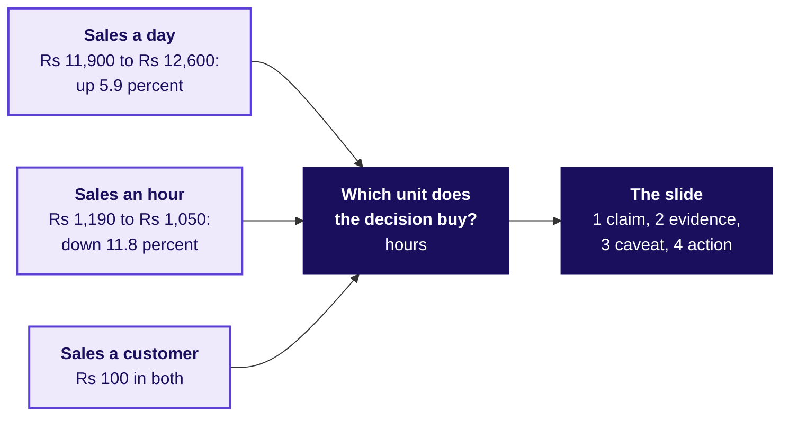
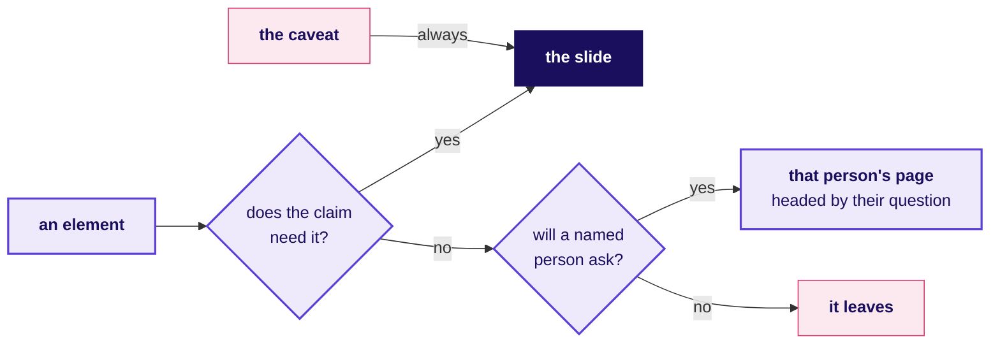
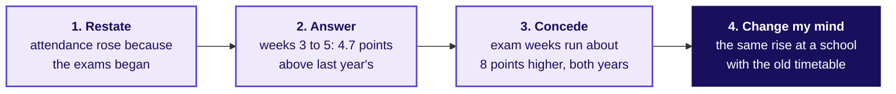
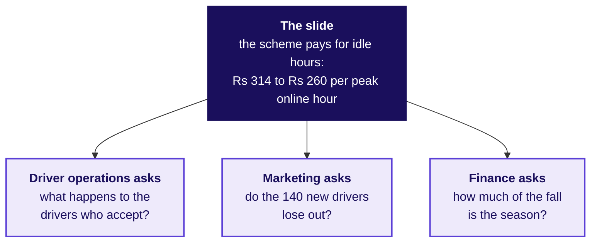
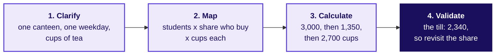
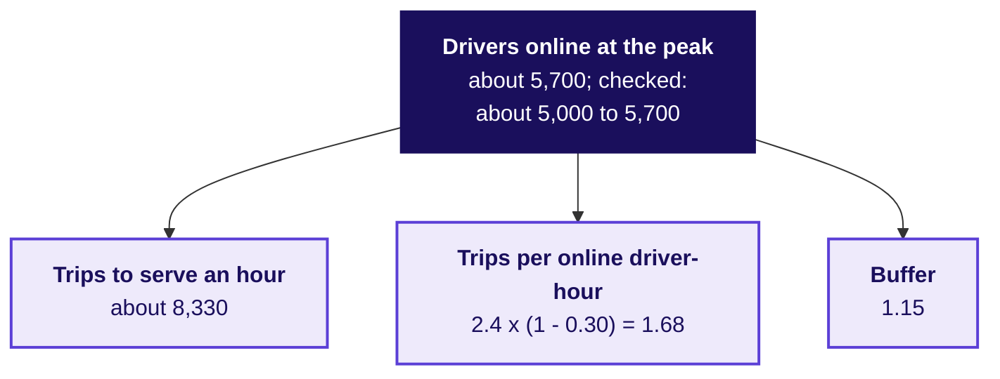
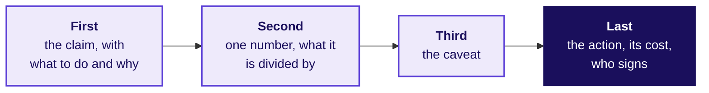

# What goes on the board on Tuesday, and in what order?

*Ramesh's kirana shop, Gulmohar Secondary School and the campus canteen are invented, as every number
about them is. Illustrative case: the company is real, the situation and the data are synthetic,
built for this class.*

Tuesday teaches five topics on invented examples, then uses them on Uber's peak-hour earnings
guarantee in Hyderabad, where gross bookings per peak online hour fell from Rs 314 to Rs 260 at a fare
that held at Rs 165, and the city head has one slide and five minutes at Thursday's review.

**Who needs the answer.** The trainer, who draws these in order, and you, if you missed a drawing or
want to redraw the board from memory before Saturday.

**The questions on the way.** Each heading below asks the question one drawing answers, in the order
the drawings go up, and the last asks what stays on the board at the end.

---

## How do the five topics connect, and where does the case use them?

Goes up first, at S4, and stays up all day. Each topic's box is lit as its chapter closes.

```mermaid
flowchart LR
    K["<b>Already in the room</b><br/>the four-part note;<br/>a rate names its<br/>denominator; Monday's<br/>metric"] -.-> T1
    T1["<b>Chapter 1: The one-slide answer:</b><br/><b>claim, evidence, caveat, action</b>"] --> T2["<b>Chapter 2: What to leave out,</b><br/><b>and the appendix</b>"]
    T2 --> T3["<b>Chapter 3: Defending under challenge:</b><br/><b>restate, answer, concede,</b><br/><b>what would change your mind</b>"]
    T3 --> T4["<b>Chapter 6: The guesstimate:</b><br/><b>clarify, map, calculate, validate</b>"]
    T4 --> T5["<b>Chapter 7: The AI-free</b><br/><b>written business case</b>"]
    T5 --> C["<b>The case</b><br/>Uber, Hyderabad,<br/>chapters 4, 5 and 8 to 10"]
    classDef lit fill:#1A0F5C,stroke:#1A0F5C,color:#FFFFFF
    classDef known fill:#EEEAFB,stroke:#5B3FD6,color:#1A0F5C,stroke-width:2px
    classDef kalpa fill:#FFF7E6,stroke:#C98A00,color:#5C3D00
    class T1,T2,T3,T4,T5 lit
    class K known
    class C kalpa
```

---

## The one-slide answer: what do the invented shop's two months say, and what does the slide carry?

Drawn during chapter 1, from Ramesh's shop (invented): 10 hours a day in September, 12 in October.

---

## What to leave out, and the appendix: where does each element go?

Drawn during chapter 2. The three questions, asked of each of the draft's eight elements.

---

## Defending under challenge: what does a full defence of the sports teacher's objection sound like?

Drawn during chapter 3, at Gulmohar Secondary School (invented).

---

## Which number carries Uber's slide, and what goes behind it?

Drawn during chapters 4 and 5. The slide in its four parts, with one appendix page per role.

---

## The guesstimate: how big is the invented canteen's weekday, and is it sane?

Drawn during chapter 6. Under it, three words stay up all afternoon: unit, period, definition.

---

## How many drivers must be online at Uber's evening peak?

Drawn during chapter 8, leaf by leaf, each value said aloud with its range.

---

## The AI-free written business case: what does a page carry, sentence by sentence?

Drawn during chapter 7, on Ramesh's page (invented), and left up for chapter 9's page to the city
head.

---

## What stays on the board at the end of the day?

The concept map with all five boxes lit, the four steps with unit, period and definition beneath them,
and the day's sentence from S93: the scheme is paying for online hours that carry no trips, Rs 314 to
Rs 260 per peak online hour at a flat Rs 165 fare; part of it may be the monsoon; test paying per
completed peak trip with an acceptance floor; and at the evening peak the city needs about 5,000 to
5,700 drivers online.
