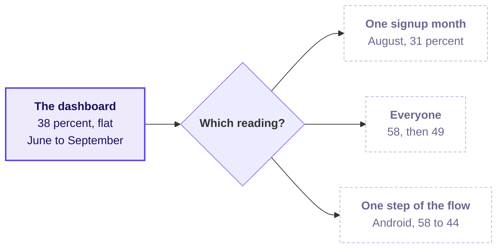

# What should you bring to Thursday, when a retention number stays flat?

Week 4, read on Wednesday evening: about 10 minutes of reading and two checks to run, so that
Thursday can start on its ticket from the first minute.

---

## What does Thursday's ticket say?

> **Zomato Gold, Chennai, the membership and the app's order flow.** The membership dashboard reports
> month-two retention for Chennai as flat at 38 percent for the reporting months June, July, August
> and September 2026. Each signup month's own group of members keeps fewer members as it ages, and
> each new month keeps fewer in its first month than the one before: January 2026, 58 percent; July,
> 49; August, 31. The August group signed up in a sale week and is 2.6 times the size of a normal
> month's. On Monday 14 September 2026 a new checkout flow shipped on Android, and since then members'
> add-to-cart to order rate on Android fell from 58 to 44 percent. The data covers 60,000 members.
> The ask, due Friday: is it a problem of one signup month or of everyone, which step of the order
> flow owns the loss, and what should be fixed first?
>
> Illustrative case: the company is real, the situation and the data are synthetic, built for this
> class.

On Thursday you answer the membership lead, who wants one cause and one fix with the evidence.

---

## Which words will Thursday use that you may not know yet?

Write what you think each one means tonight, from memory, in the right-hand column. Thursday's first
minutes assume you have tried, and a word you leave blank is the one to listen for in the room.

| Term | When Thursday uses it | What you think it means tonight |
|---|---|---|
| Cohort | The members who signed up in the same month are followed together. | |
| Retention | The ticket's flat number is a share of members still ordering. | |
| Blended | The dashboard's 38 percent mixes members of every signup month. | |
| Funnel | The order flow runs from opening the app to an order placed, step by step. | |

---

## Which one question should you think about tonight?

Today the strip's click-through fell while every part of it held, because milk's share of the slots
grew. Thursday's number does the opposite: it holds while each signup month keeps fewer members than
the month before.

How could a number made of shrinking groups stay flat? Bring your answer as one sentence, since you
will be asked for it.

---

## What should you check in your Codespace tonight?

Nothing needs installing, and each check takes under five minutes.

1. Run Restart and Run All on Wednesday's four notebooks, 01 to 04. Each ends on its checks passing,
   and if one does not, post its last error line in the cohort channel before the session.
2. Save your take-home notebook with its outputs showing, since a notebook that ran but was not saved
   looks empty to everyone else.

---

## Which line is worth carrying into Thursday?

> Wednesday's blend fell while its parts held; Thursday's holds while its parts fall.
