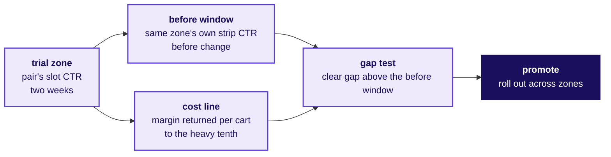
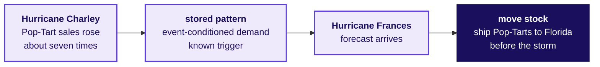
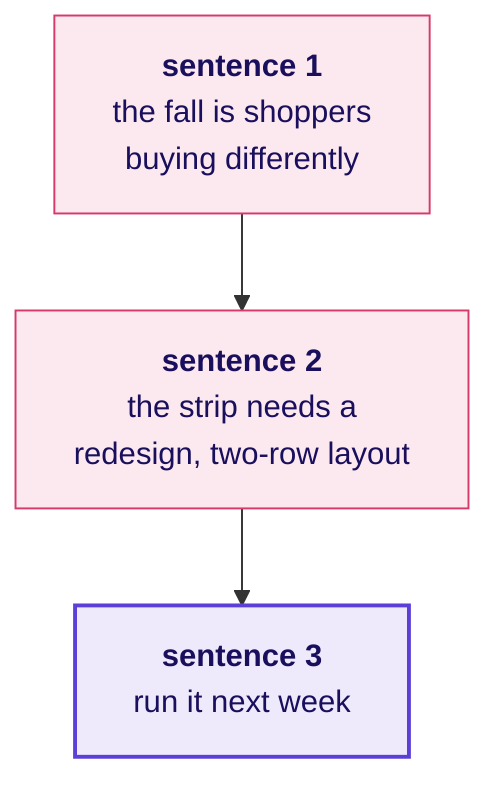

# The watch-list hour and the Pop-Tarts bridge

Week 4, Day 3. Fallback deck.

Kicker: WEEK 4  ·  WEDNESDAY  ·  FALLBACK
Quote: 120 minutes that stand in for the W4-2 faculty block (tentative) if it slips, and teach none of its content.
Who: The trainer, who runs this when IITGN cannot send the block in time

```notes
On screen when the room is told the W4-2 block cannot run as planned. The deck covers four
pieces of ground that extend the morning: the watch-list protocol, a rerun of the strip for one
zone and one time band, the Pop-Tarts bridge into Friday's forecasting, and the second interview
transcript. None of this teaches independence as probability or Apriori pruning; those stay with
the faculty whenever the block runs.
Transition: the four parts, with their minutes.
```

---

## S1. The fallback runs four parts in 120 minutes
*What is in the fallback and what is not.*

| Part | Minutes | What it does |
|---|---|---|
| 1. The watch-list protocol | 35 | What a two-week trial in two zones must show before a thin pair is promoted. |
| 2. The rerun by zone and time | 40 | The strip's new ranking recomputed for one zone and one time band; the row's after-class task done in class. |
| 3. The Pop-Tarts bridge | 20 | A real event-driven pattern that is not a pair rule, and why Friday is the question for it. |
| 4. The second transcript | 25 | The category manager is sure; the room answers with the slot-by-slot CTR split. |

```notes
LIVE, 1 minute. Say the fallback teaches nothing the faculty's block owns. The sample-size
question is parked by name for the faculty.
Transition: the watch-list protocol.
```

---

## SECTION 1: When should a thin pair be promoted?
*The watch-list protocol, 35 minutes.*

**Who needs the answer.** The category manager and the growth lead.

**The questions on the way.** Which zones for how long, which number beats, and what stops it.

```notes
LIVE, 35 minutes. Walk the three questions.
Transition: the trial design.
```

---

## S2. Try the thin pair in two zones for two weeks
*What does the trial carry?*

```cards
icon: map-pin | eyebrow: Where | title: Two zones | body: Zones with similar cart volume and category mix; the current zone and one close neighbour by basket shape. | tone: light
icon: calendar | eyebrow: How long | title: Two weeks | body: Enough for 20 to 40 appearances of the pair at the current support; the sample-size question is for the faculty. | tone: light
icon: trending-up | eyebrow: What must beat | title: CTR against baseline | body: The slot's click-through must beat its before-change CTR by a clear gap. | tone: light
icon: triangle-alert | eyebrow: What stops it | title: The caveat | body: A new campaign or a stock-out invalidates the window; the trial restarts. | tone: dark
```

```notes
LIVE, 10 minutes. Walk the four blocks. Say that "a clear gap" is a decision; the right rule for
how large it has to be is the sample-size question the faculty will teach.
Transition: the baseline the room would compare against.
```

---

## S3. The baseline is the trial zone's own CTR
*Which baseline does the room pick, and why?*

The before-after baseline is the same zone's own slot CTR before the trial. A cross-zone comparison would carry seasonality and city effects; the same-zone before window keeps those controlled. The baseline needs the four weeks of September already in `strip_log`, segmented by zone.

```notes
LIVE, 10 minutes. Press that the baseline choice is a decision; the room's two sentences are the
pick and the why. Walk the strip_log query to pull the before-trial CTR for the trial zone.
Transition: the pass criterion in one line.
```

---

## S4. Pass if the pair beats before and the strip's blend
*What does the strip need to see?*



The thin pair's slot CTR must beat the trial zone's own before-window strip CTR by a clear gap, and the pair's incremental adds must repay the slot's cost line (margin returned per cart to the heavy tenth). The strip rolls the pair out only if both numbers hold.

```notes
LIVE, 15 minutes. Walk the mechanism. The strip's own click-through plus the cost line gives
the trial a clear hurdle. Say that if the pair fails the trial, it stays on the watch list, which
is the point of a watch list.
Transition: the rerun by zone and time.
```

---

## SECTION 2: What changes in Kothrud, morning only?
*The rerun by zone and time band, 40 minutes.*

**Who needs the answer.** The growth lead.

**The questions on the way.** Which pairs change rank by zone, which by time band, and the answer to a reviewer.

```notes
LIVE, 40 minutes. Groups split by zone and time band. One Kothrud morning table, one evening
table, one Baner table.
Transition: the rerun's shape.
```

---

## S5. The rerun is the pairs table, filtered
*What changes in the code?*

```cards
icon: filter | eyebrow: One zone | title: carts.zone == "Kothrud" | body: Pull the Kothrud carts; run the same marginals, pairs and lifts on them. | tone: light
icon: clock | eyebrow: One time band | title: carts.time_band == "morning" | body: The strip page's morning cart population; same shape. | tone: light
icon: triangle-alert | eyebrow: Both | title: Zone and band | body: The smaller the slice, the thinner the ground; expect the lifts to be noisier. | tone: light
icon: check | eyebrow: Keep the floor | title: 1 percent of the slice | body: The floor is a share, so it scales with the slice; a 1 percent floor on a Kothrud morning subset is a smaller count. | tone: dark
```

```notes
LIVE, 10 minutes. Walk the four cards. Press that the floor as a share scales with the slice;
the row count floor would need a bigger relative share on a smaller slice.
Transition: the room runs the rerun.
```

---

## S6. In groups, 30 minutes, one slice per group
*What is handed in.*

| Group | Slice | What they report |
|---|---|---|
| 1 | Kothrud, all day | The top five pairs by lift, with support |
| 2 | Baner, morning | The top five pairs by lift, with support |
| 3 | Any zone, evening | The top five pairs by lift, with support |
| 4 to 9 | Zone of choice | The top five pairs; name one that changed rank against the full-data table |

```notes
LIVE, 30 minutes. The TA circulates; the common fail is pairs with support below 1 percent of
the slice looking promising. Hint: the floor sits at 1 percent of the SLICE.
Transition: the Pop-Tarts bridge.
```

---

## SECTION 3: Why do Pop-Tarts ride the storm?
*The Pop-Tarts bridge into Friday's forecasting, 20 minutes.*

**Who needs the answer.** The learner tomorrow, when Friday asks about events.

**The questions on the way.** Is this a pair rule, what is it instead, and what Friday does with it.

```notes
LIVE, 20 minutes. The one piece of real industry history that lands cleanly. Verified against
the published Teradata and Newsweek accounts, dated 12 October 2026 in the internal/sources
file.
Transition: the story in one slide.
```

---

## S7. Walmart shipped Pop-Tarts ahead of Frances
*What did Walmart see, and why move the stock?*



Walmart's data analysts had seen strawberry Pop-Tart sales rise about seven times in the week before Hurricane Charley. When Hurricane Frances was forecast, the chain shipped extra strawberry Pop-Tarts to the Florida stores before the storm. The pattern is event-conditioned demand: the trigger is a known future event, and the signal is prior behaviour under the same trigger.

```notes
LIVE, 10 minutes. Read the account. Say the source is Newsweek dated the day the trip was
checked (12 October 2026, in internal/sources). Press the mechanism: this is not a pair rule.
Chips and cold drink pair in any week; strawberry Pop-Tarts spike only when a hurricane is
coming. A pair rule has no event in it.
Transition: why Friday is the right day for this.
```

---

## S8. This is a forecasting question, which is Friday's day
*What does Friday do with event-conditioned demand?*

```timeline
label: Pair rule today | title: Chips and cold drink | body: The pair sits in 5 percent of carts in every week.
label: Event-driven tomorrow | title: Strawberry Pop-Tarts | body: Sales jump around a known future event; the measure is a forecast with the event as a feature.
label: Friday's method | title: Festival-aligned baseline | body: Compare each week to the same distance from the festival, not the calendar week.
label: What stays | title: The caveat | body: Two events a year is two observations; the fit is not the forecast.
```

```notes
LIVE, 10 minutes. Walk the four blocks. The last one is Friday's handoff in one line: the fit on
two events is not the forecast on a third. The W4-4 faculty block on Friday (tentative) takes the method up
one level: autocorrelation and ARIMA at recognition depth.
Transition: the second transcript.
```

---

## SECTION 4: Answering the manager who wants a redesign
*The second interview transcript, 25 minutes.*

**Who needs the answer.** The growth lead.

**The questions on the way.** What is partly right, and which split settles it.

```notes
LIVE, 25 minutes. The dispute transcript, run in pairs. Scorer on the four defence moves and the
Aced scorecard.
Transition: the transcript, in blocks.
```

---

## S9. The dispute, as it would reach the room
*The category manager's three sentences, in full.*



> The strip's click-through fell because shoppers after the monsoon buy differently. The strip needs a redesign; our team mocked up a two-row layout that puts the suggestions higher on the page. We can run it next week.

```notes
LIVE, 5 minutes. Read the three sentences aloud. Ask the room to list what the category manager
is partly right about and what the three sentences overstate.
Transition: what the growth lead concedes.
```

---

## S10. The four moves applied to the dispute
*The scorecard structure, applied here.*

```cards
icon: ear | eyebrow: Restate | title: Habits may have shifted | body: Monsoon ended inside the window; a share of the fall could be habits, but the strip log settles it. | tone: light
icon: message-square | eyebrow: Answer | title: Milk fills half the slots | body: The fall sits in milk slots at 1.2 percent click-through; other slots clicked 6.4 percent, up from before. | tone: light
icon: check | eyebrow: Concede | title: Layout is worth trying | body: Position bias is real, and we would A/B test the two-row layout; the fall is not what it tests. | tone: light
icon: triangle-alert | eyebrow: What would change | title: If other slots fell too | body: If removing the milk slots from the blend did not recover 6.4 percent CTR, the habits hypothesis would stand. | tone: dark
```

```notes
LIVE, 10 minutes. Walk the four moves. Say the structure is Tuesday's, which the room already
has. Score each pair on the four moves on a 0 to 2 scale.
Transition: the one chart that settles it.
```

---

## S11. The chart that settles the dispute
*What picture would you hand the manager?*


The before-change bar reads 6.1 percent, which is the pre-switch CTR. After the switch, the milk-slots bar reads 1.2 percent and the other-slots bar reads 6.4. The blended 3.8 is what the manager saw. The redesign cannot help milk slots click better; the ranking is the lever.

```notes
LIVE, 10 minutes. Walk the four bars. The sentence to carry: "a redesign is worth testing; it is
not what fell". Say the scorer on each pair reads structure first, then evidence, then concession,
then "what would change my mind".
Transition: the end of the fallback.
```

---

## S12. End of the fallback: four blocks the room keeps
*What the room leaves with when the IITGN session (tentative) cannot run.*

```timeline
label: Watch list | title: Trial design | body: Two zones, two weeks, same-zone before baseline, CTR above the before window.
label: Zone and time | title: Rerun by slice | body: The floor scales with the slice; the top-five pairs change rank in Baner mornings.
label: Pop-Tarts | title: Event, not pair | body: Hurricane-driven demand is Friday's question; today's method cannot cover it.
label: Dispute | title: Four moves | body: Restate, answer, concede, what would change my mind; the strip log settles the fall.
```

```notes
LIVE, 1 minute. Read the four blocks. Say the W4-2 block will run on the next window IITGN sends.
Transition: tomorrow's pre-read ships tonight.
```
