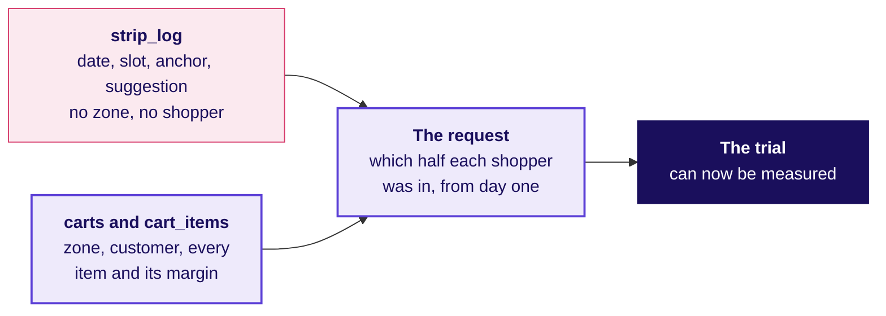
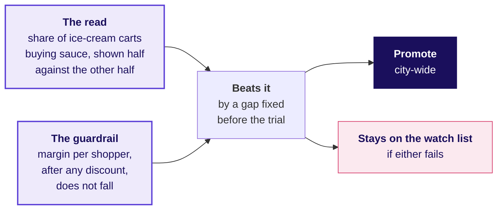
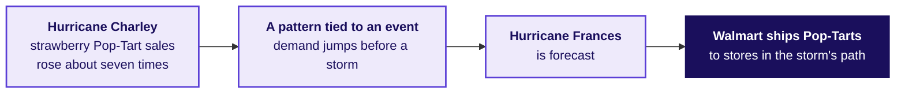

# Instamart Pune: the watch list, one zone, and a storm

Week 4, Day 3. Fallback.

Header: WEEK 4  ·  WEDNESDAY  ·  SWIGGY INSTAMART, PUNE  ·  FALLBACK

---

## S1. Four parts fill the 120 minutes
*What runs, for how long, and what does each part answer?*

| Part | Minutes | The question it answers |
|---|---|---|
| The watch-list trial | 35 | What must ice cream and chocolate sauce show before they take a slot? |
| One zone, one time band | 40 | Which pairs change rank when the strip is ranked for one slice of Pune? |
| The storm and the Pop-Tarts | 20 | Why is a sale that jumps before a storm no pair rule? |
| The second transcript | 25 | How do you answer a category manager who is sure the strip needs a redesign? |

```notes
LIVE, 2 minutes, on screen when the IITGN faculty session (tentative) cannot run in its slot. These
120 minutes extend the morning and teach nothing the block owns: no association rules as
probability, no algorithm that finds them. How long a trial must run before its answer can be
trusted is a sample-size question, parked by name for the faculty session (tentative). Transition:
the trial.
```

---

## SECTION 1: When may a thin pair take a slot?
*What must ice cream and chocolate sauce, lift 4.60 on 100 carts, show before they take a slot?*

```notes
LIVE, 35 minutes for the section. Groups design the trial; the TA plays the growth lead.
Transition: the four decisions.
```

---

## S2. A trial in two zones answers four decisions
*Where, for how long, against what, and what stops it?*

```cards
icon: map-pin | eyebrow: Where | title: Two zones, shoppers split | body: In two zones, a random half of shoppers see the pair beside ice cream and the other half do not. | tone: light
icon: calendar | eyebrow: How long | title: Fixed before it starts | body: The length is chosen before the first day and never stretched to chase a result. | tone: light
icon: target | eyebrow: Against what | title: The shoppers who do not see it | body: The other half see the next-best suggestion in that slot, over the same weeks. | tone: light
icon: octagon-x | eyebrow: What stops it | title: A shock to one half | body: A stock-out or a campaign that reaches one half and not the other voids the window. | tone: dark
```

```notes
LIVE, 12 minutes. Each group fills the four cards for its own trial. Press on "fixed before it
starts": a trial watched daily and stopped when it looks good finds a winner by luck. The rule for
how long is the parked sample-size question. Transition: the first data request.
```

---

## S3. The trial's first need is each shopper's half
*Can today's tables measure a two-zone trial?*



`strip_log` counts impressions, clicks and adds for the whole city, with no zone and no shopper, so it cannot read the trial. `carts` holds the zone and the customer, and `cart_items` every item and its margin. A two-zone trial starts with a data request: which half each shopper was in, logged from the first day.

```notes
LIVE, 8 minutes. This is a real analyst's moment: the method is ready and the data are not. Ask
the room to write the request in one sentence: which table, which new column, from which day.
Transition: the pass rule.
```

---

## S4. Pass only if sauce sells more and margin holds
*What rule promotes the pair, and what keeps it on the watch list?*



The pair is promoted only if ice-cream carts in the shown half buy sauce more often than the other half's, by a gap set before the trial, and margin per shopper, after any bundle discount, does not fall. Comparing the halves nets out the sauce shoppers would have bought anyway, which a slot's click-through cannot. The purchase rate is the read because it moves visibly when the strip works; a whole cart's margin swings too much to show a gain this size, so it guards the decision instead. If either fails, the pair stays on the watch list, which is what a watch list is for.

```notes
LIVE, 15 minutes. Groups present their pass rule in two sentences. The weak rule names the slot's
click-through, which counts only shoppers who saw the pair; the strong rule compares sauce bought in
the two halves' ice-cream carts and keeps margin per shopper as the guardrail. Transition: one zone,
one time band.
```

---

## SECTION 2: What changes in one zone at one time?
*Which pairs change rank when the strip is ranked for one zone and one time band?*

```notes
LIVE, 40 minutes for the section, the row's after-class task done in class on notebook 10.
Transition: the code change.
```

---

## S5. The rerun is the same pairs table on fewer carts
*What changes in the code, and what changes in the reading?*

```python
slice_ids = carts.loc[(carts.zone == "Kothrud") & (carts.time_band == "morning"), "cart_id"]
part = baskets[slice_ids]                                  # the same sets, fewer carts
pair_count = Counter(p for b in part for p in combinations(sorted(b), 2))
floor = 0.01 * len(part)                                   # the floor is a share of the slice
```

The code changes in one line: which carts enter. The reading changes more: a slice holds fewer carts, so every pair rests on fewer of them, and a floor written as a share of the slice admits pairs on thinner ground.

```notes
LIVE, 8 minutes. Code along. Morning carts hold milk 80 percent of the time against 66 to 69 in the
other bands, so milk's pairs read slightly differently in the morning. Transition: the slices.
```

---

## S6. Each group takes one slice and reports on it
*Which slice does each group take, and what does it report?*

| Group | Slice | What the group reports |
|---|---|---|
| First and second | Kothrud, morning; Kothrud, evening | The top five pairs above the slice's floor, with support and lift |
| Third and fourth | Baner, morning; Hinjewadi, night | The same, and one pair that moved against the city ranking |
| Fifth and sixth | Hadapsar, week three; Hadapsar, week four | What happened to curd's pairs in the stock-out week |
| Any further group | A zone and band of the group's choice | The top five, and whether the city's three slots still lead |

```notes
LIVE, 25 minutes of group work. The fifth and sixth groups find the stock-out in their own slice: curd's pairs
vanish in week three and return in week four. The common stall is a pair below the slice's floor
that looks exciting; the hint is "how many carts is that lift resting on?". Transition: what the
slices say together.
```

---

## S7. What the slices agree on, and what they do not
*Which findings survive slicing, and which belong to one slice?*

```timeline
label: Survives | title: Milk's lift near one | body: In every band, bread with milk reads about 1.04.
label: Survives | title: The top two pairs | body: Chips with cold drink and coriander with green chillies lead every one of the six slices.
label: One slice only | title: Curd in Hadapsar, week three | body: Curd falls to 0.2 percent of carts, then 28 percent in week four: a stock-out, never a change in taste.
label: Thin ground | title: Hinjewadi at night, 649 carts | body: Three pairs resting on 7 to 10 carts each slip in above bread with butter.
```

```notes
LIVE, 7 minutes. Each group reads one line of its report against this list. Transition: a storm.
```

---

## SECTION 3: Why is a storm's sale no pair rule?
*Why is a sale that jumps before a storm a forecasting question rather than a pair rule?*

```notes
LIVE, 20 minutes for the section. Transition: Walmart's account.
```

---

## S8. Walmart stocked Pop-Tarts before Hurricane Frances
*What did Walmart see, and what did it do with it?*



Walmart's analysts had seen strawberry Pop-Tart sales rise about seven times before Hurricane Charley, so when Hurricane Frances was forecast the chain shipped extra Pop-Tarts to the stores in its path (OpenStax, checked 12 October 2026). The decision moved stock ahead of the storm; a wrong forecast would have left it on the wrong shelves.

```notes
LIVE, 10 minutes. Read the account. Ask: "is strawberry Pop-Tarts with a storm a pair, like chips
with cold drink?" Transition: the answer.
```

---

## S9. A pair holds weekly; a storm's sale needs a forecast
*Where does each kind of pattern belong this week?*

```timeline
label: A pair rule, today | title: Chips with cold drink | body: Found together in about 5 percent of carts, week after week.
label: An event, Friday | title: Pop-Tarts before a storm | body: Sales jump around a known future event, which a forecast with the event in it captures.
label: Friday's method | title: Line up the event | body: Diwali fell on 31 October 2024 and 20 October 2025, so the week before Diwali is compared with the week before Diwali, never the same calendar week.
label: What stays | title: Two events are two points | body: A pattern seen twice is thin ground, as a pair on 100 carts is.
```

```notes
LIVE, 10 minutes. Friday's ticket at Flipkart's Lucknow fulfilment centre takes this up with
Diwali as the event. Transition: the second transcript.
```

---

## SECTION 4: How do you answer a redesign?
*How do you answer a category manager who is sure the strip needs a new layout?*

```notes
LIVE, 25 minutes for the section: the dispute transcript read in pairs, then scored.
Transition: the three sentences.
```

---

## S10. Three sentences that sound right
*What does the category manager say, and which parts hold?*

> The click-through fell because shoppers buy differently after the monsoon. The strip needs a redesign; our team has mocked up a two-row layout that sits higher on the page. We can run it next week.

The first sentence names a cause the log can test. The second proposes a fix for a problem nobody has shown. The third is a test, which is the part worth keeping.

```notes
LIVE, 5 minutes. Pairs list what is partly right and what is unproven before the next slide.
Transition: the four moves.
```

---

## S11. The four moves, answered from the log
*How does the growth lead answer without dismissing the manager?*

```cards
icon: ear | eyebrow: Restate | title: Habits may have shifted | body: You think shoppers changed when the monsoon ended, and a new layout would win the clicks back. | tone: light
icon: chart-column | eyebrow: Answer | title: The mix moved | body: Milk went from 2 to 50 percent of impressions at 0.9 to 1.4 percent, and the rest rose in every slot. | tone: light
icon: handshake | eyebrow: Concede | title: Position matters | body: Among suggestions other than milk, slot 1 draws 8.2 percent against 5.4 for slot 3; a test that shuffles the order separates position from the strongest suggestion. | tone: light
icon: refresh-cw | eyebrow: What would change it | title: If the rest had fallen too | body: Had the suggestions other than milk fallen with the blend, the habits story would lead. | tone: dark
```

```notes
LIVE, 10 minutes. Score each pair's answer on the four moves, 0 to 2 each. Transition: the one
chart to hand the manager.
```

---

## S12. The chart that settles the dispute
*Which picture answers "shoppers changed"?*


In every slot, suggestions other than milk clicked better after the change than before, 8.2 against 7.5 percent in slot 1. Milk's share of impressions grew from 2 to 50 percent at 0.9 to 1.4 percent; its old cell, slot 3, slipped from 1.2 to 0.9, too little to move the blend. A new layout earns a test of its own, run beside the ranking as a two-by-two with customers randomised.

```notes
LIVE, 7 minutes. The sentence to carry: "the mix moved, and a layout gets its own test".
Transition: the close.
```

---

## S13. What the fallback leaves the room with
*What does the room keep from the four parts?*

```timeline
label: The trial | title: Four decisions before day one | body: Where, how long, against what, and what voids it.
label: The slices | title: Thin ground moves | body: The city's three slots survive; curd's dip belongs to one zone and week.
label: The storm | title: An event needs a forecast | body: Friday's question, with Diwali as the event.
label: The dispute | title: Four moves, one chart | body: The log settles what fell; a layout earns its own test.
```

```notes
LIVE, 1 minute. Say only that the faculty session (tentative) did not run today. Tomorrow's
pre-read ships tonight.
```
