# Instamart Pune: strip click-through fell from 6.1 to 3.8 percent

Week 4, Day 3. Half one.

Header: WEEK 4  ·  WEDNESDAY  ·  SWIGGY INSTAMART, PUNE  ·  ILLUSTRATIVE CASE

---

## S1. Strip click-through fell from 6.1 to 3.8 percent
*What has the analyst been handed, and what is due Friday?*

| On the ticket | What it says |
|---|---|
| Company, city, surface | Swiggy Instamart, Pune: the cart page's strip of three suggested items |
| The change | Monday 7 September 2026: a curated list became the items most often found in the same cart; toned milk is in 71 percent of carts, so it now sits beside nearly everything |
| The metric | Strip click-through (clicks over impressions): 6.1 percent from 17 August to 6 September, 3.8 percent from 7 to 27 September |
| The data | `carts` (cart_id, customer_id, placed_date, zone, time_band, cart_value_rs): 40,000 carts, 1 to 28 September, eight zones; `cart_items` (cart_id, item, quantity, price_rs, margin_rs); `strip_log` (date, slot, anchor_item, suggested_item, impressions, clicks, adds) |
| The ask, due Friday | Rank the pairs the strip should show, explain the fall, put a rupee value on a slot |
| Caveats | Curd ran out in two zones in week three; the top tenth of customers place 38 percent of carts; the strip causes some of the co-occurrence it counts; a cart is one order, a customer places many |

Illustrative case: the company is real, the situation and the data are synthetic, built for this class.

```notes
LIVE, 6 minutes, on screen as the room sits down. Read the table top to bottom, then the label line:
the company is real, the situation and the data are synthetic. Define two words as they appear: an impression is
one time a slot was shown, and click-through is clicks divided by impressions. Point at the three
tables and their columns; every number today comes from them. Ask the room for one reason "in
most carts" might be the wrong reason to show an item, and write the answers on the board
without judging them. Transition: where today sits in the week.
```

---

## S2. Wednesday asks what goes with what, beyond chance
*Where does today sit among the week's five tickets?*

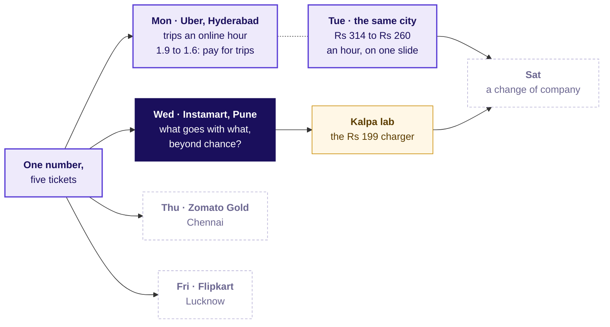

```notes
LIVE, 2 minutes. Monday and Tuesday carry the numbers the room produced on them. Today's node is
lit; Thursday, Friday and Saturday stay dashed. The Kalpa node is the lab after class, where the
same method meets Kalpa Retail's baskets. Explorer: the home screen, Wednesday lit.
Transition: where today ends.
```

---

## S3. Where today ends: three pairs, one floor, Rs 6.3 lakh
*What will the growth lead carry out of the room?*

```cards
icon: list-checks | eyebrow: Promote | title: Three pairs above a 1 percent floor | body: Chips and cold drink 3.39, coriander and green chillies 3.00, bread and butter 2.21. Milk takes no slot. | tone: light
icon: eye | eyebrow: Watch | title: One strong, thin pair | body: Ice cream and chocolate sauce: lift 4.60 on 100 carts, tested before it is promoted. | tone: light
icon: indian-rupee | eyebrow: Price | title: A slot, in rupees | body: Rs 17,280 a day with a pair that beats chance, Rs 3,240 with milk; re-ranking recovers Rs 6.3 lakh a month. | tone: dark
```

```notes
LIVE, 2 minutes. Show the finished answer once, then earn it. Leave the cause of the fall open:
chapter 2 finds it. Say that every number on the three cards is computed in the room before
lunch. Transition: chapter 1, counting by hand.
```

---

## SECTION 1: What does together mean?
*Which items go together on twelve real carts, counted three ways by hand before any code opens?*

```notes
LIVE, 1 minute. Chapter 1 of 3, level L1. Receipts on the table: the tea stall first, then the
twelve cart cards per group. No laptop opens in this chapter. Transition: the questions.
```

---

## S4. Three counts and one limit, climbed by hand
*Who needs the answer, and which questions lead to it?*

**Who needs the answer.** The category manager, who picks what the strip may suggest: a strip filled on the wrong count wastes the three spaces under every cart.

```timeline
label: How often? | title: Support | body: Carts holding both items, over all carts.
label: How reliably? | title: Confidence | body: Of the carts holding A, the share that also hold B.
label: Against chance? | title: Lift | body: Carts seen holding both, over the carts chance alone would give.
label: How far? | title: What twelve cannot say | body: Whether a pull on four carts is real or luck.
```

```notes
LIVE, 2 minutes. Read the four questions. Each gets a number before the next is asked. Write the
three words support, confidence, lift on the board only after the room has counted each one.
Transition: ten tea-stall orders.
```

---

## S5. Which tea-stall sentence is wrong?
*Ten invented orders: chai on 6, biscuit on 4, both on 3. Which reading fails?*

```cards
icon: list | eyebrow: a | title: Support is 0.30 | body: Orders holding both, over all ten: 3 of 10. | tone: light
icon: list | eyebrow: b | title: Confidence is 0.50 | body: Of the 6 chai orders, the share with biscuit: 3 of 6. | tone: light
icon: list | eyebrow: c | title: Lift is 1.25 both ways | body: Seen together 3; chance gives 2.4; the ratio reads the same from biscuit. | tone: light
icon: list | eyebrow: d | title: Chai lifts biscuit sales 25% | body: Chai makes a customer buy a quarter more biscuits. | tone: light
```

```notes
LIVE, 4 minutes. Groups vote by holding up a letter. Then two minutes for neighbours to argue, and
vote again. The split is usually between c and d. Do not explain lift yet; the next slide does.
Transition: the dots.
```

---

## S6. Answer: d, since lift counts and never names a cause
*What does a lift of 1.25 say, read off the dots?*

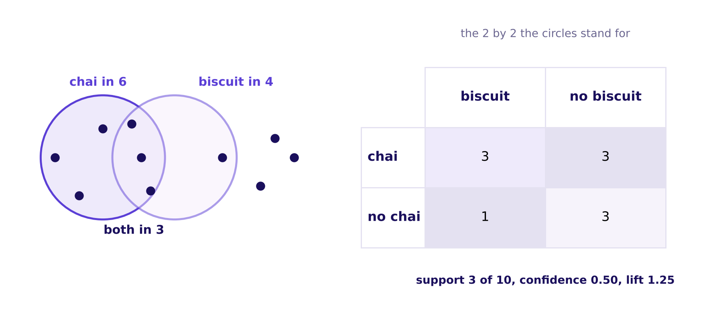

If chai and biscuit ignored each other, 60 percent of the 4 biscuit orders, 2.4 orders, would hold chai. Three do. Lift is 3 / 2.4 = 1.25, and from biscuit's side it is 0.75 / 0.60, the same 1.25. The pair turns up a quarter more often than chance would put it there; ten receipts cannot say why.

```notes
LIVE, 7 minutes. Count each cell of the 2 by 2 aloud from the dots (StatQuest). Support: the
shaded cell over all ten. Confidence: shrink the world to the chai row, 3 of 6. Expected: the
chai share times the biscuit share times ten, 0.6 x 0.4 x 10. Lift: seen over expected. Then the
reverse direction. Ask: "what would make the 1.25 a cause?" Only a test that changes chai and
watches biscuit, which Monday's faculty session on A/B testing (tentative) took up. Transition: a carry bag.
```

---

## S7. The carry bag: confidence 0.75, lift 0.83
*How can a partner look reliable and still sit below chance?*

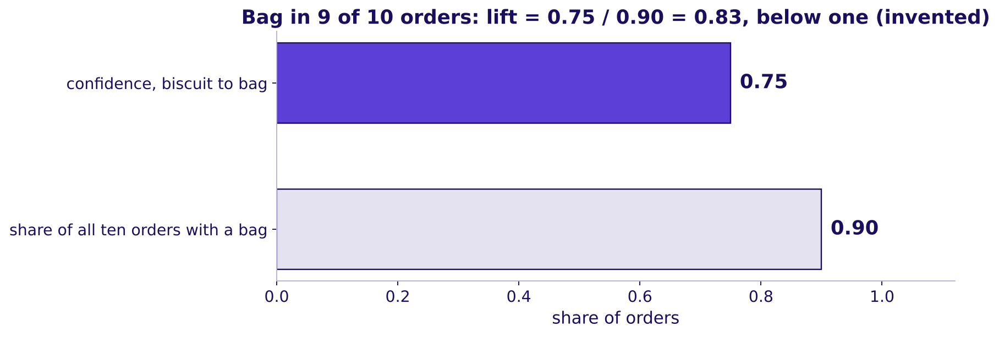

Add a carry bag, invented, in 9 of the 10 orders and in 3 of the 4 biscuit orders. Confidence from biscuit to bag is 0.75, which sounds like a bundle. The bag is in 0.90 of all orders, so lift is 0.75 / 0.90 = 0.83: biscuit orders hold a bag a little less often than orders in general. The item in every bag earns high confidence toward everything.

```notes
LIVE, 6 minutes. This is the day's trap in miniature, on numbers small enough to hold in the head.
Ask a learner to say in one sentence why the bag looks like everyone's best partner. The answer to
listen for: because it is in nearly every order. Transition: twelve real carts.
```

---

## S8. Twelve real carts: milk in 8, bread in 4
*What do twelve of the 40,000 carts hold, card by card?*

| Cart | Items held |
|---|---|
| C000098 | toned milk, bread, eggs, bananas, coriander, onions, potatoes |
| C003216 | toned milk, bread, eggs, curd, bananas |
| C006334 | toned milk, bread, curd, paneer, onions |
| C009452 | toned milk, bread, eggs, tomatoes |
| C012570 | toned milk, eggs, chips, cold drink, onions |
| C015688 | toned milk, chips, cold drink, coriander |
| C018806 | toned milk, bananas, onions, potatoes |
| C022633 | toned milk, paneer, coriander, tomatoes |
| C026803 | chips, coriander, onions, potatoes |
| C030743 | cold drink, curd, bananas, tomatoes |
| C033861 | eggs, ice cream, chocolate sauce |
| C036979 | curd, onions |

```notes
LIVE, 10 minutes. Each group holds these twelve as printed cards. Say: "sort the pack by whether it
has bread, then count how many of those have milk; now count how many have milk at all." Counts
are called out and written on the board before any formula is named. When a group stops at a
confidence and calls it the answer, ask: "how many carts hold milk whether or not they hold
bread?" Transition: predict before the reveal.
```

---

## S9. How reliably does bread bring milk on twelve carts?
*Bread is in 4 carts and milk in 8. What is the confidence from bread to milk?*

```cards
icon: percent | eyebrow: a | title: 0.33 | body: Bread's own share of the twelve carts. | tone: light
icon: percent | eyebrow: b | title: 0.50 | body: The share of milk carts that hold bread. | tone: light
icon: percent | eyebrow: c | title: 0.75 | body: Three of the four bread carts hold milk. | tone: light
icon: percent | eyebrow: d | title: 1.00 | body: Every bread cart holds milk. | tone: light
```

```notes
LIVE, 3 minutes. Groups commit in writing. Option b is the reverse direction, milk to bread, which
reads 4 of 8. Transition: the count.
```

---

## S10. Answer: d, confidence 1.00 and lift 1.50
*How do the three counts read for bread and milk?*

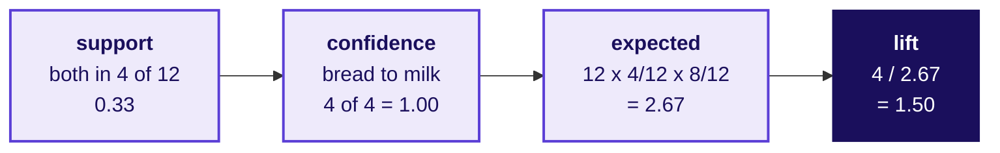

All four bread carts hold milk, so confidence is 1.00. Milk is in 8 of 12 carts anyway, so chance alone puts it in 2.67 of the four bread carts. Lift is 4 / 2.67 = 1.50: on these twelve carts, bread brings milk half again as often as chance would.

```notes
LIVE, 7 minutes. Walk the four boxes left to right, writing each number on the board. Read the
reverse confidence too: milk to bread is 4 of 8, 0.50. Lift is the same from both sides.
Transition: what confidence threw away.
```

---

## S11. The trap: 1.00 reads like a bundle
*What does confidence throw away that lift keeps?*

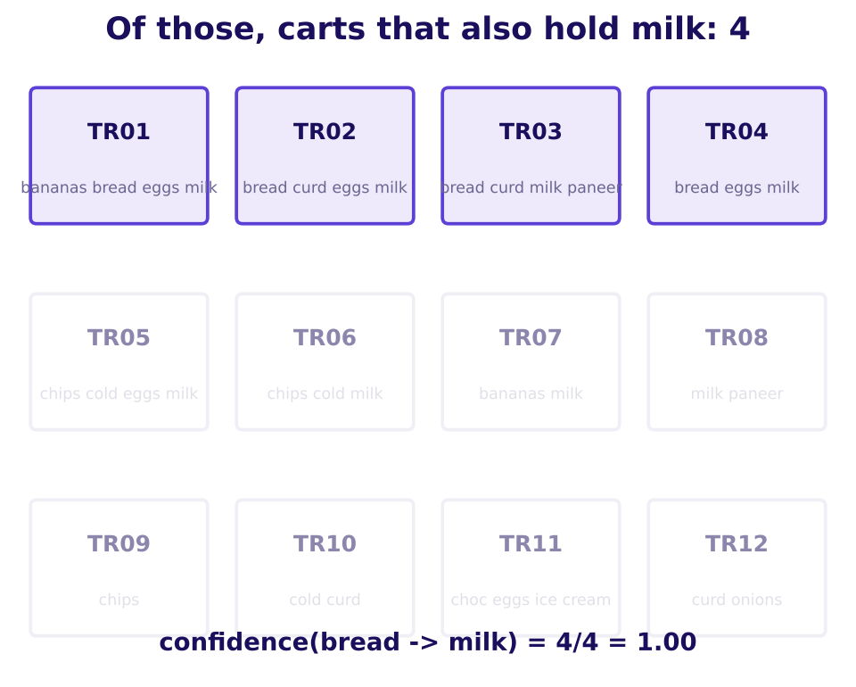

The plausible wrong answer: "confidence 1.00, so show milk beside bread." Confidence looked only inside the four bread carts. The check: milk is in 8 of 12 carts anyway. The fix: read lift, 1.50, on too few carts to trust.

```notes
LIVE, 6 minutes. The GIF beside this still dims the carts in two steps (whiteboards folder). Say
the sentence that stays: confidence shrinks the world to the carts with A; lift compares that world
with all the carts. Explorer: scene W2, two buttons that grey the carts without A, then without B.
Transition: the other pairs on the cards.
```

---

## S12. Chips and cold drink beat chance; one cart cannot
*What do the other two pairs on the cards read?*

| Pair | Carts with A | Carts with B | Both | Expected by chance | Lift |
|---|---|---|---|---|---|
| chips, cold drink | 3 | 3 | 2 | 12 x 3/12 x 3/12 = 0.75 | 2.67 |
| ice cream, chocolate sauce | 1 | 1 | 1 | 12 x 1/12 x 1/12 = 0.08 | 12 |

Chips and cold drink share 2 carts where chance gives 0.75: lift 2.67, a pull between two items that are each in only 3 carts. Ice cream and chocolate sauce share a single cart, and one cart makes a lift of 12, a number with nothing under it.

```notes
LIVE, 9 minutes. Groups compute the chips row first, then the ice cream row. Ask: "would you give a
slot to the lift of 12?" Hold the answer for chapter 3's floor. Transition: what the chapter
counted.
```

---

## S13. Three counts, two pitfalls, and what twelve cannot say
*What did the twelve carts answer, and what goes on the concept board?*

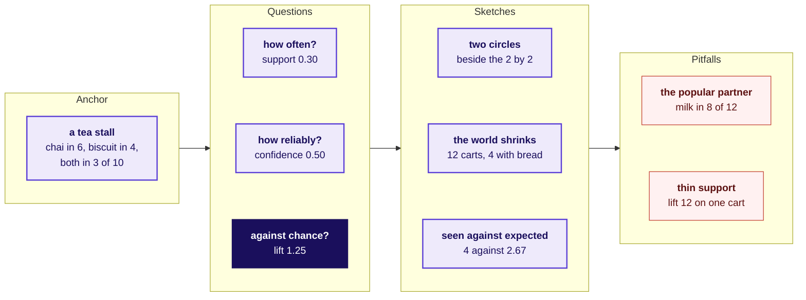

The concept board "Which pairs beat chance?", finished. Lift joins the week's map as "beyond chance": Thursday asks the same of a cohort against the blend, Friday of a forecast against the baseline. Twelve carts cannot say whether 1.50 is a real pull or four lucky carts.

```notes
LIVE, 5 minutes. The board was built region by region on the whiteboard through the chapter: the
anchor with the dots, the three questions as each was counted, the sketches, then the two pitfalls.
Ask a learner to say all three counts in one breath: how often, how reliably, against chance. Then
the limit. Add "lift: beyond chance" under Wednesday on the week map. Transition: chapter 2, every
cart.
```

---

## SECTION 2: What do 40,000 carts say?
*What do support, confidence and lift say across every cart, and why did the click-through fall?*

```notes
LIVE, 1 minute. Chapter 2 of 3, levels L2 and L3. Notebook 02 opens now: one plain line above every
cell, run top to bottom with the room. Transition: the questions.
```

---

## S14. Four questions from counts to the fall
*Who needs the answer, and which questions lead to it?*

**Who needs the answer.** The growth lead, who explains the fall on Friday, against a category manager who defends milk because it is the top seller.

```timeline
label: Question 1 | title: How often is each item in a cart? | body: Each item's share of the 40,000 carts.
label: Question 2 | title: Which pairs sit together most often? | body: And is that count the ranking the strip should use?
label: Question 3 | title: What does lift say about milk? | body: For every item in at least 2 percent of carts.
label: Question 4 | title: Why did the click-through fall? | body: Split by what each slot suggested.
```

```notes
LIVE, 2 minutes. Read the four questions; each ends on a number from notebook 02.
Transition: the first prediction.
```

---

## S15. Which pair sits together most often?
*Rank all 40,000 carts' pairs by count. Which pair comes first?*

```cards
icon: shopping-cart | eyebrow: a | title: Chips and cold drink | body: The pair that beat chance on the cards. | tone: light
icon: shopping-cart | eyebrow: b | title: Bread and toned milk | body: Two daily staples. | tone: light
icon: shopping-cart | eyebrow: c | title: Ice cream and chocolate sauce | body: The lift of 12 on one card. | tone: light
icon: shopping-cart | eyebrow: d | title: Onions and tomatoes | body: The cooking pair. | tone: light
```

```notes
LIVE, 3 minutes. Vote, argue in pairs, vote again. Write the split on the board. Transition: the
count.
```

---

## S16. Answer: b, bread and milk, in 10,064 carts
*What does a ranking by count put on top?*

| Pair | Carts holding both |
|---|---|
| bread, toned milk | 10,064 |
| eggs, toned milk | 8,468 |
| curd, toned milk | 7,436 |
| bananas, toned milk | 6,624 |
| onions, toned milk | 6,248 |
| tomatoes, toned milk | 5,680 |

Every one of the six most frequent pairs holds milk. The plausible wrong answer is "the pairs table is the ranking": ranked by count, milk is the top partner of almost every item, which is exactly what the strip has shown since 7 September. A count rewards the popular item, whatever it is paired with.

```notes
LIVE, 5 minutes. Say the trap aloud: the team built the strip on this table. The check is to ask
how often milk would sit beside bread if the two ignored each other, which is lift's question.
Transition: the five lines that counted this.
```

---

## S17. Every pair counted in five lines of pandas
*How does the code count 40,000 carts of pairs?*

```python
baskets = items.groupby("cart_id").item.apply(set)          # one set of items per cart
pair_count = Counter(p for b in baskets                      # every two items in a cart
                     for p in combinations(sorted(b), 2))    # sorted, so (a, b) is one key
single = Counter(x for b in baskets for x in b)              # carts holding each item
lift = pair_count[("bread", "toned milk")] * n / (single["bread"] * single["toned milk"])
```

A cart becomes a set of items; every pair inside it adds one to its tally; lift is carts with both, times all carts, over the two items' own counts. The same three counts as the cards, with `n` = 40,000.

```notes
LIVE, 5 minutes. Code along in notebook 02 (Krish Naik): say what each line is for before running
it. Sorting the pair keeps bread with milk and milk with bread as one key. Interview note: "why
sorted?" is a common follow-up. Transition: bread and milk on every cart.
```

---

## S18. Twelve carts said lift 1.50; 40,000 carts say 1.04
*What does lift say about bread and milk on all the carts?*

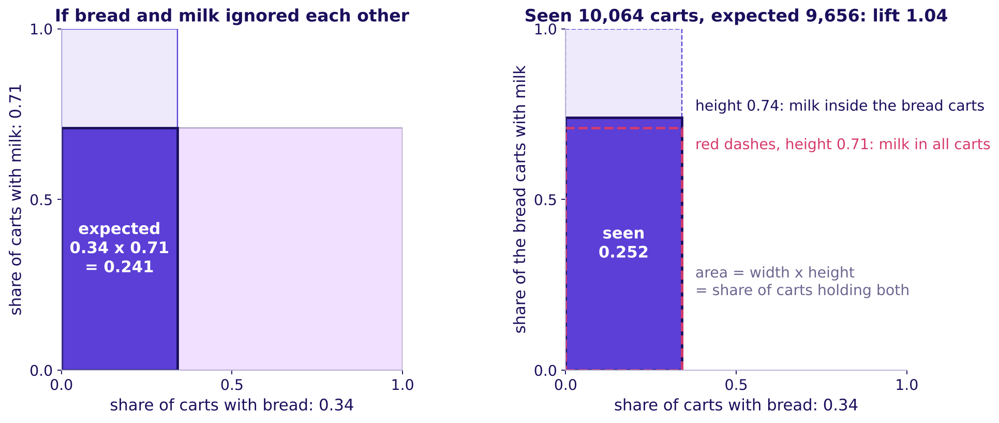

On twelve carts lift read 1.50 because all four bread carts happened to hold milk. On 40,000 carts bread to milk reads confidence 0.74 and lift 1.04: milk sits beside bread about as often as it sits in any cart. Chance gives 0.34 x 0.71 = 0.241 of carts holding both; 0.252 do.

```notes
LIVE, 6 minutes. Read the picture as two areas (3Blue1Brown): bread's band times milk's band is
the overlap chance gives; the overlap seen is barely bigger, and lift is the ratio of the two
areas. Say the lesson in one line: a few carts can make a pull look strong, and the full count
shows it near one. Explorer: scene W1, sliders for the two shares and the overlap.
Transition: is bread special, or is every item like this?
```

---

## S19. What is a popular item's lift with milk?
*For the 50 items in at least 2 percent of carts, what does lift with milk look like?*

```cards
icon: trending-up | eyebrow: a | title: It rises with popularity | body: The more common the item, the higher its lift. | tone: light
icon: equal | eyebrow: b | title: Near one for all of them | body: Every item sits close to chance with milk. | tone: light
icon: trending-down | eyebrow: c | title: It falls with popularity | body: Common items pair less with milk than rare ones. | tone: light
icon: shuffle | eyebrow: d | title: It scatters | body: Each item goes its own way. | tone: light
```

```notes
LIVE, 2 minutes. A quick vote. Transition: the chart.
```

---

## S20. Answer: b, near one for every common item
*Why does every item look bundled with milk, and what does lift say?*

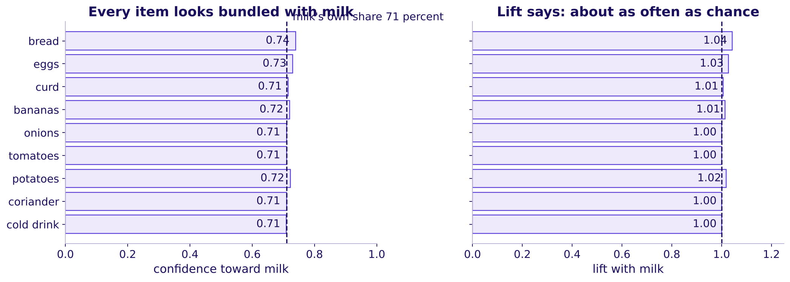

For all 50 items in at least 2 percent of carts, confidence toward milk runs 0.70 to 0.74, near milk's own 0.71, and lift runs 0.99 to 1.04. Lift divides milk's popularity out.

```notes
LIVE, 5 minutes. The left panel is what the new strip ranked by; the right panel is what it should
have read. Feynman line for the room to repeat: "the item in every bag is the worst bundle
partner, because it was going in the bag anyway". Explorer: scene W3, the milk share slider.
Transition: a company that met this trap.
```

---

## S21. Amazon met the same popular-partner trap
*Where has a real recommender met the item that sits beside everything?*

**Amazon.** Its recommender team wrote that counting how often buyers of A also bought B would have made a bestseller such as Harry Potter the top recommendation beside everything. The fix compared what was seen with what chance would predict, which is lift in spirit. Years later the team measured the base rate per purchase, because heavy buyers inflate every count (Amazon Science, checked 12 October 2026).

The cost of the trap is a recommendation slot spent on an item the shopper was buying anyway.

```notes
LIVE, 3 minutes. Name the decision and the cost: a slot shown to everyone that moves nothing. The
heavy-buyer point returns in chapter 3 as the top tenth of customers. Transition: the four pairs
side by side.
```

---

## S22. Four pairs, three numbers each, one second route
*What do support, confidence both ways and lift read for four pairs?*

| Pair | Support | Confidence A to B | Confidence B to A | Lift |
|---|---|---|---|---|
| bread, toned milk | 25.2% | 0.74 | 0.35 | 1.04 |
| eggs, toned milk | 21.2% | 0.73 | 0.30 | 1.03 |
| chips, cold drink | 5.0% | 0.42 | 0.41 | 3.39 |
| ice cream, chocolate sauce | 0.25% | 0.06 | 0.18 | 4.60 |

The second route: lift is also confidence over the partner's share. Bread to milk 0.74 / 0.71 = 1.04, and milk to bread 0.35 / 0.34 = 1.04. Both routes agree and lift reads the same from either side.

```notes
LIVE, 4 minutes. Point at the chips row: confidence 0.42 looks weak beside 0.74, yet its lift is
3.39. Confidence and lift can rank pairs in opposite orders. Notebook 02 asserts the second route
for three pairs. Transition: why did the click-through fall?
```

---

## S23. Why did the strip's click-through fall?
*It fell from 6.1 to 3.8 percent after 7 September. Which explanation will the log support?*

```cards
icon: users | eyebrow: a | title: Shoppers changed habits | body: After the monsoon, carts shifted away from the old pairs. | tone: light
icon: eye-off | eyebrow: b | title: Fewer cart-page views | body: Fewer people opened the cart page in September. | tone: light
icon: milk | eyebrow: c | title: Milk fills the slots | body: Milk now takes the slots and few shoppers click it. | tone: light
icon: panel-top | eyebrow: d | title: The strip moved down | body: The strip sits lower on the page than before. | tone: light
```

```notes
LIVE, 2 minutes. Vote. A view count says nothing about a rate, which rules out b for anyone who
thinks it through; let the room find that. Transition: the split.
```

---

## S24. Answer: c, milk took half the slots at 1.2 percent
*Where in the log does the fall sit?*

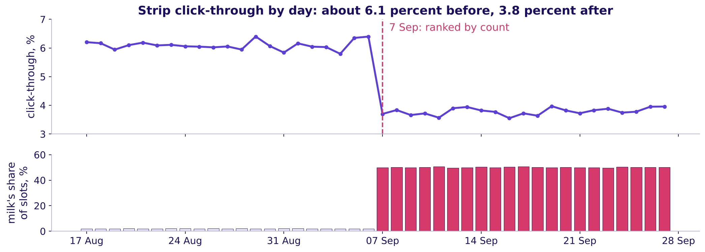

Milk took half the slot impressions at 1.2 percent; everything else clicked at 6.4, up from 6.2. Half of 1.2 plus half of 6.4 is 3.8. The plausible wrong answer, "shoppers changed after the monsoon", fails the split by suggested item.

```notes
LIVE, 6 minutes. This is notebook 02's your-turn cell: each learner splits the after rows by
whether the slot suggested milk before the answer is shown. Read the daily line first: it moves a
few tenths of a point every day and steps down on 7 September. The strip shows packs, so one view
can show milk in two slots. Transition: which slot milk took.
```

---

## S25. Slot 1 draws the most clicks, and milk took it
*Does the position of a slot change its click-through?*

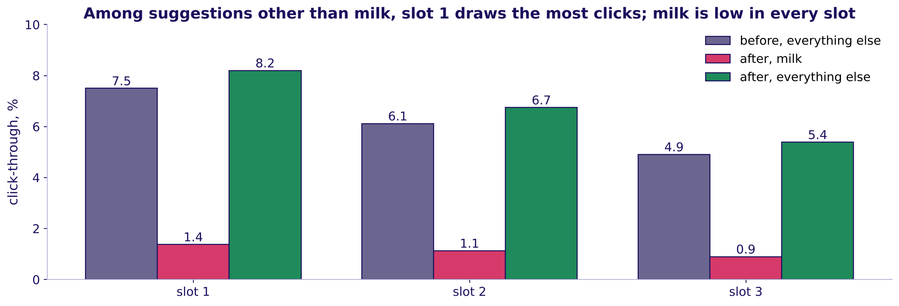

After the change, slot 1 draws 8.2 percent for a suggestion other than milk and slot 3 draws 5.4. Milk clicks at 1.4, 1.1 and 0.9 percent and holds 70 percent of slot 1. The best slot went to the item nobody needed reminding of.

```notes
LIVE, 3 minutes. This is the strip's own pull: whatever slot 1 shows draws clicks. It returns in
chapter 3 as a caveat. Transition: the chapter's answer.
```

---

## S26. Lift is the count popularity cannot fool
*What did 40,000 carts answer?*

```timeline
label: How often? | title: Milk in 71 percent of carts | body: Bread 34, eggs 29, curd 26 percent.
label: Most often together? | title: Pairs with milk | body: Bread and milk lead with 10,064 carts, so a count fills the strip with milk.
label: What lift says | title: Near one with milk | body: Bread 1.04, eggs 1.03; chips and cold drink 3.39.
label: Why the fall | title: Milk's half of the slots | body: 1.2 percent on milk, 6.4 on the rest, 3.8 blended.
```

```notes
LIVE, 3 minutes. Read the four lines, then break for 10 minutes. On the board before the break: the
week map with "lift: beyond chance" added under Wednesday. Transition after the break: chapter 3,
what fills the strip.
```

---

## SECTION 3: What fills the strip?
*Which pairs should fill the strip, what is a slot worth in rupees, and what can the counts not tell us?*

```notes
LIVE, 1 minute. Chapter 3 of 3, levels L4 and L5; part one now, part two unguided after lunch.
Notebook 03. Transition: the questions.
```

---

## S27. Four questions from a ranking to rupees
*Who needs the answer, and which questions lead to it?*

**Who needs the answer.** The growth lead, who takes a ranked list and a rupee figure to Friday's review, where the category manager will argue that milk anchors the cart.

```timeline
label: Question 1 | title: Which pairs beat chance by enough, on enough carts? | body: Lift above a support floor.
label: Question 2 | title: What should the watch list do with a strong thin pair? | body: Ice cream and chocolate sauce.
label: Question 3 | title: What is a slot worth in rupees? | body: Views, click-through, adds, margin.
label: Question 4 | title: What can the counts not tell us? | body: Six doubts and the check for each.
```

```notes
LIVE, 2 minutes. Read the four questions. Transition: the problem first.
```

---

## S28. Which of these four pairs would you promote?
*Each pair shows its support and its lift. Which takes the strip's first slot?*

```cards
icon: shopping-cart | eyebrow: a | title: Bread and toned milk | body: Support 25.2 percent, lift 1.04. | tone: light
icon: shopping-cart | eyebrow: b | title: Chips and cold drink | body: Support 5.0 percent, lift 3.39. | tone: light
icon: shopping-cart | eyebrow: c | title: Ice cream and chocolate sauce | body: Support 0.25 percent, lift 4.60. | tone: light
icon: shopping-cart | eyebrow: d | title: Onions and tomatoes | body: Support 7.5 percent, lift 1.70. | tone: light
```

```notes
LIVE, 4 minutes. Vote, argue, vote again (Brilliant: the problem before the explanation). The split
is usually b against c. Transition: every pair on one picture.
```

---

## S29. Answer: b, the strongest lift above the floor
*Where does every pair sit, and which four ways of ranking compete?*

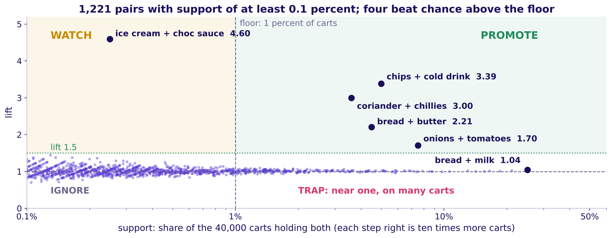

Above a floor of 1 percent of carts (400 carts), 246 pairs qualify and four beat chance clearly: chips and cold drink 3.39, coriander and green chillies 3.00, bread and butter 2.21, onions and tomatoes 1.70. The fifth reads 1.09.

```notes
LIVE, 8 minutes. Walk the regions: promote above the floor and well above one; watch, high lift
below the floor; ignore, near one, where milk's pairs sit. The floor is a decision: 0.5 percent
admits more pairs on thinner ground, 2 percent fewer. Explorer: scene W5, the floor slider counts
the pairs that survive. Transition: the thin pair.
```

---

## S30. The watch list holds lift 4.60 on 100 carts
*What should a team do with a strong pair that almost nobody buys?*

Ice cream and chocolate sauce read lift 4.60, the strongest pair between 0.2 and 1 percent support, on 100 carts in four weeks of this sample. A slot is shown on every cart page, so a pair that thin cannot repay it. It goes on a watch list: tried in two zones for two weeks and promoted only if its click-through beats the slot's own record. Acting on lift alone is the trap a floor exists to stop.

```notes
LIVE, 4 minutes. How long a trial must run to trust its answer is a sample-size question, parked by
name for the faculty session (tentative). Transition: what a slot is worth.
```

---

## S31. What does re-ranking recover in a month?
*Milk holds half the slot impressions at 1.2 percent. Moving them to pairs that click at 6.4 recovers how much?*

```cards
icon: indian-rupee | eyebrow: a | title: About Rs 50,000 | body: A rounding error on the city's month. | tone: light
icon: indian-rupee | eyebrow: b | title: About Rs 2 lakh | body: One slot's gap for half a month. | tone: light
icon: indian-rupee | eyebrow: c | title: About Rs 6 lakh | body: The gap on milk's share of all three slots. | tone: light
icon: indian-rupee | eyebrow: d | title: About Rs 50 lakh | body: Sales from every add the strip makes. | tone: light
```

```notes
LIVE, 3 minutes. Guess first, then build it. Transition: the cascade.
```

---

## S32. Answer: c, about Rs 6.3 lakh a month
*How do four numbers build a slot's value, and what does a month recover?*

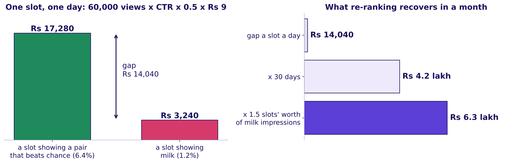

60,000 views a day (`strip_log`) x click-through x 0.5 adds per click (range 0.4 to 0.6) x Rs 9 margin an add (range Rs 7 to 11). Milk's half of three slots is 1.5 slots' worth: Rs 4.2 lakh x 1.5 = Rs 6.3 lakh a month, from Rs 3.9 lakh to Rs 9.3 lakh across the ranges.

```notes
LIVE, 7 minutes. Build it left to right on the board. Each factor is said with its source and its
range. Ask what the Rs 3,240 hides: milk earns Rs 2 a pouch, so a milk slot earns even less than
the Rs 9 assumption gives it. Explorer: scene W4, the strip simulator, rank by count against rank
by lift. Transition: the number people get wrong.
```

---

## S33. The trap: Rs 80,197 of sales is not the gain
*Which number would overstate the slot four times over?*

The plausible wrong answer books sales: a slot at 6.4 percent makes 1,920 adds a day, each selling for about Rs 42, so Rs 80,197 a day of "strip revenue". The growth lead keeps the margin, Rs 17,280. If the strip ever adds a bundle discount, the discount is margin handed back for adds that might have happened anyway. Swiggy's own letter describes its Maxxsaver discount as margin returned to the user, the cost line a rupee case must carry (W4, checked 12 October 2026).

```notes
LIVE, 5 minutes. Ask: "which line of the cascade would a bundle discount change?" The margin per
add falls by the discount. Transition: what the counts cannot tell us.
```

---

## S34. Six doubts the counts cannot settle alone
*What must the growth lead say aloud, and what check settles each doubt?*

| Doubt | The check | What it showed |
|---|---|---|
| Together is no proof of cause | A holdout that changes the strip | Monday's faculty session on A/B testing (tentative) |
| Heavy buyers | Count each customer once | Chips and cold drink 3.39 falls to 2.56; milk's pair stays 1.04 |
| Curd stock-out | Set aside two zones in week three | Curd's share 26.0 rises to 27.8 percent; its lift with milk stays 1.01 |
| Time of day | Morning carts only | Morning carts hold milk 80 percent of the time; bread with milk still about 1.04 |
| The strip's own pull | Click-through by slot | Slot 1 draws 8.2 percent, slot 3 5.4; milk is low in all three |
| Per cart against per customer | The heavy-buyer check | Answered above |

```notes
LIVE, 6 minutes. One doubt at a time, each with its number from notebook 03. A check that comes
back clean is said in one line, as the time-of-day check does. Transition: the heavy tenth.
```

---

## S35. Counted once per customer, the party pair shrinks
*How much of chips and cold drink comes from a few heavy shoppers?*

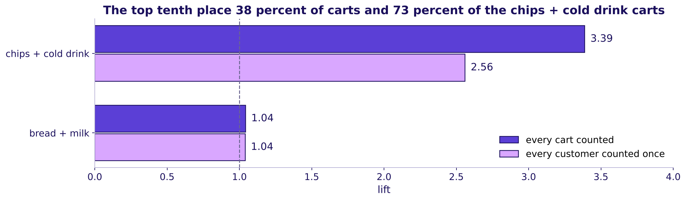

The top tenth of customers place 38 percent of the carts and 73 percent of the carts holding both chips and a cold drink. Counted with every customer once, the pair's lift falls from 3.39 to 2.56 and still beats chance; bread and milk stays at 1.04. The pair keeps its slot, and the growth lead says the smaller number.

```notes
LIVE, 4 minutes. "Counted once" means each cart weighs one over its customer's number of carts, so
a shopper with fourteen carts counts as much as a shopper with one. Transition: the stock-out.
```

---

## S36. Curd ran out in two zones in week three
*What does a stock-out do to support, and what does it leave alone?*

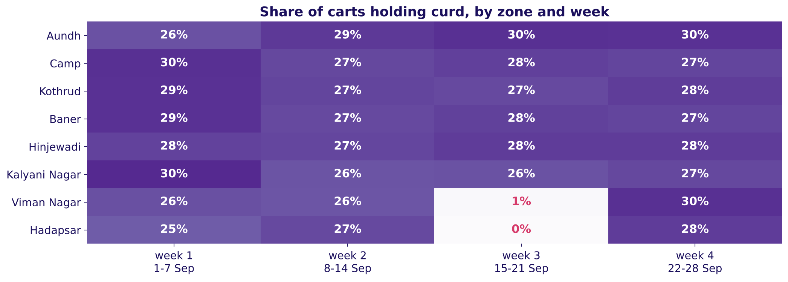

In Hadapsar and Viman Nagar from 15 to 21 September, curd is in 12 of 2,583 carts. Set those aside and curd's share rises from 26.0 to 27.8 percent; its lift with milk stays 1.01. A stock-out cuts the count, never the pull.

```notes
LIVE, 4 minutes. A caveat is a labelled line and a recomputation, never a disclaimer. Transition:
the morning's answer.
```

---

## S37. The morning's answer, ready for the afternoon
*What does the growth lead now hold?*

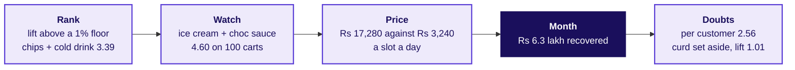

After lunch each group re-ranks the strip, prices its three slots and answers the category manager, who will say that milk anchors the cart.

```notes
LIVE, 2 minutes. Read the chain left to right. The afternoon's first 35 minutes run unguided on
notebook 03. Transition: lunch.
```
