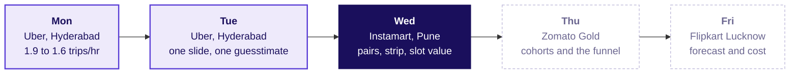
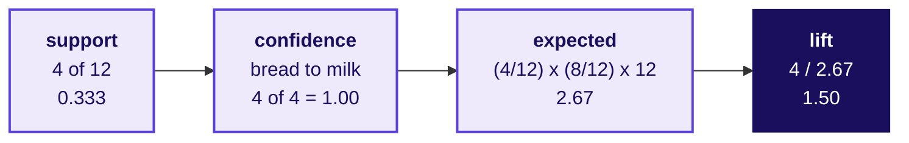
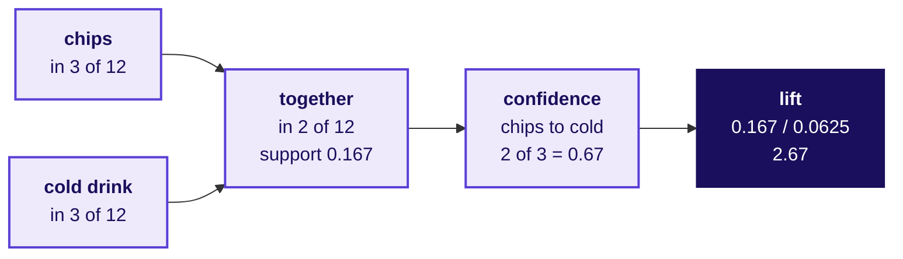
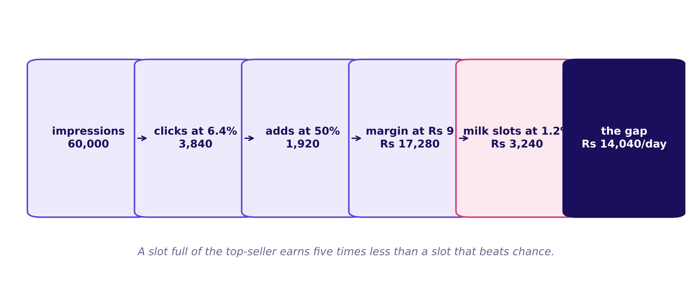
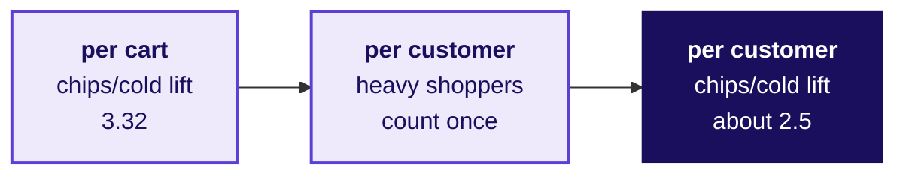

# The strip that stopped working

Week 4, Day 3. Half one.

Kicker: WEEK 4  ·  WEDNESDAY  ·  MORNING
Quote: Rank the pairs the strip should show, say why the click-through fell, and put a rupee value on a slot by Friday.
Who: The category manager and the growth lead, Swiggy Instamart, Pune, Monday 28 September 2026

```notes
On screen before the clock starts. Hold Pune and the strip in view while the room reads the
ticket. Read it aloud as it stands, including the "Illustrative case" line: the company is real
and the data for class is synthetic. Say the day runs in three chapters, L1 to L5 on the ladder.
Transition: the ticket, line by line.
```

---

## S1. Instamart Pune: click-through fell 6.1 to 3.8
*What has the analyst been handed, and what is the ask due Friday?*

| What the ticket carries | Value |
|---|---|
| Company and city | Swiggy Instamart, Pune |
| Surface | The cart page's frequently bought together strip, three slots |
| Metric before (17 Aug to 6 Sep 2026) | Strip click-through 6.1 percent |
| Metric after (7 to 27 Sep 2026) | Strip click-through 3.8 percent |
| Data | `carts` (40,000 for Sep), `cart_items`, `strip_log` |
| Ask, due Friday | Rank the pairs, explain the fall, value a slot |
| Caveats | Curd stock-out two zones week three; the top tenth place 38 percent of carts; the strip causes some of its own co-occurrence |

Illustrative case: the company is real, the situation and the data are synthetic, built for this class.

```notes
LIVE, 3 minutes. Walk the table top to bottom. Say the change: on Monday 7 September the strip
switched from a curated list to the items most often found in the same cart. Hold the "illustrative
case" line in view. Say Pune has eight zones in the data, which is why the city is split that way.
Transition: where today sits in the week, and what today ends with.
```

---

## S2. Where Wednesday sits in the week's five tickets
*Where does today sit in the week's five tickets?*



Monday and Tuesday earned the number the scheme pays for; today earns the three slots and the rupee value; Thursday asks who is leaving and Friday asks how much is coming.

```notes
LIVE, 2 minutes. Point out that Monday and Tuesday's nodes carry the numbers the room produced on
them. Say the method stays the same, the company and the question change. The AI-company variant
of today's L6 is scoring an LLM shopping assistant.
Transition: by the end of the morning, three slots on the strip and a rupee per month per slot.
```

---

## S3. Three slots, two caveats, Rs 12.6 lakh a month
*What does the end of today look like, numerically?*

```cards
icon: shopping-cart | eyebrow: Promote | title: Three slots | body: Chips and cold drink leads above the 1 percent floor; two more pairs by lift. Milk never fills a slot. | tone: light
icon: triangle-alert | eyebrow: The two caveats | title: Heavy tenth and stock-out | body: The top 10 percent of customers place 38 percent of carts; curd pairs vanish from two zones in week three. | tone: light
icon: trending-up | eyebrow: Rupees a month | title: Rs 12.6 lakh per month | body: Three slots at Rs 17,280/day each, less Rs 3,240/day under the milk ranking, times 30 days. | tone: dark
```

```notes
LIVE, 2 minutes. Say today ends with a number the growth lead will carry to the Friday review.
Three slots, two caveats, one gap in rupees. Everything between here and the gap is why the
number is sound.
Transition: chapter 1, counting on twelve carts.
```

---

## SECTION 1: What goes together, beyond chance?
*A hand count on twelve rows, before any code opens.*

**Who needs the answer.** The category manager and the growth lead.

**The questions on the way.** How often, how reliably, and against chance.

```notes
LIVE, 60 minutes. Chapter 1 of three, L1 on the ladder. Receipts on the table: twelve printed
carts per group, the ten tea-stall dots as the warm-up. Count the three ratios on the tea-stall
dots in 20 minutes, then on the twelve carts in groups in 40 minutes. No notebook open.
Transition: the tea stall as the warm-up.
```

---

## S4. Which chai-and-biscuit sentence is wrong?
*A tea stall's ten orders: chai in 6, biscuit in 4, both in 3.*

```cards
icon: list | eyebrow: Statement a | title: Support is 3 of 10 | body: The share of orders that hold both items. | tone: light
icon: list | eyebrow: Statement b | title: Confidence chai to biscuit is 3 of 6 | body: Among the chai orders, how many also had biscuit. | tone: light
icon: list | eyebrow: Statement c | title: Lift is 1.25 either way | body: The ratio of together over expected is symmetric. | tone: light
icon: triangle-alert | eyebrow: Statement d | title: Lift 1.25 means chai causes 25% more biscuit | body: A causal claim from a counting ratio. | tone: dark
```

```notes
LIVE, 2 minutes. Put the four sentences up. Ask the room to vote in groups. Do not reveal yet;
the next slide answers.
Transition: the answer, with the mechanism.
```

---

## S5. Answer: lift is a counting ratio, never a causal claim
*What does lift of 1.25 actually say?*


Support 3 of 10 is 0.30. Confidence from chai to biscuit is 3 of 6, which is 0.50. Expected if independent is 10 times 0.6 times 0.4, which is 2.4; against 3 seen the lift is 3 divided by 2.4, or 1.25. Lift reads from biscuit to chai as 3 divided by (4 times 6 divided by 10), the same 1.25. The two items are found together 25 percent more often than chance; nothing more.

```notes
LIVE, 4 minutes. Walk the counts on the picture, left dots to right table. Name what each
quantity means: support counts, confidence shrinks the world to the chai orders, lift compares
with the independence rectangle. Say explicitly that lift is a counting ratio and never a causal
claim; cause needs an experiment, which Monday and Thursday both touched.
Transition: the twelve printed carts on each table.
```

---

## S6. Twelve printed carts: milk in 8, bread in 4
*What do the twelve carts hold?*

| Cart | Items held |
|---|---|
| TR01 | milk, bread, eggs, bananas, coriander, onions, potatoes |
| TR02 | milk, bread, eggs, curd, bananas |
| TR03 | milk, bread, curd, paneer, onions |
| TR04 | milk, bread, eggs, tomatoes |
| TR05 | milk, eggs, chips, cold drink, onions |
| TR06 | milk, chips, cold drink, coriander |
| TR07 | milk, bananas, onions, potatoes |
| TR08 | milk, paneer, coriander, tomatoes |
| TR09 | chips, coriander, onions, potatoes |
| TR10 | cold drink, curd, bananas, tomatoes |
| TR11 | eggs, ice cream, chocolate sauce |
| TR12 | curd, onions |

```notes
LIVE, 5 minutes. Hand out the carts to the nine groups and read the first row aloud. Point out
that TR11 is the one cart holding ice cream and chocolate sauce, and that chips and cold drink
sit in three carts each. Do not announce "both in two" yet.
Transition: predict before you count.
```

---

## S7. Predict: how high is bread to milk's confidence?
*Which of these four values is the confidence from bread to milk on the twelve carts?*

```cards
icon: percent | eyebrow: Option a | title: 0.33 | body: The share of carts that hold bread. | tone: light
icon: percent | eyebrow: Option b | title: 0.50 | body: One of two bread carts, roughly. | tone: light
icon: percent | eyebrow: Option c | title: 0.75 | body: Three of the four bread carts, perhaps. | tone: light
icon: check | eyebrow: Option d | title: 1.00 | body: Every bread cart also holds milk. | tone: dark
```

```notes
LIVE, 1 minute. Take a vote by hand across the four options. Do not reveal yet; the next slide
walks the count.
Transition: the answer, written out.
```

---

## S8. Answer: confidence 1.00, lift 1.50 on the twelve carts
*How do the three numbers read on the twelve carts?*



Bread sits in 4 of the twelve carts, and milk sits in all 4 of them. Support is 4 of 12 which is 0.33. Confidence from bread to milk is 4 of 4 which is 1.00. Expected if independent is (4/12) times (8/12) times 12, which is 2.67; against 4 seen the lift is 4 divided by 2.67, or 1.50.

```notes
LIVE, 3 minutes. Walk the three computations line by line on the board. Press on the mechanism:
confidence shrinks the world to the 4 bread carts; lift compares with what independence would
predict. Say that 1.50 is far above 1 on 12 carts, but the next notebook will show the ratio
falling to near 1 on 40,000 carts, which is this chapter's bridge to L2.
Transition: chips and cold drink, the second count.
```

---

## S9. Chips and cold drink: lift 2.67 on 12 carts
*What do the three numbers read for the chips and cold drink pair?*



Chips is in three of the twelve carts, cold drink is in three of them, and both appear together in two carts. Support is 2 of 12 which is 0.167; confidence from chips to cold is 2 of 3 which is 0.67; expected if independent is (3/12) times (3/12) times 12 which is 0.75, so lift is 2 divided by 0.75, or 2.67.

```notes
LIVE, 4 minutes. Walk the counts. Point out that lift 2.67 is higher than the bread/milk 1.50
even though support is smaller. Rare items being found together carries more information than
common items being found together, which is what lift divides out.
Transition: the thinnest pair of all.
```

---

## S10. Ice cream and chocolate sauce: lift 12 on one cart
*What does a lift of 12 on one cart in twelve tell us about acting on it?*

Ice cream sits in one cart (TR11), chocolate sauce sits in the same cart, and the pair's expected if independent is (1/12) times (1/12) times 12 which is 1/12, so the lift reads 12. The number is dramatic; the base to compute it is one cart.

```notes
LIVE, 2 minutes. Make the point directly: a lift computed on one cart cannot be trusted, however
loud the number. The twelve carts are too few to decide. Chapter 2 will find the same pair at
lift 4.6 on 40,000 carts, which is still a watch-list candidate, not a promote candidate.
Transition: the twelve rows showed the three ratios; the next chapter runs them on every cart.
```

---

## SECTION 2: What do the three numbers say on all 40,000 carts?
*The pairs table runs on every cart in the four weeks of September.*

**Who needs the answer.** The growth lead, who must say which number the strip's new ranking optimises for.

**The questions on the way.** Which items are most common, which pairs beat chance, and why does the fall sit in slots suggesting milk.

```notes
LIVE, 50 minutes. Chapter 2 of three, L2 and L3 on the ladder. Open the notebook `02_pairs_table`
and walk the first eight cells: marginals, the pairs table, the lift ratio shown two ways, and
the milk trap caught in the your-turn cell.
Transition: lift as a ratio of two areas.
```

---

## S11. Lift reads from two rectangles
*How does a ratio of two counts turn into a comparison with chance?*


The expected rectangle has side P(bread) by side P(milk); its area is what the pair would occupy if the two items appeared independently. The observed rectangle has the same width P(bread) and a height such that its area equals the share of carts that actually hold both. Lift is the second area divided by the first; symmetric and dimensionless.

```notes
LIVE, 3 minutes. Walk the two rectangles. Say the width is bread's share, the height is the
observed density of milk inside bread. If the observed density equals milk's overall share, the
rectangles have the same area and lift is 1. Everything above or below one is the ratio of two
areas; everything else is bookkeeping.
Transition: compute the three numbers for every pair, in code.
```

---

## S12. The pairs table on 40,000 carts
*What do the four featured pairs read in the full data?*

| Pair | Support | Confidence a->b | Confidence b->a | Lift |
|---|---|---|---|---|
| bread, toned milk | 0.254 | 0.74 | 0.36 | 1.04 |
| eggs, toned milk | 0.211 | 0.73 | 0.30 | 1.03 |
| chips, cold drink | 0.050 | 0.42 | 0.41 | 3.32 |
| ice cream, chocolate sauce | 0.0026 | 0.07 | 0.18 | 4.47 |

```notes
LIVE, 4 minutes. Walk the four rows. Bread and eggs look bundled by confidence 0.73 and 0.74;
lift says they are almost independent, 1.03 and 1.04. Chips and cold drink lift 3.32 is the
strongest actionable pair. Ice cream and chocolate sauce lift 4.47 looks dramatic on 100 carts.
Transition: predict what every popular item's lift to milk looks like.
```

---

## S13. Predict: what is a popular item's lift to milk?
*For items in at least 2 percent of carts, what does their lift to milk look like?*

```cards
icon: trending-up | eyebrow: Option a | title: Rising with popularity | body: The more popular an item, the higher its lift to milk. | tone: light
icon: equal | eyebrow: Option b | title: All near 1 | body: Lift sits near one for all of them. | tone: dark
icon: trending-down | eyebrow: Option c | title: Falling with popularity | body: Common items pair less with milk than rare items. | tone: light
icon: shuffle | eyebrow: Option d | title: Scattered | body: Each pair goes its own way. | tone: light
```

```notes
LIVE, 1 minute. Take a quick vote. Do not reveal; the chart below answers.
Transition: the chart that answers.
```

---

## S14. Answer: lift says independence for every popular pair
*What does the chart say when read against the dashed lines?*


Every popular item sits at a confidence to milk of around 0.72. That is because milk sits in 0.71 of carts; most carts have milk, so most carts of X have milk too. Lift divides the 0.72 by milk's 0.71 and lands near one for every pair, which is independence.

```notes
LIVE, 4 minutes. Walk the picture. The vertical dashed line on the left panel marks milk's own
share. The vertical dashed line on the right panel marks lift of one. Say the chart in plain
words: milk looks bundled with everything but is not. This is the popularity trap, which the
chapter closes with Amazon's own account of it.
Transition: the popularity trap at Amazon.
```

---

## S15. Amazon's first recommender met the same trap
*Where has this trap bitten a real recommender?*

Amazon's early recommender counted how often buyers of A also bought B. Harry Potter was in every basket, so Harry Potter was the top recommendation beside everything. The fix was to compare with what independence would predict, which is lift in spirit; years later Amazon had to measure the base rate per purchase rather than per customer, since heavy buyers inflate everything, which the chapter's L4 picks up as the heavy-tenth caveat.

```notes
LIVE, 2 minutes. Read Amazon's own line: counting how often buyers of A also bought B would make
Harry Potter the top recommendation for everyone. Say the source is dated 12 October 2026 in the
day's internal/sources file. The fix is lift in spirit, with the base rate measured per purchase.
Transition: why did the click-through fall from 6.1 to 3.8.
```

---

## S16. Predict: why did the click-through fall?
*Which explanation is the one the data supports?*

```cards
icon: triangle-alert | eyebrow: Option a | title: Shoppers changed habits | body: After the monsoon, carts shifted and the strip's old pairs no longer fit. | tone: light
icon: triangle-alert | eyebrow: Option b | title: The strip needs a redesign | body: The slots are not visible enough on mobile. | tone: light
icon: check | eyebrow: Option c | title: Milk slots click poorly | body: Milk now fills half the slots and clicks at 1.2 percent. | tone: dark
icon: triangle-alert | eyebrow: Option d | title: Fewer impressions in September | body: The denominator fell, so the ratio fell. | tone: light
```

```notes
LIVE, 1 minute. Take a vote. Do not reveal yet.
Transition: the answer, from the strip log split.
```

---

## S17. Answer: milk slots click at 1.2 percent
*What does the split by suggested item say about the blended CTR?*


After the change, milk fills half the slots and clicks at 1.2 percent; every other suggestion clicks at 6.4 percent. Half times 1.2 plus half times 6.4 is 3.8 percent, which is the blended CTR. The number did not fall because shoppers changed; it fell because milk fills slots that no one needs reminding to add.

```notes
LIVE, 5 minutes. Walk the four bars. Say the mechanism: a blended rate is a mix of two rates;
when one of them drops, the blend drops. Say explicitly that the room should always split before
naming a cause.
Transition: the shrinking universe, which is what confidence reads.
```

---

## S18. Confidence shrinks the universe
*What does confidence throw away compared to lift?*


Confidence shrinks the world to the carts that hold A, then counts B inside them. The twelve carts drop to the four bread carts, and inside those four, all four hold milk. Confidence reads 1.00 because the shrinking is one-sided; it does not compare the inside with the outside. Lift does.

```notes
LIVE, 4 minutes. Walk the picture. The GIF beside the still shows the carts dimming. Say the
sentence that stays: confidence shrinks the universe; lift divides by the universe's rate. Use
the picture to answer any question about why the pair reads a 1.00 confidence and a 1.04 lift.
Transition: the chapter's close.
```

---

## S19. Chapter 2 close: lift is the popularity-safe measure
*What does L2 and L3 leave the room with?*

```timeline
label: Support | title: How often | body: The share of carts that hold both items; the pair's weight.
label: Confidence | title: How reliably | body: Inside the carts of A, how many also hold B; shrinks the world to A.
label: Lift | title: Against chance | body: Observed share divided by expected share; cannot be fooled by a popular partner.
label: The blend trap | title: Why the fall | body: 1.2 and 6.4 percent in half-and-half slot shares reproduce the 3.8 blend.
```

```notes
LIVE, 2 minutes. Read the four blocks aloud. Say that the next chapter picks three slots for the
strip and puts a rupee value on each.
Transition: chapter 3, the action map and the slot's value.
```

---

## SECTION 3: Which three pairs fill the strip, and what is a slot worth?
*The action map, the support floor, and the rupee value.*

**Who needs the answer.** The growth lead, who writes the one-slide answer to the ticket by Friday.

**The questions on the way.** Where sits the support floor, which pair's lift is actionable above it, and what is the margin a slot earns net of the discount a cart gives back.

```notes
LIVE, 50 minutes in the morning plus 30 minutes unguided in the afternoon's first 60. Chapter 3,
L4 and L5 on the ladder.
Transition: every pair on one picture.
```

---

## S20. Every pair on one picture: lift against support
*Where does every pair sit, and which four regions matter?*


A pair above the support floor and well above a lift of one goes to the strip; above one but below the floor goes to a watch list; near one is independence; and a cluster at high confidence to a popular partner and lift near one is the trap. The picture lets the room place every pair in one glance.

```notes
LIVE, 4 minutes. Walk the four regions. The vertical dashed line marks the 1 percent floor, the
horizontal dashed line marks lift of one. The chips/cold dot sits top-right. The ice/choc dot
sits top-left. The three milk pairs sit at lift near one.
Transition: where should the floor sit, and why 1 percent.
```

---

## S21. The 1 percent floor keeps a pair above 400 carts
*Why does the floor sit at 1 percent of carts?*

A pair below 1 percent of carts sits in fewer than 400 of the 40,000, so its lift is computed on thin ground. Ice cream and chocolate sauce lift 4.47 on 100 carts cannot repay a slot's rent in rupees; it belongs on a watch list that waits for the number to stabilise. The floor is a decision; a different company will set a different one.

```notes
LIVE, 3 minutes. Press the mechanism: the floor is a decision, not a formula. Pune's strip could
set it at 0.5 or 2 percent; the trade-off is more pairs, less reliability, each. Say the choice
of 1 percent reads cleanly against the slot's rupee value, which the next slide computes.
Transition: compute the slot's rupee value, line by line.
```

---

## S22. The slot's rupees from four labelled assumptions
*Which four numbers set the slot's value?*



60,000 cart-page views a day in Pune, half of each click becomes an add, Rs 9 margin per add. A slot with milk suggestions clicks at 1.2 percent and earns Rs 3,240 a day; a slot with a chance-beating pair clicks at 6.4 percent and earns Rs 17,280. The gap is Rs 14,040 a day per slot, or Rs 12.6 lakh over three slots over 30 days. Every assumption is labelled with its range on the notebook.

```notes
LIVE, 5 minutes. Walk the four factors. Press that each is an assumption, with a range: the
60,000 is from the ticket (50 to 70 thousand), the 50 percent add rate is from strip_log (0.4 to
0.6), the Rs 9 margin is from the cart_items margin field (Rs 7 to Rs 11). Say explicitly: a
rupee number stands only with the numbers it was built from, and the paper carries both.
Transition: the two caveats the fallback picks up.
```

---

## S23. The heavy tenth: 10% place 38% of carts
*How does recomputing per customer rather than per cart change the picture?*



The top ten percent of customers place 38 percent of the 40,000 carts. Chips and cold drink's lift reads 3.32 per cart; recomputed per customer it drops to about 2.5, because a party shopper's carts count once per person rather than once per visit. Milk and bread's per-customer lift stays near 1. The pair is still above the floor; the number the growth lead carries drops in size, and the caveat drops in a labelled sentence.

```notes
LIVE, 4 minutes. Walk the per-cart against per-customer numbers from the notebook. Say that the
per-customer denominator is what Amazon moved to when the first recommender's top pair was Harry
Potter and trash bags: heavy buyers inflate everything, so the base rate is measured per buyer.
Transition: the stock-out, the second caveat.
```

---

## S24. The curd stock-out, named and excluded
*What should the paper say about the curd pairs?*

A curd stock-out in two zones in the third week of September removed curd's pairs for those zone-weeks; the pair's lift elsewhere is unchanged. The fix is a labelled line that excludes the two zone-weeks from the curd pair's computation and recomputes. The paper carries both numbers.

```notes
LIVE, 3 minutes. Press the method: a caveat is a labelled line and a recomputation, not a
disclaimer. The paper names the fact that would change the call and shows the number with that
fact set aside.
Transition: the chapter's close.
```

---

## S25. Chapter 3 close: Rs 12.6 lakh a month
*What does the morning leave with?*

```timeline
label: Promote | title: Chips and cold drink | body: Lift 3.32 on 2,000 of 40,000 carts, above the 1 percent floor.
label: Promote | title: Two more pairs | body: Picked from the notebook's list, each above the floor and well above lift 1.
label: Watch | title: Ice cream and chocolate sauce | body: Lift 4.47 but on 100 carts, below the floor; wait for the number to settle.
label: The rupee | title: Rs 12.6 lakh a month | body: Three slots times the gap per slot per month, each assumption labelled.
```

```notes
LIVE, 2 minutes. Read the four blocks. Say the afternoon unguided chapter 3 part 2 picks the
three slots per group and writes the one-paragraph proposal. The Kalpa lab runs the same method
on Kalpa Retail's own baskets.
Transition: the afternoon unguided block picks the three slots.
```
