# Market basket, lift and cross-sell

Week 4, Day 3. Half one.

Header: WEEK 4  ·  WEDNESDAY  ·  MARKET BASKET, LIFT AND CROSS-SELL

---

## S1. Market basket, lift and cross-sell
*Which pairs lift frequency, and what is each one worth?*

```cards
icon: utensils | eyebrow: The topics | title: Counted on invented examples | body: A hostel canteen's twelve lunch orders and a Pune corner shop's month carry the five topics, chapter by chapter, by hand first. | tone: light
icon: shopping-cart | eyebrow: The case | title: Swiggy Instamart, Pune | body: The cart page's strip of three suggestions, whose click-through fell once it showed the items most often bought together. | tone: light
icon: store | eyebrow: The lab | title: Kalpa Retail's baskets | body: Merchandising wants every product bundled with the Rs 199 phone charger; the lab counts Kalpa's own order lines. | tone: dark
```

```notes
LIVE, 1 minute. Read the day's topic and its question. The topics come first, each counted on an
invented example small enough to check by hand; the case then asks the same questions of 40,000
carts; the lab asks them of Kalpa's baskets. Transition: where Wednesday sits in the week.
```

---

## S2. Wednesday asks what goes with what, beyond chance
*Where does today sit among the week's five tickets?*

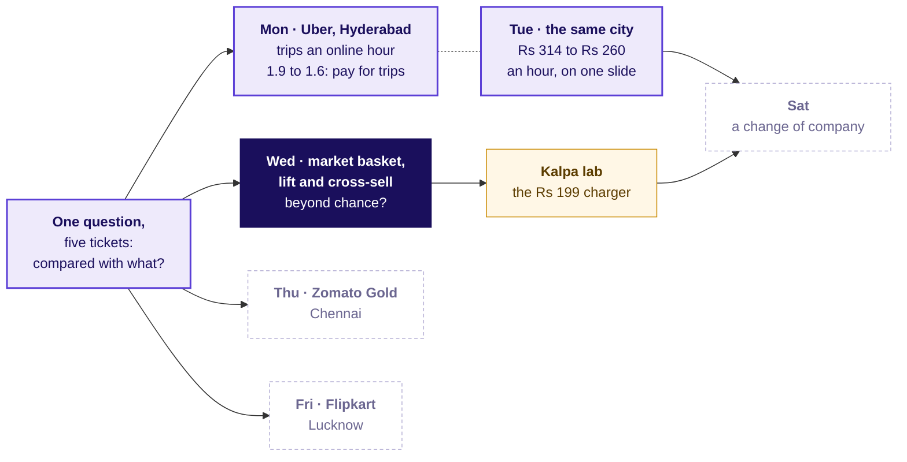

```notes
LIVE, 1 minute. Monday and Tuesday carry the numbers the room produced on them. Today's node is
lit; Thursday, Friday and Saturday stay dashed. Each day asks what one number is compared with, and
today compares two items sharing a basket with what chance alone would give. The Kalpa node is the
lab after class. Explorer: the home screen, Wednesday lit. Transition: the five topics.
```

---

## S3. Five topics in seven chapters, then the case
*Which topics does Wednesday teach, in what order, and where?*

| # | The topic, in the curriculum's words | Chapter | Minutes | Notebook |
|---|---|---|---|---|
| 1 | Support, confidence and lift, derived by counting | 1 Support; 2 Confidence; 3 Chance and lift | 12, 12, 18 | 01, 02, 03 |
| 2 | The confidence trap; lift near one | 4 | 18 | 04 |
| 3 | Basket analysis on the order items | 5 | 15 | 05 |
| 4 | The support floor and the watch list | 6 | 12 | 06 |
| 5 | Cross-sell and upsell reasoning; expected value in rupees | 9, after lunch | 18 | 09 |

Chapters 7 and 8 apply the topics to Swiggy Instamart's Pune carts before lunch, chapter 10 after it, and the lab runs them on Kalpa Retail's order lines in notebook 11. A slide numbered D is for self-study, and each interview line carries this programme's tag: [S] a staple asked everywhere, [F] frequent in product-company and global capability centre screens, [D] a differentiator.

```notes
LIVE, 2 minutes. Read the five topics down the second column once: these are the words the
curriculum uses, so a learner can find each one again by name. Each concept chapter ends on a
number counted from the canteen or the corner shop; the case then asks the same question of
40,000 carts. A 10-minute break follows chapter 4. Chapter 9 opens the afternoon so the morning
carries four new ideas a block. The IITGN faculty session (tentative) takes the afternoon's last
120 minutes. Transition: how the five topics join.
```

---

## S4. Five topics, joined to what came before and after
*What does each topic rest on, what does it feed, and where is it applied?*

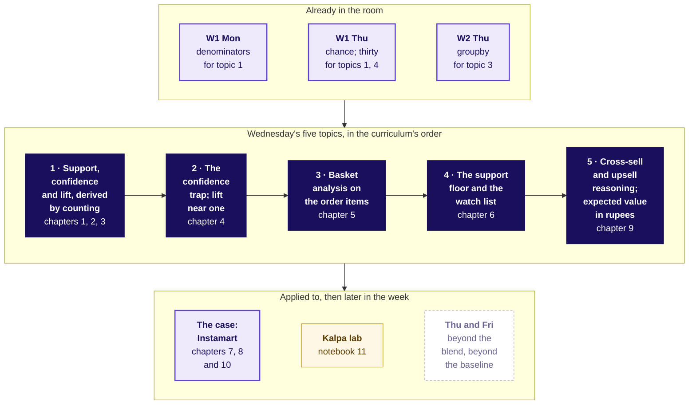

```notes
LIVE, 2 minutes. Walk the map top to bottom. The top band is what the room already has: Week 1's
denominators and like-with-like, Week 1 Thursday's chance reference and its rule of thirty, Week
2's groupby. The five dark boxes are today's topics in the curriculum's order. Every topic is
applied to the case, and the case runs once more on Kalpa in the lab. Lift returns on Thursday
as "beyond the blend" and on Friday as "beyond the baseline". The map comes back at the close of
each chapter with that chapter's box filled. Transition: the case these topics will be used on.
```

---

## S5. Strip click-through fell from 6.1 to 3.8 percent
*What has the analyst been handed, and what is due Friday?*

| On the ticket | What it says |
|---|---|
| Company, city, part of the app | Swiggy Instamart, Pune: the cart page's strip of three suggested items, each in a slot |
| The change | Monday 7 September 2026: a curated list became the items most often found in the same cart; toned milk is in 71 percent of carts, so it now sits beside nearly everything |
| The metric | Strip click-through, clicks over impressions (an impression is one showing of one slot): 6.1 percent from 17 August to 6 September, 3.8 percent from 7 to 27 September |
| The data | `carts` (cart_id, customer_id, placed_date, zone, time_band, cart_value_rs): a sample of 40,000 carts, every cart 12,000 customers placed from 1 to 28 September, in eight zones; `cart_items` (cart_id, item, quantity, price_rs, margin_rs); `strip_log` (date, slot, anchor_item, the cart item a suggestion sits beside, suggested_item, impressions, clicks, adds, the suggestions put in the cart) |
| The ask, due Friday | Rank the pairs the strip should show, explain the fall, put a rupee value on a slot |
| Who asks | The growth lead, who owns the strip's clicks and orders, and the category manager, who decides which products are promoted; Friday's review is the weekly meeting where both defend their numbers |
| Caveats | Curd ran out in two zones in week three; the top tenth of customers place 38 percent of carts; the strip causes some of the pairs it counts, since a milk add from the strip puts bread and milk in one cart; a cart is one order, a customer places many |

This page is the ticket, the work request the analyst is handed. Illustrative case: the company is real, the situation and the data are synthetic, built for this class.

```notes
LIVE, 4 minutes. Read the table top to bottom, then the label line: the company is real, the
situation and the data are synthetic. Define two words as they appear: an impression is one time a
slot was shown, and click-through is clicks divided by impressions. Point at the three tables and
their columns. Ask the room for one reason "in most carts" might be the wrong reason to show an
item, and write the answers on the board without judging them; chapter 4 settles it. This is the
destination: the seven chapters build every tool the ticket needs before chapter 7 opens it again.
Transition: the first topic, on a hostel canteen.
```

---

## SECTION 1: Support: how often together?
*Support, the first of the three counts, counted on a hostel canteen's twelve lunch orders, invented, before any code: how often do two items share a basket?*

```notes
LIVE, 30 seconds. Chapter 1 of the concept block, the first of three chapters on the topic
"Support, confidence and lift, derived by counting". The canteen cards go on every table now,
twelve per group. No laptop opens until slide S9. Transition: who needs the count.
```

---

## S6. Support counts how often two items share a basket
*Who needs the answer, and which questions lead to it?*

**The topic.** Support, confidence and lift, derived by counting: part one of three, support.

**Who needs the answer.** The canteen manager, who prints two items side by side on the combo board; without a count, the board goes to whichever pair the manager remembers selling.

```timeline
label: Question 1 | title: What is a basket? | body: Everything one customer pays for in one go.
label: Question 2 | title: How many orders hold both? | body: Roti and sabzi, counted inside the orders.
label: Question 3 | title: Which pair is most common? | body: Every pair's count over the twelve orders.
label: Question 4 | title: What does support leave out? | body: The question chapters 2 and 3 answer.
```

```notes
LIVE, 1 minute. A basket is one bill at a kirana, one order at the canteen, one cart on an app.
One customer fills many baskets, so the basket, never the customer, is what today counts.
Together means in the same basket. Read the four questions; each gets a number before the next.
Transition: the twelve orders.
```

---

## S7. How many of twelve orders hold roti and sabzi?
*A hostel canteen's twelve lunch orders, invented: roti is in 4 and sabzi in 4. How many hold both?*

| Order | Items | Order | Items | Order | Items |
|---|---|---|---|---|---|
| T01 | dal rice, papad, chaas | T05 | dal rice, chaas | T09 | roti, sabzi, chaas |
| T02 | dal rice, papad, chaas | T06 | dal rice, curd, chaas | T10 | roti, sabzi, chaas |
| T03 | dal rice, papad, chaas | T07 | roti, papad, pickle | T11 | roti, sabzi, chaas |
| T04 | dal rice, sabzi, chaas | T08 | papad, pickle | T12 | gulab jamun, curd |

a) 8, since four roti orders and four sabzi orders make eight. b) 5, since five orders hold roti or sabzi. c) 3, since three orders hold roti with sabzi. d) 4, since every roti order also holds sabzi.

```notes
LIVE, 3 minutes. The misconception first: the hurried count adds the two items' counts. Groups
vote with a letter card, argue with a neighbour for a minute, then vote again; the split is
usually a against c. Each option is a claim the cards can settle, so send the room to the cards:
"find the orders that hold both". Explorer: none yet. Transition: the reveal.
```

---

## S8. Answer: c, 3 of 12 orders hold both: support 0.25
*How does the 2 by 2 count the twelve orders?*

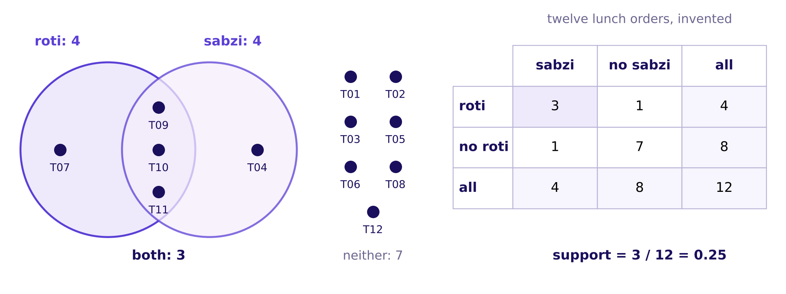

T09, T10 and T11 hold both, T07 holds roti alone, T04 holds sabzi alone, and seven orders hold neither: the four cells add to twelve. Support is the orders holding both over all orders, 3 / 12 = 0.25. Adding 4 and 4 gives 8, which counts T09 to T11 twice and never looks inside an order.

```notes
LIVE, 3 minutes. Count each cell of the 2 by 2 aloud from the cards (StatQuest): both, roti
only, sabzi only, neither, and the total. The trap, exactly: 8 for roti and sabzi, from adding
the two counts; the decision it misleads is a combo printed for a pair that shares three orders.
The check is the 2 by 2 adding to twelve. Callback to Week 1 Monday: support is a rate, and its
denominator is every basket. Transition: every pair at once.
```

---

## S9. Dal rice and chaas share the most orders: 0.50
*Which pair is most common, and what does support compute for every pair?*

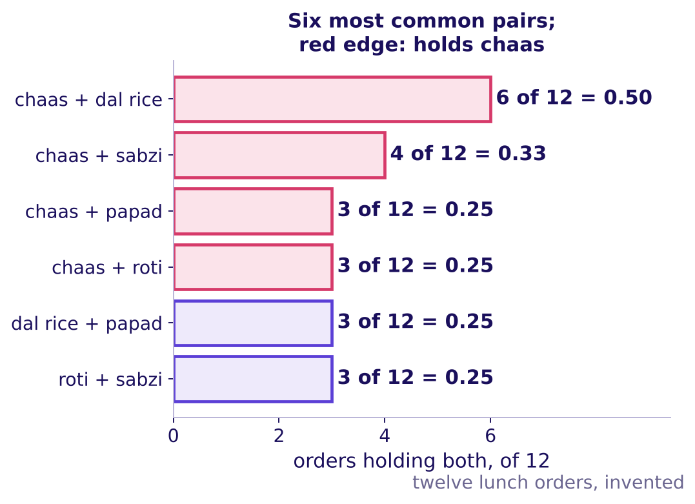

The formula, named last: support of a pair is the baskets holding both over all baskets. Chaas's own support is its share, 9 / 12 = 0.75. Three lines count it:

```python
# one set of items per order
orders = lines.groupby("order_id")
baskets = orders.item.apply(set)
# orders holding roti and sabzi: 3
both = sum("roti" in b and "sabzi" in b
           for b in baskets)
print(both / len(baskets))     # 0.25
```

```notes
LIVE, 3 minutes. Read the bars: dal rice and chaas share 6 of the 12 orders, the most common pair,
and four of the six most common pairs hold chaas. Park the question the room will ask: is the
most common pair the best one to put on the combo board? Chapter 4 answers it. Then the formula,
once, as the shorthand for the count just done, and the three lines, each said in plain words
(Krish Naik); notebook 01 runs them. Transition: the rules.
```

---

## S10. Support answers how often, and nothing more
*What should a learner keep from chapter 1, and where is support used next?*

1. A basket is everything one customer pays for in one go, and together means in the same basket.
2. Support of a pair is the baskets holding both over all baskets, so its denominator is every basket.
3. An item's own support is its share of baskets: chaas sits in 0.75 of the twelve orders.
4. The most common pair is a count and nothing more yet: dal rice and chaas lead with 6 of 12.

**In the interview.** [S] "What is support?" The share of all baskets that hold both items, said with its denominator.

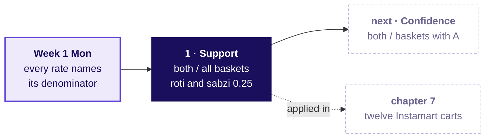

```notes
LIVE, 1 minute 30 seconds. The rules are the slide a learner photographs. Check question before moving on:
"Roti and sabzi and roti and chaas both read support 0.25. Does support tell the two pairs apart?"
It does not, which is what chapters 2 and 3 are for. Fill the map's first box with 0.25.
Transition: chapter 2, confidence.
```

---

## SECTION 2: Confidence: how reliably together?
*Confidence, the second count, on the same twelve orders: how reliably one item brings the other, and why the direction changes the number.*

```notes
LIVE, 30 seconds. Chapter 2 of the concept block, the second of three chapters on "Support,
confidence and lift, derived by counting". Same cards. Transition: who needs it.
```

---

## S11. Confidence counts inside the baskets that hold A
*Who needs the answer, and which questions lead to it?*

**The topic.** Support, confidence and lift, derived by counting: part two of three, confidence.

**Who needs the answer.** The canteen manager again, who must decide which item the combo card is printed beside: a card aimed at the wrong buyer reads well and sells nothing.

```timeline
label: Question 1 | title: What does "of those" count? | body: The baskets with A, then those with B too.
label: Question 2 | title: Does direction matter? | body: Dal rice to papad against papad to dal rice.
label: Question 3 | title: How far can it swing? | body: Papad and pickle, two orders.
label: Question 4 | title: What can it not say? | body: Whether a pair is special at all.
```

```notes
LIVE, 1 minute. Callback to Week 1 Tuesday: a rate inside a segment, whose denominator is the
segment's size. Confidence from A to B shrinks the world to A's baskets, then counts how many of
those hold B. Transition: the prediction.
```

---

## S12. Dal rice to papad reads 0.50; papad to dal rice?
*Dal rice is in 6 orders, papad in 5, both in 3. What is the confidence from papad to dal rice?*

```cards
icon: equal | eyebrow: a | title: 0.50 | body: Confidence reads the same both ways, like support. | tone: light
icon: percent | eyebrow: b | title: 0.60 | body: Three of papad's five orders hold dal rice. | tone: light
icon: percent | eyebrow: c | title: 0.25 | body: Three of all twelve orders hold both. | tone: light
icon: check | eyebrow: d | title: 1.00 | body: Every papad order holds dal rice. | tone: light
```

```notes
LIVE, 3 minutes. Put the common wrong answer to the room in its own words first: "confidence is
the chance the two go together, so it reads the same both ways". Vote, argue, vote again; the
split is usually a against b. Option c is support, which the room met in chapter 1. Transition:
both directions, counted.
```

---

## S13. Answer: b, 0.60: three of papad's five orders
*How do the same three orders give two different confidences?*

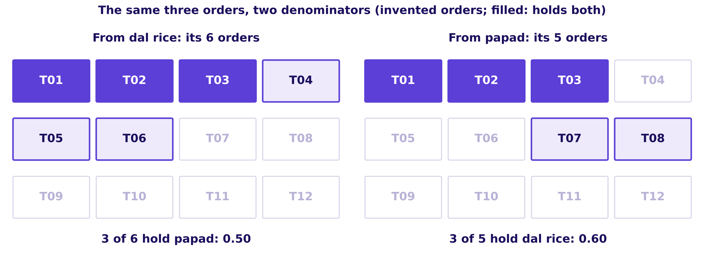

From dal rice, the world shrinks to its 6 orders and 3 hold papad: 3 / 6 = 0.50. From papad, it shrinks to 5 orders and the same 3 hold dal rice: 3 / 5 = 0.60. The trap is reporting one direction's number for the other, which aims the combo card at the wrong buyer.

```notes
LIVE, 3 minutes. Count both directions on the cards. The GIF of the shrinking world (whiteboards,
canteen_shrink) dims the orders in two steps: all twelve, then dal rice's six, then the three with
papad. Explorer: scene W2, two buttons that grey the baskets without A, then without B.
Transition: how far direction can swing a number.
```

---

## S14. Direction can swing a pair from 1.00 to 0.40
*How far apart can the two directions sit, and when do they agree?*

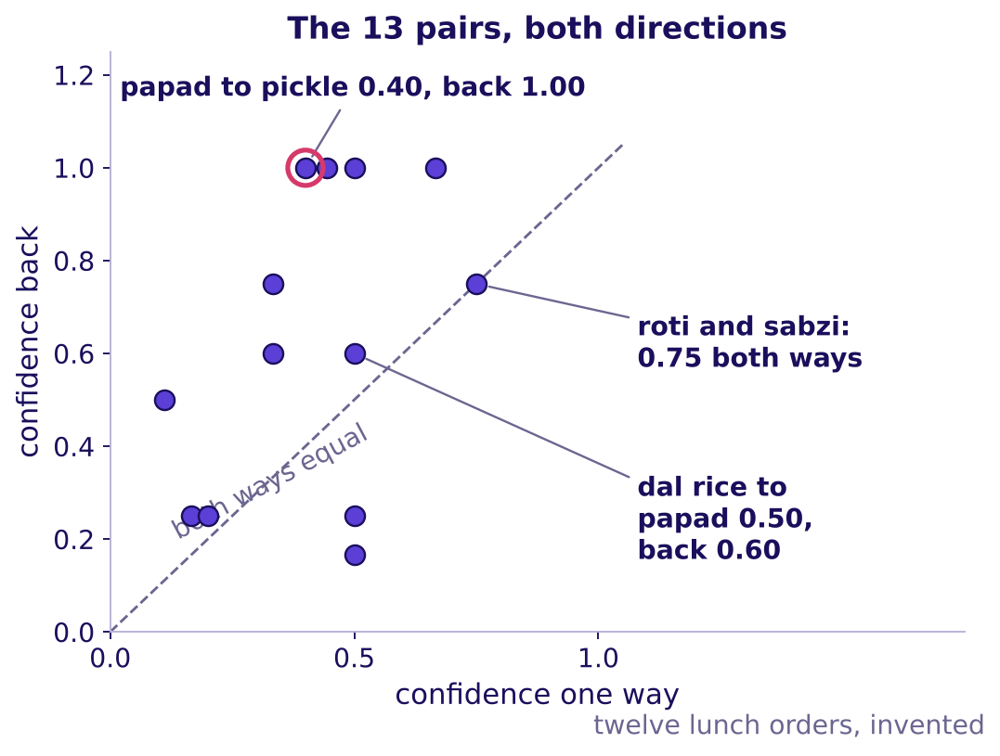

The formula, named last: confidence from A to B is the baskets holding both over the baskets holding A. Pickle's two orders both hold papad, 1.00, while papad's five orders hold pickle twice, 0.40. Roti and sabzi read 0.75 both ways only because each sits in 4 orders.

```python
# orders holding dal rice: 6
dal = sum("dal rice" in b for b in baskets)
# of those, orders holding papad too: 3
both = sum("papad" in b for b in baskets
           if "dal rice" in b)
print(both / dal)        # 0.50 from dal rice
```

```notes
LIVE, 3 minutes. Points on the diagonal read the same both ways; every point off it is a pair
whose two items have different counts. Check question: "Chaas is in 9 orders and sabzi in 4,
together in 4. Sabzi to chaas? Chaas to sabzi?" 1.00 and 0.44: the same four orders, two
sentences. Notebook 02 runs both directions for every pair. Transition: the rules.
```

---

## S15. Confidence is a rate with a direction
*What should a learner keep from chapter 2, and where is confidence used next?*

1. Confidence from A to B is the baskets holding both over the baskets holding A.
2. It is written with its direction, since the denominator is the basket count of A.
3. The two directions agree only when the two items sit in the same number of baskets.
4. Confidence alone never says whether a pair is special, since it ignores how common B is anyway.

**In the interview.** [S] "What is confidence, and why does the direction matter?" Both over A, so A to B and B to A divide by different baskets.

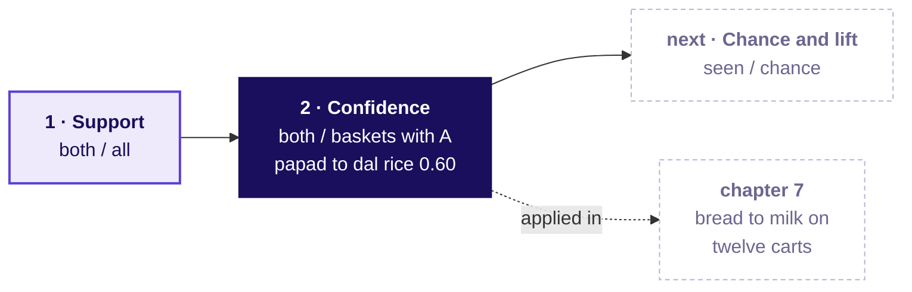

```notes
LIVE, 1 minute 30 seconds. Rule 4 is the question chapter 3 answers: is a confidence of 1.00 special when
chaas is in 9 of 12 orders anyway? Fill the map's second box with 0.60. Transition: chapter 3.
```

---

## SECTION 3: Chance and lift: more often than chance?
*Lift, the third count, built from what chance alone would put in a basket: do two items meet more often than chance would put them together?*

```notes
LIVE, 30 seconds. Chapter 3 of the concept block, the third of three chapters on "Support,
confidence and lift, derived by counting". Transition: who needs it.
```

---

## S16. Lift compares what is seen with what chance gives
*Who needs the answer, and which questions lead to it?*

**The topic.** Support, confidence and lift, derived by counting: part three of three, chance and lift.

**Who needs the answer.** The canteen manager, who wants pairs that sell together more than they would anyway; a pair that merely meets as often as chance puts nothing extra on the counter.

```timeline
label: Question 1 | title: What would chance give? | body: If two items ignored each other.
label: Question 2 | title: What is lift? | body: The seen count over the chance count.
label: Question 3 | title: Does lift have a direction? | body: Read it from both sides.
label: Question 4 | title: What does lift not say? | body: Why the two meet.
```

```notes
LIVE, 1 minute. Callback to Week 1 Thursday: the chance reference, the number a count would show
if nothing were going on, which the shuffle made and which this chapter makes with one
multiplication. The chapter stays with counts and shares. Transition: the prediction.
```

---

## S17. If roti and sabzi ignored each other, how many?
*Roti is in 4 of 12 orders and sabzi in 4. How many orders would hold both by chance alone?*

```cards
icon: circle-off | eyebrow: a | title: 0 | body: Items that ignore each other never meet. | tone: light
icon: divide | eyebrow: b | title: 1.33 | body: A third of roti's 4 orders, if sabzi ignored roti. | tone: light
icon: shopping-basket | eyebrow: c | title: 3 | body: Three orders hold both on the cards. | tone: light
icon: hash | eyebrow: d | title: 4 | body: Roti's own count. | tone: light
```

```notes
LIVE, 2 minutes. Two misconceptions said aloud: "expected means what I expect to see", when it
means what chance alone would give; and "ignoring each other means never meeting", when two
items that ignore each other still share baskets at their own rates. Vote, argue, vote again;
the split is usually b against c. Transition: the proportion, counted.
```

---

## S18. Answer: b, 1.33 by chance; 3 seen; lift 2.25
*How does chance give a count, and how does lift compare with it?*

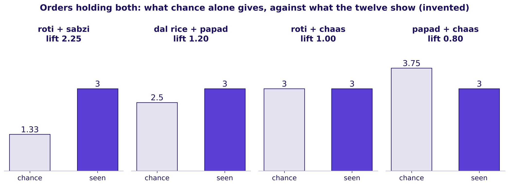

If roti and sabzi ignored each other, roti's orders would hold sabzi at the rate all orders do, 4 of 12, so a third of the 4 roti orders: 12 x 4/12 x 4/12 = 1.33. Three are seen, so lift is 3 / 1.33 = 2.25. Roti and chaas show chance itself: 12 x 4/12 x 9/12 = 3 by chance, 3 seen, lift 1.00.

```notes
LIVE, 4 minutes. Build the chance count aloud on the board: total times A's share times B's share.
Then the four pairs on the picture, left to right: 2.25, 1.20, 1.00, 0.80. Below one, together
less often than chance; near one, chance; above one, a pull. Transition: the same idea as areas.
```

---

## S19. Lift is a ratio of two areas, the same both ways
*What does the picture say lift is, and why does it have no direction?*

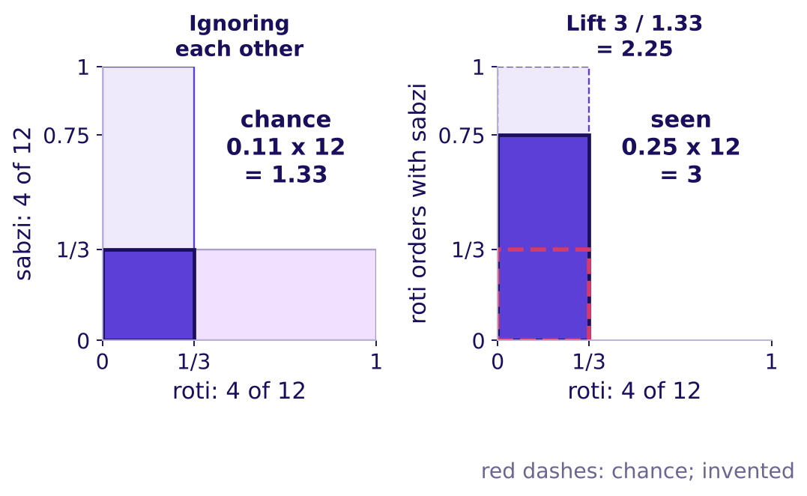

The formula, named last: lift = seen / chance = both x all / (A x B) = 3 x 12 / (4 x 4) = 2.25. The second route is confidence over the partner's share: 0.75 / (4/12) = 2.25 from either side, which is why lift has no direction.

```python
# chance: all orders x both shares
chance = 12 * (4 / 12) * (4 / 12)  # 1.33
print(3 / chance)          # lift: 2.25
# second route: confidence over share
print((3 / 4) / (4 / 12))  # also 2.25
```

```notes
LIVE, 8 minutes, 4 on the picture and the formula and 4 in notebook 03, which runs the second
route and the thirteen pairs' lifts. Read the picture as two areas (3Blue1Brown): roti's band times sabzi's band is
the box chance gives; the seen box is taller. Show the cancelling step on the board:
3 / (12 x 4/12 x 4/12) = 3 x 12 / (4 x 4). Explorer: scene W1, sliders for the two shares and the
overlap. Check question: "Papad is in 5 orders, chaas in 9, both in 3. Chance? Lift?" 3.75 and
0.80. Transition: the rules, and what lift never says.
```

---

## S20. Lift counts a pull and never names a cause
*What should a learner keep from chapter 3, and where is lift used next?*

1. Chance alone gives a pair all baskets times A's share times B's share.
2. Lift is the seen count over the chance count, and it reads the same from both sides.
3. Lift below one means together less often than chance, exactly one means chance, and above one more often.
4. Lift 2.25 never means roti makes anyone buy 2.25 times the sabzi; only a change at the counter tested fairly shows cause.

**In the interview.** [S] "Which of the three counts cannot be fooled by popularity?" Lift, because it divides by the partner's share; chapter 4 shows the trap it avoids.

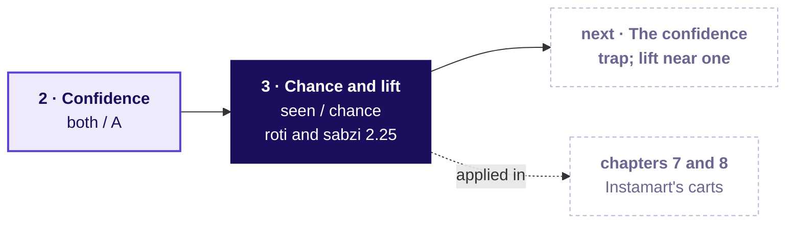

```notes
LIVE, 2 minutes 30 seconds. Rule 4 is this chapter's trap: the number is right and the sentence is wrong.
The decision it misleads is a roti promotion run to sell sabzi, whose sabzi sales need not move as
the number seems to promise; the fix is a change at the counter, tested fairly. The test that would
show cause is this week's Monday faculty session on A/B testing (tentative).
Checkpoint: three learners say roti and sabzi's three numbers from the board, 0.25, 0.75 and 2.25.
Fill the map's third box. Transition: chapter 4, the item in every order.
```

---

## SECTION 4: The confidence trap; lift near one: does 1.00 mean a bundle?
*Why the item in most baskets reads like a bundle with everything, why its lift can never climb far above one, and what near one means today.*

```notes
LIVE, 30 seconds. Chapter 4 of the concept block, on the topic "The confidence trap; lift near
one". Transition: who needs it.
```

---

## S21. Chaas is in 9 of 12 orders: a base rate of 0.75
*Who needs the answer, and which questions lead to it?*

**The topic.** The confidence trap; lift near one.

**Who needs the answer.** The canteen manager, who is told that every dal rice order has chaas and is tempted to print chaas beside everything; a board full of chaas sells nothing that was not selling already.

```timeline
label: Question 1 | title: What is a base rate? | body: How common an item is in all baskets anyway.
label: Question 2 | title: What is dal rice to chaas worth? | body: Confidence 1.00, read against 0.75.
label: Question 3 | title: Does every item look bundled? | body: The four common items toward chaas.
label: Question 4 | title: Which count resists it? | body: The one that divides the base rate out.
```

```notes
LIVE, 1 minute. The base rate is chaas's own share of all orders, 0.75: how common it is anyway.
An item in most baskets is in most of A's baskets too, whatever A is. Transition: the prediction.
```

---

## S22. Dal rice to chaas reads 1.00: what is the lift?
*Every dal rice order holds chaas, and chaas is in 9 of 12 orders. What is their lift?*

```cards
icon: check-check | eyebrow: a | title: 1.00 | body: The same as the confidence. | tone: light
icon: scale | eyebrow: b | title: 1.33 | body: The confidence over chaas's share. | tone: light
icon: trending-up | eyebrow: c | title: 2.00 | body: Twice as strong as an ordinary pair. | tone: light
icon: percent | eyebrow: d | title: 0.75 | body: Chaas's own share of the orders. | tone: light
```

```notes
LIVE, 3 minutes. The misconception, in the manager's words: "every dal rice order has chaas, so
chaas is dal rice's perfect partner; print the combo." Peer instruction here: the room usually
splits between a and c. Vote, two minutes with a neighbour, vote again. Transition: the reveal.
```

---

## S23. Answer: b, 1.33: chance already gave dal rice 4.5
*Why does a confidence of 1.00 add so little?*

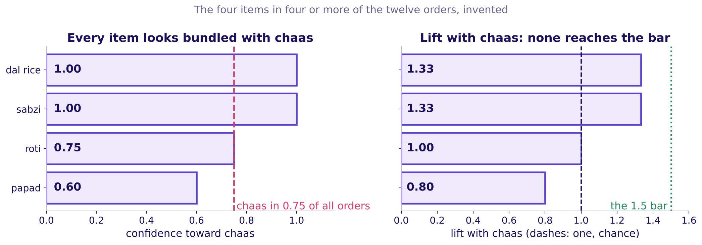

Chance alone puts chaas in 12 x 6/12 x 9/12 = 4.5 of dal rice's 6 orders; 6 are seen, so lift is 6 / 4.5 = 1.33, and 1.00 / 0.75 gives the same. That is as high as any lift with chaas can go: a partner cannot hold chaas more than every time, so lift stops at one over chaas's 0.75, 1.33. Every item in four or more orders reads confidence 0.60 to 1.00 toward chaas, and lift 0.80 to 1.33.

```notes
LIVE, 3 minutes. The trap, exactly: 1.00 read as a bundle; the decision it misleads is a combo
board filled with chaas beside everything, which changes nothing, since chaas was already in nine
of twelve orders. The check: chaas's own share. The fix: read lift. Today, near one means under
the 1.5 bar chapter 6 sets, too weak a pull to act on; on twelve orders a lift of 1.33 is also
within luck's reach, as chapter 6's month shows.
Transition: what popularity does to confidence, in general.
```

---

## S24. Confidence follows popularity; lift divides it out
*What happens to the two counts as an item gets more popular?*

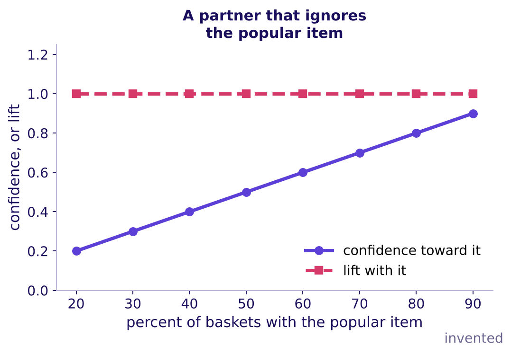

The rule, named last: for a partner that ignores it, confidence toward an item equals that item's share, so the most popular item tops the confidence ranking beside almost every item, while lift stays at one.

```python
# the popular item's share, invented
for share in [0.2, 0.5, 0.9]:
    # a partner ignoring it holds it
    # at its own share
    confidence = share
    print(share, confidence / share)  # 1.0
```

```notes
LIVE, 2 minutes 30 seconds. Notebook 04's cells 6 to 10 run the chaas pairs and the sweep for any learner
who wants the code. Explorer: scene W3, the slider that raises the popular item's share while lift
stays put. Check question: "An item is in 60 percent of a shop's bills. A partner reads confidence
0.66 toward it. Bundle them?" Lift 1.10, near one: no, since the partner's buyers take it about
as often as everyone does. Transition: the rules.
```

---

## S25. Lift divides the popular item's share out
*What should a learner keep from chapter 4, and where is the trap met next?*

1. A base rate is how common an item is in all baskets anyway.
2. Confidence toward an item in most baskets is high from every partner, so its size says nothing.
3. Beside one item, confidence ranks candidates by share times pull; lift divides the share out.
4. Lift with an item cannot pass one over its share, 1.33 for chaas, so the popular item stays under the 1.5 bar.

**In the interview.** [S] Weak answer: "confidence, since dal rice to chaas is 1.00". Hire-grade: "lift, since chaas is in 0.75 of orders anyway, so 1.00 is only 1.33 times chance."

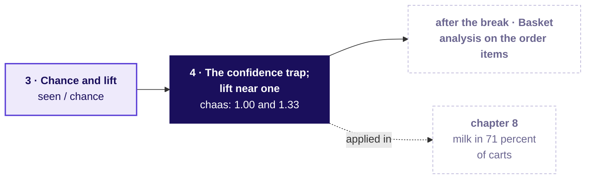

```notes
LIVE, 8 minutes, 2 for the rules and 6 for the drill. The Feynman line for the room to repeat: "the item in every basket makes a
weak bundle partner, because it was going into the basket anyway". Where the room has met this: the
"frequently bought together" strip on any shopping app. Then the first concept drill, items 1 to
4 of `exercises/unguided/C2_W04_D03_canteen_concepts_STUDENT.md`, on paper, 6 minutes inside this
chapter's 18. Checkpoint: every group posts its four letters. Fill the map's fourth box, then a
break of 10 minutes. Transition after the break:
chapter 5, every pair at once.
```

---

## SECTION 5: Basket analysis on the order items: how do lines make pairs?
*How a table of order lines becomes every pair's three numbers, built from scratch on the canteen's 33 lines.*

```notes
LIVE, 30 seconds. Chapter 5 of the concept block, on the topic "Basket analysis on the order
items". Notebook 05 opens now and the chapter runs as a code-along. Transition: who needs it.
```

---

## S26. Order lines become baskets, and baskets become pairs
*Who needs the answer, and which questions lead to it?*

**The topic.** Basket analysis on the order items.

**Who needs the answer.** Anyone who must count every pair of a real shop: a warehouse stores a bill as order lines, one row per order and item, which is how Kalpa's `order_items` and Instamart's `cart_items` are kept.

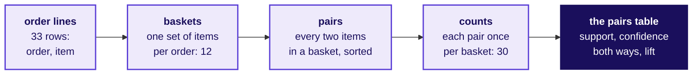

```notes
LIVE, 1 minute. Callback to Week 2 Thursday: groupby and agg on order lines. The questions on the
way: what is an order line; how does a basket become pairs; how many pairs do twelve orders hold;
why sort the two names; which pair tops the table. Transition: the prediction.
```

---

## S27. How many pairs do the twelve orders hold?
*The canteen's twelve orders hold 33 lines. Counted once per basket, how many pairs?*

```cards
icon: list | eyebrow: a | title: 33 | body: One pair for every order line. | tone: light
icon: shopping-basket | eyebrow: b | title: 30 | body: Each order's own pairs, added up. | tone: light
icon: copy | eyebrow: c | title: 60 | body: Every pair, its names read both ways round. | tone: light
icon: layout-grid | eyebrow: d | title: 28 | body: Every pair the eight menu items could form. | tone: light
```

```notes
LIVE, 2 minutes. The misconception: "33 lines, so 33 pairs". Vote, then count one order by hand
before the reveal; the split is usually a against b. Transition: one order, by hand.
```

---

## S28. Answer: b, 30 pairs from 33 lines
*How does one order turn into pairs, and how do twelve add up?*

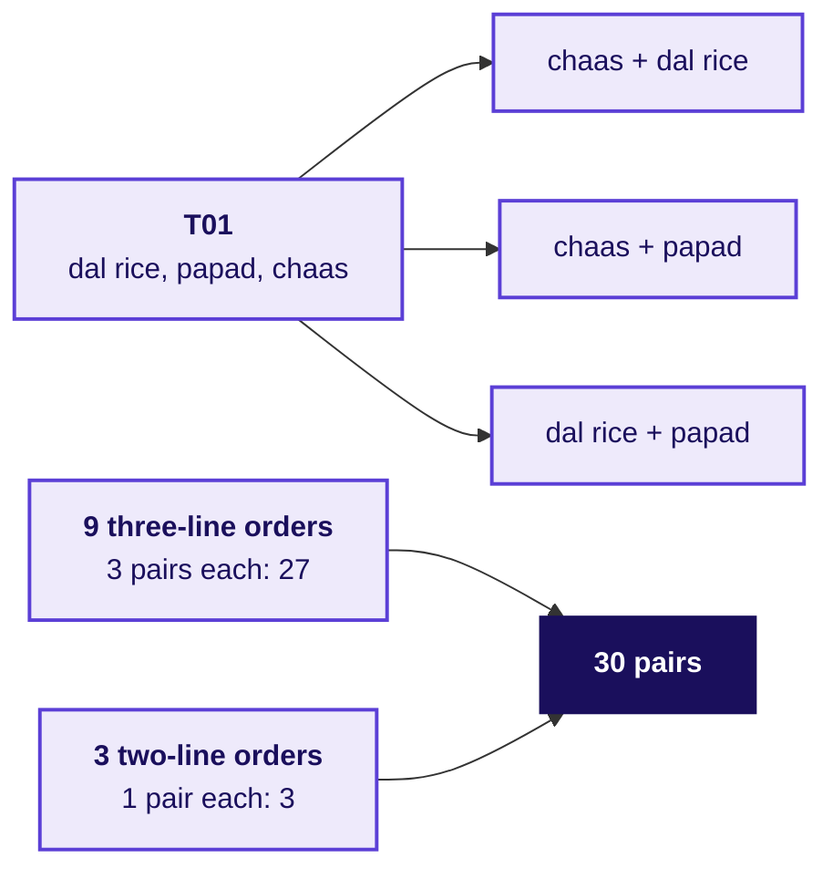

A basket of three items holds three pairs, four items hold six, and k items hold k x (k - 1) / 2. Nine three-line orders give 27 and three two-line orders give 3, so 30. The names are sorted first, so chaas with dal rice and dal rice with chaas are one key. Left unsorted, a pair can land under two keys and its count splits; counted with its names both ways round, as `permutations` does, every pair counts twice and the total reads 60.

```notes
LIVE, 3 minutes. Work T01 into its three pairs on the board. The trap, exactly: 60 pair counts
against 30, from counting each pair with its names both ways round, or a pair's count split across
two keys when the names are left unsorted. The decision it misleads is a ranking built on doubled
or split counts; the check is each basket's k x (k - 1) / 2 added up; the fix is sorted names and
`combinations`. A one-item basket adds no pair.
Transition: the five lines that do it for every basket.
```

---

## S29. Ranked by count and by lift, two different tops
*What does the pairs table say, and what code builds it?*

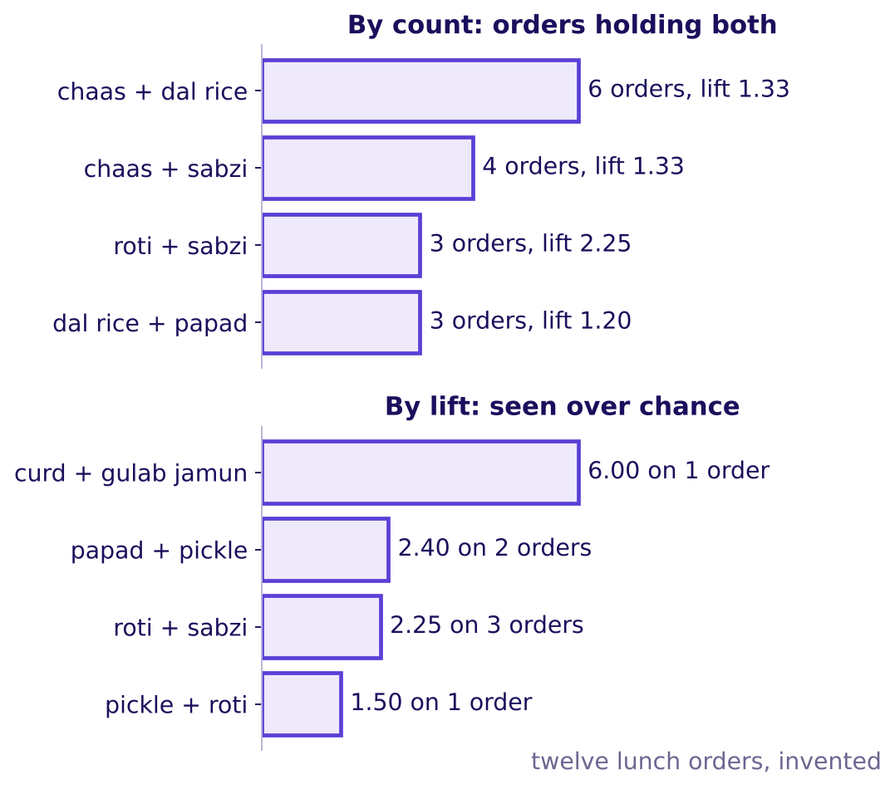

```python
# one set of items per order
orders = lines.groupby("order_id")
baskets = orders.item.apply(set)
# every two items, names sorted, once
pairs = Counter(
    p for b in baskets
    for p in combinations(sorted(b), 2))
single = Counter(x for b in baskets
                 for x in b)
print(sum(pairs.values()))     # 30
```

By count, dal rice and chaas lead with 6 orders at lift 1.33; by lift, gulab jamun and curd lead at 6.0 on one order, then papad and pickle at 2.40 on two, then roti and sabzi at 2.25 on three.

```notes
LIVE, 6 minutes. Code-along in notebook 05 (Krish Naik): say what each line is for before running
it. `combinations` of a sorted basket gives each pair once with its names in order (Python's
itertools documentation, checked 13 October 2026). The roti and sabzi row reads back chapters 1 to
3's hand counts: 3 orders, lift 2.25. Hold the question "which top do you trust?" for chapter 6.
Transition: the rules.
```

---

## S30. The pairs table is a count, never a ranking
*What should a learner keep from chapter 5, and where is the table used next?*

1. Group the order lines by order into a set of items, so each basket counts an item once.
2. Count every two items in a basket, with the two names sorted, so each pair has one key.
3. A one-item basket adds no pair, and k items add k x (k - 1) / 2.
4. The table holds counts; which pair to promote is the next chapter's decision.

**In the interview.** [F] "Why sort the pair's names before counting?" So that each pair has one key and no count is split or doubled.

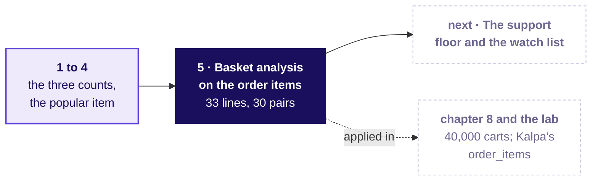

```notes
LIVE, 2 minutes 30 seconds. Check question: "A basket with four items adds how many pairs, and which line
builds the baskets?" Six; the groupby line. Fill the map's fifth box. Transition: chapter 6.
```

---

## SECTION 6: The support floor and the watch list: when is a pair too thin?
*Why a lift on one or two baskets swings by luck, where a floor goes, and what a watch list does with a strong pair below it.*

```notes
LIVE, 30 seconds. Chapter 6 of the concept block, on the topic "The support floor and the watch
list". Transition: who needs it.
```

---

## S31. A floor is the fewest baskets a lift needs
*Who needs the answer, and which questions lead to it?*

**The topic.** The support floor and the watch list.

**Who needs the answer.** The canteen manager, who sees gulab jamun and curd read lift 6.0, the canteen's strongest pair, and must decide whether one order is enough to print a combo card.

```timeline
label: Question 1 | title: How much can luck move a lift? | body: On one or two orders, and on thirty.
label: Question 2 | title: What is a floor? | body: The fewest baskets before a lift is read.
label: Question 3 | title: What does a watch list do? | body: A trial with a pass rule set first.
label: Question 4 | title: Where does each pair go? | body: Promote, watch, ignore or trap.
```

```notes
LIVE, 1 minute. Callback to Week 1 Thursday: distrust any rate under thirty observations. A floor
is the fewest baskets a pair must sit in before anyone acts on its lift. Transition: luck, tested.
```

---

## S32. In 600 orders of pure chance, how high can lift go?
*A month of the canteen's orders, invented so that no item depends on another. On one or two orders, how high can a lift read?*

```cards
icon: equal | eyebrow: a | title: About 1.2 | body: Items that ignore each other stay near one. | tone: light
icon: trending-up | eyebrow: b | title: About 2 | body: Luck can double a lift, no more. | tone: light
icon: trending-up | eyebrow: c | title: About 3 | body: Luck can triple it. | tone: light
icon: zap | eyebrow: d | title: Above 6 | body: More than six times chance. | tone: light
```

```notes
LIVE, 2 minutes. Prediction one, on the canteen's own pair first: gulab jamun and curd read 6.0;
promote it, drop it, watch it with a trial, or lower the floor until it qualifies? Then this
prediction, on 600 orders where nothing is going on by construction; the split is usually a
against b. Transition: the month.
```

---

## S33. Answer: d, 8.57 on 2 orders; near one past thirty
*What does a month of pure chance show about thin and thick pairs?*

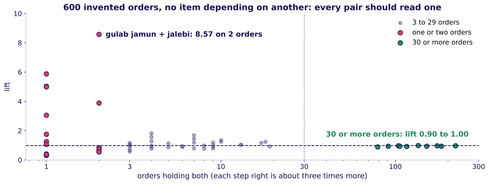

Nothing in this month pulls any item toward another, yet gulab jamun and jalebi read lift 8.57 on 2 orders. The 10 pairs on 30 or more orders read 0.90 to 1.00, a shade under one because every order must hold at least one item. In between, three pairs on 4 to 7 orders still pass 1.5, up to 1.83, and none on 8 or more orders does. A lift on a handful of baskets says more about luck than about the pair.

```notes
LIVE, 3 minutes. Read the picture left to right: wild on the left, flat on the right. Explorer:
scene W5, the floor slider that counts the pairs that qualify. Transition: the floor, set on the
twelve orders.
```

---

## S34. Set a floor, then sort: promote, watch, ignore, trap
*Where does each canteen pair go once a floor is set?*

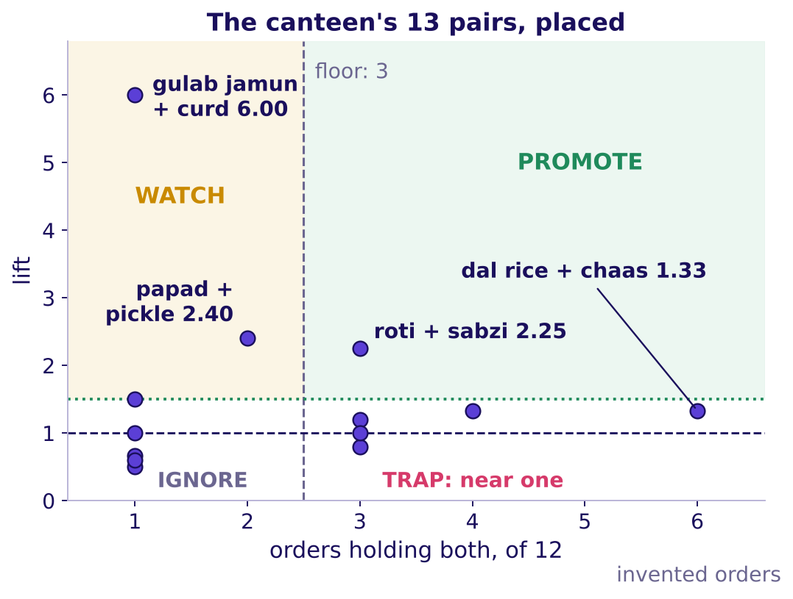

The rule, named last: set the floor where luck stops carrying a lift past the bar, read a lift only at or above it, and promote only at 1.5 or more. In the month that floor is 8 orders; twelve orders are too few for any floor, so 3 here only shows the sort. Roti and sabzi, 2.25 on three orders, lands in promote and would still be trialled first; papad and pickle (2.40 on two), roti and pickle (1.50 on one) and gulab jamun and curd (6.0 on one) are watched; dal rice and chaas, 1.33 on six, is the trap, near one on plenty of orders.

```python
FLOOR, BAR = 3, 1.5     # orders, lift
def region(k, lift):
    strong = lift >= BAR
    if k >= FLOOR:
        return "promote" if strong else "trap"
    return "watch" if strong else "ignore"
print(region(3, 2.25), region(2, 2.40))
```

```notes
LIVE, 4 minutes. The floor is a decision, stated as a count: 3 of 12 orders here, 1 percent of
40,000 carts in the case, 5 percent of the lab's baskets. With no month of pure chance to hand,
Week 1's thirty is the safe default. A watch-list entry is the pair, its lift and support, the
trial (where, for how long, against which other half of customers) and the pass rule: the pair is
promoted only if the half that sees it buys the pair more often than the other half, by a gap
written down before the trial starts. Notebook 06's cells 7 and 8 sort the thirteen pairs and draw
this map. How long a trial must run is a sample-size question, parked
for the IITGN faculty session (tentative). Transition: the rules.
```

---

## S35. A strong pair on thin support earns a trial first
*What should a learner keep from chapter 6, and where is the floor used next?*

1. A lift on one or two baskets swings by luck, so it is read only above a floor.
2. The floor is a count of baskets set where luck stops carrying a lift past the bar, before the ranking is read.
3. A strong pair below the floor goes on a watch list: a trial on a random half of customers, its pass rule written first, shows whether the pull is real and whether it sells.
4. A pair near one is never promoted: below the floor it is ignored, and above it, where a count ranks it first, it is the trap.

**In the interview.** [F] "A pair has a high lift on very few baskets; act or not?" Watch it: test it on a random half of customers with a pass rule set first.

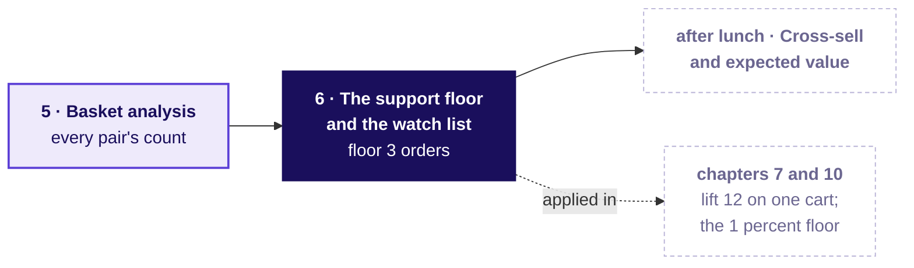

```notes
LIVE, 1 minute 30 seconds. Fill the map's sixth box. The concept block now pauses with five of six morning
boxes filled; chapter 9 fills the last after lunch. Transition: the case, opened again.
```

---

## SECTION 7: Twelve carts by hand, with support, confidence and lift and the confidence trap: what do twelve carts say?
*Twelve of Instamart's carts counted by hand with the three counts of chapters 1 to 3, the confidence trap of chapter 4 met again, and a lift on one cart that chapter 6's floor would refuse.*

```notes
LIVE, 30 seconds. The first case chapter, level L1. Receipts on the table: twelve cart cards per
group. Laptops stay shut while the cards are counted; notebook 07 repeats the count in code and runs
in the lab or the evening, or at S42 if the drill finishes early. Transition: what the chapter
answers, and for whom.
```

---

## S36. Twelve carts, the three counts and one limit
*Who needs the answer, and which questions lead to it?*

**Applies:** Support, Confidence, Chance and lift (chapters 1 to 3, support, confidence and lift, derived by counting); The confidence trap; lift near one (chapter 4); The support floor and the watch list (chapter 6).

**Who needs the answer.** The category manager, who picks what the strip may suggest: a strip filled on the wrong count wastes the three spaces under every cart.

```timeline
label: How often? | title: Support | body: Carts holding both items, over all carts.
label: How reliably? | title: Confidence | body: Of the carts holding A, the share that also hold B.
label: Against chance? | title: Lift | body: Carts seen holding both, over the carts chance alone would give.
label: How far? | title: What twelve cannot say | body: Whether a pull on four carts is real or luck.
```

```notes
LIVE, 1 minute 30 seconds. The room knows all three counts from the canteen; here they are a drill on the
case's own carts. Transition: where the case ends.
```

---

## S37. Where today ends: pairs, a floor, a rupee figure
*What will the growth lead carry out of the room?*

```cards
icon: list-checks | eyebrow: Promote | title: Pairs above a floor | body: The pairs that beat chance on enough carts, each with its support and its lift, ranked by lift. | tone: light
icon: eye | eyebrow: Watch | title: One strong, thin pair | body: A pair with a high lift on too few carts, tested before it is promoted. | tone: light
icon: indian-rupee | eyebrow: Price | title: A slot, in rupees | body: What a slot earns a day and what a month recovers, each assumption said with its range. | tone: dark
```

```notes
LIVE, 2 minutes. Show the finished answer's shape once, then earn it (fast.ai). Every word on the
three cards is now one the room can read: lift and the floor from chapters 3 and 6, and the rupees
from chapter 9 after lunch. The numbers arrive in chapter 10, so its predictions stay open. Leave
the cause of the fall open too: chapter 8 finds it. Transition: twelve carts.
```

---

## S38. Twelve carts from the 40,000: milk in 8, bread in 4
*What do twelve of the 40,000 carts hold, card by card?*

| Cart | Items held |
|---|---|
| C000098 | toned milk, bread, eggs, bananas, coriander, onions, potatoes |
| C003216 | toned milk, bread, eggs, curd, bananas |
| C006334 | toned milk, bread, curd, paneer, onions |
| C009452 | toned milk, bread, eggs, tomatoes |
| C012570 | toned milk, eggs, chips, cold drink, onions |
| C015688 | toned milk, chips, cold drink, coriander |
| C018806 | toned milk, bananas, onions, potatoes |
| C022633 | toned milk, paneer, coriander, tomatoes |
| C026803 | chips, coriander, onions, potatoes |
| C030743 | cold drink, curd, bananas, tomatoes |
| C033861 | eggs, ice cream, chocolate sauce |
| C036979 | curd, onions |

```notes
LIVE, 16 minutes, the twelve-cart drill with the guided set
`exercises/guided/C2_W04_D03_three_counts_STUDENT.md`. Each group holds these twelve as printed
cards. Say: "sort the pack by whether it has bread, then count how many of those have milk; now
count how many have milk at all." Counts are called out and written on the board: milk 8, bread 4,
both 4; the room says 0.33, 1.00, 2.67 expected, 1.50. When a group stops at a confidence and calls
it the answer, ask: "how many carts hold milk whether or not they hold bread?" Transition: predict
before the reveal.
```

---

## S39. Bread to milk is 1.00; milk to bread?
*All four bread carts hold milk, and milk is in 8 of the 12. What is the confidence from milk to bread?*

```cards
icon: equal | eyebrow: a | title: 1.00 | body: The same both ways, like support. | tone: light
icon: percent | eyebrow: b | title: 0.50 | body: Milk's carts are the denominator now. | tone: light
icon: percent | eyebrow: c | title: 0.33 | body: Bread's share of all twelve carts. | tone: light
icon: percent | eyebrow: d | title: 0.67 | body: Milk's share of all twelve carts. | tone: light
```

```notes
LIVE, 2 minutes. The drill gave bread to milk; this asks the other direction, which no item of the
guided set computed. Groups commit in writing; the split is usually a against b. Option a is
chapter 2's misconception on the case's carts. Transition: the count.
```

---

## S40. Answer: b, 0.50 the other way; lift 1.50 both ways
*How do the three counts read for bread and milk?*

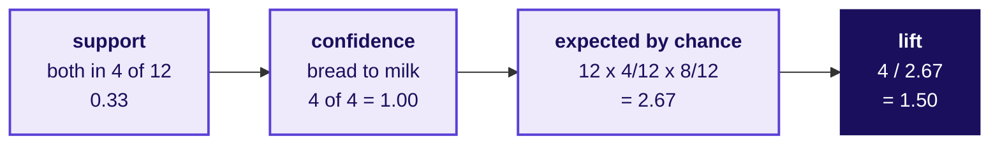

All four bread carts hold milk, so bread to milk is 1.00; milk's 8 carts hold bread 4 times, so milk to bread is 0.50. Milk is in 8 of 12 carts anyway, so chance alone puts it in 2.67 of the four bread carts, and lift is 4 / 2.67 = 1.50 from either side: on these twelve carts, bread and milk meet half again as often as chance would.

```notes
LIVE, 4 minutes. Walk the four boxes left to right, writing each number on the board; these are
chapters 1 to 3's counts on new numbers. Then the reverse confidence, milk to bread, 4 of 8, 0.50:
the same four carts, two sentences, as chapter 2 showed. Lift is the same from both sides.
Transition: what confidence threw away.
```

---

## S41. The trap: 1.00 reads like a bundle
*What does confidence throw away that lift keeps?*


The plausible wrong answer: "confidence 1.00, so show milk beside bread." This is chapter 4's confidence trap on the case's carts: confidence looked only inside the four bread carts, and milk is in 8 of 12 carts anyway. The fix: read lift instead, 1.50, though twelve carts are too few to trust it.

```notes
LIVE, 3 minutes. The room now predicts this trap, since chapter 4 met it on chaas. The GIF beside
this still dims the carts in two steps (whiteboards folder). Explorer: scene W2. Transition: the
other pairs on the cards.
```

---

## S42. Chips and cold drink beat chance; one cart cannot
*What do the other two pairs on the cards read?*

| Pair | Carts with A | Carts with B | Both | Expected by chance | Lift |
|---|---|---|---|---|---|
| chips, cold drink | 3 | 3 | 2 | 12 x 3/12 x 3/12 = 0.75 | 2.67 |
| ice cream, chocolate sauce | 1 | 1 | 1 | 12 x 1/12 x 1/12 = 0.08 | 12 |

Chips and cold drink share 2 carts where chance gives 0.75: lift 2.67, a pull between two items that are each in only 3 carts. Ice cream and chocolate sauce share a single cart, and one cart makes a lift of 12, the number chapter 6's floor exists to refuse.

```notes
LIVE, 4 minutes. Groups compute the chips row first, then the ice cream row. Ask: "would you give
a slot to the lift of 12?" The room answers with chapter 6's floor. Transition: which pair the
full data puts first.
```

---

## S43. Which pair sits together most often?
*Rank all 40,000 carts' pairs by count. Which pair comes first?*

```cards
icon: shopping-cart | eyebrow: a | title: Chips and cold drink | body: The pair that beat chance on the cards. | tone: light
icon: shopping-cart | eyebrow: b | title: Bread and toned milk | body: Two daily staples. | tone: light
icon: shopping-cart | eyebrow: c | title: Ice cream and chocolate sauce | body: The lift of 12 on one card. | tone: light
icon: shopping-cart | eyebrow: d | title: Onions and tomatoes | body: The cooking pair. | tone: light
```

```notes
LIVE, 2 minutes. Vote, argue in pairs, vote again; the split is usually a against b. Write it on
the board. Transition: the count.
```

---

## S44. Answer: b, bread and milk, in 10,064 carts
*What does a ranking by count put on top?*

| Pair | Carts holding both |
|---|---|
| bread, toned milk | 10,064 |
| eggs, toned milk | 8,468 |
| curd, toned milk | 7,436 |
| bananas, toned milk | 6,624 |
| onions, toned milk | 6,248 |
| tomatoes, toned milk | 5,680 |

Every one of the six most frequent pairs holds milk. The plausible wrong answer is "the pairs table is the ranking": ranked by count, milk is the top partner of almost every item, which is what the strip has shown since 7 September. Chapter 5 said it: the pairs table is a count, never a ranking.

```notes
LIVE, 3 minutes. Say the trap aloud: the team built the strip on this table. The check is
chapter 3's question, how often would milk sit beside bread if the two ignored each other.
Transition: chapter 8, every cart.
```

---

## SECTION 8: Basket analysis on 40,000 carts, with lift near one and the floor: what do 40,000 carts say?
*Chapter 5's five lines run on every cart, lift reads milk at chance as chapter 4 predicts, and the click-through's fall is split into its two parts.*

```notes
LIVE, 30 seconds. The second case chapter, levels L2 and L3. Notebook 08 opens now: one plain line
above every cell, run top to bottom with the room. Transition: what it answers.
```

---

## S45. Four questions from counts to the fall
*Who needs the answer, and which questions lead to it?*

**Applies:** Support, Confidence, Chance and lift (chapters 1 to 3); The confidence trap; lift near one (chapter 4); Basket analysis on the order items (chapter 5); The support floor and the watch list (chapter 6).

**Who needs the answer.** The growth lead, who explains the fall on Friday, against a category manager who defends milk because it is the top seller.

```timeline
label: Question 1 | title: How often is each item in a cart? | body: Each item's share of the 40,000 carts.
label: Question 2 | title: Do 40,000 carts agree with twelve? | body: Bread and milk's lift on every cart.
label: Question 3 | title: What does lift say about milk? | body: For every item in at least 2 percent of carts.
label: Question 4 | title: Why did the click-through fall? | body: Split by what each slot suggested.
```

```notes
LIVE, 5 minutes, opening on the five-minute paper check
`exercises/unguided/C2_W04_D03_ch8_one_pair_STUDENT.md`: four counts from the case, three numbers
and a second route, letters posted before the notebook runs. Then read the four questions; each
ends on a number from notebook 08. Transition: the five lines.
```

---

## S46. Every pair counted in five lines of pandas
*How does the code count 40,000 carts of pairs?*

```python
baskets = items.groupby("cart_id").item.apply(set)          # one set of items per cart
pair_count = Counter(p for b in baskets                      # every two items in a cart
                     for p in combinations(sorted(b), 2))    # sorted, so (a, b) is one key
single = Counter(x for b in baskets for x in b)              # carts holding each item
lift = pair_count[("bread", "toned milk")] * n / (single["bread"] * single["toned milk"])
```

These are chapter 5's lines on the canteen, unchanged: a cart becomes a set of items, and every pair inside it adds one to its tally. The last line is seen over chance rearranged: on the twelve carts, 4 / (12 x 4/12 x 8/12) is the same as 4 x 12 / (4 x 8), which is 1.50. Here `n` is 40,000.

```notes
LIVE, 4 minutes. Code-along in notebook 08 (Krish Naik), shortened, since the room built these
lines in chapter 5: say what each line is for and run it. Interview note: "why sorted?" is a
common follow-up. Transition: bread and milk on every cart.
```

---

## S47. Twelve carts said lift 1.50; 40,000 carts say 1.04
*What does lift say about bread and milk on all the carts?*


On twelve carts lift read 1.50 because all four bread carts happened to hold milk. On 40,000 carts bread to milk reads confidence 0.74: chance gives 0.34 x 0.71 x 40,000 = 9,656 carts holding both, 10,064 do, and 10,064 / 9,656 = 1.04. Chapter 6's lesson on the case: a few carts can make a pull look strong.

```notes
LIVE, 4 minutes. Read the picture as two areas, the same picture chapter 3 drew for roti and
sabzi: bread's band times milk's band is the overlap chance gives; the overlap seen is barely
bigger. The 4 percent above chance is no pull: bigger carts hold any two staples more often, and
the interview extra counts chance within each cart size. Explorer: scene W1. Transition: is bread
special, or is every item like this?
```

---

## S48. What is a popular item's lift with milk?
*For the 50 items in at least 2 percent of carts, what does lift with milk look like?*

```cards
icon: trending-up | eyebrow: a | title: It rises with popularity | body: The more common the item, the higher its lift. | tone: light
icon: equal | eyebrow: b | title: Near one for all of them | body: Every item sits close to chance with milk. | tone: light
icon: trending-down | eyebrow: c | title: It falls with popularity | body: Common items pair less with milk than rare ones. | tone: light
icon: shuffle | eyebrow: d | title: It scatters | body: Each item goes its own way. | tone: light
```

```notes
LIVE, 2 minutes. A quick vote; the room that sat chapter 4 should predict b from chaas.
Transition: the chart.
```

---

## S49. Answer: b, near one for every common item
*Why does every item look bundled with milk, and what does lift say?*


For all 50 items in at least 2 percent of carts, confidence toward milk runs 0.70 to 0.74, near milk's own 0.71, and lift runs 0.99 to 1.04. This is chapter 4's chaas at the scale of a city: lift divides milk's popularity out, and no item's lift with milk can pass one over its share, 1 / 0.71 = 1.41, under the 1.5 bar.

```notes
LIVE, 3 minutes. The left panel is what the new strip ranked by; the right panel is what it
should have read. The Feynman line again: "the item in every bag makes a weak bundle partner,
because it was going in the bag anyway". Explorer: scene W3. Transition: a company that met this
trap.
```

---

## S50. Amazon met the same popular-partner trap
*Where has a real recommender met the item that sits beside everything?*

**Amazon.** Amazon Science's history of the company's recommendation algorithm says that counting how often buyers of one item bought another would make a few bestsellers, such as Harry Potter books and trash bags, the top recommendations for every customer. The fix scored how much more likely buyers of one item were to buy another than the average customer, a difference in probabilities; lift makes the same comparison with chance as a ratio, which rare items inflate. Later the team found that buyers of one item are heavier buyers of everything, so it measured the increased likelihood of a purchase with any given purchase, discounting heavy buyers (Amazon Science, checked 13 October 2026).

The cost of the trap is a recommendation slot spent on an item the shopper was buying anyway.

```notes
LIVE, 2 minutes. Name the decision and the cost: a slot shown to everyone that moves nothing. The
heavy-buyer point returns after lunch as the top tenth of customers. The row asks for one legend
told accurately: in 1992 about 1.2 million baskets from Osco Drug stores showed beer and diapers
together in the early evening, and the chain does not appear to have moved any shelf (The
Register, checked 12 October 2026). Transition: four pairs side by side.
```

---

## S51. Four pairs, three numbers each, one second route
*What do support, confidence both ways and lift read for four pairs?*

| Pair | Support | Confidence A to B | Confidence B to A | Lift |
|---|---|---|---|---|
| bread, toned milk | 25.2% | 0.74 | 0.35 | 1.04 |
| eggs, toned milk | 21.2% | 0.73 | 0.30 | 1.03 |
| chips, cold drink | 5.0% | 0.42 | 0.41 | 3.39 |
| chocolate sauce, ice cream | 0.25% | 0.18 | 0.06 | 4.60 |

Support is a share of all carts, written as a percent; confidence is a share of A's carts, written as a decimal. Chapter 3's second route: lift is also confidence over the partner's share. Bread to milk 0.74 / 0.71 = 1.04, and milk to bread 0.354 / 0.34 = 1.04.

```notes
LIVE, 3 minutes. Point at the chips row: confidence 0.42 looks weak beside 0.74, yet its lift is
3.39. Confidence and lift can rank pairs in opposite orders. Notebook 08 asserts the second route
for three pairs. Transition: why did the click-through fall?
```

---

## S52. Why did the strip's click-through fall?
*It fell from 6.1 to 3.8 percent after 7 September. Which explanation will the log support?*

```cards
icon: users | eyebrow: a | title: Shoppers changed habits | body: After the monsoon, carts shifted away from the old pairs. | tone: light
icon: eye-off | eyebrow: b | title: Fewer cart-page views | body: Fewer people opened the cart page in September. | tone: light
icon: milk | eyebrow: c | title: Milk fills the slots | body: Milk now takes the slots and few shoppers click it. | tone: light
icon: panel-top | eyebrow: d | title: The strip moved down | body: The strip sits lower on the page than before. | tone: light
```

```notes
LIVE, 1 minute 30 seconds. Vote. A view count says nothing about a rate, which rules out b for anyone who
thinks it through; let the room find that. Transition: the split.
```

---

## S53. Answer: c, milk took half the slots at 1.2 percent
*Where in the log does the fall sit?*


Milk took half the slot impressions at 1.2 percent; everything else clicked at 6.4, up from 6.2 before the change, when milk held 2 percent of them. Half of 1.2 plus half of 6.4 is 3.8. The plausible wrong answer, "shoppers changed after the monsoon", fails the split by suggested item.

```notes
LIVE, 8 minutes. This is notebook 08's your-turn cell: each learner splits the after rows by
whether the slot suggested milk before the answer is shown. A blended rate is a mix of two rates,
Thursday's topic in preview. The decision the habits answer misleads is a redesign of the strip,
when only what it ranks needs to change. Checkpoint: every learner's your-turn cell prints 1.2 and
6.4 percent. Transition: the slot milk took, for self-study, then the case's answer so far.
```

---

## D54. Slot 1 draws the most clicks, and milk took it
*Does the position of a slot change its click-through?*


After the change, slot 1 draws 8.2 percent for a suggestion other than milk and slot 3 draws 5.4. Milk clicks at 1.4, 1.1 and 0.9 percent and holds 70 percent of slot 1. The best slot went to the item nobody needed reminding of.

```notes
SELF-STUDY, 0 minutes live. This is the strip's own pull: whatever slot 1 shows draws clicks. It
returns after lunch as a doubt the counts cannot settle. Transition: the case's answer so far.
```

---

## S55. The case answered the topics, on 40,000 carts
*What did each topic say about Instamart's carts?*

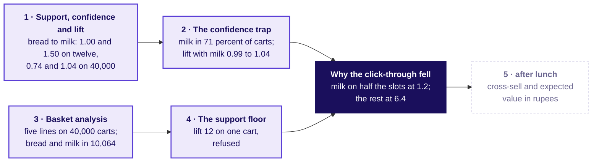

```notes
LIVE, 2 minutes. The concept map comes back with the case's numbers on its boxes: each topic,
counted first on the canteen, now speaks about Instamart. Ask a learner to say the fall in one
sentence. Then lunch. After lunch, chapter 9 teaches the last topic, cross-sell and expected value
in rupees, before chapter 10 prices the strip.
```
