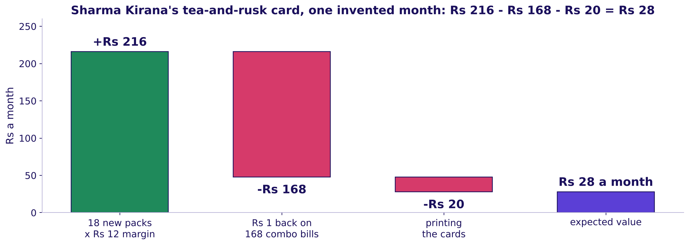
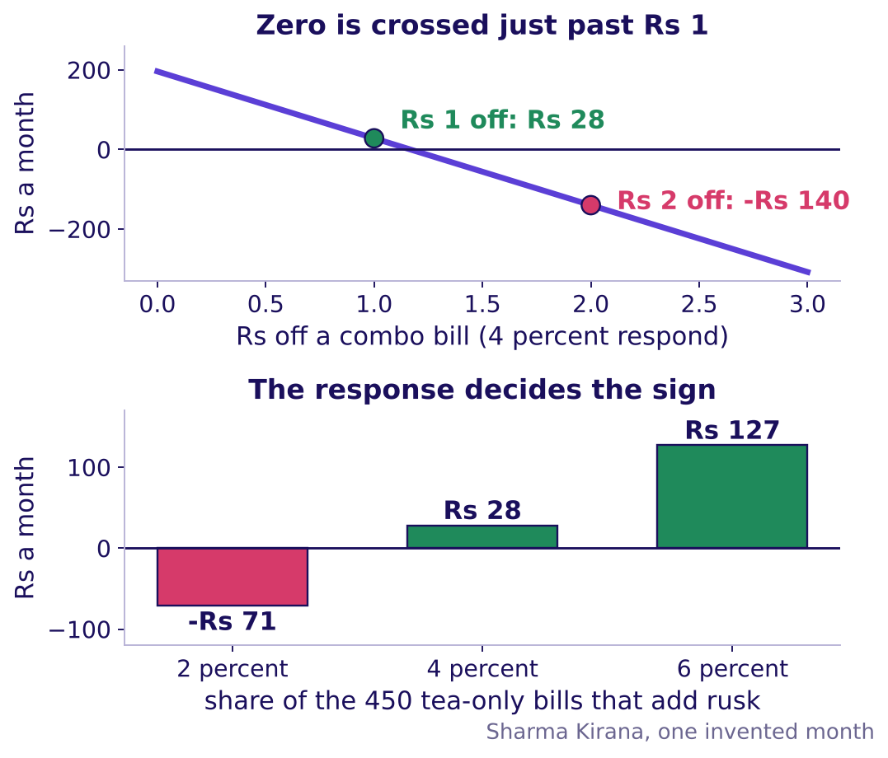
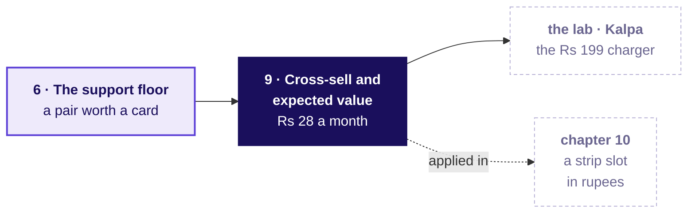
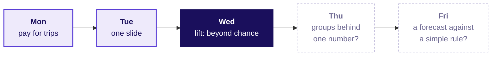

# Market basket, lift and cross-sell

Week 4, Day 3. Half two.

Header: WEEK 4  ·  WEDNESDAY  ·  MARKET BASKET, LIFT AND CROSS-SELL

---

## SECTION 9: Cross-sell and upsell reasoning; expected value in rupees: what is a combo worth?
*Cross-sell told apart from upsell, and a corner shop's combo card priced as an expected value in rupees: the margin it adds, less what it hands back on bills that held both anyway.*

```notes
LIVE, 30 seconds, on screen after lunch. Chapter 9, the last chapter of the concept block, on the
topic "Cross-sell and upsell reasoning; expected value in rupees". It opens the afternoon so the
morning carried four topics and this one gets fresh heads. Sharma Kirana's month sheet goes on
every table. Transition: who needs the answer.
```

---

## S56. Cross-sell adds a second item; upsell a bigger one
*Who needs the answer, and which questions lead to it?*

**The topic.** Cross-sell and upsell reasoning; expected value in rupees.

**Who needs the answer.** The owner of Sharma Kirana, a corner shop in Pune, invented, who is weighing a counter card that reads "Tea and rusk together, Rs 1 off". Rusk beside tea is cross-sell, a second item that goes with the first; the bigger tea pack in place of the small one would be upsell, a dearer version of the same item.

```timeline
label: Question 1 | title: Cross-sell or upsell? | body: A second item, or a bigger one of the same.
label: Question 2 | title: Which bills can the card change? | body: Only the tea bills without rusk.
label: Question 3 | title: What is it worth in a month? | body: The margin added, less every rupee given back.
label: Question 4 | title: What decides the sign? | body: The response assumed, and the discount.
```

```notes
LIVE, 2 minutes. Define the two words with the shop's own items: cross-sell suggests an additional
product, upsell a more expensive item or an upgrade of the same one (Wikipedia's cross-selling and
upselling pages, checked 13 October 2026). Callback to chapter 3: tea and rusk sit in 150 of 1,000
bills where chance gives 120, so lift 1.25 on plenty of bills; the pair beats chance, and the
question is now what a card is worth. Instamart's strip suggests a different item beside the one
in the cart, which is cross-sell. Transition: the prediction.
```

---

## S57. What is the tea-and-rusk card worth in a month?
*Sharma Kirana's month, invented. Which number should the owner weigh against the card?*

| Line of the month | Value |
|---|---|
| Bills; with tea; with rusk; with both | 1,000; 600; 200; 150 |
| Rusk's price, and its cost to the shop | Rs 30, and Rs 18 |
| The card's discount, on every bill holding both | Rs 1 |
| Printing the cards | Rs 20 |
| Tea bills without rusk that add a pack, assumed | 4 percent, range 2 to 6 |

a) Rs 5,040, the rusk sold on every bill that will hold both. b) Rs 2,016, the rusk margin on every bill that will hold both. c) Rs 196, the margin on the new packs less the printing. d) Rs 28, the margin on the new packs less every rupee the card costs.

```notes
LIVE, 3 minutes. The misconception first: a promotion is worth the sales it touches. Groups vote
with a letter card, argue with a neighbour for a minute, then vote again; the split is usually a
against c. Send the room to the sheet: "which bills does the card change, and which does it only
pay?" Transition: the reveal.
```

---

## S58. Answer: d, Rs 28 a month, once the rupee is paid
*Where does each rupee of the card go?*



Only the 450 tea bills without rusk can change: 4 percent of them, 18 bills, add a pack, and 18 x Rs 12 is Rs 216 of margin. The card hands Rs 1 back on all 168 bills that hold both, the 150 that held both anyway and the 18 new ones, and the cards cost Rs 20, so Rs 216 less Rs 168 less Rs 20 leaves Rs 28. Option a books rusk sales on all 168 bills, Rs 5,040, which is 180 times the gain.

```notes
LIVE, 5 minutes. Build the bridge left to right on the board, one bar at a time (StatQuest). The
150 bills that held both before the card are the line most people forget: the card changes nothing
on them except the rupee it hands back. The trap, exactly: Rs 5,040, rusk sales on every combo
bill; the decision it misleads is a card printed as if it earned Rs 5,040; the check is "which
bills does the card change?"; the fix is margin on those bills only, less what the card gives away.
Option b counts every combo as new, Rs 2,016; option c forgets the discount, Rs 196. The second
route, said once: rusk margin with the card is Rs 2,428 against Rs 2,400 without it, the same Rs 28.
Transition: what moves the sign.
```

---

## S59. Rs 2 off loses Rs 140; the response sets the sign
*How does expected value weigh each bill, and what moves it?*



The rule, named last: expected value is each outcome times its probability, added up. A tea-only bill earns Rs 11 with probability 0.04, so Rs 0.44, and Rs 198 across 450; less Rs 1 on each of the 150 bills that held both and Rs 20 of printing, Rs 28 again.

```python
def card_value(response, off):
    new = round(450 * response)
    combos = 150 + new
    return new * 12 - combos * off - 20

print(card_value(0.04, 1))   # 28
print(card_value(0.04, 2))   # -140
print(card_value(0.02, 1))   # -71
```

```notes
LIVE, 6 minutes. Read the top panel first: each rupee off costs Rs 168 a month, so the card earns
nothing at about Rs 1.17 off and loses Rs 140 at Rs 2. Then the bottom panel: at 2 percent the card
loses Rs 71 and at 6 percent it earns Rs 127, so the 4 percent is an assumption said with its
range, and the answer travels with it. The formula comes after the counting, as its shorthand
(Wikipedia's expected value page, checked 13 October 2026: a weighted average, each outcome times
its probability). Then the code-along, one line at a time (Krish Naik); notebook 09 runs the
function and asserts the second route. Upsell is priced the same way: the extra margin of the
bigger pack on the shoppers who switch, less what the switch gives away. Transition: the rules.
```

---

## S60. A card earns only on the bills it changes
*What should a learner keep from chapter 9, and where is it used next?*

1. Cross-sell suggests a second item that goes with the first; upsell suggests a dearer version of the same item.
2. A card earns only on the bills it changes, so its gain is margin on the new packs, never sales on every combo bill.
3. A discount is paid on every bill that takes it, including the bills that would have held both anyway.
4. Expected value weighs each outcome by its probability, so an assumed response comes with its range, and so does the answer.

**In the interview.** [F] "A combo offer lifts the pair's sales; is it worth running?" Margin on the purchases that would not have happened, less the discount paid on all of them, less the fixed cost, said as a range.



```notes
LIVE, 1 minute. Fill the concept map's last box: all five topics are now on the board. Check
question before moving on: "A card reaches 2,000 bills, 5 percent add one pack at Rs 10 of margin,
and the cards cost Rs 600: what is it worth?" 100 packs, Rs 1,000 of margin, less Rs 600, so Rs 400.
Transition: chapter 10, the strip ranked and priced.
```

---

## SECTION 10: The strip ranked by the support floor and priced by expected value in rupees: what is a slot worth?
*Chapter 6's floor and watch list re-rank Instamart's strip, chapter 9's expected value prices a slot in rupees, and each group defends one strip to the category manager.*

```notes
LIVE, 30 seconds. The third case chapter, levels L4 and L5. Notebook 10 opens now. Transition:
what the chapter answers, and for whom.
```

---

## S61. Four questions from a ranking to rupees
*Who needs the answer, and which questions lead to it?*

**Applies:** The support floor and the watch list (chapter 6); Cross-sell and upsell reasoning; expected value in rupees (chapter 9).

**Who needs the answer.** The growth lead, who takes a ranked list and a rupee figure to Friday's review, where the category manager will argue that milk, the top seller, belongs in every slot.

```timeline
label: Question 1 | title: Which pairs beat chance on enough carts? | body: Lift above a support floor.
label: Question 2 | title: What happens to a strong thin pair? | body: Ice cream and chocolate sauce, watched.
label: Question 3 | title: What is a slot worth in rupees? | body: Views, click-through, adds, margin.
label: Question 4 | title: What can the counts not tell us? | body: The doubts, each with its check.
```

```notes
LIVE, 1 minute. Read the four questions. Each is a morning topic used on the case: the floor and
the watch list from chapter 6, the rupees from chapter 9. Transition: the problem first.
```

---

## S62. Which of these four pairs would you promote?
*Each pair shows its support and its lift. Which takes the strip's first slot?*

```cards
icon: shopping-cart | eyebrow: a | title: Bread and toned milk | body: Support 25.2 percent, lift 1.04. | tone: light
icon: shopping-cart | eyebrow: b | title: Chips and cold drink | body: Support 5.0 percent, lift 3.39. | tone: light
icon: shopping-cart | eyebrow: c | title: Ice cream and chocolate sauce | body: Support 0.25 percent, lift 4.60. | tone: light
icon: shopping-cart | eyebrow: d | title: Onions and tomatoes | body: Support 7.5 percent, lift 1.70. | tone: light
```

```notes
LIVE, 3 minutes. Vote, argue, vote again (Brilliant: the problem before the explanation). The split
is usually b against c; a learner who drew chapter 6's canteen action map should call it at once.
Transition: every pair on one picture.
```

---

## S63. Answer: b, the strongest lift above the floor
*Where does every pair sit, and which pairs fill the strip?*


Above a floor of 1 percent of carts (400 carts), 246 pairs qualify and four reach lift 1.5 or more: chips and cold drink 3.39, coriander and green chillies 3.00, bread and butter 2.21, onions and tomatoes 1.70. The fifth reads 1.09. The strip has three slots, so onions and tomatoes waits as the first replacement. Each step right on the picture is ten times more carts.

```notes
LIVE, 4 minutes. The same four regions chapter 6 drew for the canteen: promote above the floor and
well above one; watch, high lift below the floor; ignore, near one, where milk's pairs sit. The
floor is a decision: 0.5 percent admits more pairs on thinner ground, 2 percent fewer. Explorer:
scene W5, the floor slider counts the pairs that survive. Transition: the thin pair.
```

---

## S64. The watch list holds lift 4.60 on 100 carts
*What does chapter 6's rule do with a strong pair that almost nobody buys?*

Ice cream and chocolate sauce read lift 4.60, the strongest pair between 0.2 percent (80 carts, too few even to trial below it) and the 1 percent floor. The pair is real, 100 carts where chance gives 22, but the strip suggests it only beside ice cream, which is in 4 percent of carts: about 2,400 of the strip's 60,000 views a day, if views follow carts, and 100 carts cannot say how shoppers will click it there. It goes on the watch list: in two zones, a random half of shoppers see it beside ice cream, and it takes the slot only if their ice-cream carts buy sauce more often than the other half's, by a gap set before the trial, with margin per shopper as the guardrail.

```notes
LIVE, 2 minutes. Chapter 6's gulab jamun and curd at city scale: a strong lift on thin support
earns a trial, never a slot. How long a trial must run to trust its answer is a sample-size
question, parked by name for the faculty session (tentative). Transition: what a slot is worth.
```

---

## S65. What does re-ranking recover in a month?
*Milk holds half the slot impressions at 1.2 percent. Moving them to pairs that click at 6.4 recovers how much?*

```cards
icon: indian-rupee | eyebrow: a | title: About Rs 50,000 | body: A rounding error on the city's month. | tone: light
icon: indian-rupee | eyebrow: b | title: About Rs 2 lakh | body: One slot's gap for half a month. | tone: light
icon: indian-rupee | eyebrow: c | title: About Rs 6 lakh | body: The gap on milk's share of all three slots. | tone: light
icon: indian-rupee | eyebrow: d | title: About Rs 50 lakh | body: Sales from every add the strip makes. | tone: light
```

```notes
LIVE, 1 minute. Guess first, then build it. Transition: the cascade.
```

---

## S66. Answer: c, about Rs 6.3 lakh a month
*How do chapter 9's rupees price a slot, and what does a month recover?*


The kirana's card at city scale: margin on the adds a slot makes, never its sales. A slot's day is 60,000 views (`strip_log`) x click-through x 0.5 adds per click (`strip_log`, range 0.4 to 0.6) x Rs 9 margin an add (the average `cart_items` line, range Rs 7 to Rs 11), with the promoted pairs assumed to click at the 6.4 percent the rest drew. Milk holds 1.5 slots' worth: Rs 4.2 lakh x 1.5 = Rs 6.3 lakh a month, Rs 3.9 lakh at 0.4 x Rs 7 and Rs 9.3 lakh at 0.6 x Rs 11.

```notes
LIVE, 2 minutes. Build it left to right on the board, each factor said with its source and its
range, as the kirana's 4 percent was. Margin is what Instamart keeps from a sale after the item's
cost: bread sells for Rs 45 and keeps Rs 6.70. Milk earns Rs 2 a pouch, so a milk slot earns even
less than the Rs 9 assumption gives it. Back to S64's thin pair, priced at its own margins, Rs
37.40 for sauce against Rs 2 for milk: on about 2,400 views a day in place of milk it earns about Rs
85,000 a month, which is why it earns a test and never a blind slot. Explorer: scene W4, the strip
simulator, rank by count against rank by lift. Transition: the number people get wrong.
```

---

## S67. The trap: Rs 80,197 of sales is not the gain
*Which number would overstate the slot four times over?*

The plausible wrong answer books sales, the kirana's Rs 5,040 at city scale: a slot at 6.4 percent makes 1,920 adds a day, each selling for about Rs 41.77, so Rs 80,197 a day of "strip revenue". The growth lead keeps the margin, Rs 17,280. If the strip ever adds a bundle discount, the discount is margin handed back, on adds that might have happened anyway, as on the kirana's 150 bills that held both before the card. Swiggy's shareholder letter for April to June 2025 describes Maxxsaver, a discount unlocked once a basket passes a set size, as margin returned to the user: the cost line a rupee case must carry (checked 12 October 2026).

```notes
LIVE, 1 minute. Ask: "which line of the cascade would a bundle discount change?" The margin per
add falls by the discount. The doubts and the heavy tenth follow as two self-study slides, read in
the lab; the unguided work uses them. Transition: the doubts, for self-study, then the brief.
```

---

## D68. Six doubts the counts cannot settle alone
*What must the growth lead say aloud, and what check settles each doubt?*

| Doubt | The check | What it showed |
|---|---|---|
| Together is no proof of cause | A holdout: a share of shoppers kept on the old strip, compared with the rest | This week's Monday faculty session on A/B testing (tentative) |
| Heavy buyers, each placing many carts | Count each customer once | Chips and cold drink 3.39 falls to 2.56; milk's pair stays 1.04 |
| Curd stock-out | Set aside two zones in week three | Curd's share 26.0 rises to 27.8 percent; its lift with milk stays 1.01 |
| Time of day | Each time band alone | Morning carts hold milk 80 percent of the time; bread with milk reads 1.03 to 1.05 in every band |
| Position in the strip | Click-through by slot | Among suggestions other than milk, slot 1 draws 8.2 percent and slot 3 5.4; milk is low in all three |
| The strip feeds its own counts | The holdout's shoppers, who never see the strip | Not in this data; the holdout in the first row settles it |

```notes
SELF-STUDY, 0 minutes live. Each doubt has its number in notebook 10. A check that comes back clean
is said in one line, as the time-of-day check does. In Hadapsar and Viman Nagar from 15 to 21
September, curd is in 12 of 2,583 carts; a stock-out cuts the count, never the pull.
```

---

## D69. Counted once per customer, the party pair shrinks
*How much of chips and cold drink comes from a few heavy shoppers?*


The top tenth of customers place 38 percent of the carts and 73 percent of the carts holding both chips and a cold drink. Counting every customer once gives each cart a weight of one over its customer's number of carts, so a shopper with 4 carts counts each as 0.25. Counted that way, the pair's lift falls from 3.39 to 2.56 and still beats chance; bread and milk stays at 1.04. The pair keeps its slot, and the growth lead says the smaller number.

```notes
SELF-STUDY, 0 minutes live. "Counted once" means each cart weighs one over its customer's number of
carts, so a shopper with fourteen carts counts as much as a shopper with one. Amazon's history
(chapter 8) met the same heavy-buyer problem.
```

---

## S70. Ship one strip in 15 minutes, priced and defended
*What does each group hand in?*

```cards
icon: list-ordered | eyebrow: Step 1 | title: Rank three pairs | body: From the pairs table: support at least 1 percent and lift 1.5 or more, each with its two numbers. | tone: light
icon: indian-rupee | eyebrow: Step 2 | title: Price the strip | body: A slot a day and the month recovered, each assumption with its range. | tone: light
icon: triangle-alert | eyebrow: Step 3 | title: Name two doubts | body: Each with the check and the number it gave. | tone: light
icon: message-square | eyebrow: Step 4 | title: Answer the category manager | body: Two sentences: the number first, then what you concede. | tone: dark
```

The one-page strip carries four fields, one line each: the three pairs with support and lift, the price with its low and high ends, the two doubts with their checks, and the two sentences. A strip that names a pair without its support, or a rupee figure without its range, goes back. The strip set in `exercises/unguided` asks the same steps as items; a group posts its letters once its page is done.

```notes
LIVE, 2 minutes to brief, then 10 minutes of group work, unguided, level L5, in groups of about
four on notebook 10. The TA moves between tables. A group that picks a pair below the floor is
asked "how many carts would the slot touch?". A group that prices sales instead of margin is asked
"which number does the growth lead keep?". The doubts sit on D68 and in notebook 10's last cells.
The strip set's solutions file is released at the close. Transition: the objection each group must
answer.
```

---

## S71. "Milk is our top seller; put it in every slot"
*Which part of the category manager's objection is right, and what answers the rest?*

```cards
icon: ear | eyebrow: Restate | title: Milk is in most carts | body: It is in 71 percent of carts and brings shoppers back daily. | tone: light
icon: chart-column | eyebrow: Answer | title: The slot moves nothing | body: Milk slots click at 1.2 percent against 6.4; lift with every common item sits near one. | tone: light
icon: handshake | eyebrow: Concede | title: Milk belongs in the cart | body: Which is why it needs no reminder; keep it on the home screen and in search. | tone: light
icon: refresh-cw | eyebrow: What would change it | title: If milk clicked like the rest | body: A two-zone test where milk slots matched 6.4 percent would put milk back. | tone: dark
```

```notes
LIVE, 3 minutes. Tuesday's four moves, used on today's numbers: restate until the owner agrees,
answer from the evidence, concede what is true, say what would change your mind. Two groups read
their answers aloud; the room names the move each sentence makes. Transition: the interview room.
```

---

## S72. Lift divides popularity out; confidence does not
*"Support, confidence, lift: which one cannot be fooled by popularity, and why?"*

```cards
icon: x | eyebrow: Weak answer | title: Confidence | body: "Confidence, because it is the probability of B given A, so the highest-confidence pair goes in the strip." It ranks milk first. | tone: light
icon: check | eyebrow: Hire-grade answer | title: Lift, because it divides by the base rate | body: "Bread to milk reads confidence 0.74, but milk is in 71 percent of carts anyway, so lift is 1.04. Chips and cold drink read 0.42 and lift 3.39. I rank by lift above a support floor." | tone: dark
icon: ear | eyebrow: What the interviewer listens for | title: The base rate and its window | body: Three questions kept apart, the denominator and window said aloud, a floor, a decision. | tone: light
```

```notes
LIVE, 3 minutes, level L6, the interview room's [S] answer. Pairs read the two answers side by
side. The weak answer is not wrong about confidence's meaning; it is wrong about what to do with
it. The full transcript, its three follow-ups and the AI-company variant, an LLM shopping assistant
scored against a popularity baseline, are read in pairs in the lab from the extras folder.
Transition: the handoff.
```

---

## S73. Handoff: lift read as probability, next
*What does the IITGN faculty session (tentative) pick up from the morning?*

> You counted lift on twelve carts and on forty thousand. The next 120 minutes show the same three numbers as probabilities: a lift near one is independence made visible, which is what milk showed you, and the support floor you set is what lets an algorithm skip counting every combination.

Independent means that knowing one item is in the cart tells you nothing about the other, and a rule is a sentence such as "bread, so milk". The IITGN faculty session is tentative until IIT Gandhinagar confirms it.

```notes
LIVE, 1 minute. Read the line as it stands. Park any question about how long a watch-list trial
must run for the faculty session (tentative). Transition: the Kahoot.
```

---

## S74. Eight quick questions, one with a minute to compute
*Can the room make the day's calls at speed?*

```timeline
label: Items 1 and 2 | title: The three counts | body: Match each count to its question; compute lift from three counts.
label: Items 3 and 7 | title: Lift near one | body: A popular partner read right; the strip's blended click-through.
label: Items 4, 5 and 8 | title: The floor, the rupee and the pairs | body: A strong thin pair; what a promotion is worth; one cart's pairs.
label: Item 6 | title: Tuesday's return question | body: The four moves of an answer to an objection that is partly right.
```

```notes
LIVE, 7 minutes. Run the Kahoot pack from the kahoot folder; it is ungraded. Re-teach in one line
any item most of the room misses. Transition: the close.
```

---

## S75. The sentence for Friday, and Thursday's question
*What does the room say on Friday, and what comes next?*

**The sentence.** "The click-through fell because the strip gave half its slots to milk, which shoppers buy anyway; ranked by lift above a 1 percent floor, the strip shows chips with cold drink, coriander with green chillies and bread with butter, and recovers about Rs 6.3 lakh a month."

**Tomorrow.** Zomato Gold in Chennai: a retention number that stays flat while every group of members shrinks. Who is leaving, and at which step?



```notes
LIVE, 2 minutes. Ask two learners to say the sentence without notes. The lab after class runs the
same method on Kalpa Retail's baskets in notebook 11. Tomorrow's pre-read ships tonight.
```
