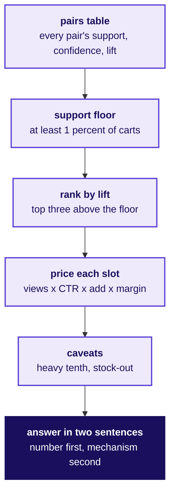
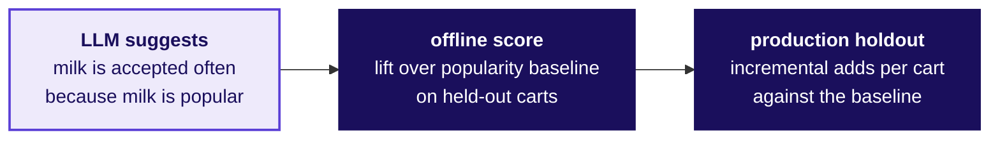

# The three slots and the Kalpa transfer

Week 4, Day 3. Half two.

Kicker: WEEK 4  ·  WEDNESDAY  ·  AFTERNOON
Quote: Which three pairs fill the strip, and which measure cannot be fooled by popularity.
Who: The afternoon's unguided chapter, the interview room and the handoff into the IITGN block

```notes
Open with the morning's close summary already in view: three slots, two caveats, Rs 12.6 lakh a
month. The afternoon's first 60 minutes run the unguided chapter 3 part 2 and the interview
transcript, then the handoff line into the W4-2 faculty block (tentative).
Transition: the unguided block's prompt.
```

---

## SECTION 6: Pick three slots and defend them
*The afternoon's unguided chapter 3 part 2.*

**Who needs the answer.** The category manager.

**The questions on the way.** Which three pairs, what each slot earns, and the answer to "milk is in most carts".

```notes
LIVE, 30 minutes in nine groups. Each group picks three pairs from the pairs table, writes the
one-paragraph proposal with the rupee value and the caveat, and answers the category manager's
one line in two sentences.
Transition: the prompt in full.
```

---

## S30. The prompt: 30 minutes, nine groups, one proposal
*What the room produces by the end of the block.*

```cards
icon: list | eyebrow: Step 1 | title: Pick three pairs | body: From the notebook's pairs table, three with support at least 1 percent and lift well above 1. | tone: light
icon: calculator | eyebrow: Step 2 | title: Price each slot | body: Views, click-through, add rate, margin per add; each labelled with its range. | tone: light
icon: book | eyebrow: Step 3 | title: Write the caveat | body: The heavy tenth and the stock-out; what each would change about the number. | tone: light
icon: message-square | eyebrow: Step 4 | title: Answer the manager | body: Two sentences. The number comes before the explanation. | tone: dark
```

```notes
LIVE, 2 minutes. Say the four steps and the time. Say the TA will circulate; a group's proposal
is judged on the lift above the floor, the labelled rupee gap and the two-sentence answer to the
manager.
Transition: the proposal template.
```

---

## S31. The proposal template, four fields in one line each
*What a group's handed-in proposal has to say.*

| Field | Expected |
|---|---|
| The three pairs | Named, with support and lift from the notebook |
| The rupee value per slot per month | From the model, with each assumption's range beside it |
| The two caveats | Heavy-tenth share and the stock-out, with the recomputation the paper would run |
| The answer to the manager | Two sentences, the number first, then the mechanism |

```notes
LIVE, 1 minute. Hand each group the one-page template. The template lives in exercises/guided
and the solutions in exercises/solutions, released at the close.
Transition: into the interview question.
```

---

## S32. The method ladder for the strip proposal
*What goes from the pairs table to a one-sentence answer?*



The method is a line: table, floor, lift, rupees, caveats, two sentences. The caveats are a labelled line in the proposal, with the recomputation the paper would carry.

```notes
LIVE, 2 minutes. Walk the six boxes. Say the room has 30 minutes to run this on the notebook
output they wrote in chapter 2 and the rupee model from chapter 3.
Transition: into the interview question.
```

---

## SECTION 7: The interview question the day equips
*A transcript the room reads in pairs, then the AI-company variant.*

**Who needs the answer.** The learner, who will be asked the question at the next screen with Uber, Swiggy or an AI startup.

**The questions on the way.** Which measure cannot be fooled by popularity, how to explain lift in one sentence, and how to score an LLM shopping assistant's add-ons.

```notes
LIVE, 15 minutes. Read the transcript aloud with one learner playing the candidate. The weak
answer and the hire-grade answer sit side by side. Score on the Aced criteria: structure, the
denominator named, the trap seen, the number tied to a decision.
Transition: the transcript.
```

---

## S40. The question, asked exactly as it reaches the room
*Support, confidence, lift: which cannot be fooled by popularity?*

```cards
icon: user | eyebrow: Interviewer | title: The question | body: "Support, confidence, lift. Which one cannot be fooled by popularity, and why? Follow up with a product example." | tone: dark
icon: triangle-alert | eyebrow: Weak answer | title: Confidence | body: Says confidence is "how likely they are to go together" and stops. The interviewer waits. | tone: light
icon: check | eyebrow: Hire-grade | title: Lift | body: "Lift divides by the base rate, so a popular item cannot inflate it. On Instamart, milk's confidence to bread is 0.74 and its lift is 1.04; lift says they are nearly independent." | tone: light
icon: message-square | eyebrow: Follow-up | title: AI assistant | body: "An LLM shopping assistant suggests milk often. How would you score it?" | tone: light
```

```notes
LIVE, 6 minutes. Walk the two answers side by side. Say what the interviewer listens for: the
base rate named, the mechanism named, a decision drawn. Say Aced's scorecard: structure first,
assumptions stated, trap seen, decision named, each 0 to 2.
Transition: the AI-company variant answered.
```

---

## S41. AI variant: lift over a popularity baseline
*What is the measure for an LLM shopping assistant's add-on suggestions?*



The assistant that suggests milk is "accepted" often because milk is popular. The measure is lift of the assistant's suggestions over a popularity baseline, computed on held-out carts. The number is then validated by a holdout in production: run the assistant on half the carts, the baseline on the other half, measure incremental adds per cart. The base-rate trap is the same one Amazon fixed.

```notes
LIVE, 3 minutes. Walk the two steps: offline on held-out carts by lift over the base rate, then
online by a holdout. Say the lesson transfers: whenever a popular item looks like a winner,
divide by the base rate before celebrating.
Transition: the Kahoot and the handoff.
```

---

## SECTION 8: The handoff into the W4-2 faculty block (tentative)
*What the trainer hands to the faculty, in one line.*

**Who needs the answer.** The IITGN faculty session (tentative), where association rules as probability, independence and the Apriori pruning principle are taught in the W4-2 block.

**The questions on the way.** How does lift read as a probability ratio, and why can an algorithm skip counting every combination.

```notes
LIVE, 2 minutes. Hand the room over with the sentence below. Say the faculty block is tentative
until IITGN confirms (`data/programme/facts.yaml`, decision `faculty`).
Transition: the handoff line.
```

---

## S45. Handoff: lift read as probability
*What the trainer says, word for word, before the faculty takes over.*

> You counted support, confidence and lift on twelve carts and on forty thousand. The next 120 minutes show the same three numbers as probabilities: a lift near one is independence made visible, which is what milk showed you. The support floor you set is what lets an algorithm skip counting every combination.

```notes
LIVE, 1 minute. Read it aloud as it stands. Say the W4-2 block is tentative until IIT Gandhinagar
confirms. Tomorrow's pre-read ships tonight.
Transition: the Kahoot and the close.
```

---

## S46. Kahoot and close
*The eight items of today's ungraded quiz.*

```timeline
label: Item 1 | title: Milk and bread | body: Which number is 0.74 on 40,000 Pune carts? Confidence from bread to milk.
label: Item 2 | title: Lift read right | body: A pair's lift of 1.04 means found together as often as independence predicts.
label: Item 3 | title: The blend | body: 50 percent milk-slot impressions at 1.2 CTR plus 50 percent other at 6.4 blends to 3.8 percent.
label: Item 4 | title: The thin pair | body: Ice cream and chocolate sauce at lift 4.47 on 100 carts: watch list, not promote.
label: Item 5 | title: The rupee | body: Rs 14,040 a day per slot is the gap between a milk slot and a chance-beating slot.
label: Item 6 | title: Return question | body: The four defence moves from Tuesday, by name: restate, answer, concede, what would change your mind.
label: Item 7 | title: The caveat | body: Recomputing per customer drops chips and cold drink's lift because of heavy shoppers.
label: Item 8 | title: AI variant | body: An LLM assistant that suggests milk is scored on lift over a popularity baseline, then by a holdout.
```

```notes
LIVE, 15 minutes. Run the Kahoot. Item 6 is the return question from Tuesday; the rest cover
today's five levels. Close the day with the one-line summary: pairs beat chance by lift, three
slots pay the growth lead's bill, and the Kalpa lab repeats the same method on the Rs 199
charger.
Transition: the day ends; tomorrow is Zomato Gold and the cohort triangle.
```
