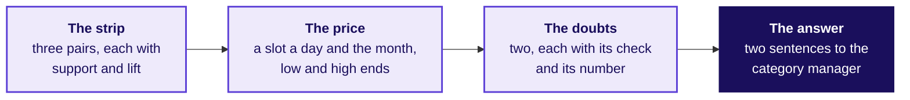
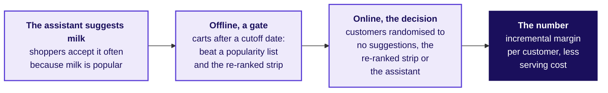
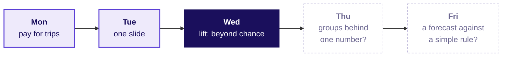

# Instamart Pune: the strip re-ranked, priced and defended

Week 4, Day 3. Half two.

Header: WEEK 4  ·  WEDNESDAY  ·  SWIGGY INSTAMART, PUNE  ·  ILLUSTRATIVE CASE

---

## SECTION 3: Which strip would you ship?
*Which three pairs, priced how, and how do you answer a category manager who wants milk in every slot?*

```notes
LIVE, 1 minute, on screen after lunch. The morning ended with the method: lift above a 1 percent
floor, a slot priced at Rs 17,280 against Rs 3,240 a day, Rs 6.3 lakh a month recovered. Chapter 3,
part two, level L5, unguided in groups of about four on notebook 03; then the interview room and
the Kahoot. The IITGN faculty session (tentative) takes the next 120. Transition: the brief.
```

---

## S38. Ship one strip in 35 minutes, priced and defended
*What does each group hand in?*

```cards
icon: list-ordered | eyebrow: Step 1 | title: Rank three pairs | body: From the pairs table: support at least 1 percent and lift 1.5 or more, each with its two numbers. | tone: light
icon: indian-rupee | eyebrow: Step 2 | title: Price the strip | body: A slot a day and the month recovered, each assumption with its range. | tone: light
icon: triangle-alert | eyebrow: Step 3 | title: Name two doubts | body: Each with the check and the number it gave. | tone: light
icon: message-square | eyebrow: Step 4 | title: Answer the category manager | body: Two sentences: the number first, then what you concede. | tone: dark
```

The one-page strip is what each group hands in. The strip set in `exercises/unguided` asks the same steps as four items; a group posts its four letters once its page is done.

```notes
LIVE, 4 minutes to brief, then 25 minutes of group work. The TA moves between tables. A group that
picks a pair below the floor is asked "how many carts would the slot touch?". A group that prices
sales instead of margin is asked "which number does the growth lead keep?". Transition: the
template.
```

---

## S39. The one-page strip: four fields, one line each
*What must the handed-in page say?*



A strip that names a pair without its support, or a rupee figure without its ranges, is sent back.

```notes
LIVE, 1 minute. The four fields on this slide are the template; the strip set's solutions file is released at the
close. Transition: the objection each group must answer.
```

---

## S40. "Milk is our top seller; put it in every slot"
*Which part of the category manager's objection is right, and what answers the rest?*

```cards
icon: ear | eyebrow: Restate | title: Milk is in most carts | body: It is in 71 percent of carts and brings shoppers back daily. | tone: light
icon: chart-column | eyebrow: Answer | title: The slot moves nothing | body: Milk slots click at 1.2 percent against 6.4; lift with every common item sits near one. | tone: light
icon: handshake | eyebrow: Concede | title: Milk belongs in the cart | body: Which is why it needs no reminder; keep it on the home screen and in search. | tone: light
icon: refresh-cw | eyebrow: What would change it | title: If milk clicked like the rest | body: A two-zone test where milk slots matched 6.4 percent would put milk back. | tone: dark
```

```notes
LIVE, 5 minutes. Tuesday's four moves, used on today's numbers: restate until the owner agrees,
answer from the evidence, concede what is true, say what would change your mind. Two groups read
their answers aloud; the room names the move each sentence makes. Transition: the interview room.
```

---

## SECTION 4: Which measure can popularity not fool?
*How does a strong candidate answer the day's question in a product-analytics interview?*

```notes
LIVE, 10 minutes for the section. Level L6. The full transcript is read in pairs from the extras
folder, and each pair scores the other on its seven criteria. Transition: the question.
```

---

## S41. Lift divides popularity out; confidence does not
*"Support, confidence, lift: which one cannot be fooled by popularity, and why?"*

```cards
icon: x | eyebrow: Weak answer | title: Confidence | body: "Confidence, because it is the probability of B given A, so the highest-confidence pair goes in the strip." It ranks milk first. | tone: light
icon: check | eyebrow: Hire-grade answer | title: Lift, because it divides by the base rate | body: "Bread to milk reads confidence 0.74, but milk is in 71 percent of carts anyway, so lift is 1.04. Chips and cold drink read 0.42 and lift 3.39. I rank by lift above a support floor." | tone: dark
icon: ear | eyebrow: What the interviewer listens for | title: The base rate and its window | body: Three questions kept apart, the denominator and window said aloud, a floor, a decision. | tone: light
```

```notes
LIVE, 4 minutes. Pairs read the two answers side by side and score both on the scorecard's seven
lines. The weak answer is not wrong about confidence's meaning; it is wrong about what to do with
it. Transition: the follow-ups.
```

---

## S42. Three follow-ups and the line that answers each
*What does the interviewer ask next, and what does a hire-grade answer say?*

| Follow-up | The hire-grade line |
|---|---|
| A pair has lift 4.6 and support 0.25 percent: act? | The pair is real, 100 carts against 22 by chance, and beside ice cream, about 2,400 views a day, sauce's Rs 37.40 margin makes it worth about Rs 85,000 a month in place of milk; 100 carts cannot say how it clicks, so it goes on the watch list and a test of how often ice-cream carts buy sauce |
| Heavy buyers buy everything: what does that do to lift? | They repeat the party pair, so count each customer once and 3.39 falls to 2.56; bigger baskets hold any pair by chance, so size the expected count by cart. Corrected for both, chips and cold drink reads 1.95 and keeps its slot, and onions and tomatoes falls to 1.38, below the 1.5 bar |
| Make it a rupee recommendation: what cost line do most forget? | Incrementality: some adds come through search or habit anyway, so the Rs 6.3 lakh a month (Rs 3.9 lakh to Rs 9.3 lakh) is a ceiling a holdout measures; sales are never the gain |

```notes
LIVE, 3 minutes. Each follow-up is one of the morning's traps asked as a question. Transition: the
same idea at an AI company.
```

---

## S43. An LLM shopping assistant meets the same base rate
*How would you score an assistant that suggests add-ons?*



Acceptance flatters an assistant as confidence flattered milk. Offline is a gate: on held-out carts placed after a cutoff date, which it never saw while it was built, hide one item in each and check that it recovers the item more often than a popularity list and the strip re-ranked by lift, leaving out each shopper's weekly staples. Online decides: customers, never carts, randomised to three arms for a length fixed in advance, scored on incremental adds, the ones that would not have happened without it, as margin per customer less serving cost. The re-ranked strip is the bar, since re-ranking is free and the assistant must beat it by more than it costs to serve.

```notes
LIVE, 3 minutes. Programme-written variant. The base-rate trap is the same one the strip fell
into, now inside a model's evaluation. Amazon's Prime Video team saw why the cutoff date matters
(Amazon Science, checked 12 October 2026): its first autoencoder trailed a list of the past two
weeks' most popular rentals until it was trained on viewing before a cutoff and scored on the two
weeks after it. Transition: the handoff.
```

---

## SECTION 5: What does the room carry out?
*What does the next session take from here, and what does the room take home?*

```notes
LIVE, 15 minutes for the section: the handoff, the Kahoot and the close. Transition: the handoff
line.
```

---

## S44. Handoff: lift read as probability, next
*What does the IITGN faculty session (tentative) pick up from the morning?*

> You counted lift on twelve carts and on forty thousand. The next 120 minutes show the same three numbers as probabilities: a lift near one is independence made visible, which is what milk showed you, and the support floor you set is what lets an algorithm skip counting every combination.

Independent means that knowing one item is in the cart tells you nothing about the other, and a rule is a sentence such as "bread, so milk". The IITGN faculty session is tentative until IIT Gandhinagar confirms it.

```notes
LIVE, 1 minute. Read the line as it stands. Park any question about how long a watch-list trial
must run for the faculty session (tentative). Transition: the Kahoot.
```

---

## S45. Eight quick questions, one with a minute to compute
*Can the room make the day's calls at speed?*

```timeline
label: Items 1 to 3 | title: The three counts | body: Match each count to its question; compute lift from three counts; a popular partner read right.
label: Items 4 and 5 | title: The floor and the rupee | body: A strong thin pair; what a promotion is worth.
label: Item 6 | title: Tuesday's return question | body: The four moves of an answer to an objection that is partly right.
label: Items 7 and 8 | title: The fall and the doubts | body: A blended rate split; counting each customer once.
```

```notes
LIVE, 10 minutes. Run the Kahoot pack from the kahoot folder; it is ungraded. Re-teach in one line
any item most of the room misses. Transition: the close.
```

---

## S46. The sentence for Friday, and Thursday's question
*What does the room say on Friday, and what comes next?*

**The sentence.** "The click-through fell because the strip gave half its slots to milk, which shoppers buy anyway; ranked by lift above a 1 percent floor, the strip shows chips with cold drink, coriander with green chillies and bread with butter, and recovers about Rs 6.3 lakh a month."

**Tomorrow.** Zomato Gold in Chennai: a retention number that stays flat while every group of members shrinks. Who is leaving, and at which step?



```notes
LIVE, 4 minutes. Ask two learners to say the sentence without notes. The lab after class runs the
same method on Kalpa Retail's baskets. Tomorrow's pre-read ships tonight.
```
