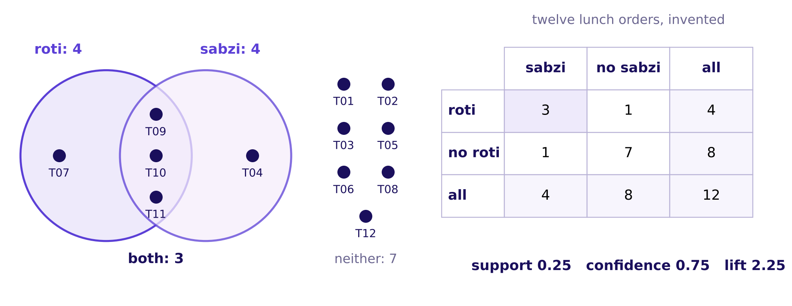

# Which pairs lift frequency beyond chance, and what is each one worth?

Week 4, Wednesday. About 18 minutes to read, and 10 more for the self-check.

Wednesday's five topics come first, each counted on an invented example small enough to check by
hand: a hostel canteen's twelve lunch orders and a Pune corner shop's month. The case then asks the
same questions of Swiggy Instamart's Pune carts, where the cart page's strip of three suggested
items switched on Monday 7 September 2026 from a curated list to the items most often found in the
same cart, and its click-through fell from 6.1 percent to 3.8 percent. Illustrative case: the
company is real, the situation and the data are synthetic, built for this class.

---

## What can you do after Wednesday?

- You can count support, confidence and lift by hand and in code, and check a lift a second way.
- You can spot the popular partner whose confidence looks strong and whose lift sits near one.
- You can turn a table of order lines into every pair's three numbers, each pair counted once.
- You can set a support floor and put a strong, thin pair on a watch list instead of a slot.
- You can price a cross-sell in rupees as an expected value, with its cost line and its range.

## Where does Wednesday sit in the week, and how do its five topics connect?

**What was worked, and what was only mentioned.** Wednesday counted the three measures by hand on
the canteen's orders, then on twelve Instamart carts, then on all 40,000; set a floor; priced a
combo card and a strip slot; and split the click-through by what each slot suggested. Cause was only
mentioned, and upsell was defined once and left for later.

```mermaid
flowchart LR
    T1["<b>1 · Support, confidence and lift</b><br/>chapters 1 to 3"] --> T2["<b>2 · The confidence trap;</b><br/><b>lift near one</b><br/>chapter 4"]
    T2 --> T3["<b>3 · Basket analysis on</b><br/><b>the order items</b><br/>chapter 5"]
    T3 --> T4["<b>4 · The support floor</b><br/><b>and the watch list</b><br/>chapter 6"]
    T4 --> T5["<b>5 · Cross-sell and upsell;</b><br/><b>expected value in rupees</b><br/>chapter 9"]
    T5 --> C["<b>The case and the lab</b><br/>chapters 7, 8 and 10;<br/>notebook 11"]
    classDef lit fill:#1A0F5C,stroke:#1A0F5C,color:#FFFFFF
    classDef known fill:#EEEAFB,stroke:#5B3FD6,color:#1A0F5C,stroke-width:2px
    class T1,T2,T3,T4,T5 lit
    class C known
```



Each day of Week 4 asks what a number is compared with. Wednesday compares two items sharing a
basket with what chance alone would give, which Thursday reuses as "beyond the blend" and Friday as
"beyond the baseline".

**What was left out.** The IITGN faculty session after class (tentative) reads the same three
numbers as probabilities and shows how a support floor lets an algorithm skip most combinations.
Whether a suggestion causes a sale needs a randomised test, the subject of this week's Monday
faculty session (tentative).

## Which one picture holds the day?



Call it **the canteen's 2 by 2**: twelve invented lunch orders, roti in 4, sabzi in 4, both in 3.
Every measure of the day is a ratio of cells in that table.

$$\text{support} = \frac{3}{12} = 0.25 \qquad \text{confidence}(\text{roti} \to \text{sabzi}) = \frac{3}{4} = 0.75 \qquad \text{lift} = \frac{3}{12 \times \frac{4}{12} \times \frac{4}{12}} = \frac{3}{1.33} = 2.25$$

Support asks how often, confidence how reliably from one side, and lift how far above chance, the
same from either side.

---

## Support: how often do two items share a basket?

**Who needs the answer.** The canteen manager, who prints two items side by side on the combo board.

**The questions on the way.**

- What is a basket?
- How many orders hold both items?
- What does support leave out?

A **basket** is everything one customer pays for in one go: one bill at a kirana, one order at the
canteen, one cart on an app. Together means in the same basket. Roti is in 4 of the twelve orders
and sabzi in 4, and three orders, T09 to T11, hold both. **Support** is the baskets holding both
over all baskets, 3 / 12 = 0.25.

**WATCH OUT.** Adding the two counts gives 8, which never looks inside an order and counts T09 to T11
twice. The check is the 2 by 2: both, roti only, sabzi only and neither, 3, 1, 1 and 7, add to
twelve.

On Instamart's 40,000 carts, bread and milk sit together in 10,064, a support of 25.2 percent, the
most common pair of all. Support is a count and nothing more yet: roti and sabzi and roti and chaas
both read 0.25, and support cannot tell them apart.

**CALLBACK.** Week 1, Monday: every rate names what it divides by. Support divides by every basket.

**Say it to the warden.** "Three of your twelve lunch orders had roti and sabzi together, a quarter
of them."

## Confidence: how reliably does one item bring the other?

**Who needs the answer.** The canteen manager, who must decide which item the combo card is printed
beside.

**The questions on the way.**

- What does "of those" count?
- Does the direction matter?

**Confidence** from A to B shrinks the world to the baskets holding A and asks how many of those also
hold B. Dal rice is in 6 orders, papad in 5 and both in 3, so dal rice to papad reads 3 / 6 = 0.50
and papad to dal rice reads 3 / 5 = 0.60: the same three orders, two sentences. The two directions
agree only when both items sit in the same number of baskets, as roti and sabzi do, 0.75 each way.
Direction can swing a pair far: gulab jamun to curd reads 1.00 on one order, and curd to gulab
jamun 0.50.

$$\text{confidence}(A \to B) = \frac{\text{baskets with both}}{\text{baskets with } A}$$

**WATCH OUT.** Reporting one direction's number for the other aims the combo card at the wrong buyer.

On the 40,000 carts, bread to milk reads 0.74 and milk to bread 0.35. Confidence alone never says
whether a pair is special, since it ignores how common B is anyway, which is the next topic's
question.

**Say it to the warden.** "Of the five orders with papad, three had dal rice; of the six with dal
rice, only three had papad."

## Chance and lift: do two items meet more often than chance?

**Who needs the answer.** The canteen manager, who wants pairs that sell together more than chance.

**The questions on the way.**

- What would chance give?
- What is lift, and does it have a direction?

If roti and sabzi ignored each other, roti's orders would hold sabzi at the rate all orders do, so
chance alone gives 12 x 4/12 x 4/12 = 1.33 orders. Three are seen. **Lift** is the seen count over
the chance count, 3 / 1.33 = 2.25. Divided through, lift is also confidence over the partner's share,
0.75 / 0.33 from either side, which is why lift has no direction. Below one, the two meet less often
than chance; near one, chance; above one, a pull. Roti and chaas sit exactly at chance: 3 seen, 3 by
chance, lift 1.00.

$$\text{lift} = \frac{\text{baskets with both} \times \text{all baskets}}{\text{baskets with } A \times \text{baskets with } B}$$

**WATCH OUT.** "Roti makes customers buy 2.25 times the sabzi" has the right number and the wrong
sentence. Lift counts a pull and never names a cause; only a fair test of a change at the counter
shows one.

On the 40,000 carts, chips and cold drink read lift 3.39 and bread and milk 1.04.

**ORIGIN.** Practical Business Python describes lift as the ratio of the observed support to that
expected if the two were independent, and a lift close to one as independence (checked 13 October
2026).

**Say it to the warden.** "Chance alone would put roti and sabzi together in about one order; they
were together in three."

## The confidence trap; lift near one: who is the worst partner?

**Who needs the answer.** The canteen manager, who hears that every dal rice order has chaas and is
tempted to print chaas beside everything.

**The questions on the way.**

- What is a base rate?
- Does every item look bundled with the popular one?

A **base rate** is how common an item is in all baskets anyway: chaas is in 9 of the 12 orders,
0.75. Every dal rice order holds chaas, a confidence of 1.00, yet chance alone already puts chaas in
4.5 of dal rice's 6 orders, so the lift is 6 / 4.5 = 1.33. Every item in four or more
orders reads a confidence of 0.60 to 1.00 toward chaas, and every lift with chaas sits between 0.80
and 1.33. The rule, named last: a partner that ignores a popular item holds it at the item's own
share, so the most popular item wins every confidence ranking while its lift stays near one.

**WATCH OUT.** A confidence of 1.00 read as a bundle fills the combo board with chaas and changes
nothing. The check is the base rate; the fix is lift.

On the 40,000 carts, toned milk is in 71 percent of carts. For all 50 items in at least 2 percent of
carts, confidence toward milk runs 0.70 to 0.74 and lift with milk 0.99 to 1.04.

**Say it to the warden.** "The item in every tray is the worst combo partner, because it was going
on the tray anyway."

## Basket analysis on the order items: how do lines make pairs?

**Who needs the answer.** Anyone who must count every pair of a real shop, where a bill is stored as
order lines, one row per order and item.

**The questions on the way.**

- How does an order become pairs?
- Why sort the two names?

Group the order lines by order into a set of items, so each basket counts an item once; then every
two items in a basket add one to their pair's tally. A basket of three items holds three pairs, four
hold six, and k items hold k x (k - 1) / 2. The canteen's 33 lines make 30 pairs: nine three-line
orders give 27 and three two-line orders give 3.

```python
baskets = lines.groupby("order_id").item.apply(set)                         # one set per order
pair_count = Counter(p for b in baskets for p in combinations(sorted(b), 2))  # each pair once
```

`combinations` of a sorted basket gives each pair once with its names in order (Python's itertools
documentation, checked 13 October 2026).

**WATCH OUT.** Left unsorted, chaas with dal rice and dal rice with chaas become two keys and the
count reads 60, every pair doubled.

The same lines run unchanged on Instamart's 40,000 carts. Testing each of the 1,711 possible pairs
against every cart would make about 68 million checks; letting each cart add the pairs it holds makes
about 433,000.

**Say it to the warden.** "A thali of three dishes is three pairs of dishes, whichever way round you
name them."

## The support floor and the watch list: when is a pair too thin?

**Who needs the answer.** The canteen manager, who sees gulab jamun and curd read lift 6.0 on a
single order.

**The questions on the way.**

- How much can luck move a lift?
- What does a watch list do?

An invented month of 600 canteen orders, built so that no item depends on another, shows how far
luck reaches: gulab jamun and jalebi read lift 8.57 on 2 orders, while the 10 pairs on 30 or more
orders read 0.90 to 1.00. A **support floor** is the fewest baskets a pair must sit in before anyone
acts on its lift, stated as a count before the ranking is read: 3 of the twelve orders here, 1
percent of the carts in the case, 400 carts. Above the floor and above a bar of 1.5, a pair is
promoted; below the floor and above the bar, it goes on a **watch list**, with a trial and a pass rule
written before the trial starts.

**WATCH OUT.** Acting on lift alone prints a card for one order's luck. How long a trial must run is a
sample-size question, parked for the faculty session (tentative).

On the 40,000 carts, ice cream and chocolate sauce read lift 4.60 on 100 carts, below the floor:
watched, never promoted blind.

**CALLBACK.** Week 1, Thursday: distrust a rate built on fewer than thirty observations.

**Say it to the warden.** "One order of gulab jamun with curd is a coincidence until a fair trial
says otherwise."

## Cross-sell and upsell reasoning; expected value in rupees: what is a combo worth?

**Who needs the answer.** The owner of Sharma Kirana, a corner shop in Pune, invented, who is
weighing a counter card that takes Rs 1 off any bill holding tea and rusk.

**The questions on the way.**

- Which bills can the card change?
- What decides the sign?

**Cross-sell** suggests a second item that goes with the first, as rusk with tea; **upsell** suggests
a dearer version of the same item, as the bigger tea pack. In the month, 1,000 bills hold tea in 600,
rusk in 200 and both in 150. Only the 450 tea bills without rusk can change: at an assumed 4 percent,
18 add a pack at Rs 12 of margin, Rs 216. The card hands Rs 1 back on all 168 bills holding both,
and the cards cost Rs 20, so the card is worth Rs 216 less Rs 168 less Rs 20, Rs 28 a month.
**Expected value** is each outcome times its probability, added up: a tea bill without rusk earns
Rs 11 with probability 0.04 and nothing otherwise, Rs 0.44 a bill (Wikipedia's expected value page,
checked 13 October 2026). At 2 percent the card loses Rs 71; at 6 percent it earns Rs 127; at Rs 2
off it loses Rs 140.

**WATCH OUT.** Rusk sales on every combo bill, Rs 5,040, is 180 times the gain.

On Instamart's strip, a slot showing a pair that beats chance earns Rs 17,280 a day against Rs 3,240
showing milk.

**Say it to the warden.** "A combo card earns only on the orders it changes, and it pays its discount
on all of them."

---

## The case: what did twelve carts and then 40,000 say, and why did the click-through fall?

**Who needs the answer.** The growth lead, who explains the fall on Friday to a category manager
defending milk as the top seller.

**The questions on the way.**

- What do twelve carts say, and what can they not say?
- What does lift say about milk on every cart?
- Why did the click-through fall?

On twelve of the 40,000 carts, milk is in 8 and bread in 4, and all four bread carts hold milk, a
confidence of 1.00: the trap met again. Chance puts milk in 2.67 of the bread carts, so lift is
1.50. Ice cream and chocolate sauce share one cart, a lift of 12 that the floor refuses.

On all 40,000 carts, bread to milk reads confidence 0.74, close to milk's own 0.71, so lift is 1.04:
chance puts both in 9,656 carts, and 10,064 hold them. Twelve carts said 1.50 because a few carts
can make a pull look strong.

**Why the click-through fell.** Before the change milk held 2 percent of slot impressions; after it,
50 percent. Milk's slots click at 1.2 percent and every other suggestion at 6.4, up from 6.2.

$$0.5 \times 1.2\% + 0.5 \times 6.4\% = 3.8\%$$

**WATCH OUT.** "Shoppers changed after the monsoon" fails the split, because the rate on everything
except milk rose. A blended rate can fall while every part of it holds.

**IN THE FIELD.** Amazon Science's history of the company's recommendation algorithm says counting
co-purchases would make a few bestsellers, such as Harry Potter books and trash bags, the top
recommendations for every customer; the fix compared what was seen with what chance would predict
(Amazon Science, checked 13 October 2026). Beer and diapers, told accurately, is a 1992 count of
about 1.2 million Osco Drug baskets with no documented shelf move (The Register, checked 12 October
2026).

**The answer.** Milk tops every count because it is in 71 percent of carts, and lift divides that
popularity out to 1.04. The click-through fell because milk took half the impressions at 1.2 percent.

## The case: which pairs fill the strip, and what is a slot worth?

**Who needs the answer.** The growth lead, who takes a ranked strip and a rupee figure to Friday's
review.

**The questions on the way.**

- Which pairs beat chance on enough carts?
- What is a slot worth in rupees, and what can the counts not tell us?

Above a floor of 1 percent of carts, 246 pairs qualify and four beat chance clearly: chips and cold
drink 3.39, coriander and green chillies 3.00, bread and butter 2.21, onions and tomatoes 1.70. The
strip has three slots, so onions and tomatoes waits, and ice cream and chocolate sauce, 4.60 on 100
carts, goes on the watch list.

$$60{,}000 \text{ views a day} \times 6.4\% \times 0.5 \text{ adds per click} \times \text{Rs } 9 = \text{Rs } 17{,}280 \text{ a day}$$

Showing milk at 1.2 percent, the slot earns Rs 3,240. The gap is about Rs 4.2 lakh a month a slot,
and milk holds 1.5 slots' worth, so re-ranking recovers about Rs 6.3 lakh a month, Rs 3.9 lakh to
Rs 9.3 lakh as the add rate runs from 0.4 to 0.6 and the margin from Rs 7 to Rs 11.

**WATCH OUT.** Booking sales as the gain: 1,920 adds a day at about Rs 41.77 each looks like Rs 80,197
of daily strip revenue, the kirana's Rs 5,040 at city scale.

**IN THE FIELD.** Swiggy's letter for the quarter to June 2025 describes Maxxsaver, a discount
unlocked once a basket passes a threshold, as funnelling part of the larger basket's margin back to
the user (Swiggy's shareholder letter, checked 12 October 2026): the cost line a rupee case carries.

**The doubts.** Together is no proof of cause, and only a holdout settles it. Counted with every
customer once, chips and cold drink fall from 3.39 to 2.56 and keep their slot. Curd's stock-out in
two zones lowers its count and leaves its lift with milk at 1.01.

**The answer.** Chips with cold drink, coriander with green chillies and bread with butter fill the
strip, ice cream and chocolate sauce wait, and re-ranking recovers about Rs 6.3 lakh a month.

## What does the lab ask of Kalpa's Rs 199 charger?

Kalpa Retail's merchandising team wants every product bundled with the Rs 199 phone charger,
"because it is in 80 percent of baskets". The lab counts Kalpa's own order lines in notebook 11: what
the charger's share and its lift with each product say about that claim, which pair beats chance
above a floor, and what the bundle would cost before any money is spent.

---

## Where does this show up in the work?

| Situation | The decision | What the wrong count costs |
|---|---|---|
| A "goes well with" strip | Which items fill the slots | Rs 14,040 a day a slot on Instamart's strip |
| A combo card or bundle discount | Whether a pair earns a promotion | A discount paid on purchases that happen anyway |
| An LLM shopping assistant | How to score its add-ons | Praise for suggesting what shoppers buy anyway |

## Can you answer these without notes?

1. Which measure answers "do these two meet more often than chance?"
2. Papad is in 5 orders, dal rice in 6 and both in 3: what does papad to dal rice read?
3. Of 40,000 carts, 6,000 hold coriander, 3,200 green chillies and 1,440 both: what is the lift?
4. Milk holds half the impressions at 1.2 percent and the rest click at 6.4: what is the blend?
5. A pair reads lift 4.60 on 100 carts, below a floor of 400: does it get a slot?
6. A card adds 18 packs at Rs 12 of margin, hands Rs 1 back on 168 bills and costs Rs 20: its worth?
7. From Tuesday: an objection is partly right; what are the four moves of the answer?

**Key.** 1: lift (chance and lift). 2: 0.60 (confidence). 3: 1,440 x 40,000 / (6,000 x 3,200) = 3.00
(chance and lift). 4: 3.8 percent (the case). 5: no, the watch list (the support floor). 6: Rs 28
(expected value). 7: restate, answer from the evidence, concede what is true, say what would change
your mind (Tuesday's notes).

## Which interview questions does Wednesday prepare you for?

| The question as asked | The hire-grade line |
|---|---|
| What is confidence, and why does the direction matter? | Both over A, so A to B and B to A divide by different baskets: papad to dal rice 0.60, dal rice to papad 0.50 |
| Support, confidence, lift: which cannot be fooled by popularity, and why? | Lift, since it divides by the base rate: bread to milk reads 0.74 and milk is in 71 percent of carts, so lift is 1.04 |
| Why sort the pair's names before counting? | So each pair has one key and no count is split or doubled |
| Lift 4.6 on support of 0.25 percent: act? | The pair is real, but 100 carts cannot say how it clicks: the watch list and a test with a pass rule set first |
| A combo offer lifts the pair's sales: is it worth running? | Margin on the purchases that would not have happened, less the discount on all of them, less the fixed cost, said as a range |
| Make it a rupee recommendation: which cost line do most forget? | Incrementality: some adds come anyway, so Rs 6.3 lakh a month is a ceiling a holdout measures |
| How would you score an LLM shopping assistant's add-ons? | Against a popularity list on carts after a cutoff date first, then by a holdout of customers online |

## Which words did Wednesday use?

| Term | Plain meaning | On the canteen or the kirana | On Instamart's carts |
|---|---|---|---|
| Support | Share of all baskets holding both items | Roti and sabzi: 0.25 | Bread and milk: 25.2 percent |
| Confidence | Share of A's baskets that also hold B | Papad to dal rice: 0.60 | Bread to milk: 0.74 |
| Lift | Baskets with both, over the baskets chance alone gives | Roti and sabzi: 2.25 | Chips and cold drink: 3.39 |
| Base rate | How common an item is across all baskets | Chaas: 0.75 | Milk: 71 percent |
| Support floor | The fewest baskets a pair needs before its lift is read | 3 orders | 1 percent, 400 carts |
| Watch list | A strong, thin pair held for a trial with a pass rule | Gulab jamun and curd | Ice cream and chocolate sauce |
| Cross-sell | Suggesting a second item that goes with the first | Rusk beside tea | The strip's suggestion beside a cart item |
| Expected value | Each outcome times its probability, added up | The card's Rs 28 a month | A slot's Rs 17,280 a day |
| Blended rate | One rate mixing groups that have different rates | Met only on the case | 3.8 percent from 1.2 and 6.4 |

## Where should you read next, and how long does each take?

| Order | Source | Time |
|---|---|---|
| 1 | Practical Business Python, "Introduction to Market Basket Analysis in Python", the lift section, https://pbpython.com/market-basket-analysis.html (checked 13 October 2026) | 20 minutes |
| 2 | StatQuest, "Conditional Probabilities, Clearly Explained!!!", https://www.youtube.com/watch?v=_IgyaD7vOOA (checked 13 October 2026) | length not verified |
| 3 | Python's itertools documentation, `combinations`, https://docs.python.org/3/library/itertools.html (checked 13 October 2026) | 5 minutes |
| 4 | Amazon Science, "The history of Amazon's recommendation algorithm", https://www.amazon.science/the-history-of-amazons-recommendation-algorithm (checked 13 October 2026) | 15 minutes |
| 5 | IBM Technology, "What is an AI Recommendation Engine?", https://www.youtube.com/watch?v=gEdePRsDACc (checked 13 October 2026) | 11 minutes |
