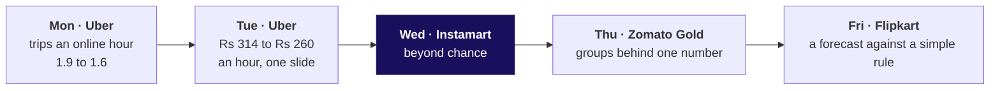

# Which pairs beat chance on Instamart's Pune carts, and what is a strip slot worth?

Week 4, Wednesday. About 13 minutes to read, and 10 more for the self-check.

Swiggy Instamart, Pune. On Monday 7 September 2026 the cart page's strip of three suggested items
switched from a curated list to the items most often found in the same cart, and its click-through
fell from 6.1 percent to 3.8 percent. Illustrative case: the company is real, the situation and the
data are synthetic, built for this class.

---

## What can you do after Wednesday?

- You can count support, confidence and lift by hand and in code, and check a lift a second way.
- You can read a blended click-through as a mix of two rates and find the part that moved.
- You can rank pairs by lift above a support floor and park a strong, thin pair on a watch list.
- You can price a slot in rupees with each assumption's range, and name the cost line.

## Where does Wednesday sit in the week?

**What was worked, and what was only mentioned.** Wednesday counted three measures by hand on ten
tea-stall orders and twelve carts, then on all 40,000; split the click-through by what each
slot suggested; ranked pairs above a floor; priced a slot; and checked the ranking with every
customer counted once and the curd stock-out set aside. Cause was only mentioned, since a count
cannot say whether a suggestion makes a sale, and upsell, a bigger pack of the same item, was named
and left for later.



Each day of Week 4 asks what a number is compared with; Wednesday compares two items sharing a cart
with what chance alone would give.

**What was left out.** The IITGN faculty session after class (tentative) reads the same three numbers
as probabilities and shows how a support floor lets an algorithm skip most combinations. Whether a
suggestion causes a sale needs a randomised test, the subject of this week's Monday
faculty session (tentative).

## Which one picture holds the day?


Call it **the ten dots**: ten invented tea-stall orders, chai in 6, biscuit in 4, both in 3. Every
measure of the day is a ratio of cells in that table.

$$\text{support} = \frac{3}{10} = 0.30 \qquad \text{confidence}(\text{chai} \to \text{biscuit}) = \frac{3}{6} = 0.50 \qquad \text{lift} = \frac{3}{10 \times 0.6 \times 0.4} = \frac{3}{2.4} = 1.25$$

Support asks how often, confidence how reliably from one side, and lift how far above chance, the
same from either side.

---

## What does "together" mean, counted on twelve carts by hand?

**Who needs the answer.** The category manager, who decides what the strip may suggest: a strip
filled on the wrong count wastes the three spaces under every cart.

**The questions on the way.**

- How often do two items share a cart?
- How reliably does one bring the other?
- Do they meet more often than chance would put them together?
- What can twelve carts not tell you?

On the ten dots, confidence from biscuit to chai is 3 of 4, 0.75, against 0.50 the other way, and
lift is 1.25 from both sides. "Chai lifts biscuit sales by 25 percent" is the tempting wrong sentence,
since lift counts and never names a cause. An invented carry bag in 9 of the 10 orders, and in 3 of
the 4 biscuit orders, reads confidence 0.75 from biscuit, yet its lift is 0.75 / 0.90 = 0.83, below
chance: the item in every bag earns high confidence toward everything.

The twelve cart cards are carts taken from the 40,000.

| Count | Bread and milk | Chips and cold drink | Ice cream and chocolate sauce |
|---|---|---|---|
| Carts with each item | 4 and 8 | 3 and 3 | 1 and 1 |
| Carts with both | 4 | 2 | 1 |
| Expected by chance | 12 x 4/12 x 8/12 = 2.67 | 12 x 3/12 x 3/12 = 0.75 | 0.08 |
| Lift | 1.50 | 2.67 | 12 |

**WATCH OUT.** Confidence 1.00 from bread to milk reads like a bundle. The tell is a partner in most
carts anyway, 8 of 12 here, and the check is lift.

**IN THE FIELD.** Amazon Science's history of the company's recommendation algorithm says counting
co-purchases would make a few bestsellers, such as Harry Potter books and trash bags, the top
recommendations for every customer; the fix compared what was seen with what chance would predict
(Amazon Science, checked 12 October 2026).

**CALLBACK.** Week 1, Monday: every rate names what it divides by.

**The answer.** Support counts how often, confidence how reliably from one side, lift how far above
chance from both sides. Twelve carts cannot tell a real pull from four lucky carts.

## What do 40,000 carts say, and why did the click-through fall?

**Who needs the answer.** The growth lead, who explains the fall on Friday to a category manager
defending milk as the top seller.

**The questions on the way.**

- How often is each item in a cart?
- Which pairs sit together most often, and is that the ranking?
- What does lift say about milk?
- Why did the click-through fall?

**Two ways to count every pair.** Testing each of the 1,711 possible pairs against every cart makes
about 68 million checks; turning each cart into a set and letting `Counter` add the pairs it holds
makes about 433,000. Notebook 02 runs the second way.

```python
baskets = items.groupby("cart_id").item.apply(set)                          # one set per cart
pair_count = Counter(p for b in baskets for p in combinations(sorted(b), 2))  # every pair once
```

Milk is in 71 percent of carts, bread in 34. Ranked by count, every one of the six most frequent
pairs holds milk, led by bread and milk on 10,064 carts, and that table has been the strip's ranking
since 7 September.

Bread to milk reads confidence 0.74, close to milk's own 0.71, so lift is 1.04: chance puts both in
9,656 carts, and 10,064 hold them. Twelve carts said 1.50; 40,000 say 1.04, because a few carts can
make a pull look strong. For all 50 items in at least 2 percent of carts, lift with milk runs 0.99 to
1.04, while chips and cold drink read a weak-looking confidence of 0.42 and lift 3.39.

**The second route.** Lift is also confidence over the partner's share: 0.74 / 0.71 = 1.04 from
bread's side and 0.354 / 0.34 = 1.04 from milk's.

**Why the click-through fell.** Before the change milk held 2 percent of slot impressions; after it,
50 percent. Milk's slots click at 1.2 percent and every other suggestion at 6.4, up from 6.2.

$$0.5 \times 1.2\% + 0.5 \times 6.4\% = 3.8\%$$

Slot 1 draws 8.2 percent for a suggestion other than milk and slot 3 draws 5.4, and milk took 70
percent of slot 1.

**WATCH OUT.** "Shoppers changed after the monsoon" fails the split, because the rate on everything
except milk rose. A blended rate can fall while every part of it holds.

**IN THE FIELD.** Beer and diapers, told accurately: in 1992 an analysis of about 1.2 million baskets
from Osco Drug stores found the two together in the early evening, and the chain does not appear to
have moved any shelf on the strength of it (The Register, checked 12 October 2026).

**ORIGIN.** Rules measured by support and confidence come from Agrawal, Imielinski and Swami, "Mining
association rules between sets of items in large databases", ACM SIGMOD 1993.

**The answer.** Milk tops every count because it is in 71 percent of carts, and lift divides that
popularity out to 1.04. The click-through fell because milk took half the impressions at 1.2 percent.

## Which pairs fill the strip, and what is a slot worth in rupees?

**Who needs the answer.** The growth lead, who takes a ranked strip and a rupee figure to Friday's
review, where the category manager will argue that milk, the top seller, belongs in every slot.

**The questions on the way.**

- Which pairs beat chance by enough, on enough carts?
- What should the watch list do with a strong pair on few carts?
- What is a slot worth in rupees?
- What can the counts not tell us?

**Four ways to rank, and the call.** By count or by confidence, milk fills the strip. By lift alone,
ice cream and chocolate sauce take slot 1 at 4.60 on 100 carts. By lift above a floor of 1 percent of
carts, 400 carts, 246 pairs qualify and four beat chance clearly: chips and cold drink 3.39, coriander
and green chillies 3.00, bread and butter 2.21, onions and tomatoes 1.70. The call is the fourth way;
if a slot were worth less, a lower floor would do and thinner pairs could take one.


**The watch list.** Ice cream and chocolate sauce is real, 100 carts where chance gives 22, but the
strip shows it only beside ice cream, about 2,400 of 60,000 views a day. A random half of shoppers
see it first, and it takes the slot only if their ice-cream carts buy sauce more often, margin held.

**The slot in rupees.**

$$60{,}000 \text{ views a day} \times 6.4\% \times 0.5 \text{ adds per click} \times \text{Rs } 9 = \text{Rs } 17{,}280 \text{ a day}$$

Showing milk at 1.2 percent, the slot earns Rs 3,240. The gap, Rs 14,040 a day, is about Rs 4.2 lakh
a month a slot, and milk holds 1.5 slots' worth, so re-ranking recovers about Rs 6.3 lakh a month:
Rs 3.9 lakh to Rs 9.3 lakh as the assumed add rate runs from 0.4 to 0.6 and the margin from Rs 7 to
Rs 11. At sauce's own Rs 37.40 margin, the watch-list pair would earn about Rs 85,000 a month in
place of milk.

**WATCH OUT.** Booking sales as the gain: 1,920 adds a day at about Rs 41.77 each looks like Rs 80,197
of daily strip revenue, four times the Rs 17,280 of margin. A bundle discount comes off the margin too,
for adds that might have happened anyway.

**IN THE FIELD.** Swiggy's letter for the quarter to June 2025 describes Maxxsaver, a discount
unlocked once a basket passes a threshold, as funnelling part of the larger basket's margin back to
the user; over 28 percent of monthly transacting users used it, and Instamart's average order value
rose 16 percent on the quarter to Rs 612 (Swiggy's shareholder letter, checked 12 October 2026).

**Six doubts, each with its check.**

| Doubt | The check | What it showed |
|---|---|---|
| Together is no proof of cause | A holdout: shoppers kept on the old strip | This week's Monday A/B session (tentative) |
| Heavy buyers, each placing many carts | Count each customer once | Chips and cold drink fall from 3.39 to 2.56; the top tenth place 38 percent of carts |
| The curd stock-out | Set aside two zones, 15 to 21 September | Curd's share rises from 26.0 to 27.8 percent; lift with milk stays 1.01 |
| Time of day | Each time band alone | Bread with milk reads 1.03 to 1.05 in every band |
| Position in the strip | Click-through by slot | Slot 1 draws 8.2 percent and slot 3 5.4, milk aside |
| The strip feeds its own counts | The holdout's shoppers never see it | Not in this data |

**IN THE FIELD.** Uber's annual report for 2025 says that in its last quarter, consumers using both
rides and delivery generated over three times the bookings of single-product consumers (checked 12
October 2026). That is an outcome and no proof of cause: the check compares the same consumers before
and after they add a second product.

**The answer.** Chips with cold drink, coriander with green chillies and bread with butter fill the
strip, ice cream and chocolate sauce wait, and re-ranking recovers about Rs 6.3 lakh a month.

---

## Where does this show up in the work?

| Situation | The decision | What the wrong count costs |
|---|---|---|
| A "goes well with" strip | Which items fill the slots | Rs 14,040 a day a slot here |
| A bundle discount | Whether a pair earns a promotion | Discount paid on adds that happen anyway |
| An LLM shopping assistant | How to score its add-ons | Praise for suggesting what shoppers buy anyway |

Tonight's lab meets the same claim at Kalpa: pair everything with the Rs 199 charger.

## Can you answer these without notes?

1. Which measure answers "do these two meet more often than chance?"
2. Of 40,000 carts, 6,000 hold coriander, 3,200 green chillies and 1,440 both: what is the lift?
3. Milk holds half the impressions at 1.2 percent and the rest click at 6.4: what is the blend?
4. A pair reads lift 4.60 on 100 carts in four weeks: does it get a slot?
5. Counted once per customer, what lift do chips and cold drink read, and why does it fall?
6. From Tuesday: an objection is partly right; what are the four moves of the answer?

**Key.** 1: lift (the ten dots). 2: 1,440 x 40,000 / (6,000 x 3,200) = 3.00 (the 40,000 carts). 3:
3.8 percent (the 40,000 carts). 4: no, the watch list (the strip). 5: 2.56, since heavy buyers
repeat the pair (the six doubts). 6: restate, answer from the evidence, concede what is true, say
what would change your mind (Tuesday's notes).

## Which interview questions does Wednesday prepare you for?

| The question as asked | The hire-grade line |
|---|---|
| Support, confidence, lift: which cannot be fooled by popularity, and why? | Lift, since it divides by the base rate: in September's carts bread to milk reads 0.74 and milk is in 71 percent, so lift is 1.04, too small for a slot |
| Lift 4.6 on support of 0.25 percent: act? | The pair is real and, at sauce's margin, worth about Rs 85,000 a month beside ice cream, but 100 carts cannot say how it clicks: the watch list and a test |
| Heavy buyers buy everything: what does that do to lift? | They repeat the party pair: counted once per customer, chips and cold drink fall from 3.39 to 2.56, and to 1.95 with chance sized by cart too |
| Make it a rupee recommendation: which cost line do most forget? | Incrementality: some adds come anyway, so Rs 6.3 lakh a month is a ceiling a holdout measures |

**The AI-company variant.** An LLM shopping assistant passes an offline gate first, beating a
popularity list and the re-ranked strip on carts after a cutoff date; then customers are randomised
to three arms online, with the re-ranked strip as the bar.

**The guesstimate: orders a dark store, a warehouse that serves only delivery orders, handles in a
day.** Households in its catchment (the area it delivers to), times the share ordering in a week,
times orders a week, over seven: 40,000 households (30,000 to 50,000), 15 percent (7 to 26, two
guesses stacked) and 1.5 orders (1 to 2) give about 1,290 a day, and about 300 to about 3,710 across
the ranges. Swiggy reported
1,089 completed orders a store a day in the quarter to June 2026, ending it with 1,171 stores
(Swiggy's shareholder letter, checked 12 October 2026), counting only the days each store was active.

## Which words did Wednesday use?

| Term | Plain meaning | Where it appeared | Example |
|---|---|---|---|
| Support | Share of all carts holding both items | The ten dots | Chips and cold drink: 5.0 percent |
| Confidence | Share of A's carts that also hold B | The twelve carts | Bread to milk: 0.74 |
| Lift | Carts with both, over the carts chance alone gives | Every chapter | Chips and cold drink: 3.39 |
| Base rate | How common an item is across all carts | The 40,000 carts | Milk: 71 percent |
| Support floor | The fewest carts a pair needs to take a slot | The strip | 1 percent, 400 carts |
| Click-through | Clicks divided by impressions | The ticket | 6.1 percent before, 3.8 after |
| Blended rate | One rate mixing groups that have different rates | The 40,000 carts | 3.8 percent from 1.2 and 6.4 |
| Margin | What the business keeps from a sale after the item's cost | The strip | Rs 9 an added item |

## Where should you read next, and how long does each take?

| Order | Source | Time |
|---|---|---|
| 1 | Practical Business Python, "Introduction to Market Basket Analysis in Python", the lift section, https://pbpython.com/market-basket-analysis.html (checked 12 October 2026) | 20 minutes |
| 2 | StatQuest, "Conditional Probabilities, Clearly Explained!!!", https://www.youtube.com/watch?v=_IgyaD7vOOA (checked 12 October 2026) | length not verified |
| 3 | Amazon Science, "The history of Amazon's recommendation algorithm", https://www.amazon.science/the-history-of-amazons-recommendation-algorithm (checked 12 October 2026) | 15 minutes |
| 4 | IBM Technology, "What is an AI Recommendation Engine?", https://www.youtube.com/watch?v=gEdePRsDACc (checked 12 October 2026) | 11 minutes |
