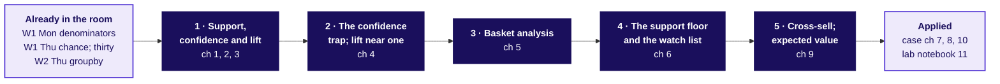

# Day sheet, Week 4 Wednesday: market basket, lift and cross-sell: which pairs lift frequency, and what is each worth?

**TRAINER ONLY.** Nothing on this page reaches a learner.

Posts to <!-- sync:module:W04/D3 -->Module 2: Applied Machine Learning<!-- /sync:module:W04/D3 -->, on <!-- sync:day-date:W04/D3 -->Wed 28 Oct 2026<!-- /sync:day-date:W04/D3 -->.

<!-- sync:faculty-day:W04/D3 -->
**IITGN faculty block W4-2 (tentative), 120 minutes, after this row's applied core.** Faculty: to be confirmed by IIT Gandhinagar.

TOPIC: Association rules as probability: support, confidence and lift as joint and conditional probabilities; independence; the Apriori principle, and why a support threshold prunes the search.
PICKS UP WHERE THE ROW STOPS: the row counts twelve baskets by hand and stops before the Apriori algorithm's mechanics.
CONNECTS TO KALPA: the very popular product with high confidence and a lift near one is statistical independence made visible.
BY THE END: a learner can derive lift from a probability table, and can explain how frequent item sets are found without counting every combination.
DOES NOT REPEAT: the costed recommendation.
<!-- /sync:faculty-day:W04/D3 -->

Your row stops where the faculty block starts: the handoff line and the Kahoot (half two, S73)
and the closing sentence (S74) are the last things you run. Do not preview the block's content; when
you mention it to the room, say it is tentative. If the block cannot run, the fallback deck fills its
120 minutes (`trainer/C2_W04_D03_fallback_note_TRAINER.md`).

Built from the approved Week 4 spine (`docs/detailing/W04_analyst_craft_spine.md`, section 7, the
concept-first Wednesday), the day's plan (`docs/detailing/W04_concept_first/D3_plan.md`), the
Wednesday case in `docs/detailing/W04_case_file.md`, and the Wednesday row of
`docs/curriculum/W4_Analyst_craft.md`. The case data and the invented examples are written by
`internal/C2_W04_D03_make_data_INTERNAL.py` (seed 20261028), and every number below is in
`internal/C2_W04_D03_facts_INTERNAL.yaml`, the invented ones under `toy_` ids. Swiggy Instamart is
real; the situation and the data are synthetic, and every learner file says so.

## Which topics does the day teach, and where?

The five topics are the row's Subtopics column, verbatim and in its order; the table is the coverage
matrix's first table (`internal/C2_W04_D03_coverage_INTERNAL.md`).

| # | Topic, in the row's words | Chapter | Slides | Notebook | Exercise items | Kahoot | Minutes |
|---|---|---|---|---|---|---|---|
| 1 | Support, confidence and lift, derived by counting | 1 Support: how often together?; 2 Confidence: how reliably together?; 3 Chance and lift: more often than chance? | half1 S6 to S20 | 01, 02, 03 | canteen_concepts Q1 to Q3; three_counts Q1, Q2; ch8_one_pair Q1, Q2; lab_set Q1, Q2 | Q1, Q2 | 12, 12 and 18 |
| 2 | The confidence trap; lift near one | 4: does 1.00 mean a bundle? | half1 S21 to S25 | 04 | canteen_concepts Q4; ch10_four_pairs Q2; strip Q3, Q4; kalpa_charger Q2; lab_set Q2 | Q3, Q7 | 18 |
| 3 | Basket analysis on the order items | 5: how do lines make pairs? | half1 S26 to S30 | 05 | canteen_concepts Q5; lab_set Q5 | Q8 | 15 |
| 4 | The support floor and the watch list | 6: when is a pair too thin? | half1 S31 to S35 | 06 | canteen_concepts Q6; three_counts Q3; ch10_four_pairs Q1, Q3, Q4; strip Q1; kalpa_charger Q3; lab_set Q3, Q6 | Q4 | 12 |
| 5 | Cross-sell and upsell reasoning; expected value in rupees | 9: what is a combo worth? | half2 S56 to S60 | 09 | canteen_concepts Q7; strip Q1; kalpa_charger Q1, Q2; lab_set Q4, Q6 | Q5 | 18 |

The case chapters apply them: chapter 7 (twelve carts; topics 1, 2 and 4; half1 S36 to S44;
notebook 07), chapter 8 (40,000 carts; topics 1 to 4; half1 S45 to S55; notebook 08) and chapter 10
(the strip ranked and priced; topics 4 and 5; half2 S61 to S74; notebook 10). The lab runs topics 2
to 5 on Kalpa's order lines in notebook 11.

## How do the five topics join?

The map is slide S4 and the board's first drawing; it comes back with each chapter's box filled.

## Which questions does the day ask, in the order the trainer asks them?

The day asks **which pairs lift frequency, and what is each one worth?** Ask each question before its
answer is shown.

| Part | Its question | The smaller questions, in order |
|---|---|---|
| The opening | Which five topics, and which ticket will they answer? | Why might "in most carts" be the wrong reason to show an item? |
| Chapter 1 | Support: how often together? | What is a basket? How many orders hold both? Which pair is most common? |
| Chapter 2 | Confidence: how reliably together? | What does "of those" count? Does direction matter? How far can it swing? |
| Chapter 3 | Chance and lift: more often than chance? | What would chance give? What is lift? Does it have a direction? What does it not say? |
| Chapter 4 | The confidence trap; lift near one: does 1.00 mean a bundle? | What is a base rate? Does every item look bundled with chaas? Which count resists it? How high can lift with chaas go? |
| Chapter 5 | Basket analysis on the order items: how do lines make pairs? | How does an order become pairs? Why sort the names? Which pair tops the table? |
| Chapter 6 | The support floor and the watch list: when is a pair too thin? | How much can luck move a lift? What is a floor? What does a watch list do? |
| Chapter 7 | What do twelve carts say? | How often, how reliably and against chance on the cards? What can twelve carts not say? |
| Chapter 8 | What do 40,000 carts say? | How often is each item in a cart? What does lift say about milk? Why did the click-through fall? |
| Chapter 9 | Cross-sell and upsell reasoning; expected value in rupees: what is a combo worth? | Cross-sell or upsell? Which bills can the card change? What decides the sign? |
| Chapter 10 | What is a slot worth? | Which pairs fill the strip? What does the watch list do? What is a slot worth? What do you say to the category manager? |
| The close | What does the room say on Friday? | What does the faculty session (tentative) pick up? |

**The day's answer, said at the close (half two, S74).** "The click-through fell because the strip
gave half its slots to milk, which shoppers buy anyway. Taking milk out, which ranking by lift above
a 1 percent floor and a 1.5 bar does by arithmetic, recovers about Rs 6.3 lakh a month before the
adds that would have come anyway; a test against a count ranking without milk shows whether lift
earns more."

---

## What does the day start from, and where does it stop?

| | |
|---|---|
| **Start from** | Week 1 Monday's denominators, Week 1 Thursday's chance reference and its rule of thirty, Week 2 Thursday's groupby, and Tuesday's four moves (restate, answer, concede, what would change my mind). Open on the topic, the week map, the five topics, the concept map and the ticket. |
| **Go as far as** | Every learner counts support, confidence and lift by hand and in code, reads a popular partner's lift near one, builds the pairs table from order lines, sets a floor and a watch list, prices a combo and a slot as an expected value with its cost line, and explains the fall as a mix of two click-through rates. |
| **Stop before** | Association rules as probabilities, independence beyond "if the two ignored each other", itemsets beyond pairs and the Apriori principle, which the faculty block (tentative) owns; sample-size arithmetic for a watch-list trial, parked by name; causal testing, which Monday's faculty block on A/B testing (tentative) owns; upsell, defined once and never worked. |
| **Comes later** | Thursday reads a blended retention number as a mix of cohorts ("beyond the blend"); Friday asks a forecast to beat a baseline ("beyond the baseline"); Saturday's paper tests the three measures and the slot's value. |
| **Cut first** | Upsell beyond its one definition; then notebook 10's second route to Rs 6.3 lakh (cell 19), kept as one spoken sentence; then the self-study slides D54, D68 and D69. Never cut a concept chapter, the hand count on the twelve carts, the milk trap or the Kalpa lab. |

---

## How do the morning's 180 minutes run?

| Block | Minutes | Slides | File beside them | What must land | What to cut if late |
|---|---|---|---|---|---|
| The opening | 10 | S1 to S5 | half one | The five topics in the row's words; the concept map; the ticket as the destination | S3 read once, without discussion |
| Chapter 1, support | 12 | SECTION 1, S6 to S10 | Canteen cards; notebook 01 | 3 of 12 = 0.25 from the 2 by 2; the trap of 8 | The bar chart's discussion |
| Chapter 2, confidence | 12 | SECTION 2, S11 to S15 | Canteen cards; notebook 02 | 0.50 one way and 0.60 the other | The direction picture to one sentence |
| Chapter 3, chance and lift | 18 | SECTION 3, S16 to S20 | Canteen cards; notebook 03 | 1.33 by chance, 3 seen, lift 2.25; lift names no cause | Notebook 03's thirteen lifts to the picture |
| Chapter 4, the confidence trap; lift near one | 18 | SECTION 4, S21 to S25 | Notebook 04; canteen_concepts items 1 to 4 | Dal rice to chaas 1.00 is only 1.33 times chance, the most chaas allows; the first drill | The sweep picture to one sentence; never the drill |
| Break | 10 | | | The concept map with four boxes filled | |
| Chapter 5, basket analysis on the order items | 15 | SECTION 5, S26 to S30 | Notebook 05, a code-along | 33 lines, 30 pairs; sorted keys | The grid picture |
| Chapter 6, the support floor and the watch list | 12 | SECTION 6, S31 to S35 | Notebook 06 | 8.57 on 2 orders of pure chance; the floor set where luck stops passing the bar, 8 orders in the month; the watch list | Notebook 06's floor picture, cell 10 |
| Chapter 7, twelve carts | 38 | SECTION 7, S36 to S44 | Cart cards and grids; the guided set; notebook 07 | Confidence 1.00 against lift 1.50, and 0.50 the other way; one cart cannot carry a lift of 12 | S37's cards read aloud only |
| Chapter 8, 40,000 carts | 35 | SECTION 8, S45 to S55 | ch8_one_pair; notebook 08 | Milk tops every count; lift 1.04; the your-turn split, 1.2 against 6.4 percent | S50 (Amazon) to its one sentence; D54 stays self-study |

## How does the afternoon's first hour run?

| Block | Minutes | Slides | File beside them | What must land |
|---|---|---|---|---|
| Chapter 9, cross-sell and expected value | 18 | SECTION 9, S56 to S60 | The kirana's month sheet; notebook 09; canteen_concepts items 5 to 7 | Rs 216 less Rs 168 less Rs 20 = Rs 28; the sign turns on the response; the second drill |
| Chapter 10, the strip ranked and priced | 14 | SECTION 10, S61 to S67 | ch10_four_pairs; notebook 10; pair cards; the action-map board | Four pairs above the floor and the bar, each beside its own item; the watch list; Rs 17,280 against Rs 3,240; about Rs 6.3 lakh, gross, earned by taking milk out; about Rs 80,200 of sales is never the gain |
| The unguided strip and the objection | 15 | S70, S71 | `exercises/unguided/C2_W04_D03_strip_STUDENT.md`; the role card | One strip per group, priced with ranges, two doubts, the category manager answered with four moves |
| The interview room's [S] answer | 3 | S72 | `extras/C2_W04_D03_interview_STUDENT.md`, read in pairs in the lab | Lift because it divides by the base rate |
| Handoff, Kahoot and close | 10 | S73, S74 | `kahoot/C2_W04_D03_quiz_STUDENT.md` | The handoff line said as written; the Kahoot inside S73's 8 minutes; the sentence for Friday |

D68 (six doubts) carries no minutes of its own: groups read it inside S70's ten minutes for the
strip's two doubts. D69 (the heavy tenth) is self-study, and the lab opens on it.

**The handoff line (S73).** "You counted lift on twelve carts and on forty thousand. The next 120
minutes show the same three numbers as probabilities: a lift near one is independence made visible,
which is what milk showed you, and the support floor you set is what lets an algorithm skip counting
every combination."

## Where did the minutes move from the case-first day?

Both days hold the trainer's 240 minutes: the morning's 180 and the afternoon's first 60, before the
faculty block (tentative).

| Part | Case-first day | This day |
|---|---|---|
| Opening: the ticket, then the topic and the concept map | 10 | 10 |
| Counting by hand: the tea stall and the twelve carts | 60 (20 and 40) | Chapters 1 to 3 on the canteen, 42; the twelve-cart drill inside chapter 7, 38 |
| The popular partner | Inside chapter 2 | Chapter 4, 18 |
| Pairs from order lines | Inside chapter 2's 50 | Chapter 5, 15; chapter 8, 35 |
| The floor and the watch list | Inside chapter 3, part one | Chapter 6, 12 |
| Break | 10 | 10 |
| The strip ranked and priced | Chapter 3, part one, 50 | Chapter 9, 18; chapter 10, 14 |
| The unguided strip | 35 | 15 |
| The interview room | 10 | 3 |
| Handoff, Kahoot and close | 15 | 10 |
| Total | 240 | 240 |

Line by line, the case-first day ran 10 + 60 + 50 + 10 + 50 + 35 + 10 + 15 = 240, and this day runs
10 + 42 + 18 + 15 + 12 + 10 + 38 + 35 + 18 + 14 + 15 + 3 + 10 = 240.

The row's two MID-SESSION checks get 15 minutes each; this day runs them in 5 (ch8_one_pair, opening
chapter 8) and 4 (ch10_four_pairs, opening chapter 10), because the canteen drills inside chapters 4
and 9, 6 minutes each, practise the same two skills first on the invented examples, and the
concept-first envelope has no other minutes to give them.

---

## Which traps does the day stage, with the exact wrong number and the check?

| Trap | The wrong number or reading | The decision it would mislead | The check | Deck | Notebook |
|---|---|---|---|---|---|
| Counts added | 8 orders for roti and sabzi | A combo for a pair that shares three orders | The 2 by 2 adds to twelve: 3, 1, 1, 7 | S7, S8 | 01, cells 3 to 6 |
| One direction for both | 0.50 for papad to dal rice | The card aimed at the wrong buyer | Divide by papad's 5 orders: 0.60 | S12, S13 | 02, cells 3 to 6 |
| Lift read as a cause | "Roti makes customers buy 2.25 times the sabzi" | A roti promotion to sell sabzi | Lift counts; only a fair test of a change shows cause | S20 | 03, cell 14 |
| Confidence read as a bundle | Dal rice to chaas 1.00 | Chaas printed beside everything | Chaas's base rate 0.75: lift 1.33 | S22, S23 | 04, cells 3 to 6 |
| Pairs miscounted | 33 pairs, one per line, or 60 with both name orders | A pairs table with every count doubled, or split across two keys when names are left unsorted | Sorted names and `combinations`: 30 pairs | S27, S28 | 05, cells 3 to 6 |
| A thin lift acted on | Gulab jamun and curd, 6.0 on one order | A card printed for one order's luck | The floor where luck stops passing the bar, 8 orders in the month; 8.57 on 2 orders of pure chance | S31 to S34 | 06, cells 3 to 8 |
| Sales as the gain, at a kirana | Rs 5,040 of rusk on every combo bill | A card printed as if it earned 180 times its Rs 28 | Which bills does the card change? | S57, S58 | 09, cells 3 to 6 |
| Confidence read as a bundle, on the case | Bread to milk 1.00 on twelve carts | Milk shown beside bread | Milk is in 8 of 12 carts anyway: lift 1.50, on four carts | S39 to S41 | 07, cells 5 to 8 |
| The count is the ranking | Six of the six most frequent pairs hold milk; bread and milk on 10,064 carts | The strip as built on 7 September | Lift: 1.04 for bread and milk | S43, S44, S49 | 08, cells 5 to 8 |
| "Shoppers changed" | The fall from 6.1 to 3.8 percent read as a habit change | A redesign instead of a re-rank | Split by suggested item: milk 1.2, the rest 6.4, up from 6.2 | S52, S53 | 08, cells 14 to 19 |
| Lift alone, on the case | Ice cream and chocolate sauce, 4.60, promoted on 100 carts | A slot spent on a pair 100 carts deep | The floor: 400 carts | S62 to S64 | 10, cells 3 to 8 |
| Lift credited with the money | "Ranking by lift recovers Rs 6.3 lakh a month" | A lift ranking sold on money that taking milk out earns, with no test against a count ranking without milk | Click-through by slot and suggestion: every suggestion but milk clicked alike, whatever its lift | S66 | 10, cells 11 to 13 |
| Sales as the gain, on the strip | About Rs 80,200 a day of "strip revenue" | A rupee case four and a half times too big | The margin kept: Rs 17,280 a day, less any discount | S67 | 10, cells 9 to 14 |
| Heavy buyers | 3.39 quoted for chips and cold drink | A number that shrinks when finance recounts it | Each customer once: 2.56 | D69 | 10, cells 15 to 18 |

## Where are the checkpoints?

| After | The check | A room that is behind |
|---|---|---|
| S20 | Three learners say roti and sabzi's three numbers from the board: 0.25, 0.75 and 2.25 | Re-count the 2 by 2 from the canteen cards before chapter 4 |
| S25 | Every group posts its four letters for canteen_concepts items 1 to 4 | Read item 4 aloud and let the room say chaas's base rate |
| S53 | Every learner's your-turn cell prints 1.2 and 6.4 percent | Pair each stuck learner with a finished one for two minutes |
| S60 | The room says the expected-value line in the topic's words: margin on the purchases a card changes, less every rupee it hands back | Rebuild the kirana's bridge on the board from 450 bills |
| S70 | Every group has one strip with a rupee range | The TA takes the slowest group's price to the board |

## Which plants does the lab find, and what if nobody does?

The full table is in `trainer/C2_W04_D03_lab_note_TRAINER.md`. In one line each: the charger in 84.5
percent of the 812 consumer baskets; screen protector to charger at confidence 0.82 and lift 0.97;
wireless earphones with their case at lift 3.1 on 6 percent support, 76 percent Retail-Plus; the car
phone mount with the car charger at lift 4.0 on 2 baskets. No learner file names any of them before
a learner's own cell prints it.

## Which numbers carry the day?

| Number | Value | Facts id |
|---|---|---|
| The canteen: roti and sabzi | 3 of 12, support 0.25, confidence 0.75, chance 1.33, lift 2.25 | toy_canteen_roti_sabzi_support, _conf_ab, _expected, _lift |
| The canteen: dal rice and papad | 0.50 one way, 0.60 the other | toy_canteen_dal_papad_conf_ab, toy_canteen_dal_papad_conf_ba |
| The canteen: dal rice and chaas | Confidence 1.00, lift 1.33; chaas's base rate 0.75 | toy_canteen_dal_chaas_conf_ab, toy_canteen_dal_chaas_lift, toy_canteen_chaas_share |
| The canteen: pairs | 33 lines, 30 pairs, 60 with both name orders | toy_canteen_lines, toy_canteen_pair_lines, toy_canteen_pair_lines_both_orders |
| The canteen month: luck | 8.57 on 2 orders; up to 1.83 on 4 to 7 orders; none past 1.5 from 8 orders; 0.90 to 1.00 on 30 or more | toy_month_thin_top_lift, toy_month_mid_top_lift, toy_month_bar_safe_orders, toy_month_thick_low, toy_month_thick_high |
| The ceilings | Chaas 1.33, milk 1.41: one over the share | toy_chaas_lift_ceiling, milk_lift_ceiling |
| Sharma Kirana's card | Rs 216 less Rs 168 less Rs 20 = Rs 28; -Rs 71 at 2 percent, Rs 127 at 6 | toy_kirana_incremental_margin, toy_kirana_discount_back, toy_kirana_ev, toy_kirana_ev_low, toy_kirana_ev_high |
| Click-through before and after | 6.1 and 3.8 percent | before_strip_ctr, after_strip_ctr |
| Milk's share of carts | 71 percent | toned_milk_share |
| Bread and milk: confidence and lift | 0.74 and 1.04 | bread_milk_conf_ab, bread_milk_lift |
| Chips and cold drink: support and lift | 5.0 percent and 3.39 | chips_cold_support, chips_cold_lift |
| Ice cream and chocolate sauce | 4.60 on 100 carts | ice_choc_lift, ice_choc_carts |
| Milk slots and the rest, after | 1.2 and 6.4 percent | milk_slot_ctr_after, other_slot_ctr_after |
| The floor, and the pairs above it | 1 percent, 400 carts, 246 pairs | support_floor, support_floor_carts, floor_pairs |
| A slot a day | Rs 17,280 against Rs 3,240 | slot_value_other_day, slot_value_milk_day |
| Recovered a month | Rs 6.3 lakh, from Rs 3.9 lakh to Rs 9.3 lakh, gross; about Rs 5.7 lakh with milk at Rs 2 and the strip's own adds at about Rs 7 | recoverable_month, recoverable_low, recoverable_high, recoverable_month_own_margins |
| Where the money comes from | Slot 1: every suggestion but milk at 8.1 to 8.4 percent, cold drink beside chips (3.39) at 8.2 and bread beside eggs (0.99) at 8.4 | slot1_other_ctr_low, slot1_other_ctr_high, chips_cold_slot1_ctr, eggs_bread_slot1_ctr |
| Per customer | 2.56 | chips_cold_lift_per_customer |
| Per customer and sized by cart (interview room) | 1.95; onions and tomatoes 1.38 | chips_cold_lift_both, onions_tomatoes_lift_both |
| The thin pair in place of milk | About Rs 85,000 a month on about 2,400 views a day, at Rs 37.40 for sauce against Rs 2 for milk | thin_rule_month, ice_cream_views_day, sauce_margin, milk_margin |
| The watch-list trial's read | About 1,100 ice-cream carts an arm for the full effect, about 4,000 for half | trial_n_full, trial_n_half |
| The twelve carts | Bread to milk 1.00, lift 1.50 | twelve_bread_milk_conf, twelve_bread_milk_lift |

## What are the interview answers, each in one breath?

- **What is support?** The share of all baskets holding both items, said with its denominator.
- **What is confidence, and why does the direction matter?** Both over A, so A to B and B to A divide
  by different baskets: papad to dal rice 0.60, dal rice to papad 0.50.
- **Which measure cannot be fooled by popularity?** Lift, since it divides by the base rate: bread to
  milk reads 0.74, but milk is in 71 percent of carts, so lift is 1.04.
- **Why sort the pair's names before counting?** So each pair has one key and no count is split or
  doubled.
- **A high lift on very few baskets: act?** Watch it: test it on a random half of customers with a
  pass rule set first. On the case, ice cream and chocolate sauce at 4.6 on 0.25 percent support is
  real, 100 carts against 22 by chance, and beside ice cream, about 2,400 views a day, sauce's Rs 37.40
  margin makes it worth about Rs 85,000 a month in place of milk; 100 carts cannot say how it clicks.
- **A combo offer lifts the pair's sales: is it worth running?** Margin on the purchases the offer
  creates, less the discount paid on every purchase that takes it, including those that would have
  happened anyway, less the fixed cost, said as a range.
- **Heavy buyers?** Count each customer once: 3.39 falls to 2.56. Sizing chance by cart as well takes
  it to 1.95, and onions and tomatoes to 1.38, below the 1.5 bar (the interview room's second effect).
- **The rupee recommendation's forgotten cost?** Incrementality: about Rs 6.3 lakh a month at the
  central assumptions, Rs 3.9 lakh to Rs 9.3 lakh across them, all gross until a holdout measures the
  adds that would have come anyway; the money comes from taking milk out, and sales are never the
  gain.
- **The LLM shopping assistant?** An offline gate against a popularity list and the strip re-ranked
  by lift on carts after a cutoff date, then customers randomised to three arms online, read on
  margin per customer adjusted for each customer's earlier margin, with the re-ranked strip as the
  bar, since re-ranking is free, and the serving cost as the smallest gain worth detecting.
- **Orders a dark store handles in a day?** About 1,290 from households, share and frequency, against
  Swiggy's 1,089 per active store-day (`trainer/C2_W04_D03_guesstimate_TRAINER.md`).

## What should you say if a learner quotes IBM's Apriori page?

IBM's "What is the Apriori algorithm?" page (https://www.ibm.com/think/topics/apriori-algorithm, checked 13 October 2026) divides confidence by the antecedent's support:
its worked example gives 0.6 / 0.125 = 4.8 one way and 0.3 / 0.25 = 1.2 the other. Lift divides by
the partner's share, which makes it the same from both sides, so a lift that changes with direction
signals the wrong divisor. Say so if a learner brings it, and point to the Practical Business Python
walkthrough, which states lift as observed over expected.

## Which item checks which topic?

| Set | Items | Topic | When it is sat |
|---|---|---|---|
| canteen_concepts | Q1 to Q3 | 1, support, confidence and lift | Inside chapter 4, the first drill |
| canteen_concepts | Q4 | 2, the confidence trap | Inside chapter 4, the first drill |
| canteen_concepts | Q5 to Q7 | 3, 4 and 5 | Inside chapter 9, the second drill |
| three_counts | Q1 to Q3 | 1 and 4, on twelve carts | Chapter 7's drill |
| ch8_one_pair | Q1, Q2 | 1, three numbers and a second route | Chapter 8's paper check |
| ch10_four_pairs | Q1 to Q4 | 4, and 2 in Q2 | Chapter 10's paper check |
| strip | Q1 to Q4 | 4 and 5, the case's doubts, 2 | The unguided strip |
| kalpa_charger | Q1 to Q3 | 5, 2 and 4 | The lab |
| lab_set | Q1 to Q6 | All five | The lab |

Twenty-nine items in all, sixteen of them design calls; the matrix lists each item on its own line.

## Which file serves which moment?

| Moment | File |
|---|---|
| The morning | `slides/C2_W04_D03_half1_STUDENT.pptx`; notebooks 01 to 08 |
| The canteen cards and the receipts activity | `trainer/C2_W04_D03_receipts_TRAINER.md`; the canteen cards, cart cards, pair cards and board work in `whiteboards/` |
| Chapter 4's and chapter 9's drills | `exercises/unguided/C2_W04_D03_canteen_concepts_STUDENT.md` |
| Chapter 7's drill | `exercises/guided/C2_W04_D03_three_counts_STUDENT.md` |
| Chapter 8's paper check | `exercises/unguided/C2_W04_D03_ch8_one_pair_STUDENT.md` |
| Chapter 10's paper check | `exercises/unguided/C2_W04_D03_ch10_four_pairs_STUDENT.md` |
| The afternoon | `slides/C2_W04_D03_half2_STUDENT.pptx`; notebooks 09 and 10; the strip set; `trainer/C2_W04_D03_role_card_TRAINER.md` |
| The interview room | `extras/C2_W04_D03_interview_STUDENT.md`; `trainer/C2_W04_D03_interview_TRAINER.md` |
| The Kahoot | `kahoot/C2_W04_D03_quiz_STUDENT.md` |
| The lab | Notebook 11; `trainer/C2_W04_D03_lab_note_TRAINER.md`; the practice set |
| Tonight | `takehome/`, `study-notes/`, `cheatsheets/`, `preread/` |
| A missing faculty block | `slides/C2_W04_D03_fallback_STUDENT.pptx`; `trainer/C2_W04_D03_fallback_note_TRAINER.md` |
