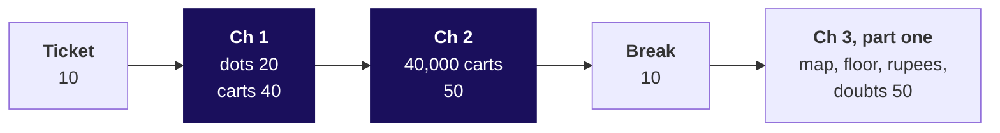

# Day sheet, Week 4 Wednesday: which pairs should Instamart's Pune strip show, and what is a slot worth?

**TRAINER ONLY.** Nothing on this page reaches a learner.

Posts to <!-- sync:module:W04/D3 -->Module 2: Applied Machine Learning<!-- /sync:module:W04/D3 -->, on <!-- sync:day-date:W04/D3 -->Wed 28 Oct 2026<!-- /sync:day-date:W04/D3 -->.

<!-- sync:faculty-day:W04/D3 -->
**IITGN faculty block W4-2 (tentative), 120 minutes, after this row's applied core.** Faculty: to be confirmed by IIT Gandhinagar.

TOPIC: Association rules as probability: support, confidence and lift as joint and conditional probabilities; independence; the Apriori principle, and why a support threshold prunes the search.
PICKS UP WHERE THE ROW STOPS: the row counts twelve baskets by hand and stops before the Apriori algorithm's mechanics.
CONNECTS TO KALPA: the very popular product with high confidence and a lift near one is statistical independence made visible.
BY THE END: a learner can derive lift from a probability table, and can explain how frequent item sets are found without counting every combination.
DOES NOT REPEAT: the costed recommendation.
<!-- /sync:faculty-day:W04/D3 -->

Your row stops where the faculty block starts: the handoff line (half two, S44), the Kahoot and the
closing sentence are the last things you run. Do not preview the block's content; when you mention
it to the room, say it is tentative. If the block cannot run, the fallback deck fills its 120
minutes (`trainer/C2_W04_D03_fallback_note_TRAINER.md`).

Built from the approved Week 4 spine (`docs/detailing/W04_analyst_craft_spine.md`, section 7, and
the acceptance test in section 12), the Wednesday case in `docs/detailing/W04_case_file.md`, and the
Wednesday row of `docs/curriculum/W4_Analyst_craft.md`. The case data is written by
`internal/C2_W04_D03_make_data_INTERNAL.py` (seed 20261028), and every number below is in
`internal/C2_W04_D03_facts_INTERNAL.yaml`. Swiggy Instamart is real; the situation and the data are
synthetic, and every learner file says so.

## Which questions does the day ask, in the order the trainer asks them?

The day asks **which pairs should the strip show, why did its click-through fall, and what is a
slot worth?** Ask each question before its answer is shown.

| Part | Its question | The smaller questions, in order |
|---|---|---|
| The ticket | What has the analyst been handed, and what is due Friday? | Why might "in most carts" be the wrong reason to show an item? |
| Chapter 1 | What does "together" mean, counted on twelve carts by hand? | How often? How reliably? Against chance? What can twelve carts not tell you? |
| Chapter 2 | What do 40,000 carts say, and why did the click-through fall? | How often is each item in a cart? Which pairs sit together most often? What does lift say about milk? Why did the click-through fall? |
| Chapter 3, part one | Which pairs fill the strip, and what is a slot worth in rupees? | Which pairs beat chance by enough, on enough carts? What does the watch list do with a strong thin pair? What is a slot worth? What can the counts not tell us? |
| Chapter 3, part two | Which strip would you ship, priced and defended? | Which three pairs? Priced how? Which two doubts? What do you say to the category manager? |
| The interview room | Which measure cannot be fooled by popularity, and why? | What follows up? How does an AI company ask it? |
| The close | What does the room say on Friday? | What does the faculty session (tentative) pick up? |

**The day's answer, said at the close (half two, S46).** "The click-through fell because the strip
gave half its slots to milk, which shoppers buy anyway; ranked by lift above a 1 percent floor, the
strip shows chips with cold drink, coriander with green chillies and bread with butter, and recovers
about Rs 6.3 lakh a month."

---

## What does the day start from, and where does it stop?

| | |
|---|---|
| **Start from** | Tuesday's four moves (restate, answer, concede, what would change my mind) and Monday's habit of naming a metric's denominator. Open on the ticket and let the room say why "in most carts" might be the wrong reason to show an item. |
| **Go as far as** | Every learner counts support, confidence and lift by hand and in code, explains the fall as a mix of two click-through rates, ranks pairs by lift above a support floor, prices a slot with its ranges and the cost line, and runs the per-customer and stock-out checks. |
| **Stop before** | Association rules as probabilities, independence, the Apriori principle and any algorithm that finds itemsets, which the faculty block (tentative) owns; causal testing, which Monday's faculty block on A/B testing (tentative) owns; upsell, named once and never taught. |
| **Comes later** | Thursday reads a blended retention number as a mix of cohorts ("beyond the blend"); Friday asks a forecast to beat a baseline ("beyond the baseline"); Saturday's paper tests the three measures and the slot's value. |
| **Cut first** | Upsell; then notebook 03's second route to Rs 6.3 lakh (cell 16), kept as one spoken sentence. Never cut the hand count on the twelve carts, the milk trap or the Kalpa lab. |

---

## How do the morning's 180 minutes run?

| Block | Minutes | Slides | File beside them | What must land | What to cut if late |
|---|---|---|---|---|---|
| The ticket | 10 | Cover, S1 to S3 | half one | The ask in the ticket's words; impression and click-through defined | S3's cards to one sentence |
| Chapter 1 | 60 | S4 to S13 | Cart cards and grids; notebook 01 | Three counts by hand; confidence 1.00 against lift 1.50; one cart cannot carry a lift of 12 | Notebook 01's cells beyond the confirm cells; the hand count stays |
| Chapter 2 | 50 | S14 to S26 | Notebook 02 | Milk tops every count; lift 1.04; the your-turn split: 1.2 against 6.4 percent | S21 (Amazon) to its one sentence; S25 to one sentence |
| Break | 10 | | | The week map with "lift: beyond chance" under Wednesday | |
| Chapter 3, part one | 50 | S27 to S37 | Notebook 03; pair cards; the action-map board | The floor and the four pairs; the watch list; Rs 17,280 against Rs 3,240 a day; Rs 6.3 lakh a month; the six doubts | S36 (stock-out) to its number; S37 read aloud only |

## How does the afternoon's first hour run?

| Block | Minutes | Slides | File beside them | What must land |
|---|---|---|---|---|
| Chapter 3, part two, unguided | 35 | S38 to S40 | `exercises/unguided/C2_W04_D03_strip_STUDENT.md`; notebook 03; the role card | One strip per group, priced with ranges, two doubts, the category manager answered with four moves |
| The interview room | 10 | S41 to S43 | `extras/C2_W04_D03_interview_STUDENT.md` | Lift because it divides by the base rate; the AI variant's popularity baseline |
| Handoff, Kahoot and close | 15 | S44 to S46 | `kahoot/C2_W04_D03_quiz_STUDENT.md` | The handoff line said as written; the sentence for Friday |

**The handoff line (S44).** "You counted lift on twelve carts and on forty thousand. The next 120
minutes show the same three numbers as probabilities: a lift near one is independence made visible,
which is what milk showed you, and the support floor you set is what lets an algorithm skip counting
every combination."

---

## Which traps does the day stage, with the exact wrong number and the check?

| Trap | The wrong number or reading | The decision it would mislead | The check | Deck | Notebook |
|---|---|---|---|---|---|
| Lift read as a cause | "Chai lifts biscuit sales 25 percent" from lift 1.25 | A chai promotion to sell biscuits | Lift counts; only a test that changes chai shows cause | S5, S6 | 01, cells 3 to 5 |
| Confidence read as a bundle | Bread to milk 1.00 on twelve carts | Milk shown beside bread | Milk is in 8 of 12 carts anyway: lift 1.50, on four carts | S9 to S11 | 01, cells 9 to 11 |
| The count is the ranking | Six of the six most frequent pairs hold milk; bread and milk on 10,064 carts | The strip as built on 7 September | Lift: 1.04 for bread and milk | S15, S16, S18 | 02, cells 5 to 9 |
| "Shoppers changed" | The fall from 6.1 to 3.8 percent read as a habit change | A redesign instead of a re-rank | Split by suggested item: milk 1.2, the rest 6.4, up from 6.2 | S23, S24 | 02, cells 14 to 19 |
| Lift alone | Ice cream and chocolate sauce, 4.60, promoted on 100 carts | A slot spent on a pair 100 carts deep | The floor: 400 carts | S28 to S30 | 03, cells 3 to 7 |
| Sales as the gain | Rs 80,197 a day of "strip revenue" | A rupee case four times too big | The margin kept: Rs 17,280 a day, less any discount | S33 | 03, cells 9 to 11 |
| Heavy buyers | 3.39 quoted for chips and cold drink | A number that shrinks when finance recounts it | Each customer once: 2.56 | S33's notes (the prediction), S34, S35 | 03, cells 13 to 16 |
| The wrong basket base (lab) | The charger in 69.6 percent of orders, Business orders kept in | Merchandising's 80 percent "disproved" on the wrong base | Consumer baskets only: 84.5 percent | | 04, the first your-turn cell |

## Where are the checkpoints?

| After | The check | A room that is behind |
|---|---|---|
| S13 | Three learners say support, confidence and lift for chips and cold drink from the board: 2 of 12, 2 of 3, 2.67 | Re-count the chips row on the grid before chapter 2 |
| S24 | Every learner's your-turn cell prints 1.2 and 6.4 percent | Pair each stuck learner with a finished one for two minutes |
| S32 | The room says the cascade's four factors aloud | Rebuild it on the board from 60,000 views |
| S40 | Every group has one strip with a rupee range | The TA takes the slowest group's price to the board |

## Which plants does the lab find, and what if nobody does?

The full table is in `trainer/C2_W04_D03_lab_note_TRAINER.md`. In one line each: the charger in 84.5
percent of the 812 consumer baskets; screen protector to charger at confidence 0.82 and lift 0.97;
wireless earphones with their case at lift 3.1 on 6 percent support, 76 percent Retail-Plus; the car
phone mount with the car charger at lift 4.0 on 2 baskets. No learner file names any of them before
a learner's own cell prints it.

## Which numbers carry the day?

| Number | Value | Facts id |
|---|---|---|
| Click-through before and after | 6.1 and 3.8 percent | before_strip_ctr, after_strip_ctr |
| Milk's share of carts | 71 percent | toned_milk_share |
| Bread and milk: confidence and lift | 0.74 and 1.04 | bread_milk_conf_ab, bread_milk_lift |
| Chips and cold drink: support and lift | 5.0 percent and 3.39 | chips_cold_support, chips_cold_lift |
| Ice cream and chocolate sauce | 4.60 on 100 carts | ice_choc_lift, ice_choc_carts |
| Milk slots and the rest, after | 1.2 and 6.4 percent | milk_slot_ctr_after, other_slot_ctr_after |
| The floor, and the pairs above it | 1 percent, 400 carts, 246 pairs | support_floor, support_floor_carts, floor_pairs |
| A slot a day | Rs 17,280 against Rs 3,240 | slot_value_other_day, slot_value_milk_day |
| Recovered a month | Rs 6.3 lakh, from Rs 3.9 lakh to Rs 9.3 lakh | recoverable_month, recoverable_low, recoverable_high |
| Per customer | 2.56 | chips_cold_lift_per_customer |
| Per customer and sized by cart (interview room) | 1.95; onions and tomatoes 1.38 | chips_cold_lift_both, onions_tomatoes_lift_both |
| The thin pair in place of milk | About Rs 85,000 a month on about 2,400 views a day, at Rs 37.40 for sauce against Rs 2 for milk | thin_rule_month, ice_cream_views_day, sauce_margin, milk_margin |
| The watch-list trial's read | About 1,100 ice-cream carts an arm for the full effect, about 4,000 for half | trial_n_full, trial_n_half |
| The twelve carts | Bread to milk 1.00, lift 1.50 | twelve_bread_milk_conf, twelve_bread_milk_lift |

## What are the interview answers, each in one breath?

- **Which measure cannot be fooled by popularity?** Lift, since it divides by the base rate: bread to
  milk reads 0.74, but milk is in 71 percent of carts, so lift is 1.04.
- **Lift 4.6 on 0.25 percent support: act?** The pair is real, 100 carts against 22 by chance, and
  beside ice cream, about 2,400 views a day, sauce's Rs 37.40 margin makes it worth about Rs 85,000 a
  month in place of milk; 100 carts cannot say how it clicks, so it goes on the watch list and a test
  read on sauce bought in ice-cream carts, with margin per shopper as the guardrail.
- **Heavy buyers?** Count each customer once: 3.39 falls to 2.56. Sizing chance by cart as well takes
  it to 1.95, and onions and tomatoes to 1.38, below the 1.5 bar (the interview room's second effect).
- **The rupee recommendation's forgotten cost?** Incrementality: some adds come anyway, so Rs 6.3 lakh
  a month is a ceiling a holdout measures, and sales are never the gain.
- **The LLM shopping assistant?** An offline gate against a popularity list and the strip re-ranked
  by lift on carts after a cutoff date, then customers randomised to three arms online, with the
  re-ranked strip as the bar, since re-ranking is free.
- **Orders a dark store handles in a day?** About 1,290 from households, share and frequency, against
  Swiggy's 1,089 per active store-day (`trainer/C2_W04_D03_guesstimate_TRAINER.md`).

## What should you say if a learner quotes IBM's Apriori page?

IBM's "What is the Apriori algorithm?" page (https://www.ibm.com/think/topics/apriori-algorithm, checked 12 October 2026) divides confidence by the antecedent's support:
its worked example gives 0.6 / 0.125 = 4.8 one way and 0.3 / 0.25 = 1.2 the other. Lift divides by
the partner's share, which makes it the same from both sides, so a lift that changes with direction
signals the wrong divisor. Say so if a learner brings it, and point to the Practical Business Python
walkthrough, which states lift as observed over expected.

## Which file serves which moment?

| Moment | File |
|---|---|
| The morning | `slides/C2_W04_D03_half1_STUDENT.pptx`; notebooks 01 to 03 |
| The receipts activity | `trainer/C2_W04_D03_receipts_TRAINER.md`; the cart cards, pair cards and board work in `whiteboards/` |
| Chapter 1's drill | `exercises/unguided/C2_W04_D03_ch1_one_pair_STUDENT.md` |
| Chapter 3's mid-session set | `exercises/unguided/C2_W04_D03_ch3_four_pairs_STUDENT.md` |
| The afternoon | `slides/C2_W04_D03_half2_STUDENT.pptx`; the strip set; `trainer/C2_W04_D03_role_card_TRAINER.md` |
| The interview room | `extras/C2_W04_D03_interview_STUDENT.md`; `trainer/C2_W04_D03_interview_TRAINER.md` |
| The Kahoot | `kahoot/C2_W04_D03_quiz_STUDENT.md` |
| The lab | Notebook 04; `trainer/C2_W04_D03_lab_note_TRAINER.md`; the practice set |
| Tonight | `takehome/`, `study-notes/`, `cheatsheets/`, `preread/` |
| A missing faculty block | `slides/C2_W04_D03_fallback_STUDENT.pptx`; `trainer/C2_W04_D03_fallback_note_TRAINER.md` |
