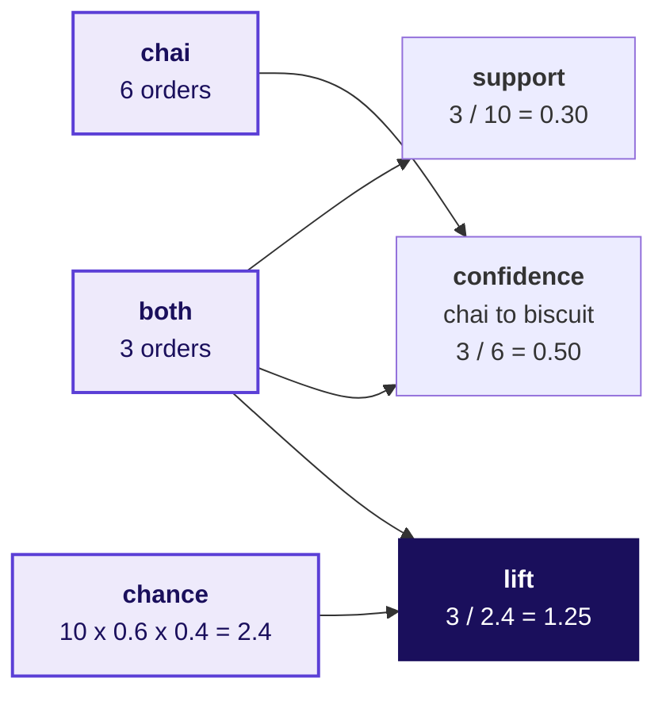
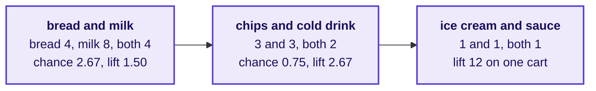
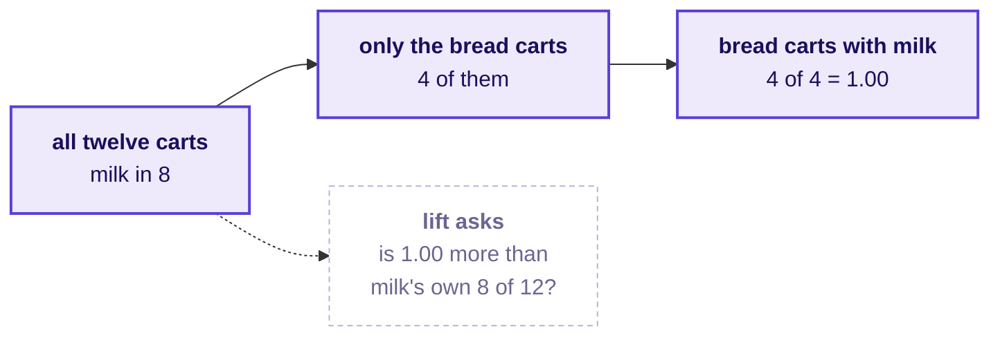
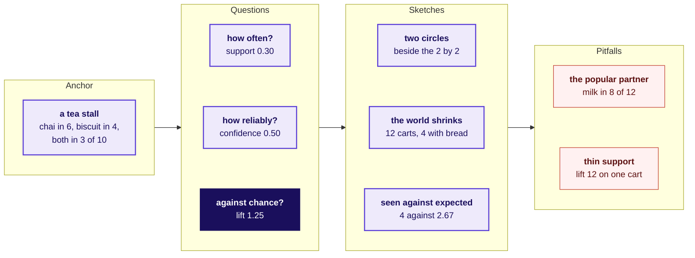
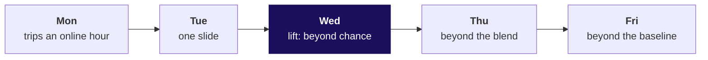
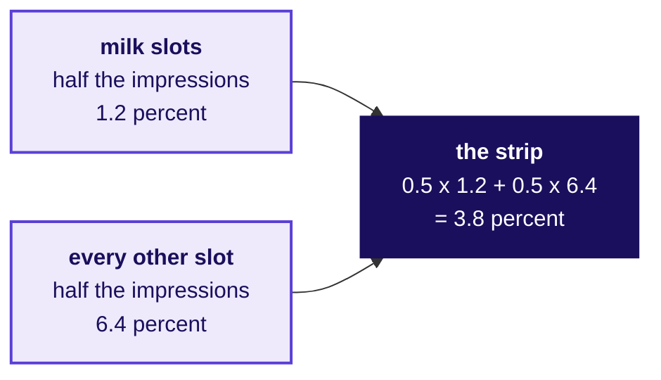
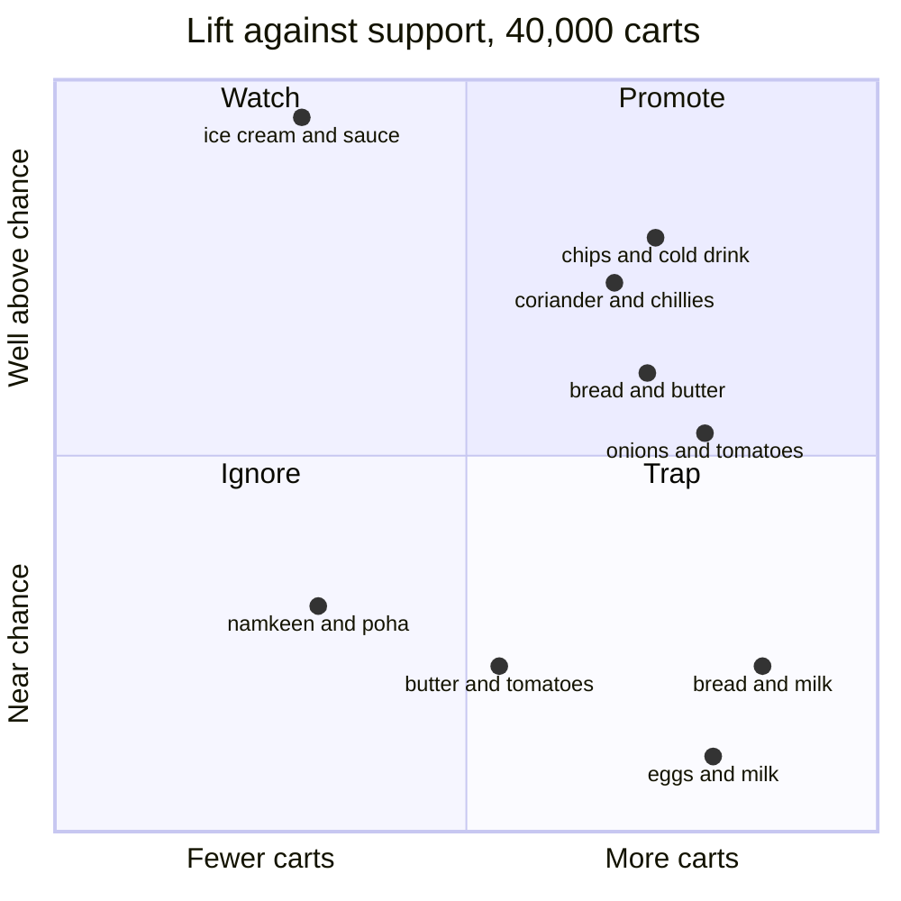
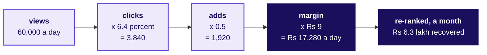
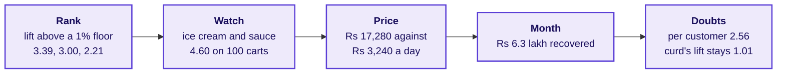

# What goes on the board, in order, from the ten dots to the priced strip?

Swiggy Instamart, Pune: the cart page's strip of three suggested items, whose click-through fell from
6.1 to 3.8 percent after it began showing the items most often found in the same cart. Illustrative
case: the company is real, the situation and the data are synthetic, built for this class.

**Who needs the answer.** Anyone redrawing the day: each drawing below goes up in this order, and the
last one is what the board holds when the day ends.

**The questions on the way.**

- What do ten orders look like as counts?
- What do the twelve cards count to?
- How does confidence shrink the world?
- Which pairs beat chance, drawn as one concept board?
- Where does lift join the week?
- How do two click-through rates make 3.8 percent?
- Where does each pair sit on the action map?
- What is a slot worth?
- What does the board hold at the close?

## What do ten tea-stall orders look like as counts?

Drawn before the room sits down, beside the ten dots. The orders are invented.

## What do the twelve cards count to?

Written as each group calls its counts out, before any formula is named.

## How does confidence shrink the world?

## Which pairs beat chance, drawn as one concept board?

Built through chapter 1: the anchor goes up with the dots, each question as its count is called,
the sketches as each picture is drawn, and the two pitfalls last.

## Where does lift join the week?

Added under Wednesday's node at the close of chapter 1, and left up all day.

## How do two click-through rates make 3.8 percent?

## Where does each pair sit on the action map?

The wall board, with the pair cards placed. Support runs across with the 1 percent floor at the
middle, and lift runs up; the positions are sketched, and notebook 03's picture draws them to scale.

## What is a slot worth?

## What does the board hold at the close?

The chain below, the week map with lift under Wednesday, the action map with its cards, and the
sentence for Friday written under them all.

> The click-through fell because the strip gave half its slots to milk, which shoppers buy anyway;
> ranked by lift above a 1 percent floor, the strip shows chips with cold drink, coriander with green
> chillies and bread with butter, and recovers about Rs 6.3 lakh a month.
