# What goes on the board, in order, from the concept map to the priced strip?

A hostel canteen's twelve lunch orders and a Pune corner shop's month, both invented, carry the five
topics; then Swiggy Instamart, Pune: the cart page's strip of three suggested items, whose
click-through fell from 6.1 to 3.8 percent after it began showing the items most often found in the
same cart. Illustrative case: the company is real, the situation and the data are synthetic, built
for this class.

**Who needs the answer.** Anyone redrawing the day: each drawing below goes up in this order, and the
last one is what the board holds when the day ends.

**The questions on the way.**

- How do the five topics join?
- What do the canteen's twelve orders count to?
- How does confidence shrink the world?
- Which pairs beat chance, drawn as one concept board?
- What does the kirana's combo card earn?
- What do the twelve cards count to?
- Where does lift join the week?
- How do two click-through rates make 3.8 percent?
- Where does each pair sit on the action map?
- What is a slot worth?
- What does the board hold at the close?

## How do the five topics join?

Drawn before the room sits down, on the left of the board, and left up all day; each box gets its
number as its chapter closes.

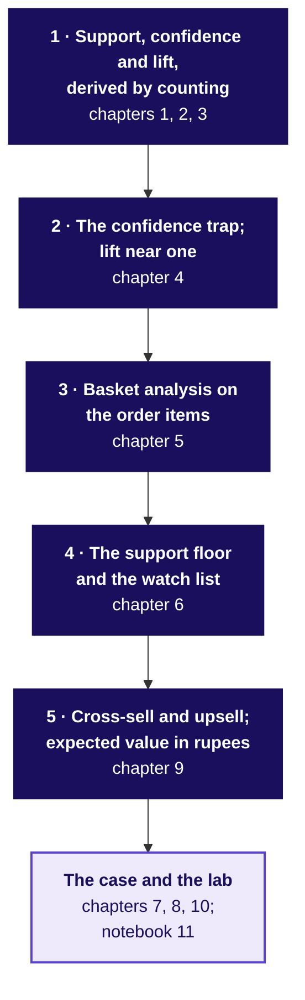

## What do the canteen's twelve orders count to?

Written as the groups call their counts from the canteen cards in chapters 1 to 3, before any formula
is named. The orders are invented.

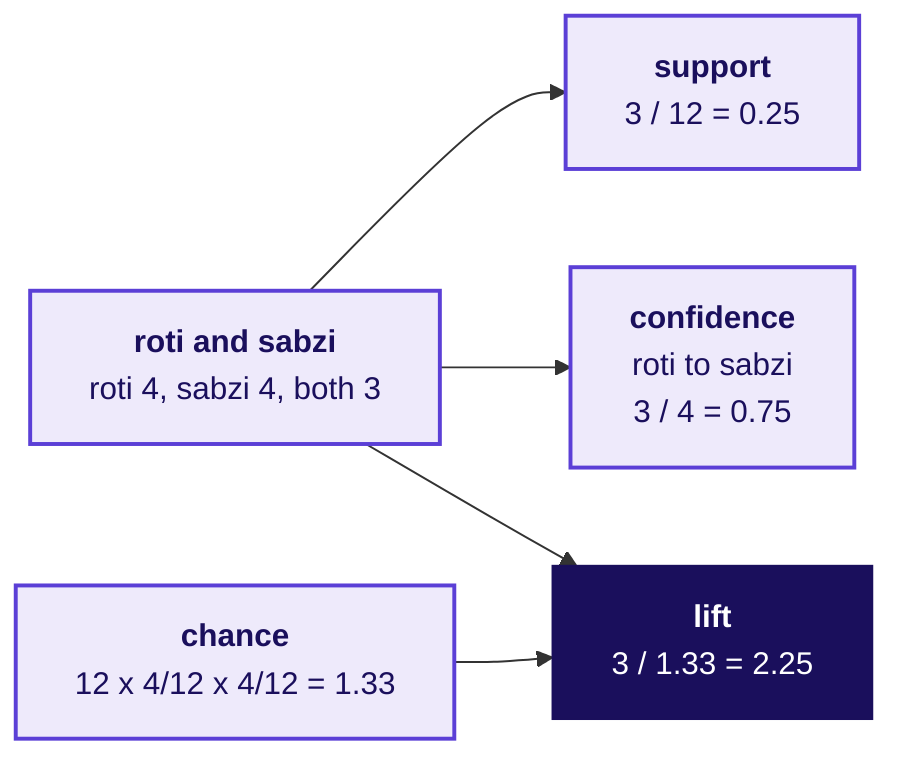

## How does confidence shrink the world?

Drawn in chapter 2 on the canteen, and again in chapter 7 on the twelve carts.

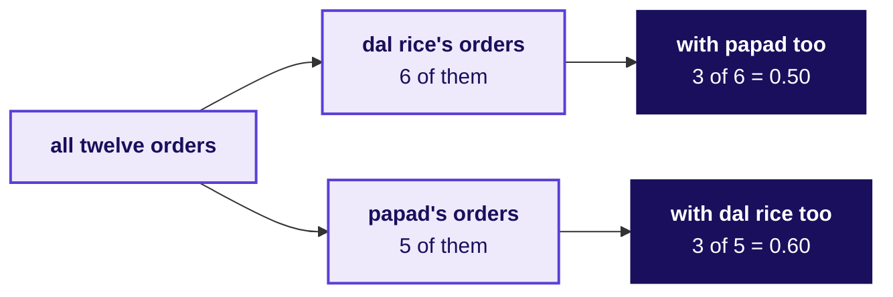

## Which pairs beat chance, drawn as one concept board?

Built through chapters 1 to 6: the example goes up with the cards, each question as its count is
called, the sketches as each picture is drawn, and the two pitfalls last.

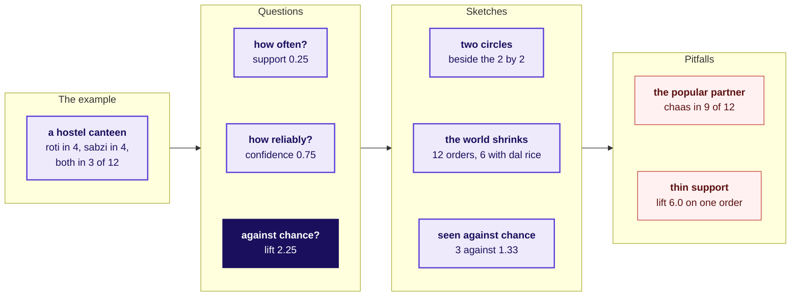

## What does the kirana's combo card earn?

Built left to right in chapter 9, one bar at a time. The month is invented.

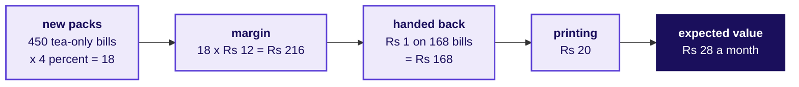

## What do the twelve cards count to?

Written as each group calls its counts out, before any formula is named.

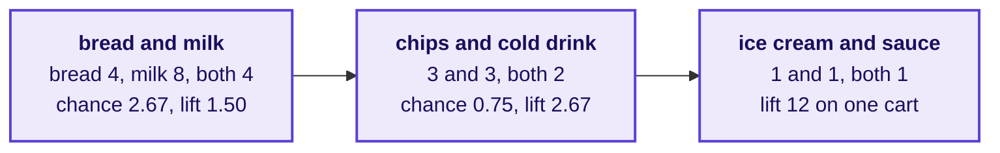

## Where does lift join the week?

Added under Wednesday's node at the close of chapter 3, and left up all day.

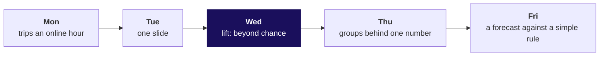

## How do two click-through rates make 3.8 percent?

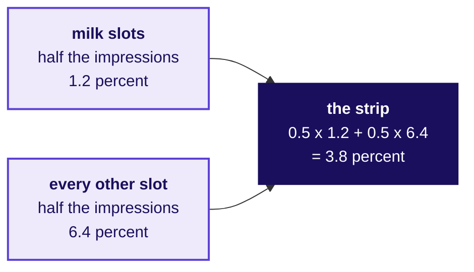

## Where does each pair sit on the action map?

The wall board, with the pair cards placed in chapter 10. Support runs across with the 1 percent
floor at the middle, and lift runs up; the positions are sketched, and notebook 10's picture draws
them to scale. Chapter 6 drew the same four regions for the canteen.

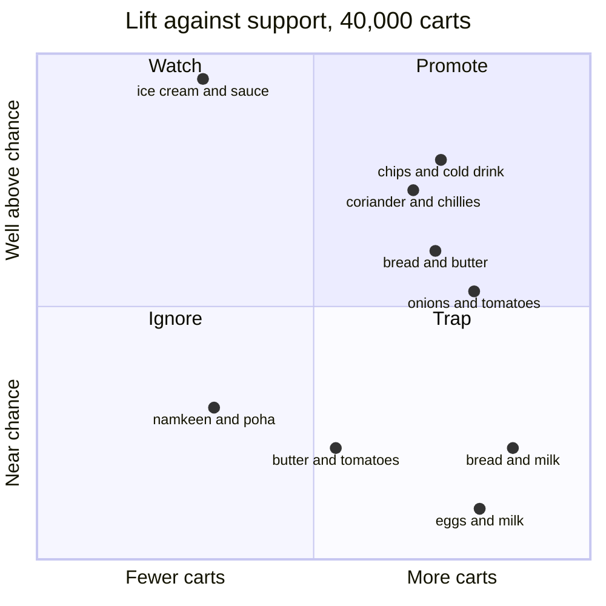

## What is a slot worth?

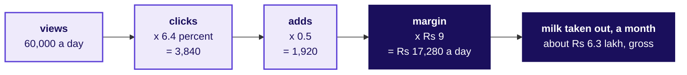

## What does the board hold at the close?

The chain below, the week map with lift under Wednesday, the action map with its cards, and the
sentence for Friday written under them all.

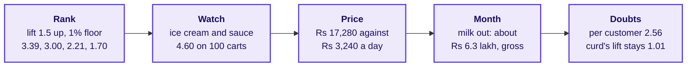

> The click-through fell because the strip gave half its slots to milk, which shoppers buy anyway.
> Taking milk out, which ranking by lift above a 1 percent floor and a 1.5 bar does by arithmetic,
> recovers about Rs 6.3 lakh a month before the adds that would have come anyway; a test against a
> count ranking without milk shows whether lift earns more.
