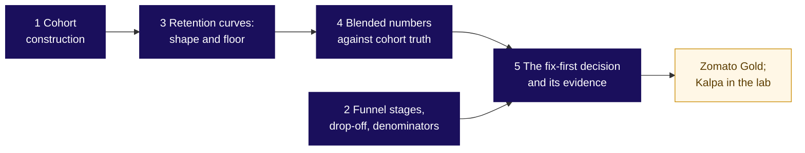

# Who is leaving, and at which step?

Zomato Gold, Chennai, Week 4 Thursday. Month-two retention read flat at 38 percent from June to September 2026 while every cohort fell, and members' Android add-to-cart to order fell from 58 to 44 percent after the 14 September release. Illustrative case: the company is real, the situation and the data are synthetic. The gym and the college are invented.

## Panel 1: Cohort construction: what does the triangle say?

| Read | What it shows | On the case |
|---|---|---|
| Across a row | How a cohort's members leave | Down to about 38.5 in month two, then 0.3 points a month |
| Down column one | How each cohort starts | 58 for January, 49 for July, 31 for August |
| The grid underneath | One row per member per month, 1 if she ordered (panel data) | 241,492 member-months, grouped by joining month and age |

`retention(c, k) = members of c active at age k / members of c`; the joining month is age zero and is never counted.

**Crux:** Fix each member's joining month and count her age from it; compare cohorts at the same age, and read one calendar month across them only to look for a shock that hit everyone.

## Panel 2: How do the five topics connect?

**Crux:** A cohort fixes the entry moment. A curve's floor is read only once two ages agree. A blend is a size-weighted average and counts who it counts. Each funnel step divides by the step before, in one named unit. A low step is not a loss until it moves, and a fix-first call carries its comparator, its date and its cost.

## Panel 3: Retention curves and blended numbers: where is the floor?

| Idea | The gym (invented) | Gold |
|---|---|---|
| Floor: two equal ages in a row | January 80, 60, 50, 50, 50 | 38.5, eroding 0.3 a month |
| Blend: size-weighted average | 100 at 40, 400 at 52.5: 250 of 500 | 13,218 of 35,000 |
| Plain mean: one vote a cohort | 46.25 against 50 | 36.9 against 35.9 |

`blend = sum of (cohort size x cohort rate) / sum of cohort sizes`

**Crux:** Rebuilt from its cohorts, a blend lands on the direct count; rank cohorts at the same age.

## Panel 4: Funnel stages, drop-off, denominators: how does a step read?

| Step, September, Gold members | Per session | Per member |
|---|---|---|
| Search to menu view | 118 percent | 101 percent |
| Menu view to add-to-cart | 34 percent | 61 percent |

`step rate = this step / the step before, in one unit`; drop-off = 100 less it; overall = last / first.

**Crux:** Above 100 is a step people can skip; of sessions that searched, 89 percent opened a menu.

## Panel 5: The fix-first decision and its evidence: what goes first?

Causes in order: tracking, the definition, cohorts, everyone, a stage. The page: call, evidence, cost ranged, objection, what would change it.

**Crux:** Rule out the count and the rule first, then fix the step that moved before the step that is low.

## Panel 6: The case in numbers: what is fixed first?

| Line | On the case |
|---|---|
| Twelve members, by age | May 3, 2, 1, 1 of 4; June 2, 1, 1 of 3; August sale 0 of 5 |
| The step | Checkout start to order, 72.5 to 55 percent, Android members, from 14 September |
| The comparators | On the same step: iOS members 71 to 70, non-members on Android 65 to 64 |
| The size | About 1,133 to 1,317 orders a week; Rs 3.4 to 6.6 lakh of order value |

**Crux:** The checkout first, since it loses orders weekly; then the sale-week payback, 20 against 49.
