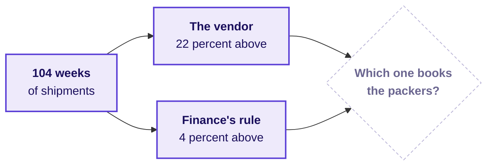

# What should you bring to Friday, when two forecasts disagree?

Week 4, read on Thursday evening: about 10 minutes of reading and two checks to run, so that Friday
can start on its ticket from the first minute.

---

## What does Friday's ticket say?

> **Flipkart, the Lucknow fulfilment centre, festive packer headcount.** The centre has 104 weeks of
> outbound shipments, the weeks beginning Monday 30 September 2024 to Monday 21 September 2026. Its
> busiest weeks sit just before Diwali, which falls on Sunday 8 November 2026. The planner must book
> packer shifts for the eight festive weeks beginning 12 October to 30 November 2026, and two forecasts
> sit eighteen points apart: a vendor's curve puts the festive weeks 22 percent above last year's,
> and finance's rule puts them 4 percent above. The ask, due Friday: which forecast goes to the
> staffing plan, and how wrong could it be?
>
> Illustrative case: the company is real, the situation and the data are synthetic, built for this
> class.

On Friday you answer the fulfilment centre's planner, who books the shifts, and the regional
operations head.

---

## Which words will Friday use that you may not know yet?

Write what you think each one means tonight, from memory, in the right-hand column. Friday's first
minutes assume you have tried, and a word you leave blank is the one to listen for in the room.

| Term | When Friday uses it | What you think it means tonight |
|---|---|---|
| Baseline | Every forecast is first compared with a plain one. | |
| Trend | The shipments grow a little from one year to the next. | |
| Seasonality | The same weeks of each year are busy again. | |
| Hold-out | Some weeks are kept back while a forecast is built. | |
| Error | Each forecast is scored on how far it missed. | |

---

## Which one question should you think about tonight?

Today's cohort table gave each member an age, months since joining. Friday's weeks need the same kind
of axis: the same week of the festival in two different years.

If Diwali moves by weeks from one year to the next, which week of last year is the fair comparison for
a week this October? Bring your answer as one sentence, since you will be asked for it.

---

## What should you check in your Codespace tonight?

Nothing needs installing, and each check takes under five minutes.

1. Run Restart and Run All on Thursday's four notebooks, 01 to 04. Each ends on its checks passing,
   and if one does not, post its last error line in the cohort channel before the session.
2. Save your take-home notebook with its outputs showing, since a notebook that ran but was not saved
   looks empty to everyone else.

---

## Which line is worth carrying into Friday?

> Thursday asked who the number counts; Friday asks what the number is compared with before anyone
> trusts it.
