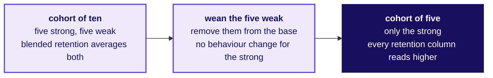
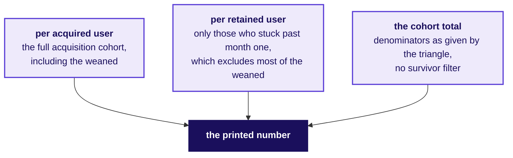

# The weaned-users hour: when a decline hides inside a lift

Week 4, Day 4. Faculty-block fallback.

Kicker: WEEK 4  ·  THURSDAY  ·  FALLBACK
Quote: Swiggy weaned over four million unprofitable users away and one-month retention rose from 55 to 61 percent. Part of that rise is the mix changing. Which part?
Who: The analyst reading Swiggy's Q1 FY27 letter. Illustrative use: the published numbers are Swiggy's, verified 12 October 2026; the dissection is the programme's.

```notes
LIVE, one minute. Read the opening and say that the hour teaches no survival content; the IITGN
block owns that whenever it runs. Four short sections, 35 + 40 + 25 + 20 minutes.
```

---

## SECTION 1: Weaned users and the mix move
*Swiggy's own triangle, the move the mix makes, and the numbers.*

---

## S1. 55 to 61 percent: where does the lift come from.
*What rose, what left, and how does the mix shift show in a cohort chart?*

| Fact in R2 (Th3) | What the picture shows |
|---|---|
| MTU up 27.4 percent | More users touched the platform in the quarter |
| Platform frequency fell 6.3 percent | Each user used it slightly less often |
| Over four million unprofitable users weaned away | The weakest column of the triangle removed from the base |
| One-month retention 55 to 61 percent | Blended rate climbed six points |

A lift of six points on blended retention can come from the remaining users ordering more, from the weakest users leaving, or from both. The cohort chart separates the two, which the dashboard does not.

```notes
LIVE, 8 minutes. Walk the four lines aloud. The question for the room: which of these three
explanations could show up with no change in anyone's behaviour at all? Expect "removing weak
users" and reinforce it.
```

---

## S2. Five weak users leave, every column reads higher
*Ten members, five weak and five strong; drop the five weak and the mean rises on every month.*



| Month | All ten | Only the strong five |
|---|---|---|
| m1 | 7 of 10 ordered | 5 of 5 ordered |
| m2 | 5 of 10 ordered | 5 of 5 ordered |
| m3 | 4 of 10 ordered | 4 of 5 ordered |
| m4 | 3 of 10 ordered | 3 of 5 ordered |

Drop the five weak members and every cell rises without a single member changing behaviour. The lift is a composition effect, which the triangle makes visible and the dashboard hides.

```notes
LIVE, 12 minutes. Build the table on the board with the room. The teaching move is StatQuest's:
tiny numbers aloud, each step named. The point is that a weaning policy and a product improvement
cannot be told apart from a blended number alone.
```

---

## S3. The denominator question on Swiggy's triangle
*Which denominator did Swiggy pick, and what would the alternatives have said?*



A chart with no stated denominator is a shape; a chart with its denominator stated is a number. Swiggy's letter indexed to the Q4 FY24 cohort; a different index would have moved every row.

```notes
LIVE, 15 minutes. The room writes the three denominator choices and names what each would say
about the lift. The hire-grade candidate asks for the denominator before trusting the number.
```

---

## SECTION 2: Monthly against weekly on today's data
*Rerun the Chennai cohort at a weekly granularity: which story survives?*

---

## S4. Monthly against weekly, done in class
*Does the mix story the morning told hold at a weekly granularity, or does noise take over?*

The row's after-class brief asked for a weekly cohort rerun. The question is which story the rerun keeps:

| What might change at the weekly axis | Which story holds, which breaks |
|---|---|
| Each cohort smaller, so curves noisier | The paradox holds; the mix move is structural |
| Seasonal weekends mix inside each month | The denominator shift is where the lift sits |
| A sale week isolated as its own cohort | The sale-week cohort reads lowest, as the monthly view showed |

The method survives the change of axis. The specific numbers do not.

```notes
LIVE, 20 minutes. The pair exercise: redraw the Chennai triangle at the week axis, from the
member_months file (the finishing session owns the exercise's final form). Ask: which teaching
sentence survives, and which has to be rephrased.
```

---

## S5. Where the mix move sits in the formula
*Which term is doing the heavy lifting in a 55 to 61 lift?*

For a blended retention $B = \frac{\sum_c N_c r_c}{\sum_c N_c}$, four moves can lift it:

| Move | What the room would see |
|---|---|
| Each $r_c$ rises (behaviour improves) | Every triangle cell goes up |
| The weak-$r_c$ cohorts' $N_c$ shrink (weaning) | Those rows disappear; the remaining average rises |
| New cohorts have higher $r_c$ (better acquisition) | Later rows start higher than earlier ones |
| The mix shifts toward higher-$r_c$ cohorts | Earlier rows unchanged; later rows pull the blend |

The dashboard shows $B$, never which lever moved. The triangle shows every row that moved.

```notes
LIVE, 20 minutes. This is the mathematical close. The formula is the shorthand for what the hand
table and the triangle already showed. Then the self-selection story on Zomato.
```

---

## SECTION 3: Zomato's 60 percent rise, kept descriptive
*A frequency rise after a decision is self-selection, not causation.*

---

## S6. Gold's 60 percent frequency rise, carefully read.
*What self-selection question would the row ask here?*

The published Zomato letter says order frequency rose about 60 percent on average after a user joined Gold (Th4, verified 12 October 2026). The teaching read is kept descriptive: the number is real and it does not say Gold caused the rise.

| What the number says | What it does not say |
|---|---|
| Frequency after joining is higher than frequency before | The joining caused the rise |
| The joined cohort is self-selected on expected ordering | The marginal joiner behaves like the inframarginal one |
| A matched non-joiner comparison would say more | Nothing is said about non-joiners' trajectories |

```notes
LIVE, 15 minutes. Walk the two columns side by side. The hire-grade candidate names the matched
comparison as the step that would move the number from a description to a claim. No causal
inference content past this slide; the IITGN block owns it when it runs.
```

---

## S7. The second transcript: the app team disputes
*How does a hire-grade response answer a dispute that is partly right?*

| Beat | What the app team says | What a hire-grade response does |
|---|---|---|
| Opening | Overall conversion is flat; the stage is fine | Concede that overall is flat; name the three axes it averages over |
| First evidence | A single chart of overall conversion | Bring the split by platform, membership and date |
| Second evidence | The stage worked before and works now | Compare pre-release and post-release on Android alone |
| Close | Everything looks the same | Name the segment, the stage and the date; propose the fix |

```notes
LIVE, 10 minutes. This is the row's [D] anchor. The teaching move is the case method's: argue
from the evidence, concede what is true, bring the chart that answers the question asked.
```

---

## SECTION 4: Close
*What the fallback hour taught, in one sentence.*

---

## S8. The sentence that closes the fallback hour
*What does the hour teach that the main day did not already carry?*

A blended lift and a blended fall can both be the mix shifting rather than any member's behaviour changing. The chart that separates them is the cohort triangle with its denominator named.

Nothing in this hour touched survival analysis, log-rank tests or hazard functions. The IITGN block owns those whenever it runs.

```notes
LIVE, 2 minutes. Say the sentence. Return control to the main afternoon slot if the block is not
coming. If the block arrives late, close here and start W4-3 cleanly.
```
