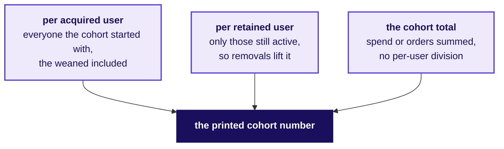
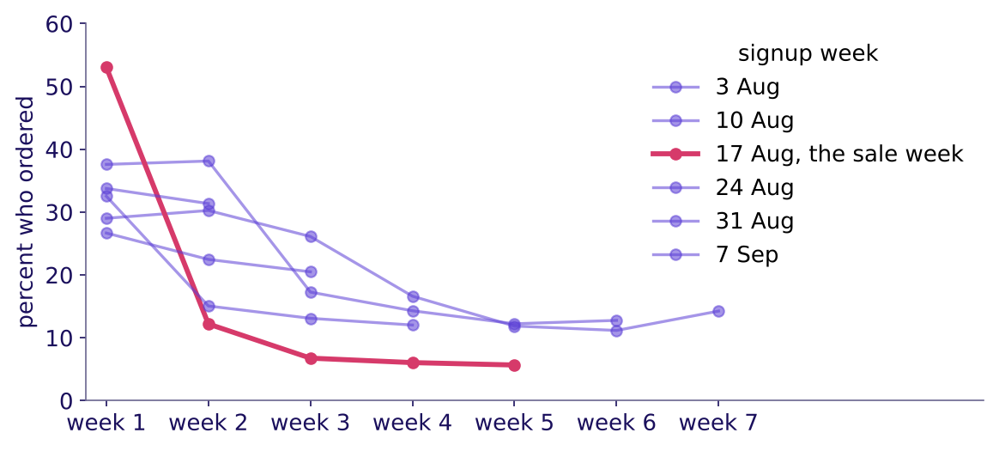
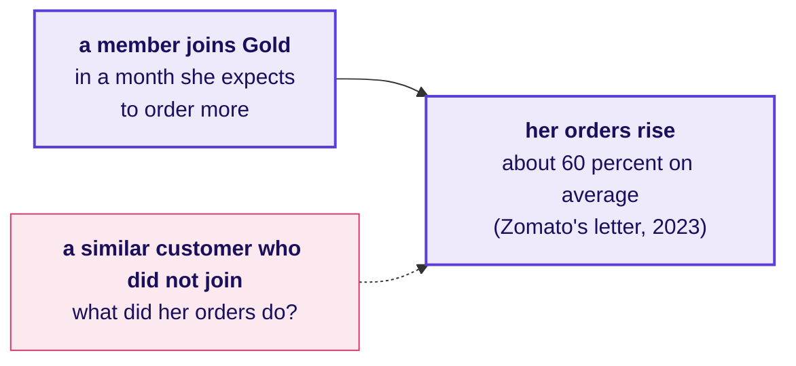

# When can a retention number rise or hold with nobody's behaviour changing?

Week 4, Day 4. Fallback for the tentative faculty block.

Header: WEEK 4  ·  DAY 4  ·  THE FALLBACK, IF THE TENTATIVE FACULTY BLOCK SLIPS

## SECTION 7: Can weaning lift retention?
*Zomato Gold, Chennai, continued, beside Swiggy's own published cohorts: Swiggy removed users with low expected value, so how much of a retention rise can that alone produce?*

```notes
This block runs only if the IITGN faculty session W4-3 (tentative) slips. It teaches no survival
curves, censoring or tests between curves, which stay with the block whenever it runs. Four
parts: 35, 40, 25 and 20 minutes, 120 in all.
LIVE, 35 minutes. Styles: StatQuest (ten members on the board), the case method (Swiggy's own
decision). The denominator question closes the part.
Transition: Swiggy's numbers.
```

---

## S1. Swiggy weaned 4 million users; retention rose
*What did Swiggy decide, and what did its numbers do?*

```stats
value: 4M+ | label: users weaned away | note: unprofitable Instamart users, over three quarters to Q1 FY27
value: 55 to 61 | label: percent | note: one-month retention of the transacting base, Q1 FY26 to Q1 FY27
value: 4.14x | label: spend at Q6 | note: the Q4 FY24 cohort's spend in its sixth quarter against its first
```

Swiggy says it used cohort-level levers (minimum order thresholds, free deliveries, new-user coupons) and weaned away users with low expected lifetime value. Sources: Swiggy's Q1 FY27 and Q2 FY26 shareholder letters, each checked 12 October 2026.

```notes
Sources:
https://nsearchives.nseindia.com/corporate/SWIGGY_30072026154100_Covering_Letter_Letter_to_Shareholders_-_signed.pdf (checked 12 October 2026)
https://www.swiggy.com/corporate/wp-content/uploads/2025/10/Q2-FY2026-Shareholder-letter.pdf (checked 12 October 2026)
LIVE, 8 minutes. Read the three numbers and the decision. Ask: which of these could rise with no
user ordering a single extra time? Expect "the retention rate"; the next slide shows how.
Transition: ten members on the board.
```

---

## S2. Drop five weak members, and every column rises
*Ten members, five strong and five weak: what happens to each month's rate when the weak five leave (invented)?*

| Month | All ten | The strong five only |
|---|---|---|
| Month one | 7 of 10 | 5 of 5 |
| Month two | 5 of 10 | 5 of 5 |
| Month three | 4 of 10 | 4 of 5 |
| Month four | 3 of 10 | 3 of 5 |

No member changed what she did, and every month's rate rose: 70 to 100, 50 to 100, 40 to 80, 30 to 60 percent. A retention rise after a weaning is partly the mix of who remains.

```notes
LIVE, 12 minutes. Build the table on the board with the room, column by column (invented
numbers). Then ask: from the blended number alone, could you tell a weaning from a better product?
No; the cohort table with its denominator can.
Transition: the denominator question.
```

---

## S3. Three denominators give three different charts
*Which denominator does a published cohort chart use, and what would the others say?*



A cohort chart without its denominator is a shape. Swiggy's table is indexed to its Q4 FY24 cohort's first quarter, and calls the groups "retained user cohorts": the first thing to ask is who stays in the count.

```notes
LIVE, 15 minutes. Groups write what each denominator would show after a weaning. Per retained
user rises most; per acquired user shows the removals as a fall; the total moves least.
Transition: the rerun, by week.
```

---

## SECTION 8: Does a weekly table agree?
*Rebuilt by signup week instead of signup month, which part of the morning's story holds and which needs new words?*

```notes
LIVE, 40 minutes. The row's after-class task done in class, in pairs, on the event log. Styles:
Krish Naik (a table built line by line), Veritasium (predict the sale week's row first).
Transition: the task.
```

---

## S4. The task: cohorts by signup week, from the log
*How is a weekly cohort table built from the event log?*

```python
placed = ev[ev["stage"] == "order_placed"]
week = lambda t: t.dt.to_period("W-SUN").dt.start_time      # weeks start on Monday
orders_week = set(zip(placed["user_id"], week(placed["event_ts"])))
# members who joined 3 August to 13 September; week k is the k-th full week after the signup week
```

Members who joined from 3 August to 13 September form six weekly cohorts. A member is active in week k when she placed an order that week. The week of 28 September is three days long, so the table stops at the week of 21 September.

```notes
LIVE, 20 minutes in pairs. Ask each pair to predict the sale week's row before computing it.
Transition: the table.
```

---

## S5. The sale week: 53 percent, then 12
*What does the weekly table show for the sale week against the weeks either side of it?*



Percent of each weekly cohort that ordered in each full week after joining. The sale week's 9,108 members ordered in their first week, while the discount lasted, and then fell off a cliff: 53 to 12 percent, the steepest fall of the six. The five other weeks, 1,112 to 1,247 members each, start between 27 and 38 percent.

```notes
LIVE, 10 minutes. Point at the sale week's two cells. The monthly table hid this inside the
signup month, which is month zero and never counted.
Transition: which story survives.
```

---

## S6. The method survives; the words change
*Which sentence of the morning holds on a weekly table, and which has to be rewritten?*

| The morning said | On the weekly table |
|---|---|
| Every cohort falls with age | Holds, with noise: weekly cohorts of 1,112 to 1,247 members |
| The sale cohort is the weakest | Holds after its first week; in its first week it looks strongest |
| Rates near 38 percent | Weekly rates are lower: ordering in a given week is rarer than in a month |
| The last month counts | The last week is partial and leaves the table |

```notes
LIVE, 10 minutes. The lesson: a cohort table's grain changes the numbers and keeps the method.
Name the grain on every chart, as the unit is named on every funnel.
Transition: Zomato's own number.
```

---

## SECTION 9: Did Gold cause the orders?
*Zomato says Gold members order about 60 percent more after joining; what comparison would let anyone say Gold caused it?*

```notes
LIVE, 25 minutes. Kept descriptive: no causal method is taught. Styles: Veritasium (the
misconception first), the case method.
Transition: the number.
```

---

## S7. Gold members order about 60 percent more after joining
*What does Zomato's own number say, and what does it leave out?*



Zomato's shareholder letter of 19 May 2023 (checked 12 October 2026) says Gold reached 1.8 million members in Q4 FY23, its members' orders were about 30 percent of food delivery GOV in March 2023, and their order frequency rose about 60 percent after joining. The number describes members; it does not show what Gold caused.

```notes
Source:
https://www.bseindia.com/xml-data/corpfiling/AttachHis/42b3bf3b-1edb-4da7-849a-87ca9da27ff8.pdf (checked 12 October 2026)
LIVE, 10 minutes. Members choose to join when they expect to order more, so before and after
mixes the choice with the effect. Ask what a fair comparison would be.
Transition: the comparisons.
```

---

## S8. Three comparisons that would say more
*Which comparison would separate what Gold did from who chose Gold?*

| Comparison | What it controls for | What it still misses |
|---|---|---|
| Matched customers who did not join | Customers who ordered alike before | Why one joined and the other did not |
| The trend before joining | A member already ordering more each month | A planned change (a move, a new job) |
| A holdout: Gold offered to some, withheld from others | Who chose to join | The cost of withholding the offer |

```notes
LIVE, 15 minutes. Groups rank the three for what Zomato could run. Keep it at this depth: how to
estimate the effect belongs to later weeks.
Transition: the second transcript.
```

---

## SECTION 10: Is the app team's stage fine?
*The app team says the funnel stage the room blamed is fine: how does a strong candidate answer a dispute that is partly right?*

```notes
LIVE, 20 minutes. The row's [D] anchor: the app team says the funnel stage you blamed is fine;
what evidence do you bring to the meeting? Pairs read and score it.
Transition: the transcript.
```

---

## S9. The dispute, answered with the split
*What does a weak answer bring to the meeting, and what does a hire-grade one bring?*

| Beat | A weak answer | A hire-grade answer |
|---|---|---|
| Opening | "Your release broke checkout." | "You're right that checkout starts held at 80 percent; I'd like to show the next step." |
| Evidence | Overall conversion before and after | Checkout start to order, 72.5 to 55, members on Android only, from the release week |
| The comparators | None | iOS members 57 to 56; non-members on Android 52 to 51 |
| What would change my mind | Nothing | "If the event the release renamed is mapped wrong, I'd rerun it on your mapping." |

```notes
LIVE, 15 minutes. Pairs score the hire-grade side on the scorecard. The move is Tuesday's: restate,
answer from the evidence, concede what is true, say what would change your mind.
Transition: the close.
```

---

## S10. The block in one sentence
*What did the fallback block add to the day?*

A retention number can rise or hold because of who is counted, with nobody's behaviour changing: the cohort table with its denominator and its grain named is what tells the two apart.

```notes
LIVE, 2 minutes. Nothing here touched survival curves, censoring or tests between curves; the
faculty block (tentative) takes them whenever it runs. Then return to the Kahoot if it has not run.
Transition: end of the block.
```
