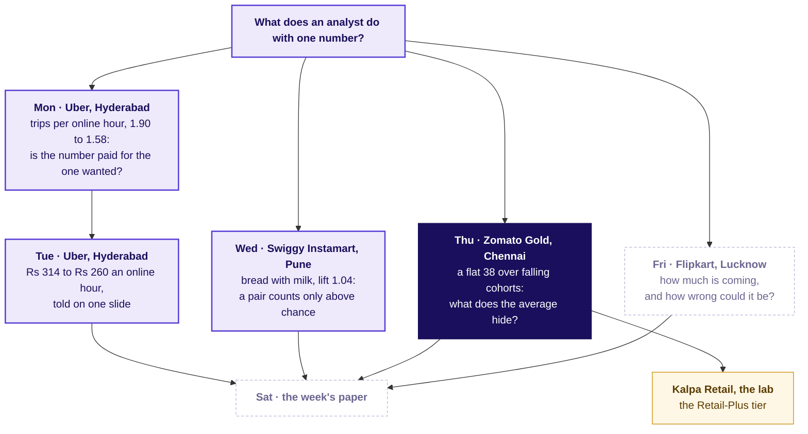
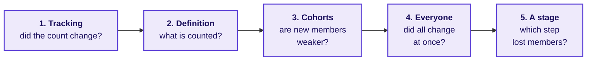
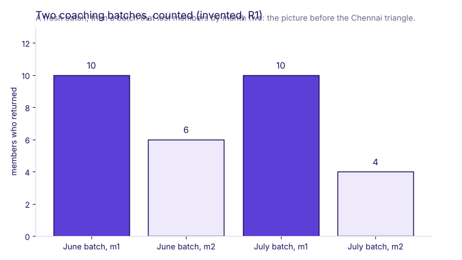
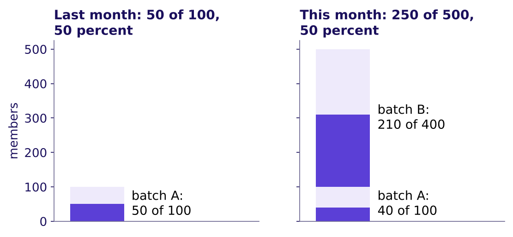
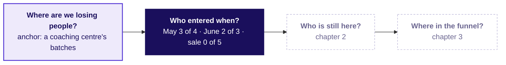
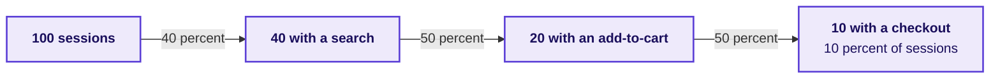
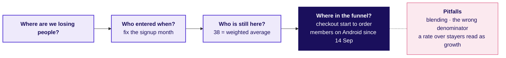

# Who is leaving Zomato Gold in Chennai, and at which step?

Week 4, Day 4. Half one.

Header: WEEK 4  ·  DAY 4  ·  ZOMATO GOLD, CHENNAI, AN ILLUSTRATIVE CASE

## S1. The ticket: a flat 38 and a release on Android
*What does the ticket say, with its numbers, its data and its ask?*

| Measure | Value |
|---|---|
| Month-two retention on the dashboard, June to September 2026 | 38 percent each month |
| Month one (the first full month after joining), by signup month, January to August | 58, 56, 55, 53, 52, 50, 49, 31 percent |
| The August cohort, grown by a sale week | 13,000 members, 2.6 times the 5,000 a month of January to July |
| Members on Android, add-to-cart to order, before and after 14 September | 58 to 44 percent |
| Members on iOS; non-members on Android | 57 to 56 percent; 52 to 51 percent |
| Search to menu view per session; menu view to add-to-cart per session and per member, September | 118 percent; 34 and 61 percent |

**Gold** is the app's paid membership, with free delivery. **Data.** `members` (53,089 who joined January to September), `member_months` (orders per member per month, from the order records), `events` (one row per stage each app session, one visit to the app, reached; August and September; platform, and checkout version v1 or the new v2; Gold members and 4,000 non-members). **The ask, due Friday.** Cohort problem or everyone problem; which funnel stage owns the loss; what to fix first, with the evidence. **Known caveats.** The home carousel opens a menu without a search; sessions and members are different units; the August cohort was bought on a discount; the release renamed one Android event, which the app team has mapped.

**Illustrative case.** The company is real; the situation and the data are synthetic, built for this class.

```notes
Source for Gold's free delivery: Zomato's shareholder letter of 19 May 2023,
https://www.bseindia.com/xml-data/corpfiling/AttachHis/42b3bf3b-1edb-4da7-849a-87ca9da27ff8.pdf (checked 12 October 2026)
LIVE, 4 minutes. Say the label line aloud first: the company is real, the situation and the data are
synthetic. The morning climbs three chapters: who joined when (counted by hand), what the
dashboard's 38 is made of (all 53,089 members), and which step owns the loss; the afternoon's first
60 minutes make the fix-first call and read the interview.
Read the table top to bottom. Define month-two retention in one breath: the share
of members two or more months past their signup month who ordered in the month. Point at the gap:
the dashboard is flat, every cohort's month one is lower than the one before, and August's 31 sits
far below. Ask which number the membership lead would put on Monday's slide; most say the 38.
Transition: where Thursday sits in the week.
```

---

## S2. The week map, Thursday lit
*Where does today sit, and what did the days before it find?*



```notes
LIVE, 1 minute. Monday asked whether the number paid for measures what is wanted, Tuesday put
one denominator on one slide, Wednesday judged a pair against chance. Thursday judges a cohort against the blend. Friday stays dashed. The
explorer's home screen draws the same map (day control: Thu).
Transition: where today ends.
```

---

## S3. Where today ends: two problems, two fixes
*What sentence will the membership lead carry out of the room?*

> "It is both, in two numbers that need different fixes. Retention is a cohort problem: the dashboard starts counting at month two, where every cohort lands near 38.5, so it never sees that each new cohort starts lower in month one, and it has not yet counted the 13,000-member August cohort, whose sale-week members kept 20 percent; in October the dashboard drops to about 33. The order loss hits members of every signup month on Android at one step from the 14 September release: of the checkouts started, 72.5 percent ended in an order before and 55 after, about 1,133 to 1,317 orders a week. Fix the Android checkout first; before buying another sale, work out whether this one's members pay back their discount."

**The words.** Month-two retention is the dashboard's name for the share of members two or more months past their signup month who ordered in the month; a member with no order in a month is not retained that month, and she is still a member. A cohort problem sits in some signup months; an everyone problem hits members of every signup month at once.

Each number in that sentence is earned in order: by hand on twelve members, on all 53,089, then on 1,386,235 app events.

```notes
LIVE, 1 minute. Read it once and move on; nothing to write. The room earns each clause in order.
Transition: the hypothesis board, before any data opens.
```

---

## S4. Five causes on the board, each with its test
*Before any chart, which causes could explain the ticket, and what would test each?*



| Cause | The test that settles it |
|---|---|
| 1. Tracking | The orders counted a second way, in the order records, against the app's event log |
| 2. Definition | The dashboard's written rule: who is counted, from which month |
| 3. Cohorts | The cohort table, each signup month read at the same age |
| 4. Everyone | One calendar month read across every cohort: did all of them move at once, on one platform? |
| 5. A stage | Each step over the step before, by unit, platform and date |

```notes
LIVE, 4 minutes. The groups write their own ordered list first, with the test each cause needs,
on the hypothesis board template; then show this ladder. It runs in the order a careful analyst
checks: the count, the rule, the cohorts, everyone, then the stage. Rows 3 and 4 read the same table
two ways: cohorts compared at the same age for strength, one calendar month read across them for a
shock that hit everyone. Each chapter's reveal strikes or confirms
a line; keep the board up all morning.
Transition: chapter 1.
```

---

## SECTION 1: Who entered when?
*Why can a flat average hide falling groups, and what does each group keep month by month, counted by hand on twelve members before any code?*

```notes
LIVE, 50 minutes. Laptops closed until the end of the chapter; the twelve-row card is on every
table. Styles: Brilliant (a question before the explanation), StatQuest (tiny counts aloud),
Veritasium (predict, then reveal), the case method (Blinkit's and Swiggy's own cohort charts).
Explorer scenes Th2 and Th1. Notebook 01 reproduces every count.
Transition: the chapter's questions.
```

---

## S5. Chapter 1: four questions, one card
*Who needs the answer, and which smaller questions lead to it?*

**Who needs the answer.** The membership lead, who must say on Friday whether Gold has a cohort problem or an everyone problem. A wrong call sends the fix to the wrong team.

```timeline
label: 1 | title: Why can one average hide two groups? | body: Two coaching batches, ten members each, invented
label: 2 | title: What does each group keep, month by month? | body: Twelve members of the case data, counted by age
label: 3 | title: What does the dashboard count? | body: The same twelve, the dashboard's way
label: 4 | title: How does a big new group hold an average up? | body: Two more batches, then two real companies' cohort reports | tone: dark
```

```notes
LIVE, 2 minutes. Read the four questions; each is answered with a count before the next is asked.
Transition: the first toy.
```

---

## S6. Two batches, one average that names neither
*Why can an average over two groups hide what each did?*



A coaching centre (invented numbers) takes 10 students in June and 10 in July. In each batch's second month, 6 of June's and 4 of July's come back: 60 and 40 percent. Together, 10 of 20 came back, 50 percent, which is neither batch's rate.

```notes
LIVE, 4 minutes. Count the dots aloud: six, four, ten of twenty. Ask: if the centre only ever
printed "50 percent", which batch would it worry about? Neither, because the average names neither.
The toy is invented (R1); say so.
Transition: twelve members of the case data.
```

---

## S7. The card: twelve members, four months
*Which of the twelve ordered in each month after joining?*

| Member | Joined | Channel | Jun | Jul | Aug | Sep |
|---|---|---|---|---|---|---|
| ZG20844 | May | organic | 1 | 1 | 1 | 1 |
| ZG21052 | May | organic | 1 | 1 | 0 | 0 |
| ZG22010 | May | organic | 1 | 0 | 0 | 0 |
| ZG22634 | May | organic | 0 | 0 | 0 | 0 |
| ZG25312 | Jun | organic | joined | 1 | 1 | 1 |
| ZG27475 | Jun | organic | joined | 1 | 0 | 0 |
| ZG28603 | Jun | organic | joined | 0 | 0 | 0 |
| ZG39559, ZG40539, ZG41000, ZG41529, ZG42328 | Aug | sale | | | joined | 0 each |

A 1 means she placed at least one order that month. **Month one** is the first full calendar month after joining, so May's is June and August's is September; the joining month is month zero and is never counted.

```notes
LIVE, 5 minutes. Hand out the card if it is not on the tables. Read one row aloud: ZG21052 joined
in May, ordered in June and July, then stopped. The last line holds the five sale-week members,
named one by one, none of whom ordered in September. Ask each table to rewrite the card by months since joining instead of by
calendar month before the next slide.
Transition: the prediction.
```

---

## S8. Predict: which group keeps the most in month one?
*Counted by months since joining, which group keeps the largest share in its own month one?*

a) The four May members

b) The three June members

c) The five August sale-week members

d) All three keep the same share

```notes
LIVE, 3 minutes. Vote first, in writing, then pairs argue for one minute and vote again (peer
instruction). Expect some c from tables that read September's column, where August's month one
sits beside May's month four.
Transition: the count.
```

---

## S9. Answer: May 3 of 4, June 2 of 3, sale 0 of 5
*What does each group keep at each age, and what does that show?*

| Joined | Month one | Month two | Month three | Month four |
|---|---|---|---|---|
| May (4) | 3 of 4 | 2 of 4 | 1 of 4 | 1 of 4 |
| June (3) | 2 of 3 | 1 of 3 | 1 of 3 | |
| August sale week (5) | 0 of 5 | | | |

The answer is a. Each group falls as it ages, and each later group starts lower: 75, 67 and then 0 percent in month one. A **cohort** is a group that joined in the same month; fixing the entry moment is what makes the three comparable at all. The twelve were picked to show the pattern on one card: on all 53,089, May's month one is 52 percent and June's 50.

```notes
LIVE, 6 minutes. Count May's row aloud: three ordered in month one, two in month two, one in three
and four. Then June's, then August's. Say the definition of a cohort only now, after the room has
built one. Watch for anyone comparing groups in the same calendar month: in September, the sale
member's month one sits beside May's month four, which is why the age column, not the calendar
column, is the fair comparison.
Transition: what the dashboard does with the same card.
```

---

## S10. Predict: what does the dashboard's way read?
*The dashboard counts a member from her second month after joining. On the card, what does it read in August and September?*

a) A fall from August to September, because the sale-week members ordered so little

b) 2 of 7 in both months, with the five sale-week members outside the count

c) A rise, because new members joined

d) 2 of 12 in both months

```notes
LIVE, 3 minutes. Remind the rule: in a reporting month, count every member two or more months past
her joining month, and ask what share ordered. Vote, argue, vote again.
Transition: the count, both ways.
```

---

## S11. Answer: 2 of 7 in August, 2 of 7 in September
*What does the card say counted the dashboard's way, and counted for everyone?*

| Reporting month | July | August | September |
|---|---|---|---|
| The dashboard's way: members two or more months past joining | 2 of 4 | 2 of 7 | 2 of 7 |
| Everyone who joined before the month | 4 of 7 | 2 of 7 | 2 of 12 |

The answer is b. The dashboard's way did not move from August to September, though five members joined in the sale week and none of them ordered: they are outside its count until October. Counted for everyone, September reads 2 of 12.

```notes
LIVE, 5 minutes. Ring the two 2-of-7 cells. Then the August column of the sale-week members: they
joined in August, so August is their month zero, and September is their month one, which the
dashboard skips. Chapter 2 finds the same two readings on all 53,089 members.
Transition: why a big new group holds an average up.
```

---

## S12. Question: does the blend rise, fall or hold?
*Batch A of 100 stood at 50 percent; now A is at 40 and a new batch B of 400 arrives at 52.5 percent. What does the blend, the one rate over both batches, do (invented)?*

a) It rises, because batch B is bigger

b) It falls, because batch A fell

c) It holds at 50 percent

d) It cannot be read without more months

```notes
LIVE, 3 minutes. Explorer scene Th2 lets a learner slide batch B's size; on the projector, vote
first. Expect b from most of the room.
Transition: the reveal.
```

---

## S13. Answer: it holds at 50 while batch A falls
*How can a blend stand still while the old batch shrinks?*



The answer is c: (100 × 0.40 + 400 × 0.525) / 500 = 250 / 500 = 50 percent. A blend is an average weighted by size: blend = sum of (cohort size × cohort rate) / sum of cohort sizes. A large young batch at a high early rate props it up while the old batch falls. On the Gold dashboard the prop is gentler, as chapter 2 shows: each month one new cohort of about 5,000 enters the count at about 38.5 percent, a little above the older cohorts' slow slide.

```notes
LIVE, 5 minutes. Read the two stacks, then the formula last, as the shorthand for what the bars
already showed (3Blue1Brown). Next month batch B ages too, and unless another large batch arrives,
the blend falls. Ask: on the Gold dashboard, what plays the part of batch B? Each month's newly
counted cohort, entering at about 38.5 and only about 5,000 strong.
Transition: a real company that publishes its cohorts.
```

---

## S14. Blinkit and Swiggy report retention by cohort
*How do two Indian companies report retention, and what does each figure count?*

```cards
icon: chart-line | eyebrow: Eternal, the company behind Zomato and Blinkit | title: 46 percent of customers, 150 percent of value | body: Blinkit is its quick-commerce app. In the fourth quarter after joining, 46 percent of a cohort's customers still ordered, on average. The cohort's net order value (NOV) in that quarter was 150 percent of its first quarter's, and 279 percent by the twelfth: fewer customers, more value, so those who stay order much more | tone: light
icon: table | eyebrow: Swiggy Instamart, Swiggy's quick-commerce app | title: Spend by cohort, indexed to one cohort's first quarter | body: Every cohort's spend is shown against what the Q4 FY24 cohort (January to March 2024) spent in the quarter it joined, and that cohort spends 4.14 times as much in its sixth quarter. Swiggy says it weaned away users with "low potential Lifetime values", withdrawing the offers that kept them, and the table states no denominator: per user who joined, or per user who stayed? | tone: light
```

Sources: Eternal's Q1 FY27 shareholder letter of 22 July 2026 and Swiggy's Q2 FY26 shareholder letter, each checked 12 October 2026. India's financial year runs April to March.

```notes
Sources:
https://www.eternal.com/blog/q1fy27/ (checked 12 October 2026), which links the letter itself:
https://drive.google.com/file/d/1jb9KWd4Ap4RTKHFHxzEOO7jgQqVZEGcd/view (checked 12 October 2026)
https://www.swiggy.com/corporate/wp-content/uploads/2025/10/Q2-FY2026-Shareholder-letter.pdf (checked 12 October 2026)
LIVE, 6 minutes. Two decisions to read. Eternal shows the customer number and the value number side
by side, and they disagree by a factor of three because the denominators differ: 150 percent is
possible because the customers still ordering spend more; the letter's own words are that a cohort
spends nearly 3x three years after acquisition. Swiggy weaned away weak users, which lifts that quarter's cells
and every later one with no change in anyone's behaviour. Ask: before trusting either chart, what do you
ask for? The denominator.
Transition: the chapter's close.
```

---

## S15. Chapter 1 close: fix the entry moment first
*What has the card answered, and what is still open?*



**The rule.** Before reading any retention number, ask which members it counts and from which month: a group that joined in a sale and a group that joined last spring are different groups, and one average over both names neither.

**In the interview.** [F], a question frequent in GCC (global capability centre) and product-company screens: blended retention is flat while every cohort declines; how? The mix, each cohort's share of the count, changes under the average, and the average counts who it counts.

```notes
LIVE, 3 minutes. Read the board's first region; Q2 and Q3 stay dashed. Strike or confirm on the
hypothesis board: "a cohort problem" is now likely; the test was the card.
Transition: chapter 2 and the full data.
```

---

## SECTION 2: What is the 38 made of?
*What does every cohort's curve look like on 53,089 members, and how can the dashboard stay at 38 while each one falls?*

```notes
LIVE, 45 minutes. Laptops open; notebook 02. Styles: Krish Naik (one pivot_table, line by line),
Veritasium (two predictions), 3Blue1Brown (the triangle, then the formula last), StatQuest (the
weighted average on seven numbers). Explorer scene Th1.
Transition: the chapter's questions.
```

---

## S16. Chapter 2: from twelve members to 53,089
*Who needs the answer, and which smaller questions lead to it?*

**Who needs the answer.** The membership lead, about to report "nothing changed" because the number is flat. If the flat number hides falling cohorts and a weak August cohort, the fix waits a month too long.

```timeline
label: 1 | title: What does each cohort keep, month by month? | body: One pivot_table on member_months
label: 2 | title: What does the dashboard print, counted directly? | body: June to September
label: 3 | title: What is September's 38 made of? | body: The weighted average, cohort by cohort
label: 4 | title: What is outside the count? | body: The August cohort, and what it will do in October | tone: dark
```

```notes
LIVE, 2 minutes. Read the four questions. Say what chapter 1 found, with its numbers, so the room
carries it in: each group fell with age, the sale-week members kept 0 of 5, and the dashboard's way
read 2 of 7 two months running.
Transition: the code that builds the table.
```

---

## S17. Predict: which way does each cohort's row run?
*Once age is computed, one pivot_table builds the table. After month one, which way does each row run?*

```python
# mm is member_months; year x 12 + month is a running count, so 2026-09 minus 2026-07 is 2
month_n = mm["month"].str[:4].astype(int) * 12 + mm["month"].str[5:].astype(int)
cohort_n = mm["cohort_month"].str[:4].astype(int) * 12 + mm["cohort_month"].str[5:].astype(int)
mm["age"] = month_n - cohort_n          # month zero is the joining month
tri = mm[mm["age"] >= 1].pivot_table(index="cohort_month", columns="age",
                                     values="active", aggfunc="mean")   # True counts 1, so a mean is a share
```

a) Up, as members settle into a habit

b) Flat, which is why the dashboard is flat

c) Down: a big step after month one, then a slow slide

d) Up, then down

```notes
LIVE, 5 minutes. Read the code a line at a time: each year-month as one count of months, age as
the gap between the two, then one pivot_table with cohorts on the rows and ages on the columns;
active (at least one order) was set when the table loaded, and each cell is a mean of True and
False, so it is a share. Vote before the cell runs.
Transition: the table.
```

---

## S18. Answer: every row falls, and each starts lower
*What does the full table show, cohort by cohort?*


The answer is c. Each cohort drops from its month one to about 38.5 percent in month two, then slides about 0.3 points a month, close to flat; the gap between two percentages is counted in points. What changes from cohort to cohort is month one: 58 percent for January down to 49 for July, and 31 for the 13,000-member August cohort. The dashboard starts at month two, so it never sees the weaker start.

```notes
LIVE, 5 minutes. Walk one row (January: 58, then 38.7 and down to 36.9 by month eight) and one
column (month one: 58 down to 49, then 31). If the room wants the motion, open
whiteboards/C2_W04_D04_cohort_fill_STUDENT.gif, which fills the triangle one month at a time with
the dashboard drawn beside it, or explorer scene Th1, which adds a "next month" button.
Transition: what the dashboard prints over the same months.
```

---

## S19. Predict: what does the dashboard print?
*With every cohort falling, what does month-two retention print from June to September?*

a) A fall of two or three points a month

b) About 38 percent every month

c) A rise, because new cohorts keep joining

d) Flat until September, then a drop when the August cohort arrives

```notes
LIVE, 2 minutes. Vote. The d voters are thinking well: they expect the August cohort to show up. Ask
them to hold that thought for four slides.
Transition: the direct count.
```

---

## S20. Answer: 38.2, 38.0, 37.9, 37.8 percent
*What does the dashboard print, counted directly from member_months?*

```stats
value: 38.2 | label: June | note: 7,722 of 20,217 members
value: 38.0 | label: July | note: 9,558 of 25,122
value: 37.9 | label: August | note: 11,359 of 29,943
value: 37.8 | label: September | note: 13,218 of 35,000
```

The answer is b: the dashboard prints 38 every month. Each month one more cohort enters the count at about 38.5 percent, just above the older cohorts' slow slide, so the average holds while every cohort falls. It counts every member aged two or more, so it is not the table's month-two column.

```notes
LIVE, 3 minutes. Read the four counts. Point at the denominators growing by about 5,000 a month:
one new cohort a month enters the count. Then say what the room is about to be tempted to say.
Transition: the plausible wrong answer.
```

---

## S21. The wrong call: "38 and flat, nothing changed"
*What would a hurried analyst conclude from four flat months, and what would it cost?*

**What breaks.** "Month-two retention is 38 percent and flat, so nothing changed." The decision it would mislead: the August cohort gets no action, the dashboard stays the month's headline, and October's drop arrives as a surprise.

**Why it is wrong.** The 38 is an average over cohorts of different ages, weighted by their sizes, and it only counts a member from her second month. A flat average can sit on top of every cohort falling, as batch A fell under batch B on the toy.

**The check.** Take the number apart, cohort by cohort, and compare each piece with the direct count. Swiggy's own tables show why: across the platform, users who ordered at least once a month rose 27.4 percent year on year while platform frequency, how often each orders, fell 6.3 percent, from 4.13 to 3.87, and the blend cannot say whether existing users ordered less or new users ordered little (Swiggy's Q1 FY27 letter of 30 July 2026, checked 12 October 2026; the 6.3 is our arithmetic).

```notes
Source:
https://nsearchives.nseindia.com/corporate/SWIGGY_30072026154100_Covering_Letter_Letter_to_Shareholders_-_signed.pdf (checked 12 October 2026)
LIVE, 3 minutes. Read the wrong sentence exactly as a hurried analyst would say it. Ask for the
decision it would drive. Then the check, which the room runs in the notebook's empty your-turn cell
before the next slide.
Transition: the decomposition.
```

---

## S22. Each month's 38: a new cohort enters, old ones slide
*What is each month's number made of?*


Each stack is the dashboard's count for one month; the dark part ordered. Every older cohort's dark share shrinks a little each month, and one new cohort enters at the top. The hatched bar is the August cohort, outside the count in September.

```notes
LIVE, 4 minutes. Point at September's stack: seven cohorts, January at the bottom, July at the
top. Then the hatched bar beside it: 13,000 members the dashboard does not count yet. Explorer
scene Th1's size slider shows what a 2.6-times cohort does when it does enter.
Transition: the second route.
```

---

## S23. Second route: 13,218 of 35,000, both ways
*Does September's 38, rebuilt as a weighted average of its cohorts, equal the direct count?*

| Cohort | Members | Ordered in September |
|---|---|---|
| January | 4,854 | 36.9 percent |
| February | 5,055 | 37.1 percent |
| March | 5,449 | 37.5 percent |
| April | 4,859 | 37.7 percent |
| May | 4,905 | 38.1 percent |
| June | 4,821 | 38.6 percent |
| July | 5,057 | 38.5 percent |

Sum of (members × rate) over the seven cohorts = 13,218 orderers; 13,218 / 35,000 = 37.8 percent, the same to the last digit as the direct count. The rates rise with youth, from January's 36.9 to June's 38.6 and July's 38.5: the younger cohorts prop the average.

```notes
LIVE, 4 minutes. Have one table read its weighted average aloud; it must match 37.8. Unweighted,
the seven rates also average 37.8, because the seven cohorts are about the same size. Add the
13,000-member August cohort and the unweighted mean (36.9) drifts a point from the true 35.9: weights
matter when sizes differ, which is the trap from Week 1 and Monday.
Transition: what the count leaves out.
```

---

## S24. Predict: counting everyone, what is September?
*In September, 13,000 August members are in their month one and outside the dashboard. Counting everyone who joined before September, what does September read?*

a) Still 38 percent

b) About 36 percent

c) About 31 percent, August's rate

d) About 49 percent, the organic August members' rate

```notes
LIVE, 2 minutes. Vote. Remind the August cohort's month one is 31 percent, below the 38.
Transition: the reveal.
```

---

## S25. Answer: 36 percent, and the sale week is the gap
*What does September read with the August cohort counted, and which of its members sit low?*


The answer is b: 17,248 of 48,000, 35.9 percent; the 5,089 who joined in September are in their month zero and in neither count. Counted this way, everyone who joined before the month, the four months read 40.9, 40.0, 39.5 and 35.9: the drop the dashboard hides. Split by how they joined, the 4,973 organic August members kept 49 percent in month one, July's rate; the 8,027 sale-week members kept 20. In October the August cohort enters the dashboard; if it loses the 10.5 points July's lost from month one to month two (49 to 38.5), 31 becomes about 20.5, and the dashboard drops to about 33 percent (32 to 34 for anything from 17 to 24).

```notes
LIVE, 5 minutes. Two readings of the same month differ only by who is counted. Then the split:
the problem is the sale week, not the month. The October estimate rests on an assumption (the
August cohort falls as July's did); name it as one. Strike on the hypothesis board: a cohort
problem, confirmed; the cohort is the sale week's.
Transition: the chapter's close.
```

---

## S26. Chapter 2 close: 38 is a weighted average
*What has the full table answered, and what is still open?*


**The rule.** A flat retention number is a size-weighted average of cohorts at different ages; rebuild it from its cohorts, check the rebuild matches, and read what the count leaves out.

**In the interview.** [F] How would you use cohort analysis to find a retention issue? Fix the entry month, build the table, read rows for decay and columns for each cohort's start, then rebuild the blend from it.

```notes
LIVE, 2 minutes. The cohort axis, months since joining, is the time axis Friday's forecast runs on.
Break follows: 10 minutes.
Transition: after the break, chapter 3.
```

---

## SECTION 3: Which stage owns the loss?
*Where in the order flow did members stop, counted in which unit, for whom and since when?*

```notes
LIVE, 65 minutes. Notebook 03. Styles: Brilliant (the four rates before any explanation),
Veritasium (three predictions), the case method (the app team's partly-right chart), Krish Naik
(the release split built line by line). Explorer scene Th3.
Transition: the chapter's questions.
```

---

## S27. Chapter 3: the funnel, its units and the release
*Who needs the answer, and which smaller questions lead to it?*

**Who needs the answer.** The membership lead and the app team's lead, who will say the stage the room blames is fine. Blaming the wrong step sends engineers to fix one that works.

```timeline
label: 1 | title: How does a funnel read? | body: Each step over the step before
label: 2 | title: Why does one step pass 100 percent? | body: A step members can skip
label: 3 | title: Per session or per member? | body: Two units, two questions
label: 4 | title: Whose conversion fell, and where inside the checkout? | body: Platform, membership, date, then the size
label: 5 | title: What can the data not show? | body: Six caveats, each with its check | tone: dark
```

```notes
LIVE, 2 minutes. Say what chapter 2 found, with its numbers: 38 is a weighted average of falling
cohorts, and the sale-week members kept 20 percent in month one.
Transition: the four rates.
```

---

## S28. Question: which step owns the loss?
*September, Gold members, per session: open to search 68, search to menu view 118, menu view to cart 34, cart to checkout 80, checkout to order 64 percent. Which step owns the loss?*

a) Search to menu view, the one above 100 percent

b) Menu view to add-to-cart, the lowest rate

c) Open to search, the first step

d) None, until each step is split by platform and date and set against the weeks before

```notes
LIVE, 4 minutes. Brilliant's move: the numbers first, the explanation after. Vote, argue, vote.
Expect b from most of the room; the lowest rate looks like the loss.
Transition: how a funnel reads.
```

---

## S29. Answer: a low step is not a loss until it moves
*How does a funnel read, on numbers small enough to hold?*



The answer is d. Each step's rate divides it by the step before, in one unit, here sessions, a session being one visit to the app (a toy, invented). Read from the top, 10 of 100 sessions end in a checkout. If the 100 sessions came from 20 people and the 10 checkouts from 10 of them, the same checkouts read 10 of 20 people, 50 percent. A step that is always low, such as browsing menus, is normal; a loss is a step that changed.

```notes
LIVE, 6 minutes. Walk the toy aloud (R1's numbers). Then the two units on the same checkouts.
Then the rule for the chapter: find the step that changed, for whom, since when.
Transition: the step above 100 percent.
```

---

## S30. 118 percent: the carousel skips search
*Why does search to menu view read 118 percent, and what does it really read?*

| September, member sessions | Count |
|---|---|
| Sessions with a search | 131,974 |
| Sessions with a menu view | 155,729 |
| Sessions with a menu view and no search: the home carousel | 38,932 |
| Sessions with a search and a menu view | 116,797, which is 89 percent of 131,974 |

**What breaks.** "Search to menu view is 118 percent, our best step." The home carousel opens a restaurant's menu without a search, so the ratio divides two counts of different sessions: search is a step members can skip, and the 118 is an artefact, a number made by the way the count is taken. **The fix.** Count menu views only among sessions that searched: 89 percent.

```notes
LIVE, 7 minutes. The artefact: a rate above 100 percent says the numerator holds people who never
passed the denominator's step. Explorer scene Th3 toggles the carousel entries in and out. Strike
on the hypothesis board: the funnel's first steps are not the loss.
Transition: the second unit.
```

---

## S31. Predict: per member, what does menu to cart read?
*Menu view to add-to-cart reads 34 percent per session. Counted per member, what does it read?*

a) The same, 34 percent

b) Lower, because members browse many times

c) Higher, because a member who browses five times and buys once counts once

d) Above 100 percent

```notes
LIVE, 3 minutes. Vote. Ask one table to explain its letter in a sentence.
Transition: the two units side by side.
```

---

## S32. Answer: 61 per member, 34 per session
*What does each unit answer, and which does the chart name?*


The answer is c. Per session asks how often a menu visit becomes a cart; per member asks how many members who browsed ever added to a cart that month. Neither is wrong, and a chart that does not name its unit invites the wrong one. Every step reads higher per member, since a member who fails in one session can succeed in another; search to menu view still reads 101. This chart pools every platform and all of September, so neither panel shows the ticket's loss: the split by platform and date does.

```notes
LIVE, 5 minutes. Point at the same step in both panels: 34 and 61. Then at the 101: the skippable
step, not the unit, makes the number pass 100.
Transition: the release.
```

---

## S33. Predict: whose conversion fell after 14 September?
*Add-to-cart to order: before is 1 August to 13 September, after is 14 to 30 September. Whose rate fell?*

a) Everyone's, on every platform

b) Members', on every platform

c) Members' on Android

d) Non-members' on Android

```notes
LIVE, 3 minutes. Vote. Remind the app team's lead will say the checkout works.
Transition: the split by membership, platform and date.
```

---

## S34. Answer: members on Android, from the release week
*How does add-to-cart to order move by membership, platform and week?*


The answer is c. Members on Android: 58 to 44 percent, about 58 in each of the seven weeks before the release, then 45, 43 and 44. Members on iOS: 57 to 56. Non-members on Android: 52 to 51. Moving the cut a week either way keeps the fall, 58 to 47 with the cut on 7 September and 56 to 43 on 21 September, so the fall does not depend on where the line is drawn.

```notes
LIVE, 6 minutes. Read the three lines. The moved cut dates the fall; it does not test tracking,
since the rename shipped with the release and a logging fault would also start on 14 September.
The tracking test is S36's: the orders counted in member_months against the event log. Every
Android session from 14 September ran checkout v2, so the date and the version are one split here.
Transition: which step inside the checkout.
```

---

## S35. The step that broke: checkout start to order
*Which of the two steps inside the checkout changed, and is the app team's chart wrong?*


Android members still start checkout from 80 percent of carts, before and after. Completing the order once checkout has started fell from 72.5 to 55 percent, and the two steps multiply to the ticket's numbers: 0.80 × 72.5 = 58, 0.80 × 55 = 44. On this same step, iOS members went from 71 to 70 and non-members on Android from 65 to 64. The app team's chart, carts that start checkout, reads 80 percent flat: true, and it measures the step that did not break.

```notes
LIVE, 9 minutes. The case method: the app team is partly right, so find the part. Concede that
checkout starts held; bring the split that shows completion fell, for members, on Android, from
the release. Only members on Android fell, so the place to look is something in the new flow that
members see. The 55 rests on 18,273 checkout starts, so chance moves it by under a point; the
non-members' comparator rests on 1,600, so "held" there means within about 2.5 points. The afternoon's role card replays this dispute.
Transition: the chapter's close.
```

---

## S36. Seven checks before the call
*What could still make the call wrong, and which check settles each?*

| Caveat | The check | What it found |
|---|---|---|
| Selection: the sale-week members were bought on a discount | The August cohort's organic members beside July's cohort | 49 against 49 percent; the sale-week members alone sit at 20 |
| Censoring: the newest cohorts have few months on record | Compare cohorts only at ages all have reached; an empty cell is a month not yet lived | Named here; the IITGN faculty session W4-3 (tentative) takes it up |
| Seasonality: exam months in a student-heavy zone (hypothetical) | September split by zone (notebook 02) | No zone more than 0.9 points from the city |
| Tracking: the release renamed an Android event | Orders in member_months, which event names do not touch, against the event log | The same 27,212 member orders in September: none went missing |
| Mix inside the split: the August cohort aged across 14 September | Members who joined before August, on the same step | Android 70.3 to 53.6; iOS 68.6 to 69.3 |
| Sessions against members | The unit named on every chart | 34 per session, 61 per member, both true |
| Joiners' orders rising after they join | Zomato Gold's frequency rose about 60 percent after joining | Members join when they expect to order more; the release split has a comparison, this has none |

Zomato's 60 percent comes from its shareholder letter of 19 May 2023 (checked 12 October 2026); it describes members, and says nothing about what Gold caused.

```notes
Source:
https://www.bseindia.com/xml-data/corpfiling/AttachHis/42b3bf3b-1edb-4da7-849a-87ca9da27ff8.pdf (checked 12 October 2026)
LIVE, 12 minutes. One caveat at a time, each with the fact that settles it (L4). The last row
contrasts two before-and-after readings: the release split compares Android members with iOS
members and non-members over the same weeks, which Gold's 60 percent cannot. Strike the last lines
of the hypothesis board: tracking is ruled out, the definition explained, a cohort problem
confirmed, and an everyone-on-Android problem in one step. Name censoring for the faculty block (tentative)
and park any "are these curves different by chance" question there.
Transition: the chapter's close.
```

---

## S37. Chapter 3 close: one step, one platform, one date
*Which stage owns the loss, for whom, since when, and how big is it?*



**The size.** 0.14 × 22,841 carts is about 3,198 orders in 17 days: 188 a day, 1,317 a week if none came back; counted in orders placed, 1,133 to 1,266 a week, a quarter of Android members' 5,064. At Rs 300 to Rs 500 an order (an assumption), Rs 3.4 to 6.6 lakh of order value a week, of which Zomato keeps its commission and fees.

**The rule.** Name the unit, split by who, where and when, and find the step that changed before blaming the step that is low.

```notes
Source:
https://www.amplitude.com/blog/7-percent-retention-rule (checked 12 October 2026)
A "good" retention number needs its definition: Amplitude, a product-analytics vendor, says 7
percent of a cohort back on day seven puts a product in the top 25 percent of the more than 2,600
companies it studied, and its blog gives no method. Say so if the room asks for a benchmark.
LIVE, 5 minutes. Say the morning's sentence: the dashboard was flat because of who it counts;
every cohort fell; one step, on one platform, after one date, drove the order loss. Board complete.
The afternoon names what the data cannot show, makes the call and reads the interview.
Transition: lunch.
```
