# Cohort and funnel: who is leaving, and at which step?

Week 4, Day 4. Half one.

Header: WEEK 4  ·  DAY 4  ·  COHORT AND FUNNEL

## S1. Thursday's topic: cohort and funnel
*Who is leaving, and at which step do we lose them?*

**Thursday's topic, as the curriculum words it.** Cohort and funnel: why Retail-Plus frequency fell, and where the loss actually happens.

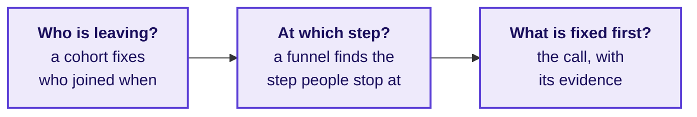

The day climbs these three questions twice: first on a gym and a college, invented so every number can be counted by hand, then on Zomato Gold in Chennai, an illustrative case, and in the lab on Kalpa Retail's Retail-Plus tier.

```notes
LIVE, 1 minute. Read the topic as the curriculum words it, then the three questions. Say once,
in plain words, the shape of the day: five topics first on examples small enough to count by hand,
then the same topics on a real company's synthetic data, then Kalpa in the lab.
Transition: where Thursday sits in the week.
```

---

## S2. The week map, Thursday lit
*Where does today sit, and what did the days before it find?*

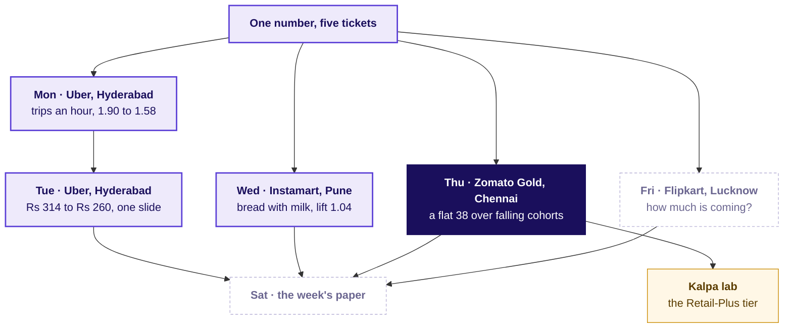

```notes
LIVE, 1 minute. Monday asked whether the number paid for measures what is wanted, Tuesday put
one denominator on one slide, Wednesday judged a pair against chance. Thursday judges a cohort
against the blend. Friday stays dashed. The explorer's home screen draws the same map (day
control: Thu).
Transition: the day's five topics.
```

---

## S3. Five topics, each with its chapter and notebook
*Which topics does Thursday teach, in which chapter, for how long, and with which notebook?*

| # | The topic, as the curriculum words it | Taught in | Minutes | Notebook | Applied in |
|---|---|---|---|---|---|
| 1 | Cohort construction | SECTION 1 | 25 | 01 cohort construction | SECTIONs 5 and 6 |
| 2 | Funnel stages, drop-off, denominators | SECTION 4 | 25 | 04 funnel denominators | SECTION 7 |
| 3 | Retention curves: shape and floor | SECTION 2 | 15 | 02 retention curves | SECTION 6 |
| 4 | Blended numbers against cohort truth | SECTION 3 | 20 | 03 blended vs cohort truth | SECTION 6 |
| 5 | The fix-first decision and its evidence | SECTION 8, after lunch | 10 | 08 fix first evidence | SECTION 9 and the lab |

The chapters run 1, 3, 4, 2, 5: topics 1, 3 and 4 share one invented gym and one table read three ways, topic 2 brings an invented college, and topic 5 opens the afternoon right before the call that uses it.

```notes
LIVE, 3 minutes. Read the five topics in the curriculum's words, top to bottom, then the order
they are taught in and why: the three retention topics build one table once and read it three
ways, the funnel is a second picture and a second example, and the decision is a pattern, so it
sits right before the Zomato Gold call that applies it. A trainer matching the row to the deck
reads this table: every topic has its chapter, its minutes and its notebook.
Transition: how the five connect.
```

---

## S4. How the five topics connect, and where they go
*What does each topic rest on from earlier weeks, what does it feed, and where is it used?*

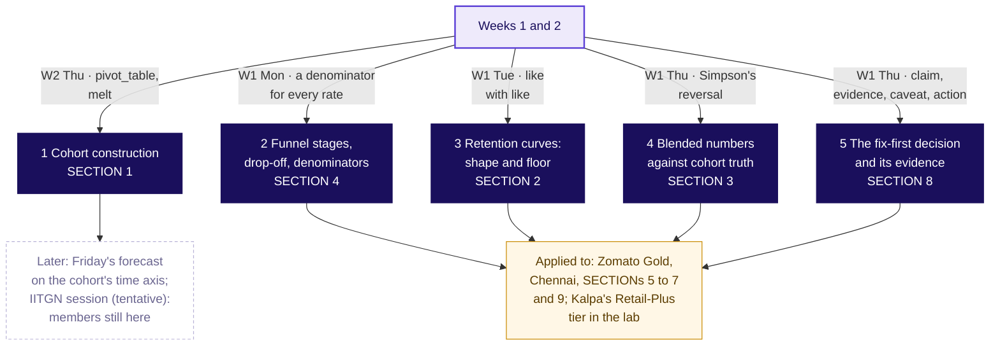

```notes
LIVE, 3 minutes. Walk the map in words a newcomer can repeat: a cohort fixes who joined when (1),
so one cohort's share month by month is a curve whose shape and floor can be read (3); one number
over all cohorts is a weighted blend, which a growing young cohort can hold flat while every
cohort falls (4); a funnel is the other picture, a chain of steps where each rate divides by the
step before in one unit (2); the fix-first call takes the cohort and the step and carries its
evidence (5). Weeks 1 and 2 gave the pieces: the denominator habit, the segment reversal,
pivot_table. Each chapter's last slide lights its own node on a map like this one.
Transition: the case these topics are used on.
```

---

## S5. The ticket: a flat 38 and a release on Android
*Where will the five topics be used, and what is due Friday?*

| Measure | Value |
|---|---|
| Month-two retention on the dashboard, June to September 2026 | 38 percent each month |
| Month one (the first full month after joining), by signup month, January to August | 58, 56, 55, 53, 52, 50, 49, 31 percent |
| The August cohort, grown by a sale week | 13,000 members, 2.6 times the 5,000 a month of January to July |
| Members on Android, add-to-cart to order, before and after 14 September | 58 to 44 percent |
| Members on iOS; non-members on Android | 57 to 56 percent; 52 to 51 percent |
| Search to menu view and menu view to add-to-cart, per session, September | 118 percent; 34 percent |

**Gold** is the app's paid membership, with free delivery. **Month-two retention** is the dashboard's name for the share of members two or more months past their signup month who ordered in the month. **Data.** `members` (53,089 who joined January to September), `member_months` (orders per member per month, from the order records), `events` (one row for each stage an app session reached, a session being one visit to the app; August and September; with the platform and the checkout version, v1 or the new v2; Gold members and 4,000 non-members). **The ask, due Friday.** Cohort problem or everyone problem; which funnel stage owns the loss; what to fix first, with the evidence. **Known caveats.** The home carousel opens a menu without a search; sessions and members are different units; the August cohort was bought on a discount; the release renamed one Android event, which the app team has mapped.

**Illustrative case.** The company is real; the situation and the data are synthetic, built for this class.

```notes
Source for Gold's free delivery: Zomato's shareholder letter of 19 May 2023,
https://www.bseindia.com/xml-data/corpfiling/AttachHis/42b3bf3b-1edb-4da7-849a-87ca9da27ff8.pdf (checked 12 October 2026)
LIVE, 2 minutes. This slide is the destination, shown before the topics are taught. Say the label
line aloud first: the company is real, the situation and the data are synthetic. Read the ask,
then point at two numbers only: the flat 38 and the 58 to 44 on Android. Say that each of the five
topics will be needed to read this ticket, and that the full read opens the case in SECTION 5,
after the topics.
Transition: the first topic, cohort construction, on a gym.
```

---

## SECTION 1: Cohort construction: who joined when?
*Group people by the month they joined, count each group at each age since joining, and compare groups at the same age, on one gym branch's thirty joiners counted by hand.*

```notes
LIVE, 25 minutes. Laptops closed until the code glimpse; notebook 01 afterwards or in the lab.
Hand out: drill c1 with the rules slide; it runs on paper after S11, 4 minutes. If late: S12 in
one sentence, and drill c1 moves to the lab.
Styles: Veritasium (the owner's reading, then predict and vote), StatQuest (the count aloud,
one row at a time), 3Blue1Brown (the triangle, the formula named last), Krish Naik (one
pivot_table, line by line), ByteByteGo (the map node). The gym is invented; say so once.
Transition: the chapter's questions.
```

---

## S6. Cohort construction: four questions, one gym
*Who needs the answer, and which smaller questions lead to it?*

**Who needs the answer.** The owner of a neighbourhood gym (invented), who wants to know which month's joiners keep coming, so that a retention offer reaches the batch that needs it; read by calendar month, the offer goes to the wrong batch. A cohort is a batch, as a coaching centre runs a June batch and a July batch: everyone who joined in the same month.

**The questions on the way.** Four, and each is answered with a count before the next is asked.

```timeline
label: 1 | title: Which batch looks best in April? | body: The owner's reading, one calendar month
label: 2 | title: What does each batch keep at each age? | body: Thirty joiners counted by hand
label: 3 | title: Why is the table a triangle? | body: Rows by joining month, columns by age
label: 4 | title: How does code count the same table? | body: One pivot_table, month zero left out | tone: dark
```

```notes
LIVE, 2 minutes. Read the four questions; each is answered with a count before the next is asked.
The coaching-batch line is the only place the batches appear: a learner who has sat in a coaching
class already knows what a cohort is.
Transition: the owner's reading.
```

---

## S7. Predict: which batch keeps most in month one?
*In April the owner reads 5, 5 and 6 of 10 January, February and March joiners and calls March best. Counted by months since joining, which batch keeps the most in its own month one?*

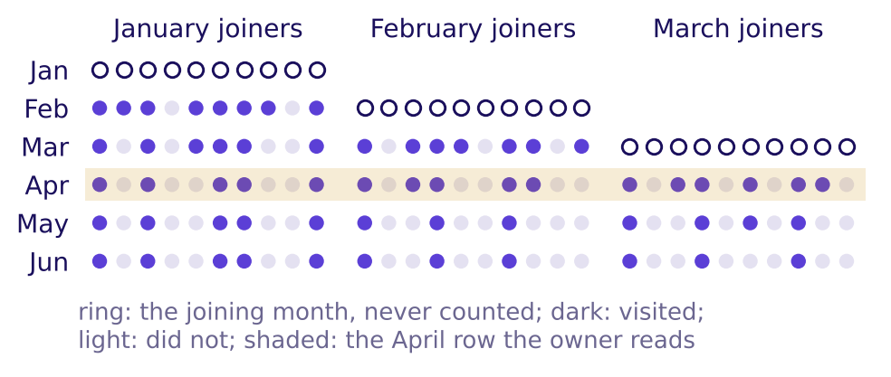

a) March, as the owner reads it

b) February

c) January

d) All three keep the same share

```notes
LIVE, 3 minutes. Month one is the first full month after joining; the joining month is month
zero, ringed on the picture. Vote first, in writing, then pairs argue for one minute and vote
again (peer instruction). Expect a from tables that trust the shaded April column.
Transition: the count, by hand.
```

---

## S8. Answer: January keeps 8 of 10, March 6 of 10
*What does each batch keep at each age, counted by hand?*

| Joined, 10 each (invented) | Age 1 | Age 2 | Age 3 | Age 4 | Age 5 |
|---|---|---|---|---|---|
| January | 8 | 6 | 5 | 5 | 5 |
| February | 7 | 5 | 3 | 3 | |
| March | 6 | 4 | 3 | | |

The answer is c. Age is the month minus the joining month, and the joining month is age zero, never counted, so a January joiner's age one is February. At age one the batches keep 8, 7 and 6 of 10: March, best in April, is the weakest at the same age. April's column mixed January at age three, February at age two and March at age one, so its 16 of 30 names no batch.

```notes
LIVE, 5 minutes. Count January's row aloud from the register: down the February column for the
ten January joiners (8), then March (6), then April, May and June (5 each). Then February's row
from March on, then March's from April on. Build the table on the board as it is counted. Say the
word cohort only now: a cohort is everyone who joined in the same month, and the table has one
row per cohort and one column per age.
Transition: the table as a picture.
```

---

## S9. The cohort table is a triangle
*Why does each row stop where it does, and what does one cell mean?*

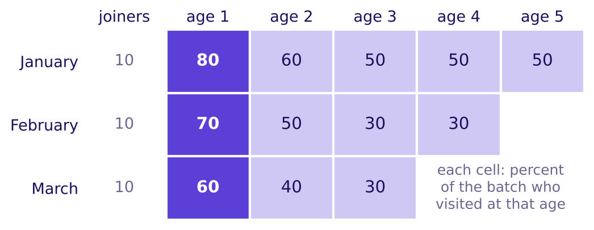

Each row is a cohort, everyone who joined in one month, and each column is an age. By June, March's joiners have lived only three ages, so their row is short, and a newer cohort's row is always shorter: that is why a cohort table is a triangle. **Named last, the formula:** retention of cohort c at age k = members of c who visited at age k ÷ the members of c. January at age two: 6 ÷ 10 = 60 percent.

```notes
LIVE, 3 minutes. Point at one cell and say its sentence: of the ten who joined in January, six
visited in their second month after joining. Point at the empty corner: those months have not
happened yet for the later batches. Then the formula, last, as the shorthand for the sentence.
Transition: the same table in code.
```

---

## S10. One pivot_table builds the same triangle
*How does pandas count the triangle from the register?*

```python
PLACE = {"jan": 0, "feb": 1, "mar": 2, "apr": 3, "may": 4, "jun": 5}
long = roster.melt(id_vars=["member_id", "joined"], var_name="month",
                   value_name="visited").dropna()               # one row per member per month
long["age"] = long["month"].map(PLACE) - long["joined"].map(PLACE)   # joining month = age 0
tri = long[long["age"] >= 1].pivot_table(index="joined", columns="age",
                                         values="visited", aggfunc="mean")
```

This is Week 2 Thursday's `pivot_table` with one new line: `age >= 1` keeps month zero out of the table. Each cell is the mean of ones and zeros, which is the share who visited, so the code prints 0.8, 0.6, 0.5, 0.5, 0.5 for January, the row counted by hand.

```notes
LIVE, 3 minutes. Read the code a line at a time: melt makes one row per member per month (the
shape called panel data), the age line subtracts two places in the year, the filter drops month
zero, and pivot_table puts cohorts on the rows and ages on the columns. Ask what the table would
show without the filter: a column of 100 percent at age zero, since everyone visits the month
they join. Notebook 01 runs the cell and checks the code against the hand count.
Transition: the rules.
```

---

## S11. Four rules for building a cohort table
*What does an analyst do every time a retention table is built, and what does an interviewer listen for?*

1. A cohort is everyone who joined in the same month, and a member keeps her cohort for good.
2. The joining month is age zero and is never counted; age one is the first full month after it.
3. Every cell divides by the whole cohort, never by the members who visited the month before.
4. Cohorts are compared at the same age, since one calendar month mixes ages and names no cohort.

**In the interview.** [S] "Retention dropped; walk me through your investigation." A strong first move: "I'd confirm what the number counts and that the count is right, then fix each member's joining month and compare cohorts at the same age before I read any blended number." The tag says how often it is asked: [S] a staple everywhere, [F] frequent in GCC (global capability centre) and product screens, [D] a question that sets a candidate apart.

```notes
LIVE, 3 minutes. Read the four rules; learners photograph this slide. One learner says the
interview line aloud in under twenty seconds. Then drill c1 on paper, 4 minutes: three items on
the gym, letters posted before S12.
Transition: where this topic goes next.
```

---

## S12. Cohort construction feeds three later chapters
*Where does this topic come from, and which chapters use it next?*

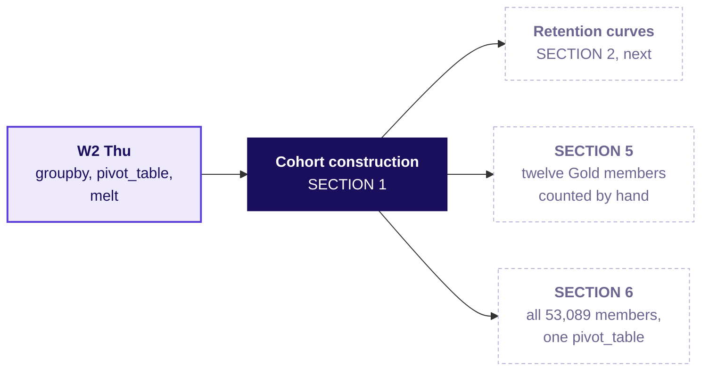

**Where it shows up.** Swiggy Instamart publishes its cohorts as this same triangle, each cohort's spend set against one cohort's spend in its first quarter, and the table states no denominator (Swiggy's Q2 FY26 shareholder letter, checked 12 October 2026). Before trusting any cohort chart, ask per what.

```notes
Source:
https://www.swiggy.com/corporate/wp-content/uploads/2025/10/Q2-FY2026-Shareholder-letter.pdf (checked 12 October 2026)
LIVE, 2 minutes. Light the node on the concept map. Swiggy's table is the same shape as the gym's,
with spend in place of visits: per user who joined, or per user who stayed? The denominator
decides what the chart says.
Transition: the next topic, the rows read as curves.
```

---

## SECTION 2: Retention curves: shape and floor: where is the floor?
*Read one cohort's row as a curve: how fast it falls in its first months, and the level it stops falling at, on the same gym's three batches.*

```notes
LIVE, 15 minutes. Laptops closed; notebook 02 afterwards. Hand out: drill c2, on paper after S18,
3 minutes. If late: S16's table in one sentence, and drill c2 moves to the lab. Styles: Veritasium (predict January's
age five), 3Blue1Brown (the three curves, then the words shape and floor), StatQuest (churn on
ten members), the case method (Blinkit's own retention figure).
Transition: the chapter's questions.
```

---

## S13. Retention curves: four questions, one gym
*Who needs the answer, and which smaller questions lead to it?*

**Who needs the answer.** The gym's owner, who staffs the floor for the regulars: the level a batch stops falling at says how many joiners became regulars, and a level read too early staffs for members who are about to leave.

**The questions on the way.** Four, each read off the gym's three batches.

```timeline
label: 1 | title: How fast does a batch fall? | body: The curve's shape in its first ages
label: 2 | title: Where does it stop falling? | body: The floor, and churn beside it
label: 3 | title: When can a floor be called? | body: Two ages that read the same
label: 4 | title: Which batch is strongest, fairly? | body: The same age for all three | tone: dark
```

```notes
LIVE, 1 minute. The table from SECTION 1 is unchanged; this chapter reads its rows.
Transition: the prediction.
```

---

## S14. Predict: what does January read at age five?
*January's ten joiners read 80, 60 and then 50 percent at ages one to three. What do they read at age five?*

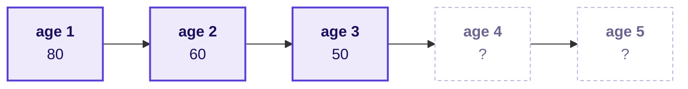

a) About 25 percent, the fall carrying on

b) 50 percent

c) Under 10 percent

d) Back up to 80 percent

```notes
LIVE, 2 minutes. Vote. Most of the room extends the line: a and c. A learner who says b, ask why;
the reason should be that the members still coming by age three are the ones who stay.
Transition: the three curves.
```

---

## S15. Answer: January holds at 50 from age three
*What do the three batches' curves look like, and where does each stop falling?*

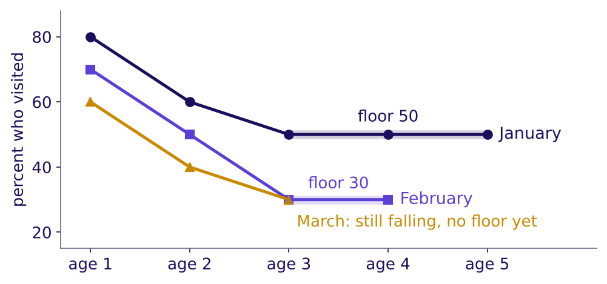

The answer is b: 80, 60, 50, 50, 50. A curve's **shape** is how fast it falls in its first ages: January fell 20 points from age one to age two, then 10, then none. Its **floor** is the level where it stops falling: January's is 50, the five of ten who made visiting a habit, and February's is 30. March reads 60, 40, 30 and is still falling, so its floor is not known yet.

```notes
LIVE, 2 minutes. Trace January with a finger: steep, then flat. A point is the gap between two
percentages, so 80 to 60 is a fall of 20 points. Then February's floor and March's open end.
Transition: churn, the same row counted as losses.
```

---

## S16. Churn is the share lost, counted two ways
*What share of January's joiners has stopped by each age, and what share of last month's visitors stopped?*

| January's ten joiners (invented) | Age 1 | Age 2 | Age 3 | Age 4 | Age 5 |
|---|---|---|---|---|---|
| Still visiting, percent of 10 | 80 | 60 | 50 | 50 | 50 |
| Churned so far, percent of 10 | 20 | 40 | 50 | 50 | 50 |
| Stopped since the month before, percent | 20 | 25 | 16.7 | 0 | 0 |

**Named last.** In this branch nobody who stopped came back, which is what lets both counts work. Churn so far is 100 less the retention. Month-to-month churn divides those who stopped by those still visiting the month before: 2 of 8 at age two, 25 percent. Where members do come back, a team first picks when a member counts as gone, for example 60 days with no visit, and labels that a choice. A chart that prints a churn number says which of the two it is.

```notes
LIVE, 2 minutes. In this branch no member came back after stopping, so the members visiting at
each age are the ones who were still visiting the age before, which is what lets the third row
divide by last month's visitors. Ask which row the owner should print on a wall chart; either,
with its name.
Transition: when can a floor be called?
```

---

## S17. A floor needs two ages that agree
*February read 50 at age two; why was that not its floor, and how does code test for one?*

**What breaks.** After February's age two, 5 of 10, the owner staffed for a floor of five regulars. Ages three and four read 3 of 10, so the plan counted two regulars too many.

**The rule we use, this programme's own.** Call a floor only when two ages in a row read within a point of each other; until then the curve is still falling. A batch of ten moves in steps of ten points, so on the gym that means two equal ages.

```python
def floor_of(row, within=0.01):          # row: shares at ages 1, 2, 3, ...
    pairs = zip(row, row[1:])
    near = (b for a, b in pairs if abs(a - b) <= within)
    return next(near, None)              # None: still falling
# floor_of([0.8, 0.6, 0.5, 0.5, 0.5]) gives 0.5; floor_of([0.6, 0.4, 0.3]) gives None
```

```notes
LIVE, 3 minutes. The two-ages rule, within a point, is this programme's rule of thumb, so say it
as ours; exact equality never fires on a large cohort's shares, which is why the code allows a
point. A floor
read from one age is the plausible wrong answer: it looks settled after a big drop. March's row
returns None: a young cohort has not lived enough ages to show a floor, which is the plain-words
version of what the IITGN block (tentative) calls censoring.
Transition: the rules.
```

---

## S18. Four rules for reading a retention curve
*What does an analyst read off every retention curve, and what does an interviewer listen for?*

1. A retention curve is one cohort's row of the table, drawn by age.
2. The shape says how fast a cohort leaves; the floor says how many stay where members who stop never return, and otherwise the share active in a typical month.
3. Cohorts are ranked at the same age, never by the latest calendar month.
4. A young cohort has no floor yet, since it has not lived the ages that would show one.

**In the interview.** [F] "How would you use cohort analysis to find a retention issue?" Read each cohort's shape and floor, rank cohorts at the same age, and look for the cohort whose curve starts lower or never flattens.

Blinkit, Eternal's quick-commerce app: in the fourth quarter after joining, 46 percent of a cohort's customers still ordered, on average, and the cohort's order value was 150 percent of its first quarter's (Eternal's Q1 FY27 letter of 22 July 2026, checked 12 October 2026). The customers who stay carry the business: fewer of them, each spending more.

```notes
Sources:
https://www.eternal.com/blog/q1fy27/ (checked 12 October 2026), which links the letter itself:
https://drive.google.com/file/d/1jb9KWd4Ap4RTKHFHxzEOO7jgQqVZEGcd/view (checked 12 October 2026)
LIVE, 1 minute. Read the rules. Blinkit's two numbers measure different things: 46 is a share of
the cohort's customers and 150 compares the cohort's order value with its first quarter's. Then
drill c2 on paper, 3 minutes, letters posted before S19.
Transition: where this topic goes next.
```

---

## S19. The floor feeds the blend and the case
*Where does this topic come from, and which chapters use it next?*

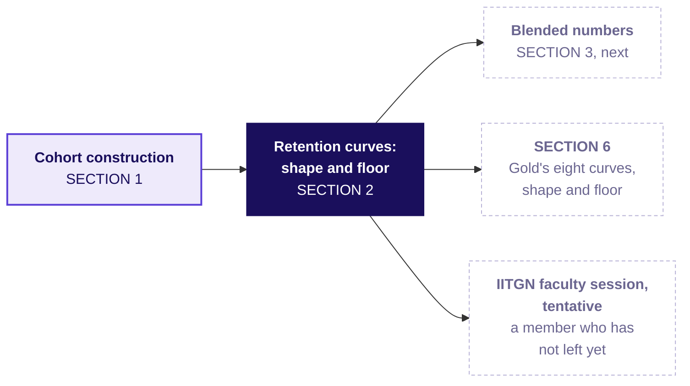

Rank at the same age, read the floor only once two ages agree within a point (our rule), and leave a young cohort's floor open.

```notes
LIVE, 1 minute. Light the node. The IITGN faculty session this afternoon is tentative; name it
only as the place where a member who has not left yet gets a name.
Transition: the next topic, one number over every cohort.
```

---

## SECTION 3: Blended numbers against cohort truth: what is a blend made of?
*Rebuild one number over all members as an average weighted by cohort size, and see how a large new cohort holds it flat while the older members fall, on the whole gym's dashboard.*

```notes
LIVE, 20 minutes. Laptops closed until the code; notebook 03 afterwards. Hand out: drill c3, on
paper after S25, 3 minutes. If late: S26's origin in one sentence, and drill c3 moves to the lab.
Styles: Veritasium (the
room predicts what a big new cohort does to the dashboard), 3Blue1Brown (the stacked bars, the
formula named last), StatQuest (the weighted average on two numbers), ByteByteGo (the Week 1
Thursday link). Explorer scene Th2 lets a learner slide the new cohort's size; it draws the
same 100 and 400 as the neighbourhood gym's older members and January joiners.
Transition: the chapter's questions.
```

---

## S20. Blended numbers: four questions, one dashboard
*Who needs the answer, and which smaller questions lead to it?*

**Who needs the answer.** The gym's owner, who reads one dashboard number each month, the share of members who visited; a flat number read as "nothing changed" leaves a falling cohort with no action.

**The questions on the way.** Four, from the dashboard's one number down to the cohorts under it.

```timeline
label: 1 | title: What does February's dashboard read? | body: 100 older members and 400 January joiners
label: 2 | title: What are the cohorts doing under it? | body: Each cohort's own rate
label: 3 | title: What is the dashboard's number made of? | body: An average weighted by size
label: 4 | title: Which quick average is wrong? | body: The plain mean of the rates | tone: dark
```

```notes
LIVE, 1 minute. The dashboard is the whole gym's, all branches; the branch's thirty joiners from
SECTION 1 are part of the January, February and March joiners.
Transition: the prediction.
```

---

## S21. Predict: what does February's dashboard read?
*The dashboard counts a member from the month after she joins. January read 50 of 100 older members, 50 percent. In February the older members fall to 40 of 100, and the 400 January joiners, in their month one, visit at 52.5 percent. What does February read?*

| The gym's dashboard (invented) | January | February |
|---|---|---|
| Older members, joined before 2026 | 50 of 100 | 40 of 100 |
| January joiners | their joining month, not counted | 210 of 400 |

a) It falls, because the older members fell

b) It rises, because 400 members joined

c) It holds at 50 percent

d) It cannot be read without more months

```notes
LIVE, 3 minutes. Vote, argue, vote again. Most of the room says a: when a group falls, the average
falls with it. Hold the reveal until every table has committed.
Transition: the reveal.
```

---

## S22. Answer: 250 of 500, 50 percent, unmoved
*How can the dashboard stand still while the older members fall ten points?*

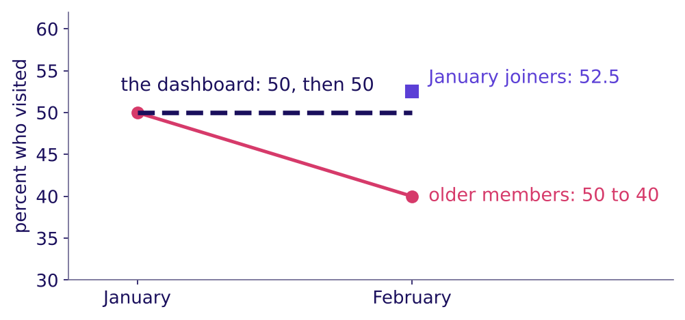

The answer is c. February counts 40 older members plus 210 January joiners who visited: 250 of 500, 50 percent, the same as January's 50 of 100. The older members fell ten points, from 50 to 40 percent, and the one number over everyone did not move, because 400 joiners at their high early rate now carry four votes in five.

```notes
LIVE, 3 minutes. Point at the dashed line, then the falling line under it. Next month the
January joiners age too, and unless another large batch joins, the dashboard starts to fall.
Transition: what the 50 is made of.
```

---

## S23. A blend is an average weighted by size
*What is February's 50 made of, cohort by cohort?*

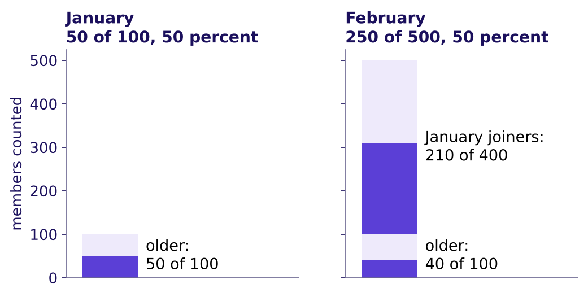

**Named last, the formula:** blend = sum of (cohort size × cohort rate) ÷ sum of cohort sizes = (100 × 0.40 + 400 × 0.525) ÷ 500 = (40 + 210) ÷ 500 = 50 percent. Rebuilt from its cohorts, the blend lands on the direct count, 250 of 500; a rebuild that misses the count has left a cohort out or counted one twice.

```notes
LIVE, 3 minutes. Read the two stacks, then the formula last, as the shorthand for what the bars
already showed. The weighted average and the direct count are the same number by arithmetic, so
the rebuild is a check on the cohorts, not on the formula.
Transition: the quick average that gets it wrong.
```

---

## S24. The plain mean of the rates is the wrong number
*Why is 46.25 percent wrong, and how does code catch it?*

**What breaks.** Averaging the two rates, (40 + 52.5) ÷ 2 = 46.25 percent, gives 100 older members the same vote as 400 joiners. It is neither the count, 50 percent, nor the older members' own 40, and a report of "46.25 percent, down 3.75 points" describes no group in the gym.

```python
feb = dash[(dash["example"] == "gym") & (dash["month"] == "2026-02")]
rate = feb["visited"] / feb["members"]
direct = feb["visited"].sum() / feb["members"].sum()                  # 250 / 500 = 0.50
weighted = (feb["members"] * rate).sum() / feb["members"].sum()      # equals direct
plain = rate.mean()                                                  # 0.4625, one vote each
```

```notes
LIVE, 3 minutes. The check that catches it: the weighted average must equal the direct count, and
the plain mean does not. The plain mean matches the blend only when the cohorts are the same size
or read the same rate. Notebook 03 asserts both lines.
Transition: the rules.
```

---

## S25. Four rules for a blended number
*What does an analyst do before believing one number over many cohorts?*

1. A number over several cohorts is their average weighted by cohort size.
2. It moves when the mix of young and old cohorts moves, as well as when behaviour does.
3. Rebuild it from its cohorts, and check the rebuild equals the direct count, before believing it.
4. A plain mean of cohort rates gives each cohort one vote, so it matches the blend only when the cohorts are the same size or read the same rate.

**In the interview.** [F] "Blended retention is flat while every cohort declines; how?" A mix shift: a growing young cohort at its high early rate carries more weight each month, so the average holds while each cohort falls; read the cohorts at the same age.

Swiggy: users who ordered at least once a month rose 27.4 percent in a year while orders per user fell from 4.13 to 3.87, about 6.3 percent (Swiggy's Q1 FY27 letter, checked 12 October 2026; the 6.3 is our arithmetic). One blended number cannot say whether existing users ordered less or new users ordered little.

```notes
Source:
https://nsearchives.nseindia.com/corporate/SWIGGY_30072026154100_Covering_Letter_Letter_to_Shareholders_-_signed.pdf (checked 12 October 2026)
LIVE, 2 minutes. Read the rules, then Swiggy's two numbers: more users, fewer orders each, and a
blend that cannot say which group moved. Then drill c3 on paper, 3 minutes, letters posted before
S26.
Transition: where this topic comes from.
```

---

## S26. The blend uses Week 1 Thursday's arithmetic
*Where does this topic come from, and which chapters use it next?*

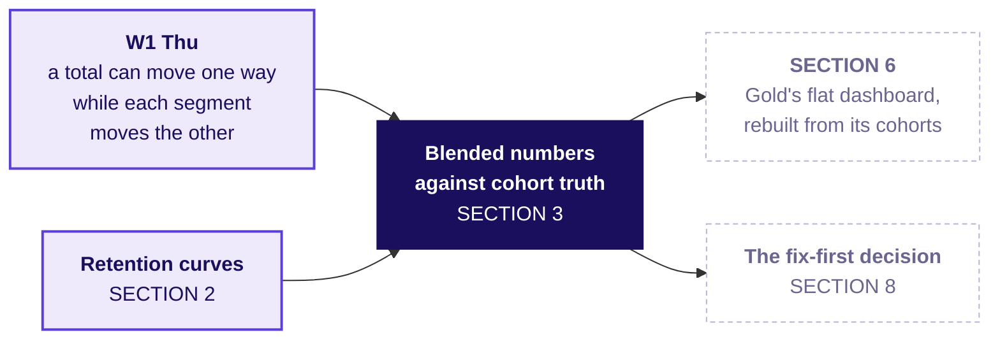

A total that runs against its parts is called Simpson's paradox, after E. H. Simpson's 1951 paper in the Journal of the Royal Statistical Society. A flat blend over falling cohorts uses the same arithmetic, a weighted average whose weights moved; nothing reverses here, so it is called a mix effect.

```notes
Source: the paper's Crossref record, https://doi.org/10.1111/j.2517-6161.1951.tb00088.x (checked 13 October 2026).
LIVE, 2 minutes. Say the Week 1 Thursday link in one sentence and let the room name the reversal
it met then; do not restate that week's numbers. Light the node.
Transition: the next topic, the funnel, on a college.
```

---

## SECTION 4: Funnel stages, drop-off, denominators: which step owns a loss?
*Divide each step by the step before in one named unit, find the step that moved against its own past, and tell a real loss from a step people can skip, on one college's admissions.*

```notes
LIVE, 25 minutes. Laptops closed until the code; notebook 04 afterwards. Hand out: drill c4, on
paper after S33, 4 minutes. If late: S32's code read and not run, and drill c4 moves to the lab.
Styles: Brilliant (the
two cycles shown before any rate is named), Veritasium (predict the losing step), StatQuest (each
step over the step before, by hand), the case method (a sister programme's 107 percent).
Transition: the chapter's questions.
```

---

## S27. The funnel: four questions, one college
*Who needs the answer, and which smaller questions lead to it?*

**Who needs the answer.** The dean of a college (invented), who has one admissions team for one fix this year: a step blamed because it is low sends the team to a step that works. A funnel is a chain of steps people pass through, fewer at each, as every learner here passed through one to be admitted: applied, sat a test, shortlisted, accepted an offer, joined.

**The questions on the way.** Four, each answered on the college's own counts.

```timeline
label: 1 | title: Which step owns this cycle's loss? | body: Two cycles side by side
label: 2 | title: What does each step read? | body: Step rate, drop-off, overall
label: 3 | title: Why does one step pass 100 percent? | body: A step people can skip
label: 4 | title: Per application or per applicant? | body: The unit, named | tone: dark
```

```notes
LIVE, 1 minute. Every learner has been through an admissions funnel; ask nobody to share theirs.
Transition: the two cycles.
```

---

## S28. Predict: which step owns this cycle's loss?
*Last cycle against this one, at an invented college: which step owns the loss?*

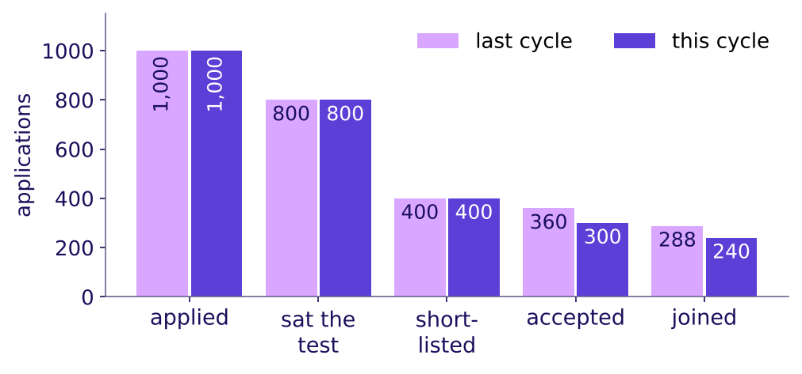

a) Shortlisting, the lowest step at 50 percent

b) Offer acceptance, at 75 percent this cycle

c) Joining, at 80 percent

d) The test, which 200 applications never sit

```notes
LIVE, 3 minutes. Brilliant's move: the numbers before the explanation. Vote, argue, vote. Expect
a from most of the room: the lowest step looks like the loss.
Transition: the step that moved.
```

---

## S29. Answer: offer acceptance, the step that moved
*Which step changed against its own past, and which only looks low?*

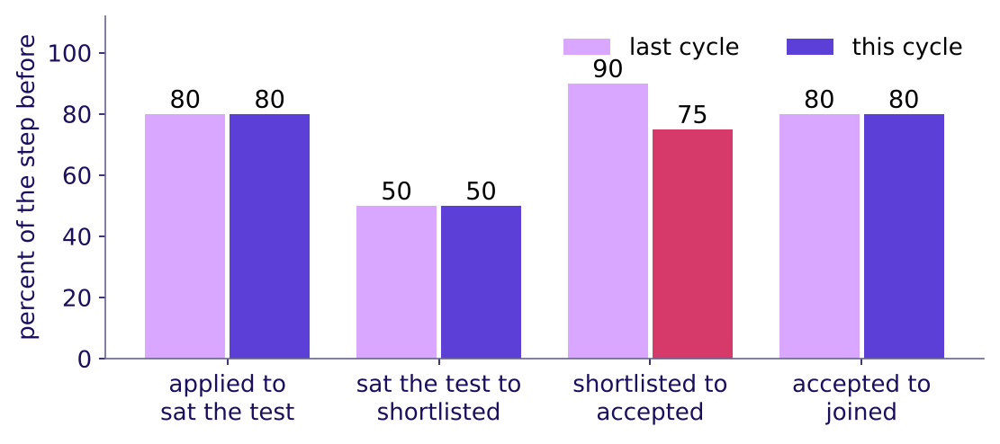

The answer is b. Offer acceptance fell from 90 to 75 percent of those shortlisted, and every other step read the same in both cycles. Shortlisting reads 50 percent because the college selects half by design, and it did not move: when the overall falls, the step that moved against its own past owns the fall, and a low, steady step is how the process runs.

```notes
LIVE, 3 minutes. Point at the one pair of bars that differs. Then at shortlisting: low, and the
same both cycles. A committee sent to redesign shortlisting would work on a step that works.
Transition: each step by hand.
```

---

## S30. Step rate, drop-off and overall, by hand
*What does each step read this cycle, and how do the steps make the overall?*

| This cycle (invented) | Applied | Sat the test | Shortlisted | Accepted | Joined |
|---|---|---|---|---|---|
| Applications | 1,000 | 800 | 400 | 300 | 240 |
| Step rate, percent of the step before | | 80 | 50 | 75 | 80 |
| Drop-off, percent | | 20 | 50 | 25 | 20 |

**Named last.** Step rate = those who reached a step ÷ those who reached the step before, in one unit. Drop-off = 100 less the step rate. Overall conversion = the last step ÷ the first: 240 ÷ 1,000 = 24 percent this cycle against 28.8 last cycle, and the step rates multiply to it, 0.80 × 0.50 × 0.75 × 0.80 = 0.24.

```notes
LIVE, 4 minutes. Divide aloud, step by step: 800 of 1,000, 400 of 800, 300 of 400, 240 of 300.
Then the overall, then the product. The definitions are the ones analytics tools print as step
conversion, funnel conversion from the first step, and drop-off.
Transition: a step that reads above 100 percent.
```

---

## S31. A step above 100 percent is one people skip
*Why does the sister programme's test to shortlist read 107 percent, and what does it really read?*

| The sister programme, this cycle (invented) | Applications |
|---|---|
| Applied | 1,000 |
| Sat the optional test | 300 |
| Shortlisted | 320: 230 who sat the test, 90 on school results alone |

**What breaks.** "Test to shortlist reads 107 percent, our best step": 320 ÷ 300 puts 90 students who never sat the test over the test-takers. A rate above 100 says the numerator holds people the denominator never had: here, students who skipped the test; elsewhere, a double count, two units or two time windows. The 107 is an **artefact**, a number made by the way the count is taken. **The fix.** Count the shortlist among those who sat the test: 230 ÷ 300 = 77 percent.

```notes
LIVE, 4 minutes. The test team's question is "how often does sitting our test lead to a
shortlist?", and only 77 answers it. Shortlisted over applications, 32 percent, and test-takers
over applications, 30 percent, are true numbers that answer other questions.
Transition: the unit.
```

---

## S32. The unit: per application or per applicant
*What does the same funnel read counted in people, and how does code read every step?*

This cycle's 1,000 applications came from 900 applicants, since some applied in two rounds. The same 240 joiners are 24 percent of applications and 26.7 percent of applicants. Each applicant joins at most once, so the overall reads higher per person; a middle step can move either way, so its direction is read from the data, and a chart names its unit.

```python
STAGES = ["applied", "sat_test", "shortlisted", "accepted", "joined"]
this = adm.query("programme == 'main' and cycle == 2026 and group == 'all'")
for unit, c in this.groupby("unit"):
    c = c.set_index("stage")["count"].reindex(STAGES)
    print(unit, (c / c.shift()).round(3).tolist()[1:], round(c.iloc[-1] / c.iloc[0], 3))
```

```notes
LIVE, 3 minutes. The loop prints each unit's step rates (each count over the one before, which is
what shift does) and its overall. In this college's data every step reads at least as high per
applicant; that is this data's pattern, and only the overall is sure to, since each applicant joins
once. Notebook 04 draws both.
Transition: the rules.
```

---

## S33. Four rules for reading a funnel
*What does an analyst check at every step, and what does an interviewer listen for?*

1. Each step divides by the step before, in one named unit, and drop-off is 100 less that rate.
2. The overall rate divides the last step by the first, and where each stage is a subset of the one before, the step rates multiply to it.
3. When the overall falls, the step that moved against its own past owns the fall; a low, steady step is how the process runs, and where to invest is a separate question.
4. A rate above 100 percent means the numerator holds people the denominator never had: a skipped step, a double count, or mixed units or windows; count only those who passed the step before.

**In the interview.** [S] "Checkout conversion fell this month; how do you find where?" Check the count first, then read each step over the step before in one named unit against its own past, split by platform, group and date, and name the step that moved beside a step that held.

```notes
LIVE, 2 minutes. Read the rules; the last two are the traps the case meets on its event log. Then
drill c4 on paper, 4 minutes, letters posted before S34.
Transition: where this topic goes next.
```

---

## S34. The funnel feeds the case's order flow
*Where does this topic come from, and which chapters use it next?*

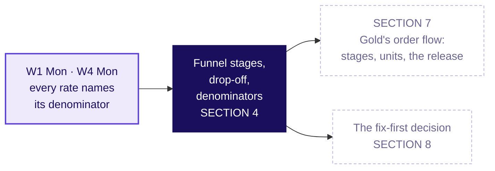

Four of the five topics are now on the map; SECTIONs 5 to 7 apply them to Zomato Gold in Chennai, and the fifth opens the afternoon.

```notes
LIVE, 1 minute. Light the node. Break follows: 10 minutes, the seam between the topics and the
case. If the room needs the break earlier, it falls after SECTION 3.
Transition: after the break, the case opens on the ticket read in full.
```

---

## SECTION 5: Cohort construction on twelve Gold members: who entered when?
*The ticket read in full, the causes listed before any data, and twelve members of the case counted by hand by age, as SECTION 1 counted the gym.*

```notes
LIVE, 15 minutes. Laptops closed; the twelve-row card is on every table. Hand out: the hypothesis
board template at S38, the card and the guided set at S39. If late: S37 is read without discussion. Styles: the case method
(the hypothesis board), StatQuest (the twelve counted aloud), Veritasium (two predictions).
Notebook 05 reproduces every count.
Transition: the chapter's questions.
```

---

## S35. Twelve members: the board, then the card
*Who needs the answer, and which smaller questions lead to it?*

**Who needs the answer.** The membership lead, who must say on Friday whether Gold has a cohort problem or an everyone problem. A wrong call sends the fix to the wrong team.

Applies: Cohort construction (SECTION 1).

```timeline
label: 1 | title: Which topic does each ticket line need? | body: The ticket read in full
label: 2 | title: Which causes could explain it? | body: Five causes, each with its test
label: 3 | title: What does each group keep, month by month? | body: Twelve members of the case data, by age
label: 4 | title: What does the dashboard count? | body: The same twelve, the dashboard's way | tone: dark
```

```notes
LIVE, 1 minute. Read the four questions; each is answered before the next is asked.
Transition: the ticket, read in full.
```

---

## S36. The ticket read in full: each line and its topic
*Which of the five topics does each line of the ticket need, and where is it answered?*

| The ticket says | The topic that reads it | Answered in |
|---|---|---|
| Month-two retention flat at 38 percent, June to September | Blended numbers against cohort truth | SECTION 6 |
| Month one 58, 56, 55, 53, 52, 50, 49, then 31 percent | Cohort construction; retention curves: shape and floor | SECTIONs 5 and 6 |
| Members' add-to-cart to order on Android, 58 to 44 percent after 14 September | Funnel stages, drop-off, denominators | SECTION 7 |
| Search to menu view 118 percent; menu view to add-to-cart 34 percent, per session | Funnel stages, drop-off, denominators | SECTION 7 |
| The ask: cohort or everyone, which stage, what first | The fix-first decision and its evidence | SECTIONs 8 and 9 |

```notes
LIVE, 2 minutes. Go back to the ticket's table (the slide after the concept map) if the room
wants it; this slide is the same ticket read line by line against the topics. Every line now has
a topic the room has met, except the last, which opens the afternoon.
Transition: where today ends.
```

---

## S37. Where today ends: one sentence with blanks
*What sentence will the membership lead carry out of the room?*

> "It is ______: a cohort problem, an everyone problem, or both. Retention: the dashboard starts counting at month ______, so it never sees ______, and it has not yet counted ______. Orders: members of every signup month on ______ lose orders at one step, ______, from ______. Fix ______ first; before buying another sale, work out ______."

**The words.** Month-two retention is the dashboard's name for the share of members two or more months past their signup month who ordered in the month; a member with no order in a month is not retained that month, and she is still a member. A cohort problem sits in some signup months; an everyone problem hits members of every signup month at once.

Each blank is filled in order: by hand on twelve members, on all 53,089, then on 1,386,235 app events, and SECTION 9 writes the sentence whole.

```notes
LIVE, 1 minute. Read it once with its blanks and move on; nothing to write yet. The room fills
each blank as the morning earns it; the filled sentence is in the case file.
Transition: the hypothesis board, before any data opens.
```

---

## S38. Five causes on the board, each with its test
*Before any chart, which causes could explain the ticket, and what would test each?*

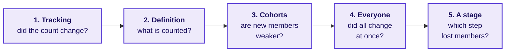

| Cause | The test that settles it |
|---|---|
| 1. Tracking | The orders counted a second way, in the order records, against the app's event log |
| 2. Definition | The dashboard's written rule: who is counted, from which month |
| 3. Cohorts | The cohort table, each signup month read at the same age |
| 4. Everyone | One calendar month read across every cohort: did all of them move at once, on one platform? |
| 5. A stage | Each step over the step before, by unit, platform and date |

```notes
LIVE, 3 minutes. The groups write their own ordered list first, with the test each cause needs,
on the hypothesis board template; then show this ladder. It runs in the order a careful analyst
checks: the count, the rule, the cohorts, everyone, then the stage. Rows 3 and 4 read the same table
two ways: cohorts compared at the same age for strength, one calendar month read across them for a
shock that hit everyone. Each chapter's reveal strikes or confirms a line; keep the board up all
morning.
Transition: the card.
```

---

## S39. The card: twelve members, four months
*Which of the twelve ordered in each month after joining?*

| Member | Joined | Channel | Jun | Jul | Aug | Sep |
|---|---|---|---|---|---|---|
| ZG20844 | May | organic | 1 | 1 | 1 | 1 |
| ZG21052 | May | organic | 1 | 1 | 0 | 0 |
| ZG22010 | May | organic | 1 | 0 | 0 | 0 |
| ZG22634 | May | organic | 0 | 0 | 0 | 0 |
| ZG25312 | Jun | organic | joined | 1 | 1 | 1 |
| ZG27475 | Jun | organic | joined | 1 | 0 | 0 |
| ZG28603 | Jun | organic | joined | 0 | 0 | 0 |
| ZG39559, ZG40539, ZG41000, ZG41529, ZG42328 | Aug | sale | | | joined | 0 each |

A 1 means she placed at least one order that month. **Month one** is the first full calendar month after joining, so May's is June and August's is September; the joining month is month zero and is never counted, as Cohort construction (SECTION 1) set out on the gym.

```notes
LIVE, 1 minute. Hand out the card if it is not on the tables, with the guided set
(exercises/guided, one row), whose two items are the rewrite below. Read one row aloud: ZG21052 joined
in May, ordered in June and July, then stopped. The last line holds the five sale-week members,
named one by one, none of whom ordered in September. Ask each table to rewrite the card by months
since joining, as they rewrote the gym's register, before the next slide.
Transition: the prediction.
```

---

## S40. Predict: which group keeps the most in month one?
*Counted by months since joining, which group keeps the largest share in its own month one?*

a) The four May members

b) The three June members

c) The five August sale-week members

d) All three keep the same share

```notes
LIVE, 1 minute. Vote. Expect some c from tables that read September's column, where August's
month one sits beside May's month four: the gym's April reading again.
Transition: the count.
```

---

## S41. Answer: May 3 of 4, June 2 of 3, sale 0 of 5
*What does each group keep at each age, and what does that show?*

| Joined | Month one | Month two | Month three | Month four |
|---|---|---|---|---|
| May (4) | 3 of 4 | 2 of 4 | 1 of 4 | 1 of 4 |
| June (3) | 2 of 3 | 1 of 3 | 1 of 3 | |
| August sale week (5) | 0 of 5 | | | |

The answer is a. Each group falls as it ages, and each later group starts lower: 75, 67 and then 0 percent in month one. Only read by age, as Cohort construction (SECTION 1) read the gym, can the three groups be compared at all. The twelve were picked to show the pattern on one card: on all 53,089, May's month one is 52 percent and June's 50.

```notes
LIVE, 2 minutes. Count May's row aloud: three ordered in month one, two in month two, one in three
and four. Then June's, then August's. In September the sale member's month one sits beside May's
month four, which is why the age column, not the calendar column, is the fair comparison.
Transition: what the dashboard does with the same card.
```

---

## S42. Predict: what does the dashboard's way read?
*The dashboard counts a member from her second month after joining. On the card, what does it read in August and September?*

a) A fall from August to September, because the sale-week members ordered so little

b) 2 of 7 in both months, with the five sale-week members outside the count

c) A rise, because new members joined

d) 2 of 12 in both months

```notes
LIVE, 1 minute. Remind the rule: in a reporting month, count every member two or more months past
her joining month, and ask what share ordered. Vote, argue, vote again.
Transition: the count, both ways.
```

---

## S43. Answer: 2 of 7 in August, 2 of 7 in September
*What does the card say counted the dashboard's way, and counted for everyone?*

| Reporting month | July | August | September |
|---|---|---|---|
| The dashboard's way: members two or more months past joining | 2 of 4 | 2 of 7 | 2 of 7 |
| Everyone who joined before the month | 4 of 7 | 2 of 7 | 2 of 12 |

The answer is b. The dashboard's way did not move from August to September, though five members joined in the sale week and none of them ordered: they are outside its count until October. Counted for everyone, September reads 2 of 12.

```notes
LIVE, 2 minutes. Ring the two 2-of-7 cells. Then the August column of the sale-week members: they
joined in August, so August is their month zero, and September is their month one, which the
dashboard skips. SECTION 6 finds the same two readings on all 53,089 members.
Transition: what the card showed.
```

---

## S44. What the card showed: fix the entry month
*What has the card answered, and what is still open?*

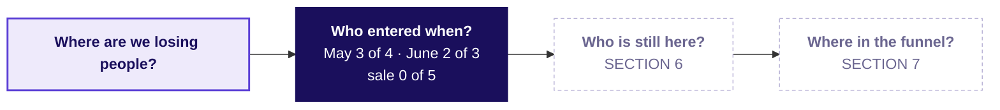

**The rule.** Before reading any retention number, ask which members it counts and from which month.

**In the interview.** [F], frequent in GCC (global capability centre) and product-company screens: blended retention is flat while every cohort declines; how? The mix, each cohort's share of the count, changes under the average.

```notes
LIVE, 1 minute. Read the board's first region; Q2 and Q3 stay dashed. Strike or confirm on the
hypothesis board: "a cohort problem" is now likely; the test was the card.
Transition: SECTION 6 and the full data.
```

---

## SECTION 6: Retention curves and blended numbers on 53,089 members: what is the 38 made of?
*Every cohort's curve on the full data, the dashboard's flat 38 rebuilt from its cohorts, and the cohort the count leaves out, as SECTIONs 2 and 3 read the gym.*

```notes
LIVE, 30 minutes. Laptops open; notebook 06. Hand out: reveal 1 at S47, reveal 2 at S53. If late:
D1 stays self-study. Styles: Krish Naik (one pivot_table, line by line),
Veritasium (three predictions), 3Blue1Brown (the triangle, the stacked count), StatQuest (the
weighted average on seven numbers). Explorer scene Th1.
Transition: the chapter's questions.
```

---

## S45. From twelve members to 53,089
*Who needs the answer, and which smaller questions lead to it?*

**Who needs the answer.** The membership lead, about to report "nothing changed" because the number is flat. If the flat number hides falling cohorts and a weak August cohort, the fix waits a month too long.

Applies: Cohort construction (SECTION 1); Retention curves: shape and floor (SECTION 2); Blended numbers against cohort truth (SECTION 3).

```timeline
label: 1 | title: What does each cohort keep, month by month? | body: One pivot_table on member_months
label: 2 | title: What does the dashboard print, and why does it hold? | body: June to September
label: 3 | title: What is September's 38 made of? | body: The weighted average, cohort by cohort
label: 4 | title: What is outside the count? | body: The August cohort | tone: dark
```

```notes
LIVE, 1 minute. Read the four questions. Say what SECTION 5 found, with its numbers, so the room
carries it in: each group fell with age, the sale-week members kept 0 of 5, and the dashboard's
way read 2 of 7 two months running.
Transition: the code that builds the table.
```

---

## S46. Predict: which way does each cohort's row run?
*Once age is computed, one pivot_table builds the table, as SECTION 1 built the gym's. After month one, which way does each row run?*

```python
# mm: member_months joined to members for cohort_month; active = orders > 0
# year x 12 + month is a running count, so 2026-09 minus 2026-07 is 2
month_n = mm["month"].str[:4].astype(int) * 12 + mm["month"].str[5:].astype(int)
cohort_n = mm["cohort_month"].str[:4].astype(int) * 12 + mm["cohort_month"].str[5:].astype(int)
mm["age"] = month_n - cohort_n          # month zero is the joining month
# active is True or False, so a cell's mean is a share
tri = mm[mm["age"] >= 1].pivot_table(index="cohort_month", columns="age",
                                     values="active", aggfunc="mean")
```

a) Up, as members settle into a habit

b) Flat, which is why the dashboard is flat

c) Down: a big step after month one, then a slow slide

d) Up, then down

```notes
LIVE, 3 minutes. Read the code a line at a time: each year-month as one count of months, age as
the gap between the two, then one pivot_table with cohorts on the rows and ages on the columns;
active (at least one order) was set when the table loaded, and each cell is a mean of True and
False, so it is a share. Vote before the cell runs.
Transition: the table.
```

---

## S47. Answer: every row falls, and each starts lower
*What does the full table show, cohort by cohort?*


The answer is c. Each cohort drops from its month one to about 38.5 percent in month two, then slides about 0.3 points a month. Read as in SECTION 2, that is a cliff after month one; ages two and three agree within a point, so by our rule each row old enough to show it reaches its floor at month two, and the floor then erodes slowly. What changes from cohort to cohort is month one: 58 percent for January down to 49 for July, and 31 for the 13,000-member August cohort. The dashboard starts at month two, so it never sees the weaker start.

```notes
LIVE, 4 minutes. Walk one row (January: 58, then 38.7 and down to 36.9 by month eight) and one
column (month one: 58 down to 49, then 31). By our rule, two ages within a point, January to
June each reach a floor at month two, which erodes about 0.3 points a month; July has not lived
month three. Members come back after a month with no order, so the floor is the share ordering in
a typical month, and the 38 who order are not always the same 38. If the room wants the motion, open
whiteboards/C2_W04_D04_cohort_fill_STUDENT.gif, which fills the triangle one month at a time with
the dashboard drawn beside it.
Transition: why the dashboard holds over the same months.
```

---

## S48. Predict: why does the dashboard hold near 38?
*Every cohort's row falls, yet month-two retention printed 38 percent from June to September. Which reason holds?*

a) Members who stopped ordering came back the next month, so the share held

b) After month two, rows slide 0.3 a month and each new cohort enters near 38.5

c) The dashboard averages the seven cohorts' rates without weighting by size

d) The 13,000-member August cohort, counted from September, holds the share up

```notes
LIVE, 2 minutes. Vote. The d voters are thinking about the August cohort, which the dashboard has
not counted yet; ask them to hold that thought for four slides. The a voters hold a true fact,
since members do come back, and the rows already count every returner.
Transition: the direct count.
```

---

## S49. Answer: a slow slide, refilled each month
*What does the dashboard print, counted directly, and what holds it near 38?*

```stats
value: 38.2 | label: June | note: 7,722 of 20,217 members
value: 38.0 | label: July | note: 9,558 of 25,122
value: 37.9 | label: August | note: 11,359 of 29,943
value: 37.8 | label: September | note: 13,218 of 35,000
```

The answer is b. After month two each row slides only about 0.3 points a month, and each month a new cohort enters the count near 38.5, which props September by about half a point: held to June's four cohorts, it reads 37.3. The weak starts sit in month one, which the dashboard never counts, since it counts every member aged two or more.

```notes
LIVE, 3 minutes. Read the four counts. Point at the denominators growing by about 5,000 a month:
one new cohort a month enters the count. The prop is real and small; the number looks flat mostly
because the slide is slow and the count starts at month two. Then say what the room is about to
be tempted to say.
Transition: the plausible wrong answer.
```

---

## S50. The wrong call: "38 and flat, nothing changed"
*What would a hurried analyst conclude from four flat months, and what would it cost?*

**What breaks.** "Month-two retention is 38 percent and flat, so nothing changed": the August cohort gets no action, and October's drop arrives as a surprise.

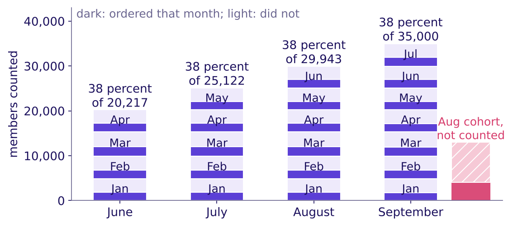

**Why it is wrong.** The 38 is a blend weighted by cohort size, as Blended numbers against cohort truth (SECTION 3) showed on the gym, and it counts a member only from her second month: each month a new cohort enters at the top while every older one shrinks, and the hatched August cohort is outside the count.

```notes
LIVE, 3 minutes. Read the wrong sentence exactly as a hurried analyst would say it. Ask for the
decision it would drive. Point at September's stack: seven cohorts, January at the bottom, July at
the top, then the hatched bar beside it: 13,000 members the dashboard does not count yet. The
check, taking the number apart, runs in the notebook's empty your-turn cell before the next slide.
Transition: the second route.
```

---

## S51. Second route: 13,218 of 35,000, both ways
*Does September's 38, rebuilt as a weighted average of its cohorts, equal the direct count?*

| Cohort | Members | Ordered in September |
|---|---|---|
| January | 4,854 | 36.9 percent |
| February | 5,055 | 37.1 percent |
| March | 5,449 | 37.5 percent |
| April | 4,859 | 37.7 percent |
| May | 4,905 | 38.1 percent |
| June | 4,821 | 38.6 percent |
| July | 5,057 | 38.5 percent |

Sum of (members × rate) over the seven cohorts = 13,218 orderers; 13,218 / 35,000 = 37.8 percent, the same to the last digit as the direct count. The rates rise with youth, from January's 36.9 to June's 38.6 and July's 38.5, so the younger cohorts prop the average, by about half a point in September.

```notes
LIVE, 5 minutes. Have one table read its weighted average aloud; it must match 37.8. Unweighted,
the seven rates also average 37.8, because the seven cohorts are about the same size. Add the
13,000-member August cohort and the unweighted mean (36.9) drifts a point from the true 35.9: the
gym's plain mean of rates again, which is why weights matter when sizes differ.
Transition: what the count leaves out.
```

---

## S52. Predict: counting everyone, what is September?
*In September, 13,000 August members are in their month one and outside the dashboard. Counting everyone who joined before September, what does September read?*

a) Still 38 percent

b) About 36 percent

c) About 31 percent, August's rate

d) About 49 percent, the July cohort's month-one rate

```notes
LIVE, 2 minutes. Vote. Remind the August cohort's month one is 31 percent, below the 38.
Explorer scene Th1, which adds a "next month" button, once the vote is in: it asks where October
lands before S53 prints the estimate, and its reveal also gives this slide's answer.
Transition: the reveal.
```

---

## S53. Answer: 36 percent, and the sale week is the gap
*What does September read with the August cohort counted, and which of its members sit low?*

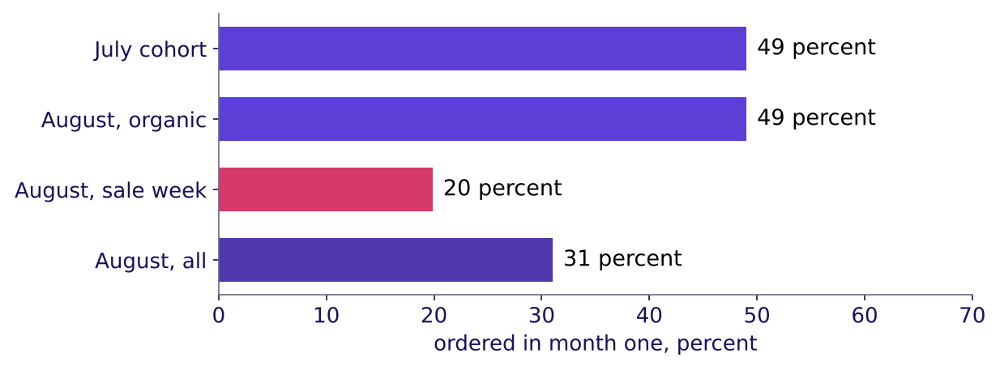

The answer is b: 17,248 of 48,000, 35.9 percent; the 5,089 who joined in September are in their month zero and in neither count. Counted this way, everyone who joined before the month, the four months read 40.9, 40.0, 39.5 and 35.9: the drop the dashboard hides. Split by how they joined, the 4,973 organic August members kept 49 percent in month one, July's rate; the 8,027 sale-week members kept 20. In October the August cohort enters the dashboard, which, on the assumption the next slide sets out, drops to about 33 percent.

```notes
LIVE, 5 minutes. Hand out reveal 2 now. Two readings of the same month differ only by who is counted. Then the split:
the problem is the sale week, not the month. The October estimate rests on an assumption, set out
on the self-study slide that follows; name it as one. Strike on the hypothesis board: a cohort
problem, confirmed; the cohort is the sale week's.
Transition: the chapter's close.
```

---

## D1. October's dashboard: about 33 percent, worked
*Why does the dashboard drop to about 33 in October, and what does that estimate assume?*

| Step | The working |
|---|---|
| The assumption | The August cohort loses the same 10.5 points from month one to month two that July's lost (49 to 38.5) |
| August at month two | 31 less 10.5 is about 20.5 percent |
| The older cohorts | Each slides one month further, about 0.3 points |
| October, counted the dashboard's way | About 33 percent, against the 38 printed since June |
| The range | 32 to 34 percent for an August month two anywhere from 17 to 24 percent |

The drop comes from who enters the count; no member has to change what she does in October for it to happen. The assumption is the weak point: the sale-week members may not lose the same 10.5 points as July's organic members, which is why the range is printed.

```notes
SELF-STUDY, notebook 06's October cell computes the same three numbers. Read it as an estimate with
its assumption named, never as a forecast.
Transition: the chapter's close.
```

---

## S54. Gold's 38 is a weighted average of falling cohorts
*What has the full table answered, and what is still open?*

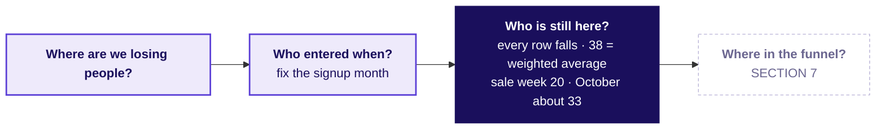

**The rule.** A flat retention number is a size-weighted average of cohorts at different ages; rebuild it from its cohorts, check the rebuild matches, and read what the count leaves out.

**In the interview.** [F] How would you use cohort analysis to find a retention issue? Fix the entry month, build the table, read rows for decay and columns for each cohort's start, then rebuild the blend from it.

```notes
LIVE, 2 minutes. The cohort axis, months since joining, is the time axis Friday's forecast runs on.
Transition: SECTION 7, the order flow.
```

---

## SECTION 7: Funnel stages, drop-off, denominators on the event log: which stage owns the loss?
*Gold's order flow read step over step in a named unit, the step that passes 100 percent, and the fall split by membership, platform and date, as SECTION 4 read the college.*

```notes
LIVE, 30 minutes. Notebook 07. Hand out: reveal 3 at S62. If late: S62's weekly picture described,
and S64's four self-study rows left to the notes. Styles: Brilliant (the five rates before any explanation),
Veritasium (three predictions), the case method (the app team's partly right chart), Krish Naik
(the release split built line by line). Explorer scene Th3.
Transition: the chapter's questions.
```

---

## S55. The funnel, its units and the release
*Who needs the answer, and which smaller questions lead to it?*

**Who needs the answer.** The membership lead and the app team's lead, who will say the stage the room blames is fine. Blaming the wrong step sends engineers to fix one that works.

Applies: Funnel stages, drop-off, denominators (SECTION 4).

```timeline
label: 1 | title: Which step owns the loss? | body: Five rates, before any split
label: 2 | title: Why does one step pass 100 percent? | body: A step members can skip
label: 3 | title: Per session or per member? | body: Two units, two questions
label: 4 | title: When did the Android rate break, and where? | body: Platform, membership, date, then the size
label: 5 | title: What can the data not show? | body: Seven doubts, each with its check | tone: dark
```

```notes
LIVE, 1 minute. Say what SECTION 6 found, with its numbers: 38 is a weighted average of falling
cohorts, and the sale-week members kept 20 percent in month one.
Transition: the five rates.
```

---

## S56. Question: which step owns the loss?
*September, Gold members, per session: open to search 68, search to menu view 118, menu view to cart 34, cart to checkout 80, checkout to order 64 percent. Which step owns the loss?*

a) Search to menu view, the one step above 100 percent

b) Menu view to add-to-cart, the lowest rate on the page

c) Open to search, the first step of every session

d) None yet: each must be split and set against its past

```notes
LIVE, 3 minutes. Brilliant's move: the numbers first. Vote, argue, vote. Expect b from part of
the room even after the college; the lowest rate still looks like the loss.
Transition: the answer.
```

---

## S57. Answer: no step owns it until it is split
*Which step owns the loss before any split by who, where and when?*

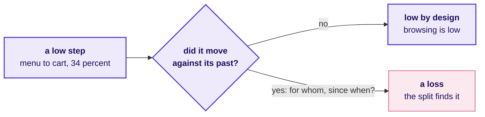

The answer is d. When the overall falls, the step that moved against its own past owns the fall, as Funnel stages, drop-off, denominators (SECTION 4) found on the college, where shortlisting read 50 percent in both cycles. Menu view to add-to-cart, at 34 percent, is the lowest step and may be low by design; search to menu view, at 118, is a step members can skip. The loss shows only once a step is split by membership, platform and date.

```notes
LIVE, 2 minutes. One line of recall, then straight to the data: the next slide takes the 118 apart.
Transition: the step above 100 percent.
```

---

## S58. 118 percent: the carousel skips search
*Why does search to menu view read 118 percent, and what does it really read?*

| September, member sessions | Count |
|---|---|
| Sessions with a search | 131,974 |
| Sessions with a menu view | 155,729 |
| Sessions with a menu view and no search: the home carousel | 38,932 |
| Sessions with a search and a menu view | 116,797, which is 89 percent of 131,974 |

**What breaks.** "Search to menu view is 118 percent, our best step." The home carousel opens a restaurant's menu without a search, so the ratio divides two counts of different sessions: search is a step members can skip, as the sister programme's optional test was in SECTION 4, and the 118 is an artefact, a number made by the way the count is taken. **The fix.** Count menu views only among sessions that searched: 89 percent.

```notes
LIVE, 5 minutes. The artefact: a rate above 100 percent says the numerator holds people who never
passed the denominator's step. Strike on the hypothesis board: the funnel's first steps are not
the loss.
Transition: the second unit.
```

---

## S59. Predict: per member, what does menu to cart read?
*Menu view to add-to-cart reads 34 percent per session. Counted per member, what does it read?*

a) The same, 34 percent

b) Lower, because members browse many times

c) Higher, because a member who browses five times and buys once counts once

d) Above 100 percent

```notes
LIVE, 2 minutes. Vote. Ask one table to explain its letter in a sentence; the college's applicants
are the clue.
Transition: the two units side by side.
```

---

## S60. Answer: 61 per member, 34 per session
*What does each unit answer, and which does the chart name?*


The answer is c. Per session asks how often a menu visit becomes a cart; per member asks how many members who browsed ever added to a cart that month. Neither is wrong, and a chart that does not name its unit invites the wrong one. Here every step except search to menu view reads higher per member, 118 to 101, since a member who fails in one session can succeed in another; a member who orders in many sessions can pull a per-member rate lower, so the direction is read from the data. This chart pools every platform and all of September, so neither panel shows the ticket's loss: the split by platform and date does.

```notes
LIVE, 3 minutes. Point at the same step in both panels: 34 and 61. Then at the 101: members skip
search in either unit, which is what makes the step pass 100.
Transition: the release.
```

---

## S61. Predict: when did members' Android rate break?
*Members' add-to-cart to order on Android read 58 percent from 1 August to 13 September and 44 from 14 to 30 September. Week by week, what does the line look like?*

a) A slow slide across August and September

b) Flat near 58 for seven weeks, then a break in the release week

c) A fall that started a week before the release

d) A dip in the release week that recovered by the month's end

```notes
LIVE, 2 minutes. Vote. The ticket gave the before and the after; the shape between them says
whether the release is the moment. The app team's lead will say the checkout works.
Transition: the split by membership, platform and date.
```

---

## S62. Answer: flat, then a break in the release week
*How does add-to-cart to order move by membership, platform and week?*

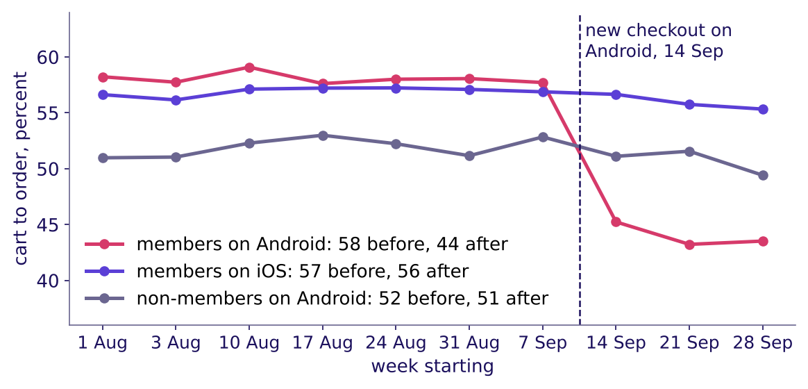

The answer is b. Members on Android: 58 to 44 percent, about 58 in each of the seven weeks before the release, then 45, 43 and 44. Members on iOS: 57 to 56. Non-members on Android: 52 to 51. Moving the cut a week either way keeps the fall, 58 to 47 with the cut on 7 September and 56 to 43 on 21 September, so the fall does not depend on where the line is drawn.

```notes
LIVE, 4 minutes. Read the three lines. The moved cut dates the fall; it does not test tracking,
since the rename shipped with the release and a logging fault would also start on 14 September.
The tracking test is on the doubts slide: the orders counted in member_months against the event
log. Every Android session from 14 September ran checkout v2, so the date and the version are one
split here.
Transition: which step inside the checkout.
```

---

## S63. The step that broke: checkout start to order
*Which of the two steps inside the checkout changed, and is the app team's chart wrong?*


Android members still start checkout from 80 percent of carts, before and after. Completing the order once checkout has started fell from 72.5 to 55 percent, and the two steps multiply to the ticket's numbers: 0.80 × 72.5 = 58, 0.80 × 55 = 44. On this same step, iOS members went from 71 to 70 and non-members on Android from 65 to 64. The app team's chart, carts that start checkout, reads 80 percent flat: true, and it measures the step that did not break.

```notes
LIVE, 5 minutes. The case method: the app team is partly right, so find the part. Concede that
checkout starts held; bring the split that shows completion fell, for members, on Android, from
the release. Only members on Android fell, so the place to look is something in the new flow that
members see. The 55 rests on 18,273 checkout starts, so chance moves it by under a point if sessions were
independent; sessions cluster within members, so the honest margin is somewhat wider and still far
smaller than the fall from 72.5 to 55. The non-members' comparator rests on 1,600, so "held" there means
within about 2.5 points. The
afternoon's role card replays this dispute.
Transition: the checks before the call.
```

---

## S64. Seven checks before the call
*What could still make the call wrong, and which check settles each?*

| Caveat | The check | What it found |
|---|---|---|
| Selection: the sale-week members were bought on a discount | The August cohort's organic members beside July's cohort | 49 against 49 percent; the sale-week members alone sit at 20 |
| Censoring: the newest cohorts have few months on record | Compare cohorts only at ages all have reached; an empty cell is a month not yet lived | Named here; the IITGN faculty session W4-3 (tentative) takes it up |
| Seasonality: exam months in a student-heavy zone (hypothetical) | September split by zone (notebook 06) | No zone more than 0.9 points from the city |
| Tracking: the release renamed an Android event | Orders in member_months, which event names do not touch, against the event log | The same 27,212 member orders in September: none went missing |
| Mix inside the split: the August cohort aged across 14 September | Members who joined before August, on the same step | Android 70.3 to 53.6; iOS 68.6 to 69.3 |
| Sessions against members | The unit named on every chart | 34 per session, 61 per member, both true |
| Joiners' orders rising after they join | Zomato Gold's frequency rose about 60 percent after joining | Members join when they expect to order more; the release split has a comparison, this has none |

Zomato's 60 percent comes from its shareholder letter of 19 May 2023 (checked 12 October 2026); it describes members, and says nothing about what Gold caused.

```notes
Source:
https://www.bseindia.com/xml-data/corpfiling/AttachHis/42b3bf3b-1edb-4da7-849a-87ca9da27ff8.pdf (checked 12 October 2026)
LIVE, 2 minutes. Read three rows aloud: tracking, the mix inside the split, and sessions against
members; the other four are for self-study and the notebook. Strike the last lines of the
hypothesis board: tracking is ruled out, the definition explained, a cohort problem confirmed,
and an everyone-on-Android problem in one step. Name censoring for the faculty block (tentative)
and park any "are these curves different by chance" question there. Explorer scene Th3 toggles the
carousel entries in and out, and its unit toggle sits beside the sessions-against-members row.
Transition: the chapter's close.
```

---

## S65. One step, one platform, one date
*Which stage owns the loss, for whom, since when, and how big is it?*

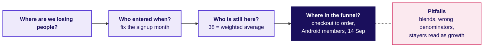

**The size.** 0.14 × 22,841 carts is about 3,198 orders in 17 days, 1,317 a week if none came back; counted in orders placed, 1,133 to 1,266 a week, about a quarter of the 5,064 orders a week Android members placed before the release. At Rs 300 to Rs 500 an order (an assumption), Rs 3.4 to 6.6 lakh of order value a week.

**The rule.** Name the unit, split by who, where and when, and find the step that changed before blaming the step that is low.

```notes
Source:
https://www.amplitude.com/blog/7-percent-retention-rule (checked 13 October 2026)
A "good" retention number needs its definition: Amplitude, a product-analytics vendor, says 7
percent of a cohort back on day seven puts a product in the top 25 percent for activation among the
more than 2,600 companies it studied, and its blog gives no method. Say so if the room asks for a
benchmark. The size's working: Android members placed 5,064 orders a week before the release and
4,138 after, down 18 percent, while iOS members' orders rose 7 percent and non-members' on Android
4 percent; held to either comparator's change, the loss is 1,266 or 1,133 orders a week.
LIVE, 1 minute. Say the morning's sentence: the dashboard was flat because of who it counts;
every cohort fell; one step, on one platform, after one date, drove the order loss. Board complete.
The afternoon opens on the fifth topic, then makes the call and reads the interview.
Transition: lunch.
```
