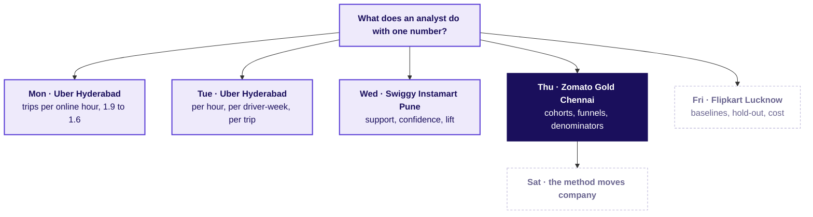
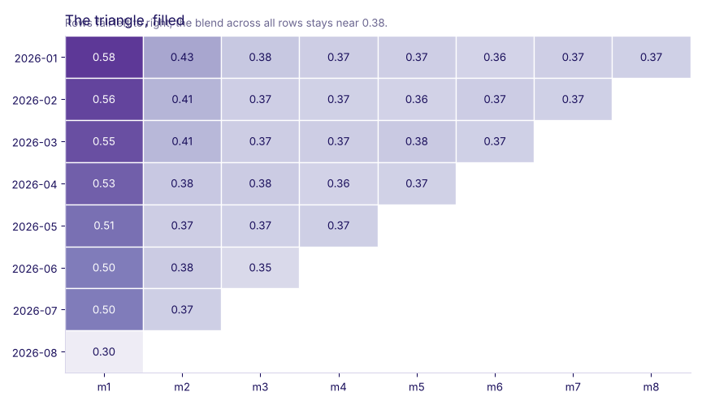

# Zomato Gold in Chennai: who is leaving, and at which step?

Week 4, Day 4. Morning.

Kicker: WEEK 4  ·  THURSDAY  ·  MORNING
Quote: Our dashboard says 38 percent retention and holds there. Every cohort chart I draw tells me the opposite. And the app team says their new checkout works. Which number should I believe?
Who: The head of Gold, Chennai, Zomato, to the analyst. Illustrative case: the company is real, the situation and the data are synthetic, built for this class.

```notes
LIVE, one minute. Read the ticket aloud and leave it up while the room settles. Say the label line
so no learner leaves thinking Zomato did this. The day climbs one case in three chapters: who
entered when, which stage owns the loss, and what fixes first. The twelve rows are the morning
anchor; the full data finishes each question a second way; the lab after lunch re-runs the method
on Kalpa.
```

---

## S1. The ticket, in the register the city desk uses
*What is on the table, with its numbers before and after and the data the analyst has?*

| Line | What it says |
|---|---|
| Company and surface | Zomato Gold, Chennai, the membership and the app's order flow |
| Metric | Blended retention, member-months active over members signed up before the reporting month |
| Before and after | Flat at 38 percent for June, July, August and September 2026 (reporting) |
| Cohort month-one, Jan to Aug | 58, 56, 55, 53, 52, 50, 49, 31 percent, falling each month |
| Checkout release | Monday 14 September 2026, Android, members' add-to-cart to order 58 to 44 |
| iOS and non-members, same window | iOS 57 to 56, non-members on Android 52 to 51 |
| Data in hand | members (60,000), member_months (one row per member per month), events (September in full) |
| The ask, due Friday | Is it a cohort problem or an everyone problem; which funnel stage owns the loss; what to fix first |

```notes
LIVE, 3 minutes. Each line of the ticket is a fact the deck tracks all morning. The eye should
catch the August 31: a cohort four times smaller than its neighbours could be ignored, a cohort
2.6 times bigger cannot. Then the thread.
```

---

## S2. The week map, Thursday lit
*Where today sits, and the four companies that came before and will come after.*



```notes
LIVE, one minute. Monday to Wednesday are complete and their numbers sit on the nodes. Today lights
Zomato Gold. Friday is Flipkart's forecast and stays dashed.
```

---

## S3. Three questions carry today, one chapter each
*Who entered when, which stage owns the loss, what gets fixed first?*

```timeline
label: Chapter 1 | title: Who entered when, and what happens to each group month by month? | body: Twelve members, three signup months, counted by hand. The paradox the dashboard misses.
label: Chapter 2 | title: What is every cohort's curve on 60,000 members, and what is the blend made of? | body: One pivot_table, every curve drawn, the blend decomposed into cohort sizes and rates.
label: Chapter 3 | title: Which stage owns the loss, on which denominator, and for whom? | body: The funnel in two units, the artefact above 100 percent, the release split by platform and date. | tone: dark
```

```notes
LIVE, 2 minutes. Three chapters, each one level up: L1 by hand, L2 on all 60,000, L3 the funnel.
Afternoon owns L4 to L6: the caveats, the fix-first call, and the transcript. Then the hypothesis
board opens before any data.
```

---

## S4. The hypothesis board, before any data opens
*Which cause does the blended-flat-while-cohorts-decline story point to?*

| Cause the room may list | Test that would settle it |
|---|---|
| A cohort problem: the sale cohort is dragging the average | Decompose the blend by cohort and look at the August row |
| An everyone problem: a product change hurt every active member | Look at every cohort's curve across the same calendar months |
| A tracking change: the dashboard measures a different thing | Compare pre and post the release, with the renamed events mapped |
| A funnel stage: one step shed users after a release | Build the funnel per stage, per platform, per date |
| A denominator artefact: the stage's unit changed | Count the stage per session and per member side by side |

```notes
LIVE, 4 minutes. The room writes its ordered list before any chart arrives, with the test each
cause needs. This is the Yammer habit from R1: start from a hypothesis and ask what would prove it
wrong. The reveals in chapters 1 to 3 strike or confirm each line.
```

---

## SECTION 1: Who entered when?
*The twelve members, counted by hand, before any curve on sixty thousand.*

---

## S5. Who entered when, and what happens month by month.
*What does the dashboard's 38 percent stand for, and what is in the twelve rows?*

**Who needs the answer.** The head of Gold, who signs the fix-first call.

**The questions on the way.** What is a cohort, how is retention counted per member, what does the blend average over.

```notes
LIVE, 3 minutes. Define cohort before counting: a cohort is the set of members whose membership
started in the same calendar month. Retention in month k means she placed at least one order in
the k-th calendar month after her signup month. The blend for a reporting month is the share of
members signed up before that month who placed at least one order in it. Then the toy.
```

---

## S6. Two coaching batches say what the blend forgets
*If one batch loses members and another loses more, what does the overall average do?*


Ten members join a coaching centre in June, ten in July. Six from June and four from July come back in month two. Each batch's month-two rate is a number (0.60 and 0.40). The overall rate, 10 of 20, is 0.50 and names neither.

```notes
LIVE, 3 minutes. Say the toy aloud with the picture. Draw out the point: averaging across batches
hides what each batch did. This is the shape the full data will carry at scale.
```

---

## S7. Question: predict the hand count
*The twelve members, three cohorts, each has an order flag per month since signup: May 3 of 4 in month one, June 2 of 3, August 2 of 5. September is month four for May, month three for June, month one for August. What is the overall share who placed an order in September?*

```stats
value: a) 3 of 12 | label: 25 percent | note: a plausible wrong number
value: b) 6 of 12 | label: 50 percent | note: a plausible wrong number
value: c) 9 of 12 | label: 75 percent | note: a plausible wrong number
```

Four of each option, letter it before the reveal.

```notes
LIVE, 3 minutes. Vote in pairs before the next slide shows the count. Expect a 25 answer from
anyone who conflates the m1 count with the September reading. The reveal is the next slide.
```

---

## S8. Answer: the twelve rows counted by hand
*How many of the twelve placed an order in September, cohort by cohort?*

| Cohort | Members | Month one | Month two | Month three | Month four (September) |
|---|---|---|---|---|---|
| May 2026 | 4 | 3 of 4 ordered | 2 of 4 | 1 of 4 | 2 of 4 |
| June 2026 | 3 | 2 of 3 | 1 of 3 | 2 of 3 (September) | not reached |
| August 2026 | 5 | 2 of 5 (September) | not reached | not reached | not reached |
| All twelve | 12 | | | | **6 of 12 = 0.50** |

The twelve-row blend for September is 6 of 12, 0.50. The dashboard's 38 percent is five points off even here, and the shape underneath is three cohorts moving at three different speeds.

```notes
LIVE, 5 minutes. Walk every row aloud. The point is that the hand count already shows the mix:
Augusts recent and low, Mays older and still returning. The 0.50 on twelve rows is the first
version of the September number; the next chapter does it on 60,000.
```

---

## S9. The dashboard versus every cohort's own curve
*What does the Chennai dashboard print, and what do the Monday-morning cohort rates say?*

| Reporting month | Dashboard says, blended | Each cohort's month-one, in order |
|---|---|---|
| June | 38 percent | Jan 58, Feb 56, Mar 55, Apr 53, May 52 |
| July | 38 percent | ...through June at 50 |
| August | 38 percent | ...through July at 49 |
| September | 38 percent | August cohort at 31, from the sale week |

The dashboard sits still across four reporting months. Every cohort row drops. Each new cohort's month-one is lower than the one before. The August cohort is 2.6 times a normal cohort and the worst.

```notes
LIVE, 3 minutes. The two columns look like different stories, which is the point. The dashboard
is right about what it computes; it is the wrong number to act on. Then why the dashboard looks
flat.
```

---

## S10. Why a blend can stand still while every batch shrinks
*What happens to the average when the mix tilts toward a bigger, younger batch?*


Last month, batch A had 100 members and 50 ordered: a 50 percent rate. This month batch A has fallen to 40 who ordered. A fresh batch B of 400 joins and 210 of them order: a 52.5 percent rate on batch B. The blend across 500 members is still 250 who ordered, 50 percent, while A has collapsed. Mix, not stability, holds the number.

```notes
LIVE, 5 minutes. Say the numbers out loud with the picture. The teaching move is StatQuest: tiny
numbers you can hold in your head, then the full data on the next chapter. Chapter 1 closes on
one claim: the dashboard's 38 is a mix, not a floor.
```

---

## SECTION 2: What is every cohort's curve?
*Sixty thousand members, nine cohorts, one picture side by side.*

---

## S11. One pivot_table turns member rows into the triangle
*How is retention measured per cohort, and what shape does the full triangle take?*

```python
triangle = (member_months
            .assign(k=lambda d: d["months_since_signup"])
            .query("k >= 1")
            .pivot_table(index="cohort_month",
                         columns="k",
                         values="orders",
                         aggfunc="mean"))
```

A cohort month on the row, a month-since-signup on the column, each cell the share of that cohort who ordered that many months later. The row drops left to right as members peel off; the column drops top to bottom because each later cohort starts lower.

```notes
LIVE, 3 minutes. Each cell is a mean of zero-or-one orders flags, so the value is a share. The
code is the full chapter in one call; the picture on the next slide shows what it draws.
```

---

## S12. The triangle, from the full sixty thousand
*What does every cohort's curve look like on all 60,000 members?*


Each row is a cohort, each column is months since signup. Every row falls across its observed ages. The August row is the lowest at month one and the biggest row behind it, which chapter 1 already named on the twelve rows.

```notes
LIVE, 4 minutes. Walk one row aloud: Jan at 58, drops to the floor by month four, floor near 37
across months 4 to 8. Walk one column: at month one, cohorts step from 58 down to 31. Then the
GIF, or still if the GIF cannot play: the triangle filling, the blend barely moving.
```

---

## S13. The triangle fills; the blend barely moves
*As each cohort row fills in, what does the overall average do?*



Each new cohort adds a row below. The dashboard's blended number sits near 0.38 across every reporting month, drifting only a few points even as the August cohort pulls it down in September. The flat line is the mix at work, not the cohorts holding steady.

```notes
LIVE, 2 minutes. The still frame is here on the deck; the fill GIF plays on the explorer scene
Th1 if the room wants the animation. Then the predict step before the decomposition.
```

---

## S14. Question: predict the September blend
*Jan 2026 at month 8, Feb at month 7, Mar at month 6, Apr at month 5, May at month 4, Jun at month 3, Jul at month 2 (five thousand each). August at month 1, with thirteen thousand members. The seven older cohorts retain near 0.37 at their ages. The August cohort retains at 0.31. What is the overall share?*

```stats
value: a) 0.42 | label: close to the June number | note: the dashboard's flat 38 bias
value: b) 0.35 | label: close to the computed value | note: the August cohort drags
value: c) 0.31 | label: equal to August alone | note: ignores every other cohort
```

Letter it in pairs, no calculator. Then the reveal.

```notes
LIVE, 3 minutes. Vote first. Then run the division on the board: 7 cohorts at 5,000 members at
average 0.37, plus one cohort at 13,000 members at 0.31. Total members 48,000. Total active about
7 x 5000 x 0.37 + 13000 x 0.31 which lands near 17,000. 17,000 of 48,000 is near 0.35. The
answer is b; the dashboard's 38 is close but is dragged under on September.
```

---

## S15. Answer: the blend decomposed, cohort by cohort
*What are the cohort sizes behind each reporting month, and what retention does each contribute?*


Each stacked column is a reporting month, every segment is a cohort coloured by its retention at that age, segment height equal to cohort size. The amber line is the blended rate on top. Flat line, falling cohorts: the mix prop that chapter 1 named with ten and ten.

```notes
LIVE, 4 minutes. The amber line is what the dashboard prints; the stack is what the room must act
on. Point at the August stack segment: biggest and lowest, and it is what pulls September down a
few points. Chapter 2 closes on the formula.
```

---

## S16. The formula, derived from the picture
*How does the blend relate to the cohort rates and their sizes?*

For a reporting month, the blended retention is the share of pre-signed members who placed an order. Split pre-signed into cohorts of size $N_c$ each with retention $r_c$ at its age for that month, and the formula drops out:

$$B = \frac{\sum_c N_c r_c}{\sum_c N_c}$$

A weighted average with the cohort size as the weight. A big young cohort with a low rate pulls the blend down; a stable older cohort at the floor holds it up. The dashboard shows $B$ and never the $r_c$ it is made of.

```notes
LIVE, 3 minutes. The equation is the StatQuest formula arriving last. The teaching rule from
3Blue1Brown holds here: the picture is the mechanism, the formula is the shorthand. Then
chapter 3's opening question.
```

---

## SECTION 3: Which stage owns the loss?
*Four stages, two units, one release split by platform and date.*

---

## S17. Question: which stage owns the loss on this app?
*Open to search is nearly complete, search to menu view sits above 100 percent, menu view to add-to-cart is low, add-to-cart to order is medium. Where does the drop that matters sit?*

```stats
value: a) search to menu view | label: it is above 100 percent | note: too wide, too artefact
value: b) menu view to add-to-cart | label: the biggest absolute fall | note: a plausible wrong
value: c) add-to-cart to order | label: smaller than add-to-cart | note: the number to size
value: d) cannot tell yet | label: not until units are named | note: the trained answer
```

Vote the letter, then listen for which denominator the room asks for before trusting a chart.

```notes
LIVE, 3 minutes. Expect b from pattern-matchers and c from last week's funnel practice. The
hire-grade answer is d: a rate above 100 percent means a sessions-over-sessions ratio where the
numerator entered through a different route, so the stage reads as an artefact until the unit is
named. Then the toy.
```

---

## S18. Answer: it depends on the unit the chart uses
*A hundred app visits, forty searches, twenty add-to-carts, ten checkouts: what do the per-stage rates say, and in which unit?*

| Step | Count | Per step before | Per total |
|---|---|---|---|
| Visit | 100 | not applicable | 100 percent |
| Search | 40 | 40 percent | 40 percent |
| Add to cart | 20 | 50 percent | 20 percent |
| Checkout | 10 | 50 percent | 10 percent |

The per-step rate (per the step before) says where the drop sits. The per-total rate says how deep the funnel is. Each step picks its own unit, which the chart must name.

```notes
LIVE, 3 minutes. The toy is R1's. Walk the two columns: per step before shows the fall, per total
shows the depth. Then the artefact: when a step counts from a different source, the ratio can
exceed 100 percent.
```

---

## S19. The denominator artefact: a rate above 100 percent
*Why does search to menu view read as 1.20 per session, and what does the number mean?*

The home carousel on the Zomato app opens a restaurant's menu without a search. For every ten sessions, roughly two go through the carousel and reach a menu directly; eight go through search and reach a menu. The denominator (search sessions) is smaller than the numerator (menu view sessions), so the ratio sits above one.

Reading this as a drop in search is wrong. The step is skippable, and the rate is a counting choice.

```notes
LIVE, 3 minutes. Pause here. Define the artefact carefully. A per-member funnel does not have
this problem, because a member who viewed a menu is counted once whether she searched or not. The
unit is the number, not an aside.
```

---

## S20. The funnel in two units, side by side
*What does the September funnel look like per session and per member?*


Per session, search to menu view is above 1.0; per member, every stage is well-behaved. Menu view to add-to-cart reads 0.42 per session and 0.58 per member. Add-to-cart sessions and add-to-cart members measure different things, and the chart names which it is drawing.

```notes
LIVE, 4 minutes. Point at the search-to-menu-view bar on the per-session chart. Point at the same
step on the per-member chart. Different unit, same room, same month: the only reading that acts
on the right thing is the one that names which unit the chart is in.
```

---

## S21. Question: predict what Android does after the release
*Before 14 September, Android members' add-to-cart to order sat at about 0.58. On Monday 14 September a new checkout flow shipped on Android only. Between then and the end of the month, what does that rate do, compared to iOS?*

```stats
value: a) stays flat on both | label: no release effect | note: the app team's claim
value: b) falls on Android, holds on iOS | label: the release regresses | note: the honest reveal
value: c) rises on both | label: a new flow helps everyone | note: nothing in the data says this
```

Vote the letter.

```notes
LIVE, 2 minutes. Expect a from anyone who trusts the app team's chart (overall conversion stays
flat because iOS and web prop it up). Then the reveal: the release split by platform.
```

---

## S22. Answer: the fall sits on Android, after the release
*How does add-to-cart to order move on Android, iOS and web, before and after 14 September?*


Android falls from 0.58 to 0.44 after 14 September. iOS stays within two points of its own baseline. Web is small and holds. The app team's overall-conversion chart was correct and useless, because the fall sits in one platform after one date.

```notes
LIVE, 4 minutes. Say the three lines aloud: Android down 14 points, iOS flat, web flat. The app
team is partly right that other platforms are fine; the question was about members on Android.
The dispute's answer is the split by platform and date, nothing less.
```

---

## S23. The chapter closes on stage, segment and date
*Which stage, for whom, since when, and how big is the gap in orders a week?*

| Field | Reading |
|---|---|
| Stage | Add-to-cart to order |
| Segment | Members, Android, from 14 September |
| Fall | 0.58 to 0.44, that is 14 points on a session base |
| Comparator | iOS members and non-members on Android: both flat |
| Size in orders a week | 14 points times the Android members' weekly add-to-cart sessions in September (facts file) |
| What stays open | The six caveats below, which L4 names one by one in half two |

The stage is one. The segment is one. The date is one. The fix-first call for the city head needs this three-line answer and no more.

```notes
LIVE, 3 minutes. This closes the morning. The afternoon owns L4 (the caveats), L5 (the fix-first
call and its cost), and L6 (the transcript and the AI variant). Pre-read for Friday is Flipkart
Lucknow; terms only (baseline, trend, seasonality, hold-out, error).
```

---

## S24. The morning in one sentence a city head repeats
*What does the chapter close on, and what does Friday's forecast lean on from today?*

The dashboard was flat because the mix shifted. Every cohort fell with age. One stage, on one platform, after one date, drove members' loss. That sentence replaces the dashboard reading.

Friday's forecast will lean on today's cohort table as a time axis; Week 5's target will be defined on this table.

```notes
LIVE, 2 minutes. Say the sentence twice. The afternoon reads the transcript in Aced's order and
closes on the fix-first call. Kahoot has the return question from Wednesday: lift 0.97 at
confidence 0.82; the verdict in one breath (the pair is a one-off, confidence is popularity).
```
