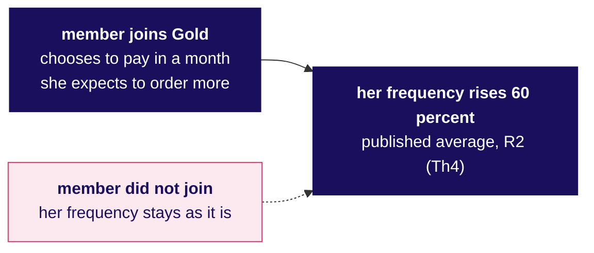
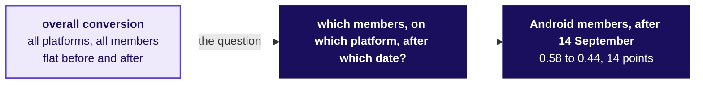
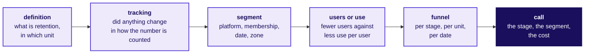

# What the data cannot show, what to fix first, and the interview walk

Week 4, Day 4. Afternoon.

Kicker: WEEK 4  ·  THURSDAY  ·  AFTERNOON
Quote: You have a stage, a segment and a date. Before you call the fix, name what the data cannot show. And then walk me through the investigation in the order a hiring screen expects.
Who: Kavya Nair, senior analyst, to the team's own analyst, and the hire-grade shape for the transcript that follows.

```notes
LIVE, one minute. The afternoon is 60 trainer minutes before the IITGN block (tentative) at W4-3,
or the weaned-users fallback if the block slips. Read the opening line and the thread: Trust, in
the specific sense of a flat number hiding a collapse.
```

---

## SECTION 4: What can the table not show?
*Six caveats the engineer must say aloud before any fix moves.*

---

## S1. Six caveats, each with the check that would settle it
*What might make the morning's call wrong, and how is each one tested?*

| Caveat | Why it matters | The check |
|---|---|---|
| Selection: the sale cohort was bought on a discount | A sale cohort may churn differently from an organic one | Place the August organic subcohort beside July's organic cohort at the same ages |
| Censoring: the latest cohorts are young | A member who has not left is not retained for ever | Named for W4-3; treat her as censored and read the curve with that in mind |
| Seasonality: exam months in student-heavy zones | A zone effect can masquerade as a cohort effect | Split by zone and look at IT-corridor and south against the city total |
| The tracking change: renamed events on Android | A redefined column shifts the number without changing behaviour | Use the app team's mapping; shift the release date a week either way; the fall holds |
| Sessions against members | The two units mean different things | Name the unit on every chart |
| Before-and-after is not cause | Something else may have changed in the same window | Note Zomato Gold's 60 percent frequency rise after joining (Th4) as the self-selection shape |

```notes
LIVE, 6 minutes. Walk every row aloud. The teaching move is Veritasium's: name the misconception
first, then the test. Trust the data less than the room thinks, and name what each caveat would
and would not change.
```

---

## S2. Zomato's own number: frequency rises after joining
*What does the published 60 percent frequency rise after joining Gold say, and what does it not?*



The published number is real and does not say Gold caused the rise. A member who joins is also a member who expected to order more that month. The matched comparison is to the member who did not join but could have, which is what L4 demands before any causal claim.

```notes
LIVE, 3 minutes. This is the self-selection caveat with its company fact. Say "before and after is
not cause" twice. The R2 citation is Zomato's shareholder letter, verified 12 October 2026. The
transcript in L6 will ask a shorter version of this question.
```

---

## SECTION 5: What is fixed first, and what does it cost?
*The three-line call, the dispute, and the sale cohort's accounting.*

---

## S3. The call: Android checkout, members, from 14 September
*Which stage, for whom, since when, and what does the room cost into the fix?*

**The call.** Fix the Android members' checkout flow that shipped on 14 September. Keep the sale-cohort action until L5's lifetime value number lands next week.

**The evidence.** Add-to-cart to order fell from 0.58 to 0.44 on Android. iOS stayed within two points, web was flat. The fall is one stage, one platform, after one date.

**The cost.** The gap times Android members' weekly add-to-cart sessions in September, from the facts file. The multiplier is an average order value with its range, labelled an assumption so Finance can reset it before the number ships.

```notes
LIVE, 4 minutes. State the call, the evidence and the cost in exactly this order. Lead with the
call, not the number: a city head wants the sentence first. The cost is a labelled number with
its assumption named, which is what L5 asks for in the hire-grade answer.
```

---

## S4. The app team's chart, answered on its own axes
*The app team shows overall conversion flat across all platforms. What does that chart leave out?*



The app team's chart is correct and useless. The right chart drops the three contrasts their chart averages over: platform, membership and date. Each one is in the data; the room draws it in one `groupby`.

```notes
LIVE, 3 minutes. The move is the case-method's: concede what is true (overall is flat), restate
what the question asked (members on Android after 14 September), and bring the chart that answers
the question asked. The response is a dispute answered, not a dispute won.
```

---

## S5. What the sale cohort cost, in orders not received
*How much of the September gap is the Android fall, and how much is the August cohort's own retention?*

The Android fall is 14 points on an add-to-cart base that the facts file sizes for September.
The August cohort's month-one retention is 31 percent against the organic cohorts' low 50s. On 13,000 members, each extra point of month-one retention is 130 members ordering in September. The two gaps sum to a weekly orders number the city head can hand to Finance.

The call keeps the stage as the fix-first; the sale-cohort decision waits for Week 5's lifetime value number, which decides whether the discount paid for itself.

```notes
LIVE, 3 minutes. Say the arithmetic aloud. The teaching move is Krish Naik's: compute the number
with the room, name what each assumption is, and name what makes it change. Lifetime value is
Week 5, not today.
```

---

## SECTION 6: The interview walk
*Retention dropped; walk me through it. And the AI-company variant.*

---

## S6. The transcript, in Aced's order
*Retention dropped. Walk me through your investigation. How does a hire-grade candidate open?*



| Beat | Weak answer | Hire-grade answer |
|---|---|---|
| Clarifying questions | None; starts naming causes | "Which cohort window, which segment, what is retention here defined as?" |
| First check | "The sale cohort is the cause" | "First the definition and the tracking: did either change?" |
| Second check | Jumps to a product change | "Then the segment cuts: platform, membership, date, zone" |
| Third check | Blames the funnel | "Fewer users or less use per user: separate before blaming either" |
| Fourth check | not reached | "Then the funnel per stage, per unit, per date" |
| Close | "The retention dropped" | "The call, the stage it is in, the evidence that rules out everything else, the cost in orders a week" |

```notes
LIVE, 5 minutes. Walk the two columns side by side. The hire-grade answer opens on method and
closes on a decision; the weak one opens on a cause and skips the method. The scorecard is in
trainer/C2_W04_D04_transcript_TRAINER (finishing session owns it).
```

---

## S7. The AI-company variant: novelty against habit
*How do you separate the launch-week bump from real retention when a new AI feature ships?*

| What arrives | What it looks like at first | What it looks like at week four |
|---|---|---|
| A launch-week cohort | Day-1 and day-2 reads look strong because the feature is new | Retention falls faster than organic cohorts' once novelty fades |
| An organic cohort | Day-1 and day-2 reads look normal | Retention curve follows the shape of earlier organic cohorts |
| A blended MAU reading | Climbs through the launch and holds | Hides the launch cohort's decay beneath the organic prop |

The call is to compare week-4 retention per cohort, never a blended MAU, when a launch is still inside the window. The structure is the same as Chennai's: a mix shift masks a drop.

```notes
LIVE, 4 minutes. This is the programme-written AI variant. It carries no company figure; it uses
the structure the day has already taught. The transfer from a membership app to an AI product is
the move the Saturday paper tests across companies.
```

---

## S8. Pain points, each anchored to a case
*Which pain points carry today's lesson into interviews?*

| Pain point | Case anchor |
|---|---|
| A blend cannot separate fewer users from less use per user | Swiggy's letter (Th3): MTU up 27.4 percent while platform frequency fell 6.3 percent |
| A cohort chart with a moving denominator | Swiggy Instamart (Th2): the triangle indexed to Q4 FY24; the denominator question |
| Before-and-after read as cause | Zomato (Th4): Gold frequency rose 60 percent after joining |
| A stage counted in sessions beside a stage counted in members | The case: search-to-menu-view at 1.20 per session, well-behaved per member |
| A universal "good retention" number | Amplitude (Th5): 7 percent day-7 cited as top quartile with a vendor caveat |

```notes
LIVE, 3 minutes. Pick one and tell its story: the Swiggy MTU-against-frequency split is clean,
quick and loud. The links are in the facts file and the study notes.
```

---

## S9. The handoff line to IITGN W4-3 (tentative)
*Where does the trainer stop, and what does the tentative faculty block pick up?*

**Handoff line.** Your cohort table treats a member who has not left yet as if she were retained for ever, and that flatters every curve. The next 120 minutes give that member a name, censored, and show when two retention curves really differ by more than chance.

The faculty block is W4-3 and is tentative until IIT Gandhinagar confirms it. The topic is survival curves, censoring and the log-rank; the fallback is the weaned-users hour on Swiggy's own triangle.

```notes
LIVE, 2 minutes. Say the handoff. If the block slips, pivot to the fallback: Swiggy's weaned
users, the row's monthly-against-weekly re-run, the Zomato frequency rise and the second
transcript. Trainer owns the choice when the day runs.
```

---

## S10. Kahoot: eight items, two returns
*What does the room still owe the day, and what did Wednesday leave open?*

| Item | What it asks | Where it points |
|---|---|---|
| Q1 | What a cohort fixes that a blended average cannot | The entry moment |
| Q2 | Read the funnel: which stage owns the loss | The stage, per unit, per date |
| Q3 (trap) | Blended retention flat, every cohort down: how | Mix shift and the weighted average |
| Q4 | The retention curve's floor means what | A steady state is a cohort's long-run share |
| Q5 | Which stage's drop is a denominator artefact | The one above 100 percent, or the one whose unit changed |
| Q6 (return) | Lift 0.97 at confidence 0.82: verdict in one breath | A one-off; confidence is popularity |
| Q7 | What does "members on Android after 14 September" rule out | Everyone else, so the comparator is iOS |
| Q8 | The AI variant: when does a blended MAU hide a launch cohort's decay | Inside the launch window, before week 4 |

```notes
LIVE, 10 minutes with Kahoot. The trap item (Q3) uses a blend other than 38 and never 41, so the
plant stays Kalpa's. The return question is from Wednesday, with the quick-breath verdict.
```

---

## S11. The day in one sentence, and tomorrow's pre-read
*What does Thursday close on, and what should Friday's room walk in holding?*

The dashboard was flat because the mix shifted. Every cohort fell with age. One stage, on one platform, after one date, drove members' loss. The call is a fix in one place and a cohort-level comparison the sale-week decision waits on.

Tomorrow is Flipkart's Lucknow fulfilment centre and the forecast that must beat a seasonal naive. Pre-read: the ticket's first lines and the terms baseline, trend, seasonality, hold-out, error.

```notes
LIVE, 2 minutes. Say the sentence. The pre-read ships tonight, terms only; no technique. The TA
lab after this block owns L1 to L3 on Kalpa's Retail-Plus, with the plant found in the lab's
empty your-turn cell.
```
