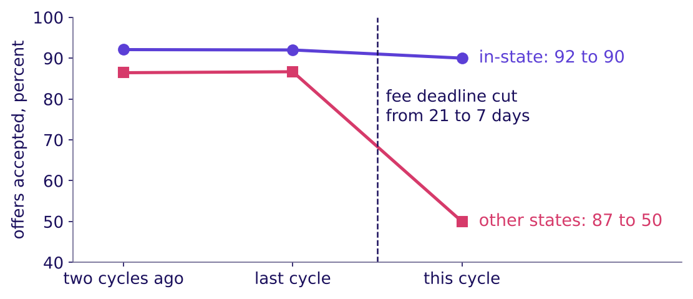
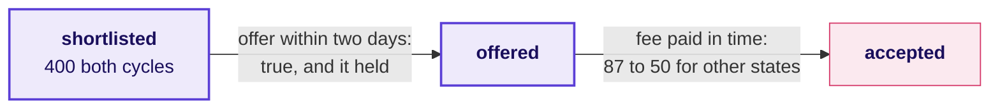
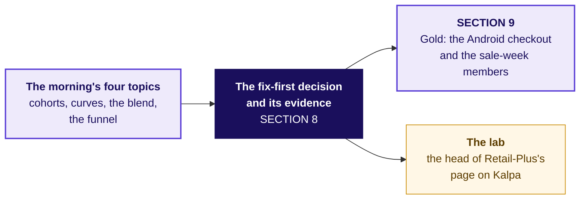
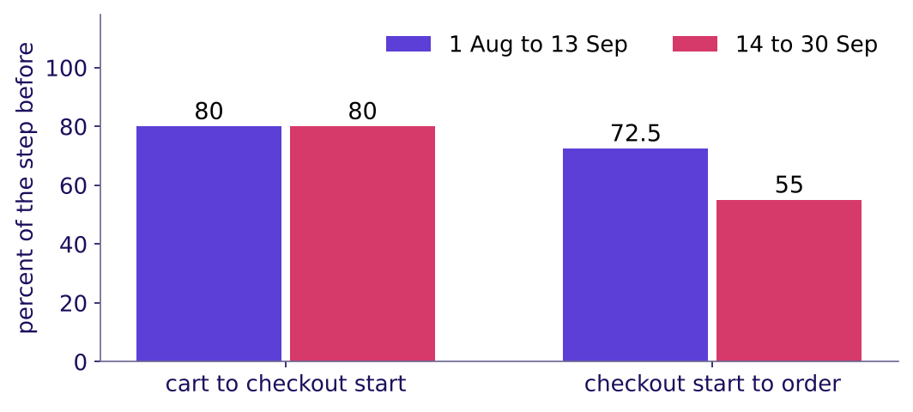
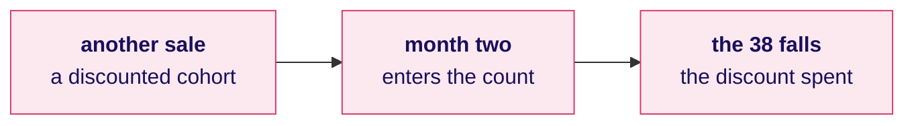
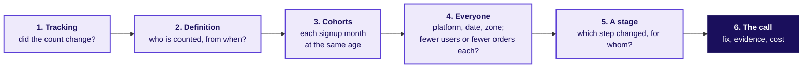
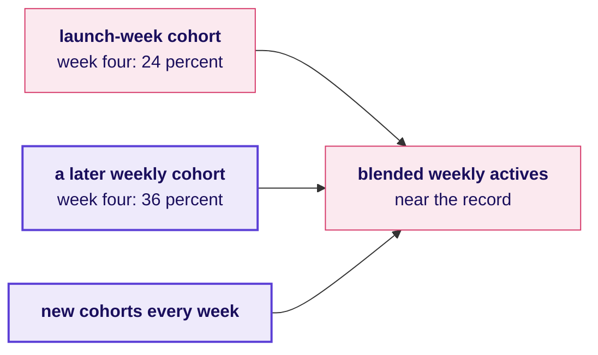

# What does Zomato Gold fix first, and how do you walk an interviewer through it?

Week 4, Day 4. Half two.

Header: WEEK 4  ·  DAY 4  ·  COHORT AND FUNNEL

## SECTION 8: The fix-first decision and its evidence: what does a call carry?
*When two problems compete for one team, choose the step that moved, show it with a comparator, a date and a cost, and concede the true part of the objection, on the same college's two problems.*

```notes
Sixty trainer minutes: the fifth topic on the college (10), the fix-first call on Zomato Gold,
unguided (25), the interview walk and the AI-company variant (10), the Kahoot and the close (15).
Then the IITGN faculty session W4-3 runs (tentative), or the weaned-users fallback if it slips.
LIVE, 10 minutes. Laptops closed; notebook 08 afterwards or in the lab; drill c5 runs in the lab.
If late: S70 in one sentence. Styles: Veritasium (the
bigger count against the step that moved), the case method (the admissions office's claim,
partly right), Feynman (the page in five plain lines).
Transition: the chapter's questions.
```

---

## S66. The fix-first decision: four questions, one dean
*Who needs the answer, and which smaller questions lead to it?*

**Who needs the answer.** The college's dean (invented), who has one admissions team for one fix before the next cycle; the wrong fix leaves the lost students lost for another year.

**The questions on the way.** Four, on the same college the funnel chapter counted.

```timeline
label: 1 | title: Which of two problems goes first? | body: The bigger count, or the step that moved
label: 2 | title: Whom does the loss hurt, since when? | body: The split by group and date
label: 3 | title: How big is it, and what does it cost? | body: Students and fees, with a range
label: 4 | title: What answers the objection? | body: The true part conceded first | tone: dark
```

```notes
LIVE, 1 minute. The college is the morning's, from SECTION 4: the same programme, the same two
cycles, plus the one before them.
Transition: the dean's two problems.
```

---

## S67. Predict: which problem does the dean fix first?
*The dean has two problems: 200 of 1,000 applications never sat the entrance test this cycle, the same 20 percent as every cycle, and offer acceptance fell from 90 to 75 percent (invented). Which goes first?*

| The college's two problems (invented) | Two cycles ago | Last cycle | This cycle |
|---|---|---|---|
| Applications that sat the test | 80 percent | 80 percent | 80 percent |
| Offers accepted | 90 percent | 90 percent | 75 percent |

a) Both at once, split across the team

b) The test's no-show, the bigger count at 200

c) Offer acceptance

d) Neither, until the next cycle confirms it

```notes
LIVE, 2 minutes. Vote. Expect b: 200 students sounds bigger than a fall of 15 points.
Transition: the split.
```

---

## S68. Answer: acceptance, for other-state students
*Which problem moved, for whom, and since when?*



The answer is c. The test's no-show has read 20 percent for three cycles, so it is how the test runs, and nothing changed there. Acceptance fell for one group: students from other states went from 87 to 50 percent, from the cycle the fee-payment deadline was cut from 21 to 7 days after the offer, while in-state students on the same step, who met the same shorter deadline, held at 92 to 90: the comparator places the fall in one group, and the date ties it to the change.

```notes
LIVE, 2 minutes. Three things turn a fall into a case: the group it hurts, the date it started,
and a comparator on the same step that held. Ask which of the three the dean would ask for first.
Transition: how big it is.
```

---

## S69. The size and the cost, with the assumption ranged
*How many students did the fall cost, and what are they worth?*

| This cycle against last cycle's rates (invented) | In-state | Other states | Together |
|---|---|---|---|
| Shortlisted, each offered a place | 250 | 150 | 400 |
| Expected to accept at last cycle's rates | 230 | 130 | 360 |
| Accepted | 225 | 75 | 300 |
| Fewer acceptances | 5 | 55 | 60 |

Since 80 percent of those who accept join, 60 fewer acceptances are 48 fewer students, and the joiners counted directly say the same: 288 last cycle, 240 this cycle. At a first-year fee of Rs 1 to 1.5 lakh, an assumption, that is Rs 48 to 72 lakh of first-year fees, Rs 57.6 lakh at Rs 1.2 lakh. The no-show, sized the same way: if half of the 200 sat the test and passed on at this cycle's rates, an assumption, about 30 more would join. That gain is worth planning for, and it is how the test has always run; the 48 is a loss that started this cycle.

```python
lost = shortlisted * accepted_last / shortlisted_last - accepted   # 230 - 225 = 5; 130 - 75 = 55
joiners_lost = lost.sum() * 0.8                                    # 48; 288 - 240 says the same
```

```notes
LIVE, 2 minutes. The cost is counted in joiners, since fees come from students who join; the
two routes to 48 must agree before the number goes on the page. The fee is an assumption with its
range, said as one.
Transition: the objection.
```

---

## S70. The objection: "our offers go out in two days"
*What is true in the admissions office's answer, and what answers the rest?*



**The claim.** "Our offers go out within two days of the shortlist, every one, so acceptance is not our problem." **What is true.** The offers held: every shortlisted student got an offer on time in both cycles. **What answers it.** The fall sits after the offer, in the days allowed to pay, for one group, from the cycle the deadline shrank. Concede the true part, then bring the split.

```notes
LIVE, 1 minute. Tuesday's four moves: restate, answer from the evidence, concede what is true,
say what would change your mind. A reply that calls the office wrong has lost the room.
Transition: the page.
```

---

## S71. The fix-first page: five lines, each with a number
*What does a call carry to survive the meeting, filled in for the dean?*

1. **The call.** Give other-state offers their 21-day fee deadline back in the next round, a cheap change that can be undone; the test's no-show waits, since it never moved.
2. **The evidence.** Offer acceptance fell from 90 to 75 percent; for other-state students from 87 to 50, while in-state held at 92 to 90 on the same step, from the cycle the deadline went from 21 to 7 days.
3. **The cost.** 60 fewer acceptances, 48 fewer students, Rs 48 to 72 lakh of first-year fees at an assumed Rs 1 to 1.5 lakh.
4. **The objection.** Offers did go out in two days, which is true; the fall came after the offer, for one group, after one change.
5. **What would change it.** Other-state acceptance falling before the deadline changed; it read 86 and 87 in the two cycles before.

**In the interview.** [D] "What evidence do you bring when the owning team says its step is fine?" The step against its own past, the group and the date, a comparator that held, the size with its range, and the true part of their claim conceded.

```notes
LIVE, 1 minute. This page is the chapter's rules: learners photograph it. Before blaming anyone,
the morning's board runs in order: the count, the definition, the cohorts, everyone, then the
step. The five-line page is this programme's own form, built on Tuesday's claim, evidence,
caveat and action.
Transition: where the page goes next.
```

---

## S72. The page goes to Gold next, then to Kalpa
*Where does this topic come from, and which chapters use it next?*



All five topics are now on the map; the rest of the day applies them.

```notes
LIVE, 1 minute. Light the last node on the concept map. The college's page has the same five lines
the groups now write for the membership lead.
Transition: SECTION 9, the call on Zomato Gold.
```

---

## SECTION 9: The fix-first decision on Zomato Gold: what is fixed first?
*The morning found two problems, a dashboard that reads 38 because of who it counts and one broken step on Android. With the page SECTION 8 built, which goes first, on what evidence, at what cost, and what does the app team's lead say?*

```notes
LIVE, 25 minutes, unguided, in the nine groups: 12 minutes of slides and 13 of writing; the set's
items run in the lab. Hand out: the fix-first set and the role card to the TA. If late: S76 in one
sentence. L5. Styles: the case method (the app team's lead
argues from a role card and is partly right), Feynman (the call in one sentence a membership lead
could repeat).
Transition: the task.
```

---

## S73. The task: one call, five lines, one page
*Who needs the answer, and what does a fix-first call carry, in what order?*

**Who needs the answer.** The membership lead, who takes one call to Friday's review. Applies: The fix-first decision and its evidence (SECTION 8).

```timeline
label: 1 | title: The call | body: What gets fixed first, in one sentence
label: 2 | title: The evidence | body: The stage, the segment and the date, each with its number
label: 3 | title: The cost | body: Orders a week and rupees, with every assumption named and ranged
label: 4 | title: The objection | body: The app team's lead, answered with the split that settles it
label: 5 | title: What would change it | body: The one fact that would reverse the order | tone: dark
```

Each group writes the five lines for the membership lead on one page, the fix-first set's page, and then answers its items. After the lab, the Kalpa set's second page asks for the same five lines for Kalpa's head of Retail-Plus. Every number comes from the morning's notebooks.

```notes
LIVE, 2 minutes to set up; the groups write for 13 minutes in all, between this slide and the
call. Circulate with one question per group: which line of your evidence would the app team's
lead attack first? Groups that write "fix retention" with no stage are sent back to SECTION 7's
split.
Transition: the app team's lead.
```

---

## S74. The app team's lead: "our checkout is fine"
*What does the app team's lead claim, what is true in it, and what answers it?*



**The claim.** "Carts that start checkout held at 80 percent on every platform, before and after 14 September, so the new flow works." **What is true.** Starting checkout did not break. **What answers it.** Completing the order once checkout has started fell from 72.5 to 55 percent, for members on Android, from the release week. Concede the true part, restate the question, bring the split.

```notes
LIVE, 3 minutes. Keep S73 up while the TA, playing the app team's lead from the role card (TRAINER
role card), reads the claim; one group answers in the four moves from Tuesday, and only then does
this slide, the model answer, go up. The four moves: restate, answer from the evidence, concede what is true, say what
would change your mind. A response that calls the app team wrong has lost; the chart is right
about the step it measures. It is the college's admissions office again, on a real company.
Transition: what each problem costs.
```

---

## S75. What each problem costs, side by side
*How big is each loss, in orders and rupees, and how sure is each number?*

```stats
value: 1,133 to 1,317 | label: orders a week | note: 1,317 from 22,841 carts at 58 against 44 percent if none came back; 1,133 counted in orders placed against non-members on Android
value: Rs 3.4 to 6.6 lakh | label: of order value a week | note: at Rs 300 to Rs 500 an order, an assumption; Zomato keeps its commission and fees from it
value: 0.23 | label: orders per sale-week member | note: in month one, against 0.61 for an organic August member
value: 33 | label: percent, October | note: the dashboard once the August cohort enters, if it loses July's 10.5 points (32 to 34)
```

The release costs orders every week it stays live, and a code fix ends it. The August cohort's discount is already paid for; what can still change is whether the next sale runs, which waits on whether this one's members pay their discount back.

```notes
LIVE, 3 minutes. Read each number with its assumption. The 1,317 assumes no failed cart came back
as a later order. Some did: the share of failures followed by an order within a day held near 36
percent, but failures nearly doubled (1,921 to 3,386 a week), so recoveries rose from 701 to 1,189 a
week. Counted in orders placed, which keeps them, Android members' weekly orders fell 18 percent
while iOS members' rose 7: a loss of 1,266 a week against iOS members, 1,133 against non-members on
Android. Ask which number the membership lead can act on this week.
Transition: the wrong fix.
```

---

## S76. The wrong fix: buy more sale members
*What would "fix retention" with more acquisition do to the number, and to the business?*



**What breaks.** "Retention will recover if we run another sale." The next discounted cohort enters the count at its month two and, if it behaves like this one, pulls the dashboard down again at the discount's cost.

**The rule.** Before another sale, set a sale-week member's 0.23 orders in month one, against an organic member's 0.61, beside her discount and the margin; until then the payback is open. Leave search to menu view alone: 118 was never a broken step.

```notes
LIVE, 2 minutes. Two traps of L5: acquiring your way out of a retention problem, and fixing the
skippable stage. If a group asks what a real company did instead: Swiggy went the other way and
weaned away more than 4 million unprofitable Instamart users (its Q1 FY27 letter; the fallback
deck opens on it). Then the groups finish their page.
Source:
https://nsearchives.nseindia.com/corporate/SWIGGY_30072026154100_Covering_Letter_Letter_to_Shareholders_-_signed.pdf (checked 12 October 2026)
Transition: the call, said in one breath.
```

---

## S77. The call: the Android checkout first
*What does a strong call say, in the order the membership lead needs it?*

**The call.** Fix the member path of the new Android checkout first: it loses about 1,133 to 1,317 orders a week, a quarter of Android members' orders, and non-members on the same checkout held, so the fault sits in what only members see. Until the fix ships, switch Android members back to the old checkout today, or give half of them the old path for two days, which confirms the cause and stops most of the loss. **The evidence.** Checkout start to order placed fell from 72.5 to 55 percent for members on Android from the release week; starting checkout held at 80; on the same step iOS members went from 71 to 70 and non-members on Android from 65 to 64; the order records match the event log. **The cost.** Rs 3.4 to 6.6 lakh of order value a week at Rs 300 to Rs 500 an order, of which Zomato keeps its commission and fees. **The second problem.** The sale-week members kept 20 percent in month one against 49 for organic August members; before another sale, work out whether these members pay back their discount. **What would change the order.** If most members who failed had come back and ordered later, the release would cost a delay rather than orders and the sale would go first; counted in orders placed, Android members' weekly orders fell 18 percent while iOS members' rose 7, so most did not.

```notes
LIVE, 2 minutes. One group reads its call; the room scores it against the five lines. This is the
model, and a group that puts the sale-week members first with a reason that holds has made a
defensible call; the room should hear why.
Transition: the interview.
```

---

## SECTION 10: The retention walk in an interview: what does a hire say?
*"Retention dropped; walk me through your investigation." How does a hire-grade candidate, one whose answer gets the job, order it with all five topics, and how does the same idea apply to an AI product?*

```notes
LIVE, 10 minutes. L6. Pairs work from S79's table only: one asks the question, one answers in the
hire-grade order, and they swap; the full transcript in the extras folder is for the evening. The
AI variant is read aloud, 3 minutes, no discussion; explorer scene Th4 carries it.
Transition: the chapter's questions.
```

---

## S78. The interview: three questions, five topics
*Who needs the answer, and which smaller questions lead to it?*

**Who needs the answer.** You, in a screen at a product company or a GCC (global capability centre), where this question comes in the first minutes. Applies: all five topics, from cohort construction to the fix-first decision and its evidence.

```timeline
label: 1 | title: In what order does the walk run? | body: The board's five causes, then the call
label: 2 | title: How does an AI product ask it? | body: Novelty or habit, cohort by cohort
label: 3 | title: What comes after the walk? | body: The member who has not left yet | tone: dark
```

```notes
LIVE, 1 minute. Every step of the walk is one of the morning's topics; name each as it comes.
Transition: the order of the walk.
```

---

## S79. The walk: the morning's five causes, then the call
*In what order does a strong candidate investigate a retention drop?*



| | A weak answer | A hire-grade answer |
|---|---|---|
| First sentence | "It's probably the August cohort." | "Before a cause, I'd check the count, then what the number counts." |
| The flat 38 | Accepts it | "Who does month-two retention count, and from when?" |
| The split | Overall conversion | Cohorts at the same age, then platform and date on the same step, then fewer users against fewer orders each, cohorts held fixed |
| The close | "Retention dropped." | "About 3.2 of the 3.6-point fall is the August cohort; the checkout loses 1,133 to 1,317 orders a week that retention cannot see; then whether the sale pays back; October reads about 33 on one assumption." |

```notes
LIVE, 5 minutes. Pairs read only this table: one asks, one answers in the hire-grade order, then
swap. The 3.6 and the 3.2, worked: counted for everyone, the month read 39.5 in August and 35.9 in
September, a fall of 3.6 points; with a normal August cohort, 5,000 members at July's 49 percent in
month one, September would read 39.2, a fall of about 0.4, so about 3.2 of the 3.6 is the August
cohort. The steps are the morning's hypothesis board. Aced's guide to analyst interviews
says the same about a metric drop: rule out a data issue first, segment before a root cause, and
keep fewer users apart from fewer views each (checked 12 October 2026). The weak answer names a
cause in its first sentence.
Source:
https://www.aced.io/blog/top-data-analyst-interview-questions (checked 12 October 2026)
Transition: the AI-company variant.
```

---

## S80. The AI variant: judge each cohort at week four
*An AI writing assistant launched two months ago and its launch week brought its biggest cohort ever. How do you know whether it is habit or novelty?*

| | Launch-week cohort | A later weekly cohort |
|---|---|---|
| Week one | Looks strong: the feature is new | Looks normal |
| Week four (invented numbers) | 24 percent still active | 36 percent still active |
| The blended weekly actives | Jump in launch week, then stay near the record | Each week's new cohort adds to the count |



**The call.** Count a user as active only on the core action, a draft she keeps; check the week's model and pricing changes first; then read each cohort's curve by weeks since signup, week four or later (the programme's rule of thumb). If later cohorts flatten while the launch cohort keeps sliding, the product sticks for the users who came looking. The blended count still sizes load and spend; it cannot say whether anyone formed a habit.

```notes
LIVE, 3 minutes, read aloud, no discussion. Programme-written, every number a toy (explorer scene
Th4 shows the same toy). The transfer: a launch cohort is the sale-week members of an AI product.
Two months after launch, the launch cohort and the next few weekly cohorts have all reached week
four.
Transition: the handoff.
```

---

## S81. The handoff: the member who has not left yet
*What does the cohort table get wrong about its newest members, and who picks it up?*

**The handoff line.** "Your table leaves a young cohort's later ages empty, and a member who has not left yet has no end date. Treat her as retained for ever and every curve looks better than it is. After the close, the faculty session (tentative) gives that member a name, censored, and shows when two curves really differ by more than chance."

The next block is the IITGN faculty session W4-3 on survival curves, censoring and hazard, tentative until IIT Gandhinagar confirms it.

```notes
LIVE, 1 minute. Say the handoff line word for word and stop. If the block has slipped, open the
fallback deck (the weaned-users block). Park any "is the difference real" question for the block.
Transition: the Kahoot.
```

---

## SECTION 11: The five topics recalled: what does the room carry?
*Which of the day's calls can the room make in seconds, one topic at a time, and what does the day close on before Friday's ticket?*

```notes
LIVE, 15 minutes. The two questions (1), the Kahoot (10) and the close (4). If late: the close
keeps the sentence and Friday's ticket.
Transition: the chapter's questions.
```

---

## S82. The close: two questions, five topics
*Who needs the answer, and which smaller questions lead to it?*

**Who needs the answer.** You, tonight, before the take-home: a call missed in the Kahoot is a call likely to reach the membership lead wrong. Applies: all five topics.

```timeline
label: 1 | title: Which calls can you make in seconds? | body: At least one Kahoot item per topic, and Wednesday's return question
label: 2 | title: What does the day close on? | body: The sentence to the membership lead, then Friday's ticket | tone: dark
```

```notes
LIVE, 1 minute. Read the two questions.
Transition: the Kahoot.
```

---

## S83. Kahoot: eight items, one from Wednesday
*Which of the day's calls can the room make in seconds?*

```cards
icon: users | eyebrow: Items 1, 3 and 4 | title: Cohorts, the blend and the curves | body: Cohort construction: what a cohort fixes; blended numbers against cohort truth: a blend that holds while two old cohorts fall; retention curves: what the floor says | tone: light
icon: filter | eyebrow: Items 2, 5 and 7 | title: Funnel stages, drop-off, denominators | body: The step that owns the Android loss; a step above 100 percent; per session against per member | tone: light
icon: rotate-ccw | eyebrow: Items 8 and 6 | title: The fix-first decision, then Wednesday | body: Which of Gold's two problems goes first, and why; then bread to milk, confidence 0.74 and lift 1.04, the verdict in one breath | tone: dark
```

```notes
LIVE, 10 minutes. Ungraded, scored on correctness and speed. The trap item uses a blend other than
38. Read the most-missed item's answer aloud before the close, and name the topic it tests.
Transition: the close.
```

---

## S84. The day in one sentence, and Friday's ticket
*What does Thursday close on, and what is Friday's question?*

**The sentence.** The dashboard was flat because of who it counts: every cohort fell after month one, each newer one started lower, and the August cohort is outside the count until October, when the dashboard, on one assumption, reads about 33; the orders were lost in one step, on one platform, after one date.

**The crux lines.** A cohort fixes the entry moment. A curve's floor, by our rule, is read only once two ages agree within a point. A blend is a size-weighted average and counts who it counts. Each funnel step divides by the step before, in one named unit. When the overall falls, the step that moved owns the fall, and a fix-first call carries its comparator, its date and its cost.

**Friday.** Flipkart's Lucknow fulfilment centre must book packer shifts for the festive weeks, and two forecasts sit eighteen points apart: which one goes to the plan, and how wrong could it be? The pre-read ships tonight: the ticket's first lines and Friday's five topics, as terms.

```notes
LIVE, 4 minutes. Say the sentence twice. The TA lab after the block runs the same method on Kalpa
Retail's Retail-Plus tier. The cohort axis built today is Friday's time axis.
Transition: the faculty block (tentative) or the fallback.
```
